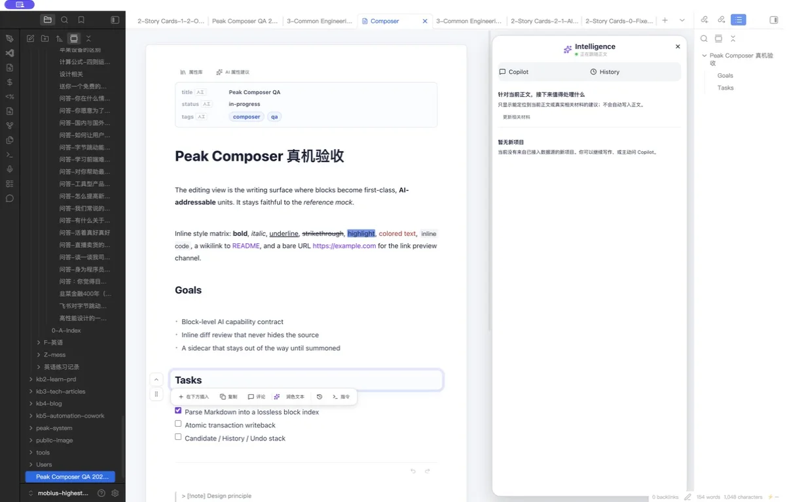

<div align="center">

<p><a href="README.zh-CN.md">简体中文</a></p>

# Peak Assistant

### Turn scattered notes into work you can verify.

Peak Assistant is an evidence-aware AI workspace for Obsidian. Search across your vault, inspect the notes behind each answer, and review changes without giving up your Markdown.

[](#project-status)
[](https://obsidian.md/)
[](LICENSE)

**[Project site](https://highestpeak.github.io/obsidian-peak-assistant/)** · **[Quick start](#quick-start)** · **[Documentation](docs/index.html)** · **[Roadmap](docs/roadmap.html)**

</div>



> [!IMPORTANT]
> Peak Assistant is a development preview. There is no official binary or Obsidian Community Plugins release yet. The current installation path is a source build for early users and contributors.

## Why Peak Assistant

Most AI tools stop at an answer. Peak Assistant keeps the work around that answer visible:

- **Understand the vault, not just one note.** Search with full-text, fuzzy, semantic, tree, and graph-oriented views, then continue into deeper analysis when needed.
- **Keep evidence attached.** AI Search separates the run, report, and source list so you can inspect which notes shaped the result.
- **Work where the source lives.** Peak Composer keeps Markdown as the primary surface, with Copilot, Intelligence, and History next to the document.
- **Choose the model and the boundary.** Connect local or cloud providers by role; Fast Index stays local, while semantic and full indexing are explicit opt-ins that require a configured provider.

The core loop is deliberately simple:

```text
Ask a real task → search the vault → inspect report + sources → review or continue the work
```

<table>
  <tr>
    <td width="50%"></td>
    <td width="50%"></td>
  </tr>
  <tr>
    <td><b>Result</b> — read the structured report in the same workspace.</td>
    <td><b>Evidence</b> — move to the exact source set without losing the run.</td>
  </tr>
</table>

## What is in the preview

### Search and investigate

- Vault Search with compact/detailed list, tree, and graph-oriented exploration
- AI Search runs with progress, report, source inspection, saved snapshots, and handoff into Chat
- Vault Intelligence signals for hubs, gaps, stale structure, links, and other knowledge-health patterns

### Write and review

- Peak Composer as a Markdown-first writing surface
- Document Copilot for selection, block, and document-level work
- Intelligence and History alongside the source document
- Candidate, receipt, and history paths designed to make note changes inspectable

### Chat with context

- Chat Studio with projects, conversations, attachments, and vault context
- A shared agent runtime for tools, permissions, traces, budgets, and cancellation
- Provider profiles for OpenAI, Anthropic, Google, Perplexity, OpenRouter, Ollama, and compatible custom endpoints

### Stay in control

- Local Fast Index and local SQLite read models
- Explicit local/cloud model bindings by role
- Usage and diagnostic views that keep run cost and runtime behavior visible
- External tools and external plugin commands remain permission-gated

Capability availability depends on your configuration. Provider-backed AI, embeddings, web search, media generation, and external tools need their own credentials or local endpoints.

## Quick start

### Requirements

- Obsidian Desktop
- Git
- Node.js 20 or newer

### Build inside your vault

Open a terminal and replace `<your-vault>` with the path to your Obsidian vault:

```bash
cd "<your-vault>/.obsidian/plugins"
git clone https://github.com/highestpeak/obsidian-peak-assistant.git
cd obsidian-peak-assistant
npm run install-safe
npm run build
```

Then restart Obsidian, open **Settings → Community plugins**, and enable **Peak Assistant**. The first-run setup will guide you through provider and index configuration.

To update a source installation:

```bash
git pull
npm run install-safe
npm run build
```

Restart Obsidian after the build finishes.

> [!NOTE]
> The project does not currently publish release packages. If you prefer a signed, versioned, no-build installation, watch the repository for the first public release.

## Data, privacy, and control

Peak Assistant uses a storage boundary instead of treating every generated value as a note.

| Data class | Where it lives | What to know |
| --- | --- | --- |
| User-owned source | Markdown and native files in your vault | These remain the primary source of truth and follow your own vault/sync setup. |
| Durable machine records | JSON / partitioned JSONL in the configured Peak data folder | Used for conversations, reports, receipts, reviews, and history. Legacy Markdown readers are migration adapters. |
| Rebuildable read models | Local SQLite, full-text indexes, embeddings, caches, and local diagnostics | These are local projections, not canonical user documents. |
| Provider requests | The AI, embedding, web-search, media, or external-tool service you configure | A selected action may send prompts, note excerpts, attachments, or queries required for that action. Review the provider's own data policy. |

Additional points worth knowing:

- **Fast Index is local-only.** Semantic and Full modes require configured embedding/LLM providers and may send document chunks for enrichment.
- **API keys are stored locally in Obsidian plugin data.** Peak does not claim to encrypt that local file; protect your vault and device accordingly.
- **Debug traces are off by default.** Redacted and Full local modes are opt-in. Full local traces can contain vault or account context and should not be shared verbatim.
- **Edits are designed for inspection, not blind writeback.** Composer exposes candidate/history/receipt paths, but this preview does not promise perfect rollback for every feature and file type.

For the full storage contract, see the [generated artifact registry](docs/conventions/generated-artifact-registry.md).

## Project status

Peak Assistant is under active development.

- **Desktop only.** This matches the current plugin manifest.
- **Markdown-first.** PDF, DOCX, PPTX, CSV, JSON, Canvas, Excalidraw, and other formats are mainly read/index or constrained embed paths—not full Peak editors. XLSX is not currently supported.
- **No official release package yet.** Installation currently requires a source build.
- **Interaction QA is still closing.** Some recently landed Composer, File Atlas, and Command Center surfaces are build-verified but still labeled for live Obsidian QA in the roadmap.
- **Plans are not shipped features.** Research candidates and future products remain clearly separated from current capabilities.

Use the [current roadmap](docs/roadmap.html) for status and [progress log](docs/progress.md) for implementation history.

## Development

```bash
npm run dev
npm run test
npm run build
```

Useful starting points:

- [Architecture and runtime boundaries](docs/01-architecture.html)
- [Code organization](docs/02-code-organization.html)
- [Use-case playbook](docs/05-use-case-playbook.html)
- [Configuration and user views](docs/04-configuration-and-user-views.html)
- [Contributor rules](AGENTS.md)

Before opening a large pull request, start with an [issue](https://github.com/highestpeak/obsidian-peak-assistant/issues) describing the user problem and intended scope. Keep unrelated changes separate and run the relevant tests plus the production build before requesting review.

## License

Peak Assistant is licensed under [GPL-3.0](LICENSE).

Obsidian is a trademark of Dynalist Inc. Peak Assistant is an independent open-source project and is not affiliated with or endorsed by Obsidian.
