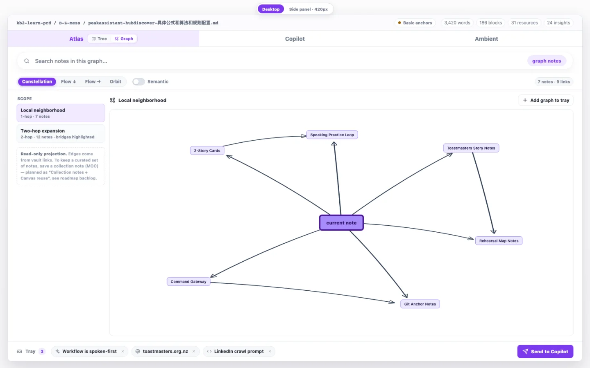
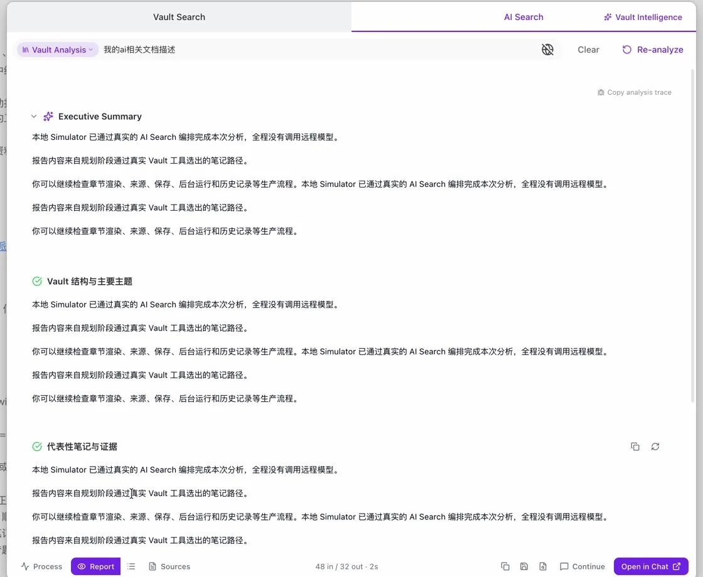
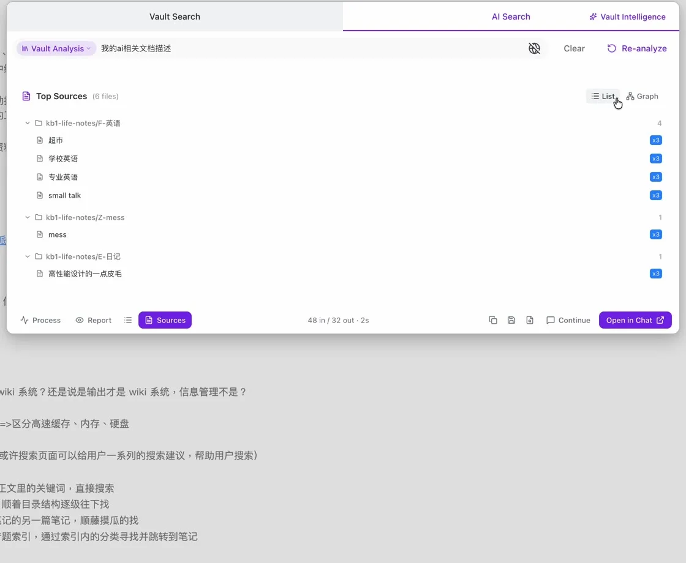
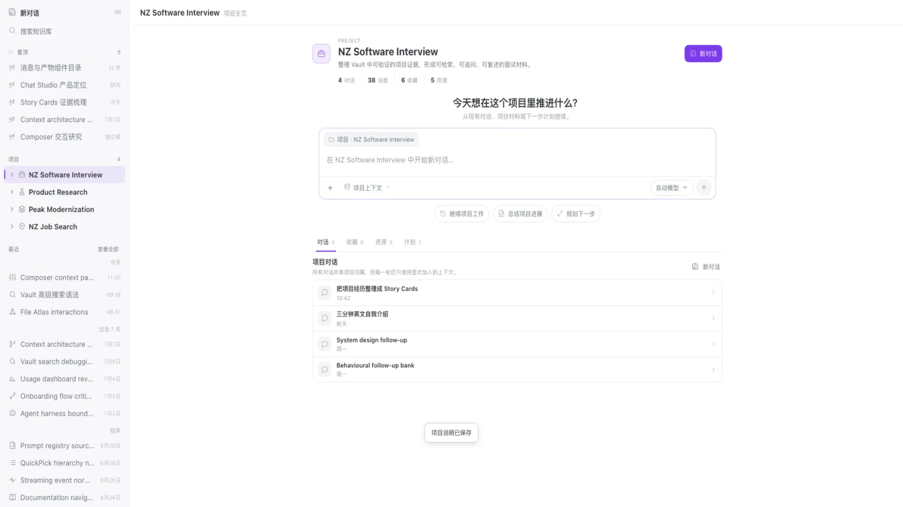
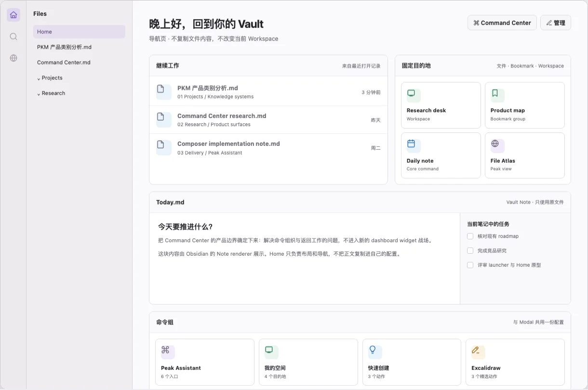

<div align="center">

<p><a href="README.zh-CN.md">简体中文</a></p>

# Peak Assistant

### Your whole vault. Connected.

Peak Assistant is an evidence-aware AI workspace for Obsidian. Search and map knowledge, find hubs and gaps, write with Copilot, run project conversations, generate media, and route AI work across the providers you choose—without giving up your Markdown.

[](#project-status)
[](https://obsidian.md/)
[](LICENSE)

**[Project site](https://highestpeak.github.io/obsidian-peak-assistant/)** · **[Quick start](#quick-start)** · **[Documentation](docs/index.html)** · **[Roadmap](docs/roadmap.html)**

</div>



<p align="center"><sub>File Atlas design reference. Graph mode exists in the current source; live Obsidian interaction QA is still closing.</sub></p>

> [!IMPORTANT]
> Peak Assistant is a development preview. There is no official binary or Obsidian Community Plugins release yet. The current installation path is a source build for early users and contributors.

## Why Peak Assistant

Most AI tools add a chat box. Peak Assistant connects the layers of work around your vault:

- **See the vault, not just a result list.** Move between Search graphs, File Atlas neighbourhoods, semantic edges, hubs, gaps, bridges, and versioned AI Graph artifacts.
- **Keep evidence attached.** AI Search separates the run, report, and source list so you can inspect which notes shaped the result.
- **Turn structure into action.** Vault Intelligence finds hubs, structural holes, missing links, stale clusters, fragile bridges, orphan notes, and maintenance opportunities.
- **Continue where the source lives.** Carry evidence into Peak Composer, Chat Studio, File Atlas, or a saved artifact.
- **Choose the model and the boundary.** Route text, agents, embeddings, reranking, image, video, music, and voice work across local or cloud providers.

The core loop is deliberately simple:

```text
Ask → search → inspect evidence → explore the graph → continue in Composer or Chat
```

<table>
  <tr>
    <td width="50%"></td>
    <td width="50%"></td>
  </tr>
  <tr>
    <td><b>Result</b> — read the structured report in the same workspace.</td>
    <td><b>Evidence</b> — move to the exact source set without losing the run.</td>
  </tr>
</table>

## The Peak capability map

| System | What it is for | Current maturity |
| --- | --- | --- |
| **Vault Search + AI Search** | Full-text, fuzzy, vector, metadata, PPR and co-citation retrieval; List, Tree and Graph; query parsing, reports, sources and Chat handoff | In current source |
| **File Atlas** | Work-file rail, document structure, headings, blocks, links, resources, local neighbourhoods and reveal-to-editor paths | Preview / live QA closing |
| **Knowledge Graph** | Search Result Graph, Atlas Graph, semantic edges, link direction, communities, evidence and immutable AI Graph history | Foundation in source; interaction QA closing |
| **Vault Intelligence** | Find hubs, gaps, structural holes, missing backlinks, stale hubs, fragile bridges, orphans, abandoned clusters and drift | In current source |
| **Peak Composer + Copilot** | Lossless Markdown editing, selection/block/document AI, native objects, candidates, receipts, History and Intelligence | Preview; data and QA closure ongoing |
| **Chat Studio** | Projects, conversations, assistants, resources, artifacts, attachments, branching and long-running agent work | In current source |
| **Command Center + Home** | A curated launcher for files, workspaces, bookmarks, dashboards and grouped Peak actions | Build verified; live QA pending |
| **AI Control Center + My Content** | Action-level model, tool, approval, budget, output and saved-content governance | In development |
| **Image, video, music + voice** | Image generation/editing and masks, async video/music/TTS jobs, and audio/video understanding | Built paths; paid-provider validation incomplete |
| **Multi-provider AI Platform** | Provider profiles, role routing, embeddings, reranking, Peak Harness, MCP, skills, permissions, budgets and traces | In current source |
| **Peak Sheet** | Spreadsheet work, Datasets, ComputePlan, AI formulas, charts, views and revision-safe updates | Research candidate; no Dataset runtime yet |
| **Operations** | Onboarding, Fast/Semantic/Full index modes, Usage Dashboard, cost controls, storage governance and debug receipts | In current source |

### Graph is a first-class workspace

Peak does not flatten every relationship into one undifferentiated edge. The graph direction separates physical links, semantic relationships, co-citation, evidence, communities, direction, hubs, and gaps:

- **Search Result Graph** turns a result set into a navigable evidence map.
- **File Atlas Graph** explores local and two-hop neighbourhoods with multiple layouts and semantic toggles.
- **Vault Intelligence Graph** reveals structural holes, fragile bridges, abandoned clusters, missing backlinks, and review opportunities.
- **AI Graph artifacts** preserve immutable, parent-linked graph versions with evidence-bearing edges and rebuildable projections.
- **Advanced Graph research** explores Nebula, Source–Sink, and a Vault Intelligence “Healing Ray” overlay. These are research directions, not shipped claims.

<table>
  <tr>
    <td width="50%"></td>
    <td width="50%"></td>
  </tr>
  <tr>
    <td><b>Chat Studio</b> — project conversations, resources, artifacts, agents, and media.</td>
    <td><b>Command Center + Home</b> — a curated spatial launcher alongside native Cmd/Ctrl+P.</td>
  </tr>
</table>

### What comes next

The roadmap keeps future systems visible without presenting them as released features:

- **Closing now:** AI Control Center + My Content, Provider Capability Gateway, Composer Intelligence, Command Center live acceptance, and Chat/media provider validation.
- **Designed next:** Peak File Workspace for Image/HTML/PDF, the shared keyboard navigation system, Ambient Current Work State, and storage-governance closure.
- **Research horizon:** Peak Sheet, advanced Graph views, Peak Share, external source sync, Context Inspector, conversation intelligence, and local workflow/template/focus systems.

Capability availability depends on your configuration. Provider-backed AI, embeddings, web search, media generation, and external tools need their own credentials or local endpoints.

## Quick start

### Requirements

- Obsidian Desktop
- Git
- Node.js 20 or newer

### Build inside your vault

Open a terminal and replace `<your-vault>` with the path to your Obsidian vault:

```bash
cd "<your-vault>/.obsidian/plugins"
git clone https://github.com/highestpeak/obsidian-peak-assistant.git
cd obsidian-peak-assistant
npm run install-safe
npm run build
```

Then restart Obsidian, open **Settings → Community plugins**, and enable **Peak Assistant**. The first-run setup will guide you through provider and index configuration.

To update a source installation:

```bash
git pull
npm run install-safe
npm run build
```

Restart Obsidian after the build finishes.

> [!NOTE]
> The project does not currently publish release packages. If you prefer a signed, versioned, no-build installation, watch the repository for the first public release.

## Data, privacy, and control

Peak Assistant uses a storage boundary instead of treating every generated value as a note.

| Data class | Where it lives | What to know |
| --- | --- | --- |
| User-owned source | Markdown and native files in your vault | These remain the primary source of truth and follow your own vault/sync setup. |
| Durable machine records | JSON / partitioned JSONL in the configured Peak data folder | Used for conversations, reports, receipts, reviews, and history. Legacy Markdown readers are migration adapters. |
| Rebuildable read models | Local SQLite, full-text indexes, embeddings, caches, and local diagnostics | These are local projections, not canonical user documents. |
| Provider requests | The AI, embedding, web-search, media, or external-tool service you configure | A selected action may send prompts, note excerpts, attachments, or queries required for that action. Review the provider's own data policy. |

Additional points worth knowing:

- **Fast Index is local-only.** Semantic and Full modes require configured embedding/LLM providers and may send document chunks for enrichment.
- **API keys are stored locally in Obsidian plugin data.** Peak does not claim to encrypt that local file; protect your vault and device accordingly.
- **Debug traces are off by default.** Redacted and Full local modes are opt-in. Full local traces can contain vault or account context and should not be shared verbatim.
- **Edits are designed for inspection, not blind writeback.** Composer exposes candidate/history/receipt paths, but this preview does not promise perfect rollback for every feature and file type.

For the full storage contract, see the [generated artifact registry](docs/conventions/generated-artifact-registry.md).

## Project status

Peak Assistant is under active development.

- **Desktop only.** This matches the current plugin manifest.
- **Markdown-first.** PDF, DOCX, PPTX, CSV, JSON, Canvas, Excalidraw, and other formats are mainly read/index or constrained embed paths—not full Peak editors. XLSX is not currently supported.
- **No official release package yet.** Installation currently requires a source build.
- **Interaction QA is still closing.** Some recently landed Composer, File Atlas, and Command Center surfaces are build-verified but still labeled for live Obsidian QA in the roadmap.
- **Plans are not shipped features.** Research candidates and future products remain clearly separated from current capabilities.

Use the [current roadmap](docs/roadmap.html) for status and [progress log](docs/progress.md) for implementation history.

## Development

```bash
npm run dev
npm run test
npm run build
```

Useful starting points:

- [Architecture and runtime boundaries](docs/01-architecture.html)
- [Code organization](docs/02-code-organization.html)
- [Use-case playbook](docs/05-use-case-playbook.html)
- [Configuration and user views](docs/04-configuration-and-user-views.html)
- [Contributor rules](AGENTS.md)

Before opening a large pull request, start with an [issue](https://github.com/highestpeak/obsidian-peak-assistant/issues) describing the user problem and intended scope. Keep unrelated changes separate and run the relevant tests plus the production build before requesting review.

## License

Peak Assistant is licensed under [GPL-3.0](LICENSE).

Obsidian is a trademark of Dynalist Inc. Peak Assistant is an independent open-source project and is not affiliated with or endorsed by Obsidian.
