# Copilot / Vault Intelligence Evolution Report

Date: 2026-05-15

Status: synthesis report and current source of truth for the Copilot / Command Center redesign. Design/planning only; no implementation has started.

Rendered visual board: `evolution-report-rendered.html`

## 1. Executive Summary

The product should not evolve into a prettier action grid, a bigger dashboard, or one picture per feature.

The product should evolve into:

> An Obsidian-native intent orchestration system.

Users should be able to click high-level entries such as `Copilot` or `Vault Intelligence`, then let Peak Assistant inspect context, choose relevant capabilities, run safe discovery, and present reviewable artifacts.

Manual feature search still matters, but it is the fallback path. The main path is intent -> plan -> safe discovery -> review/apply.

## 2. Final IA Decision

`Knowledge Analysis`, `Research / Synthesize`, and `Maintain Vault` should be merged.

They are all vault-level work:

- understanding a vault area,
- synthesizing knowledge from a vault area,
- maintaining the quality and structure of a vault area.

Splitting them into three top-level entries forces the user to classify their problem before the assistant has inspected the scope. That repeats the current action-grid problem at a higher level.

Final top-level model:

| Product model | UI tab label | User meaning | System behavior |
| --- | --- | --- | --- |
| `Copilot` | `Document` | Help this note now | Inspect current note/selection and plan document-level capabilities |
| `Vault Intelligence` | `Vault` | Understand, synthesize, or maintain my vault | Resolve scope, choose Analyze/Synthesize/Maintain mode, and plan vault-level capabilities |
| `Manage System` | `Setting` | Maintain the assistant itself | Index, models, skills, prompts, usage, diagnostics |

Inside `Vault Intelligence`:

| Mode | User meaning | Example capabilities |
| --- | --- | --- |
| Analyze | Understand a topic, folder, note neighborhood, or vault slice | Related notes, knowledge gaps, graph signals, vault summary, hub/structural holes |
| Synthesize | Produce a reusable knowledge artifact | Topic synthesis, cited draft, source-backed report, save-as-note |
| Maintain | Clean and organize safely | Vault health, duplicate review, batch tags, detect/file, stale notes, task review |

## 3. Evidence From Original Annotations

### Evidence A: Original Concept Sketch

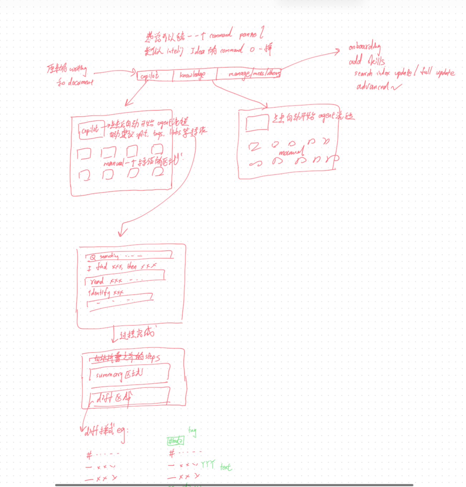

This showed top-level entries like `copilot`, `knowledge`, and `manage`, plus auto recommendations, run steps, summary, diff, and apply back to document.

Interpretation:

> The original ask is an operating system for assistant capabilities, not a static catalog.

### Evidence B: Vault / Knowledge Action Grid

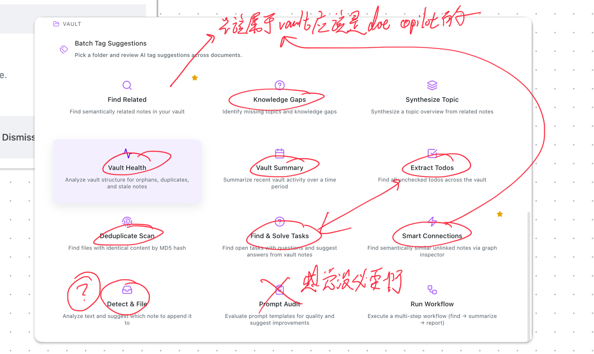

This showed `Knowledge Gaps`, `Vault Health`, `Extract Todos`, `Deduplicate Scan`, `Find & Solve Tasks`, `Smart Connections`, `Detect & File`, and `Prompt Audit` being questioned or circled together.

Interpretation:

> These are mostly vault-level modes. The UI should merge them into one `Vault Intelligence` hub instead of exposing three competing vault entries.

### Evidence C: Agent Links / Diff / Auto Behavior

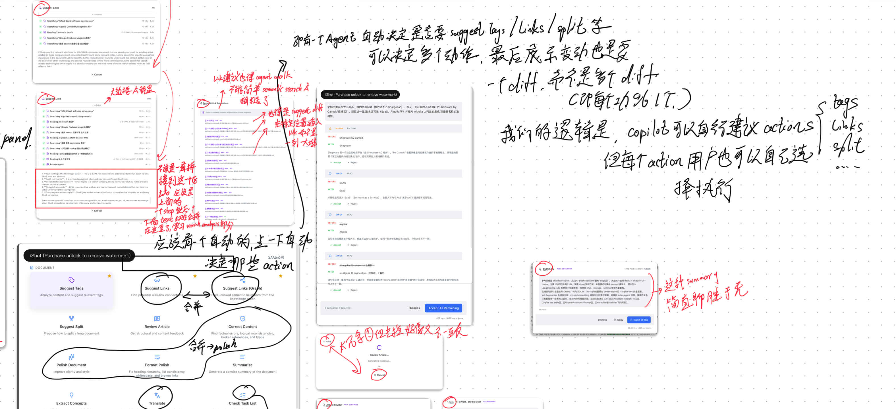

This showed that link recommendation can use agent, semantic, graph, or other strategies internally, but the user-facing output should be proposals, provenance, and diffs.

Interpretation:

> Capabilities can be internally complex, but the result should be reviewable actions.

### Evidence D: Taxonomy Merge Notes

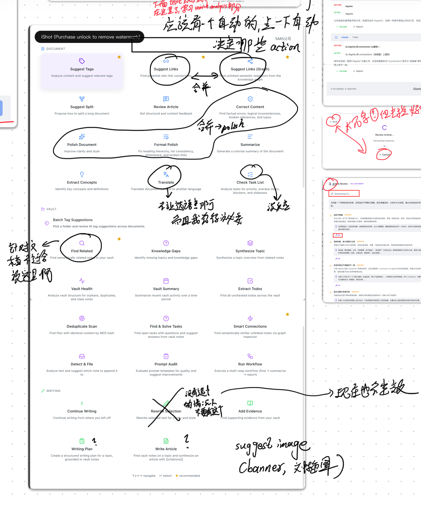

This showed repeated requests to merge duplicate feature cards: links with graph links, review with polish/correct/format, and generic actions like translate into contextual tools.

Interpretation:

> The product should reduce visible choices by merging capabilities under intent hubs.

## 4. Visual Evolution Assets

Current conforming visual baselines:

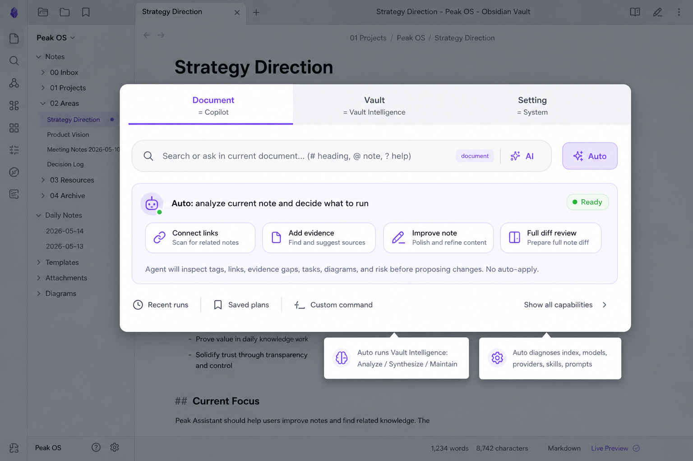

Why this conforms:

- It matches the provided Search-view tab style: large rounded panel, active purple underline, soft inactive tab background, and large rounded command input.
- It exposes `Document`, `Vault`, and `Setting` as UI tabs while keeping the product model underneath: Copilot, Vault Intelligence, and Manage System.
- It makes `Auto` the primary action in the active tab. Clicking Auto starts the agent planner instead of opening a static feature grid.

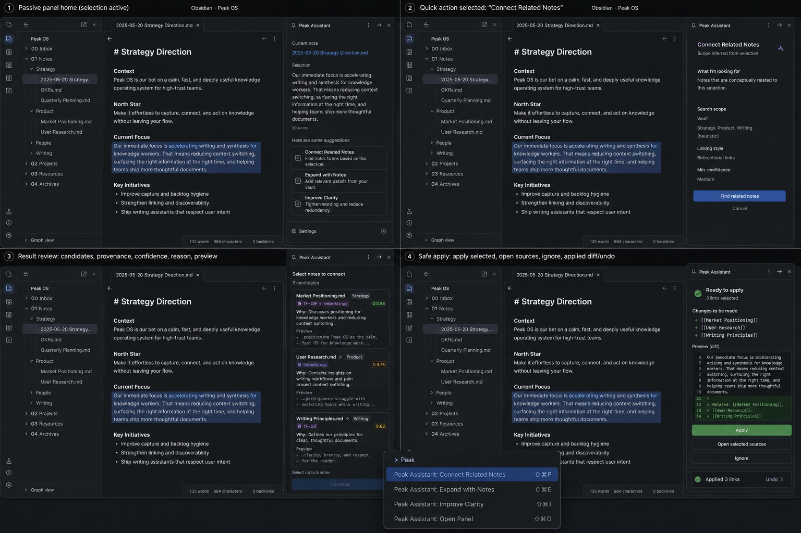

Why this conforms:

- It keeps the active Obsidian note as the main workspace.
- It shows the docked side panel, quick action configuration, result review, candidate provenance, safe apply, and undo pattern.
- It proves the assistant can operate inside Obsidian without turning into a separate full-page app.

Archived non-conforming exploration:

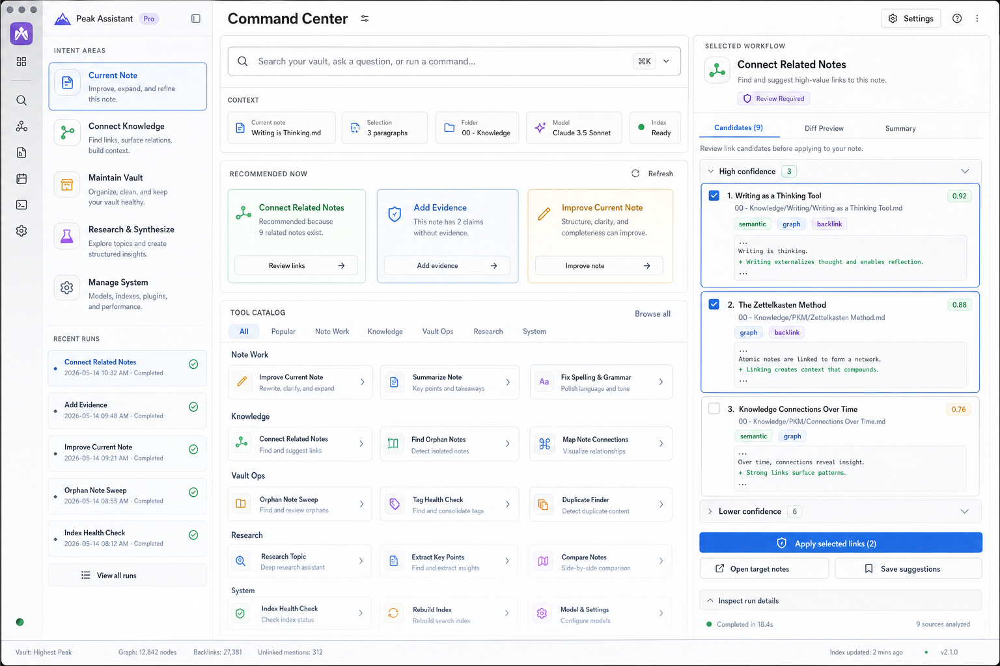

Why this matters:

- The full-page workbench image is retained only as a negative example: it looks complete, but it leaves the user's Obsidian writing flow.
- Future visual iterations should start from the two conforming bitmap baselines above, not from the old HTML command-panel prototypes.

## 5. Mind Map

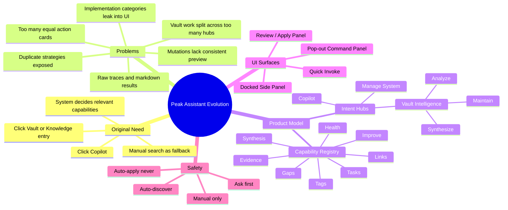

## 6. Evolution Diagram

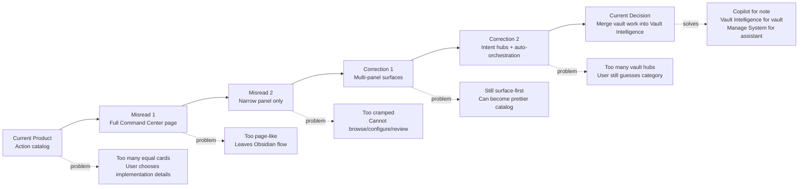

## 7. UX Flow

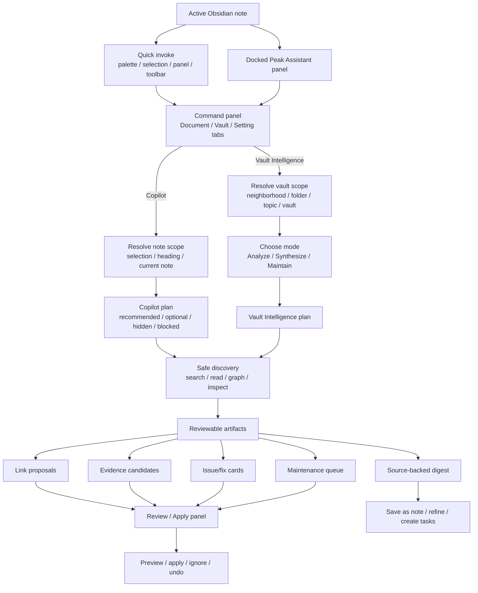

## 8. Surface Relationship

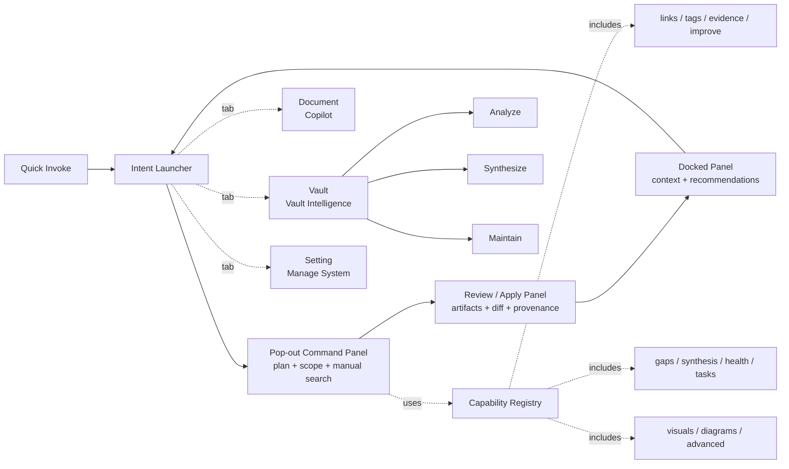

## 9. Why This Design

### Users Think In Intent, Not Implementation

The screenshots repeatedly show implementation-level actions:

- semantic links vs graph links,
- find related vs smart connections,
- review article vs correct content vs polish document,
- extract todos vs check task list vs find and solve tasks.

Users do not want to choose among these first. They want to improve the note, understand a topic, synthesize knowledge, or maintain the vault.

### Vault Work Should Be One Hub

`Knowledge Analysis`, `Research / Synthesize`, and `Maintain Vault` are not separate mental models for most users. They are modes of the same question:

> What should the assistant do with this vault context?

The system can ask or infer whether the user wants Analyze, Synthesize, or Maintain after scope is known.

### Automation Should Prepare, Not Mutate

The annotations imply "automatically recommend, then let me approve." That means the system should proactively prepare suggestions, but not silently edit the vault.

Therefore:

- safe discovery can run automatically,
- expensive/full-vault work asks first,
- mutations require preview/apply,
- every generated change needs provenance and location.

### Panels Are Carriers, Not The Product Model

The docked panel keeps the user near the note. The pop-out panel provides room for plan/configuration/manual search. The review panel protects trust.

But the panels alone do not solve the problem. A better panel full of equal cards is still the old product.

### Pop-Out Panel Should Use Top Tabs

The pop-out command panel should follow the existing Search-view pattern:

- a top tab strip,
- a command input,
- results scoped by the active tab,
- keyboard-friendly switching and search.
- active tab shown with a purple underline,
- large rounded search/command input,
- soft gray inactive tab background.

The tabs should be:

- `Document`: current note/selection work, powered by `Copilot`,
- `Vault`: topic/folder/vault work, powered by `Vault Intelligence`,
- `Setting`: model/index/provider/skill/prompt diagnostics, powered by `Manage System`.

Each tab should include an `Auto` primary action:

- `Document / Auto`: run Copilot planner for the current note/selection.
- `Vault / Auto`: run Vault Intelligence planner across the scoped folder/topic/vault context.
- `Setting / Auto`: diagnose index, model, provider, skills, prompts, and configuration health.

Clicking `Auto` should not open another static card grid. It starts the agent planner, which decides which capabilities matter, runs safe discovery, and returns reviewable artifacts.

This is better than a left-side category rail because it keeps the user in a familiar search mental model and avoids reintroducing a long action taxonomy as the primary navigation.

### Prototype Workflow Should Be Imagegen-First

Future visual prototype iterations should use Codex built-in `imagegen` to generate bitmap UI mockups first. Handwritten HTML is too slow for this level of visual exploration and should be reserved for documentation wrappers, embedded reports, or interaction mechanics that require a local clickable prototype.

### Full-Document Diff For Document Changes

The current storyboard's side-panel diff is too small for substantial document edits.

Small review cards are acceptable for:

- tag proposals,
- link proposals,
- evidence candidates,
- simple task cards.

But document-level mutations need a VSCode-like full document review:

- left pane: current rendered Markdown,
- right pane: proposed rendered Markdown,
- both panes preserve document context,
- changed blocks are highlighted inside rendered content,
- deletion/addition must use explicit red and green rails plus `-` / `+` labels or equivalent markers,
- raw Markdown/source diff is secondary behind an inspect control,
- support per-block accept/reject,
- support apply selected, reject all, and undo after apply.

This applies to polish, format, correct, rewrite, review fixes, summary insertion, source-backed synthesis insertion, and any action that changes multiple paragraphs or headings.

## 10. Capability Registry

| Current exposed feature | Evolution target | New home |
| --- | --- | --- |
| Suggest Tags | Tag Suggestions capability | `Copilot` or `Vault Intelligence / Maintain` |
| Suggest Links / Suggest Links (Graph) / Find Related / Smart Connections | Connect Related Notes | `Copilot` or `Vault Intelligence / Analyze` |
| Add Evidence | Evidence Candidates | `Copilot` |
| Review Article / Correct Content / Polish Document / Format Polish | Improve Current Note with full-document rendered diff for multi-block changes | `Copilot` |
| Extract Todos / Check Task List / Find & Solve Tasks | Task Review | `Copilot` or `Vault Intelligence / Maintain` |
| Knowledge Gaps / Vault Summary / Hub signals | Analyze capabilities | `Vault Intelligence / Analyze` |
| Synthesize Topic / Research Draft / Source-backed article | Synthesis capabilities | `Vault Intelligence / Synthesize` |
| Vault Health / Deduplicate Scan / Detect & File / Batch Tags | Maintenance capabilities | `Vault Intelligence / Maintain` |
| Prompt Audit / Run Workflow | Manage System / Advanced | `Manage System` |
| Suggest Visual / Diagram / Example / Table | Document enrichment capability | `Copilot` |
| Translate | Contextual/manual capability | Search or contextual suggestion only |

## 11. Action Planning Contract

Every planned capability should include:

- capability id,
- hub and mode that selected it,
- reason,
- scope,
- expected output,
- estimated runtime/cost when useful,
- mutation risk,
- run mode,
- review surface.

Review surface values should include:

- proposal list for small independent suggestions,
- rendered insertion preview for evidence or short snippets,
- full-document rendered diff for multi-paragraph or structural document changes,
- maintenance queue for vault-level cleanup,
- source-backed Markdown preview for synthesis artifacts.

Run modes:

| Mode | Meaning |
| --- | --- |
| Auto-discover | Safe search/read/scan can run automatically |
| Ask first | User confirms before running |
| Manual only | Available through search/advanced catalog |
| Auto-apply never | Mutations always require preview/apply |

## 12. What To Stop Doing

- Do not make a full-page dashboard the primary product.
- Do not make the side panel the only surface.
- Do not lead with a grid of 20 equal action cards.
- Do not split vault-level work into `Knowledge Analysis`, `Research / Synthesize`, and `Maintain Vault` as competing top-level entries.
- Do not expose semantic vs graph vs agent as separate user choices.
- Do not show raw traces and markdown as the final result.
- Do not use a tiny side-panel diff for whole-document or multi-paragraph changes.
- Do not make one picture per feature the primary planning artifact; that recreates the feature catalog problem.
- Do not make `Prompt Audit`, `Run Workflow`, or `Translate` daily Copilot defaults.

## 13. Implementation Evolution

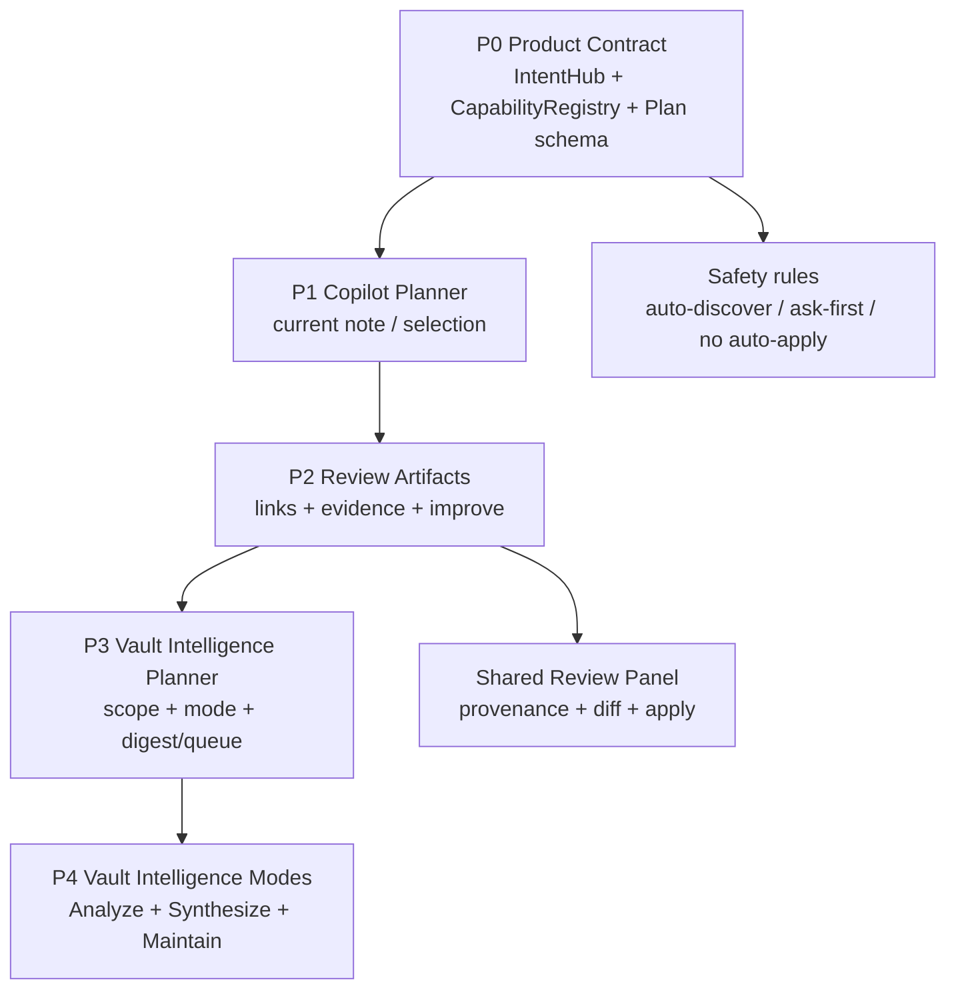

## 14. Artifact Status

| Artifact | Status | Why |
| --- | --- | --- |
| `evolution-report.md` | Canonical | Synthesizes analysis history, evidence, diagrams, and final direction |
| `evolution-report-rendered.html` | Canonical visual report | Browser-readable visual board with embedded evidence images, bitmap mockups, iframes, and flow diagrams |
| `intent-hub-auto-orchestration-review.md` | Supporting | Explains the intent orchestration model; should follow the Vault Intelligence merge |
| `intent-hub-orchestration-prototype.html` | Supporting prototype | Shows the intent hub planning flow |
| `full-document-rendered-diff-prototype.html` | Supporting prototype | Shows the VSCode-like rendered Markdown diff required for substantial document mutations |
| `popout-command-panel-prototype.html` | Secondary | Useful panel mechanic, but catalog-first by itself is insufficient |
| `capability-visual-gallery.html` | Exploratory | Useful coverage inventory, but too close to feature catalog |
| `obsidian-panel-flow-prototype.html` | Supporting | Useful docked panel / review flow |
| `command-center-prototype.html` | Archived | Too full-page and workbench-like |
