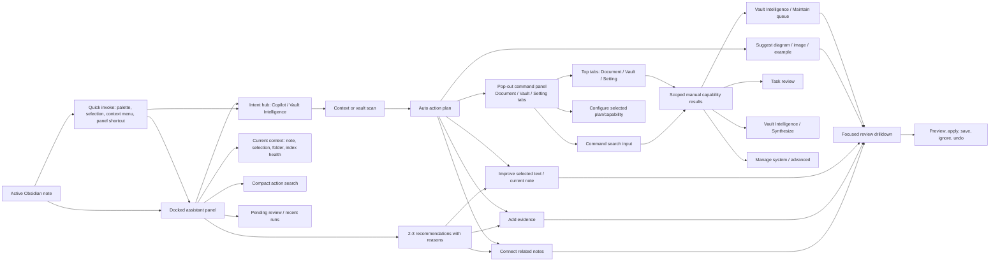
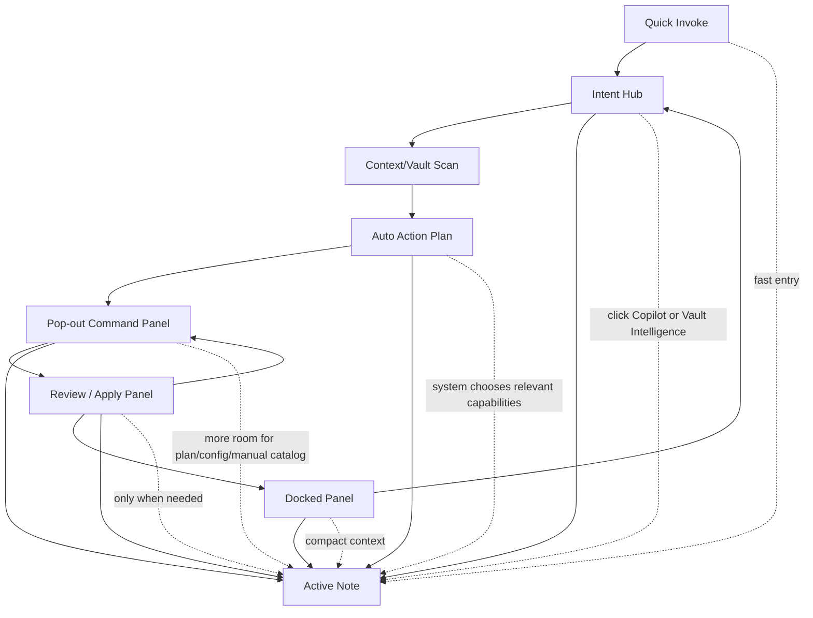
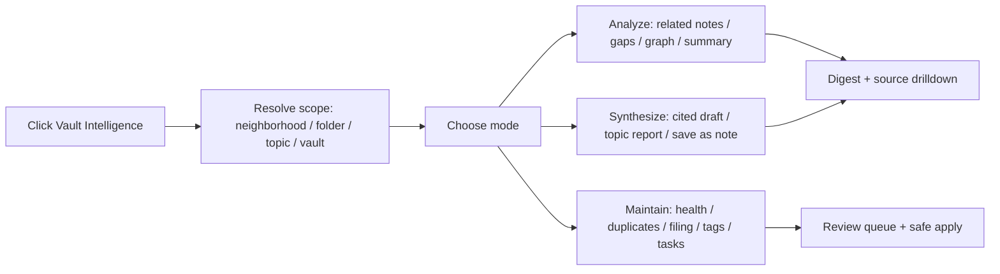
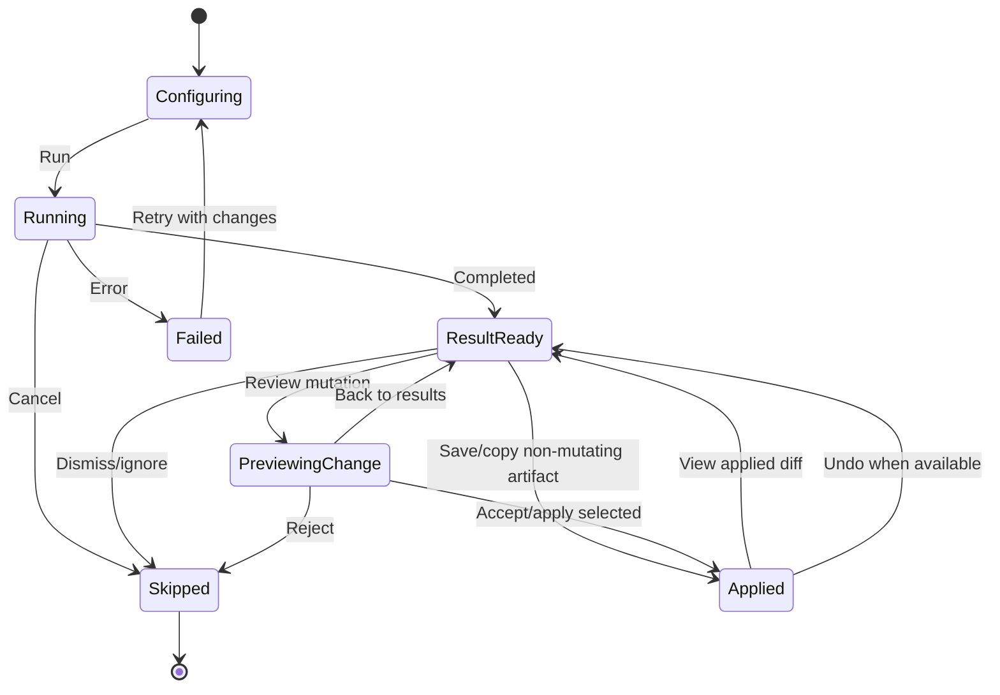
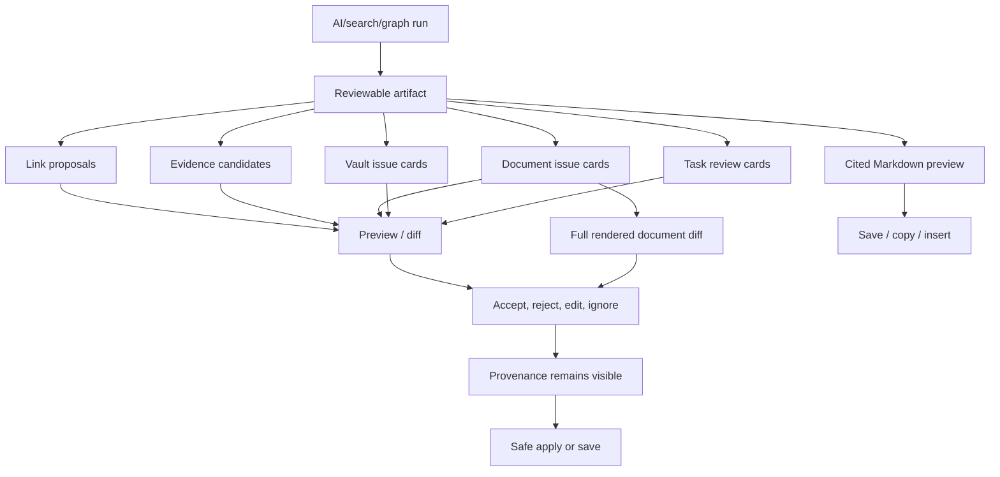

# Requirements Prototype Flow

These diagrams capture the intended product behavior for the Copilot / Command Center redesign.

## Panel-First Information Architecture

## Surface Model

## Vault Intelligence Mode Split

## Shared Action Lifecycle

## Result Artifact Model

