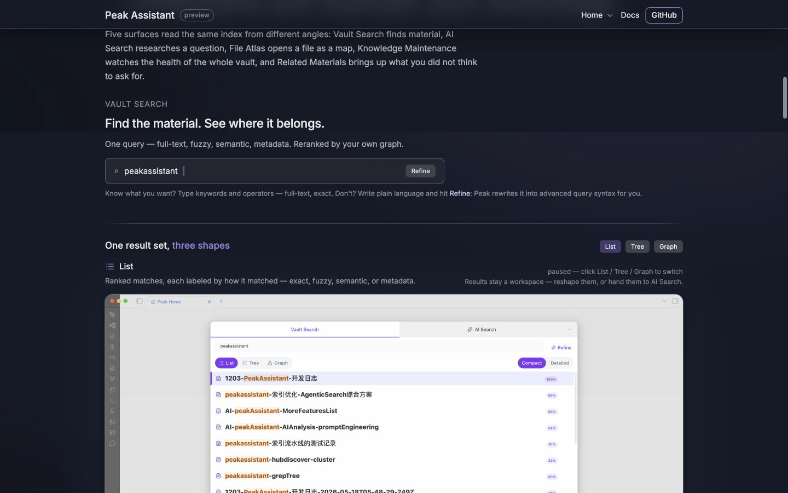
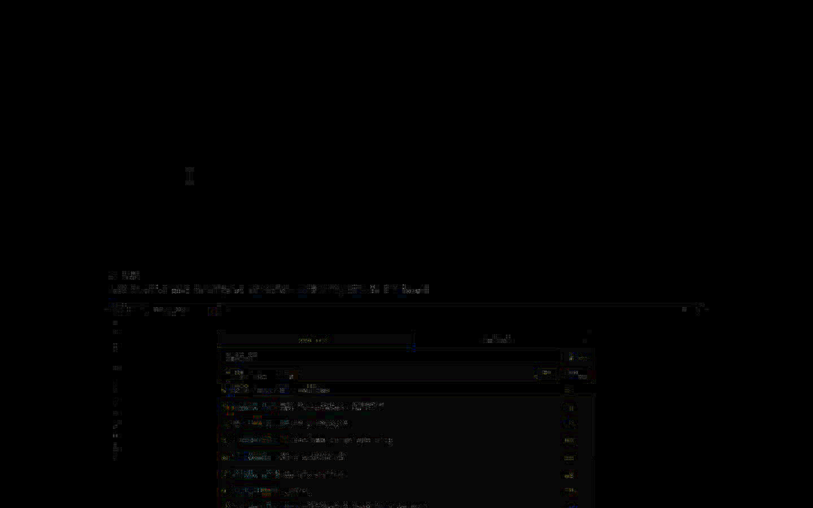
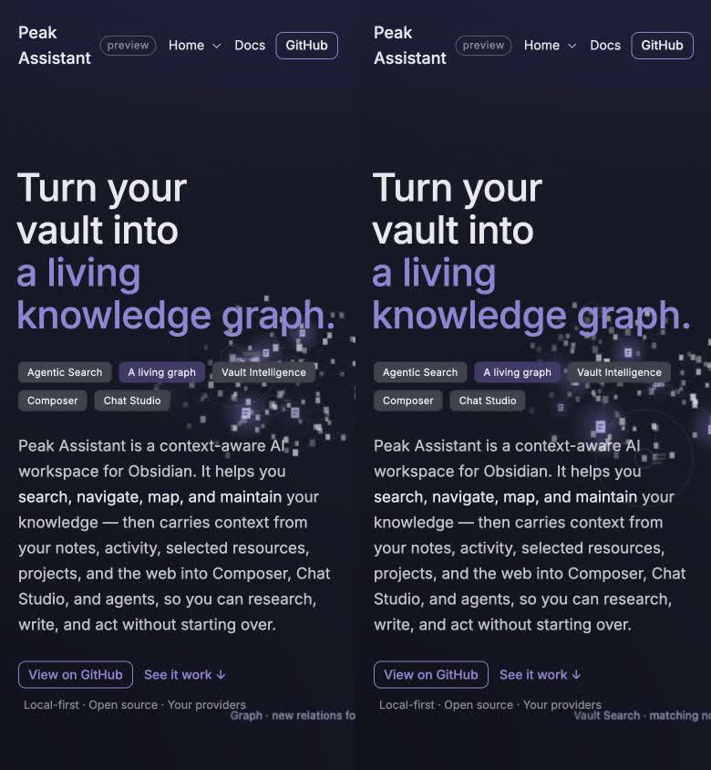

# Peak Assistant Landing Page Fidelity Evidence

## Result

The GitHub Pages implementation preserves the supplied design's layout, copy, screenshots, responsive behavior, interactions, canvas animation system, and section sequence. The original single-file bundle was unpacked into ordinary site files under `website/`: HTML, CSS, JavaScript, fonts, screenshots, and vendor runtime assets are now addressable resources rather than base64 payloads inside one downloaded file.

The reference source was:

`/Users/zhangjike/Downloads/Peak Assistant Landing.html`

SHA-256: `866e911f201068522566e2cab0556cec722c5000cb76c25cd07730ff62b31374`

Browser automation cannot open the original `file://` URL. The reference captures below therefore come from the manifest and template unpacked byte-for-byte from that bundle and served locally, with no design changes. They are not presented as direct `file://` captures.

## Desktop comparison

Both pages were captured at `1440 × 900`, DPR 2. Their total page height was `10,127px`. The first four measured regions matched exactly:

| Region | Reference top / height | Implementation top / height |
| --- | ---: | ---: |
| Nav | `11 / 70` | `11 / 70` |
| Hero | `70 / 533` | `70 / 533` |
| Spine | `603 / 64` | `603 / 64` |
| Overview | `685 / 819` | `685 / 819` |

The live constellation intentionally uses time and randomized nodes, so its particles are expected to occupy different coordinates between separate captures. Typography, spacing, alignment, section geometry, and component positions remain aligned.

## Stable screenshot comparison

The Vault Search List state contains no randomized canvas. Its reference and implementation captures reached:

- SSIM: `0.999535`
- PSNR: `53.135722 dB`

The amplified difference image is almost black; remaining pixels are capture and JPEG antialiasing noise around text and the embedded screenshot.

The full-page captures, including live animation regions, reached SSIM `0.997648` and PSNR `43.891645 dB`.

## Mobile comparison

The mobile reference and implementation were captured through the same browser tab at `390 × 844`. Both produced the same Hero rectangle, page height (`13,309px`), and clipped-canvas width (`626px`). The reference design sets `overflow-x: clip`, so the oversized atmospheric canvas does not create a visible horizontal scrollbar.

## Interaction checks

- Hero capability chip changed the headline to `an agentic search engine.`
- Home section menu opened and exposed its full navigation list.
- 30 anchor links resolved to 19 unique in-page targets; 0 targets were missing.
- All three repository CTAs point to the real GitHub repository.
- Both Docs links point to the repository documentation tree.
- Vault Search List switched to the accent state and loaded the local `vault-search-list.png` asset.
- Local screenshot, font, stylesheet, and runtime requests loaded successfully.
- The synchronized recording completed with no page or console errors.

## Synchronized motion comparison

The 14.32-second recording renders the unpacked reference and the implementation in two `1440 × 900` frames scaled side by side. Both frames use the same seeded particle layout and receive the same clicks and scroll positions at the same time.

[Play the synchronized reference vs implementation recording](recordings/reference-vs-implementation.mp4)

## Evidence inventory

- `screenshots/desktop-reference.jpg`
- `screenshots/desktop-implementation.jpg`
- `screenshots/desktop-overlay.png`
- `screenshots/desktop-side-by-side.jpg`
- `screenshots/mobile-reference.jpg`
- `screenshots/mobile-implementation.jpg`
- `screenshots/mobile-overlay.png`
- `screenshots/mobile-side-by-side.jpg`
- `screenshots/search-reference.jpg`
- `screenshots/search-implementation.jpg`
- `screenshots/search-overlay.png`
- `screenshots/search-difference.png`
- `screenshots/full-reference.jpg`
- `screenshots/full-implementation.jpg`
- `recordings/reference-vs-implementation.mp4`
- `record-compare.mjs`
