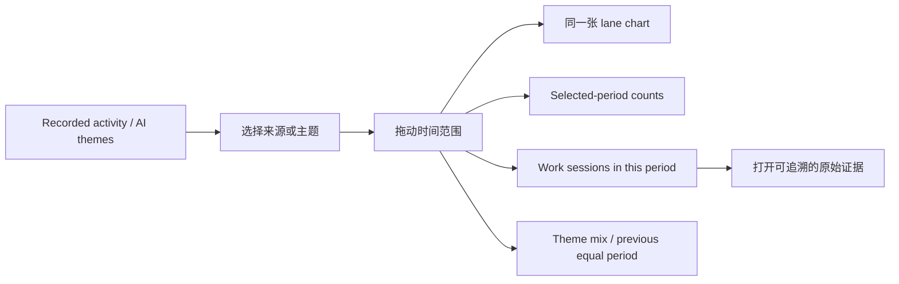
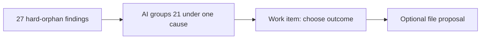

# Vault Intelligence：Activity 与 Run 结果模型

> 本文描述当前 V2 mock 的产品模型，不代表生产能力已经实现。示例数字用于验证信息架构与交互。

## 1. 两个页面分别回答什么

- **Activity**：这个 Vault 在什么时间发生了哪些可验证的活动？在用户明确要求后，AI 能否把这些记录解释成工作会话与主题？
- **Completed run**：这次扫描实际更新了什么、发现了什么、哪些结果需要用户决定、哪些内容可以继续执行？

Activity 不是监控用户，也不猜测“生产力”。Run 也不是一张检查器日志表。两者都必须从可追溯的本地记录开始，再逐层增加解释。

## 2. Activity 的三层数据

| 层级 | 数据是什么 | 何时存在 | 示例 |
| --- | --- | --- | --- |
| 原始活动记录 | 带时间戳、对象引用与来源的显式记录 | 事件发生后立即存在 | `Aug 11 10:32` 修改 `Vault Intelligence workspace mock` |
| 工作会话 | 由确定性规则把临近、共享对象的记录聚成一组 | 本地聚类后存在 | 18 次文件编辑、5 个 Chat context 和 3 次 Composer activity 组成一次 “Vault Intelligence redesign” 会话 |
| AI 工作主题 | AI 根据会话证据生成的标签、归属与解释 | 用户触发分析或 Scan/Index 补全后存在 | `Vault Intelligence`、`Search & Index`、`User research` |

### 2.1 什么才是原始记录

默认 Activity 只显示不需要 AI 推断的五种来源：

1. **File edits**：文件创建、编辑、移动或删除；
2. **Chat contexts**：用户显式保存、延续或产生待办的 Chat context；
3. **Composer activity**：被保存的 Change Set、review、apply、reject 等耐久状态；
4. **Project changes**：项目状态、计划、决定或显式任务变化；
5. **Peak-native revisions**：AI Graph、Peak Sheet 等 Peak 文件的新版本或来源变化。

没有时间戳、对象引用或来源凭证的数据不能进入这层。

### 2.2 工作会话怎么生成

工作会话不是主题。它只是对相邻记录的确定性分组，优先使用以下锚点：

- 同一个 Project、Composer session、Change Set 或 Chat context；
- 同一批文件、同一个导入 receipt、同一个 Peak-native artifact；
- 时间上相邻并且存在共享对象；
- 不满足这些条件的记录保持独立。

每个会话都保留 `recordIds`、开始/结束时间、涉及对象以及分组原因，所以用户能从会话回到原始记录。

### 2.3 AI 主题怎么生成

主题是可重新计算的投影，不是真实历史本身：

1. 读取选定时间范围内的工作会话；
2. 使用文件所在 Community / Topic、Project、Chat context、Composer session 与 Peak-native artifact 作为证据；
3. 给每个会话生成一个主主题，可附次级主题；
4. 为归属保存置信度与 citations；
5. 低置信度记录进入 **Unclassified**，不能强行分配；
6. 保存 `generatedAt`、源数据 revision 和分析范围；新记录出现后状态变为 stale；
7. 历史记录没有分析时仍可看原始 Activity，用户可单独触发 backfill。

因此 UI 默认是 **Recorded activity**，而不是 AI themes。主题视图必须明确显示 `generated / stale / unclassified` 状态。

## 3. 主题很多时怎么展示

固定显示四个主题不成立。新的交互规则是：

- 图中默认显示当前范围内记录数最高的四个主题；
- 其余主题聚合为 `Other N themes`，但不是丢弃；
- 搜索式 picker 可以访问完整主题列表与数量；
- 选择任一主题后，图只保留该 lane，并同步筛选期间统计与工作会话；
- Unclassified 始终单独计数，不被算进 Other；
- 生产实现应按可见时间范围切换 day / week / month 粒度。

## 4. Activity 应当是一个联动工作区

原设计把 topic lanes、拖动轴、Events、Current focus、Direction change 拆成几块，导致用户无法判断它们是否描述同一批数据。新的 mock 把它们放入一个卡片、共享一个 selection state：

拖动范围以后，图、总数、会话列表、主题占比和比较结果同时变化。点击一个会话则把范围收窄到它附近的证据窗口。

### 4.1 为什么删除 `Current focus`

旧 `Current focus · last 7 days` 实际上是“最近七天经 AI 归因的主题占比”，但标题没有说明时间、数据来源和 AI 状态。它被替换为：

- **Theme mix in selected period**：明确跟随用户选中的时间范围；
- 仅在 AI themes 模式出现；
- 显示主题占比、Unclassified 数量和分析状态。

### 4.2 为什么删除 `Direction change`

旧设计用“前四周”和“最近七天”比较，时间窗口任意，而且与用户拖动的范围无关。它被替换为：

- **Previous equal period**：把选定范围与紧邻的、相同长度的前一段时间比较；
- 展示每个主要主题的记录数差值；
- 数据不足时直接显示没有完整 baseline；
- 不输出“用户注意力转移”一类无证据的心理判断。

## 5. 一个 Run 可以产生多少类底层数据

产品层面建议定义 **10 个底层结果对象类型**。这里的“类型”是持久化、关联和审计使用的数据 schema，**不是十个页面栏目，也不是十条互斥的用户结果**。一项用户决策通常由多个对象共同构成。

| # | 结果对象类型 | 产生的数据 | 当前 mock 示例 | 默认去向 |
| --- | --- | --- | --- | --- |
| 1 | Search projection | 可读内容、chunk、readiness、检索记录 | 137 个 changed files 变为 Search-ready | 完成页的一行本地更新回执；可在 Vault contents 检查 |
| 2 | Vault structure projection | Community、Topic、Hub、typed relation、bridge、orphan membership | Product ↔ Research 仍连接但 bridge stale | Vault contents / graph；结构异常形成 finding |
| 3 | File intelligence | Summary、AI Tags、vectors、source hash 等逐文件机器知识 | 42 个 Summary、39 个 AI Tag 更新 | 完成页的一行本地更新回执；逐文件状态可检查 |
| 4 | Detector finding | detector ID、阈值、affected objects、证据、与上次相比的状态 | Connections 检出 27 个 hard orphan | 作为事实；重要结果进入决策组 |
| 5 | AI explanation | 对 findings 的分组、原因、趋势、置信度与 citations | 21 个导入笔记大概率来自同一 intake 问题 | 附着在对应决策上，不另造一个 AI Review 任务 |
| 6 | Work item | 持久状态、证据、next action、exit condition、owner surface | 决定 21-note Research import 如何处理 | Work queue；可完成、dismiss 或 handoff |
| 7 | User-file proposal | 文件 diff、source revision guard、冲突、apply 状态 | 12 个 frontmatter diffs，1 个 conflict | 专用 proposal review；显式 Apply 后才改文件 |
| 8 | Peak knowledge update | Peak 自己维护的可读标签、描述或投影文本 | 2 个 Community description、5 个 topic label、6 个 Hub description | Publish / Regenerate / Keep current |
| 9 | Partial result / exception | 局部失败、保留的成功结果、错误 receipt、retry/exclude 选项 | 3 个文件第二次 parse 仍失败 | 完成页和 Work queue；不把整次 run 标成失败 |
| 10 | Run receipt | run ID、scope、stage receipts、check version、citations、token、cost、duration | `run-vault-live-7f2c`、19 checks、23 citations、$0.42 | 内部审计；只在 compare / inspect evidence / debug 的上下文中出现 |

### 5.1 为什么页面上是 5 个决策，不是 10 个栏目

`10` 是底层结果对象类型；`5` 是本次需要用户处理的 **owner decisions**。例如第一条“21 个 imported notes 可以连接到 Research”包含：

如果 UI 把这四个对象拆成四行，用户会重复打开同一问题。完成页应以决策为行，把事实、解释、后续任务和可能的 proposal 放在一起。

对象之间的形成关系只保留在数据模型、审计记录和上下文化证据中。默认完成页不显示 `finding → explanation → work item` 这类内部对象链；每一行只显示决策、短解释、最关键的证据数字和下一步动作。

### 5.2 不是 Work queue 的结果

以下结果默认不应创建任务：

- 成功的 Search / structure / file intelligence projection；
- 没有异常的 detector result；
- Run receipt；
- 已经被另一个 owner decision 吸收的 AI explanation。

只有存在用户决定、需要重试、需要 handoff、需要发布 Peak-owned 文本或需要审查文件 diff 时，才产生 Work item。

## 6. Completed run 的最终信息层级

完成页只有一个主要任务：让用户处理仍需决定的结果。自动更新是完成事实，Run receipt 是内部证据，两者都不应与待办争夺页面层级。

页面顺序为：

1. **完成状态与本次 scope**：只在这里显示一次扫描对象总数、耗时、检查数和 partial-result 状态；
2. **一行本地更新回执**：直接说明 Search、Vault structure、Summary 和 AI Tags 更新了什么，并明确没有修改用户文件；
3. **5 decisions need you**：主区域立即显示真正要处理的五个聚合决策；
4. **上下文化证据**：Run receipt 不在默认页面出现，仅由 compare、inspect evidence 或 debug 行为打开。

本地更新回执必须用动作语言，而不是抽象名词：

- **Search**：重新提取 137 个文件的可读内容，重建 changed chunks，并刷新 readiness；
- **Vault structure**：重新计算 Community membership、Hubs、Bridges 和 typed relations；
- **File intelligence**：针对当前 source revision 保存 42 个本地 Summary 和 39 个 machine AI Tags；
- 明确说明这些是可重建的本地投影，没有修改用户文件、frontmatter 或用户标签。

十类底层对象的完整定义和逐类示例保留在本文档以及开发者 schema 中，不在完成页重复渲染成独立区块。

## 7. Run 与 Work queue 在导航中的位置

顶层导航只保留 `Overview / Vault map / Work queue`，不再为 Run 建立第四个长期驻留的工作区。这不是因为 Run 数据不重要，而是因为用户对 Run 的三种需求已经有更直接的入口：

1. **开始新扫描**：点击 `Scan Vault` 进入 scope 与检查选择；
2. **回到正在运行的扫描**：主按钮变为 `View progress`，并保留活动运行状态；
3. **查看最近结果**：点击标题后的 `Last scan` 直接打开最近完成的 owner summary。

Run 和 Work queue 不应在数据模型中合并：

- **Run receipt** 是不可变的执行证据，记录当时的 scope、stage、detector version、partial result、cost 与 citations；
- **Work item** 是当前仍未结束的所有者决定，拥有 next action、exit condition 和 owner surface；
- 一次 Run 可以产生多个 Work item，但 Run 完成不代表这些 Work item 已完成；
- 一个 Work item 也可以在后续 Run 中被重新验证，因此它不应被绑死在某个历史列表行上。

旧 Run 收据仍保留在本地审计层，供引用、差异比较、调试和合规使用。当用户在某个 finding 里选择 `Compare with previous scan` 时，产品可以上下文化地打开对应收据；默认完成页不显示 `Run record`，在没有实际使用证据前也不需要恢复一个第四个顶层历史页。

## 8. 当前 mock 与未来实现边界

当前 mock 已表达：原始 Activity / AI theme 两种模式、完整主题 picker、范围联动、同长周期比较、工作会话，以及 Completed run 的单一 owner-decision 主流程。10 类 Run 结果对象及其逐类示例只在本文档中定义；自动结果进入一行本地更新回执，Search、Vault structure、file intelligence 和 partial result 的具体变化由 `View changes` 按需打开，不常驻完成页。需处理的结果以 owner-readable 决策进入 UI，内部形成链不占据完成页。

仍需生产实现的能力包括：真实 activity event schema、session 聚类、主题分析与 backfill、主题 citations、跨 run 的 result identity、Work item materialization、proposal revision guard、Peak knowledge publish receipt、projection/exception/receipt 的统一持久化与真实 UI 路由。
