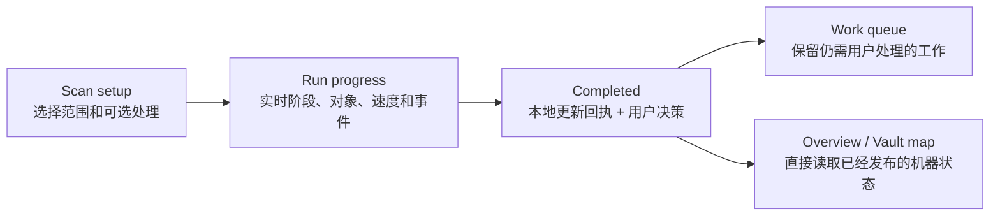
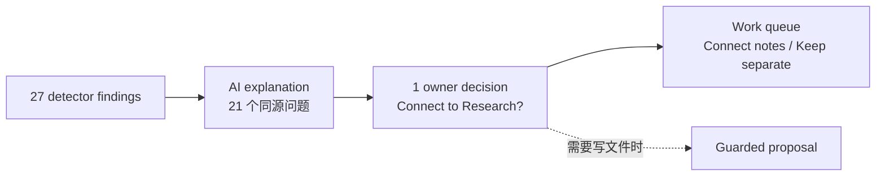

# Vault Intelligence V2 Mock：续作交接

这份文档把本次长对话中，**独立 worktree 编码交付之后继续发生的 Mock 设计调整**集中成一个可续作入口。它同时解释 Scan 会产生什么、为什么完成页只有若干用户决策，以及下一轮还缺哪些真实能力。

> 当前边界：这里描述的是 `docs/gstack/vault-intelligence-workspace-2026-08-12-v2/` 下的交互原型和产品合同，不代表这些能力已经全部进入 Obsidian 插件生产代码。

> Follow-up 的完整来源、七个维护能力域、19 个当前检查、6 个 future semantic checks、每个用户动作的例子和退出条件，统一以 [Vault Scan Follow-up 与 Work queue 用户合同](../../superpowers/specs/2026-08-15-vault-scan-follow-up-and-work-queue-contract.md) 为准。

## 1. 先看最终产品结构

Vault Intelligence 回答三个问题：

- **Overview**：现在最值得我继续或处理什么？
- **Vault map**：我的全部文件形成了什么知识结构，过去做过什么？
- **Work queue**：哪些事情 Peak 不能替我决定或完成？

Scan 不是第四个长期页面，而是一条有起点和终点的操作流：



顶层导航最终只保留：

```text
Vault Intelligence
├── Overview
├── Vault map
└── Work queue
```

运行中的主按钮是 `View progress`；空闲时是 `Scan Vault`。标题旁的 `Last scan` 可回看最近一次完成结果，但不建立完整的 Run 历史工作区。

## 2. Worktree 编码完成后，本次对话继续修改了什么

下面按产品区域归纳，不按几十次视觉迭代逐条复述。

### 2.1 全局信息架构

- 删除顶层 `Runs`。Run 数据仍保留为审计事实，但不再占据用户的长期工作区。
- 明确 `Scan setup → Run progress → Completed` 是同一条连续路径；面包屑不再突然跳回 Overview。
- `Files & index` 不再是一级页面。文件类型、可搜索状态、Summary、AI Tags、vectors 都属于 Vault map 中对 Vault 内容的观察。
- Chats、Projects、Composer 是 Vault 中的 Peak 工作对象；AI Graph、Peak Sheet 是文件类型，不与 Files 并列。
- My Content 暂未并入 Vault Intelligence；后续可以提供跳转，但它仍是“用户显式保存或物化的 Peak 内容”所有者界面。

### 2.2 Overview

- 移除首页的大型 Vault structure 图。Overview 不复制完整 Vault map。
- 首页重点收敛为：对象概况、Continue work、What changed、Priority work 和机器知识就绪状态。
- 标题行把 `Last scan` 与 `changes ready / Review plan` 放在 `Vault Intelligence` 后面，不再分两行。
- Continue work 改为紧凑列表；不再靠图标猜对象类型，也不展示 24 行把页面拉得过长。
- 首页删除独立 AI insight 文案；结构解释和 AI 解读回到 Vault map 的上下文中。
- 大量重复说明、小字号 caption 和装饰性图标被删减。

### 2.3 Vault map：内容与结构

- `Structure` 与 `Vault contents` 合并。结构不是独立于内容的第三种东西，而是文件及其关系的投影。
- `Vault contents` 与 `Activity` 成为 Vault map 下仅有的两个并列视图。
- 文件类型必须按**真实后缀/文件类型**展示，使用可交互 pie；AI Graph 和 Peak Sheet 保留在 Files 内。
- 点击 pie slice 或图例会把相应文件类型投影到知识图，而不是打开无意义的静态列表。
- 知识图采用真实知识库样本结构，使用 Cytoscape 和共享 Graph 交互规范，不使用 React Flow，也不再手画假 SVG。
- 图支持 `Constellation / Flow → / ↓ / Orbit` 布局；第二个方向布局只显示向下箭头，不重复 `Flow` 文案。
- 工具栏、按钮组、语义边开关、Nodes、图片和全屏控制与现有 Vault Search Graph 保持一致。
- Community 节点点击后**在同一张图内放大展开**，显示其 topics / hubs；不会切换成另一张图。
- 展开时保留全图语境，强化当前节点及邻居，明显淡化无关节点和边；再次点击、空白点击或返回可收起。
- 节点 hover 强调节点与相邻关系；关系文字保持水平、可读，不跟随边倾斜成小字。
- 不保留右侧常驻 selection drawer。图下方紧跟 Community summary；右侧区域显示当前 selection 详情和有证据的 AI interpretation。
- `Community overview / Topics & hubs` 两个图切换被取消，因为它们是同一张图的摘要与展开层级，不应让用户理解成两个知识结构。
- Overview 中若需结构预览，只使用约 270px 的真实 Cytoscape 缩略全貌；点击后聚焦完整图区域，不复制第二张示意图。

### 2.4 Vault map：Activity

- 原始 Activity 与 AI 主题严格分层：
  - 原始记录来自文件编辑、Chat context、Composer、Project、AI Graph / Peak-native revision；
  - 相邻且共享对象的记录先确定性聚成 work session；
  - AI theme 是可重新生成的解释层，不是历史天然自带的事实。
- 默认先展示原始 activity heatmap。历史即使从未做过 AI 分析，也仍可浏览。
- AI themes 由用户主动分析，或在 Scan / Index 中回填；必须保留证据、时间范围、生成时间、来源 revision 与置信度。
- 主题很多时只展示 Top N、`Other` 和 `Unclassified`；另有可搜索的完整 theme picker，不把所有主题堆成 chips。
- 删除难懂的 `Current focus` 与 `Direction change` 卡片：
  - 当前范围构成改为 `Theme mix in selected period`；
  - 变化改为和 `Previous equal period` 做同长度对比。
- timeline、范围选择器、work sessions 和 event list 必须属于同一联动区域。拖动时间范围时，它们一起更新，而不是上图和下表彼此脱离。
- Heatmap 使用长的一年日历形态；hover 显示当天证据，选择某天后下面以清晰列表展示具体活动。
- 不推断生产力、心理注意力或停留时长，只使用本地、可解释的显式记录。

### 2.5 Scan setup

- Setup 不再用两个平级的 `Refresh checks / Enrich files` 按钮。它们是一次维护运行中的不同阶段。
- 顶层只保留一个主动作 `Scan Vault`，但点击后进入独立 setup 页面，而不是小弹窗或 Overview 区块。
- Setup 的第一件事是选择范围：changed objects、selected scope 或 entire Vault。
- 第二步选择维护任务，其中 `Knowledge Index` 以折叠行承接本次运行的详细输出计划；只有用户主动展开时才显示 Core Search 与四组 Generated knowledge。
- Index plan 直接继承第一步范围，不再重复 folder / Community / saved work 选择；它只决定本次构建 Full-text、Embeddings、Summary、AI Tags、relationship signals 等哪些可复用输出。
- 第三步为已选任务与 Index 输出配置每个 AI operation 的模型和开关。Index 输出与其支撑 operation 共享同一状态，不能出现相互矛盾的开关。
- 预计时间不是静态占位符：范围、本次启用的每一个可用 Index 输出、AI operation 与 routed model 都要触发重算。当前 Mock 用本地吞吐区间、并行 AI 最长路径和全部启用 AI 工作的有限队列占用做简单估算，并在悬浮说明中公开公式。
- Background refresh、batching、retry、exclusion、chunking 与默认模型策略仍由 Knowledge Index settings 持久化；Scan setup 只负责当前 run。
- 首次运行应沿用 Knowledge Index onboarding 的预检思路；正常增量运行、首次 setup 与 recoverable checkpoint 是三种不同入口状态。
- 当前 Mock 的右下角状态控制支持 `Changes / First setup / Recoverable / Indexing / AI work / Completed`，用于评审时直接进入对应页面；它不是生产按钮。

### 2.6 Run progress

- 运行期间必须看到真实过程，不允许只把按钮改成 loading：
  - Overall progress 与 Knowledge Index progress 是两个同时可见、口径不同的进度：前者覆盖整个 Scan DAG，后者只覆盖本次选中的 Index layer work units，并拆出 Core Search-ready 与 AI-enriched document 数；
  - 四段运行导航为 `Discover / Build Index / AI work / Publish`，它们是可检查的依赖阶段，不是假装严格串行的时间线；Build Index 与已满足输入依赖的 AI operation 可以同时显示 Running；
  - 真正执行全文索引时，Build Index 沿用原 Knowledge Index 的可观察工作台心智，展示自己的进度卡、无断点的内部步骤轨道、连续文档队列、当前文件、六个 per-file Index 子步骤、预计剩余与吞吐，而不是另开 Index 页面；
  - AI work 必须显式区分两种 execution scope：逐文件的 Index enrichment 跟随每个 eligible document 并直接计入 Index progress；全库级分析则在 evidence threshold 后单独经历 `Assemble evidence / Discover candidates / Review and explain / Prepare follow-up`，这些阶段可重叠，且 Index enrichment 完成后全库 Review 仍可继续；
  - 全库级 AI work 使用一条连续时间链，不再重复展示“四阶段摘要 + 三张 AI 分组卡”。`Assemble evidence / Discover candidates / Review and explain / Prepare follow-up` 四个节点原地保留历史：Waiting 说明所需输入，Running 自动展开并一次性平滑聚焦到视口中部，Complete 收为具体结果摘要，并行节点可以同时展开。普通进度刷新不得持续抢滚动；用户正在检查其他 Run stage 时，聚焦等待到 AI stage 可见后再执行。点击任一节点可回看过程而不改变执行；
  - `Assemble evidence` 本身也必须展示 selected input、affected context、完整当前 graph、provenance boundary 四步过程。其余节点承载实际 Vault-level operation；十个 operation 每项展示四步过程时间线、当前或所需输入、具体 evidence 产出、可验证数量、模型/provider、receipt-backed token/cost 与独立 Stop/Skip。Relationship discovery 必须明确展示候选池、全图对比、排序去重和来源段落绑定；Semantic review 再独立展示方向/含义/冲突/历史检查以及具体保留或拒绝结果，不能只写 Running；
  - live events、checkpoint、provider wait 与 partial failure。
- 执行 DAG 采用流水线式混合方案：文档先完成 extract / Full-text / deterministic facts；Embeddings、Summary、AI Tags 随单文档就绪立即跟随并计入 Index progress；跨文件 relationship / semantic review 与 Community / Hub / bridge analysis 在足够 Index evidence 后启动并可与 Index 尾部重叠；proposal 与 synthesis 等上游证据稳定后再运行。
- Publish 按 Index layer 验证：Core Search 不应被一个失败的可选 AI enrichment 阻塞；可选层失败时留下 partial result 与 receipt，不伪装完整成功。
- 暂停保留 checkpoint；恢复继续同一个 run；停止保留已经生成的事实和 partial result。
- Mock 提供直接完成运行的快捷动作，只用于设计评审，不是产品能力。

### 2.7 Completed scan

- 完成页不再有 `Observed facts / AI insights / Files & enrichment / Run evidence` 四个 tab。
- 删除独立 AI Review 页面。AI explanation 必须附着在相应的 owner decision 上。
- 删除 `View updated overview`、默认展开的 Run record、第二套数字摘要和重复结果 dashboard。
- 顶部只回答三个问题：Scan 已完成、下面还有多少事项需要用户处理、Peak 是否依据 Setup 中的预授权更新了用户文件。当前完整评审数据明确显示 `48 follow-ups below` 和 `7 files updated by pre-approved repairs`。扫描对象、耗时、checks、token、费用和 provider receipt 全部进入默认收起的 `Run details`。
- `Peak finished automatically` 紧跟 Hero，先说明本轮已经改变了什么、影响哪些产品能力；它使用页面内 accordion，不用 modal，默认收起，展开时解释四类成功结果：
  - Search
  - Knowledge map
  - File understanding
  - Setup 预授权的确定性用户文件修复
- 自动用户文件修复只允许执行不依赖 AI 判断的 rename / heading 等确定性重定向，并逐项保留 source revision guard、write receipt、re-index 和 fresh detector verification。任何 AI 推断目标或歧义目标仍然进入 Proposal 或 owner target decision；不能因为“可能修得对”而自动写入。
- 本次完整设计评审用的 48 个合成 Follow-up 放在自动完成结果之后；真实 Scan 只产生本轮证据支持的未完成事项。三个 unreadable files 应合并成一个 recovery decision，不再重复成另一类结果。
- 对首次用户先用自然语言解释，再补充 Community、Topic、Hub 等产品术语。
- 自动发布的机器投影不是任务；它们在靠上的自动结果回执里说明。真正需要用户处理的 decision list 紧随其后，仍是完成页的主要行动区域。
- 完成页的 decision 行只保留：一个问题、一个短解释、决定性数字和一个主动作。内部 result chain、citations 与 detector ID 进入具体处理流后再展示。

### 2.8 Work queue

- Work queue 不是 run history，也不是指标 dashboard。这里只放 Peak 不能替用户完成的事项。
- `All work` 必须是清楚可见的默认视图，不能藏成右上角小按钮。
- 不再把五个粗粒度 owner-action 文案当成互斥、稳定的产品分类。当前完整动作注册表包含 48 个可执行动作，每个动作都有自己的影响和退出条件。
- 顶层只保留帮助用户快速查找事项的轻量视图：`All / Needs your choice / Ready for review / Needs recovery`。它们是过滤条件，不是 Follow-up 的类型系统。
- 行内 badge 可以回答事项的来源或状态，例如 saved work、finding、generated knowledge、proposal、failure；具体主动作直接写在事项上，例如 `Connect notes`、`Refresh Hub`、`Retry` 或 `Review diff`。
- 真实 Work queue 只展示当前 Vault 里确实存在的未完成事项，不提供 `Action catalog` 产品页或第二种队列模式。为了让 owner 一次性评审完整设计，当前 Mock 的 Completed 页面把全部 48 个合成 Follow-up 按普通结果行从上到下连续排列，不再按动作族切成卡片组。动作族只作为小型来源 badge。每行右侧主动作必须路由到六种真实交互之一，而不是共用一张只换文案的 `Choose outcome` Modal：① 恢复到精确 checkpoint 的继续工作；② 只读查看证据或受影响对象；③ AI setup → progress / token / cost → result；④ 真正改变产品状态的用户决策；⑤ scoped recovery / verification setup → progress → result；⑥ 带逐文件 diff、source guard 和显式 Apply 的 Proposal workspace。只有第④类展示 outcome cards。48 项的每条操作路径仍必须写明处理对象、成功/失败数量、剩余 blocker 或下一状态、receipt，以及 AI 操作的模型、token 和费用；不得用统一 `ready`、`selected` 或“alternative path”代替。该穷举数据集不表示真实 Scan 通常会产生 48 个待办。
- Property Review 确立的是所有 Follow-up 共用的阅读与导航原则，不是要求所有类型都伪装成 Property diff。Completed 保留 `事项 / 受影响对象 / 下一步` 三列。Title 必须独立说明用户要处理什么；Affected 每行只展示一种用户真正要处理的主对象数量，例如 files、notes、nodes、Communities、PDFs 或 Hubs。第二个数量只有在决定任务含义时才进入 Title，否则进入详情，不能在同一个列标题下制造两个无名数据列。行内不再重复 family、provenance、ID、解释句、impact 或单独的 Evidence 摘要。完整证据、影响和写入边界进入详情。整条事项行仍可进入。恢复 Property 工作面时也只保留一个任务标题区；不能先用通用 Modal header 写一次任务名，再在内容区重复同一任务名。进入工作面后，第一组主指标必须先回答多少对象、变化、证据、费用或恢复范围；有对象集合的区块使用完整 header row 折叠/展开并支持 Enter/Space，header 内真实动作与折叠隔离。AI、只读 inspect、decision、recovery、verification、Proposal 各自保留正确动作语言；只有 canonical object set 真正支持独立选择时才出现 Accept/Reject 与 bulk action，不能给 AI 或只读检查硬造批量选择。
- Property 工作使用一个用户可理解的属性维护任务和一组 canonical suggestions；`Batch` 与 `File` 是同一份 suggestion 数据上的两种分组视角，不是必须逐层进入的页面。Group by Batch 保留维护目的、证据、风险和验证边界；Group by File 把同一文件来自不同 Batch 的变化集中起来。`Group by` 与 `Show` 必须并列成为左侧 view controls，全局 Accept/Reject 单独留在右侧。Batch header 必须把 file count 与 change count 提升为独立醒目指标；File header 必须突出 change count，跨 Batch 时再显示 batch count，不能把这些关键数量埋进灰色说明。Revision 只在 File header 展示一次；Property 行只保留属性、当前值、建议值和动作，不在每条变更下重复 evidence 句子。File 分组仅额外保留紧凑的来源 Batch 标记。Batch 和 File 的完整 header row 都可点击折叠，折叠只改变阅读密度；行内 Accept/Reject 不触发折叠。Batch、当前视图中的文件组、单条 Property 都有统一文案的 Accept/Reject，并更新同一 decision state；active 按钮本身就是状态，不再重复显示 accepted/rejected badge。决定状态必须不读文字也能扫出来：选中的按钮使用实色，整条 change row 使用对应底色和左侧状态线，建议值呈现接受或拒绝处理，未选中的反向动作退为次要但仍可切换；按钮同步暴露 `aria-pressed`。`Accept all` 接受 canonical set 内全部非冲突建议，`Reject all` 拒绝全部建议（包括 conflict）；所有 Bulk Accept 都必须跳过 conflict。切换分组或折叠不得复制、重置或重复计数。当前示例含 43 条变化、28 个唯一文件；`Customer interview 07.md` 同时承载来自三批的 `type / source / status`。恢复 review 会恢复分组、filter、collapsed groups、scroll anchor、decision state、source revision 和原第 7/12 个文件的 checkpoint，但不执行 Apply。
- Broken-link maintenance 也必须覆盖一个 Scan 中的完整 canonical broken-reference set，而不是把一个 7-file inspect surface 错当成全部断链工作。`Target` 与 `File` 是同一组 repairs 的可切换视图，所有选择都写回同一 exact-reference decision state。选择层级是 `Target default → File override → exact reference override`：Target choice 可先统一全部匹配引用；File choice 可统一覆盖一个文件内的匹配引用；展开文件后，每个具体位置仍可从四种真实修复语义中单独选择。对某层执行批量选择会清除该范围下已有例外，之后再做下层选择才形成显式 exception。可用方案包括 redirect 到现有 note、创建或恢复缺失目标、移除链接语法但保留文字、或暂不处理；有歧义时逐个展示 evidence-backed candidate。`All / Needs repair / Needs target / Already repaired` 只是同一连续列表的 filter，默认 `All` 同时显示未解决与自动完成项。折叠行只展示 target、带语义的影响数量与下一步。展开后先展示 Target default，再展示文件列表；完整 file row 原地展开 file-level choice 与逐条 exact line/source excerpt choice，path/revision 只在 filename 悬浮时出现，不另设重复 Inspect。`File` grouping 只是重新排列同一 decision state，不能制造第二份选择。当前 Mock 示例含 63 个 broken references、18 个唯一文件：21 个确定性修复已按 Setup 预授权自动写入并完成 receipt / re-index / fresh detector verification；31 个等待选择修复方案；11 个存在 target 歧义。自动修复在同一列表中只读展示，不能事后伪装成待决定建议。
- 后续修改任何 Scan maintenance item，先按 [Scan maintenance review 共享规则](../../superpowers/specs/2026-08-15-vault-scan-follow-up-and-work-queue-contract.md#scan-maintenance-review-shared-rules) 完成领域适配卡，再画页面。共享的是一份 canonical state 与同一套流程边界，不是把 Property 或 Broken link 的控件复制到其他事项。
- 三轮反复修改还确认了一条此前漏掉的 gate：review 中 `current owner choice > current Peak suggestion > historical suggestion / evidence`，Apply / Verify 后再由 verified result 成为可见真值。任何 override、reject 或 suggestion recompute 都必须同步改变标题、当前选择、展开解释、live summary、CTA 与最终 result；旧 suggestion 只能进入 history / evidence。开始视觉评审前必须通过主合同 §11.11 的跨领域回归场景，并同时通过领域名词检查与 secondary-copy 价值检查；不能只复用列表、dropdown 或 CSS 外形。
- 同类、可重复出现的 Decide finding 必须先聚合成一个 maintenance task。当前 Community membership 示例把九篇归属不确定的 notes 合并为一份 canonical decision set，支持 Suggested Community / File 两种投影、group / note 作用域、owner guidance 重算与逐 note override；one-hop / two-hop 只作为 File Atlas 的按需证据，不再充当主要决策结构。顶部必须同时提供 `Accept all / Reject all`；Community group 与 note 原行使用同一种下拉菜单，统一提供 use suggested Community、choose another Community、no Community，并写入同一 note decision state。下拉选项只能保留 action + Community name 的单行选择，不能附加重复、低价值的小字。展开说明必须跟随当前 decision：未覆盖时可以显示 `Why suggested Community`，owner 改选后必须显示 `Changed to chosen Community`，拒绝后显示 `No Community`，不能继续把已被覆盖的 Peak suggestion 当作当前解释。展开区不得出现 evidence cards、outcome cards 或另一组按钮。Folder move 属于 user-file Proposal，不能伪装成 Community membership 选项。
  - 用户的自然语言 instruction 可以批量重算当前 task 中全部未 Apply suggestions，但不能静默替换 owner choice。
  - 主界面不增加局部模型选择器；provider、model、token 和 cost 进入可展开 history / receipt。
- File Property 的剩余合同以同一文档 §12 为准。必须补齐跨 Batch collision、自定义值、完整 Property operation、schema 校验、按需 evidence、partial stale refresh、最终 per-file combined diff 和 Apply 后 verification。Property suggestion 与 machine-only AI Tags 继续保持不同写入边界。
- Follow-up 的完整来源、能力域、finding、生命周期和动作边界，以 [Vault Scan Follow-up 与 Work queue 用户合同](../../superpowers/specs/2026-08-15-vault-scan-follow-up-and-work-queue-contract.md) 为准。
- 不使用右侧 drawer。Completed 的紧凑结果行打开居中的完整任务 Modal；真实 Work queue 的普通事项仍可在行下方展开轻量证据与返回点，深度动作再进入它自己的 owner surface。
- 需要深入工作的动作交给 owner surface，例如 Composer、Project、Chat、AI Graph、Proposal review；Work queue 保留来源与返回点。

### 2.9 文案、图标与视觉密度

- 删除大量没人会读的小字；正文重要度不能靠 10–11px caption 承担。
- 首页和完成页优先短标题、可解释数字和按需展开，不重复同一事实。
- 工作项不是总有可识别的图标；宁可用明确标题和 object type，也不使用廉价、错误或猜测性的图标。
- Projects、Composer、AI Graph、Peak Sheet 使用真实产品语义；Pie 与图例可交互，不做装饰。
- 详情靠近触发对象展开，减少从左侧条目到右侧 drawer 的长距离移动。

## 3. 三个数字不要再混在一起

这是此前完成页最难懂的根源。

| 层级 | 当前数量 | 它回答什么 | 是否直接成为 UI 分类 |
| --- | ---: | --- | --- |
| Run result object type | 10 | 系统到底生成了哪些可保存、可追踪的数据对象？ | 否，属于产品与技术模型 |
| 本次示例 Scan 的 owner decision | 5 | 这一次运行后，用户具体要决定哪五件事？ | 是，显示在本次完成页 |
| 用户可执行动作 | 当前合同登记 48 个 | 用户能对不同事项真正做什么，以及怎样验证完成？ | 直接成为每个事项的主动作或次动作；不压成永久五分类 |

不要再使用 `10 → 5 → 5` 作为产品模型。十类底层对象可以组合成数量不定的具体 Follow-up；不同 run 的 Follow-up 数量和内容会变化；每个事项再从动作注册表中选择与当前证据匹配的主动作和次动作。当前 Mock 的 48 项只是为了穷举评审全部动作。

## 4. Scan 会产生的 10 类结果对象

| # | 结果对象 | 保存什么 | 本次具体示例 | 默认展示位置 |
| ---: | --- | --- | --- | --- |
| 1 | Search projection | 可读文本、chunks、readiness、retrieval record | 137 个 changed files 重新变为 Search-ready | 完成页本地更新回执；Vault contents 可查 |
| 2 | Vault structure projection | Community、Topic、Hub、typed relation、bridge、orphan membership | Product 与 Research 仍相连，但 bridge stale | Vault contents / graph；异常可进入 decision |
| 3 | File intelligence | Summary、AI Tags、vectors、source hash | 更新 42 个 Summary 和 39 个 AI Tags | 完成页本地更新回执；文件状态可查 |
| 4 | Detector finding | detector ID、阈值、对象、证据、与上次差异 | Connections detector 发现 27 个 hard orphan | 作为事实；高影响结果进入 decision |
| 5 | AI explanation | findings 分组、可能原因、趋势、置信度、citations | 27 个 orphan 中 21 个很可能来自同一个导入流程 | 附在相应 decision 中，不单独开 AI Review |
| 6 | Work item | durable state、next action、exit condition、owner surface | 决定 21 个 Research import notes 如何处理 | Work queue |
| 7 | User-file proposal | guarded diff、source revision、conflict、apply state | 12 个 frontmatter diffs，1 个 conflict | Proposal review；只有 Apply 才写用户文件 |
| 8 | Peak knowledge update | Peak 自有的可见名称、摘要、topic 与 Hub 描述 | 2 个 Community、5 个 topic、6 个 Hub 文案待审 | Generated knowledge review |
| 9 | Partial result / exception | 局部失败、已保留成功结果、retry / exclude 选项 | 3 个文件第二次读取仍失败 | 完成页 + Work queue；不把整次 run 判失败 |
| 10 | Run receipt | run ID、scope、stage receipt、checks、citations、tokens、cost、duration | `run-vault-live-7f2c`、19 checks、23 citations、$0.42 | 内部审计；仅在 compare / evidence / debug 时露出 |

### 哪些结果不应进入 Work queue

- 成功发布的 Search、structure 和 file intelligence projection；
- 没有异常的 detector result；
- 被某个 decision 吸收的 AI explanation；
- 单纯用于审计的 Run receipt。

它们仍然存在，但不伪装成用户任务。

## 5. 当前示例 Scan 为什么形成 5 个 decision

下面五项是**这个 Mock run 的具体决策样本**，不是“Vault Intelligence 永远只有五种结果”。

### Decision 1：Connect the imported meeting notes to Research?

- **用户看到的事实**：21 个 notes 共享同一个 Meetings import、命名模式和 Research 内容重合；另外 6 个 orphan 不属于这个组。
- **底层对象**：27 个 detector findings + 1 个有 11 citations 的 AI grouping + 1 个 Work item。
- **用户动作**：检查导入模式，选择连接、分类、修改导入规则、保持分离或稍后处理。
- **为什么不是自动修复**：是否属于 Research 是 owner decision；Peak 不应凭相似度改链接或用户文件。

### Decision 2：Apply the Research metadata proposal?

- **用户看到的事实**：12 个 guarded frontmatter diffs 已准备，1 个 source-revision conflict 必须先解决。
- **底层对象**：84 个 metadata findings + 1 个 12-file proposal + 1 个 Work item。
- **用户动作**：逐文件 review、解决冲突，然后显式 Apply；也可 regenerate、keep current 或 dismiss。
- **为什么不是自动更新**：这是用户文件写入，必须经过 proposal 和 revision guard。

### Decision 3：Update or retire the Product ↔ Research bridge?

- **用户看到的事实**：结构连接仍存在，但 2 个 bridge notes 已没有覆盖 14 个 changed sources。
- **底层对象**：stale-bridge findings + AI explanation + Composer handoff + Work item。
- **用户动作**：打开 bridge notes 与 source context，更新、替换、退役或记录该差距是预期状态。
- **为什么不叫 Review AI explanation**：AI 已经把解释附在这里；剩下的是处理 bridge，而不是再次“看 AI”。

### Decision 4：Publish the new Vault map descriptions?

- **用户看到的事实**：图的 membership 已经更新；2 个 Community、5 个 topic 与 6 个 Hub 的可见说明共 13 项待确认。
- **底层对象**：structure projection + Peak knowledge update + Work item。
- **用户动作**：对具体文案 `Publish / Try another / Keep old`。
- **为什么不是用户文件 proposal**：这些是 Peak-owned generated knowledge，不改 Markdown、frontmatter 或用户 tags。

### Decision 5：Retry or exclude the three unreadable files?

- **用户看到的事实**：3 个文件第二次 read/parse 仍失败；其他成功结果已经保留。
- **底层对象**：3 个 partial-result receipts + recovery Work item。
- **用户动作**：Retry、修复 parser/setup、明确 exclude，或保留为可恢复状态。
- **为什么 run 仍 Completed**：局部失败不应抹掉 Search、structure 和其他文件已经完成的结果。

## 6. 底层对象如何组合成用户决策

以 imported notes 为例：



默认 UI 从 `owner decision` 开始。用户进入处理流后才展示 findings、citations、proposal、receipt 等证据对象。

## 7. Follow-up 的完整覆盖与 Work queue 动作筛选

Follow-up 不是五种固定结果。当前完整来源至少包括：

1. Peak continuation：已保存、暂停或因 source drift 阻塞的 Project、Composer、AI Graph 工作；
2. Pending decision：等待 owner 选择的关系、结构、提醒或生成任务；
3. Readiness：未读取、未索引、解析失败、provider / model 不可用；
4. Enrichment：vectors、Summary、AI Tags 等机器知识缺失、过期或失败；
5. Structure：Orphan、broken link、island、Gap、fragile Bridge、stale Hub、Community 变化；
6. Content：empty、stub、oversized、duplicate、naming 与内容维护问题；
7. Tags & metadata：untagged、tag explosion、frontmatter policy、field / type conflict；
8. Semantic review：contradiction、coverage gap、low cohesion、redundant Hub 等 AI-assisted review；
9. Runtime：paused、failed、skipped、conflict、partial completion；
10. Proposal：waiting review、waiting apply、source drift、waiting verify。

这些来源横跨 Structure、Content、Freshness、Machine knowledge、User metadata、AI diagnosis、Materialization 七个维护能力域；19 个当前可运行的 deterministic detector 只是其中的具体检查集合。`source / capability domain / finding kind / lifecycle state / next owner action` 是五个不同维度，不能压成一套“永久五类”。

Work queue 顶层只需要帮助用户找到事项，不需要再次发明一套动作分类。当前建议的轻量视图是 `All / Needs your choice / Ready for review / Needs recovery`。同一 work item 可以提供一个主动作和若干次动作，例如 unreadable PDF 的主动作是 `Retry`，次动作是 `Exclude`；它不需要被塞进一个名为 `Fix a blocker` 的永久桶里。

完整的 48 个动作与逐项例子见 [Vault Scan Follow-up 与 Work queue 用户合同](../../superpowers/specs/2026-08-15-vault-scan-follow-up-and-work-queue-contract.md)。内部来源可以是 Vault Lint、Indexer、AI Review、Composer 或 runtime，但这些不是一级用户分类。

## 8. 当前仍只有 Mock、没有真实 UI 或功能的内容

### 8.1 Activity 数据链

- 统一的 raw activity event schema 与持久化；
- 文件、Chat context、Composer、Project、Peak-native revision 的事件采集；
- deterministic work-session clustering；
- AI theme generation、backfill、citations、confidence、staleness 与 `Unclassified`；
- day / week / month 聚合、完整主题 picker、previous equal period 比较；
- heatmap、timeline、session list 与 event evidence 的生产 UI 联动。

### 8.2 Scan runtime

- Knowledge Index current-run output plan、AI operation/model routing 与 durable settings policy 的连接；
- changed-object closure、selected scope 和 entire Vault 的一致 scope model；
- 支持阶段重叠的 run DAG、checkpoint、pause/resume/stop，以及旧 Index 在新 Core Search / enrichment layer 分别验证前持续可用的分层发布；
- 实时 object queue、throughput、ETA、provider wait、cost 和 live events；
- detector、AI explanation、enrichment 与 publish receipts 的统一 RunEnvelope。

### 8.3 Result 与 Work queue 持久化

- 十类 result schema 的正式 ID、revision 与 canonical carrier；
- finding → explanation → decision → work item / proposal 的稳定关系；
- completed run 把 actionable result 幂等物化到 Work queue；
- decision 的 complete、dismiss、handoff、reopen 与 provenance；
- partial result 保留成功结果并独立 retry 的真实实现。

### 8.4 用户文件与 Peak-owned knowledge

- frontmatter / file proposal 的 revision guard、conflict、preview、Apply receipt；
- Community / Topic / Hub 可见文案的 generation、Publish、Regenerate、Keep current；
- Summary、AI Tags、vectors 的 eligibility、source hash、stale detection 与按文件重试；
- 明确哪些生成物进入 Peak knowledge index，哪些只保存在本地 projection。

### 8.5 Vault map 集成

- 共享 Cytoscape stack 已有生产基础，但 Vault Intelligence 的完整内容投影、file-type controller、Community inline expansion、selection summary 与 AI interpretation 仍主要是 Mock；
- graph、pie、work item 与具体文件 / Composer / Proposal review 的真实路由；
- My Content 是否只提供跳转、还是在 Vault Intelligence 中提供只读视图，仍未定。

### 8.6 命令与入口

- `Vault Intelligence` 可以是稳定的 Command Palette 全局入口；
- AI Graph 是文件类型，其“新建 / 打开当前图”等命令由 AI Graph owner surface 决定，不应把每个内部维护动作都注册成全局命令；
- 需要遵守现有 Command Palette governance，暂不把 Scan 子阶段、detector 或 debug action 暴露为全局命令。

### 8.7 验证边界

- 当前 HTML Mock 可通过 `file://` 直接查看；
- 它证明信息架构和原型交互，不证明生产数据、真实扫描、持久化、proposal Apply 或 Obsidian host 行为；
- 在真实插件接入并完成 CDP / Obsidian QA 前，相关交互应保持 `INTERACTION NOT VERIFIED`。

## 9. 下一个 task 的建议顺序

下一轮不要同时重做所有页面。建议按这个顺序继续：

1. **先定 Work queue 当前版**：验证轻量查找视图、事项主动作、次动作、证据和行内展开是否自然；不再验证五种永久 owner-action 分类。
2. **完成 Activity 数据合同与页面**：先 raw activity，后 session，再 AI themes；解决主题生成和多主题扩展问题。
3. **完成 Scan setup / progress / completed 的单线评审**：每个页面只保留该阶段的用户问题。
4. **逐个 decision flow 做深度 Mock**：import cluster、file proposal、stale bridge、map text、partial failure。
5. **最后再写生产 implementation plan**：把十类 result schema、runtime、persistence、owner surfaces 与验证 gate 映射到真实代码。

### 下一个 task 的硬边界

- 先继续 Mock 和产品文档；除非 owner 明确授权，不修改生产实现。
- 不把 Mock 文案当作当前 source capability。
- 不重新加入顶层 Runs、右侧 drawer、独立 AI Review 或 Files & index 页面。
- 不用 React Flow；交互图继续使用 Cytoscape 与共享 Graph 组件合同。
- 不以“多放一个数字或解释段落”解决理解问题；先明确对象、层级、owner action，再决定 UI。

## 10. 续作入口

- [交互 Mock](./index.html)
- [Mock README 与最终设计约束](./README.md)
- [Activity 与 Run result 产品模型](./activity-and-run-result-model.md)
- [Vault Intelligence 产品总览](../../13-feature-vault-intelligence.html)
