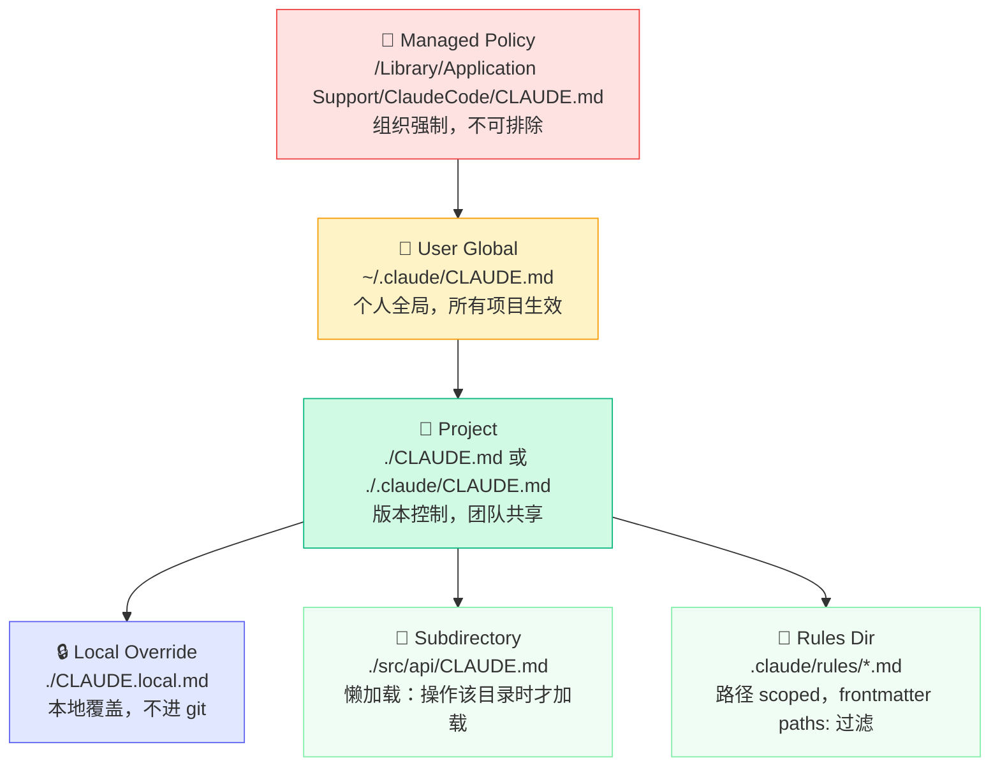
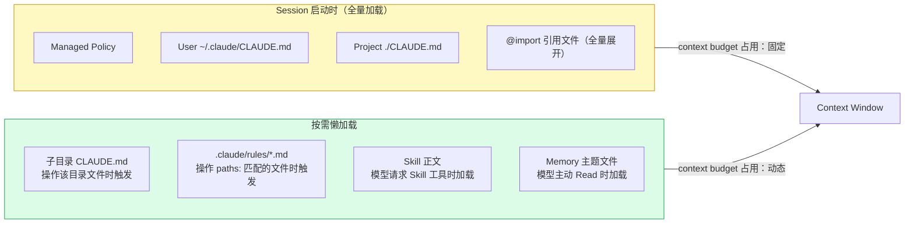
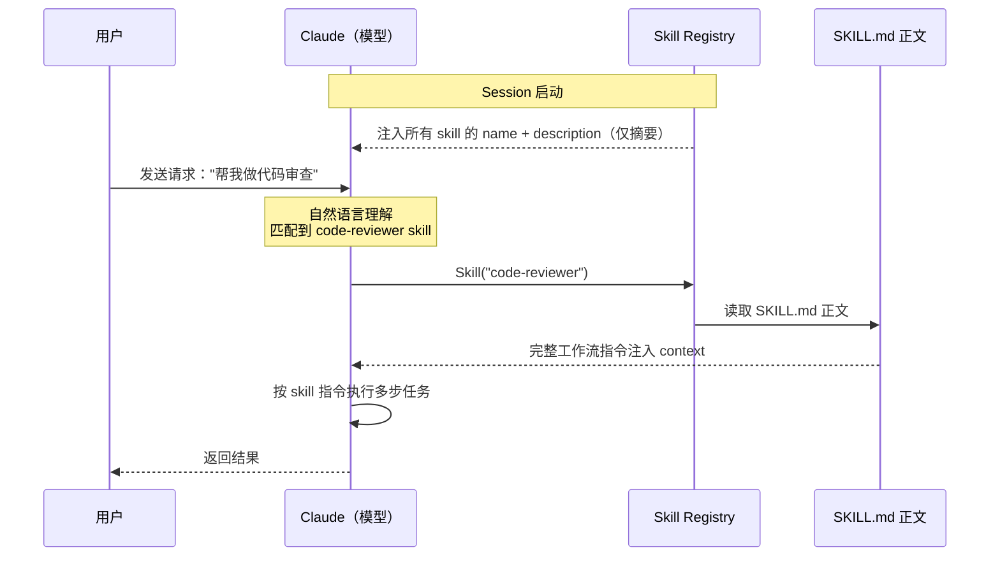
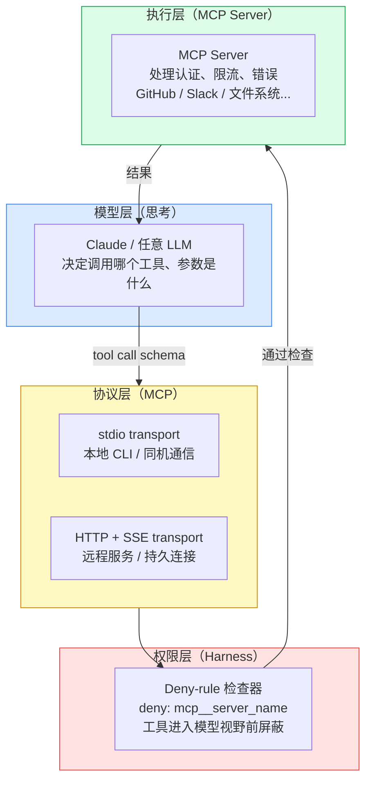
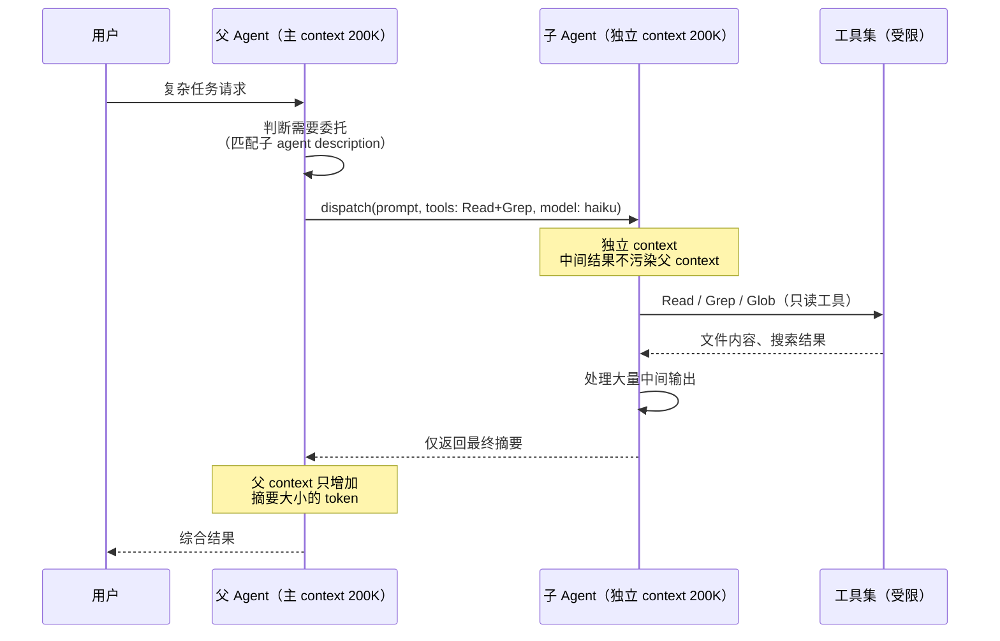
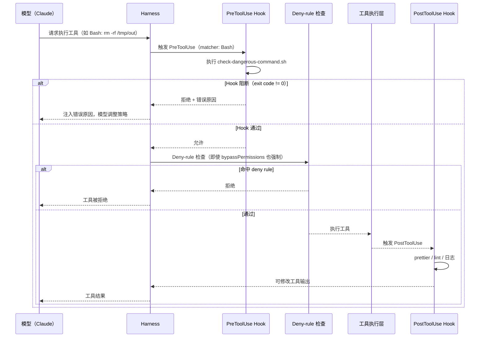
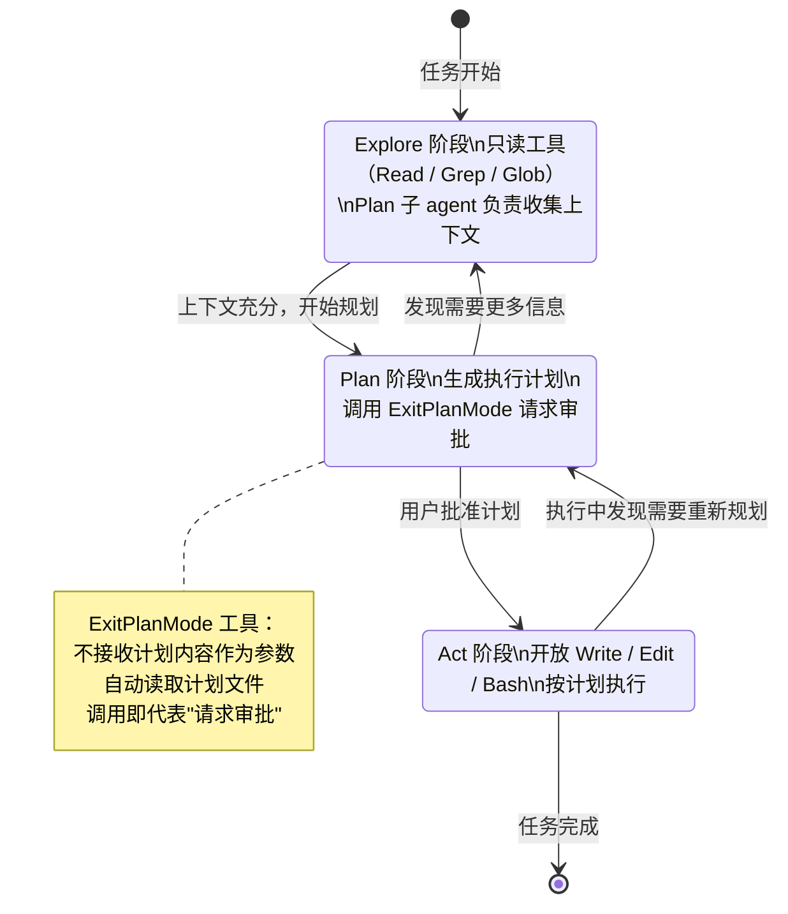
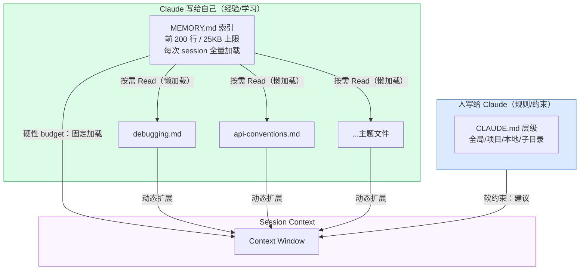
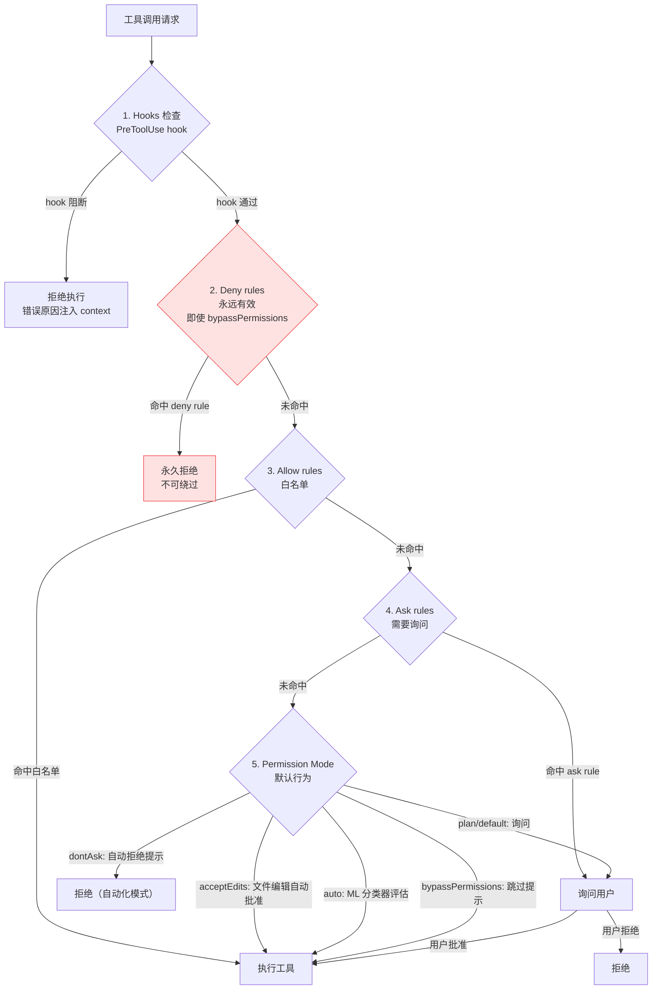
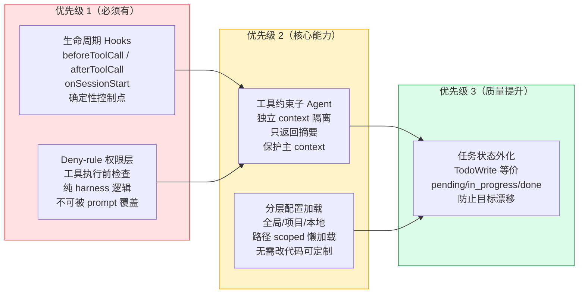

# Claude Code 设计模式调研

> 调研目的：为自研 ReAct loop（支持本地模型 Qwen/Llama）提取 Claude Code 的可借鉴设计经验。
> 日期：2026-05-24

---

## 摘要（TL;DR）

Claude Code 的成功不在于模型本身，而在于围绕模型构建的"harness"层。2026 年的一项研究分析了 Claude Code v2.1.88 的代码，发现其中 98.4% 是 harness 基础设施（权限管道、上下文管理、工具路由、沙箱），只有 1.6% 是 AI 决策逻辑。其核心设计哲学可以归纳为一句话：**用确定性机制（hooks、权限、工具约束）管控边界，把不确定性（推理、规划、工具选择）留给模型**。这对我们自研 ReAct loop 的意义是：不要试图把所有逻辑塞进 prompt，而要构建一个结构化的 harness 层，让模型在受约束的环境里自由运作。

---

## 1. CLAUDE.md 层级 Walk

### 设计意图

单一全局配置的问题是"one size fits all"——组织级规范和个人偏好、项目架构和文件级惯例，如果全部平铺在一个文件里，维护成本极高，且每次都全量注入上下文，浪费 token。CLAUDE.md 的层级设计解决了三个正交的需求：**谁**拥有这条规则（组织/个人/项目/本地）、**在哪里**生效（全局/当前项目/特定子目录）、**是否**需要版本控制（CLAUDE.md 进 git，CLAUDE.local.md 进 .gitignore）。

### 实现要点

加载顺序从宽到窄（后读的更具体，歧义时更具体的胜出）。如下图所示，层级从组织强制到子目录按需，越靠下越具体：



| 层级 | 位置 | 特性 |
|------|------|------|
| Managed Policy | `/Library/Application Support/ClaudeCode/CLAUDE.md` | 组织强制，不可排除 |
| User | `~/.claude/CLAUDE.md` | 个人全局，所有项目生效 |
| Project | `./CLAUDE.md` 或 `./.claude/CLAUDE.md` | 版本控制，团队共享 |
| Local | `./CLAUDE.local.md` | 本地覆盖，不进 git |
| Subdirectory | `./src/api/CLAUDE.md` | 按需懒加载 |

关键机制：
- **懒加载**：项目根目录以上的 CLAUDE.md 在启动时全量加载；子目录的 CLAUDE.md 在 Claude 读取该目录文件时才加载。这是真正的按需加载，节省上下文。
- **拼接而非覆盖**：所有发现的文件被拼接进上下文，不存在"优先级覆盖"，只是后读的内容在上下文里排后。
- **`@import` 语法**：支持 `@path/to/file` 引用外部文件，但引用文件在启动时也会全量展开——这是一个常见误解，import 不是懒加载的。
- **`.claude/rules/` 目录**：支持路径 scoped 规则（frontmatter 中写 `paths: ["src/api/**/*.ts"]`），只有 Claude 操作匹配路径的文件时才注入，这才是真正节省 context 的做法。
- **`claudeMdExcludes`**：大型 monorepo 里可以排除不相关团队的 CLAUDE.md。

下图展示了各层的加载时机（启动时全量 vs 按需懒加载）：



### 和 Cursor Rules / Windsurf Rules 的对比

| 维度 | CLAUDE.md | Cursor (.cursorrules) | Windsurf (.windsurfrules) |
|------|-----------|----------------------|--------------------------|
| 层级 | 6层（managed→user→project→local→subdir→rules/） | 项目级单文件 | 项目级单文件 |
| 懒加载 | 支持（子目录按需） | 不支持 | 不支持 |
| 版本控制分层 | CLAUDE.md vs CLAUDE.local.md | 无区分 | 无区分 |
| 组织强制部署 | 支持（managed policy）| 不支持 | 不支持 |
| 路径 scoped 规则 | `.claude/rules/*.md` + `paths:` frontmatter | 不支持 | 不支持 |

Claude Code 在这个维度上是目前最完整的方案，但复杂度也最高。

### 用户反馈 / 争议

主要抱怨是**合并行为不透明**：两个 CLAUDE.md 里有冲突指令时，Claude 可能随机选一个，没有明确的 "后者胜出" 语义。调试时需要用 `/memory` 命令检查究竟加载了哪些文件，以及用 `InstructionsLoaded` hook 做诊断。

另一个问题是 CLAUDE.md 内容进入 context window，而非 system prompt，这意味着它是"建议"而非"强制"——如果想要强制行为，应该用 hooks。

### 我们能借鉴什么

自研 harness 的配置加载应该实现：
1. **分层配置**：区分全局默认（`~/.config/agent/`）和项目级配置（`.agent/CLAUDE.md`），至少两层。
2. **路径 scoped 规则**：重要！避免把所有规则在每次调用时全量注入。可以根据当前操作的文件路径动态过滤激活哪些规则。
3. **local 覆盖**：`.agent.local.md` 这类文件处理个人偏好，不进版本控制。
4. 注意：配置文件进 context 是"软约束"，真正的强制行为需要在 harness 层（hooks / 权限）实现。

---

## 2. Skills 系统

### 设计意图

Skills 解决的核心问题是：**context 稀缺时，如何让大量"专项能力"按需可用，而不是全量常驻**。如果把每个工作流的完整指令都塞进系统 prompt，context 很快就会耗尽，而且 Claude 在 60+ 工具面前会产生"选择疲劳"。Skills 通过渐进式披露（progressive disclosure）解决了这个问题。

### 实现要点

Skill 是一个 SKILL.md 文件，由 YAML frontmatter + markdown 正文组成。关键字段：

```yaml
---
description: "当用户要做代码审查时使用这个 skill"
disable-model-invocation: false  # 设为 true 则只能用户手动触发，不能被 Claude 自动调用
---
# 正文是 skill 的完整指令...
```

**Model-first discovery**（模型优先发现）的核心机制：

1. 每个 session 启动时，Claude 只看到所有 skill 的 name + description（一行描述），不加载正文。
2. 当用户消息到达，Claude 判断是否需要某个 skill，如果需要，才通过 `Skill` 工具加载完整的 SKILL.md。
3. 关键：这个决策**没有任何算法路由**——没有 embedding 相似度、没有 regex 匹配、没有分类器。Claude 完全靠自然语言理解决定调用哪个 skill。

如下时序图所示，skill 正文直到模型决策后才进入 context：



这和 prompt template 的区别：prompt template 是静态替换，每次调用都要显式指定；skill 是动态的，Claude 自主决定什么时候需要它。和 LangChain tool 的区别：LangChain tool 有固定的 input/output schema，更适合结构化操作；skill 是"给 Claude 的完整工作流指令手册"，更适合复杂的多步骤任务。

**Plugin 模型**：Skills 可以打包进 plugin，插件安装后 skills 自动可用。每个 plugin 有自己的命名空间（如 `my-plugin:review:security`）。

### 用户反馈 / 争议

Model-first discovery 的最大争议是**不可预测性**：Claude 有时会调用用户没有预期的 skill，或者该调用时不调用。`disable-model-invocation: true` 是一个重要的安全阀，对于有副作用的操作（如 `/deploy`、`/commit`）应该始终设置。

### 我们能借鉴什么

对于自研 harness：
1. **Skill registry 模式**：维护一个 skill 列表，每次请求前先把 name+description 注入 context，让模型决定加载哪些完整 skill 内容。
2. **渐进式上下文**：skill 内容按需加载，而非全量常驻。一个简单实现：skill 文件注册到 registry，context 构建时先注入摘要，模型请求某个 skill 时再注入全文。
3. **访问控制分层**：区分"可以自动触发"和"只能手动触发"的 skill，对应我们插件里的 auto-run vs user-triggered 操作。

---

## 3. MCP (Model Context Protocol)

### 设计意图

MCP 的核心主张是：**标准化工具协议，终结每个平台各自造轮子的碎片化问题**。在 MCP 之前，OpenAI function calling、Anthropic tool use、LangChain tools 各有各的格式，一个 GitHub 集成要针对每个平台重写一遍。MCP 类比的是 REST / GraphQL：不是一个库，而是一个规范。

设计理念的核心是**关注点分离**：
- Claude 负责思考（决定调用哪个工具、参数是什么）
- MCP server 负责执行（处理认证、限流、错误）
- Claude 不需要知道它在和 GitHub 交互，只需要看到 `create_issue(title: string, body: string)` 这个 schema

### MCP 分层架构

MCP 的关注点分离体现在协议的三层结构中，如下图所示：



### 和 LangChain Tools / OpenAI Function Calling 的关键差异

| 维度 | OpenAI Function Calling | LangChain Tools | MCP |
|------|------------------------|----------------|-----|
| 定位 | 平台特性 | 框架抽象 | 开放协议 |
| 可移植性 | 锁定 OpenAI | 锁定 LangChain 生态 | 跨平台/跨框架 |
| 传输层 | HTTP only | 框架内调用 | stdio + HTTP + SSE/WS |
| 服务器独立 | 不支持（inline） | 部分支持 | 一等公民（server/client 分离） |
| 工具发现 | 静态注入 | 静态注入 | 运行时发现 + 按需加载 |

**Stdio vs HTTP transport**：
- `stdio`：server 和 client 在同一机器，通过标准输入输出通信。适合本地 CLI 工具、无网络延迟场景。Claude Code 默认的工具（Read、Edit、Bash 等）都走 stdio。
- `HTTP + SSE`：适合远程服务、需要持久连接推送通知的场景。生产部署更常用。

一个关键实现细节：Claude Code 中 MCP 工具是**延迟加载**的（deferred），不在启动时全量注入。Claude 先用 search 工具发现相关工具，按需加载——这和 skill 的设计思路一致，都是为了控制 context 占用。

另一个重要点：MCP 工具通过同样的 deny-rule 管道进行权限检查，`deny: mcp__server_name` 可以在 tool 进入 Claude 视野之前直接屏蔽整个服务器。

### 我们能借鉴什么

1. **工具注册为协议而非硬编码**：工具接口应该是可插拔的，而不是在 agent loop 里硬写 `if tool == "read_file": ...`。参考 MCP 的 server/client 分离思路，工具实现和工具调度分层。
2. **权限检查在 harness 层而非 prompt 层**：工具调用请求在到达执行层之前，应该有一个 deny-rule 检查器，这是确定性的，不能被 prompt 覆盖。
3. **按需发现**：不要在系统 prompt 里列出所有工具。可以维护工具摘要，按需展开完整 schema。

---

## 4. SubAgents（Task/Agent Tool）

### 设计意图

子 agent 的核心设计动机是**context 隔离**：当一个侧任务需要大量中间输出（搜索结果、日志、文件内容）时，如果在主 agent 的 context 里完成，这些内容会永久占据上下文窗口，即使之后不再需要。子 agent 在独立的 200K context 窗口里完成工作，只把最终结果汇报给父 agent。

第二个动机是**专业化**：通过 frontmatter 给子 agent 分配特定工具集、特定模型、特定权限模式，可以构建更经济更安全的工作流（例如：exploration 用 Haiku 而非 Opus）。

### 实现要点

子 agent 定义文件（`.claude/agents/name.md`）的 frontmatter 格式：

```yaml
---
name: code-reviewer        # 唯一标识，不需要和文件名一致
description: "当需要代码审查时..."  # 模型用来决定何时委托的关键字段
tools: Read, Grep, Glob    # 工具白名单（omit = 继承全部）
disallowedTools: Write     # 工具黑名单
model: haiku               # haiku / sonnet / opus / inherit
permissionMode: acceptEdits
maxTurns: 20
memory: user               # 持久化内存范围
isolation: worktree        # 是否在独立 git worktree 里运行
background: false
effort: medium
---
# 正文即子 agent 的 system prompt
```

如下时序图展示了子 agent 的 context 隔离与结果汇报机制：



重要约束：
- **子 agent 不能再生成子 agent**（防止无限嵌套）
- **权限不继承**：子 agent 需要的权限由父 agent 的 terminal 审批，子 agent 不能自行提升权限
- **发现机制**：与 skill 相同——模型看到所有子 agent 的 description，自行决定是否委托

内置子 agent：
- **Explore**（Haiku 模型，只读工具）：代码库探索，不污染主 context
- **Plan**（只读工具）：plan mode 下收集上下文
- **General-purpose**（继承主模型，全工具）：复杂多步任务

### 用户反馈 / 争议

GitHub issue #20304 是个典型的诉求：用户希望子 agent 有"真正的 context 隔离"参数，因为当前子 agent 仍然读取父 session 的 git status 和 CLAUDE.md（除了内置的 Explore/Plan）。这暴露了一个 tradeoff：完全隔离（更干净）vs 继承 context（更方便、不用重新说明项目背景）。

### 我们能借鉴什么

1. **Context 隔离 + 结果摘要**是 agent 编排的核心模式。自研 harness 的 `runAgentLoop` 应该支持一个 "子 agent 调用" 路径：启动新的隔离 loop，只把 final output 注入父 loop 的 context。
2. **工具约束**：子 agent 应该能接受 allowedTools / disallowedTools 参数，这样 exploration 子 agent 可以用轻量模型+只读工具，execution 子 agent 用全权限。
3. **按 description 委托**：父 agent 的调度不需要硬编码 if/else，只需要给每个子 agent 写清楚 description，让 LLM 自行决定委托。这是一种"声明式 agent 组合"。

---

## 5. Hooks

### 设计意图

Hooks 的核心主张：**应该由 harness 执行的事情，不能交给 LLM 来"记得"做**。CLAUDE.md 里写"每次 commit 前运行 lint"是软约束，Claude 可能忘记。PreToolUse hook 绑定 "在 Bash 工具执行前检查命令" 是硬约束，由 harness 强制执行。

### 实现要点

Hook 配置在 `settings.json` 的 `hooks` 对象下，按事件名分组：

```json
{
  "hooks": {
    "PostToolUse": [{
      "matcher": "Edit|Write",
      "hooks": [{"type": "command", "command": "prettier --write ..."}]
    }],
    "PreToolUse": [{
      "matcher": "Bash",
      "hooks": [{"type": "command", "command": "check-dangerous-command.sh"}]
    }]
  }
}
```

下图展示了一次工具调用从发起到完成的完整 hook 触发链：



Claude Code 文档记录的主要 hook 事件：

| 事件 | 时机 | 能做什么 |
|------|------|---------|
| `PreToolUse` | 工具执行前 | 验证、阻断（exit code 非零 = 阻断） |
| `PostToolUse` | 工具执行后 | 格式化、日志、反馈注入（修改工具输出） |
| `SessionStart` | Session 启动 | 注入初始 context |
| `Notification` | Claude 等待输入 | 发桌面通知 |
| `InstructionsLoaded` | CLAUDE.md 加载完成 | 调试验证 |

Hook 可以有三种类型：`command`（shell 命令）、`prompt`（调用 LLM 判断）、`agent`（启动子 agent 评估），体现了从确定性到智能的渐进式控制。

重要细节：**PreToolUse hook 可以阻断工具执行但不能绕过后续的 deny-rule 检查**——这是分层防御（defense in depth）的体现。

### 用户反馈 / 争议

一个已知的安全漏洞（来自 arxiv 论文）：当 bash 命令包含 50+ 个子命令时，细粒度的 per-subcommand 检查会退回到单一通用审批，因为细粒度解析导致 UI 冻结。这揭示了**分层防御共享性能约束时的结构性弱点**——防御层之间有耦合，一层的性能退化会拖累整体安全性。

### 我们能借鉴什么

这是最直接可以移植到自研 harness 的机制：
1. **工具生命周期事件**：在 `runAgentLoop` 里暴露 `beforeToolCall(tool, input)` 和 `afterToolCall(tool, input, output)` 钩子，让外部代码（而非 LLM）注入行为。
2. **阻断语义**：`beforeToolCall` 返回特定信号时，harness 取消工具执行并把错误原因注入 agent 上下文，让 agent 有机会调整策略。
3. **声明式配置**：hooks 不应该 hardcode，应该从配置文件（类似 settings.json）加载，让用户可以不改代码定制行为。

---

## 6. Plan Mode 与 ExitPlanMode

### 设计意图

Plan mode 解决了一个具体风险：**过于积极的 agent 会在没有充分理解任务的情况下直接开始修改代码**。它通过一种有趣的机制实现——让模型**主动请求降低自己的权限**。当 Claude 判断任务足够复杂时，它进入 plan mode，放弃所有 write 工具，只保留 read 工具，直到用户批准计划才恢复完整权限。

这是整个 Claude Code 里唯一一个"模型自愿限制自身权限"的机制。

### 实现要点

Plan mode 的三阶段状态切换如下图所示：



Plan mode 下可用的能力：
- 可以：Read、Grep、Glob、codebase 搜索
- 不可以：Write、Edit、Bash（写操作）

`ExitPlanMode` 工具的设计很有趣：它不接收计划内容作为参数，而是自动读取计划文件，调用即代表"请求用户批准"。这把"信任"从工具参数里提取出来，变成了一个明确的交互事件。

Claude Code 还有内置的 **Plan 子 agent**（只读工具），在 plan mode 下承接上下文收集任务，避免主 agent 的 plan 阶段无限嵌套。

### 我们能借鉴什么

1. **Explore-Plan-Act 三阶段循环**是可以直接实现的模式：
   - Phase 1 (Explore)：限制只用 read 工具，让 agent 充分理解任务
   - Phase 2 (Plan)：生成执行计划，用户审查
   - Phase 3 (Act)：开放 write 工具，按计划执行
2. **这个模式对本地模型尤其重要**：Qwen/Llama 等模型在没有充分探索的情况下更容易产生幻觉式的操作，强制 explore 阶段可以减少"盲目操作"。
3. **权限门控而非提示门控**：不要依赖 prompt 里写"先规划再执行"，要在 harness 层控制哪些工具在哪个阶段可用。

---

## 7. TodoWrite

### 设计意图

TodoWrite 解决了**长任务中的注意力漂移**问题：随着工具调用和中间结果的积累，模型的注意力会自然偏离最初的 10 步计划，因为早期步骤的 salience（显著性）在 context 里越来越低。通过在一个专门的数据结构里维护任务状态，而不是依赖 prompt history 里的隐式记忆，agent 始终有一个"当前任务列表"可以参考。

为什么不直接在 prompt 里列 todo？因为 prompt 是一次性的，没有状态更新语义，而 TodoWrite 支持标记 `in_progress` / `done`，让任务状态变成可读的结构化数据，而不是需要从历史里推断的隐式状态。

### 实现要点

约束：**同一时间只能有一个 `in_progress` 的任务**。这是一个精心设计的限制，强制 agent 保持顺序聚焦，而不是同时"声称"在做多件事。

另一个设计：Claude Code 每隔 5 轮会在 context 里重新注入目标提醒（system reminder）。这是对抗"目标遗忘"的一个简单但有效的机制。

Anthropic 自己的反思（来自 "Seeing Like an Agent" 博客）：早期版本使用了更刚性的 todo 结构，导致模型觉得必须死板地遵循清单，即使意识到需要调整路径时也不敢修改。当前版本用更灵活的 `Task` 工具替代了刚性的 todo 列表。这个迭代说明：**过于刚性的结构会压制模型的判断力，但完全没有结构又会导致漂移**，最终落点是"可修改的结构化状态"。

### 我们能借鉴什么

1. **任务状态外化**：在自研 harness 里维护一个显式的任务队列（`pending / in_progress / done`），每次 agent 调用时把当前状态注入 context。
2. **单任务 in_progress 约束**：这个约束让 agent 行为更可预测，可以直接复用。
3. **周期性目标重注入**：每隔 N 轮在 context 里重新注入任务目标，防止长对话里目标漂移。

---

## 8. Memory 系统

### 设计意图

Claude Code 区分两种记忆：**你写给 Claude 的**（CLAUDE.md）和**Claude 写给自己的**（Auto Memory）。前者是规则和约束，后者是经验积累。这个区分很重要：auto memory 是"学习到的事实"（这个项目用 pnpm、这个 API 需要 Redis 环境），而不是用户希望强制执行的规范。

### 实现要点

Auto Memory（v2.1.59 引入）的存储结构与加载机制如下图所示：



关键设计决策：
- **MEMORY.md 有 200 行上限**：超出部分不在 session 启动时加载，这是硬性的 context budget 约束
- **主题文件懒加载**：`debugging.md` 等文件不在启动时加载，Claude 判断需要时用 Read 工具主动读取
- **自动维护**：Claude 会去重、剪枝、重组记忆文件，避免随时间退化
- **机器本地**：不跨机器同步，所有 worktree 共享同一个 memory 目录（按 git repo 标识）

### 和 MemGPT / Letta 的差异

MemGPT（现在叫 Letta）的原始设计是把所有操作（包括发消息）都建模为工具调用，通过 `thinking` 和 `request_heartbeat` 等参数在工具 schema 里嵌入控制流，以此在早期不支持原生 reasoning 的模型上实现 chain-of-thought。

Letta 自己的复盘是：现代 LLM（Claude 4.x、GPT-5 等）已经原生支持 reasoning 和直接 assistant 消息，把控制流强行编码进工具 schema 反而变成了限制。新版 Letta V1 废弃了 heartbeat 机制，让模型直接输出 reasoning 而不是通过工具代理。

Claude Code 的 memory 设计从一开始就选择了文件系统（plain markdown）而不是结构化数据库，优先可读性和可编辑性，代价是失去了结构化查询能力。

### 我们能借鉴什么

1. **两级 memory 分离**：规则/约束（人写的）和经验/学习（模型写的）应该在不同文件里管理。
2. **索引 + 详情的分层加载**：MEMORY.md 作为索引始终加载，主题文件按需读取。对于 context 敏感的本地模型尤其重要。
3. **硬性 context budget**：给 memory 设置一个最大 token 预算（比如 2000 tokens），超出后自动触发压缩。不能让 memory 无限增长挤压真正重要的 context。
4. **对本地模型要更保守**：MemGPT 的教训是工具调用架构和模型能力要匹配。Qwen/Llama 的 function calling 能力不如 Claude，设计时要预留更多确定性结构，减少依赖模型自主判断的环节。

---

## 9. Permission 模式

### 设计意图

权限系统要同时解决两个矛盾的问题：**开发阶段的审批疲劳**（每次写文件都要确认，用户很快就"允许全部"）和**自动化阶段的安全风险**（CI 里 bypassPermissions 是危险的）。Claude Code 的解决方案是一个**渐进式信任光谱**，让用户明确选择自己在光谱上的位置。

Anthropic 内部数据：用户在默认模式下批准了约 93% 的权限请求——这是典型的审批疲劳信号，说明默认模式提示过于频繁。这直接推动了 `acceptEdits` 和 `auto` 模式的设计。

### 实现要点

权限评估的优先级链（从高到低，**先判断的胜出**）如下图所示：



1. **Hooks 检查**（hook 可以拦截）
2. **Deny rules**（即使在 `bypassPermissions` 模式下也生效）
3. **Allow rules**（白名单）
4. **Ask rules**（需要询问的）
5. **Permission mode 默认行为**

主要模式：

| 模式 | 场景 | 特性 |
|------|------|------|
| `plan` | 只读分析 | 只允许 read 操作 |
| `default` | 交互开发 | 每次操作询问 |
| `acceptEdits` | 日常开发 | 文件编辑自动批准，bash 仍询问 |
| `auto` | 半自动 | ML 分类器评估风险，低风险自动批准 |
| `dontAsk` | CI/无头模式 | 自动拒绝所有提示，只走 allow rules |
| `bypassPermissions` | 完全自动化 | 跳过所有提示，但 deny rules 仍强制执行 |

**关键不变量**：Deny rules 在所有模式下都有效，这是整个权限体系的安全底线。

### 我们能借鉴什么

1. **分层权限而非布尔开关**：不要只有"允许/不允许"，要设计一个渐进式的信任光谱，让用户可以根据场景选择。
2. **Deny rules 作为不变量**：无论 harness 处于什么模式，某些操作（如删除特定路径、运行危险命令）应该永远被阻断，这是不能被配置覆盖的安全底线。
3. **自动化场景的 dry-run 模式**：等价于 Claude Code 的 `dontAsk`，自动拒绝所有需要用户交互的操作，让自动化流水线不会卡住等待输入。

---

## 横向洞察

### 贯穿始终的设计原则

**1. 确定性 harness + 不确定性 model**

Claude Code 的所有机制都遵循这个分工：需要"每次都执行"的事用 hooks 和权限（确定性），需要"智能判断"的事交给 model（不确定性）。这是最重要的设计原则，也是自研 harness 最应该内化的一点。

**2. Context 是稀缺资源**

几乎每个机制都有 context 管理的考量：CLAUDE.md 懒加载、skill 渐进披露、memory 的索引/详情分层、子 agent 的 context 隔离。这不是优化，这是架构约束——在 context 满之前维持任务连贯性，这是整个 harness 的核心工程挑战。

**3. 文件系统作为真实来源**

Skills 是 .md 文件，SubAgents 是 .md 文件，Memory 是 .md 文件，CLAUDE.md 是 .md 文件。这是一个一致的选择：人类可读、可版本控制、工具可操作。代价是失去了结构化查询，但获得了透明度和可维护性。

**4. 软约束 vs 硬约束分离**

CLAUDE.md 里的指令是软约束（建议，Claude 可能不遵守）；hooks + deny rules 是硬约束（强制，harness 保证执行）。这两类机制不应该混淆——用软约束做硬保证是一个常见的错误。

**5. Tool design from the model's perspective**

Anthropic 的 "Seeing Like an Agent" 博客揭示了一个反直觉的设计方法：设计工具时要站在模型的视角，问"如果我是模型，我想要什么工具"。他们为 elicitation 迭代了三次才找到 `AskUserQuestion`（一个专门的工具），而不是给现有工具加参数或让模型输出结构化 markdown。这个原则对我们设计本地模型的工具集同样重要。

### "Claude Code 为什么赢"的核心因素

1. **98% harness 理论的验证**：模型质量重要，但 harness 的完整性差距更大。Claude Code 把工程资源投入到了正确的地方。
2. **渐进式信任而非全有全无**：权限模式的光谱设计让不同场景（交互开发/CI/自动化）都有合适的配置，而不是强迫用户在"安全但烦人"和"危险但顺畅"之间选择。
3. **文件系统原生**：所有配置都是人类可读的文件，可以进版本控制，可以被工具处理，没有黑箱。这大幅降低了调试和定制的门槛。
4. **Explore-Plan-Act 的强制分阶段**：对抗了 LLM 的"急于行动"倾向，在保持灵活性的同时降低了破坏性操作的概率。

### 对自研 ReAct Loop 的综合建议

基于以上调研，自研 harness 最值得优先实现的五个机制（按重要性排序），如下图所示：



1. **生命周期 hooks**（`beforeToolCall` / `afterToolCall` / `onSessionStart`）——最直接的 harness 控制点，成本低收益高
2. **Deny-rule 权限层**——在工具执行前的确定性检查，与 LLM 无关，纯 harness 逻辑
3. **工具约束的子 agent 调用**——允许在独立 context 里运行子任务，只返回摘要，保护主 context
4. **分层配置加载**（全局/项目/本地，懒加载子目录规则）——让 harness 可配置而无需改代码
5. **任务状态外化**（TodoWrite 等价物）——维护结构化任务队列，防止长任务中的目标漂移

---

## 关键参考资料

- [Dive into Claude Code (arxiv 2604.14228)](https://arxiv.org/html/2604.14228v1) — VILA-Lab 对 Claude Code 架构的系统性学术分析，涵盖 harness 五层结构、权限模型细节，2026-04
- [Seeing Like an Agent — Anthropic Blog](https://claude.com/blog/seeing-like-an-agent) — Anthropic 官方关于工具设计哲学的第一手资料，解释了 skill/tool 设计迭代背后的思路
- [How Claude Remembers Your Project — Claude Code Docs](https://code.claude.com/docs/en/memory) — CLAUDE.md 层级和 auto memory 的官方文档，细节最全
- [Create Custom Subagents — Claude Code Docs](https://code.claude.com/docs/en/sub-agents) — SubAgent frontmatter 完整 schema 和使用模式
- [Automate Workflows with Hooks — Claude Code Docs](https://code.claude.com/docs/en/hooks-guide) — Hooks 系统的官方指南
- [12 Agentic Harness Patterns from Claude Code](https://generativeprogrammer.com/p/12-agentic-harness-patterns-from) — 从 Claude Code 提炼出的 12 个 harness 工程模式，包含完整分类和设计意图
- [Rearchitecting Letta's Agent Loop — Letta Blog](https://www.letta.com/blog/letta-v1-agent) — MemGPT → Letta V1 重构的反思，对比了早期 MemGPT 和现代 Claude Code 的设计差异
- [Model Context Protocol Explained — Vercel Blog](https://vercel.com/blog/model-context-protocol-mcp-explained) — MCP 设计意图和与 OpenAI function calling / LangChain 的对比
- [Claude Code 98% Harness Study — TechTimes](https://www.techtimes.com/articles/316928/20260521/claude-code-study-four-competing-teams-built-same-agent-harness-pointing-real-ai-moat.html) — 四个独立团队分析 Claude Code 得出相同 harness 架构的研究，2026-05
- [What Is an Agent Harness — MindStudio](https://www.mindstudio.ai/blog/what-is-agent-harness-architecture-explained) — harness 概念的综合解释和 Claude Code 架构解析
- [Plan Mode Deep Dive — Armin Ronacher](https://lucumr.pocoo.org/2025/12/17/what-is-plan-mode/) — 对 plan mode 的深度分析，包括设计意图和使用场景
- [Piebald-AI claude-code-system-prompts](https://github.com/Piebald-AI/claude-code-system-prompts) — 各版本 Claude Code 系统 prompt 的反向工程存档，包括 TodoWrite、ExitPlanMode 等工具的完整描述

---

## 附录：2026-05-24 一手资料补充

> 本节基于官方文档直接阅读，补充上文不完整或未覆盖的权威细节。

### Skills 系统官方权威细节

来源：[Claude Code Skills 官方文档](https://code.claude.com/docs/en/skills)（直接阅读）

**描述预算机制（官方原文）**：所有 skill 名字始终包含在 context，但描述文字按使用频率裁剪，占 context window 的 1%（`skillListingBudgetFraction` 可配置）；每条 description + when_to_use 上限 1536 字符（`maxSkillDescriptionChars` 可配置）；溢出时最少使用的 skill 描述先被截断。`/doctor` 命令可诊断。

**Skill 内容生命周期（重要）**：Skill 内容一旦加载进对话就在 session 内全程驻留（不会卸载）。Compaction 后最多保留最近 8 个 skill 的前 5000 token，8 个 skill 共享 25000 token 预算。早期调用的 skill 在大量 compaction 后可能消失——用户需重新 invoke。

**`context: fork` 的实现**：子 agent 不共享父对话历史，SKILL.md 内容作为子 agent 的 task prompt。内置 Explore 和 Plan agent 额外跳过 CLAUDE.md 和 git status 加载，保持极小 context。这是 Claude Code "context economy" 原则的直接体现。

**安全阀设计**：`disable-model-invocation: true` 让 skill 从 Claude 的自动触发列表中完全消失（连描述都不注入），只能用户手动 `/invoke`。对有副作用的操作（部署、commit、发送通知）必须设置。

### Auto-Memory 官方细节

来源：[Claude Code Memory 官方文档](https://code.claude.com/docs/en/memory)（直接阅读）

核心数据：
- 需要 v2.1.59+；默认启用，`autoMemoryEnabled: false` 可禁用
- 存储路径：`~/.claude/projects/<project>/memory/`，以 git repo 为粒度，所有 worktree 共享
- MEMORY.md 加载：前 200 行 **或** 25KB（先到先止）；超出不加载也不截断
- 主题文件（`debugging.md` 等）**不**在启动时加载，模型用标准 Read 工具按需读取
- `autoMemoryDirectory` 只接受 policy/user settings，**不接受** project/local settings（防止克隆仓库重定向 memory 到敏感路径）

与 **Letta/MemGPT** 对比（来源：[Letta 官方博客](https://www.letta.com/blog/letta-v1-agent)）：
- MemGPT 原始设计：把所有操作建模为工具调用，通过 `thinking` / `request_heartbeat` 参数嵌入控制流，是为"早期不原生支持 reasoning 的模型"设计的 workaround
- Letta V1（2025-2026）：废弃 heartbeat，利用现代模型原生 reasoning，控制流不再经过工具代理
- Claude Code auto-memory：plain markdown + 文件系统，不依赖结构化 DB，优先透明度和可编辑性，模型通过普通文件操作读写记忆

### SubAgent 委托模型 vs OpenAI Swarm/Agents SDK handoff 模型

来源：[Composio 对比分析](https://composio.dev/content/claude-agents-sdk-vs-openai-agents-sdk-vs-google-adk)

| 维度 | OpenAI Swarm/Agents SDK | Claude Code SubAgent |
|------|------------------------|---------------------|
| 控制权转移 | handoff：显式转交控制权 | 委托：父 agent 保持控制 |
| Context 流转 | 随控制权转移（接力） | 子 agent 返回 summary，隔离中间过程 |
| 并行能力 | 需手动协调 | 内置 10 并发上限 |
| 调试性 | handoff 链清晰可追踪 | 子 agent 内部过程不可见 |
| 数据依赖 | handoff 天然支持序列依赖 | 并行时需提前保证子任务独立 |

OpenAI Agents SDK（v0.17.1，2026-05）已增加 outcomes 语义（不 handoff 而返回结果），逐步向委托模型靠拢；但默认仍是 handoff 共享 context。

### 为什么 CLAUDE.md 不用 RAG——设计哲学核心

官方文档直接阐述了这一设计选择（来源：Memory 官方文档）：

> "Treat CLAUDE.md as the place you write down what you'd otherwise re-explain."

RAG 基于语义相似度，会遗漏"语义距离远但强制性高"的规则（如"永远不要直接 push 到 main"）。**完整注入 vs 相关性检索**：CLAUDE.md 选择完整注入，代价是 token，收益是规则可靠性。

当规则文件膨胀时，这个假设开始失效——`.claude/rules/*.md` + `paths:` frontmatter 是中间方案：路径过滤而非语义检索，在不引入 RAG 复杂性的情况下控制 token 消耗。

### 综合建议：必抄 / 跳过清单

**必抄（4 项，优先级排序）**

1. **CLAUDE.md 层级加载 + 路径 scoped 规则**：文件 walk + 按需触发 + 简单拼接。最小实现：vault root `AGENT.md` + 子文件夹按需加载 + `.agent/rules/*.md` 支持 frontmatter `paths:` 过滤。

2. **PreToolUse / PostToolUse 钩子（middleware 形式）**：确定性行为不依赖模型。安全护栏（阻止 vault 外写入）和状态反馈（操作后通知 UI）必须是 harness 层的硬约束，不能是 prompt 建议。

3. **两阶段 Plan-then-Execute**：侵入性操作（批量修改笔记、vault 整理）强制人类确认。不需要 ExitPlanMode tool，一个"展示计划 → 确认 → 执行"的 React 组件即可。对本地小模型尤其重要（小模型更容易急于行动）。

4. **子任务 context 隔离（串行 subagent）**：vault review 天然是多文件分析场景，中间结果不能污染主 context。本地模型并发压力大，用串行而非并行，每个子任务独立 context，只返回 summary。

**跳过（3 项）**

1. **完整 MCP 协议栈**：单插件单模型，直接 function calling 即可，不需要跨工具互操作协议。

2. **Skills model-first discovery（Skill tool）**：依赖模型可靠理解描述并自主决定调用，Ollama 小模型不稳定。降级方案：用户手动触发或 harness 按关键词静态匹配。

3. **Auto-memory 模型自主写入**：需要模型准确判断"值得记住"并格式化写入，小模型不可靠。起步用用户手动维护的 `AGENT.md`，auto-memory 是后期 nice-to-have。
