# 开源 Agent 框架对比调研（2025-2026）

> 调研日期：2026-05-24
> 视角：自研 TypeScript ReAct loop，目标摆脱 Claude Agent SDK 依赖、支持本地模型（Ollama/Qwen/Llama）
> 已有基础：Vercel AI SDK，TypeScript，Obsidian 插件内运行（不能起独立 server）

---

## 摘要（TL;DR）

### 业界正在收敛的设计选择

1. **Message list 作为 ground truth**：无论用 graph 还是 message passing，底层都是 `messages[]` 数组往返于 LLM。State machine 是在消息之上的编排层，而非替代品。
2. **Tool 调用用 model 原生 function calling**：2025 年所有主流框架默认依赖 provider 的 function calling，仅 smolagents 的 CodeAgent 是例外。
3. **maxSteps / max_iterations 作为安全阀**：几乎所有框架都有步数上限，防止失控循环，缺省值通常是 20。
4. **可观测性内置化**：trace/span 从"可选插件"变成了标配（OpenAI Agents SDK、Mastra、LangGraph 都内置）。
5. **本地模型支持通过 OpenAI-compatible endpoint**：绝大多数框架通过 `baseURL` override 接入 Ollama/vLLM，不需要特殊适配。

### 仍在分歧的设计选择

1. **state machine vs message list**：LangGraph 强推 state machine，PydanticAI / Vercel AI SDK 坚持纯 message list + 函数。
2. **code-as-action vs JSON tool call**：smolagents 的 CodeAgent 和 ToolCallingAgent 性能差距约 30%（复杂任务），但 code 执行风险更高。
3. **framework-first vs library-first**：重框架（LangGraph、CrewAI）vs 轻依赖（PydanticAI、Vercel AI SDK + maxSteps）的路线之争。
4. **memory 位置**：in-context 编辑（Letta）vs 外部检索（Mastra semantic recall）vs 无显式 memory（Vercel AI SDK）。

---

## 框架谱系与演化

三张图从"继承关系"、"抽象层级"、"发布时间"三个维度整体定位各框架。

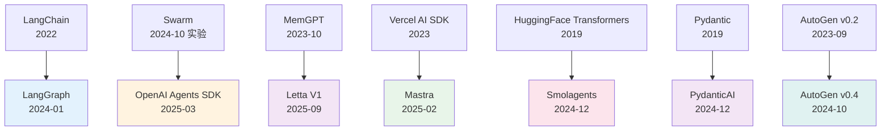

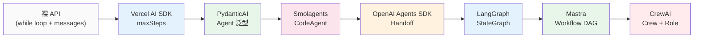

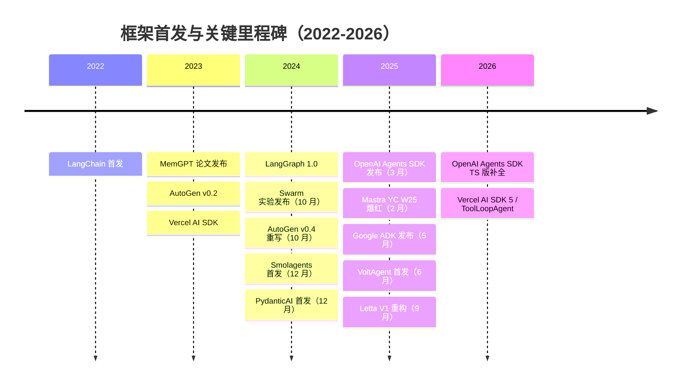

---

## 框架卡片

### 1. LangGraph（LangChain）

**核心定位**：把 agent loop 表达为带状态的有向图（cyclic graph），用于需要确定性控制流的复杂 agent。

| 维度 | 详情 |
|------|------|
| **核心抽象** | `StateGraph` + TypedDict state + 节点函数 + 条件边。每个节点接收 state，返回 state 更新（reducer 模式）。`Checkpointer` 在每次节点转换后持久化 state。 |
| **Tool 调用** | ReAct 风格：LLM 选 tool → 执行 → 结果追加进消息列表 → 下一轮。依赖 provider 原生 function calling。 |
| **Memory / Context** | Checkpointer 持久化整个 state（含消息历史）。context overflow 需手动处理（trim、summarize），没有自动机制。 |
| **错误恢复** | 支持 time-travel（回滚到历史 checkpoint）、human-in-the-loop interrupt（暂停等待人工介入）。tool 失败由开发者在节点内部处理。 |
| **本地模型** | 通过 LangChain 的 ChatOllama / OpenAI-compatible 接口，支持 Qwen / Llama。TS 版有已知内存泄漏（每次调用 ~5.8MB，Issue #1746）和 Ollama 空 content bug（Discussion #4398）。 |
| **可观测性** | LangSmith 集成（付费），本地有 `astream_events`。trace 粒度细（节点级）。 |
| **开发者口碑** | 褒贬两极。优点：checkpoint、time-travel、human-in-the-loop 是业界最强。批评：**学习曲线陡峭**，graph 定义繁琐（社区："writing simple hardcoded solutions seems faster"），调试抽象层太深，LangChain 全家桶包袱重。 |

**典型 API 形状（Python）**：

```python
from langgraph.graph import StateGraph, MessagesState

def call_model(state: MessagesState):
    response = model.invoke(state["messages"])
    return {"messages": [response]}

def should_continue(state: MessagesState):
    last = state["messages"][-1]
    return "tools" if last.tool_calls else END

graph = StateGraph(MessagesState)
graph.add_node("agent", call_model)
graph.add_node("tools", tool_node)
graph.add_conditional_edges("agent", should_continue)
graph.add_edge("tools", "agent")
app = graph.compile(checkpointer=MemorySaver())
```

LangGraph 的 `createReactAgent` 内部执行流如下：

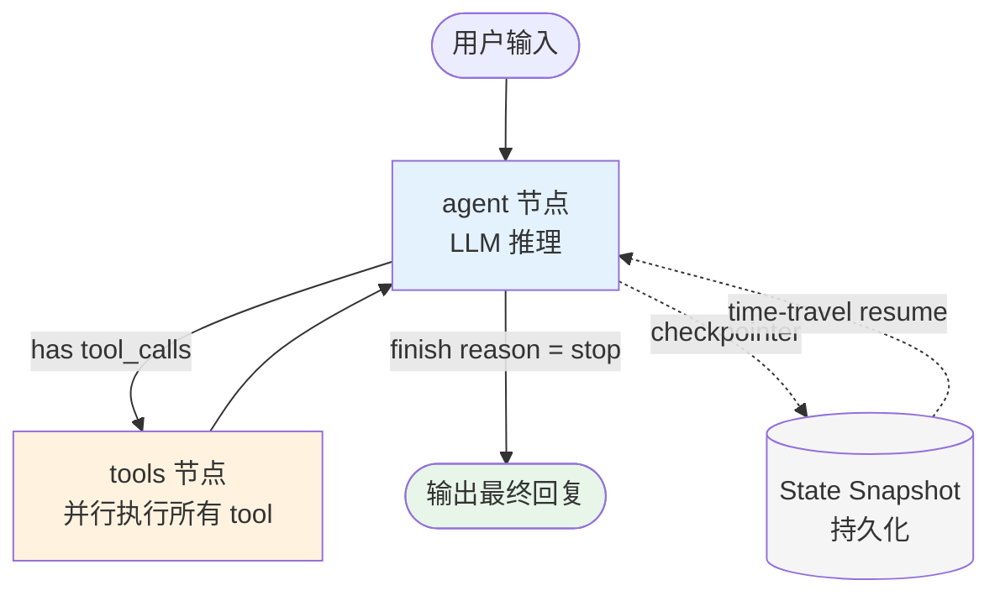

**适用场景**：需要明确控制流、checkpoint + resume 的长任务、human-in-the-loop 审批流。简单 ReAct loop 用 LangGraph 是过度工程。**TS 嵌入场景慎用**（内存泄漏问题未修复）。

---

### 2. OpenAI Agents SDK（前身 Swarm）

**核心定位**：极简的 agent 编排原语，以 handoff 为核心，面向多 agent 协作。2025 年 3 月发布 Python 版，2026 年补 TypeScript 版。

| 维度 | 详情 |
|------|------|
| **核心抽象** | `Agent`（instructions + tools + guardrails + model） + `Runner`（执行循环） + `Handoff`（agent 间移交控制权）。Trace 由 `trace()` / `span()` 自动收集。 |
| **Tool 调用** | 函数装饰器自动生成 JSON schema，依赖 function calling。MCP server 作为 tool source（内置支持）。Guardrails 并行于 agent 执行，输入/输出校验失败时 fail fast。 |
| **Memory / Context** | Sessions API 跨轮次持久化，但具体 context window 管理需开发者自己处理。无自动压缩。 |
| **错误恢复** | Guardrails 并行拦截。tool 失败返回错误信息交由 LLM 重试。 |
| **本地模型** | 官方仅支持 OpenAI 系列，通过 `base_url` + OpenAI-compatible 可接 Ollama，但 handoff/guardrail 在非 OpenAI 模型上未充分测试。 |
| **可观测性** | 内置 trace/span，自动记录 LLM 调用、tool 执行、handoff 事件。与 OpenAI 平台评估/微调工具集成。 |
| **开发者口碑** | 正面：API 极简，"5 个原语就够了"，handoff 作为 tool call 的设计优雅。批评：**强 OpenAI 锁定**，Python 版更成熟，TS 版 2026 才补上，handoff 串行不支持并行。 |

**典型 API 形状（Python）**：

```python
from agents import Agent, Runner, handoff

spanish_agent = Agent(name="Spanish agent", instructions="Reply in Spanish.")
triage_agent = Agent(
    name="Triage",
    instructions="Route to the right specialist.",
    handoffs=[handoff(spanish_agent)]
)
result = Runner.run_sync(triage_agent, "Hola, necesito ayuda.")
print(result.final_output)
```

Handoff 的控制权转移时序如下（Guardrails 并行于主 agent 执行）：

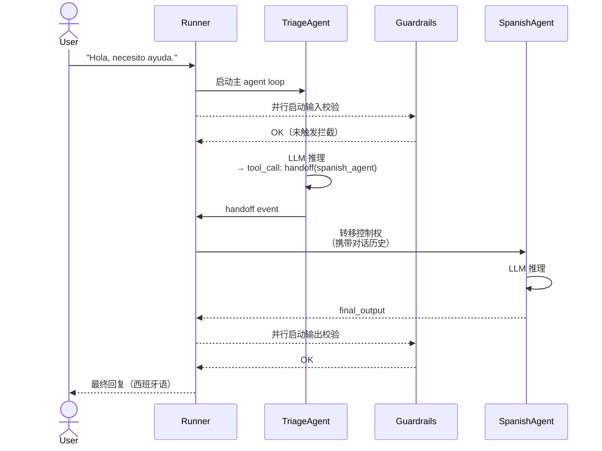

---

### 3. Mastra（Gatsby 团队，TS-first）

**核心定位**：TypeScript-first 的 agent + workflow 框架，建在 Vercel AI SDK 之上，补齐 memory、workflow orchestration、RAG、evals。YC W25，$13M seed。

| 维度 | 详情 |
|------|------|
| **核心抽象** | `Agent`（model + instructions + tools + memory）+ `Workflow`（基于 XState 的 graph-based 编排，`.then()` / `.branch()` / `.parallel()`）+ `Memory`（conversation history + semantic recall）。 |
| **Tool 调用** | 直接透传给 Vercel AI SDK 的 tool 机制，继承 AI SDK 的流式基础设施。`createTool` + Zod schema。 |
| **Memory / Context** | 三层：recent messages（last N）+ semantic recall（embedding 检索）+ working memory（结构化事实）。Observational Memory（30k token 触发后台 LLM 压缩——**此压缩成本不计入 agent token 用量，是隐性开销**）。 |
| **错误恢复** | Workflow 支持 checkpoint（mid-execution pause/resume）和 human approval 节点。agent 层面依赖 AI SDK 的重试机制。 |
| **本地模型** | 理论上通过 AI SDK 支持 40+ providers。**实际问题**：Issue #2619 Ollama 报 Bad Request；Issue #7252 `ollama-ai-provider-v2` 依赖 Zod v4 而 Mastra 用 Zod v3，冲突；V5 版本 Ollama 完全不可用。 |
| **可观测性** | 内置 workflow 执行日志，支持 OpenTelemetry。 |
| **开发者口碑** | 2025 年 2 月 HN 爆红（1 周 1500 → 7500 stars）。好评：TS-first、AI SDK 集成自然。批评：auth 包仍标 `experimental_`，Ollama 支持实际破损，**Elastic License v2 不是真开源**（SaaS 部署受限）。 |

**典型 API 形状（TypeScript）**：

```typescript
import { openai } from "@ai-sdk/openai";
import { Agent } from "@mastra/core/agent";

const agent = new Agent({
  name: "ResearchAgent",
  instructions: "You are a research assistant.",
  model: openai("gpt-4o"),
});

await agent.stream("Summarize recent AI papers", {
  resourceId: "user_123",
  threadId: "session_abc",
  memoryOptions: {
    lastMessages: 10,
    semanticRecall: { topK: 3, messageRange: 5 },
  },
});
```

Mastra 三层架构（Workflow / Agent / Memory）的组合方式：

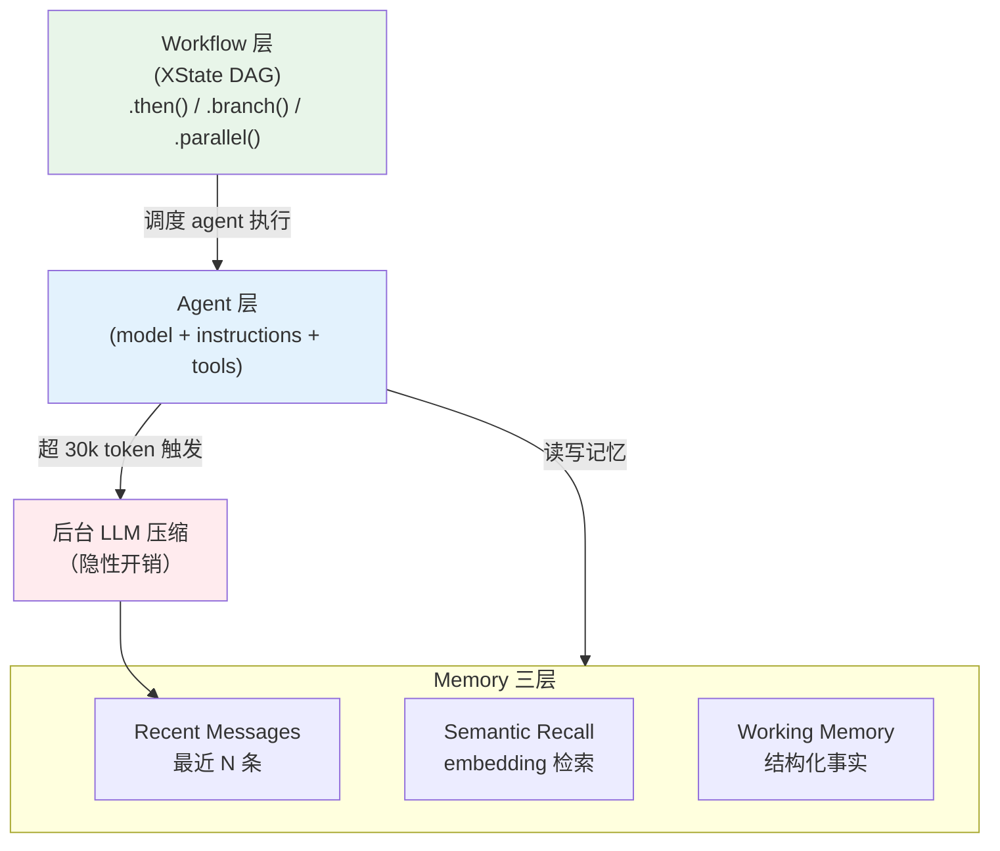

**结论**：Mastra 是最接近"直接用"的 TS 框架，但 Ollama 问题和 Elastic License 是硬障碍。可以参考其三层 memory 架构和 Workflow/Agent 分层设计，但不建议直接引入依赖。

---

### 4. Vercel AI SDK（generateText / streamText with tools）

**核心定位**：流式优先的 LLM 调用库，`maxSteps` 参数使其具备 agent loop 能力，本质是"带工具的多轮生成"而非完整 agent 框架。

| 维度 | 详情 |
|------|------|
| **核心抽象** | `generateText` / `streamText`（单次或多步 LLM 调用） + `tools`（schema + execute） + `maxSteps`（循环步数上限） + `ToolLoopAgent`（封装好的工具循环，AI SDK 5 新增）。 |
| **Tool 调用** | 依赖 provider 原生 function calling。tool 结果自动追加回消息列表，触发下一步 LLM 调用。`onStepFinish` 钩子可观察每步。 |
| **Memory / Context** | **无内置 memory**。messages 数组需开发者自己管理。这是与 Mastra 的最大区别。 |
| **错误恢复** | tool execute 抛出异常时，错误作为 tool result 返回给 LLM。`stopWhen` 控制终止条件（`stepCountIs(N)` / `hasToolCall(name)` / `isLoopFinished()`）。`WorkflowAgent` 内置 3 次自动重试。 |
| **本地模型** | 通过 `@ai-sdk/openai` compatible endpoint 接 Ollama，`baseURL: "http://localhost:11434/v1"` 即可。项目已有此集成，是最稳定的 TS 本地模型路径。 |
| **可观测性** | 无内置 trace，需接 Braintrust / Langfuse 等。`onStepFinish` 可手动 log。 |
| **开发者口碑** | 高度正面：API 简洁，TS 类型安全，streaming UI 集成无缝（`useChat`）。批评：Vercel 函数 timeout 限制（300-800s）对长任务不友好，但在 Node.js 进程内不受限；memory 完全 DIY。 |

**`maxSteps` 是 agent loop 吗？**

严格来说是的——它实现了 ReAct 的 observe-reason-act 循环。但它缺乏状态持久化、memory 管理、multi-agent 协作等"框架级"能力。适合单 agent 任务，复杂场景需要在上层封装。**这是本项目自研 loop 的最佳底层**。

**典型 API 形状（TypeScript）**：

```typescript
import { generateText, tool } from "ai";
import { openai } from "@ai-sdk/openai";
import { z } from "zod";

const { text, steps } = await generateText({
  model: openai("gpt-4o"),
  tools: {
    weather: tool({
      description: "Get the weather",
      parameters: z.object({ city: z.string() }),
      execute: async ({ city }) => ({ temp: 22, city }),
    }),
  },
  maxSteps: 10,
  onStepFinish({ toolCalls, toolResults, finishReason }) {
    // 每步回调：logging / token 计数 / UI 更新
  },
});
// steps 数组包含完整执行 trace
```

`prepareStep` 的高级用法（AI SDK 5）——每步前可切换 model，实现 big→small 模型策略：

```typescript
const agent = new ToolLoopAgent({
  model: anthropic("claude-sonnet-4-6"),
  tools: { /* tools */ },
  stopWhen: stepCountIs(20),
  prepareStep: async ({ model, steps }) => {
    // 前几步用强模型规划，后续用小模型执行
    if (steps.length > 3) return { model: localModel };
  },
});
```

Vercel AI SDK agent loop 骨架（以 `ToolLoopAgent` 为例）：

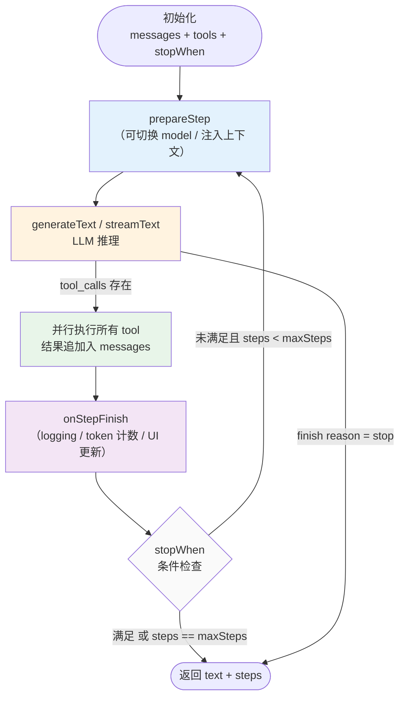

---

### 5. AutoGen（Microsoft，v0.4）

**核心定位**：多 agent 异步对话框架，v0.4 从头重写，采用 actor 模型，主要面向研究和复杂多 agent 场景。

| 维度 | 详情 |
|------|------|
| **核心抽象** | 三层：`autogen-core`（actor 模型 + 消息路由）/ `autogen-agentchat`（高层对话 API）/ `autogen-ext`（provider 集成）。Team：`RoundRobinGroupChat` / `SelectorGroupChat`（LLM 决定下一个发言者）。 |
| **Tool 调用** | 通过 `ToolCallRequestEvent` / `ToolCallExecutionEvent` 消息类型传递。`CancellationToken` 可取消任意 agent 操作。 |
| **Memory / Context** | Team 支持 `save_state()` / `load_state()`，但没有自动 context compression。 |
| **错误恢复** | 异步事件驱动，支持 mid-execution 暂停、agent 组合调整。`CancellationToken` 可取消任意操作。 |
| **本地模型** | v0.4.8 内置 `OllamaChatCompletionClient`，原生支持 Ollama tool calling（Ollama v0.3.1+）。**Python-only**。 |
| **可观测性** | `run_stream()` 实时输出 agent 动作流。支持 Azure Application Insights。 |
| **开发者口碑** | v0.2 → v0.4 不兼容重写，社区出现 AG2 fork。v0.4 架构更健壮，但**复杂度高**，适合研究而非快速产品开发。Python-only，TypeScript 无官方支持。 |

---

### 6. CrewAI

**核心定位**：角色扮演式多 agent 框架，通过 role/goal/backstory 定义 agent，用 Crew 统一编排任务分发。

| 维度 | 详情 |
|------|------|
| **核心抽象** | `Agent`（role + goal + backstory + tools）+ `Task`（description + expected_output + agent）+ `Crew`（agents + tasks + process: sequential/hierarchical）。 |
| **Tool 调用** | 基于 LLM 自主决策选 tool，每个 task 绑定一个 agent。依赖 function calling。 |
| **Memory / Context** | short-term（ChromaDB + RAG）、long-term（SQLite）、entity memory（知识图谱）。但多 agent 共享全量 context 导致 token 成本 3x。 |
| **错误恢复** | **主要弱点**：一个 agent context overflow 导致整个 crew 可能陷入"doom loop"——失败的 agent 被反复调用。checkpoint 成熟度远不如 LangGraph。 |
| **本地模型** | 通过 LiteLLM 支持 Ollama，但本地小模型在 role-based 指令跟随上表现不稳定，hierarchical 模式有终止失败风险。 |
| **可观测性** | AgentOps 集成，有 UI 观察 crew 执行。 |
| **开发者口碑** | 最广泛的企业使用（production adoption 最高），代码量少、上手快。严厉批评：**黑盒调试**、token 浪费（有 "$414 in a single run" 真实案例）、agent 自主性被 task 结构限死（"one task = one agent" 去掉了真正的自主决策）、错误恢复差，有已知 doom loop bug。适合 demo，慎用于 production 复杂任务。 |

---

### 7. Letta（前 MemGPT）

**核心定位**：memory-first agent 框架，核心创新是把 context window 当 OS 的内存来管理，允许 LLM 自主 read/write 自己的记忆。

| 维度 | 详情 |
|------|------|
| **核心抽象** | Memory Blocks（in-context 结构化记忆单元，类比 RAM）+ Archival Memory（外部存储，向量检索，类比磁盘）+ Recall Memory（对话历史检索）。Memory 工具：`core_memory_append`、`core_memory_replace`、`archival_memory_insert`、`archival_memory_search`。 |
| **Tool 调用** | LLM 通过 tool call 自主管理自己的记忆（写入/检索/删除），不只是调用外部 API。依赖 function calling。 |
| **Memory / Context** | **核心特色**：递归摘要 + 消息剪枝 + 人工降低 context 上限触发压缩。"MemFS"（git-tracked 记忆文件系统）是最新实现。 |
| **错误恢复** | compaction 有 bug 修复记录（double-compaction、runaway compaction loop）。context exceeded 错误有描述性提示。 |
| **本地模型** | 支持 Ollama，但 memory tool 密集调用对小模型挑战大。**架构硬约束**：Letta 必须运行独立 server，无法进程内嵌入，与 Obsidian 插件场景直接冲突。 |
| **可观测性** | ADE（Agent Development Environment）提供可视化 agent 状态和记忆查看。 |
| **开发者口碑** | 学术背景强（MemGPT 论文），适合需要跨会话记忆的 personal assistant 场景。批评：memory tool 机制增加 LLM 调用次数，成本偏高；必须运行独立 server 是架构硬限制。 |

Letta 三层内存架构——Core Memory 在 context window 内，其余两层依靠 tool call 按需检索或写入：

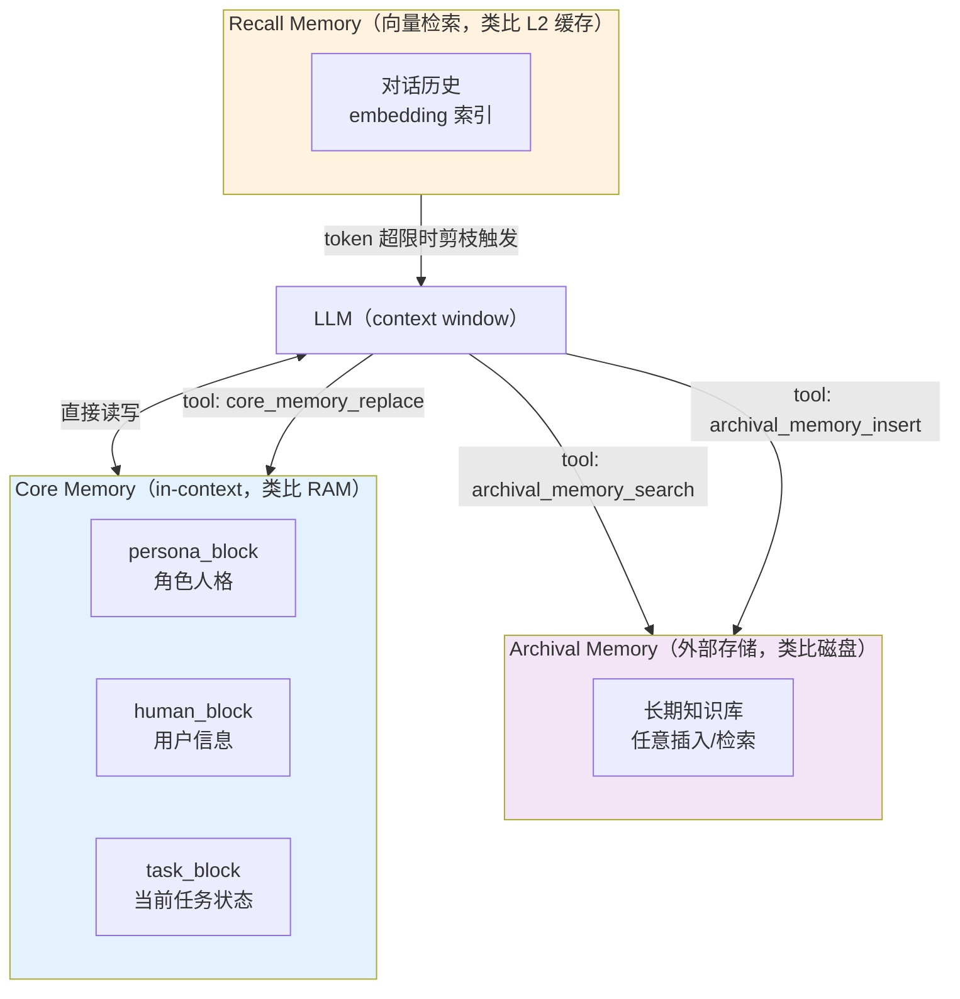

**值得借鉴的设计（不用引入整个框架）**：Memory Block 模式——把 agent context 切分为命名块（`persona_block`、`human_block`、`task_block`），每块有独立更新策略，比整段 system prompt 更可控。

---

### 8. Pydantic AI

**核心定位**：type-safe Python agent 框架，强调编译期类型检查，model-agnostic，用 Pydantic 验证 LLM 输出。2025 年 9 月 v1.0 发布后快速获得 16,000 GitHub stars。

| 维度 | 详情 |
|------|------|
| **核心抽象** | `Agent[DepsType, OutputType]`（泛型 agent）+ `RunContext[Deps]`（依赖注入上下文）+ `@agent.tool` 装饰器（tool 注册）。 |
| **Tool 调用** | `@agent.tool` 函数的 docstring 自动成为 LLM 描述，Pydantic 验证参数。tool 失败时错误返回给 LLM 进行重试（reflection）。`tool_retry` 异常类型可从 tool 内部请求 LLM 重试。 |
| **Memory / Context** | 无内置 memory，messages 由开发者管理。**亮点**：`UsageLimits`（max_tokens / max_tool_calls 硬性上限，超限自动中止，这是其他框架普遍缺失的）。 |
| **错误恢复** | validation 失败触发 reflection（LLM 自我修正）。`tool_retry` 可精确控制哪个 tool 失败后触发重试。 |
| **本地模型** | 支持 Ollama、LiteLLM、OpenRouter 等 20+ providers，包括任意 OpenAI-compatible endpoint。 |
| **可观测性** | Logfire 集成（Pydantic 自家产品）。 |
| **开发者口碑** | 好评：最接近 TS 类型安全体验的 Python 框架，dependency injection 模式测试友好。批评：生态比 LangChain 小 15 倍，没有内置 handoff / workflow，Python-only 核心。 |

**典型 API 形状（Python）**：

```python
from pydantic_ai import Agent, RunContext
from dataclasses import dataclass

@dataclass
class Deps:
    db_client: DatabaseClient
    user_id: str

agent = Agent(
    "anthropic:claude-sonnet-4-6",
    deps_type=Deps,
    output_type=str,
)

@agent.tool
async def lookup_order(ctx: RunContext[Deps], order_id: str) -> dict:
    """Fetch order details from the database."""
    return await ctx.deps.db_client.get_order(ctx.deps.user_id, order_id)

result = agent.run_sync(
    "What's the status of order #1234?",
    deps=Deps(db, "u_123"),
)
```

**最值得移植到 TS 的设计**：`UsageLimits` 模式（在 loop 启动时声明硬性约束）和依赖注入 RunContext（tools 通过 context 获取运行时资源，不依赖全局状态）。

---

### 9. HuggingFace Smolagents

**核心定位**：极简（约 1000 行核心代码）的 agent 框架，核心创新是 `CodeAgent`——让 LLM 写 Python 代码而非 JSON tool call，在复杂任务上减少约 30% LLM 步骤。

| 维度 | 详情 |
|------|------|
| **核心抽象** | `CodeAgent`（code-as-action，生成 Python 代码执行）vs `ToolCallingAgent`（JSON tool call，标准模式）。`InferenceClientModel`（HF Hub API）/ `TransformersModel`（本地）。 |
| **Tool 调用** | CodeAgent：LLM 生成 Python 代码，框架安全执行（沙箱），结果作为 observation 传回。ToolCallingAgent：标准 JSON function calling，使用 provider 原生能力。 |
| **Memory / Context** | 基本：对话历史保留在 `agent.memory` 中。无自动压缩。 |
| **错误恢复** | code 执行异常 traceback 直接返回给 LLM，允许修正后重试。`max_steps` 防止无限循环。 |
| **本地模型** | `TransformersModel` 直接加载 HF 模型。**已知限制**：每次响应只解析一个 tool call（即使模型支持并行，Issue #1899），本地小模型 code 格式错误率高。 |
| **可观测性** | 执行 trace 实时打印（`╭─ Calling tool... ╰─`），无外部 observability 集成。 |
| **开发者口碑** | 好评：GAIA benchmark top 2（验证集 44.2%，测试集 33.3%），框架轻量（1000 行，易读懂）。批评：code 执行安全风险（生产需要 Docker/E2B 沙箱），`TransformersModel` 不支持并行 tool call，local model 格式失败率较高，极简意味着 production 特性（持久化/重试/observability）需全部自建。 |

**Code vs JSON 性能数据**（smolagents 论文数据）：

| 场景 | CodeAgent | ToolCallingAgent |
|------|-----------|-----------------|
| 简单单步 | 相当 | 相当 |
| 复杂多步（10+ 步） | ~7 步完成 | ~10 步完成（少 30% steps） |
| 变量传递 | 原生支持（Python 变量） | 需要额外 LLM 调用中转 |
| 安全风险 | 需要沙箱 | 无额外风险 |
| 小模型兼容性（<14B） | 差（格式错误率高） | 好（schema 约束更严格） |

两种 loop 结构的对比（左 CodeAgent / 右 ToolCallingAgent）：

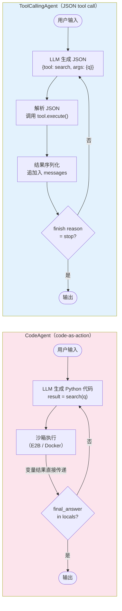

---

### 10. Cline / Roo Code（开源 Coding Agent）

**核心定位**：VS Code 扩展 + 独立 agent runtime，专注 coding 任务，自研 agent loop 不依赖任何 agent 框架。2025 年发布 `@cline/sdk`，开放核心 loop 供复用。

| 维度 | 详情 |
|------|------|
| **核心抽象** | `@cline/agents`（stateless agentic loop：iteration + tool 编排 + event 发射）+ `@cline/core`（stateful 编排：session lifecycle + persistence + config）+ `@cline/providers`（LLM 调用层，完全解耦）。Plan/Act 双模式切换。 |
| **Tool 调用** | `createTool` 自定义注册，provider 层完全解耦于 agent loop（切换 provider 是配置变更而非代码变更）。支持 MCP server 作为 tool source。 |
| **Memory / Context** | `.clinerules` 定义项目级规则。context 管理手动（token 计数、主动截断）。无自动 memory 系统。 |
| **错误恢复** | 自动捕获 lint/编译错误，主动修复后继续。task abort 机制。 |
| **本地模型** | 显式支持 Ollama / LM Studio，provider 层 OpenAI-compatible。 |
| **可观测性** | Plan/Act 模式下用户可见每步 diff 和 action，人工审批后执行。 |
| **开发者口碑** | GitHub 上最活跃的开源 coding agent 之一。值得学习：**provider 层与 loop 层的彻底解耦**、stateless loop 设计使其适合 serverless。 |

**Cline SDK 的分层是自研时的直接参考模板**：

```
@cline/providers  →  纯 LLM 调用层（可替换）
@cline/agents     →  无状态 loop（可在 serverless / 插件内运行）
@cline/core       →  有状态编排（session、persistence）
```

---

### 附：OpenHands（前 OpenDevin）

**核心定位**：通用软件工程 agent，事件驱动架构，每个 action/observation 是不可变事件（支持确定性 replay）。

| 维度 | 详情 |
|------|------|
| **核心抽象** | Agent / Conversation / Workspace / EventStream（单一事实来源）。每个 action 在沙箱容器中执行，通过 REST API 返回 observation，形成 tight loop。 |
| **Tool 调用** | 所有 action（文件编辑、终端命令、浏览器操作）统一为事件类型，不是传统 tool call。 |
| **本地模型** | 支持，但推荐 32B+ 参数（<32B 指令跟随在复杂任务上显著退化）。开源模型与 Claude/GPT 差距约 2-6%（SWE-Bench verified）。 |
| **口碑** | 学术+工程兼顾，SWE-Bench 顶尖成绩。V1 SDK 重构后可复用性提升。 |

---

## 横向对比矩阵

| 框架 | 语言 | 核心抽象 | Tool 调用 | 内置 Memory | 本地模型友好 | 错误恢复 | 可观测性 | 生产口碑 |
|------|------|----------|-----------|-------------|-------------|----------|----------|----------|
| **LangGraph** | Python | StateGraph + Checkpointer | Function calling | 手动管理 | ★★（TS 版有 bug） | ★★★★★ time-travel | ★★★★ LangSmith | ★★★★ 复杂场景 |
| **OpenAI Agents SDK** | Python/TS | Agent + Runner + Handoff | Function calling | Sessions API | ★★ 非设计目标 | ★★★ guardrails | ★★★★ 内置 trace | ★★★ 强 OAI 绑定 |
| **Mastra** | TypeScript | Agent + Workflow + Memory | AI SDK 透传 | ★★★★★ 三层 | ★★（Ollama 破损） | ★★★★ checkpoint | ★★★★ OTel | ★★★ 成长中 |
| **Vercel AI SDK** | TypeScript | generateText + maxSteps | Function calling | 无，手动 | ★★★★★ 最稳 | ★★★ 工具级 | ★★ 需外接 | ★★★★★ 最轻量 |
| **AutoGen v0.4** | Python | Actor + Team + Message | Function calling | save/load state | ★★★★ 原生 Ollama | ★★★★ async cancel | ★★★ streaming | ★★★ 研究向 |
| **CrewAI** | Python | Crew + Agent + Task | Function calling | ★★★ 多层 | ★★ 小模型差 | ★★ doom loop 风险 | ★★★ AgentOps | ★★ 高风险 |
| **Letta** | Python | Memory Blocks + Tools | Function calling | ★★★★★ 核心 | ★★★ Ollama（需 server） | ★★★ compaction | ★★★★ ADE | ★★★ niche |
| **PydanticAI** | Python | Agent[Deps, Out] + RunContext | Function calling | 无（有 UsageLimits） | ★★★★ 20+ providers | ★★★★ reflection | ★★★ Logfire | ★★★★ 快速增长 |
| **Smolagents** | Python | CodeAgent / ToolCallingAgent | Code / JSON | 基础 history | ★★★★★ HF 原生 | ★★★ code retry | ★★ print trace | ★★★ 研究向 |
| **Cline SDK** | TypeScript | stateless loop + core | 自定义 tool | 无（clinerules） | ★★★★★ Ollama 显式 | ★★★★ lint repair | ★★★★ Plan/Act UI | ★★★★★ coding |

---

以"抽象层级"为横轴、"本地模型友好度"为纵轴，各框架的大致定位：

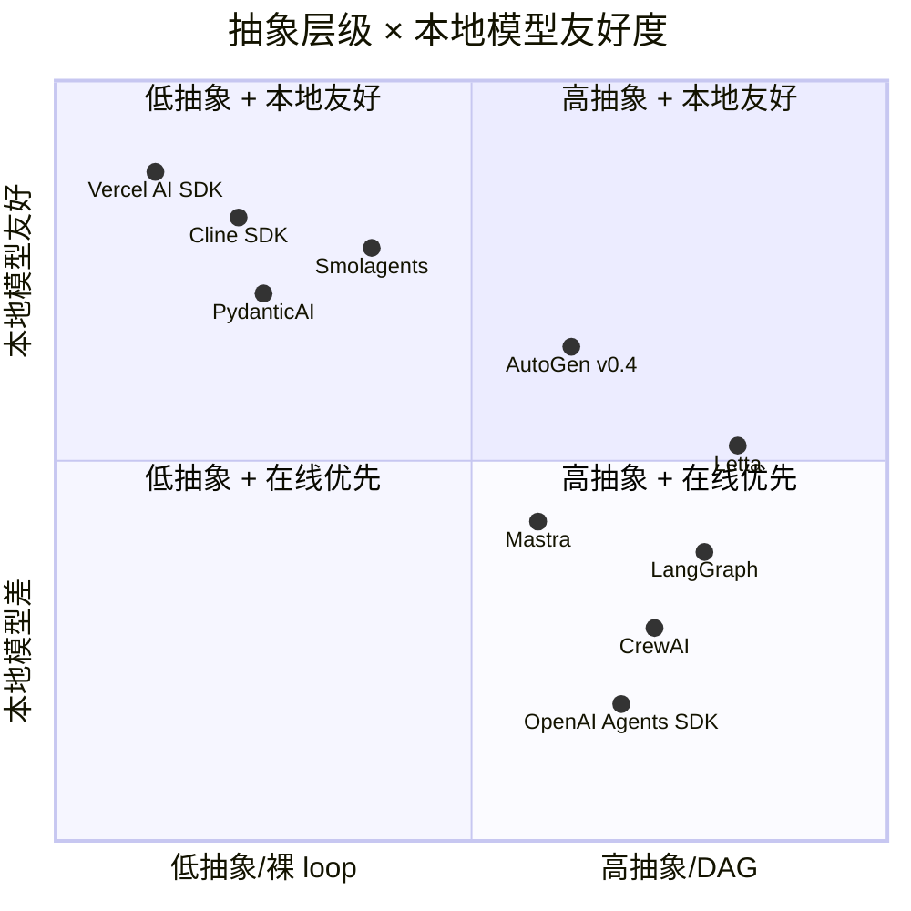

根据项目约束（运行环境 / 本地模型 / 编排复杂度）选型：

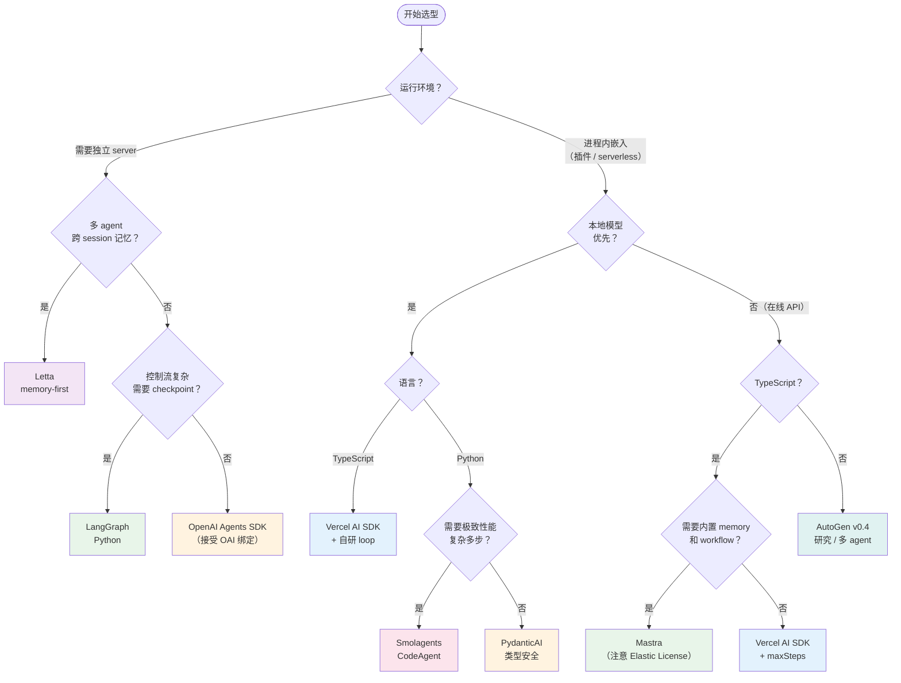

---

## 设计选择的分歧点

### 1. State Machine vs Message List

**State Machine 派（LangGraph）的论点**：
- 复杂工作流需要确定性控制流（保证 A 之后总是 B 或 C，不让 LLM 自由发挥）
- checkpoint 在节点边界上是天然的 state snapshot
- 易于 time-travel 和 human-in-the-loop interrupt

**Message List 派（PydanticAI、Vercel AI SDK）的论点**：
- agent 的"状态"本质上就是消息历史，无需额外抽象
- state machine 引入的图定义代码量大，simple task 是过度工程
- 调试 message list 比调试 graph state 直观得多——messages 可直接 `console.log`，graph state 需要专门工具
- 现代 LLM 的 instruction following 能力已经强到不需要 graph 强制控制流

**社区趋势（2025）**：Reddit/HN 趋势明显倒向 message list，特别是对已有代码库的项目。"直接用 API + 几十行 loop 就够了"的声音越来越强。

**实践结论**：用 message list 作为 loop 的内部状态，在外层用简单的 if/else 或 switch 表达控制流。只有当控制流复杂到需要 checkpoint 和 time-travel 时才引入 LangGraph（且 TS 版本当前有内存泄漏 bug，Obsidian 插件场景不建议）。

### 2. Code-as-Action vs JSON Tool Call

**Smolagents CodeAgent 的论点**：
- LLM 生成代码天然支持变量复用（`result = search(q)[0].text; summary = summarize(result)`），JSON 模式每步都需要 LLM 重新中转
- 复杂任务减少约 30% LLM 调用次数（GAIA benchmark 验证）
- 不需要解析 JSON 来构建调用——代码直接执行
- GAIA benchmark top 2

**JSON Tool Call 派的论点**：
- 安全风险：code 执行需要可信沙箱，JSON tool call 风险面更小
- 小模型（<14B）生成格式正确代码的失败率远高于 JSON tool call（Qwen3-8B tool 错误恢复率仅 20%，Claude Sonnet 超 50%）
- JSON schema 约束更严格，解析错误更少
- 主流 provider 原生支持 function calling，不需要额外 prompt engineering

**实践结论**：对于需要本地小模型（Qwen 7B/14B）的场景，JSON tool call 更可靠。code-as-action 的优势在强模型（Claude/GPT-4 级别）和需要复杂数据操作的场景下更明显。Obsidian 插件面向本地模型场景，选 JSON tool call + 容错层。

### 3. Memory Tool vs 自动 Compression

**Letta 的 Memory Tool 路线**：
- LLM 自主决定写/读/删什么，记忆质量更高（模型知道什么重要）
- 但每次 memory 操作都消耗 tool call，增加延迟和成本
- 小模型的 memory tool 调用格式失败率高

**自动 Compression 路线（Mastra Observational Memory、LangGraph summarize chain）**：
- 无需 LLM 自主触发，超出 token 阈值自动压缩
- 压缩质量可能低于 LLM 自主决策，但实现更可靠
- 对小模型友好，Mastra 的隐性成本（压缩调用不计入可见 token）需注意

**实践结论**：自研 loop 推荐自动 compression + 滑动窗口（保留最近 N 条 + 早期摘要），作为可靠的 fallback。在目标模型够强（Claude 级别）的场景，再叠加 memory tool。

### 4. Framework-First vs Library-First

**Framework-First（LangGraph、CrewAI、AutoGen）**：
- 开箱即用，减少 boilerplate
- 但抽象层增加调试难度，"abstraction without leverage"（artiquare.com 批评：当前框架是"包装代码而非真正的架构"）
- 框架演化可能与业务需求脱节（CrewAI doom loop bug 多年未修，"abstract too early"）

**Library-First（PydanticAI、Vercel AI SDK、直接调 API）**：
- 完全掌控 loop 每一步
- 更容易 debug（消息列表可直接打印）
- 初期代码更多，但长期可维护性更好

**结论**：对于 Obsidian 插件这类有特殊约束（不能起 server、TS 环境、本地模型优先）的场景，library-first 几乎是唯一选项。

---

## 推荐借鉴清单

### 必抄的设计

**1. Provider 层与 Loop 层彻底解耦（参考 Cline SDK）**

provider 负责 LLM 调用 + 消息格式化，loop 不知道也不关心底层用的是哪个 provider。切换 Claude → Qwen-local 是配置变更，loop 代码不动。

```typescript
// provider 层：只负责 LLM 调用，返回标准化消息
interface LLMProvider {
  complete(messages: Message[], tools: ToolSchema[]): Promise<LLMResponse>;
  stream(messages: Message[], tools: ToolSchema[]): AsyncGenerator<StreamChunk>;
}

// loop 层：无状态，不依赖任何具体 provider
async function runAgentStep(
  state: AgentState,
  provider: LLMProvider,
  tools: ToolRegistry
): Promise<AgentState> { /* ... */ }
```

**2. maxSteps + 明确的 stop condition（参考 Vercel AI SDK）**

不要用 `while (true)`，始终带步数上限。同时支持 tool 级别的终止条件。

```typescript
const stopConditions = [
  stepCountIs(20),              // 安全阀
  hasToolCall("final_answer"),  // 语义终止
];
```

**3. Token 预算声明（参考 PydanticAI UsageLimits）**

在 loop 启动时声明硬性约束，超限自动中止而非无限循环。这是最被忽视的安全机制之一。

```typescript
interface LoopBudget {
  maxSteps: number;       // 步数上限
  maxTokensTotal: number; // 总 token 上限
  maxToolCalls: number;   // tool 调用总次数上限
}
```

**4. Tool 失败返回 error 而非 throw（参考 Claude Agent SDK / Cline）**

tool execute 的异常应 catch 后作为 tool result 返回给 LLM（`isError: true`），而非让整个 loop 崩溃。LLM 可以看到错误信息并决定是否重试或换策略。

```typescript
async function executeTool(tool: Tool, args: unknown): Promise<ToolResult> {
  try {
    const result = await tool.execute(args);
    return { type: "success", content: result };
  } catch (err) {
    return { type: "error", content: String(err), isError: true };
  }
}
```

**5. 每步 onStepFinish 钩子（参考 Vercel AI SDK）**

暴露给调用方在每步结束时注入逻辑（logging、token 计数、UI 更新、human-in-the-loop check），而非把这些逻辑硬编码进 loop。

**6. 滑动窗口 + 摘要的 context 管理（参考 LangGraph 社区实践 + Letta 思路）**

```typescript
function trimMessages(messages: Message[], maxTokens: number): Message[] {
  // 1. 保留 system prompt（始终）
  // 2. 保留最近 N 条完整消息（滑动窗口）
  // 3. 如果还超限，触发 summarize（调用 LLM 摘要早期历史）
  // 4. 把摘要作为一条 assistant 消息插入头部
}
```

**7. Zod schema 驱动的 tool 定义（参考 Vercel AI SDK，TS 场景）**

tool 的 parameters 用 Zod schema 定义，自动生成 JSON schema 传给 LLM，同时作为运行时 parse 和类型推导的来源。避免手写 JSON schema 和类型不一致。（本项目已有此模式，参考 `src/core/schemas/`）

**8. 内置 trace event emitter**

loop 每步发出标准化事件（`tool_call_start`、`tool_call_end`、`llm_call_start`、`llm_call_end`、`step_finish`），外部消费者订阅 trace。不把 logging 硬编码进 loop 内部。

### 必避的反模式

**1. 用框架包装框架（反 CrewAI / LangChain 全家桶）**

当 agent loop 失败时，你需要能直接看到：完整的 messages 数组、tool call 的原始 JSON、provider 的原始响应。多层框架抽象会遮蔽这些信息，使调试变成猜谜。artiquare.com 总结："当前框架抽象了核心机制（context 如何构建、state 如何传递、tool 如何调用），把清晰性换成了晦涩性，而晦涩性在生产中会杀死可调试性。"

**2. 无步数上限的 `while (true)` loop**

不加 `maxSteps` 保护的 loop 在 LLM 输出异常时会无限消耗 token。CrewAI 社区有 $414 单次运行的真实案例。

**3. Tool 执行错误直接 throw 让 loop 崩溃**

tool 失败是 agent 执行的正常情况（网络超时、文件不存在、权限不足），应该让 LLM 看到错误并自己决定下一步，而非让整个 task 失败。

**4. 把 prompt / label 硬编码进 loop**

（对应本项目已有的 configurability rule）agent loop 中的 system prompt、tool 描述、错误模板都应通过 TemplateManager 加载，不硬编码进 TypeScript 文件。

**5. 多 agent 对话中无限制地共享全量 context（反 CrewAI 多 agent 模式）**

每个 agent 获取完整对话历史 = O(N * agents) token 消耗。对于 Obsidian 插件中的本地模型场景，应严格控制每个 agent/step 看到的 context 量。把 subagent 包装成 tool（smolagents / Google ADK 模式）是最轻量的方案——subagent 对主 loop 透明，失败时只影响一次 tool call。

**6. 假设 model 原生 function calling 总可用（针对本地模型场景）**

Ollama 部分模型的 function calling 实现有 quirk（并行 tool call 解析、nested JSON 参数等）。loop 层应有 graceful fallback：检测 provider 能力，降级到 prompt-engineering based tool calling（直接在 system prompt 描述工具格式）。

**7. Black-box memory 不可观察**

Letta / Mastra 的 memory 系统是好用的，但在 debug 时必须能直接观察 in-context 消息列表的原始内容。black-box memory 在 context overflow 时会出现难以复现的行为（Mastra 的后台 LLM 压缩调用、compaction bug）。至少要能在 debug 模式下打印完整 messages 数组。

---

## 关键参考资料

- [LangGraph 官方文档 — Human-in-the-loop](https://docs.langchain.com/oss/python/langchain/human-in-the-loop)
- [LangGraph.js Issue #1746 — heap memory leak](https://github.com/langchain-ai/langgraphjs/issues/1746)
- [OpenAI Agents SDK 官方文档](https://openai.github.io/openai-agents-python/)
- [OpenAI Agents SDK — Handoffs](https://openai.github.io/openai-agents-python/handoffs/)
- [Mastra — Using Vercel AI SDK](https://mastra.ai/blog/using-ai-sdk-with-mastra)
- [Mastra Issue #7252 — Zod v3/v4 Ollama conflict](https://github.com/mastra-ai/mastra/issues/7252)
- [Vercel AI SDK — Agents Loop Control](https://ai-sdk.dev/docs/agents/loop-control)
- [AutoGen v0.4 — Microsoft Research Blog](https://www.microsoft.com/en-us/research/blog/autogen-v0-4-reimagining-the-foundation-of-agentic-ai-for-scale-extensibility-and-robustness/)
- [AutoGen — Local LLMs with Ollama](https://microsoft.github.io/autogen/stable//user-guide/core-user-guide/cookbook/local-llms-ollama-litellm.html)
- [Smolagents — Code vs JSON Actions](https://huggingface.co/learn/agents-course/en/unit2/smolagents/tool_calling_agents)
- [Smolagents — Why use smolagents](https://huggingface.co/learn/agents-course/unit2/smolagents/why_use_smolagents)
- [Cline SDK — Introducing the Agent Runtime](https://cline.bot/blog/introducing-cline-sdk-the-upgraded-agent-runtime)
- [OpenHands — Software Agent SDK Paper (arxiv)](https://arxiv.org/html/2511.03690v1)
- [Letta — Memory Blocks](https://www.letta.com/blog/memory-blocks)
- [PydanticAI v1 Overview](https://pydantic.dev/docs/ai/overview/)
- [Speakeasy — Agent Framework Comparison](https://www.speakeasy.com/blog/ai-agent-framework-comparison)
- [Simon Willison — Agentic Engineering Patterns](https://simonw.substack.com/p/agentic-engineering-patterns)
- [Simon Willison — The lethal trifecta for AI agents](https://simonw.substack.com/p/the-lethal-trifecta-for-ai-agents)
- [CrewAI Practical Lessons Learned](https://ondrej-popelka.medium.com/crewai-practical-lessons-learned-b696baa67242)
- [Everyone's Building AI Agent Frameworks — Most Are Getting It Wrong](https://www.artiquare.com/ai-agent-frameworks-critical-analysis/)
- [Best Local LLMs for Function Calling — InsiderLLM](https://insiderllm.com/guides/function-calling-local-llms/)
- [LangGraph vs Temporal 2026 Decision Guide](https://agentmarketcap.ai/blog/2026/04/08/langgraph-vs-temporal-long-running-agent-workflows-2026)
- [TypeScript Agent Frameworks in 2026 — EveryDev.ai](https://www.everydev.ai/p/blog-typescript-agent-frameworks-in-2026-loop-runtime-sandbox)
