# 本地模型与学界范式调研

> 调研时间：2026-05-24
> 背景：为 Obsidian Peak Assistant 插件评估自研 ReAct loop + 本地模型（Ollama）的可行性

---

## Part A：本地模型 tool calling 实测

### 当前格局

2025-2026 年，本地模型的 tool calling 能力经历了一次质的飞跃。以 Qwen3、Llama 3.3、GLM-4.7 为代表的新一代模型，在原生 JSON 模式和 function calling 格式支持上已达到"可用"门槛——顶尖本地模型的单步 well-formed call rate 可达 93-97%，逼近 GPT-4o 级别的在线模型。关键分水岭在于参数量和量化精度：**14B 以下模型**在复杂多步推理中容易崩溃；**量化到 Q3 以下**的模型在 chat 质量受损前，tool calling 格式可靠性就已明显下滑。对于 Obsidian vault 扫描、文件读写、多步搜索这类需要 8-12 步工具链的任务，裸跑本地模型端到端成功率偏低（基线约 53-65%），但加上工程加固手段后可以提升到 85-90%。

**主流模型 tool calling 能力对比表（截至 2026-05-24）**

| 模型 | 参数量 | BFCL Overall | Well-formed Call Rate（实测）| 最低 VRAM（Q4_K_M）| Ollama 支持 |
|------|--------|-------------|------------------------|----------------|-----------|
| Llama 3.3 70B | 70B | ~77% (BFCL v2) | ~97% | 42 GB | 原生 |
| Qwen3 32B | 32B | ~75% (BFCL v3) | ~93% | 20 GB | 原生 |
| GLM-4.7 32B | 32B | - | ~94% | 20 GB | 原生 |
| Qwen3-Coder 30B | 30B | - | ~96% (代码任务) | 18 GB | 原生 |
| Qwen3 14B | 14B | - | ~85-88%（估） | 10 GB | 原生 |
| DeepSeek-V3.2 | 671B MoE | 最强开源水平 | 高（服务端） | 不可本地 | 无（API only）|
| Llama 3.1 8B | 8B | ~76% | ~70-75% | 5 GB | 原生 |
| Mistral Small 3.1 | 24B | - | ~88-90% | 15 GB | 原生 |
| Phi-4 mini | 3.8B | - | ~78% | 3 GB | 原生 |
| Gemma 3 27B | 27B | ~31%（未微调）| ~95%（微调后）| 16 GB | 原生 |

> 说明：BFCL 分数来自不同版本（v2/v3/v4），不可直接横向比较。Well-formed Call Rate 来自 PromptQuorum May 2026 实测，侧重 MCP server 场景格式合规率，不等于端到端任务完成率。

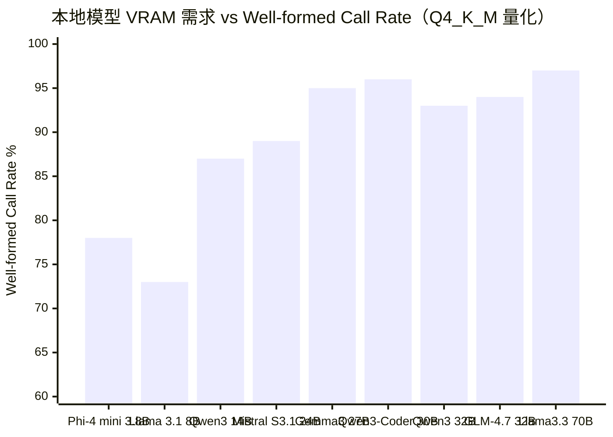

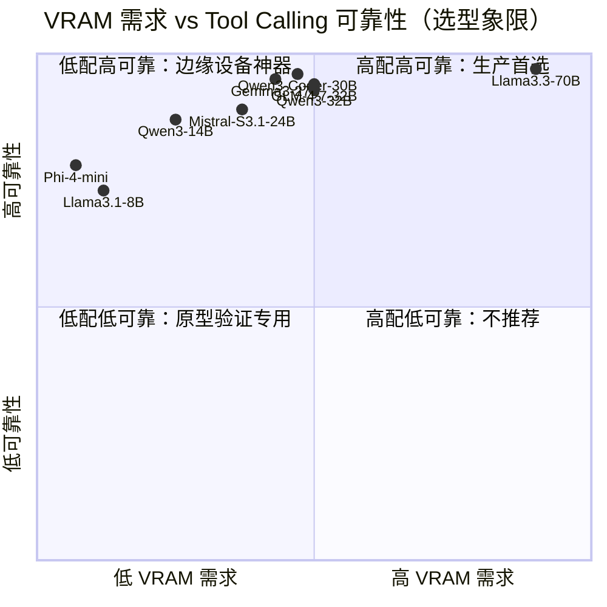

---

### 各模型详解

---

#### Qwen2.5 系列（7B / 14B / 32B / 72B）

- **发布时间**：2024-09 正式发布，2025-01 技术报告
- **官方 tool calling 支持**：原生支持（JSON function calling + Hermes 风格模板）
- **BFCL 分数**：Qwen2.5-7B 在 Tool-DC 辅助下达到 BFCL 整体 83.16%，超过 o3 和 Claude Haiku 4.5（来自 arxiv 2604.02155 论文引用）
- **Ollama 可部署**：全系列支持；Q4_K_M 量化能力损失轻微，Q3 以下格式可靠性下降
- **实测多步 tool calling**：14B/32B 在中等复杂度任务表现良好；72B 接近 GPT-4o-mini 水准
- **典型失败模式**：小参数（7B）在多轮对话中容易混入自然语言到 JSON 输出；参数遗漏在嵌套 schema 场景较常见
- **对我们场景适配度**：32B Q4_K_M（约 20 GB）是性价比最优选择；vault 文件读写 + 搜索类工具调用匹配度高，但超过 10 步的推理链需要搭配 schema 约束

---

#### Qwen3 系列（0.6B ～ 235B）

- **发布时间**：2025-04-28/29
- **官方 tool calling 支持**：原生支持，同时支持 thinking 和 non-thinking 双模式，两种模式下均可调用工具；官方推荐 Qwen-Agent 框架
- **BFCL 分数**：Qwen3-235B-A22B ≈ 0.708，Qwen3-32B ≈ 0.703，QwQ-32B ≈ 0.664（llm-stats.com 截至 2026 年）
- **Ollama 可部署**：全系列支持（`ollama pull qwen3:32b`）；32B Q4_K_M 需 20 GB VRAM
- **实测多步 tool calling**：Qwen3-32B well-formed call rate ≈ 93%；Qwen3-Coder 30B 在代码类 MCP 任务可达 96%；thinking 模式对复杂推理有明显加成
- **典型失败模式**：non-thinking 模式下高度依赖 system prompt 格式；reasoning token 开销在低算力环境下成本较高
- **对我们场景适配度**：截至调研日期，Qwen3-32B 是综合性价比最高的本地模型之一，vault scan + 搜索 + 笔记写入场景覆盖良好；thinking 模式对规划层（写 plan，调工具序列）有实质帮助

---

#### Llama 系列（3.1 / 3.2 / 3.3 / 4）

- **发布时间**：Llama 3.1（2024-07），3.2（2024-09），3.3（2024-12），Llama 4 Scout/Maverick（2025-04）
- **官方 tool calling 支持**：Llama 3.1+ 原生 function calling；Llama 4 新增 128 experts MoE，全面支持 tool use
- **BFCL 分数**：Llama 3.1 405B ≈ 0.885，70B ≈ 0.848，8B ≈ 0.761（llm-stats.com）；Llama 3.3 70B 在 BFCL v2 约 77.3%
- **Ollama 可部署**：3.1/3.3 系列全系支持；Llama 4 的 Scout（17B active）和 Maverick（17B active MoE）均可部署，但全精度显存要求高
- **实测多步 tool calling**：Llama 3.3 70B well-formed call rate ≈ 97%，是本地模型中最高的；IFEval 92.1% 超过 405B，适合需要严格指令遵循的 agent pipeline；裸跑多步任务失败率仍高（无 guardrail 时约 80% 失败率）
- **典型失败模式**：8B 参数模型容易混入自由文本；70B 在 JSON 输出中偶有自由文本混入；多步场景下易"提前结束"
- **对我们场景适配度**：Llama 3.3 70B 是高可靠性首选，但需要 42 GB VRAM（M2/M3 Max Mac 可运行）；8B 仅适合原型验证

---

#### DeepSeek 系列（V3 / R1 / Coder-V2）

- **发布时间**：DeepSeek-V3（2024-12），R1（2025-01），V3-0324（2025-03），R1-0528（2025-05），V3.2/V3.1（2025 中期）
- **官方 tool calling 支持**：V3 原生支持；R1 最初不支持 function calling（仅推理），R1-0528 更新后正式加入 JSON output 和 function calling
- **BFCL 分数**：DeepSeek V3 在一项 agent 测试中得分 81.5%（212/260），Qwen Plus 同测试 96.5%（GitHub issue #1108）；V3.2 为开源权重中 BFCL agentic 最强，距离闭源 top 约 10 pp
- **Ollama 可部署**：V3 全精度（671B MoE）无法本地运行；蒸馏版（7B/14B/32B）可部署但能力大幅缩减；Coder-V2 Lite（16B）可部署
- **实测多步 tool calling**：V3.1 在 code agent 和 search agent 基准超过 V3-0324 和 R1-0528；R1-0528 Tau-Bench：Airline 53.5 / Retail 63.9；V3 已知问题：当工具返回错误时会反复重试同一命令
- **典型失败模式**：工具出错后不接受结果、死循环重试；蒸馏小模型与原版能力差距大
- **对我们场景适配度**：V3 系列服务端 API 可用（成本可控），本地蒸馏版不推荐作为 agent backbone；R1 的推理能力适合规划层但不适合高频工具调用

---

#### Mistral 系列（Small 3.1 / Nemo / Codestral）

- **发布时间**：Mistral Small 3.1（2025-03），3.2（2025-06）
- **官方 tool calling 支持**：原生支持 function calling 和 JSON 输出；3.2 专项强化了 function calling 鲁棒性
- **BFCL 分数**：未找到 BFCL v3/v4 具体分数（截至 2026-05-24）
- **Ollama 可部署**：24B 参数，Q4_K_M 约 15 GB，M2 Pro/Max 可运行
- **实测多步 tool calling**：Small 3.1 well-formed call rate 约 88-90%（据社区实测）；Nemo 12B 较轻量但复杂推理能力弱
- **典型失败模式**：多步规划中容易丢失上下文；Nemo 12B 的 JSON 输出在复杂嵌套 schema 下偶有格式错误
- **对我们场景适配度**：Mistral Small 3.1/3.2 作为 14GB 显存设备的备选方案；Codestral 更适合代码生成而非 agent

---

#### GLM-4 / GLM-4.7（智谱）

- **发布时间**：GLM-4（2024），GLM-4.5（2025 上半年），GLM-4.6V（2025-12），GLM-4.7（2025-12-22）
- **官方 tool calling 支持**：原生支持，包括 tool_stream（实时流式参数返回）；GLM-4.7 实现了 Interleaved Thinking，每次工具调用前都会先推理
- **BFCL 分数**：GLM-4.5 在 BFCL v3 得分 76.7%（领先 Qwen3-32B 的 75%）；GLM-4.7 在 tau2-Bench 达到 87.4%
- **Ollama 可部署**：GLM-4.7 32B 可通过 Ollama 部署，约 20 GB VRAM；well-formed call rate ≈ 94%
- **实测多步 tool calling**：GLM-4.7 的 SWE-bench Verified 73.8% 为开源最高；agent 任务表现强劲，128K 原生上下文无需缩放
- **典型失败模式**：中文语料偏重导致英文 schema 解析偶有问题；GLM-4 系列早期版本 tool calling 不稳定
- **对我们场景适配度**：GLM-4.7 对中文笔记场景天然友好（中文语料充足）；128K 上下文窗口适合 vault 全文分析；国内服务器访问速度优于境外 API

---

#### Phi-4（Microsoft）

- **发布时间**：Phi-4（2024-12），Phi-4 mini（2025）
- **官方 tool calling 支持**：Phi-4 mini 明确支持 function calling，有 Ollama + agent 示例
- **BFCL 分数**：未找到官方 BFCL 分数（截至 2026-05-24）；独立工具调用基准中 phi4-mini 得分 0.780，低于 qwen3:0.6b 的 0.880
- **Ollama 可部署**：Phi-4 mini（3.8B）可在低显存设备运行；全精度 Phi-4（14B）约需 8-10 GB
- **实测多步 tool calling**：3.8B 版本在多步场景中表现有限；14B 版本表现接近 Mistral Nemo
- **典型失败模式**：小参数版本在 10 步以上工具链中上下文遗忘严重；格式错误率相对较高
- **对我们场景适配度**：仅适合资源极度受限的边缘设备场景；Obsidian 插件用户一般配置优于此需求，不推荐作为主力模型

---

#### Gemma 3（Google）

- **发布时间**：Gemma 3 系列（2025-03），FunctionGemma 270M（2025-12）
- **官方 tool calling 支持**：基础版需 fine-tuning；Google 专门发布了 FunctionGemma（270M 函数调用特化版）
- **BFCL 分数**：Gemma 3 1B 未微调约 31%；FunctionGemma 微调后在 Mobile Actions 基准从 58% 提升至 85%
- **Ollama 可部署**：Gemma 3 系列全线支持；27B Q4_K_M 约 16 GB（被评为 24GB 显存设备的通用 agent 首选）
- **实测多步 tool calling**：Gemma 3 27B well-formed call rate ≈ 95%（PromptQuorum 2026-05 实测）；通用 agent 任务表现良好
- **典型失败模式**：基础版不经过特化训练的 function calling 准确率极低；依赖严格 chat template（专用控制 token）
- **对我们场景适配度**：Gemma 3 27B 是 24 GB 显存设备（M2 Pro 等）的竞争力选项；但需确认 Ollama 版本的 chat template 正确配置

---

### BFCL 最新排行解读

BFCL V4（2026-04-12 最后更新）引入了 Agentic 评估维度，增加了 web search 多跳推理、agent memory 管理、错误恢复等测试项目，更贴近真实 agent 场景。

核心发现：
1. **闭源 vs 开源差距缩小**：Claude Opus 4.5 以 77.47% 领跑，但开源 top 模型已进入 70% 区间
2. **开源最强：DeepSeek V3.2**，在 agentic 子类中与闭源 top 10 差距收窄至 10pp 以内，但仅能作为 API 使用
3. **Llama 3.1 405B（0.885）** 在 llm-stats BFCL 版本中排名最高，但该数据点来源版本不同，与 BFCL V4 Agentic 不可直接对比
4. **14B 以下本地模型缺席 top 榜单**：当前 BFCL top 20 几乎全是 70B+ 或 API 模型，印证了小模型在 agentic 任务上的天花板问题

---

## Part B：学界 agent 范式演进

### 时间线总览

2022 年 ReAct 提出"思考-行动-观察"循环，奠定 agent 研究基础范式。2023 年是爆发年：Reflexion 引入自我反思，Voyager 实现技能自积累，Generative Agents 构建了 memory+reflection+planning 三层架构，Toolformer/Gorilla/ToolLLM 专攻工具学习，AutoGPT/BabyAGI 的失败则揭示了 hype 与现实的鸿沟。2024 年进入理论整合期：CoALA 提出统一认知架构框架，LATS 将 MCTS 引入 agent 搜索，多 agent 框架（MetaGPT, ChatDev）走向工程化。2025-2026 年的趋势是：skill library 工程化、multi-agent 协议标准化（MCP、OpenAI Agents SDK、Anthropic Agent SDK），以及 thinking + tool calling 的融合（Qwen3、GLM-4.7）。

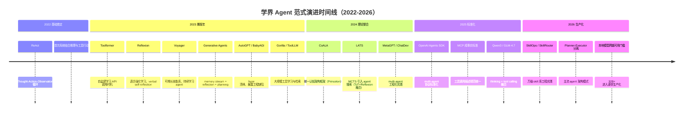

---

### 关键范式详解

---

#### ReAct（2022）

- **核心 idea**：将 chain-of-thought "思考"与外部工具"行动"交织——每步生成 Thought（推理）、Action（工具调用）、Observation（工具返回），循环直到得出答案
- **关键贡献**：首次系统性地将推理（reasoning）与行动（acting）结合，证明"先想后做"比纯行动或纯推理都好；在 HotpotQA、Fever、ALFWorld 等多个任务上取得 SOTA
- **后续影响**：成为几乎所有后续 agent 框架的基础骨架；LangChain、LlamaIndex 等框架的 agent 模块均是 ReAct 的工程实现
- **对我们的启示**：ReAct 是自研 agent harness 的直接参考对象；Thought 步骤对小模型尤其重要（迫使模型先规划再行动，降低格式错误）

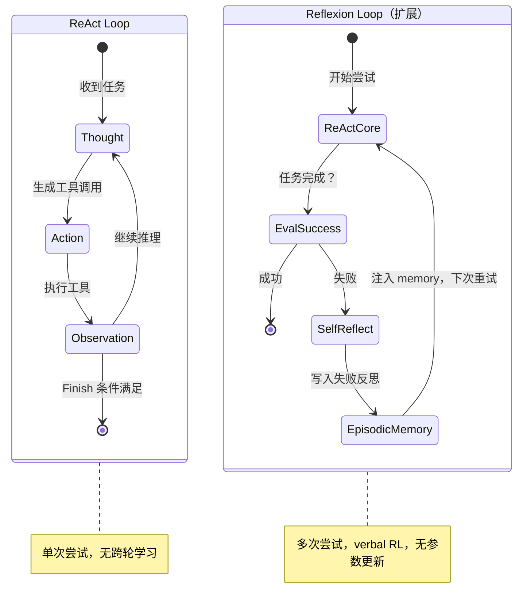

---

#### Reflexion（NeurIPS 2023）

- **核心 idea**："语言强化学习"——agent 在任务失败后用自然语言对失败轨迹进行反思，将反思文本存入 episodic memory，下次尝试时读入，从而在不更新参数的情况下学习
- **关键贡献**：AlfWorld 提升 22pp，HotPotQA 提升 20pp，HumanEval 提升 11pp（GPT-4 加 Reflexion 达 91% vs 裸 GPT-4 的 80%）；证明"verbal feedback"可替代传统 RL
- **后续影响**：self-reflection loop 成为生产 agent 的标配；LangChain 等已内置 Reflection Agents 组件
- **对我们的启示**：vault review 任务失败后，让模型生成"我犯了什么错、下次如何避免"的文本并放入 system prompt，是成本极低但效果显著的可靠性提升手段

---

#### Tree of Thoughts / LATS（2023）

- **核心 idea**：ToT 让模型同时探索多条推理路径并自我评估；LATS（Language Agent Tree Search）在此基础上引入 Monte Carlo Tree Search（MCTS），在每个 action 节点展开多候选，用模拟+反思评分选择最优路径
- **关键贡献**：LATS 在 HumanEval（94.4%）和 WebArena 上大幅超越 ReAct；统一了 ReAct + Reflexion + ToT 三种范式
- **后续影响**：提供了理论最优路径，但计算开销高（每步多次 LLM 调用），实践中常按任务重要性选择性使用
- **对我们的启示**：对于 Obsidian vault 中的"关键笔记重组"这类高价值低频任务，LATS 搜索是值得考虑的增强策略；日常文件读写 + 搜索不需要 MCTS 级别的计算

---

#### Voyager（NeurIPS 2023）

- **核心 idea**：在 Minecraft 中构建持续学习 agent，三个核心组件：(1) 自动课程（自主决定下一个探索目标）；(2) **可增长技能库**（将成功完成的行为存为可复用 JS 函数，按相关性检索）；(3) 迭代 prompting（将环境反馈、执行错误、自我验证结果反复注入 prompt 直到技能可靠）
- **关键贡献**：获得 3.1 倍独特物品、解锁科技树速度 15.3 倍、探索距离 2.3 倍；技能库在新世界中可零样本迁移；是最早规模化验证"agent 自积累可复用技能"的工作
- **后续影响**：SkillOps（2025）、SoK: Agentic Skills（2026 arxiv）等论文将技能库抽象成通用架构组件；LLM Skills 概念已在 Claude Code、Codex 等主流工具中落地
- **对我们的启示**：**直接相关**。Peak Assistant 的 skills 系统本质上就是 Voyager 技能库的 Obsidian 版：agent 将"读取每日笔记并生成摘要"等操作封装成可复用 skill，避免每次从零推理。区别是 Voyager 中技能由 agent 自动生成，而我们当前是人工定义——长期可以向自动技能生成演进

---

#### Generative Agents（Stanford/Google，UIST 2023）

- **核心 idea**：25 个 agent 在虚拟小镇生活，每个 agent 维护三层架构：(1) **Memory Stream**（时序记录所有体验）；(2) **Reflection**（定期将低层记忆合成高层洞察）；(3) **Planning**（将洞察转化为行动计划）；记忆检索按 recency + importance + relevance 三维打分
- **关键贡献**：涌现出协调行为（如自发组织情人节派对）；证明 memory + reflection 可让 LLM agent 产生持续一致的"个性"
- **后续影响**：记忆流架构被广泛采用（MemGPT、Zep 等 memory 中间件）；为长期运行 agent 提供了存储-检索-反思的完整蓝图
- **对我们的启示**：Peak Assistant 的 SQLite chat 数据库已是 Memory Stream 的雏形。Reflection 层（定期将对话摘要为更高层洞察）是提升 vault 理解深度的下一步，但实现成本中等，不建议在 MVP 阶段引入

---

#### Toolformer / Gorilla / ToolLLM（2023-2024）

- **核心 idea**：Toolformer（NeurIPS 2023）：自监督方式让模型自学何时调用 API、参数写什么；Gorilla（NeurIPS 2024）：RAT（Retriever-Aware Training），将 API 文档检索融入训练，解决 API 变更问题；ToolLLM（ICLR 2024）：16000+ 真实 API，训练模型从大规模工具集中检索和调用
- **关键贡献**：系统性解决了"工具知识"如何注入模型的问题；Gorilla 的 RAT 策略对工具集经常更新的场景尤其重要
- **后续影响**：工具学习成为 LLM fine-tuning 的重要赛道；启发了现代 MCP（Model Context Protocol）的工具描述规范设计
- **对我们的启示**：我们无需自行训练工具，但 ToolLLM 的"大规模工具检索"启发了 skill routing 设计：当 skill 数量超过 50 个时，应通过嵌入检索动态选择注入哪些 skill，而非全量放入 context

---

#### AutoGPT / BabyAGI 的教训（2023）

- **核心 idea**：AutoGPT：GPT-4 驱动的自主 agent，可递归拆解目标并执行；BabyAGI：任务列表 + 优先级排序的极简循环
- **关键贡献**：引发 2023 年最大 AI hype 浪潮（AutoGPT 成为 GitHub 历史上最快达到 10 万星的项目）；暴露了当时 agent 技术栈的核心缺陷
- **后续影响**：Amazon 研究：AutoGPT 购物任务成功率仅 24%；典型失败：死循环（BabyAGI 反复重规划）、无限重试、无退出条件、高度依赖 GPT-4（GPT-3.5 下骤降至不可用）
- **对我们的启示**：**最重要的工程警示**：(1) 必须有硬性步数上限（max_steps）；(2) 必须有明确终止条件（success state + failure state）；(3) 工具出错不应无限重试；(4) 模型切换会导致 agent 完全失效，必须针对目标模型专项测试

---

#### CoALA（Cognitive Architectures for Language Agents，2024）

- **核心 idea**：借鉴认知科学，将 language agent 抽象为三维架构：(1) 信息存储（working memory + long-term memory：procedural / semantic / episodic）；(2) 行动空间（internal：推理/检索/学习；external：grounding 行动）；(3) 决策过程（planning + execution 交替循环）
- **关键贡献**：统一描述语言，将 ReAct、Reflexion、Voyager、Generative Agents 等各路方法纳入同一框架比较；为设计新 agent 系统提供了理论清单
- **后续影响**：成为 agent 系统设计的标准参考框架（Princeton 出版，Theodore Sumers 等）
- **对我们的启示**：按 CoALA 框架审视 Peak Assistant：Working Memory = 当前对话 context；Episodic Memory = chat.sqlite；Semantic Memory = vault.sqlite 向量索引；Procedural Memory = skills 系统；下一步应重点补强 Planning 和跨轮 Memory 检索

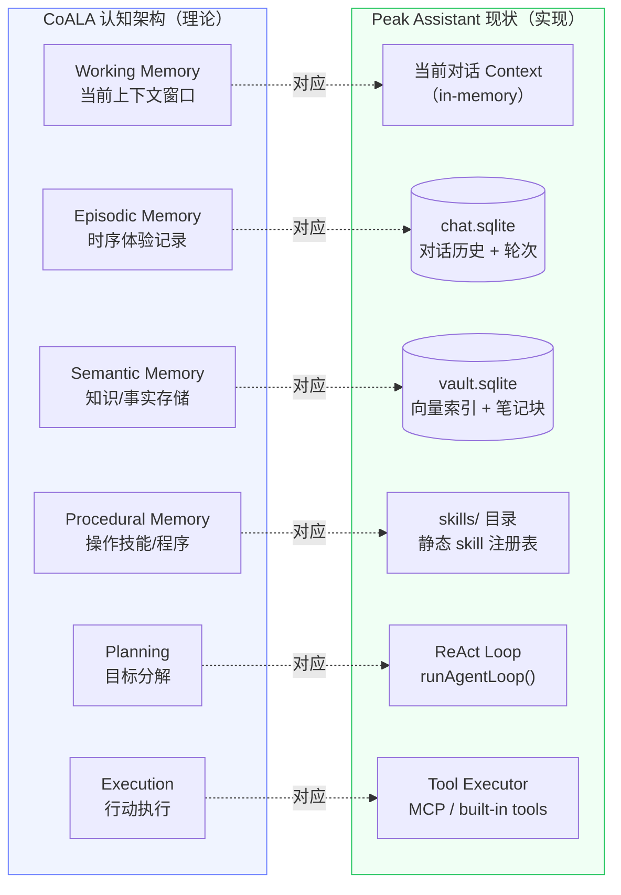

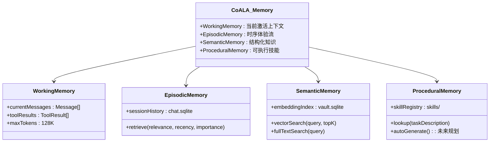

---

#### 2025-2026 最新趋势：Multi-Agent + Thinking Integration

- **核心 idea**：单一 ReAct loop 向 multi-agent 协作演进：一个 orchestrator agent 分派任务给专门 sub-agent；同时，thinking（extended reasoning）直接集成进 tool calling 流程（Qwen3、GLM-4.7 的 interleaved thinking 模式）
- **关键贡献**：OpenAI Agents SDK（2025-03）、Google ADK（2025-04）、Anthropic Agent SDK（2025-10）相继发布，标志 multi-agent 协议进入标准化阶段；MCP（Model Context Protocol）成为工具调用的事实标准；"Beyond ReAct" planner-centric 框架（arxiv 2511.10037）提出先制定完整计划再执行，而非边想边做
- **后续影响**：planner-executor 分离成为 2025-2026 agent 工程实践的主流模式；skill library 在 Claude Code、Codex 等 coding agent 中广泛落地
- **对我们的启示**：self-hosted 版 planner（thinking mode）+ executor（function calling）的双模架构，是本地模型的合理演进方向；Qwen3 的 thinking + tool calling 融合正好支持这个模式

---

## Part C：关键决策问题

### Q1：本地 14B 模型跑 multi-step tool calling 的实际成功率？

**结论：裸跑约 55-70%，加工程加固后约 80-87%，仍低于 Claude Sonnet 的 91%。**

具体数据：一项 8B 模型（Ministral-3）的系统测试显示，无 guardrail 基线约 53%，加入完整工程加固后约 86.5%（Dev.to，2025）。14B 模型基线约 65-70%。对于需要 8-12 步工具调用的 vault review 任务，端到端完成率的核心挑战不是单步格式准确率（14B 已达 85-88%），而是**错误累积效应**——每步 88% 的格式正确率，10 步串联后理论成功率仅约 $0.88^{10} \approx 27\%$。引入 retry + validation 后，实际工程可以将每步有效成功率拉升到 95%+，10 步链路成功率提升至 60%。对于 8-12 步任务，**建议从 Qwen3-32B 起步**，而非 14B。

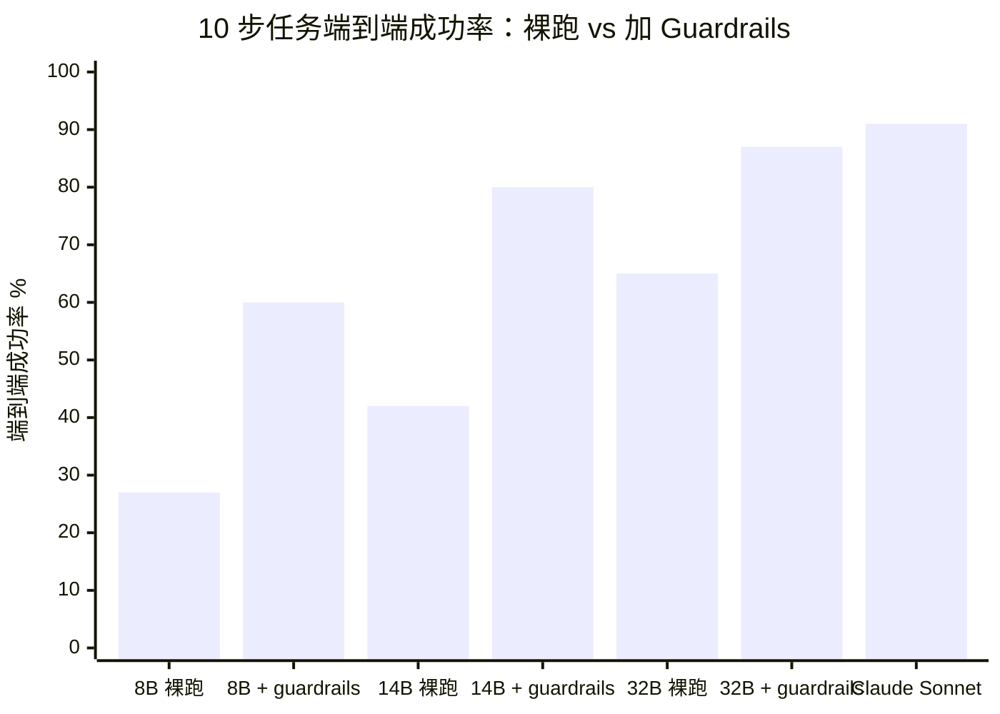

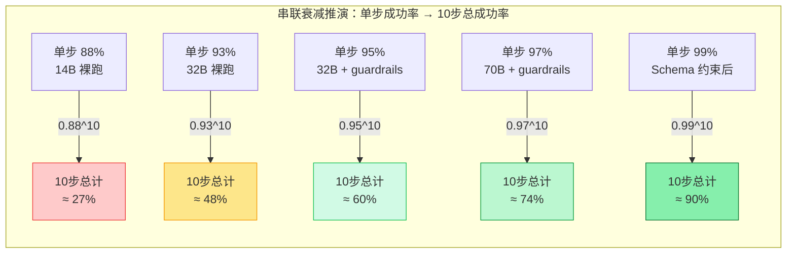

---

### Q2：哪些"硬性"工程手段能补救本地模型 tool calling？

**结论：4 类核心手段，组合使用可将 8B 模型从 53% 提升至 86.5%，效果依次递减。**

1. **Schema 约束生成（Constrained Decoding）**：使用 Outlines / XGrammar / Guidance 等库，在推理时将 token 采样约束在合法 JSON schema 范围内，格式错误率降至接近 0，但首次编译有 1-2s 开销。vLLM 和 SGLang 已原生集成这些工具。贡献约 +0 pp（消除格式错误）
2. **Response Validation + Rescue Parsing**：执行前验证 JSON 格式，尝试 lightweight 修复（补括号、修复引号等）后再决定是否触发 full retry；比直接重试节省约 60% token。贡献约 +8-12 pp
3. **Targeted Retry Nudges**：重试不是简单重发，而是在对话中追加具体错误说明（"你漏填了 `path` 参数，请只返回 JSON，不要包含解释文字"），利用模型已有的纠错训练。贡献约 +6-9 pp
4. **Step Enforcement（前置约束）**：在 system prompt 或代码层面阻止 agent 在未完成必要步骤前调用终止工具（"必须先调用 search 才能调用 answer"）。贡献约 +5-8 pp（多步场景）
5. **Context Management（VRAM-aware 压缩）**：长链任务中监控 token 用量，及时压缩旧轮次工具调用记录，防止因 context 溢出导致模型"忘记"工具格式。贡献约 +3-5 pp

> 参考：[LLM Agent Guardrails Engineering Playbook](https://dev.to/monuminu/llm-agent-guardrails-the-engineering-playbook-for-taking-an-8b-local-model-from-53-to-99-on-18c)

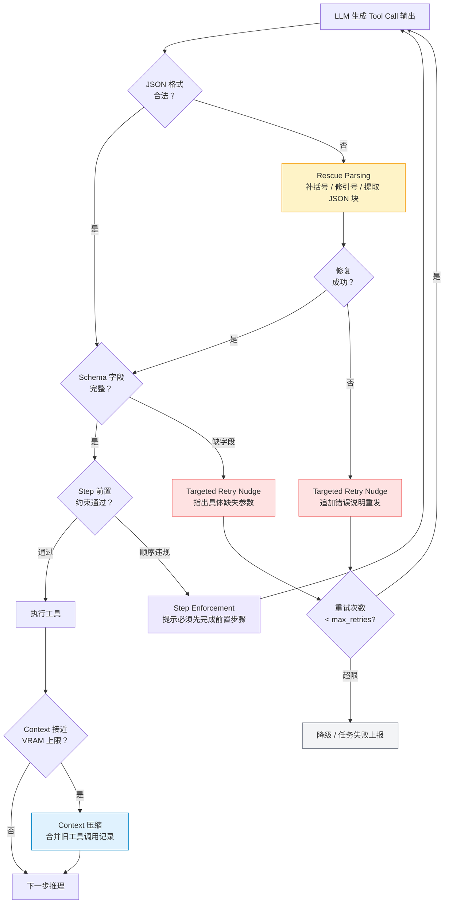

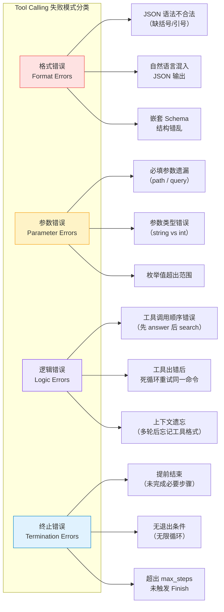

---

### Q3：要不要做 skill library（Voyager 模式）？

**结论：值得做，但实现方式要务实——从"静态 skill 注册表"出发，先不做"自动技能生成"。**

Voyager 的核心价值对本地小模型而言是**雪中送炭**：将复杂的多步推理封装成明确的"技能"（输入/输出/步骤描述），相当于把 10 步推理链压缩成 1 步工具调用。对于 14-32B 的本地模型，这直接降低了单次任务的推理深度要求。

具体建议：
- **阶段一（现在）**：建立 JSON/YAML 格式的 skill 注册表，每个 skill 包含：描述、调用签名、预期工具序列、成功条件。agent 在开始任务时检索匹配的 skill 作为"行动参考"
- **阶段二（3-6 个月后）**：实现嵌入检索，当 skill 数量超过 30 个时按相关性动态注入，避免撑爆 context
- **阶段三（未来）**：agent 执行成功后自动将轨迹提炼成新 skill（接近 Voyager 的自动课程）

SkillOps（2026 arxiv）和 SkillRouter（2026）等最新论文已证明，skill-based 系统在生产环境可扩展到万级 skill，且与本地模型兼容良好。

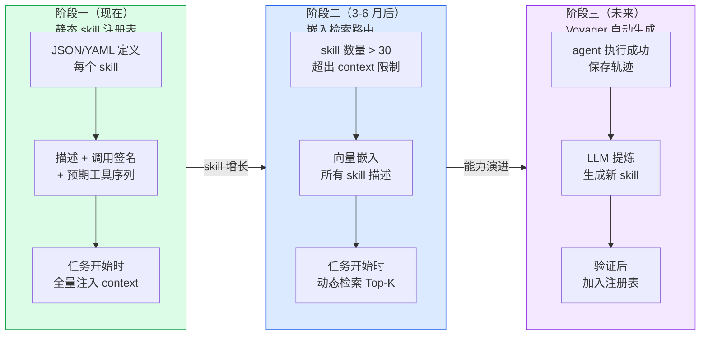

---

### Q4：Memory stream + reflection（Generative Agents 模式）值得抄吗？

**结论：Memory stream 值得实现（且已部分存在），Reflection 有选择地引入，不要全套照抄。**

现状评估：
- **Memory Stream**：Peak Assistant 的 chat.sqlite 已是 Memory Stream 的直接实现，只需补强检索层（relevance + recency + importance 三维评分）
- **Reflection（合成高层洞察）**：对 vault 助手场景有独特价值——定期将"用户最近 7 天的搜索和操作"合成为"用户当前关注焦点"的摘要，注入下次 agent session 的 system prompt，类似 GPT Memory 功能。实现成本：约 2-3 天；价值：显著提升 agent 的上下文感知
- **Planning（反思后制定行动计划）**：对于单次任务来说已有 ReAct 覆盖；跨任务规划（"本周研究进展 → 下周推荐阅读"）是更高阶的功能，MVP 阶段不建议

**过度工程警示**：Generative Agents 每个 agent 每步都运行完整的检索+反思+规划，对于 API 调用这是奢侈的，对于本地模型这是不可接受的。应将 reflection 做成离线批处理（如每天 00:00 运行一次摘要任务），而非每次对话实时计算。

---

### Q5：现在（2026 年）跑本地模型做 productivity agent，业界共识是"可行"还是"还早"？

**结论：部分场景已经可行，核心 multi-step agent 仍需 32B+ 模型，14B 以下建议只做 copilot 而非全自主 agent。**

**已成熟的 use case（2026 年可信赖）：**
- 文档问答 / RAG（单步检索+生成）：任何 7B+ 模型均可
- 代码补全 / 解释（1-3 步）：Qwen3-Coder、DeepSeek-Coder 等专项模型已达生产水准
- 结构化信息提取（单步）：JSONSchema 约束下 7B+ 稳定可用
- 知识库 Q&A with Obsidian（1-3 步检索）：成熟方案，大量社区实测验证

**需要 32B+ 才相对可靠的（2026 年）：**
- 5-10 步自主工具链（vault review、自动生成索引）：Qwen3-32B / Llama 3.3 70B + guardrails
- 跨文件推理 + 笔记重组：需要 32B 级别推理能力
- 持续多轮任务（跨 session 记忆）：需要 memory 层支撑，不只是模型本身

**仍是 demo 阶段（2026 年不建议依赖）：**
- 完全自主 agent（无人监督运行数十步）：即使是 GPT-4o，成功率也不足 50%（WebArena 标准）
- 自动生成新技能并部署（Voyager 完整模式）：需要大量验证机制
- 跨应用 computer use（控制 Obsidian GUI）：本地模型视觉理解不足

Gartner 2025 报告和社区共识：local LLM productivity agent 已跨越"实验室可行"门槛，进入"谨慎生产化"阶段，关键前提是**有监督的人机协作**（agent 提议，用户确认），而非全自主执行。

---

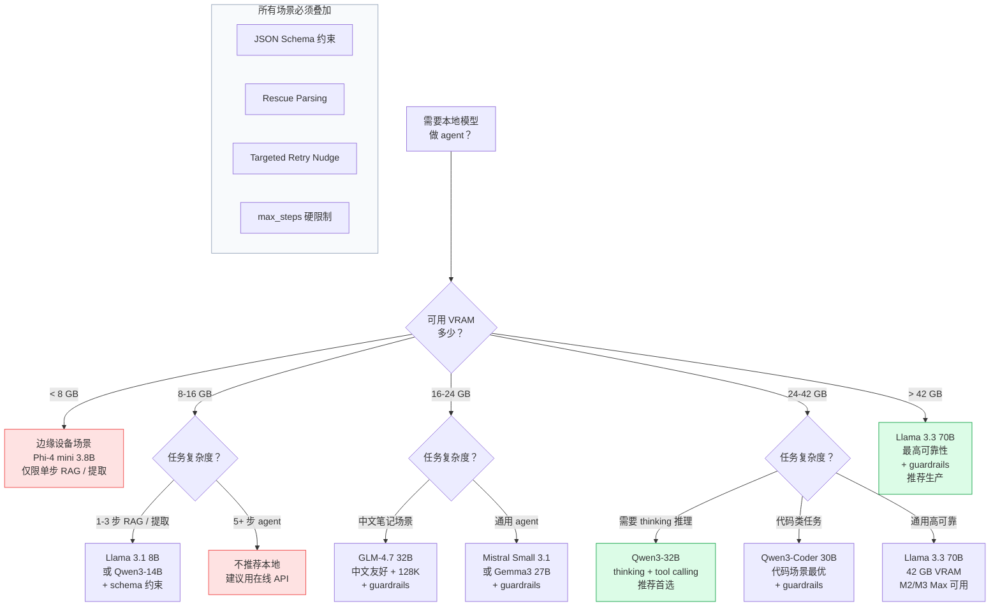

## 综合判断：本地模型自研 agent 的可行性

**现在是合适时机，但要选对模型和架构。** 2025-2026 年是本地模型能力跃升的关键窗口：Qwen3-32B、Llama 3.3 70B、GLM-4.7 等模型在 24-42 GB 显存下已能提供"够用"的 tool calling 可靠性，Ollama 的工具支持也在 v0.5+ 后趋于稳定。自研 ReAct loop 替代 Claude Agent SDK 的核心代价是：**需要自行实现 guardrail 层**（schema 验证、retry、step enforcement、context 压缩），这约 2-4 周工程量，但换来的是零 API 成本和本地隐私。

**关键风险只有一个**：模型能力断崖。从 Claude Sonnet（91%）到 Qwen3-32B（加 guardrails 后约 87%）再到 14B（约 80%），每级下降在 8-12 步任务中都会被指数级放大。建议：
1. **最小可行路径**：Qwen3-32B（或用户有 42 GB 则 Llama 3.3 70B）+ Ollama + 自实现 guardrail 层（JSON Schema 验证 + retry nudge + max_steps 限制）+ 静态 skill 注册表
2. **分级降级策略**：32B 失败 → 本地模型降级提示 + 建议切换到在线 API，而非无限重试
3. **人机协作优先**：vault review 等高风险操作，agent 生成计划后需用户确认，不做全自主执行

对于 Obsidian 插件这一具体场景：vault 文件本地访问（无网络延迟）、任务相对固定（文件读写+搜索+生成）、用户在线可监督，是本地 agent 的理想应用场景，比 WebArena 或 computer use 类任务简单得多，成功率预期显著更高。

---

## 参考来源

- [BFCL V4 Leaderboard - gorilla.cs.berkeley.edu](https://gorilla.cs.berkeley.edu/leaderboard.html)
- [BFCL Benchmark - llm-stats.com](https://llm-stats.com/benchmarks/bfcl)
- [Best Local Models for Tool Calling 2026 - PromptQuorum](https://www.promptquorum.com/power-local-llm/best-local-models-tool-calling-2026)
- [LLM Agent Guardrails Playbook - dev.to](https://dev.to/monuminu/llm-agent-guardrails-the-engineering-playbook-for-taking-an-8b-local-model-from-53-to-99-on-18c)
- [DeepSeek-V3 Function Calling Issue #1108](https://github.com/deepseek-ai/DeepSeek-V3/issues/1108)
- [Qwen3 Function Calling - deepwiki.com](https://deepwiki.com/QwenLM/Qwen3/4.3-function-calling-and-tool-use)
- [Llama 3.3 70B Tool Calling - aicerts.ai](https://www.aicerts.ai/news/llama-3-3-boosts-developer-tools-with-reliable-function-calling/)
- [GLM-4.7 Analysis - llm-stats.com](https://llm-stats.com/blog/research/glm-4.7-launch)
- [FunctionGemma - Google Blog](https://blog.google/innovation-and-ai/technology/developers-tools/functiongemma/)
- [Mistral Small 3.2 - VentureBeat](https://venturebeat.com/business/mistral-just-updated-its-open-source-small-model-from-3-1-to-3-2-heres-why)
- [Voyager Paper - arxiv 2305.16291](https://arxiv.org/abs/2305.16291)
- [Reflexion Paper - NeurIPS 2023](https://proceedings.neurips.cc/paper_files/paper/2023/file/1b44b878bb782e6954cd888628510e90-Paper-Conference.pdf)
- [Generative Agents - arxiv 2304.03442](https://arxiv.org/abs/2304.03442)
- [CoALA - arxiv 2309.02427](https://arxiv.org/abs/2309.02427)
- [LATS - arxiv 2310.04406](https://arxiv.org/pdf/2310.04406)
- [SkillOps - arxiv 2605.13716](https://arxiv.org/html/2605.13716)
- [AutoGPT Planning Failures - vectara/awesome-agent-failures](https://github.com/vectara/awesome-agent-failures/blob/main/docs/case-studies/autogpt-planning-failures.md)
- [Gorilla Paper - NeurIPS 2024](https://proceedings.neurips.cc/paper_files/paper/2024/file/e4c61f578ff07830f5c37378dd3ecb0d-Paper-Conference.pdf)
- [ToolLLM - ICLR 2024](https://proceedings.iclr.cc/paper_files/paper/2024/file/28e50ee5b72e90b50e7196fde8ea260e-Paper-Conference.pdf)
- [Local LLM with Obsidian - xda-developers.com](https://www.xda-developers.com/using-my-local-llm-with-obsidian/)
- [Building Local-first KMS with Obsidian - GoPenAI](https://blog.gopenai.com/building-a-local-first-knowledge-management-system-with-llm-and-obsidian-1a6be6cd94d7)
