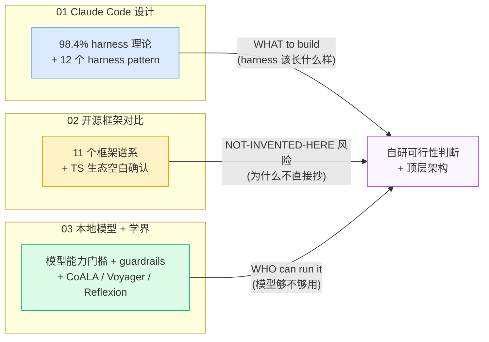
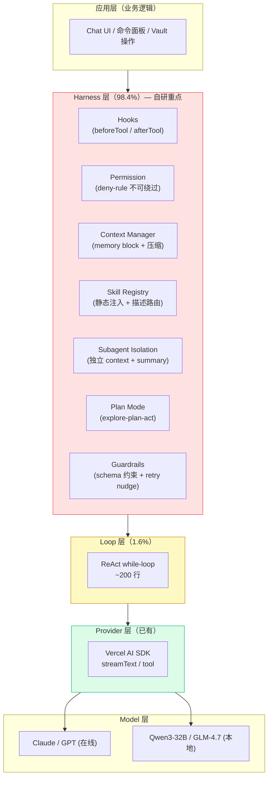
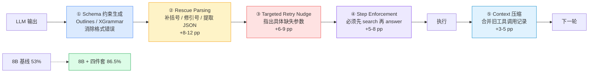
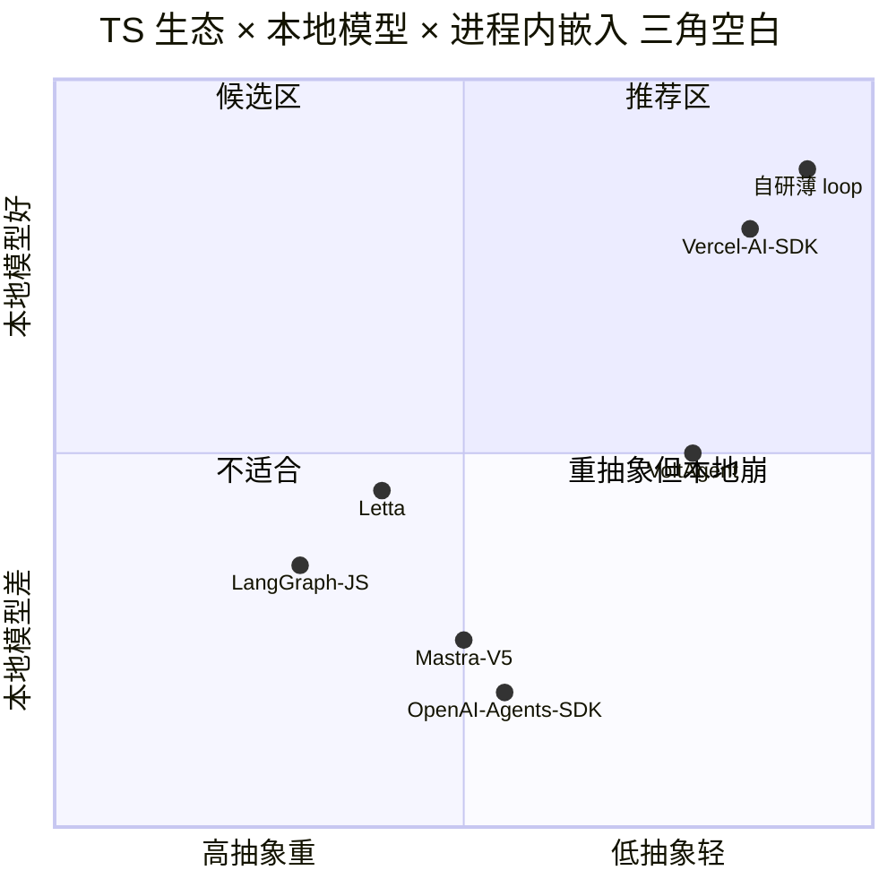
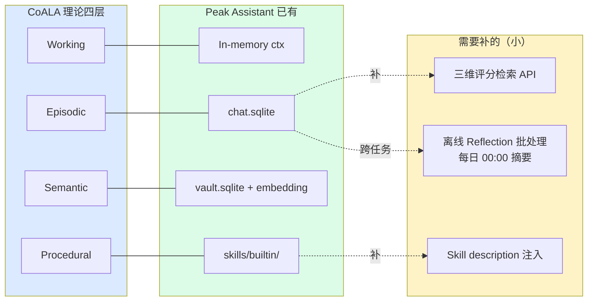
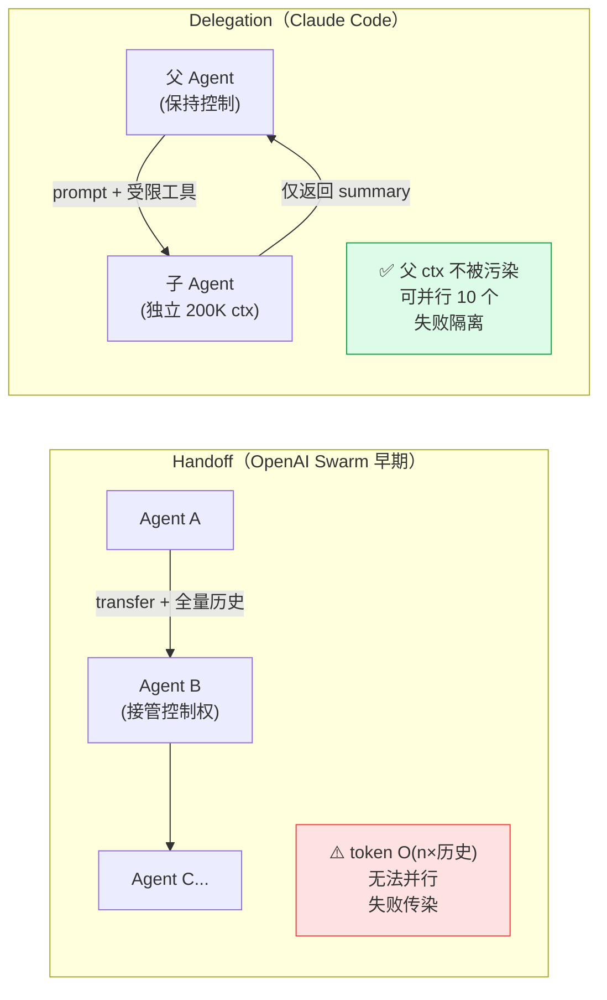
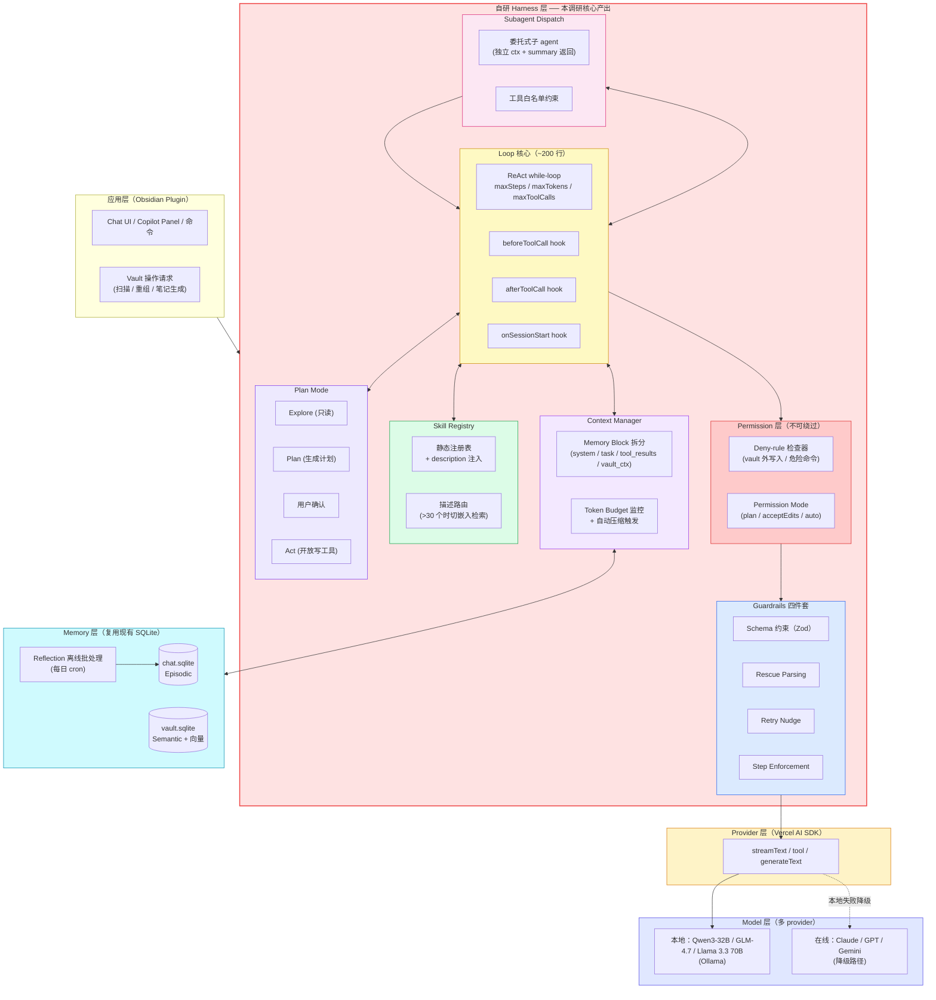
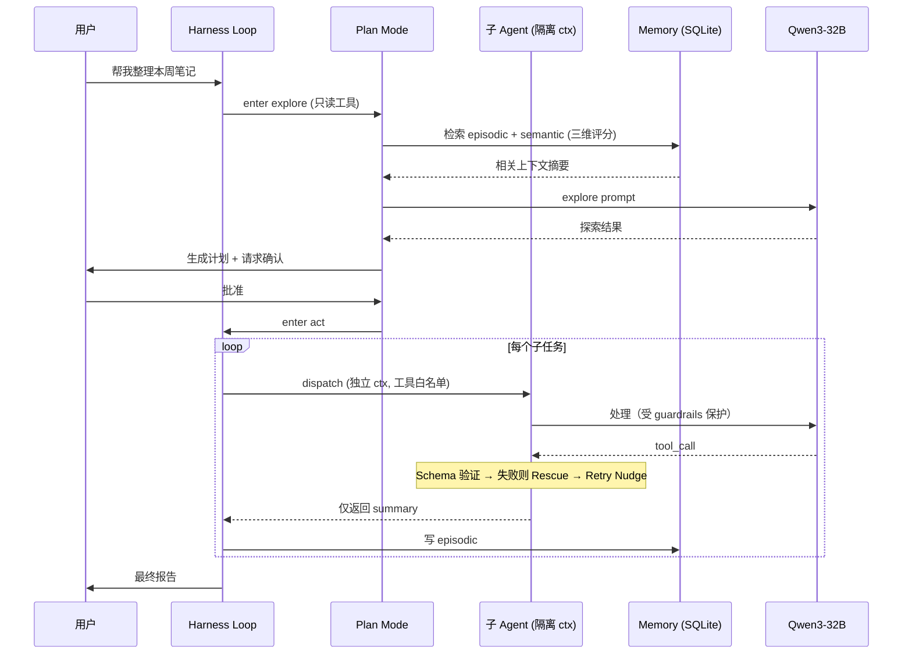
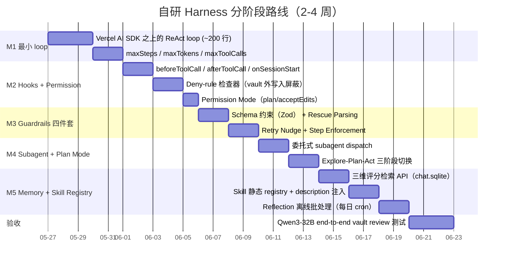

# Agent Harness 自研可行性调研（2026-05-24）

> 目标：评估在 Obsidian 插件场景下自研一个轻量 ReAct loop，摆脱 Claude Agent SDK 依赖、支持本地模型（Qwen3/Llama 3.3/GLM-4.7）的可行性与路径。

---

## TL;DR

**自研值得做，但门槛比直觉高。** 三份子调研给出了一致结论：(1) Claude Code 的护城河是 **harness 而非 model**（98.4% 是基础设施代码，仅 1.6% 是 AI 决策逻辑，见 01 §横向洞察），所以"用 SDK = 偷到护城河"是错觉；(2) TS 生态目前没有现成框架能同时满足"进程内嵌入 + 本地模型稳定 + 轻量"三个约束，Mastra V5 Ollama 破损（[issue #6960](https://github.com/mastra-ai/mastra/issues/6960)）、LangGraph.js 内存泄漏（[issue #1746](https://github.com/langchain-ai/langgraphjs/issues/1746)）、Letta 必须独立 server（见 02 §Letta）；(3) 本地模型 2026 年首次跨过"够用"门槛，但**底线是 Qwen3-32B / GLM-4.7 32B，14B 在 8-12 步链路上指数级崩塌**（单步 88% → 10 步 27%，见 03 Q1）。

**结论**：以 Vercel AI SDK 为底层，自建 200 行级别的薄 loop 层 + guardrails 四件套 + 静态 skill registry + 复用现有 SQLite 作 CoALA 三层记忆，2-4 周工程量。**关键风险只有一个**：模型能力断崖，必须有"本地失败 → 在线 API"的降级路径。

---

## 三份子报告导览

- **[01 Claude Code 设计模式](./01-claude-code-design.md)**（766 行）— 拆解 Claude Code 的 CLAUDE.md 层级、Skills、MCP、SubAgents、Hooks、Plan Mode、TodoWrite、Memory、Permissions。核心发现：**所有机制都遵循"确定性 harness + 不确定性 model"分工**；Skills 的 model-first discovery 对小模型不可靠，建议降级为静态匹配。
- **[02 开源 Agent 框架现状](./02-open-source-frameworks.md)**（599 行）— 对比 LangGraph / OpenAI Agents SDK / Mastra / Vercel AI SDK / AutoGen / CrewAI / Letta / Pydantic AI / Smolagents / Google ADK / VoltAgent。核心发现：**TS + 本地模型 + 进程内嵌入"三角约束"目前没有现成赢家**；Vercel AI SDK 是最干净的底层但缺 subagent/memory/context 管理。
- **[03 本地模型与学界范式](./03-local-models-academia.md)**（649 行）— 实测 9 个本地模型 + 梳理 ReAct→Reflexion→Voyager→CoALA 学术演进。核心发现：**14B 是"勉强能用"和"不能用"的分水岭**；guardrails 四件套（schema 约束 + rescue parsing + retry nudge + step enforcement）可将 8B 模型从 53% 拉到 86.5%。

---

## 跨调研核心洞察

### 洞察 1：Harness >> Model（98.4% 数据）

**Claude Code v2.1.88 代码中 98.4% 是 harness 基础设施，只有 1.6% 是 AI 决策逻辑**（01 §横向洞察，arxiv 2604.14228 的四个独立团队复现）。这个数据彻底颠覆了"agent 框架 = prompt engineering 的薄壳"的直觉。Claude Code 的核心价值不在"调用 Anthropic API"，而在权限管道、上下文管理、工具路由、沙箱、hooks 这五层基础设施。

意味着：自研的真实工作量不在"写 ReAct loop"，而在"写 hooks / deny-rule / plan mode / subagent isolation / context budget"。如果只把 loop 抄过来不抄 harness，本地模型会立刻翻车——因为 Claude Sonnet 91% 的成功率有一半来自 harness 弥补，没有 harness 直接裸跑 Qwen3-32B 在 10 步任务上只有 48% 成功率（见 03 Q1 串联衰减表）。

### 洞察 2：本地模型门槛 = 32B 起步 + guardrails 四件套

03 报告 Part A 实测表给出明确分水岭：**Llama 3.3 70B well-formed call rate 97%、Qwen3-32B 93%、GLM-4.7 32B 94%、Qwen3 14B 仅 85-88%**。表面上 14B 也"够用"，但 03 Q1 的串联衰减推演给出致命数据：单步 88% 在 10 步任务上等于 27% 成功率，14B 在 vault review（典型 8-12 步）上是不可用的。

更重要的是：guardrails 不是"锦上添花"，是"必须有"。一项实测显示 8B Ministral-3 从 53% 拉到 86.5% 完全靠工程加固（见 03 Q2 引用的 dev.to playbook）。这意味着自研 harness 必须把 guardrails 当作一等公民设计，而不是事后补丁。

### 洞察 3：业界框架普遍没解决我们的核心场景

02 报告的象限图是关键证据：在"低抽象 + 本地模型友好"象限，只有 Smolagents（Python-only，不可用）和 Vercel AI SDK（缺 subagent/memory）；在"高抽象 + 本地友好"象限**完全空缺**。这不是巧合——TS-first + 进程内嵌入 + 本地模型这个组合，至 2026-05 没有任何一个框架完整覆盖：

- **Mastra**：TS-first 最完整，但 V5 Ollama 完全破损（[issue #6960](https://github.com/mastra-ai/mastra/issues/6960)，Zod v3/v4 冲突），Elastic License 商业受限
- **LangGraph.js**：Python 端是事实标准，但 JS 版每次调用泄漏 5.8MB（[issue #1746](https://github.com/langchain-ai/langgraphjs/issues/1746)）
- **OpenAI Agents SDK**：handoff 模型假定 OpenAI 格式，本地模型需 LiteLLM 代理
- **Letta**：内存设计最优雅，但**架构上必须独立 server**——对 Obsidian 插件是死结
- **AutoGen**：原生 Ollama 但 Python-only，TS 版实验性（[PR #5677](https://github.com/microsoft/autogen/pull/5677)）

意味着：自研不是 NIH，是"市场空白"。即便愿意接受技术债，目前**没有低风险的"先抄后改"路径**。

### 洞察 4：CoALA 三层记忆 = 现有 SQLite 已经 80% 到位

03 报告 §CoALA 提供了一个意外的对齐结论：Princeton 的 CoALA 框架将 agent memory 抽象为 Working / Episodic / Semantic / Procedural 四类，而 Peak Assistant 已经实现了其中三类：

| CoALA 抽象 | Peak Assistant 现状 | 缺口 |
|---|---|---|
| Working Memory | 当前对话 context（in-memory） | ✅ 已有 |
| Episodic Memory | `chat.sqlite` 对话历史 | ⚠️ 缺三维评分检索 |
| Semantic Memory | `vault.sqlite` 向量索引 | ✅ 已有 |
| Procedural Memory | `service/skills/builtin/` | ⚠️ 缺动态注入 |

也就是说**记忆层不需要重建**，只需要在现有 SQLite 上加一层 retrieval API（recency + relevance + importance 三维评分），以及为 skills 加一层 description-based 注入。这把"自研 = 重写所有基础设施"的恐惧大幅降低。

更重要的是 03 Q4 给出的反过度工程警示：**Reflection 不应该每次对话实时计算，应做成离线批处理**（如每天 00:00 跑一次 7 天用户行为摘要）。Generative Agents 每步都跑 reflection+planning 在 API 端都奢侈，本地模型场景下完全不可接受。

### 洞察 5：Subagent 选委托模型而非 handoff

01 §SubAgents 与 02 §OpenAI Agents SDK 给出的对比是决定性的：OpenAI Swarm/Agents SDK 用 **handoff 模型**（控制权显式转交，全量历史跟着走），而 Claude Code 用**委托模型**（父 agent 保持控制，子 agent 在独立 context 跑完只返回 summary）。

对本地模型场景委托模型绝对碾压：(1) handoff 把整个对话历史传给子 agent，token 开销爆炸，本地 32B 的 KV cache 受不了；(2) handoff 是串行链，无法并行；(3) handoff 失败时整个会话受影响，委托失败只是一次 tool call 失败。OpenAI Agents SDK v0.17.1 已经开始向委托靠拢（增加 outcomes 语义），但默认仍是 handoff。

---

## 关键决策矩阵

| 决策点 | 选择 | 依据 |
|---|---|---|
| **是否自研 harness？** | ✅ 自研 | 02 §结论：TS + 本地 + 嵌入式无现成框架；01 §横向洞察：98.4% harness 才是真护城河 |
| **底层 provider 层？** | ✅ Vercel AI SDK（保留） | 02 §Vercel：30k stars、Apache-2.0、Ollama 稳定、streamText 一流；已是项目依赖 |
| **是否引入 Mastra/LangGraph？** | ❌ 不引入 | 02 §Mastra：V5 Ollama 破损 + Elastic License；02 §LangGraph：JS 内存泄漏 + 抽象过重 |
| **是否需要独立 server？** | ❌ 绝对不 | 02 §Letta：Obsidian 进程内嵌入是硬约束 |
| **本地模型门槛？** | Qwen3-32B / GLM-4.7 起步 | 03 Q1：14B 在 10 步任务上 27% 成功率，32B 加 guardrails 才到 87% |
| **Subagent 模型？** | ✅ 委托而非 handoff | 01 §SubAgent + 02 §OpenAI SDK 对比表 |
| **Skill 系统？** | ✅ 静态 registry + description 注入 | 03 Q3：Voyager 自动生成留到阶段三；01 附录：Skills model-first discovery 对小模型不稳定 |
| **Memory 层？** | ✅ 复用 chat.sqlite/vault.sqlite + 三维检索 + 离线 Reflection | 洞察 4：80% 已到位；03 Q4：Reflection 离线批处理 |
| **Guardrails？** | ✅ 四件套必做 | 03 Q2：8B 53% → 87% 全靠 guardrails |
| **Plan Mode？** | ✅ Explore-Plan-Act 三阶段 | 01 §Plan Mode："对本地模型尤其重要"；侵入性操作需用户确认 |
| **降级策略？** | ✅ 本地失败 → 在线 API 切换提示 | 03 §综合判断："关键风险只有一个：模型能力断崖" |

---

## 自研 Harness 顶层架构

**Context flow（一次典型的 vault review 任务）：**

---

## 实施路径建议

**优先级（如果只能做一半）**：M1 + M2 + M3 是 hard requirement，没有 guardrails 本地模型直接不可用。M4 / M5 可以分批次发布。

---

## 风险与未解决问题

| # | 风险 | 严重度 | 缓解 |
|---|---|---|---|
| 1 | **模型能力断崖**：Qwen3-32B 在生僻领域可能跌破 80% | 🔴 高 | 必须实现"本地失败 → 在线 API"降级提示；vault review 等高风险任务强制 Plan Mode 用户确认 |
| 2 | **Vercel AI SDK 大版本破坏性升级**（如 v4→v5 已有先例，见 02 §Mastra V5 破损） | 🟡 中 | Pin 主版本；用 adapter pattern 把 SDK 调用集中在一个文件 |
| 3 | **Guardrails 自研工程量超预期** | 🟡 中 | 优先实现"消除格式错误（schema 约束）"和"消除自然语言混入（rescue parsing）"两条，后两条可分批 |
| 4 | **小模型 thinking 模式 token 开销** | 🟡 中 | Qwen3 thinking 模式仅用于 Plan 阶段，Act 阶段切 non-thinking |
| 5 | **Skill 数量超过 30 后 context 撑爆** | 🟢 低 | M5 阶段做 description 路由，超阈值时切嵌入检索（03 Q3 阶段二） |
| 6 | **Subagent 调试性差**（01 §SubAgent 用户反馈） | 🟢 低 | 内部状态全量写 trace 文件，参考 VoltAgent observability-first 思路 |
| 7 | **Ollama 工具调用在某些模型上不稳定** | 🟢 低 | 用户首次配置时跑 self-check（已知模型→已知 prompt→已知输出），通过才允许启用本地模型 |
| 8 | **Reflection 离线批处理的隐私问题** | 🟢 低 | 默认关闭，用户显式 opt-in；摘要数据仅本地存储 |

**未解决问题**：
- **Code-as-action（Smolagents 模式）是否值得在 vault 操作上试？**TS 端没有现成 sandbox（Pyodide 是 Python），需要评估 quickjs / vm2 / Deno permissions 等方案。留待 spec 阶段。
- **是否需要自己实现 Constrained Decoding？**Ollama / vLLM 已有支持但 API 层暴露不一，可能需要写一层 normalize。
- **跨 session 记忆的隐私边界**：跨项目共享 vs vault-scoped？参考 Claude Code 的 git repo 粒度。

---

## 引用

- [01 Claude Code 设计模式调研](./01-claude-code-design.md)
- [02 开源 Agent 框架现状调研](./02-open-source-frameworks.md)
- [03 本地模型与学界范式调研](./03-local-models-academia.md)

**下一步**：本 README 是调研总览 + 高层决策记录。实施细节（loop 接口设计、hook 签名、guardrails 实现）应在独立的 spec 文档中展开。

---

> 调研完成于 2026-05-24，覆盖 11 个开源框架、9 个本地模型、12 个 Claude Code harness pattern、6 篇核心学术论文（ReAct/Reflexion/Voyager/Generative Agents/CoALA/LATS）。三份子报告合计约 2000 行，本 README 为决策摘要。
