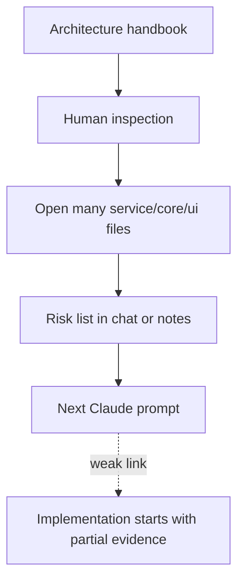
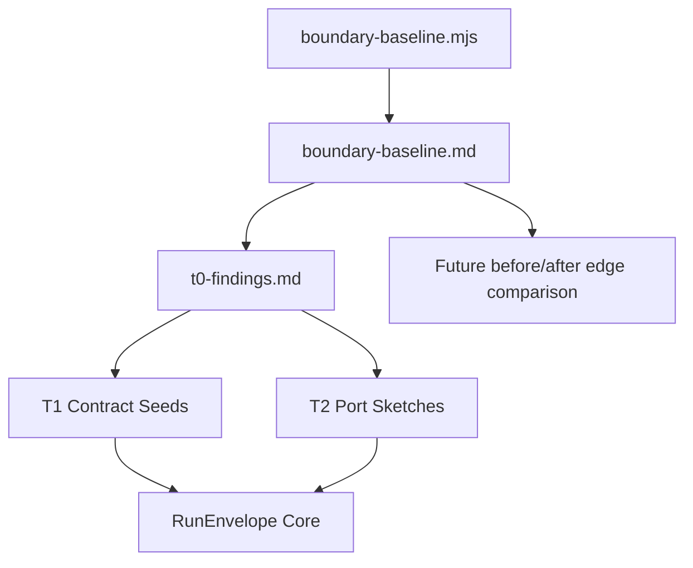
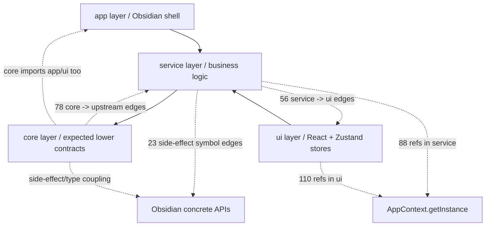
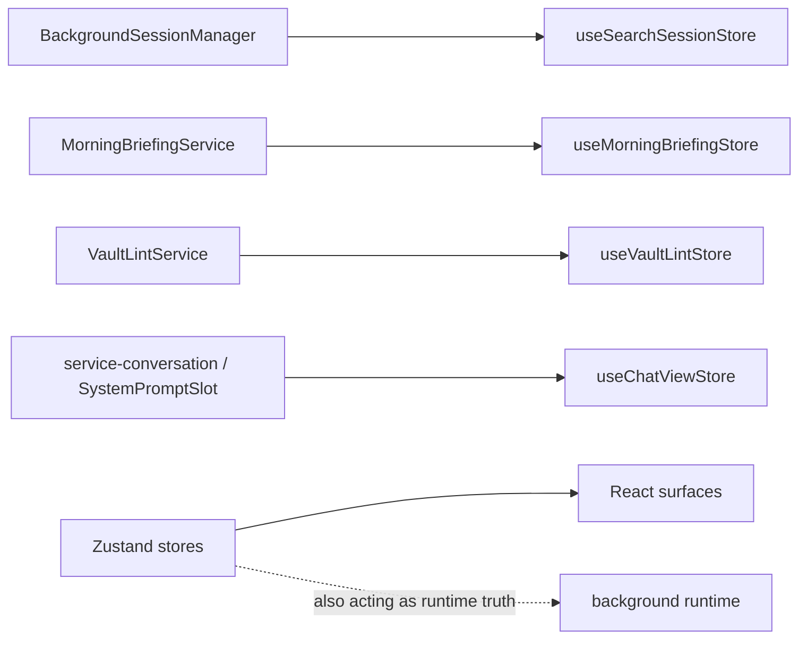

# Owner Review Packet: T0 Boundary Baseline

Claude Code commit:
- `9850eef` chore(refactor): add T0 boundary baseline scanner and audit report

Source-of-truth docs checked:
- Main handbook: `docs/superpowers/specs/2026-06-01-peak-system-architecture-modernization-handbook.html`
- Ambient spec: `docs/superpowers/specs/2026-06-02-ambient-push-current-work-state-product-technical-review.html`
- Command Gateway spec: `docs/superpowers/specs/2026-06-03-obsidian-plugin-command-gateway-capstone-review.html`
- T0 handoff: `docs/superpowers/refactor-ops/t0-boundary-baseline-handoff.md`

Verdict:
- Accepted.

T0 stayed diagnostic. It added a repeatable scanner, a frozen baseline, and a human findings report without editing `src/` or introducing a new runtime path. The important gain is control visibility, not implementation improvement.

## 1. One-Sentence Outcome

This task measured Peak Assistant's current layer, side-effect, state ownership, and suspected dual-path risks so that T1 Contract Seeds and T2 Port Sketches can start from evidence instead of intuition.

## 2. What Changed

| Area | Evidence | Review |
| --- | --- | --- |
| Scanner | `scripts/audit/boundary-baseline.mjs` | Dependency-free, deterministic with `--out`, scoped to `src/**/*.{ts,tsx}` imports. |
| Command | `package.json` adds `audit:boundary` | Good for quick local inspection. For clean file snapshots, use `node ... --out` or `npm run --silent audit:boundary`. |
| Raw baseline | `docs/superpowers/audits/2026-06-12-boundary-baseline.md` | Captures 819 scanned files and 423 flagged edges. |
| Human findings | `docs/superpowers/audits/2026-06-12-t0-findings.md` | Converts raw edges into T1/T2 input and explicitly records what was not changed. |

Files changed in the commit are only these four files. No business source under `src/` changed.

## 3. Before Control Path

Before T0, the modernization risk was real but mostly implicit. A reviewer had to open many services manually to discover whether state, side effects, and layer boundaries were mixed.

Why this was hard to control:
- The user could not tell whether a future refactor actually reduced coupling.
- Claude Code could choose a tempting large feature area before the smallest high-leverage boundary was known.
- "No dual system" could not be enforced because suspected old/new runtime pairs were not listed.

## 4. After Control Path

T0 creates a measurable audit loop. It does not fix the architecture yet, but it gives every later task a baseline to reduce.

How this lowers decision risk:
- T1 can start with capability inventory and `AppContext` resolutions.
- T2 can start with concrete side-effect ports instead of abstract port names.
- T4/T9 pilot choice has evidence: Vault Lint and Morning Briefing are smaller than Chat and Ambient Push.

## 5. Boundary Risk Map

The biggest architectural smell is not one bad file. It is that runtime truth, Obsidian effects, and dependency direction are all mixed across layers.

## 6. State Ownership Map

Current state truth for long-running work still leaks into UI stores:

Evidence checked:

| Path | Evidence | Meaning |
| --- | --- | --- |
| `src/service/BackgroundSessionManager.ts` | Imports `Notice`, `QuickSearchModal`, `useSearchSessionStore`, and `AppContext`. | Quick Search background sessions mix runtime, UI restore, and notification side effects. |
| `src/service/ambient/MorningBriefingService.ts` | Imports `useMorningBriefingStore` and calls `AppContext.getSettings`. | Morning Briefing is a small but real background-job candidate for RunEnvelope later. |
| `src/service/lint/VaultLintService.ts` | Imports `useVaultLintStore` and resolves `AppContext`. | Vault Lint is the cleanest pilot candidate because the surface and store are small. |
| `src/core/eventBus.ts` | Imports chat service types from `@/service/chat/types`. | `core` currently depends upward on business types. |
| `src/core/document/loader/helper/DocumentLoaderHelpers.ts` | Imports `AppContext`, `AIServiceManager`, and `PromptId`. | The current `core/document/loader` placement must be decided before adding new core contracts. |
| `src/service/copilot/actions/index.ts` | Static imports 20+ UI panels into service action registration. | Largest boundary offender; good T4 target, bad first pilot. |

## 7. Old Path / Dual Path Review

No old path was deleted in T0, and that is correct for this task. The value is that suspected dual paths are now named and must be confirmed before replacement work.

| Suspected area | Status after T0 | Review |
| --- | --- | --- |
| `VaultSearchAgent` vs `VaultSearchAgentSDK` | Suspected in findings; source says `VaultSearchAgent` delegates to SDK. | Likely thin forwarding, but T1 should still verify callers and registration. |
| `AmbientPushService` vs `service/capabilities/*` | Suspected; Ambient spec says do not keep extending old pipeline as target architecture. | Defer. Ambient must not be an early pilot. |
| `copilot/actions/index.ts` vs `CopilotMetaAgentStream` | Strong boundary smell; service imports UI panels and action registry owns React result panels. | Good later replacement candidate, too broad for T1 pilot. |
| `AIAnalysisHistoryService` vs `analysisDocPersistence` | Suspected; persistence and Notice usage need caller/write-path confirmation. | T1/T2 should confirm whether both write equivalent artifacts. |

Acceptance rule preserved: no old and new implementation were made to co-own behavior in T0.

## 8. Verification

| Check | Result | Notes |
| --- | --- | --- |
| `npm run build` | Passed | CSS pipeline, esbuild production build, `node --check main.js`, and SDK copy completed. |
| `npm run audit:boundary` | Passed | Produces markdown to stdout; npm adds a command banner if redirected directly. |
| `node scripts/audit/boundary-baseline.mjs --out /tmp/peak-boundary-baseline-out.md` | Passed | Exact snapshot match against committed `2026-06-12-boundary-baseline.md`. |
| Changed file scope | Passed | Commit changed only `package.json`, scanner, and two audit docs. |
| Binary/image assets | Passed | No image or binary assets in the commit stat. |
| Working tree after verification | Clean | Build did not leave generated-file churn. |

## 9. Diagnostic Score

Use diagnostic scoring for T0. Do not treat these as implementation elegance improvements.

| Diagnostic dimension | Score | Confidence | Evidence |
| --- | ---: | --- | --- |
| Baseline coverage | 85 | High | 819 TS/TSX files scanned; import matrix, category counts, top offenders, store inventory. Regex scanner means dynamic imports and re-exports may be missed. |
| Evidence quality | 85 | High | Raw baseline plus human findings; source spot-checks confirm the highest-risk examples. |
| Reproducibility | 90 | High | Dependency-free script; `--out` output matches committed snapshot exactly. |
| Actionability for next task | 80 | High | Clear T1/T2 inputs and pilot ordering; still needs core placement decision and dual-path confirmation. |
| User comprehension value | 85 | Medium-High | Top five risks are explainable; future packets should add before/after deltas once code starts changing. |

T0 diagnostic quality: **85/100**.

## 10. Architecture Health Baseline

This is a health estimate of the current codebase after T0 measurement, not a claim that T0 improved the implementation.

| Dimension | Code | Baseline | Confidence | Evidence |
| --- | --- | ---: | --- | --- |
| Architecture clarity | AC | 40 | Medium | Main target architecture is clear in docs; current runtime paths remain scattered. |
| Capability semantics | CS | 35 | Medium | Many current units are named by service/UI surface rather than capability contract. |
| Dependency direction | DD | 25 | High | 423 flagged edges; 56 service->ui; 78 core->upstream. |
| Modularity / cohesion | MC | 35 | Medium | Top offender `copilot/actions/index.ts` has 30 flagged edges; several services mix runtime and surface concerns. |
| Side-effect isolation | SI | 25 | High | 23 service/core concrete Obsidian side-effect edges; `Notice` and `MarkdownView` in service paths. |
| Single runtime path | SR | 30 | Medium-Low | Suspected dual paths listed but not confirmed; no replacement work yet. |
| State ownership clarity | SO | 20 | High | Services read/write UI stores as runtime truth. |
| Observability / trace | OT | 40 | Medium | T0 audit is observable; runtime execution traces are not yet unified by RunEnvelope. |
| Testability / fake-port readiness | TF | 35 | Medium | Scanner is testable; business behaviors still depend on AppContext, Obsidian, and UI stores. |
| Old-path deletion | OD | 0 | High | No old code deletion was attempted, by design. |
| Change radius | CR | 30 | Medium | T0 lowers investigation radius but not implementation blast radius yet. |
| Owner comprehension | OC | 70 | Medium | The user can now name the highest-risk boundaries and pilot candidates. |
| Overall code elegance baseline | Overall | 32 | Medium | Weighted estimate; diagnostic visibility improved, implementation did not. |

Grouped baseline indices:

| Group | Baseline | Meaning |
| --- | ---: | --- |
| Control Index | 50 | The user can now inspect risks, but runtime debugging is still scattered. |
| Boundary Index | 29 | Dependency direction, cohesion, side effects, and change radius are the weakest areas. |
| Runtime Truth Index | 28 | Capability semantics, single path, and state truth are not yet clean. |
| Verification Index | 18 | Fake-port proof and old-path deletion have not started. |

Optional task dimensions:

| Optional dimension | Code | Score | Evidence |
| --- | --- | ---: | --- |
| Developer experience | DX | 80 | One command exists; exact snapshots should use `--out` or silent npm. |
| Documentation / handoff quality | DOC | 85 | Findings are actionable and explicitly list non-changes. |
| UI surface stability | UX | N/A | No UI changed. |
| Backward compatibility / migration safety | BC | N/A | No settings, SQLite, history, or Vault schema changed. |
| Performance / cost containment | PC | N/A | No runtime performance or LLM path changed. |
| Security / permission boundary | SC | N/A | No command/tool/secret/destructive path changed. |

## 11. What The User Should Understand

After T0, the mental model should be:

1. The biggest current problem is not "too many files"; it is unclear ownership: service owns UI state, core depends upward, and side effects are concrete.
2. `core/` cannot be blindly treated as the safe place for new contracts until `core/document/loader/*` and provider/rerank ownership is decided.
3. The first ports should be boring and concrete: `NotificationPort`, `ActiveDocumentPort`, `ProgressReporterPort`.
4. Vault Lint is the best first pilot because it has a small runtime surface and a single obvious UI store.
5. Morning Briefing is the second-best pilot because it is a real background job but still much smaller than Chat.
6. Chat, Ambient Push, and Command Gateway should be delayed; starting there would maximize blast radius.
7. Future implementation packets must show before/after edge deltas, old-path deletion evidence, and fake-port or fixture proof.
8. A higher architecture score is invalid if it only adds abstractions without deleting or forwarding old ownership.

## 12. Recommended Next Task

Recommended next task:
- Codex prepares T1/T2 handoff: **Vault Lint Contract Seed + Core Placement Decision + first Port sketches**.

Why now:
- T0 says Vault Lint is small enough to teach the pattern without touching Chat or Ambient.
- Finding 2 blocks careless `core/` additions; the handoff should force an explicit placement decision before Claude writes contracts.
- Finding 3 gives three low-risk Port names with concrete service adopters.

Do not do next:
- Do not start Chat migration.
- Do not implement Ambient Current Work State yet.
- Do not start Command Gateway.
- Do not add a large `core/capabilities` tree until the `core` boundary decision is made.
- Do not refactor all `Notice` callers at once; pick one first adopter per port.

Codex should prepare:
- A T1 handoff that asks Claude Code to inventory `VaultLintService` inputs, outputs, AppContext resolutions, state owner, and side effects.
- A T2 handoff that defines the smallest useful `NotificationPort` shape and uses one service file as the first adopter.
- A review checklist requiring `rg` evidence that the chosen service no longer imports the old UI store or concrete Obsidian symbol where the port was introduced.

## 13. Review Verdict

Verdict:
- Accepted.

Reason:
- T0 met the handoff scope, stayed diagnostic, produced a repeatable baseline, exposed the right risks, and did not create a second architecture.

Required follow-up before implementation:
- Decide the `core/document/loader/*` and `core/providers/rerank/llm.ts` ownership question before adding new contracts under `core/`.
- Confirm whether each suspected dual path is active, thin forwarding, or dead before T4 replacement work.
- Use `node scripts/audit/boundary-baseline.mjs --out <file>` for exact snapshot comparison, or `npm run --silent audit:boundary` for clean stdout.
