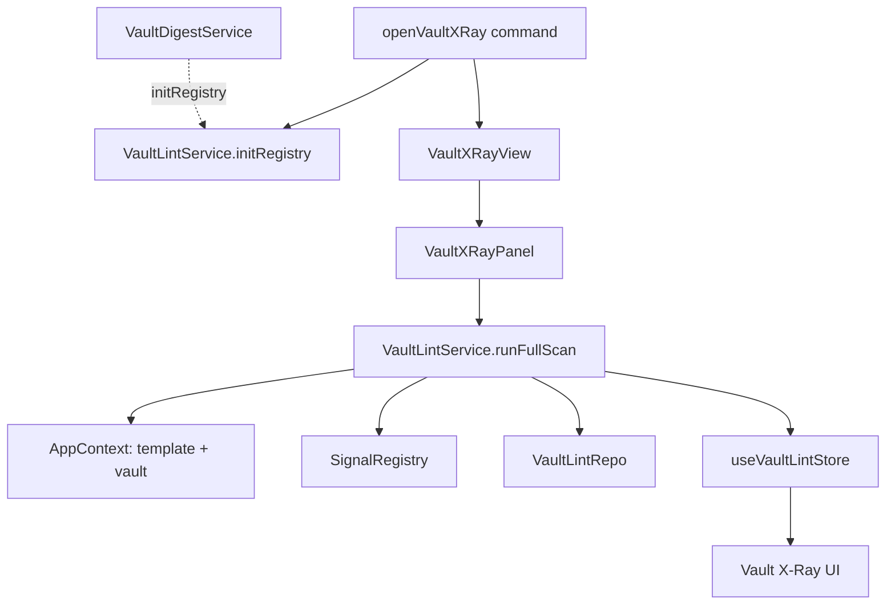
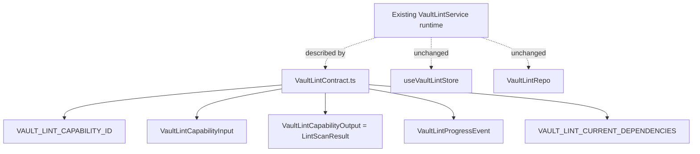
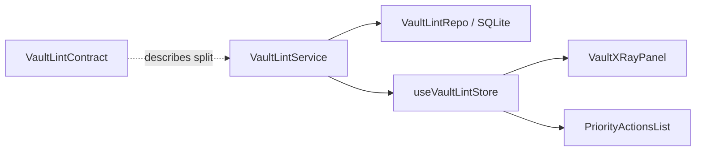
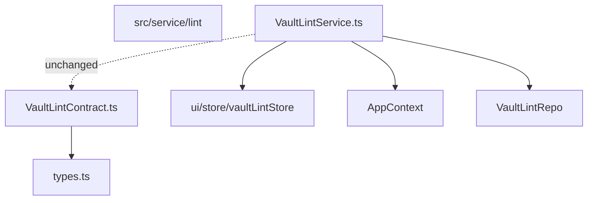

# Owner Review Packet: T1 Vault Lint Contract Seed

Claude Code commit:
- `3626c48` feat(lint): add T1 Vault Lint capability contract seed

Source-of-truth docs checked:
- Main handbook: `docs/superpowers/specs/2026-06-01-peak-system-architecture-modernization-handbook.html`
- Ambient spec: `docs/superpowers/specs/2026-06-02-ambient-push-current-work-state-product-technical-review.html`
- Command Gateway spec: `docs/superpowers/specs/2026-06-03-obsidian-plugin-command-gateway-capstone-review.html`
- T0 findings: `docs/superpowers/audits/2026-06-12-t0-findings.md`
- T0 owner review: `docs/superpowers/audits/2026-06-12-t0-owner-review-packet.md`
- T1 handoff: `docs/superpowers/refactor-ops/t1-vault-lint-contract-seed-handoff.md`

Verdict:
- Accepted, with one scanner caveat to carry into T2.

## 0. Review Entry Points

| Review item | Status | Why open it |
| --- | --- | --- |
| This Owner Review Packet | Final | Main review surface for T1. |
| `src/service/lint/VaultLintContract.ts` | New code | Shows the first capability contract seed and current dependency inventory. |
| `test/vault-lint-contract.test.ts` | New test | Shows how the contract is kept dependency-light. |
| `t1-vault-lint-contract-seed-handoff.md` | Source contract | Shows what Claude Code was allowed to do. |
| `t2-first-port-sketches-draft.md` | Draft only | Candidate next task; do not send until user approves. |

## 1. Owner Decision

Why Vault Lint was used here:

- Vault Lint is not being promoted as the most important product feature.
- It is the smallest useful sample of the current architecture problem: service singleton, UI store projection, SQLite repo, AppContext access, and a real UI surface.
- T1 uses it as a low-risk architecture training slice before touching Chat, Quick Search, Ambient Push, or Command Gateway.

What this does not mean:

- It does not mean the project is now "working on Vault Lint" as the main product direction.
- It does not mean Chat/Search/Ambient are less important.
- It means the modernization loop needs one small capability to prove the contract habit before larger migrations.

## 2. One-Sentence Outcome

T1 introduced a dependency-light Vault Lint capability contract seed so the project has one concrete capability id, input/output shape, progress vocabulary, and current dependency inventory without changing runtime behavior.

## 3. What Changed

| Area | Evidence | Review |
| --- | --- | --- |
| Contract seed | `src/service/lint/VaultLintContract.ts` | Good. It exports `vault.lint.scan`, current input, current progress phases, output alias, and dependency inventory. |
| Tests | `test/vault-lint-contract.test.ts` | Good. It source-scans the contract file and rejects forbidden imports. |
| Runtime | No runtime files changed | Correct for T1. `VaultLintService`, UI store, view, panel, command, and repo remain untouched. |
| Docs | No T0 docs changed | Correct. T0 baseline remains frozen. |

The commit changed only two files and did not create a new runtime path.

## 4. Before Runtime Path

This is still the real runtime path after T1; T1 did not rewire it.

Why this was hard to control:

- The capability did not have a stable product-level name.
- Inputs, outputs, side effects, and dependency resolution were only visible by reading `VaultLintService`.
- The UI store and SQLite repo were both involved in state truth, but this split was not named.

## 5. After Contract Path

T1 adds a contract seed beside the existing runtime. It is not wired in yet.

How this lowers decision risk:

- Future T2/T3 work can refer to a named capability instead of a vague service/view/store cluster.
- The contract names current truth rather than pretending RunEnvelope or ports already exist.
- The dependency inventory prevents the next agent from assuming X-Ray is the only consumer.

## 6. State Ownership Map

| State | Owner | Consumers | Still ambiguous? |
| --- | --- | --- | --- |
| Completed scan result | `VaultLintRepo` and `useVaultLintStore` | X-Ray UI, repo readers, future digest usage | Yes. Split truth remains. |
| Scan progress | `useVaultLintStore` | X-Ray UI | Yes. UI store is still runtime progress truth. |
| Dependency inventory | `VaultLintContract.ts` | Future T2/T3 handoffs, Codex reviews | No for T1 scope. |

T1 improved visibility, not ownership. That is the correct boundary for this task.

## 7. Module Boundary Map

Boundary improved:
- A dependency-light contract now exists beside the capability.
- The contract imports only `./types`.
- The test prevents accidental imports from Obsidian, app, UI, core storage, React, Zustand, SQLite driver, and singleton lint services.

Boundary still weak:
- `VaultLintService` still writes `useVaultLintStore`.
- `VaultLintService` still resolves `AppContext`.
- `VaultDigestService` still imports `VaultLintService` directly.
- No port, no RunEnvelope, no state projection split yet.

New abstraction justified by:
- It names a real capability and records current dependencies without adding a second execution path.

New abstraction risk:
- If future tasks keep adding contract seeds without deleting or porting old ownership, the architecture score should stop improving.

## 8. Key Files To Read

| Read order | File | Why it matters |
| --- | --- | --- |
| 1 | `src/service/lint/VaultLintContract.ts` | New capability contract seed and dependency inventory. |
| 2 | `test/vault-lint-contract.test.ts` | Guard that keeps the contract dependency-light. |
| 3 | `src/service/lint/VaultLintService.ts` | Still owns the old runtime and remaining coupling. |
| 4 | `src/ui/store/vaultLintStore.ts` | Still stores progress/result projection and partial runtime truth. |
| 5 | `docs/superpowers/refactor-ops/t2-first-port-sketches-draft.md` | Draft next task, not yet approved. |

## 9. Old Path Deletion / Reduction

| Old path | Status | Evidence | Remaining risk |
| --- | --- | --- | --- |
| `VaultLintService -> useVaultLintStore` | Still active | `VaultLintService.ts` unchanged. | State ownership score remains low. |
| `VaultLintService -> AppContext` | Still active | `VaultLintService.ts` unchanged. | AppContext dependencies are named but not isolated. |
| `VaultLintService -> VaultLintRepo` | Still active | Runtime unchanged. | Port boundary not introduced. |
| No old path targeted for deletion | Accepted for T1 | Handoff said no deletion in T1. | T2/T3 must start reducing old ownership. |

This task is accepted because T1 was a seed/inventory task. It would not be acceptable for T2/T3 to keep increasing scores without deletion, fake ports, or runtime convergence.

## 10. Verification

| Check | Result | Notes |
| --- | --- | --- |
| `npm run build` | Passed | CSS pipeline, esbuild production build, `node --check main.js`, and SDK copy completed. |
| `npm run test -- test/vault-lint-contract.test.ts` | Passed | 5 assertions passed, including import scan and dependency inventory coverage. |
| `npm run test -- test/vault-lint-structural.test.ts` | Passed | 2 assertions passed. |
| `npm run test -- test/vault-lint-repo.test.ts` | Passed | 3 assertions passed. |
| `node scripts/audit/boundary-baseline.mjs --out /tmp/t1-boundary-baseline-codex.md` | Passed | 423 findings, same flagged edge count as T0. |
| `rg "VAULT_LINT_CAPABILITY_ID|VaultLintCapability" src test docs` | Passed | Hits are contract, test, and handoff docs only. |
| `rg "from ['\"]@/core/capabilities|src/core/capabilities" src test docs` | Passed | Only handoff prohibition text. No real `core/capabilities` path. |

Verification note:
- I first ran the three targeted tests in parallel, but `run-test.js` uses a shared `temp-test.js`, so output can cross. I reran all three targeted tests sequentially and used the sequential results above.

## 11. Boundary Audit Delta

| Metric | T0 | T1 | Delta | Review |
| --- | ---: | ---: | ---: | --- |
| Files scanned | 819 | 820 | +1 | Expected: new contract file. |
| Total flagged edges | 423 | 423 | 0 | Good. No new cross-layer or side-effect edge. |
| Service -> UI | 56 | 56 | 0 | Good. |
| Core -> upstream | 78 | 78 | 0 | Good. |
| Service/Core -> Obsidian side-effect | 23 | 23 | 0 | Good. |
| Service -> app shell | 74 | 74 | 0 | Good. |
| Service AppContext substring count | 88 | 90 | +2 | Scanner caveat: counted string literals in `VAULT_LINT_CURRENT_DEPENDENCIES`, not new runtime calls. |

The +2 AppContext count is a scanner limitation. It does not block T1 acceptance, but T2 should not use raw AppContext substring count as a hard gate until the scanner ignores string literals or the inventory format avoids exact call strings.

## 12. Elegance Score

Use the rubric in `architecture-scorecard.md`.

| Dimension | Code | Before | After | Delta | Confidence | Reason / evidence |
| --- | --- | ---: | ---: | ---: | --- | --- |
| Architecture clarity | AC | 40 | 50 | +10 | High | `VaultLintContract.ts` gives a named reading entry for one capability. |
| Capability semantics | CS | 35 | 50 | +15 | High | Capability id, current input, progress, output, and dependency inventory are explicit. |
| Dependency direction | DD | 25 | 25 | 0 | High | No runtime dependency direction changed; flagged edges unchanged. |
| Modularity / cohesion | MC | 35 | 38 | +3 | Medium | Contract isolates vocabulary, but runtime responsibilities remain mixed. |
| Side-effect isolation | SI | 25 | 25 | 0 | High | Side effects are named, not isolated. |
| Single runtime path | SR | 30 | 30 | 0 | High | Runtime unchanged; no second path introduced. |
| State ownership clarity | SO | 20 | 20 | 0 | High | Split state truth is documented but not fixed. |
| Observability / trace | OT | 40 | 45 | +5 | Medium | Dependency inventory improves reviewability; no runtime trace yet. |
| Testability / fake-port readiness | TF | 35 | 42 | +7 | High | Contract import guard is tested; no fake port yet. |
| Old-path deletion | OD | 0 | 0 | 0 | High | No deletion intended or performed. |
| Change radius | CR | 30 | 34 | +4 | Medium | Future Vault Lint work has a clearer start file; runtime blast radius unchanged. |
| Owner comprehension | OC | 70 | 78 | +8 | High | User can now explain why Vault Lint is the training slice and what it depends on. |
| Overall elegance | Overall | 32 | 36 | +4 | Medium | Small but real clarity gain; implementation architecture mostly unchanged. |

Grouped indices:

| Group | Before | After | Delta | Reason |
| --- | ---: | ---: | ---: | --- |
| Control Index | 50 | 58 | +8 | Better reading/debugging entry for one capability. |
| Boundary Index | 29 | 31 | +2 | Contract helps vocabulary; boundary edges unchanged. |
| Runtime Truth Index | 28 | 33 | +5 | Capability semantics improved; state truth and runtime path unchanged. |
| Verification Index | 18 | 21 | +3 | Contract guard exists; no fake port or deletion yet. |

Optional task dimensions:

| Optional dimension | Code | Score | Evidence |
| --- | --- | ---: | --- |
| Developer experience | DX | 85 | New test makes the contract safe to extend. |
| Documentation / handoff quality | DOC | 80 | Implementation note is precise and honest; no docs changed in T1. |
| UI surface stability | UX | N/A | No UI changed. |
| Backward compatibility / migration safety | BC | N/A | No persisted shape changed. |
| Performance / cost containment | PC | N/A | No runtime path changed. |
| Security / permission boundary | SC | N/A | No command/tool/secret path changed. |

## 13. What The User Should Understand

After T1, you should be able to say:

1. Vault Lint now has the capability name `vault.lint.scan`.
2. This is still not a new runtime. It is a contract seed beside the old runtime.
3. Current input is only `full` scan triggered manually.
4. Current progress vocabulary is only `init`, `scanning`, and `cleared`.
5. Current output is still the full `LintScanResult`.
6. Current state truth is still split between SQLite and `useVaultLintStore`.
7. T1 did not make the architecture much cleaner; it made the next move safer and more understandable.
8. The next real improvement must isolate a concrete side effect or runtime path, not just add more contract files.

## 14. Next Task

Recommended next task:
- T2A First Port Sketch, but review the draft before sending it.

Why now:
- T1 gave us a contract seed.
- The next score improvement should come from side-effect isolation and fakeability, not more inventory.
- T0 found concrete Obsidian side effects; T2 should reduce one of them.

Codex recommendation:
- Use the existing draft `docs/superpowers/refactor-ops/t2-first-port-sketches-draft.md`.
- Prefer `ProgressReporterPort` with `src/service/search/support/progress-tracker.ts` as the first adopter.
- Do not use `NotificationPort` broadly across all `Notice` callers yet. Claude's implementation note suggested `NotificationPort`, but that may be too broad if it pulls in 6 files at once.

Do not do next:
- Do not start Chat migration.
- Do not implement Ambient Current Work State.
- Do not start Command Gateway.
- Do not add startup/scheduled Vault Lint triggers.
- Do not narrow `VaultLintCapabilityOutput` before RunEnvelope/projection work.

## 15. Review Verdict

Verdict:
- Accepted.

Reason:
- T1 stayed inside the handoff, added one dependency-light contract seed, preserved runtime behavior, added an appropriate test, avoided `core/`, avoided ports/RunEnvelope, and did not create a second runtime path.

Required follow-up before sending T2:
- Decide whether to keep T2A as `ProgressReporterPort` first adopter or revise it toward `NotificationPort`.
- Treat the T1 AppContext +2 audit count as scanner noise, not a runtime regression.
- Do not run this repo's targeted tests in parallel unless `run-test.js` temp output isolation is fixed.
