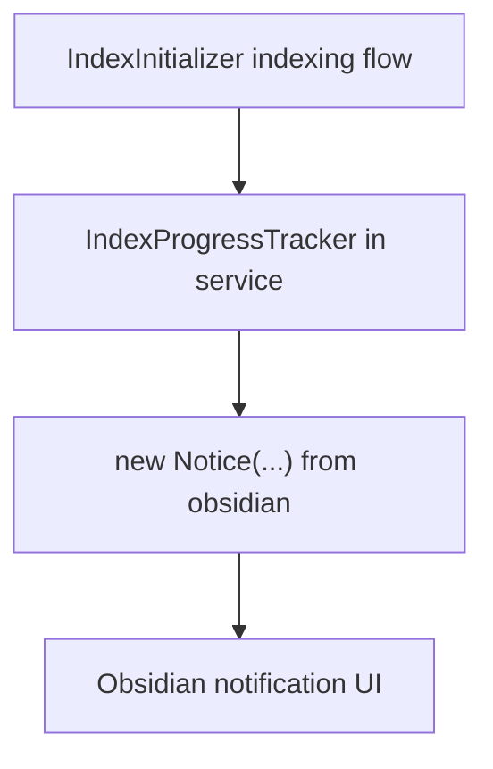
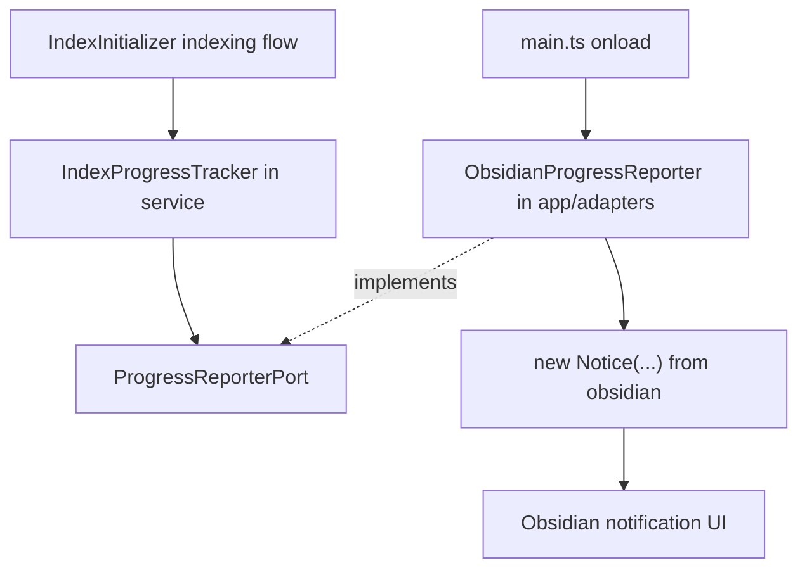

# Owner Review Packet: T2A ProgressReporterPort First Port Slice

Claude Code commit:
- `f9cf49f feat(search): introduce ProgressReporterPort for index progress notice`

Codex verdict:
- Accepted

Owner decision:
- 这轮可以接受。下一步不要直接冲 Chat / Ambient / Command Gateway，而是在 `T2B` 和 `T3` 之间做选择。

Global position:
- 现在处在 `T2 Port Sketches`。这不是产品功能开发，而是在训练一条可复制的架构迁移路径：service 不再直接碰 Obsidian UI 副作用，而是通过 `Port -> Adapter`。

## 0. Review Entry Points

| Review item | Status | Why open it |
| --- | --- | --- |
| This Owner Review Packet | Final | 本轮给 owner 看的中文判断面。 |
| [`t2-first-port-sketches-draft.md`](../refactor-ops/t2-first-port-sketches-draft.md) | Source contract | 说明为什么 T2A 选 `ProgressReporterPort`。 |
| [`architecture-scorecard.md`](../refactor-ops/architecture-scorecard.md) | Updated | 记录 T2A 的分数变化。 |
| [`docs/progress.md`](../../progress.md) | Updated | 记录当前阶段和下一步。 |

## 1. 一句话结论

T2A 把 `IndexProgressTracker` 里的 Obsidian `Notice` 副作用移到 app 层 adapter，让 service 只依赖 `ProgressReporterPort`，并用 fake reporter 测试证明这个边界可替换。

这让项目更可控，因为以后类似的 UI 通知副作用可以逐步收口到 port，而不是散在 service 业务逻辑里。

它没有做：
- 没有改索引业务流程。
- 没有改 `IndexInitializer` 的调用点。
- 没有引入 `RunEnvelope`。
- 没有解决 Vault Lint 的 store / AppContext 旧依赖。
- 没有批量迁移所有 `Notice`。

## 2. 这一轮到底在干什么

T0 发现 service 层里有很多直接碰 Obsidian UI 的地方，比如 `new Notice(...)`。

T2A 选了其中最小的一处：

- before: `src/service/search/support/progress-tracker.ts` 自己 `import { Notice } from 'obsidian'`
- after: `progress-tracker.ts` 只调用 `ProgressReporterPort`
- 真正的 `Notice` 留在 `src/app/adapters/ObsidianProgressReporter.ts`

这就是 `Port / Adapter` 的基本形态：

- `Port`: service 能理解的抽象接口。
- `Adapter`: app 层把这个抽象接口接到真实 Obsidian API。

## 3. Before Runtime Path



问题：
- service 业务逻辑直接依赖 Obsidian UI API。
- Node 测试不能完整 fake 这个通知边界。
- 后续如果要换 UI 呈现方式，需要回 service 文件里改副作用。

## 4. After Runtime Path



现在的边界：
- service 只知道 `ProgressReporterPort`。
- app 层负责注册真实 adapter。
- 测试可以传 `FakeReporter`，不需要 Obsidian。
- `main.ts` 在 `onload()` 开头注册默认 reporter，在 `onunload()` 清理，避免热重载残留。

## 5. Files Reviewed

| File | Role | Review result |
| --- | --- | --- |
| `src/service/ports/ProgressReporterPort.ts` | 新 port 接口和默认 reporter registry | 零 import，依赖轻；有 fail-loud getter。 |
| `src/app/adapters/ObsidianProgressReporter.ts` | Obsidian `Notice` adapter | app 层 import `Notice` 合理；service 没有反向 import。 |
| `src/service/search/support/progress-tracker.ts` | first adopter | 删除 `Notice` 依赖；公共 API 和 timeout 保持。 |
| `main.ts` | composition root | onload 注册，onunload 清理；没有扩 AppContext。 |
| `test/progress-tracker-port.test.ts` | fake-port tests | 覆盖 public methods、default fallback、fail-loud、源码边界扫描。 |

## 6. Acceptance Evidence

Codex 复核命令：

```text
npm run build
npm run test -- test/progress-tracker-port.test.ts
npm run test -- test/vault-lint-contract.test.ts
npm run test -- test/vault-lint-structural.test.ts
npm run test -- test/vault-lint-repo.test.ts
node scripts/audit/boundary-baseline.mjs --out /tmp/t2a-codex-boundary-baseline.md
rg "from ['\"]obsidian|\\bNotice\\b" src/service/search/support/progress-tracker.ts
rg "ObsidianProgressReporter" src/service
```

Results:

| Check | Result |
| --- | --- |
| Build | Pass |
| T2A fake-port test | 14/14 pass |
| T1 contract regression | 5/5 pass |
| T1 structural regression | 2/2 pass |
| T1 repo regression | 3/3 pass |
| Boundary audit | 422 findings |
| `progress-tracker.ts` Obsidian/Notice refs | 0 |
| service importing `ObsidianProgressReporter` | 0 |

Boundary delta:

| Metric | T0 | T2A | Delta |
| --- | ---: | ---: | ---: |
| Files scanned in `src/` | 819 | 822 | +3 |
| Total flagged edges | 423 | 422 | -1 |
| Service/core -> Obsidian side-effect | 23 | 22 | -1 |
| Service files importing Obsidian | 53 | 52 | -1 |
| Service side-effect Obsidian files | 12 | 11 | -1 |
| app -> service edges | 34 | 35 | +1 legal |
| app -> Obsidian imports | 9 | 10 | +1 legal |
| service -> ui | 56 | 56 | 0 |
| core -> upstream | 78 | 78 | 0 |
| service -> app | 74 | 74 | 0 |

## 7. Important Caveats

This is accepted, but it is still a small slice.

Remaining caveats:
- `ProgressReporterPort` uses a module-level default reporter. This was an explicit bounded compromise, not the final dependency-injection ideal.
- The port is narrow. `ProgressHandle.setMessage()` only accepts message text, not per-update timeout. That is fine for this adopter, but future adopters may need an extension.
- `indexInitializer.ts` still has direct `new Notice(...)` calls outside `IndexProgressTracker`.
- Other service-side `Notice` sites remain.
- No `RunEnvelope` exists yet.
- No manual Obsidian UI verification was run in Codex. Risk is low because message text and timeout behavior are covered by tests and adapter preserves destroy-recreate semantics.

## 8. Scorecard

Task-level score, not whole-project score.

| Dimension | Code | Before | After | Delta | Confidence | Reason |
| --- | --- | ---: | ---: | ---: | --- | --- |
| Architecture clarity | AC | 45 | 62 | +17 | High | Progress notice path is now traceable as service -> port -> app adapter. |
| Capability semantics | CS | 35 | 45 | +10 | Medium | This is a port slice, not a full capability model. |
| Dependency direction | DD | 32 | 46 | +14 | High | One service -> Obsidian side-effect removed; app -> service adapter edge is legal. |
| Modularity / cohesion | MC | 35 | 48 | +13 | High | Tracker owns progress formatting; adapter owns Obsidian rendering. |
| Side-effect isolation | SI | 25 | 45 | +20 | High | `Notice` moved behind `ProgressReporterPort` for one adopter. |
| Single runtime path | SR | 48 | 50 | +2 | High | Same runtime path; no dual implementation added. |
| State ownership clarity | SO | 30 | 32 | +2 | Medium | Local progress handle is clearer, but broader state truth unchanged. |
| Observability / trace | OT | 25 | 30 | +5 | Medium | Better test observability, no runtime trace/artifact yet. |
| Testability / fake-port readiness | TF | 20 | 52 | +32 | High | Fake reporter covers public behavior and boundary scans. |
| Old-path deletion | OD | 15 | 35 | +20 | High | Old direct `Notice` import in tracker is gone. |
| Change radius | CR | 35 | 45 | +10 | Medium | Future progress UI changes have a cleaner starting point. |
| Owner comprehension | OC | 45 | 62 | +17 | Medium | This packet and language rule make the slice easier to explain. |
| Overall elegance | Overall | 32 | 46 | +14 | High | Real but narrow boundary improvement. |

Grouped indices:

| Group | Before | After | Delta | Reason |
| --- | ---: | ---: | ---: | --- |
| Control Index | 38 | 51 | +13 | Easier to trace and review. |
| Boundary Index | 32 | 46 | +14 | One real side-effect boundary extracted. |
| Runtime Truth Index | 38 | 42 | +4 | No dual path, but no full capability runtime yet. |
| Verification Index | 18 | 44 | +26 | Fake-port tests prove the boundary. |

## 9. What You Should Understand

你不需要记住所有文件。记住这条路径就够了：

```text
IndexInitializer
-> IndexProgressTracker
-> ProgressReporterPort
-> ObsidianProgressReporter
-> Obsidian Notice
```

如果以后 indexing progress notice 坏了，第一读：

- behavior formatting: `src/service/search/support/progress-tracker.ts`
- Obsidian UI bridge: `src/app/adapters/ObsidianProgressReporter.ts`
- default wiring: `main.ts`
- test proof: `test/progress-tracker-port.test.ts`

## 10. Recommended Next Step

Recommended:
- `T2B`: 继续做一个很小的 port follow-up，优先复用 `ProgressReporterPort` 把 `src/service/search/index/indexInitializer.ts` 里剩余直接 `Notice` 通知收口一部分或全部。这样可以证明 T2A 不是孤例，而且继续降低 T0 finding 3。

Alternative:
- `T3`: 开始设计 `RunEnvelope Core`。现在已经有一个 contract seed 和一个 port seed，可以开始设计 envelope，不再是凭空设计。

Not recommended:
- 不要现在批量做广义 `NotificationPort`。
- 不要开始 Chat。
- 不要开始 Ambient Push。
- 不要开始 Command Gateway。
