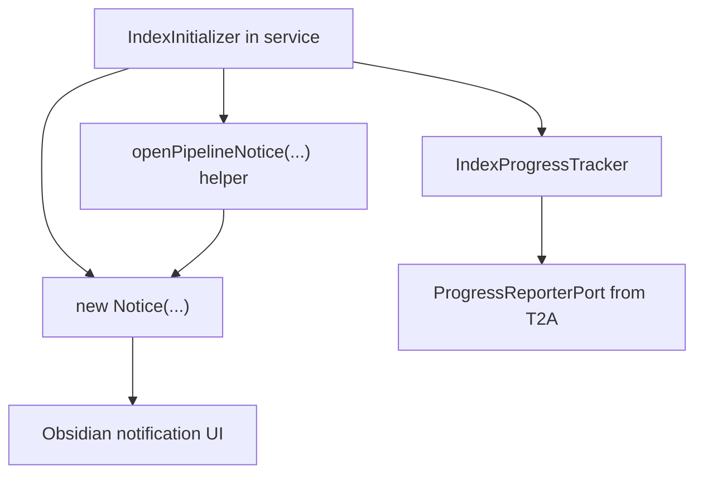
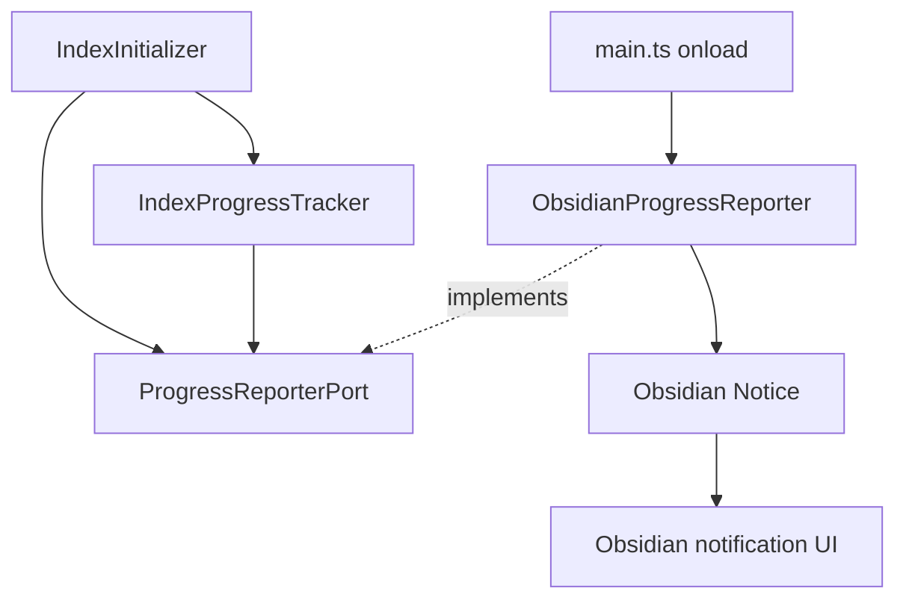

# Owner Review Packet: T2B IndexInitializer ProgressReporterPort Follow-up

Claude Code commits:
- `fbf8a56 feat(search): reuse ProgressReporterPort in IndexInitializer (T2B)`
- `79478b0 fix(search): pass this.reporter into IndexProgressTracker (T2B review fix)`

Codex verdict:
- Accepted

Owner decision:
- 这轮可以接受。下一步建议在 `T2C` 和 `T3` 之间选择：如果想把 search 区域的 `Notice` 边界再收干净一点，做 `T2C`；如果觉得 T2 的证据已经够了，可以进入 `T3 RunEnvelope Core`。

Global position:
- 仍在 `T2 Port Sketches`。T2A 证明了一个 service support 文件可以通过 `ProgressReporterPort` 脱离 Obsidian `Notice`；T2B 证明同一个 port 能被 search indexing 区域第二个、更复杂的文件复用。

## 0. Review Entry Points

| Review item | Status | Why open it |
| --- | --- | --- |
| This Owner Review Packet | Final | 本轮给 owner 看的中文判断面。 |
| [`t2b-index-initializer-progress-reporter-handoff.md`](../refactor-ops/t2b-index-initializer-progress-reporter-handoff.md) | Source contract | 说明 T2B 允许 Claude 做什么、不能做什么。 |
| [`2026-06-12-t2a-owner-review-packet.md`](./2026-06-12-t2a-owner-review-packet.md) | Previous packet | 说明 `ProgressReporterPort` 的第一轮来源。 |
| [`architecture-scorecard.md`](../refactor-ops/architecture-scorecard.md) | Updated | 记录 T2B 分数变化。 |
| [`docs/progress.md`](../../progress.md) | Updated | 记录当前阶段和下一步。 |

## 0.5 Code Reading Guide

这轮你应该按下面顺序读代码。目标不是读完所有行，而是看懂：`Notice` 副作用从 service 文件里消失后，去了哪里。

| Order | File | What to inspect | Why it matters |
| ---: | --- | --- | --- |
| 1 | `src/service/search/index/indexInitializer.ts` | `constructor`, `this.reporter`, `this.reporter.show(...)` | 主变化：原来这里直接 `new Notice(...)`，现在只调用 port。 |
| 2 | `src/service/search/index/indexInitializer.ts` | `new IndexProgressTracker(..., this.reporter)` | review fix：确认同一个 reporter 沿调用链继续传下去，没有绕回全局 default。 |
| 3 | `src/app/adapters/ObsidianProgressReporter.ts` | `setMessage(next)` | adapter 里才真正碰 Obsidian `Notice`，并保留原来的 native `setMessage` 优先策略。 |
| 4 | `test/index-initializer-port.test.ts` | source-scan tests | 证明 `indexInitializer.ts` 不再 import/construct concrete `Notice`，也不 import adapter。 |
| 5 | `test/progress-tracker-port.test.ts` | T2A regression tests | 证明 T2B 没把 T2A 的 tracker port 行为弄坏。 |

Reading notes:

- Read first: `src/service/search/index/indexInitializer.ts` 的 imports、constructor、`this.reporter.show(...)` 替换点。
- Then read: `src/app/adapters/ObsidianProgressReporter.ts` 的 `setMessage`，理解真正的 Obsidian UI 边界。
- Optional / only if debugging: `src/service/search/support/progress-tracker.ts`，看 T2A 和 T2B 如何共用同一个 port。
- Files intentionally not changed: `main.ts`, `ProgressReporterPort.ts`, `AppContext`, UI files, Chat, Ambient Push, Quick Search, Command Gateway。
- If this breaks later, open this file first: `src/service/search/index/indexInitializer.ts`；如果是 UI 通知显示问题，再看 `src/app/adapters/ObsidianProgressReporter.ts`。

## 1. 一句话结论

T2B 把 `IndexInitializer` 里直接使用 Obsidian `Notice` 的通知副作用移到 `ProgressReporterPort` 后面，并删除了私有 `openPipelineNotice` helper。

这让 `ProgressReporterPort` 从“一次性 T2A 样板”变成“可被 search indexing 区域复用的真实边界”。

它没有做：
- 没有改变 indexing 业务逻辑。
- 没有改变用户可见文案或 timeout。
- 没有改 `main.ts` wiring。
- 没有扩 `AppContext`。
- 没有引入 `NotificationPort`。
- 没有引入 `RunEnvelope`。
- 没有碰 Chat / Ambient / Quick Search / Command Gateway。

## 2. Before Runtime Path



问题：
- 同一个 indexing flow 里，一部分通知走 T2A port，另一部分还直接 `new Notice(...)`。
- `openPipelineNotice` 是 service 里的 ad-hoc Obsidian helper，和 `Port -> Adapter` 模式重复。
- fake reporter 注入无法完整覆盖 `IndexInitializer -> IndexProgressTracker` 的通知链，直到 `79478b0` 修复。

## 3. After Runtime Path



现在的边界：
- `IndexInitializer` 不再 import concrete `Notice`。
- `IndexInitializer` 不再 `new Notice(...)`。
- `openPipelineNotice` helper 删除。
- `IndexInitializer` 可接收显式 `ProgressReporterPort`，并把同一个 reporter 传给内部 `IndexProgressTracker`。
- 真正的 `Notice` 创建只留在 app adapter。

## 4. Files Reviewed

| File | Role | Review result |
| --- | --- | --- |
| `src/service/search/index/indexInitializer.ts` | T2B first adopter | Accepted. Direct `Notice` removed; all one-shot and pipeline notices route through `this.reporter`. |
| `src/app/adapters/ObsidianProgressReporter.ts` | app adapter | Accepted. `setMessage` keeps old native-update-first behavior. |
| `test/index-initializer-port.test.ts` | T2B guard tests | Accepted. Guards imports, direct construction, helper deletion, count of `reporter.show`, and reporter forwarding to `IndexProgressTracker`. |
| `test/progress-tracker-port.test.ts` | T2A regression | Passed. T2B did not break T2A. |

## 5. Acceptance Evidence

Codex 复核命令：

```text
npm run build
npm run test -- test/index-initializer-port.test.ts
npm run test -- test/progress-tracker-port.test.ts
node scripts/audit/boundary-baseline.mjs --out /tmp/t2b-fix-codex-boundary-baseline.md
rg -n "\bnew\s+Notice\b|import\s+\{[^}]*Notice[^}]*\}\s+from ['\"]obsidian['\"]|ObsidianProgressReporter|openPipelineNotice" src/service/search/index/indexInitializer.ts src/service
rg -n "new IndexProgressTracker\(" src/service/search/index/indexInitializer.ts
```

Results:

| Check | Result |
| --- | --- |
| Build | Pass |
| T2B test | 9/9 pass |
| T2A regression test | 14/14 pass |
| Boundary audit | 421 findings |
| `indexInitializer.ts` concrete `Notice` / `openPipelineNotice` | 0 |
| service importing `ObsidianProgressReporter` | 0 |
| `IndexProgressTracker` constructor sites in `IndexInitializer` | 2, both pass `this.reporter` |

Boundary delta:

| Metric | T0 | T2A | T2B final | Delta vs T0 | Delta vs T2A |
| --- | ---: | ---: | ---: | ---: | ---: |
| Files scanned in `src/` | 819 | 822 | 822 | +3 | 0 |
| Total flagged edges | 423 | 422 | 421 | -2 | -1 |
| Service/core -> Obsidian side-effect | 23 | 22 | 21 | -2 | -1 |
| Service files importing Obsidian | 53 | 52 | 51 | -2 | -1 |
| Service side-effect Obsidian files | 12 | 11 | 10 | -2 | -1 |
| app -> service edges | 34 | 35 | 35 | +1 legal | 0 |
| app -> Obsidian imports | 9 | 10 | 10 | +1 legal | 0 |
| service -> ui | 56 | 56 | 56 | 0 | 0 |
| service -> app | 74 | 74 | 74 | 0 | 0 |
| core -> upstream | 78 | 78 | 78 | 0 | 0 |

## 6. Important Caveats

Accepted, with these caveats:

- Tests are source-scan guards, not full runtime tests for indexing. This is acceptable for T2B because faking `IndexService`, SQLite, document loaders, and Obsidian `App` would be larger than the port slice.
- No manual Obsidian UI verification was run in Codex.
- `ProgressReporterPort` still uses a module-level default reporter. The `79478b0` fix makes explicit injection consistent, but the global default remains a known T2 compromise.
- `IndexInitializer` still has a type-only `App` import from `obsidian`; that is allowed here because it is not the concrete `Notice` side-effect.
- `RunEnvelope` does not exist yet.
- State ownership is unchanged.

## 7. Scorecard

Task-level score, not whole-project score.

| Dimension | Code | Before | After | Delta | Confidence | Reason |
| --- | --- | ---: | ---: | ---: | --- | --- |
| Architecture clarity | AC | 62 | 68 | +6 | High | Search indexing notification path is now service -> port -> app adapter. |
| Capability semantics | CS | 45 | 48 | +3 | Medium | Still a port slice, not a full capability contract. |
| Dependency direction | DD | 46 | 53 | +7 | High | Second service-side Obsidian side-effect file removed from direct `Notice`. |
| Modularity / cohesion | MC | 48 | 55 | +7 | High | `openPipelineNotice` helper retired; adapter owns Obsidian update strategy. |
| Side-effect isolation | SI | 45 | 58 | +13 | High | `IndexInitializer` no longer owns concrete `Notice` side effects. |
| Single runtime path | SR | 50 | 52 | +2 | High | Same runtime path, no dual implementation added. |
| State ownership clarity | SO | 32 | 34 | +2 | Medium | Reporter chain is clearer; broader state truth unchanged. |
| Observability / trace | OT | 30 | 35 | +5 | Medium | Better test/debug path, still no runtime trace. |
| Testability / fake-port readiness | TF | 52 | 62 | +10 | High | Explicit reporter is forwarded into `IndexProgressTracker`; source guards prove boundary. |
| Old-path deletion | OD | 35 | 48 | +13 | High | Direct `Notice` path and private helper deleted from `IndexInitializer`. |
| Change radius | CR | 45 | 52 | +7 | Medium | Search indexing notification changes now start at the port/adapter. |
| Owner comprehension | OC | 62 | 70 | +8 | Medium | Code reading guide identifies exact files and symbols. |
| Overall elegance | Overall | 46 | 54 | +8 | High | Real second-adopter boundary improvement; still pre-RunEnvelope. |

Grouped indices:

| Group | Before | After | Delta | Reason |
| --- | ---: | ---: | ---: | --- |
| Control Index | 51 | 58 | +7 | Easier owner reading and debug path. |
| Boundary Index | 46 | 55 | +9 | Second concrete side-effect boundary extracted. |
| Runtime Truth Index | 42 | 45 | +3 | No dual path; still no full capability runtime. |
| Verification Index | 44 | 55 | +11 | Source-scan guards plus reporter forwarding guard. |

## 8. What You Should Understand

你现在应该能说清这条路径：

```text
IndexInitializer
-> ProgressReporterPort
-> ObsidianProgressReporter
-> Obsidian Notice
```

并且能补上 T2B fix 的关键点：

```text
IndexInitializer
-> IndexProgressTracker(..., this.reporter)
-> same ProgressReporterPort
```

也就是说，现在 `IndexInitializer` 注入一个 fake reporter 后，它内部自己的通知和内部 tracker 的通知都会走同一个 reporter。

## 9. Recommended Next Step

Recommended:
- `T2C`: 收尾 search-area 剩余的 `src/service/search/analysisDocPersistence.ts` `Notice`。这是同一个 port 模式的第三次、小范围复用，可以让 search 子目录里 concrete `Notice` 更接近清零。

Alternative:
- `T3`: 开始 `RunEnvelope Core`。现在已经有 `VaultLintContract`、`ProgressReporterPort`、两个 adopter、以及一次 review fix，足够作为 envelope 设计的真实依据。

Not recommended:
- 不要现在做广义 `NotificationPort`。
- 不要批量改 Copilot / BackgroundSessionManager。
- 不要开始 Chat。
- 不要开始 Ambient Push。
- 不要开始 Command Gateway。
