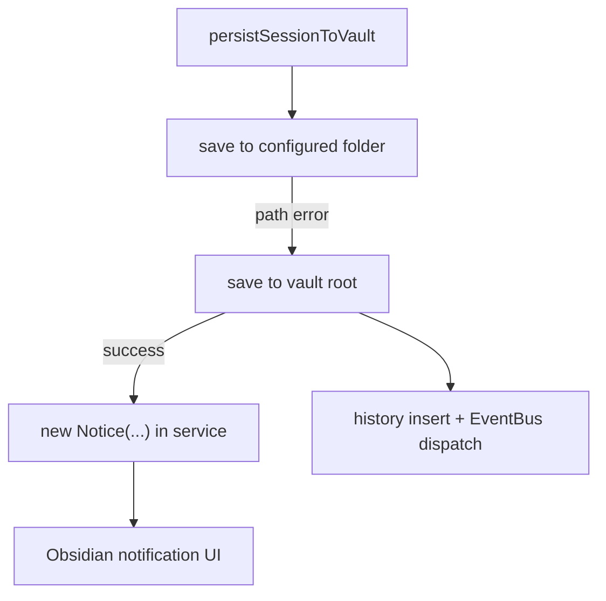
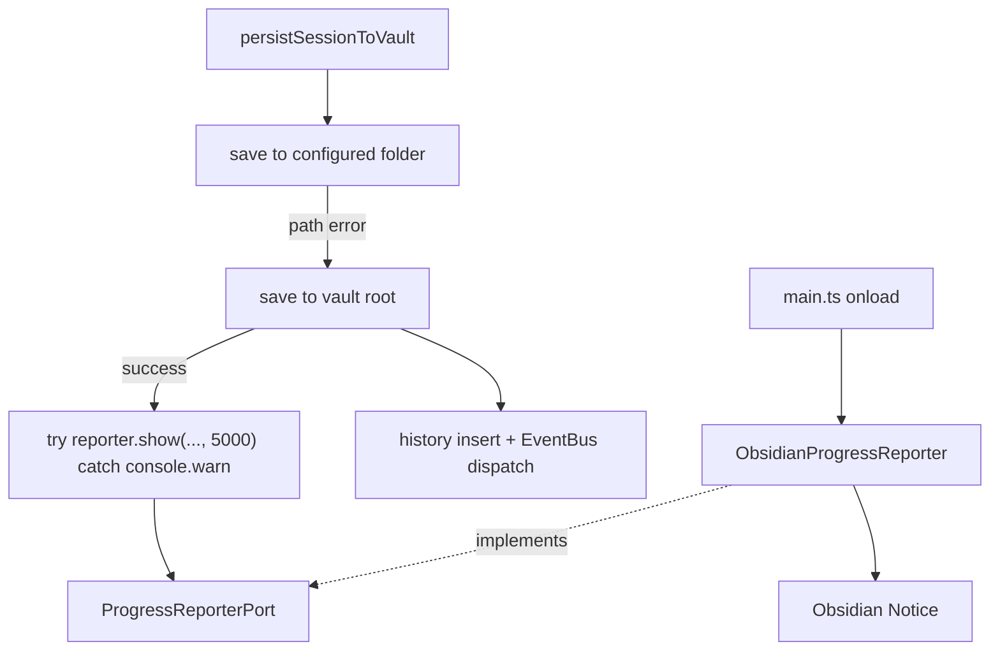

# Owner Review Packet: T2C AnalysisDocPersistence Notice Cleanup

Claude Code commit:
- `2e97eac feat(search): route analysisDocPersistence fallback notice through ProgressReporterPort (T2C)`

Codex verdict:
- Accepted

Owner decision:
- 这轮可以接受。下一步建议进入 `T3 RunEnvelope Core`，不要继续做 T2D 批量扫其它 `Notice`。T2A/T2B/T2C 已经给 T3 足够的真实 port 证据。

Global position:
- 仍在 `T2 Port Sketches` 的收尾。T2A 清掉 `progress-tracker.ts` 的 direct `Notice`，T2B 清掉 `indexInitializer.ts` 的 direct `Notice`，T2C 清掉 `analysisDocPersistence.ts` 的 direct `Notice`。
- 这不是 Quick Search persistence 重构。它只把一个 Obsidian UI 副作用从 service 文件搬到 `ProgressReporterPort -> ObsidianProgressReporter` 后面。

## 0. Review Entry Points

| Review item | Status | Why open it |
| --- | --- | --- |
| This Owner Review Packet | Final | 本轮给 owner 看的中文判断面。 |
| [`t2c-analysis-doc-persistence-notice-cleanup-handoff.md`](../refactor-ops/t2c-analysis-doc-persistence-notice-cleanup-handoff.md) | Source contract | 说明 T2C 允许 Claude 做什么、不能做什么。 |
| [`2026-06-12-t2b-owner-review-packet.md`](./2026-06-12-t2b-owner-review-packet.md) | Previous packet | 说明 T2C 为什么是 T2B 后的可选收尾。 |
| [`architecture-scorecard.md`](../refactor-ops/architecture-scorecard.md) | Updated | 记录 T2C 分数变化。 |
| [`docs/progress.md`](../../progress.md) | Updated | 记录当前阶段和下一步。 |

## 0.5 Code Reading Guide

这轮你应该按下面顺序读代码。目标不是读完整个 persistence 文件，而是看懂：fallback 通知从 service 的 `new Notice(...)` 变成了可注入 port 调用。

| Order | File | What to inspect | Why it matters |
| ---: | --- | --- | --- |
| 1 | `src/service/search/analysisDocPersistence.ts` | imports, `persistSessionToVault` options, fallback root save 后的 inner `try/catch` | 主变化：这个 service 文件不再 import Obsidian `Notice`，通知失败也不会破坏已成功的 save。 |
| 2 | `src/service/ports/ProgressReporterPort.ts` | 顶部注释和 `defaultReporter` | 注释现在明确列出 T2A/T2B/T2C 三个 adopter，并把 `defaultReporter` 标成 T2 临时妥协。 |
| 3 | `test/analysis-doc-persistence-port.test.ts` | `testFallbackNoticeIsWrappedInTryCatch`, `testPortFileStillHasExactlyOneModuleLevelDefault` | 证明 direct `Notice` 不会回来，也证明没有复制新的 `let defaultX` 全局模式。 |
| 4 | `src/app/adapters/ObsidianProgressReporter.ts` | `show(message, timeoutMs)` | 真正的 Obsidian `Notice` 仍然只在 app adapter 里创建。T2C 没改这里。 |

Reading notes:

- Read first: `src/service/search/analysisDocPersistence.ts` 的 `progressReporter?: ProgressReporterPort` 和 `options?.progressReporter ?? getDefaultProgressReporter()`。
- Then read: `ProgressReporterPort.ts` 顶部注释，理解为什么这仍是临时妥协，不是未来复制的模式。
- Optional / only if debugging: 4 个 `persistSessionToVault(...)` caller；它们都没有改。
- Files intentionally not changed: `main.ts`, `ObsidianProgressReporter.ts`, `BackgroundSessionManager.ts`, Quick Search UI stores/callbacks, Chat, Ambient Push, Command Gateway, RunEnvelope。
- If this breaks later, open this file first: `src/service/search/analysisDocPersistence.ts`；如果是通知显示问题，再看 `src/app/adapters/ObsidianProgressReporter.ts`。

## 1. 一句话结论

T2C 成功把 `analysisDocPersistence.ts` 里唯一的 direct `new Notice(...)` 移到 `ProgressReporterPort` 后面，并保持 fallback save 行为不变。

这轮接受，但只代表 `Notice` 副作用边界变干净了；`analysisDocPersistence.ts` 本身仍然很不优雅，仍有 `service -> ui` 和 `service -> app` 老耦合。

## 2. Before Runtime Path



问题：
- service 文件直接 import Obsidian `Notice`。
- fallback save 已经成功后，通知 UI 副作用仍由 business persistence 文件直接拥有。
- 这让 search 子树还不能被称为 `Notice` 边界已收敛。

## 3. After Runtime Path



现在的边界：
- `analysisDocPersistence.ts` 不再 import `obsidian`。
- `analysisDocPersistence.ts` 不再 `new Notice(...)`。
- fallback 通知文本和 `5000` timeout 保留。
- 如果 reporter 缺失或抛错，只 `console.warn`，不会让已经成功的 vault-root save 变成失败。
- `progressReporter?: ProgressReporterPort` 是可选字段，4 个 caller 全部保持兼容。

## 4. Files Reviewed

| File | Role | Review result |
| --- | --- | --- |
| `src/service/search/analysisDocPersistence.ts` | T2C adopter | Accepted. Direct `Notice` removed; fallback notification goes through optional reporter/default reporter with non-fatal warning. |
| `src/service/ports/ProgressReporterPort.ts` | port contract | Accepted with caveat. Implementation unchanged; comment correctly marks `defaultReporter` as T2 temporary compromise. |
| `test/analysis-doc-persistence-port.test.ts` | T2C guard tests | Accepted. Source-scan guards match the narrow slice and mutable-global rule. |
| `src/app/adapters/ObsidianProgressReporter.ts` | app adapter | Not changed. Still the only app adapter that creates concrete `Notice` for this port. |

## 5. Acceptance Evidence

Codex 复核命令：

```text
npm run build
npm run test -- test/analysis-doc-persistence-port.test.ts
npm run test -- test/progress-tracker-port.test.ts
npm run test -- test/index-initializer-port.test.ts
node scripts/audit/boundary-baseline.mjs --out /tmp/t2c-codex-boundary-baseline.md
rg -n "new Notice|from ['\"]obsidian['\"]|\bNotice\b" src/service/search/analysisDocPersistence.ts
rg -n "ObsidianProgressReporter" src/service || true
rg -n "let default|setDefault|getDefault" src/service/ports src/service/search/analysisDocPersistence.ts
```

Results:

| Check | Result |
| --- | --- |
| Build | Pass |
| T2C test | 10/10 pass |
| T2A regression test | 14/14 pass |
| T2B regression test | 9/9 pass |
| Boundary audit | 420 findings |
| `analysisDocPersistence.ts` concrete `Notice` / Obsidian import | 0 |
| service importing `ObsidianProgressReporter` | 0 |
| new `let default...` in T2C target | 0 |

Boundary delta:

| Metric | T0 | T2A | T2B final | T2C | Delta vs T0 | Delta vs T2B |
| --- | ---: | ---: | ---: | ---: | ---: | ---: |
| Files scanned in `src/` | 819 | 822 | 822 | 822 | +3 | 0 |
| Total flagged edges | 423 | 422 | 421 | 420 | -3 | -1 |
| Service/core -> Obsidian side-effect | 23 | 22 | 21 | 20 | -3 | -1 |
| Service files importing Obsidian | 53 | 52 | 51 | 50 | -3 | -1 |
| Service side-effect Obsidian files | 12 | 11 | 10 | 9 | -3 | -1 |
| app -> service edges | 34 | 35 | 35 | 35 | +1 legal | 0 |
| app -> Obsidian imports | 9 | 10 | 10 | 10 | +1 legal | 0 |
| service -> ui | 56 | 56 | 56 | 56 | 0 | 0 |
| service -> app | 74 | 74 | 74 | 74 | 0 | 0 |
| core -> upstream | 78 | 78 | 78 | 78 | 0 | 0 |

## 6. Important Caveats

Accepted, with these caveats:

- Tests are source-scan guards, not runtime persistence tests. This is acceptable for T2C because running `persistSessionToVault` would require faking `AppContext`, vault write helpers, history service, and EventBus.
- `analysisDocPersistence.ts` is still a top offender with 5 flagged edges in the fresh boundary report.
- It still imports Quick Search UI callbacks/types.
- It still uses `AppContext.getInstance()`.
- It still mixes vault write, history insert, and event dispatch.
- `ProgressReporterPort.defaultReporter` remains a module-level mutable default.
- No manual Obsidian UI verification was run in Codex.
- `RunEnvelope` does not exist yet.

## 6.5 Mutable Global State Check

| Item | File | Status | Accepted? | Retirement path |
| --- | --- | --- | --- | --- |
| `defaultReporter` | `src/service/ports/ProgressReporterPort.ts` | Preserved from T2A | Temporary only | T3/T4 should replace this with explicit runtime/composition wiring. |
| New module-level default | `analysisDocPersistence.ts` | None | Yes | No new retirement needed. |
| New default getter use | `analysisDocPersistence.ts` | Added 1 `getDefaultProgressReporter()` fallback | Accepted as T2 temporary reuse | T3 `RunEnvelope` should pass reporter explicitly. |

Decision:
- Do not add another T2 task that copies this pattern for a different side-effect class.
- Do not create `NotificationPort` now.
- Treat T3 as the point where dependency assembly becomes explicit and `defaultReporter` gets an exit path.

## 7. Scorecard

Task-level score, not whole-project score.

| Dimension | Code | Before | After | Delta | Confidence | Reason |
| --- | --- | ---: | ---: | ---: | --- | --- |
| Architecture clarity | AC | 68 | 70 | +2 | High | Search notification path is now consistent across three adopters. |
| Capability semantics | CS | 48 | 50 | +2 | Medium | Still a port slice, but persistence notification is now modeled as a boundary dependency. |
| Dependency direction | DD | 53 | 56 | +3 | High | One more service file stops importing concrete Obsidian UI. |
| Modularity / cohesion | MC | 55 | 58 | +3 | High | Direct UI notification concern leaves persistence logic, but bigger persistence mixing remains. |
| Side-effect isolation | SI | 58 | 62 | +4 | High | `analysisDocPersistence.ts` no longer owns concrete `Notice`. |
| Single runtime path | SR | 52 | 54 | +2 | High | No dual path added; fallback notification has one port route. |
| State ownership clarity | SO | 34 | 34 | 0 | High | State truth is unchanged. |
| Observability / trace | OT | 35 | 38 | +3 | Medium | Non-fatal warning makes missing reporter visible; still no run trace. |
| Testability / fake-port readiness | TF | 62 | 66 | +4 | High | Optional `progressReporter` and source guards make the boundary fakeable. |
| Old-path deletion | OD | 48 | 53 | +5 | High | Direct `Notice` import/construction deleted from the file. |
| Change radius | CR | 52 | 55 | +3 | High | Future search notification changes start at the port/adapter. |
| Owner comprehension | OC | 70 | 73 | +3 | Medium | Code reading guide and tests identify the exact behavior to inspect. |
| Overall elegance | Overall | 54 | 56 | +2 | High | Solid small cleanup; no RunEnvelope/state ownership improvement yet. |

Grouped indices:

| Group | Before | After | Delta | Reason |
| --- | ---: | ---: | ---: | --- |
| Control Index | 58 | 60 | +2 | Easier to explain the search notification path. |
| Boundary Index | 55 | 58 | +3 | One more service-side Obsidian side effect removed. |
| Runtime Truth Index | 45 | 46 | +1 | Runtime path stays singular, but no capability runtime yet. |
| Verification Index | 55 | 60 | +5 | New source-scan guard plus T2A/T2B regressions. |

## 8. What You Should Understand

你现在应该能说清这条路径：

```text
analysisDocPersistence fallback save succeeds
-> ProgressReporterPort.show(...)
-> ObsidianProgressReporter
-> Obsidian Notice
```

也要能说清这条 caveat：

```text
analysisDocPersistence is not architecturally clean yet.
Only the direct Notice side effect was removed.
UI imports, AppContext, history insert, and EventBus remain old paths.
```

## 9. Recommended Next Step

Recommended:
- `T3 RunEnvelope Core`。现在已有 `VaultLintContract`、一个被 3 个 adopter 复用的 `ProgressReporterPort`、明确的 mutable global 退役目标、以及连续三轮 boundary audit delta。足够开始设计真正的运行 envelope。

Not recommended:
- 不要现在做 `T2D BackgroundSessionManager Notice cleanup`。它比 T2A/T2B/T2C 更深，涉及 background session 状态、UI store、Notice、Quick Search hooks，更适合等 T3 envelope 约束出来后再拆。
- 不要现在 generalized `NotificationPort`。
- 不要批量改 Copilot / Ambient / Chat。
- 不要开始 Command Gateway。
