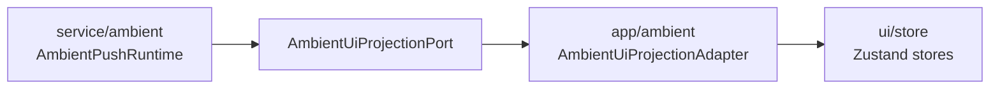
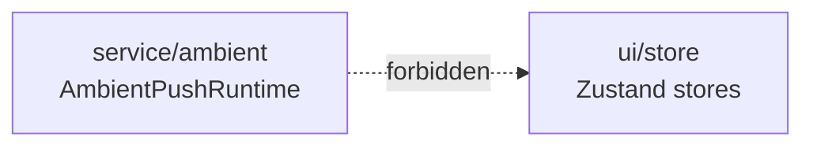
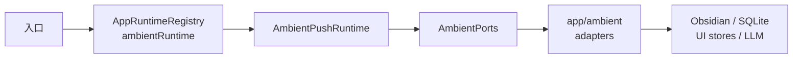
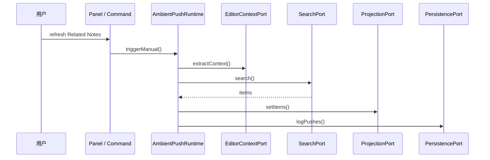
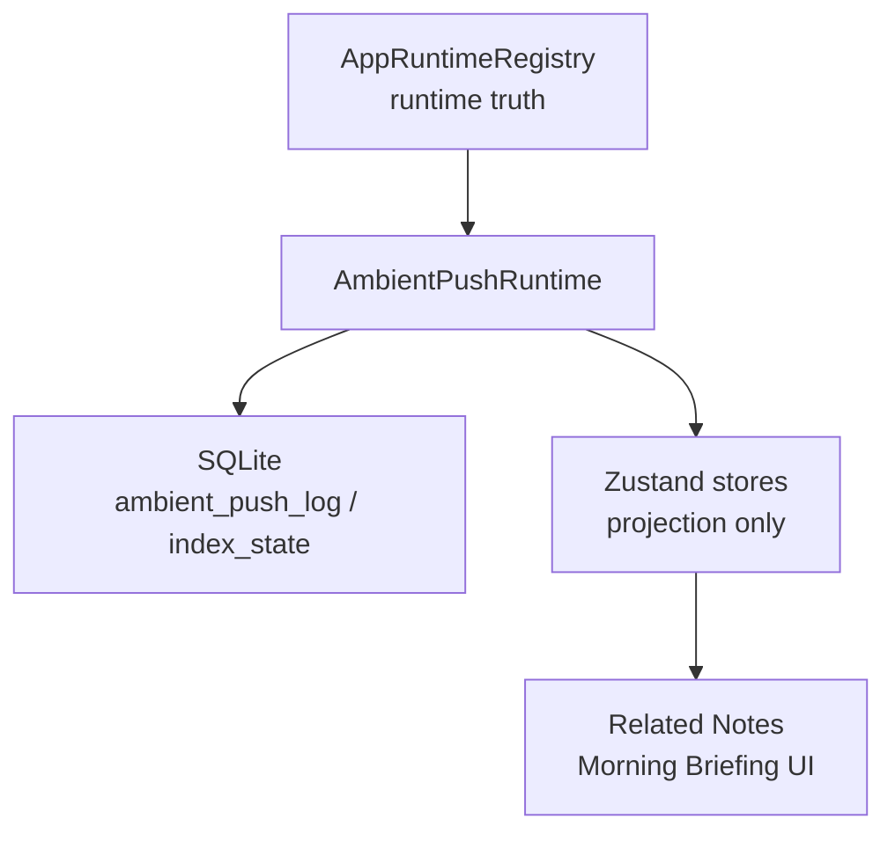
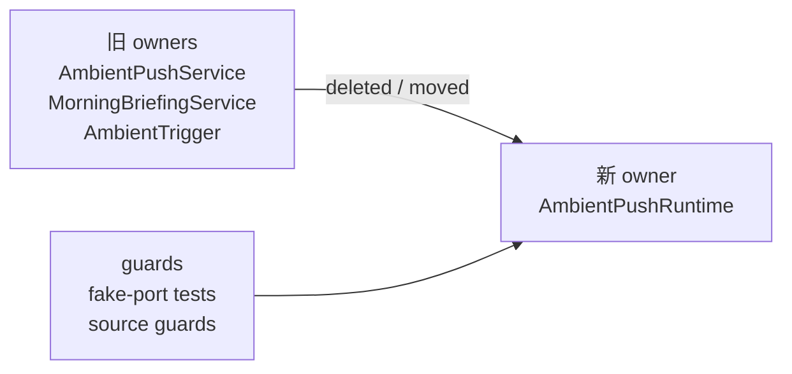

# Owner Review Packet: T8 Ambient Foundation Runtime Boundary Wave

Claude Code commits:

- `a1789056 refactor(ambient): add AmbientRuntime contract, ports, and app-owned runtime registry slot (T8 part 1)`
- `e20bbce7 refactor(ambient): replace service singletons with port-based runtime and app-layer adapters (T8 part 2)`
- `85f20917 test(ambient): add T8 fake-port runtime tests and boundary source guards (T8 part 3)`

Codex verdict:

- Accepted

Owner decision:

- 接受 T8。
- 这轮确实是比 T1-T7 更大的 coherent wave：34 个文件、3 个 commit、边界 findings `415 -> 404`。
- T8 只接受为 foundation cleanup，不代表 Ambient 的 `Current Work State / Session Thought Trace` 产品形态已经开始实现。
- 下一步不要继续在 Ambient 上做小 polish；应该选择第三个 capability 做同等或更大的 runtime boundary wave。

## Review Entry Points

| Review item | Status | Why open it |
| --- | --- | --- |
| This Owner Review Packet | Final | T8 的验收记录、代码阅读入口、边界结论、下一步判断。 |
| [`t8-ambient-foundation-runtime-boundary-wave-handoff.md`](../refactor-ops/t8-ambient-foundation-runtime-boundary-wave-handoff.md) | Previous handoff | Claude Code 执行 T8 时拿到的任务边界和验收标准。 |
| [`architecture-scorecard.md`](../refactor-ops/architecture-scorecard.md) | Updated | T8 分数已加入 ledger：Overall `84 -> 87`。 |
| [`README.md`](../refactor-ops/README.md) | Updated | 当前 refactor loop 状态已经从 T8 推进到 T9 decision。 |
| [`../../progress.md`](../../progress.md) | Updated | 项目进度里已记录 T8 接受和下一步候选。 |

## 中文摘要

T8 做到了：

- 新增 `AmbientRuntime` 接口和 `AmbientPushRuntime` 普通 class。
- 新增 `AmbientPorts`，把 Ambient 需要的 8 类外部能力说清楚：
  - settings
  - editor context
  - search
  - UI projection
  - persistence
  - briefing
  - LLM explanation
  - clock
- `AmbientPushService.getInstance()` 和 `MorningBriefingService.getInstance()` 两条 service-layer singleton 旧路径被删除。
- `src/service/ambient` 不再 import：
  - `@/app/context/AppContext`
  - `@/ui/*`
  - `sqliteStoreManager`
  - Obsidian concrete APIs
- Obsidian workspace event、SQLite、Zustand store、LLM profile、SearchClient 都集中到 `src/app/ambient/*` adapter。
- `AppRuntimeRegistry` 现在同时持有：
  - `vaultLintRuntime`
  - `ambientRuntime`
- UI 和命令入口改成通过 `AppContext.tryGetAmbientRuntime()` 或 React `ServiceContext.ambientRuntime` 触发。
- 新增 fake-port tests 和 source guards，防止 Ambient 以后退回 service singleton / service 直连 UI/sqlite/AppContext。

一句话：

> T8 把 Ambient 从“service 自己到处抓环境 + 两个 singleton 运行时”改成“app 组装 runtime，service 只看 ports，UI/store 只是 projection”。

## 全局位置


T7 的意义是：Vault Lint 成为第一个 worked example。

T8 的意义是：同一套架构纪律开始横向复制到第二个 capability，证明它不是只对 Vault Lint 有效。

T8 不做的事情：

- 不做 Ambient 产品升级。
- 不实现 `Current Work State`。
- 不实现 `Session Thought Trace`。
- 不把 Ambient 接进 `RunEnvelope`。
- 不动 Chat / Command Gateway。

## 代码路径图

T8 前：

```text
main.ts / commands / panel
  -> AmbientPushService.getInstance()
      -> AppContext.getSearchClient()
      -> sqliteStoreManager
      -> useAmbientPushStore
      -> queryWithProfile / ProfileRegistry
      -> AmbientTrigger / Obsidian workspace events

main.ts startup
  -> MorningBriefingService.getInstance()
      -> sqliteStoreManager
      -> useMorningBriefingStore
```

T8 后：

```text
main.ts
  -> composeAmbientRuntime(app)
  -> AppContext.setAmbientRuntime(runtime)
  -> runtime.start()

commands / panel / PushCard / gutter
  -> AppContext.tryGetAmbientRuntime()
  -> AmbientRuntime.triggerManual / recordAction / tryShowMorningBriefing

AmbientPushRuntime
  -> AmbientPorts
      -> src/app/ambient/* adapters
          -> Obsidian / sqlite / Zustand / SearchClient / LLM
```

真正接触外部世界的地方变成：

```text
src/app/ambient/*
```

真正保留业务 orchestration 的地方变成：

```text
src/service/ambient/AmbientPushRuntime.ts
src/service/ambient/AmbientSearcher.ts
```

## Visual Dependency Maps

这节重写成小图。每张图只回答一个问题，不再用一张大图把所有文件塞进去。

### 1. 先回答截图里的问题

你圈出来的是：

```text
src/app/ambient/AmbientUiProjectionAdapter.ts
  -> import useAmbientPushStore
  -> import useMorningBriefingStore
```

这不是 `service -> ui`，而是 `app adapter -> ui projection`。



```text
T8 后允许的路径

service/ambient/AmbientPushRuntime
  -> AmbientUiProjectionPort
      -> app/ambient/AmbientUiProjectionAdapter
          -> ui/store/useAmbientPushStore
          -> ui/store/useMorningBriefingStore
```

```text
T8 后禁止的路径

service/ambient/AmbientPushRuntime
  -> ui/store/useAmbientPushStore     不允许
  -> ui/store/useMorningBriefingStore 不允许
```



核心区别：

| Path | 是否接受 | 为什么 |
| --- | --- | --- |
| `service/ambient -> ui/store` | No | service 直接知道 UI，业务逻辑和界面状态绑死。 |
| `service/ambient -> port -> app/ambient adapter -> ui/store` | Yes | service 只知道 port；UI store 是一个可替换的投影实现。 |

所以 `AmbientUiProjectionAdapter` 不是“service 依赖 UI 的残留”，它是“把 runtime 输出投到 UI store 的桥”。

### 2. T8 最小依赖图

只记这条主线：



```text
入口
  -> AppRuntimeRegistry.ambientRuntime
      -> AmbientPushRuntime
          -> AmbientPorts
              -> src/app/ambient/* adapters
                  -> Obsidian / SQLite / UI stores / LLM
```

翻译成人话：

- `AppRuntimeRegistry` 管“这个 runtime 活着没有”。
- `AmbientPushRuntime` 管“Ambient 该怎么跑”。
- `AmbientPorts` 管“runtime 能向外请求什么能力”。
- `src/app/ambient/* adapters` 管“真实世界怎么接进来”。

### 3. Related Notes 刷新路径

这是你点 refresh 或 command 时发生的事：



```text
用户点击刷新
  -> AmbientPushPanel / command
      -> ambientRuntime.triggerManual()
          -> editorContext.extractContext()
          -> search.search()
          -> projection.setItems()
          -> persistence.logPushes()
```

重点：

- `AmbientPushRuntime` 不知道 `useAmbientPushStore`。
- 它只调用 `projection.setItems()`。
- 真实的 `setItems()` 由 `AmbientUiProjectionAdapter` 转发到 Zustand store。

### 4. UI store 现在是什么角色



```text
ambient_push_log / index_state
  = 持久化 truth

AppRuntimeRegistry.ambientRuntime
  = runtime truth

useAmbientPushStore / useMorningBriefingStore
  = 当前屏幕要显示什么
  = projection only
```

这就是为什么 T8 接受 `app/ambient/AmbientUiProjectionAdapter.ts` import store：

```text
UI store 仍然存在
但它不再写 SQLite
也不再被 service 直接 import
```

### 5. 旧路径到底删了什么



```text
删除:
  AmbientPushService.ts
  MorningBriefingService.ts
  AmbientTrigger.ts

移动:
  SerendipityGutterPlugin.ts
    service/ambient -> app/ambient

移除:
  ambientPushStore.recordAction -> sqlite write
```

对应的新路径：

```text
AmbientPushRuntime
  -> ports
  -> app adapters
```

对应的防回退测试：

```text
test/ambient-source-guard.test.ts
  - service/ambient 不能 import app/ui/sqlite
  - ambientPushStore 不能 import sqlite
  - 不能重新调用 AmbientPushService.getInstance()
  - 不能重新调用 MorningBriefingService.getInstance()

test/ambient-runtime-ports.test.ts
  - 用 fake ports 跑 AmbientPushRuntime
```

This is why T8 is accepted: it deletes old owners and adds guards around the new owner.

## Code Reading Guide

Read in this order:

1. `src/service/ambient/ports/AmbientPorts.ts`
   - 看 8 个 port 接口。
   - 这是 T8 的形状图：Ambient runtime 到底允许依赖哪些能力。

2. `src/service/ambient/AmbientRuntime.ts`
   - 看 5 个 runtime 方法：
     - `start`
     - `triggerManual`
     - `tryShowMorningBriefing`
     - `recordAction`
     - `dispose`
   - 这就是 UI/commands 能调用的公开 surface。

3. `src/service/ambient/AmbientPushRuntime.ts`
   - 看 `handleTrigger`。
   - 看 `tryShowMorningBriefing`。
   - 看 `recordAction`。
   - 这里回答：“Ambient 的业务流程是否还自己摸 AppContext/sqlite/store？”
   - 结论：不摸，只走 ports。

4. `src/app/ambient/composeAmbientRuntime.ts`
   - 看所有 adapter 如何被 new 出来。
   - 这是 Ambient 的唯一 app-level composition point。

5. `src/app/runtime/AppRuntimeRegistry.ts`
   - 看 `set/get/tryGet/clearAmbientRuntime`。
   - 这里回答：“runtime owner 到底是谁？”
   - 结论：app-owned registry，不是 service module singleton。

6. `src/app/ambient/ObsidianAmbientEditorContextAdapter.ts`
   - 看 `start` 和 `extractContext`。
   - 这里负责 Obsidian editor event 和当前 paragraph/context 抽取。

7. `src/app/ambient/SearchAmbientSearchAdapter.ts`
   - 看 `searchVault` 和 `serendipitySearch`。
   - 这里负责 SearchClient、2-hop graph、embedding repo。

8. `src/app/ambient/SqliteAmbientPersistenceAdapter.ts`
   - 看 `logPushes`、`recordAction`、`getLearnedPatterns`。
   - 这里负责 `ambient_push_log` 和 pattern cache。

9. `src/app/ambient/SqliteAmbientBriefingAdapter.ts`
   - 看 `loadBriefingItems`。
   - 这里负责 Morning Briefing 的三类 SQL 查询。

10. `src/ui/store/ambientPushStore.ts`
    - 确认 store 现在只剩 UI projection，不再写 SQLite。

11. `test/ambient-runtime-ports.test.ts`
    - 看 `buildFakePorts()`。
    - 这是最关键的 owner 理解点：Ambient runtime 已经可以不启动 Obsidian、不连 sqlite、不挂 UI store，用 fake ports 单独跑。

12. `test/ambient-source-guard.test.ts`
    - 看 6 个 source guard。
    - 这里防止以后有人把 `AppContext` / `sqliteStoreManager` / `@/ui` 又 import 回 service 层。

Debug first file:

- Related Notes 不刷新：先看 `src/service/ambient/AmbientPushRuntime.ts` 的 `handleTrigger`。
- 手动 refresh 没反应：先看 `src/app/commands/PeakCommandActions.ts:openRelatedNotes/refreshRelatedNotes` 和 `AmbientPushPanel.tsx`。
- Obsidian 当前段落抽取不对：先看 `src/app/ambient/ObsidianAmbientEditorContextAdapter.ts`。
- 搜索/serendipity 不对：先看 `src/app/ambient/SearchAmbientSearchAdapter.ts`。
- 持久化/action log 不对：先看 `src/app/ambient/SqliteAmbientPersistenceAdapter.ts`。
- Morning Briefing 不显示：先看 `AmbientPushRuntime.tryShowMorningBriefing`，再看 `SqliteAmbientBriefingAdapter.ts`。
- 边界退化：先看 `test/ambient-source-guard.test.ts`。

## Changed Code Files

### Contract / runtime surface

- `src/service/ambient/AmbientContract.ts`
  - 新增 Ambient capability ids、input/output、dependency inventory。
  - 注意：这里是描述性 inventory，不是运行时代码。
- `src/service/ambient/AmbientRuntime.ts`
  - 新增 runtime interface。
- `src/service/ambient/ports/AmbientPorts.ts`
  - 新增 8 个 port 接口。

### Runtime implementation

- `src/service/ambient/AmbientPushRuntime.ts`
  - 新增普通 class。
  - 合并原 `AmbientPushService` 和 `MorningBriefingService` 的 orchestration。
  - 不 import app/UI/sqlite/Obsidian。
- `src/service/ambient/AmbientSearcher.ts`
  - 改成接收 `AmbientSearchDeps`。
  - 不再直接 `AppContext.getSearchClient()`。
- `src/service/ambient/ContextExtractor.ts`
  - 删除 Obsidian-dependent `extractContext(app, ...)`，只保留纯文本 helper。
- `src/service/ambient/RelevanceExplainer.ts`
  - 删除 LLM 请求路径，只保留 template explanation。
- `src/service/ambient/PatternLearner.ts`
  - 删除 sqlite-backed pattern cache，保留类型和 boost helper。
- `src/service/ambient/SerendipitySearcher.ts`
  - 删除 sqlite-backed 2-hop search，保留 `cosineDistance` 和类型。

### App adapters

- `src/app/ambient/composeAmbientRuntime.ts`
  - 新 runtime 组装点。
- `src/app/ambient/ObsidianAmbientSettingsAdapter.ts`
  - 负责 settings 读取和 auto-open 标记写回。
- `src/app/ambient/ObsidianAmbientEditorContextAdapter.ts`
  - 负责 workspace event subscription 和 active editor context。
- `src/app/ambient/SearchAmbientSearchAdapter.ts`
  - 负责 SearchClient + graph/embedding serendipity。
- `src/app/ambient/AmbientUiProjectionAdapter.ts`
  - 负责写 `useAmbientPushStore` / `useMorningBriefingStore`。
- `src/app/ambient/SqliteAmbientPersistenceAdapter.ts`
  - 负责 push log、action record、learned patterns。
- `src/app/ambient/SqliteAmbientBriefingAdapter.ts`
  - 负责 Morning Briefing timestamp 和 SQL queries。
- `src/app/ambient/LlmAmbientExplanationAdapter.ts`
  - 负责 `queryWithProfile` LLM micro-explanation。
- `src/app/ambient/DefaultAmbientClock.ts`
  - 负责 production clock。
- `src/app/ambient/SerendipityGutterPlugin.ts`
  - 从 service 移到 app。
  - 不再用 `(window as any).app`。

### App/runtime/UI wiring

- `main.ts`
  - 启动时 compose + bind + start Ambient runtime。
  - Morning Briefing 改走 `AppContext.tryGetAmbientRuntime()?.tryShowMorningBriefing()`。
  - unload 改走 `AppContext.clearAmbientRuntime()`。
- `src/app/runtime/AppRuntimeRegistry.ts`
  - 新增 Ambient runtime binding。
- `src/app/context/AppContext.ts`
  - 新增 Ambient runtime static delegators。
- `src/app/commands/PeakCommandActions.ts`
  - Related Notes 命令改走 runtime。
- `src/ui/context/ServiceContext.tsx`
  - 新增 `ambientRuntime`。
- `src/ui/react/ReactElementFactory.tsx`
  - 注入 `ambientRuntime`。
- `src/ui/view/ambient-push/AmbientPushPanel.tsx`
  - Refresh button 改走 `ambientRuntime.triggerManual()`。
- `src/ui/view/ambient-push/PushCard.tsx`
  - open/link/dismiss action record 改走 `ambientRuntime.recordAction(...)`。
- `src/ui/store/ambientPushStore.ts`
  - 删除 sqlite import 和 `recordAction` 写库逻辑。
  - 只保留 UI projection。

### Deleted / moved old paths

- Deleted: `src/service/ambient/AmbientPushService.ts`
- Deleted: `src/service/ambient/MorningBriefingService.ts`
- Deleted: `src/service/ambient/AmbientTrigger.ts`
- Deleted/renamed: `src/service/ambient/briefing-queries.ts`
- Moved: `src/service/ambient/SerendipityGutterPlugin.ts` -> `src/app/ambient/SerendipityGutterPlugin.ts`

## Runtime Ownership Check

| Runtime | Owner before | Owner after | App composition point | Service-layer singleton? | Accepted? |
| --- | --- | --- | --- | --- | --- |
| Ambient Push / Morning Briefing | `AmbientPushService.instance` + `MorningBriefingService.instance` | `AppRuntimeRegistry.ambientRuntime` | `src/app/ambient/composeAmbientRuntime.ts` + `main.ts` | No | Yes |

Evidence:

- `AmbientPushService.ts` deleted.
- `MorningBriefingService.ts` deleted.
- `AppRuntimeRegistry.clearAmbientRuntime()` disposes runtime.
- `AppContext.clearForUnload()` also clears Ambient runtime, and clear is idempotent.
- `test/app-runtime-registry.test.ts` covers fail-loud get, soft tryGet, double-bind rejection, clear/rebind, dispose, and cross-capability isolation.

## Boundary Check

Codex reran:

```text
node scripts/audit/boundary-baseline.mjs --out /tmp/t8-codex-boundary-baseline.md
```

Result:

```text
Files scanned: 846
Total flagged edges: 404
```

Delta:

| Metric | T7 | T8 | Delta |
| --- | ---: | ---: | ---: |
| Total flagged edges | 415 | 404 | -11 |
| Service -> UI | 55 | 52 | -3 |
| Service -> app shell | 70 | 66 | -4 |
| Service/Core -> Obsidian side-effect | 20 | 19 | -1 |
| Service/Core -> Obsidian types | 78 | 76 | -2 |
| Core -> Service/App/UI | 78 | 78 | 0 |
| UI -> app shell | 114 | 113 | -1 |
| Service AppContext references | 87 | 87 | 0 |
| App -> service | 51 | 79 | +28 |

Interpretation:

- `App -> service` 增加是预期的：app adapters 现在 import service 的 port/type/runtime，这是正确方向。
- `Service AppContext references` 没下降，是因为剩余 87 个引用来自其他 capability，不是 Ambient。
- 对 T8 的验收重点不是全项目 AppContext 数字，而是 `src/service/ambient` 是否变干净。source guard 已证明它干净。

## Source Checks

Codex reran:

```text
rg -n "AmbientPushService\\.getInstance|MorningBriefingService\\.getInstance" src main.ts
rg -n "from ['\"]@/ui/|from ['\"]@/app/context/AppContext|sqliteStoreManager|SqliteStoreManager" src/service/ambient
rg -n "sqliteStoreManager|SqliteStoreManager" src/ui/store/ambientPushStore.ts
rg -n "\\(window as any\\)\\.app" src/service/ambient src/app/ambient src/ui
```

Result:

- retired singleton hits are comments only;
- `src/service/ambient` sqlite/AppContext/UI hits are comments or contract inventory only;
- `ambientPushStore.ts` sqlite hit is comment only;
- `(window as any).app` hit is comment only.

The real guard is:

```text
npm run test -- test/ambient-source-guard.test.ts
```

Result:

- 6/6 pass
- scanned service 11 files and app 10 files

## Verification

Codex reran:

```text
npm run build
npm run test -- test/ambient-runtime-ports.test.ts
npm run test -- test/ambient-source-guard.test.ts
npm run test -- test/app-runtime-registry.test.ts
npm run test -- test/ambient-push.test.ts test/ambient-panel-startup.test.ts test/run-envelope-core.test.ts test/vault-lint-defaults.test.ts test/vault-lint-contract.test.ts test/vault-lint-runner.test.ts test/vault-lint-service-ports.test.ts test/vault-lint-detectors.test.ts test/vault-lint-source-guard.test.ts test/vault-lint-repo.test.ts test/vault-lint-structural.test.ts test/lint-health-score.test.ts
node scripts/audit/boundary-baseline.mjs --out /tmp/t8-codex-boundary-baseline.md
```

Results:

| Check | Result |
| --- | --- |
| Build | Pass |
| Ambient runtime fake-port tests | 16/16 pass |
| Ambient source guards | 6/6 pass |
| App runtime registry tests | 14/14 pass |
| Ambient helper regression | Pass |
| Ambient panel startup regression | Pass |
| RunEnvelope core regression | 27/27 pass |
| Vault Lint defaults / contract / runner / service ports / detectors / source guard / repo / structural / health score | All pass |
| Boundary audit | 404 findings |

Verification caveat:

- 本 repo 的 `run-test.js` 会写固定文件 `temp-test.js`。
- 所以不能并行跑多个 `npm run test -- <file>` 进程；会互相踩输出。
- 正确做法是：
  - 一个 `npm run test -- file1 file2 ...`，让 runner 内部串行；
  - 或者逐个串行运行。

## Caveats

Non-blocking:

1. `composeAmbientRuntime.ts` 顶部注释说它在 sqlite initialized 后运行，但 `main.ts` 实际是先 compose/start Ambient runtime，再异步 init sqlite/search。当前行为仍可接受，因为 search/sqlite 调用是 lazy 的，失败会被 runtime 捕获；但注释应该在下一轮 hygiene 中改准。

2. `AmbientContract.ts` 的 inventory 写了 `ObsidianAmbientEditorContextAdapter.ts` 使用 `AppContext.getApp().workspace + metadataCache`，真实代码是构造时注入 `app`，不是直接 `AppContext.getApp()`。这是 inventory 文字不精确，不影响运行时边界。

3. Ambient 还没有接 `RunEnvelope`，所以这轮的 Observability / trace 不应该高估。现在能测 runtime 行为，但还不能像 Vault Lint 那样产出 run event / artifact trace。

4. `DEFAULT_AMBIENT_PUSH_SETTINGS` 仍在 `src/service/ambient/types.ts`。T8 没有把 Ambient settings 升级成 editable JSON + drift guard；这是后续 config governance 小任务，不是本轮 acceptance blocker。

5. `Date.now()` 仍存在于部分 app adapter / pure helper 中。它们多数是旧行为搬迁，不是新增可变 singleton；以后如果要严格 fake time，可以再把 clock port 扩展到 adapter 层。

## Elegance Score

| Dimension | Code | T7 | T8 | Delta | Confidence | Reason / evidence |
| --- | --- | ---: | ---: | ---: | --- | --- |
| Architecture clarity | AC | 84 | 88 | +4 | High | Ambient entry -> runtime -> ports -> adapters path is now traceable. |
| Capability semantics | CS | 80 | 82 | +2 | Medium | Ambient Push / Briefing are modeled; Current Work State remains future-only. |
| Dependency direction | DD | 79 | 85 | +6 | High | `src/service/ambient` no longer imports app/UI/sqlite; source guards enforce it. |
| Modularity / cohesion | MC | 79 | 86 | +7 | High | editor, search, persistence, briefing, LLM, projection split into app adapters. |
| Side-effect isolation | SI | 80 | 86 | +6 | High | Obsidian/sqlite/UI/LLM side effects hidden behind ports/adapters. |
| Single runtime path | SR | 85 | 91 | +6 | High | retired `AmbientPushService` and `MorningBriefingService` singletons are deleted. |
| State ownership clarity | SO | 85 | 88 | +3 | High | runtime owned by registry; stores are UI projection; persistence adapter owns DB writes. |
| Observability / trace | OT | 74 | 76 | +2 | Medium | fake tests improve inspection, but no Ambient RunEnvelope/artifact trace yet. |
| Testability / fake-port readiness | TF | 89 | 91 | +2 | High | 16 fake-port tests + 6 source guards. |
| Old-path deletion | OD | 84 | 90 | +6 | High | two service singletons and old trigger path deleted/moved. |
| Change radius | CR | 82 | 85 | +3 | Medium | future Ambient changes start at runtime/ports/adapters, not service singleton/store/sqlite scatter. |
| Owner comprehension | OC | 84 | 88 | +4 | High | changed files and debug path are now reviewable as one coherent unit. |
| Overall elegance | Overall | 84 | 87 | +3 | High | second capability proves the modernization pattern beyond Vault Lint. |

Grouped indices:

| Group | T7 | T8 | Delta | Reason |
| --- | ---: | ---: | ---: | --- |
| Control Index | 84 | 84 | 0 | trace still missing; code path is clearer but not yet RunEnvelope-backed. |
| Boundary Index | 79 | 86 | +7 | Ambient service-side boundary closed. |
| Runtime Truth Index | 85 | 87 | +2 | runtime owner is app-level; old singletons removed. |
| Verification Index | 89 | 91 | +2 | fake-port tests + source guards are strong. |

## What Remains Old

- Chat / Quick Search / Copilot still carry most of the remaining `AppContext` / UI-store / service-to-app coupling.
- `src/service/copilot/actions/index.ts` remains the top offender with 30 flagged edges.
- `src/service/BackgroundSessionManager.ts` remains a major service -> UI coupling point.
- Ambient is not yet `Current Work State`; it is still the old Related Notes / Morning Briefing product behavior behind better runtime boundaries.
- Command Gateway remains T12 capstone and should not start now.

## Next Task

Recommended T9 direction:

1. **T9 Copilot Vault Digest / Review Runtime Boundary Wave**
   - Why: medium size, likely 25-40 files.
   - Good next step if we want another controlled capability wave without touching Chat's largest blast radius.
   - Candidate old paths:
     - `VaultReviewSession`
     - `VaultMetaAgentStream`
     - `VaultDigestService`
     - Copilot vault review AppContext/runtime lookup.

2. **T9 Quick Search Foundation Boundary Wave**
   - Why: higher leverage, likely 50-70 files.
   - More aligned with the biggest remaining service/UI coupling.
   - Risk: larger blast radius; should be split into 2-3 commits inside one Claude session.

3. **Ambient Config Defaults Governance**
   - Why: small cleanup, 5-8 files.
   - Not recommended as the immediate next move because the owner asked to increase task granularity.

Do not do next:

- Do not implement Current Work State yet.
- Do not start Command Gateway.
- Do not spend another round on Ambient micro-polish unless there is a concrete bug.

## Review Verdict

Verdict:

- Accepted

Reason:

- T8 removed meaningful old runtime paths, not just added abstractions.
- Runtime ownership follows the app-level registry rule.
- Ambient service code no longer owns Obsidian/sqlite/UI/provider side effects.
- Tests are strong enough to prevent the most likely regressions.
- Boundary scan confirms a real drop: `415 -> 404`.

Required follow-up before next coding task:

- Decide T9 target: Copilot vault review/digest for controlled medium wave, or Quick Search for larger high-leverage wave.
