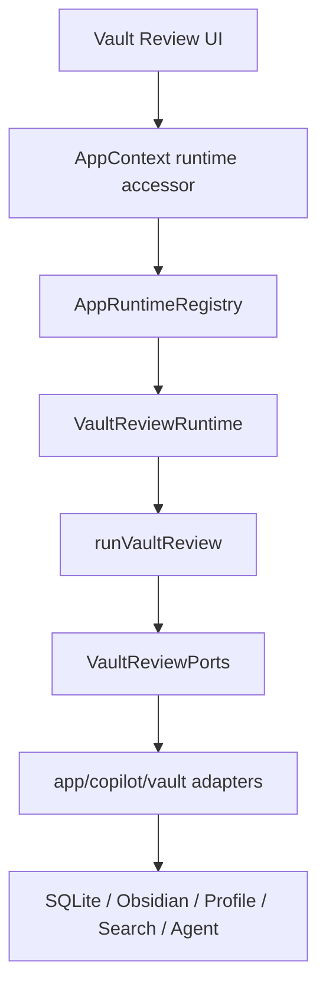
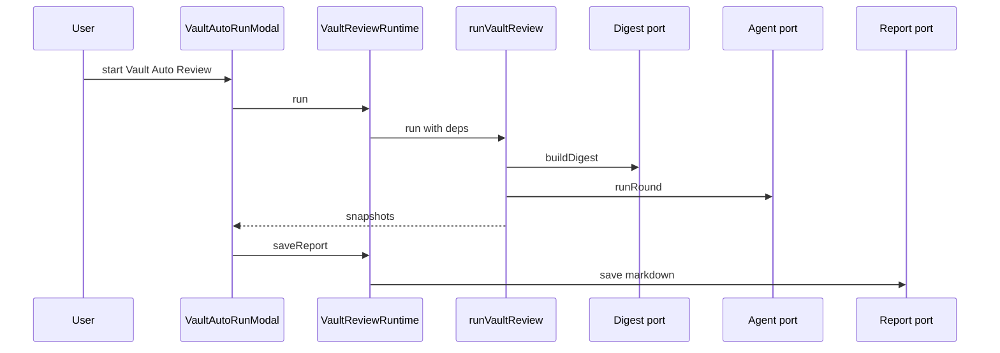
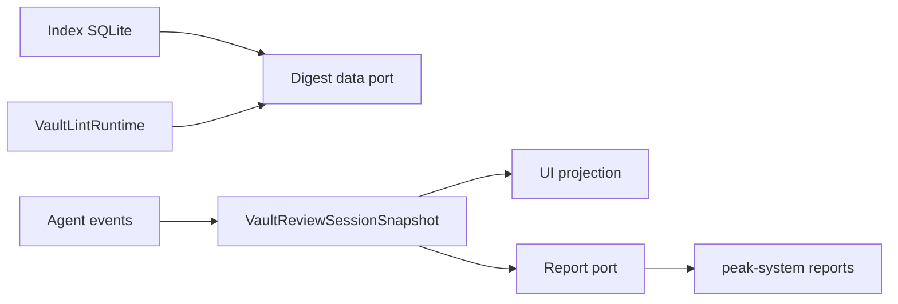
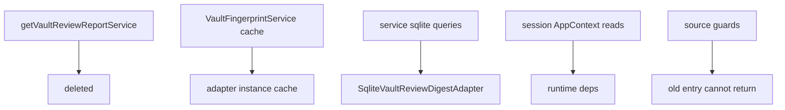
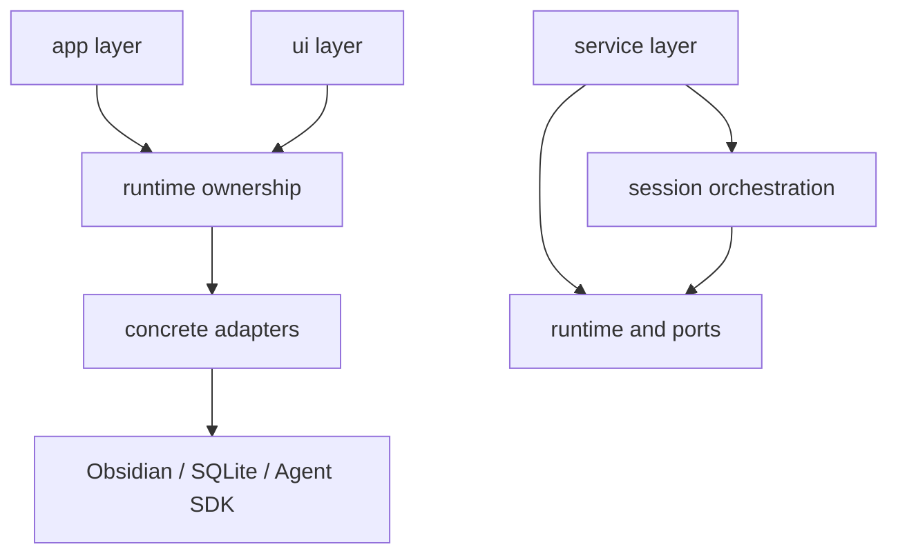
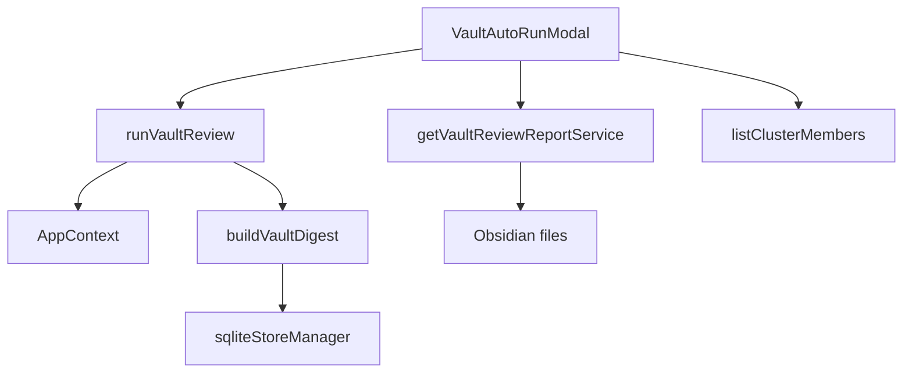
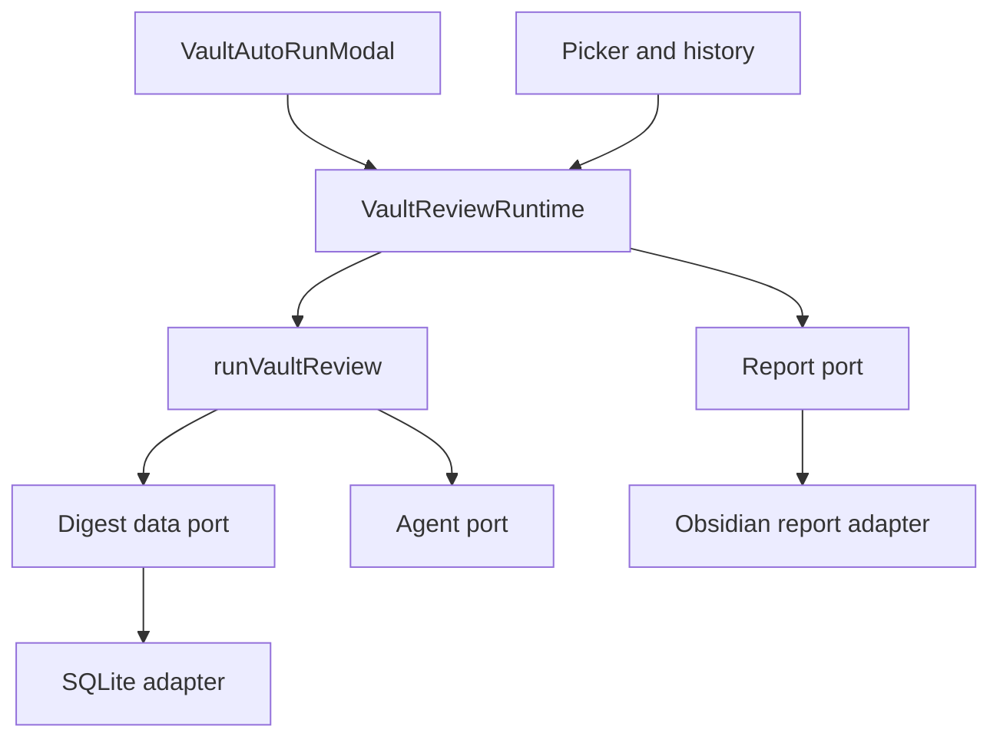

# Owner Review Packet: T9 Copilot Vault Review Runtime Boundary Wave

Claude Code commits:

- `d606005b` `refactor(vault-review): add VaultReviewRuntime contract, ports, and app-owned runtime registry slot (T9 part 1)`
- `bbbdb95d` `refactor(vault-review): replace service singletons with port-based runtime and app-layer adapters (T9 part 2)`
- `9f53d970` `test(vault-review): add T9 fake-port runtime tests and boundary source guards (T9 part 3)`

Verdict: **Accepted, with two non-blocking cleanup notes**

Owner decision: 可以把 T9 当作完成，下一轮不要继续抠 Vault Review 小边角；下一步应在 **Quick Search / Background Session** 和 **Copilot Action Registry** 两条大线之间二选一。

Global position: T9 是第三个 worked example。T7 证明 Vault Lint 可以走 ports/runtime，T8 证明 Ambient 可以退役旧 singleton，T9 证明 Copilot Vault Review 这种更复杂的 agent/report/history surface 也能用同一套 app-owned runtime 模式收口。

## 0. Review Entry Points

| Review item | Status | Why open it |
| --- | --- | --- |
| This Owner Review Packet | Final | 本轮 owner 审查主文档。 |
| [`t9-copilot-vault-review-runtime-boundary-wave-handoff.md`](../refactor-ops/t9-copilot-vault-review-runtime-boundary-wave-handoff.md) | Source contract | 对照 Claude 被允许做什么、禁止做什么。 |
| [`architecture-scorecard.md`](../refactor-ops/architecture-scorecard.md) | Updated | T9 分数与趋势。 |
| `/tmp/t9-codex-boundary-baseline.md` | Local evidence | Codex 复跑的 boundary scanner，404 findings。 |

## 0.5 Code Reading Guide

Read in this order:

| Order | File | What to inspect | Why it matters |
| ---: | --- | --- | --- |
| 1 | `src/service/copilot/vault/VaultReviewRuntime.ts` | `VaultReviewRuntime` | 新 runtime facade，UI 以后只需要认识这个入口。 |
| 2 | `src/app/copilot/vault/composeVaultReviewRuntime.ts` | `composeVaultReviewRuntime` | T9 的唯一 app composition point。 |
| 3 | `src/service/copilot/vault/ports/VaultReviewPorts.ts` | `VaultReviewProfilePort`, `VaultReviewDigestDataPort`, `VaultReviewAgentPort`, `VaultReviewReportPort` | 这里定义了 service 可以依赖什么。 |
| 4 | `src/service/copilot/vault/VaultReviewSession.ts` | `runVaultReview` | session loop 现在只吃 ports，不再抓 `AppContext`。 |
| 5 | `src/app/copilot/vault/SqliteVaultReviewDigestAdapter.ts` | `buildDigest`, `getVaultFingerprint`, `listClusterMembers` | SQLite 查询和 fingerprint cache 从 service 搬到 app adapter。 |
| 6 | `src/app/copilot/vault/ObsidianVaultReviewReportAdapter.ts` | `save`, `listAll`, `load`, `delete` | Obsidian file / Notice 副作用从 service 搬到 app adapter。 |
| 7 | `src/ui/view/copilot/vault/VaultAutoRunModal.tsx` | `tryGetVaultReviewRuntime` call sites | UI 现在通过 runtime 跑 review / 保存 / 读历史 / drilldown。 |
| 8 | `test/vault-review-source-guard.test.ts` | all tests | 防止旧入口回潮。 |
| 9 | `test/vault-review-runtime-ports.test.ts` | `testDigestNullProducesErrorSnapshot`, `testFastRoundRunsAgentStreamToCompletion` | fake ports 证明核心 orchestration 不需要 Obsidian/sqlite/AppContext。 |

Reading notes:

- Read first: runtime interface + composition function。
- Then read: service session + two app adapters。
- Optional / only if debugging: `VaultMetaAgentStream.ts`，因为它仍然包含 prompt/tool/Agent SDK round 细节。
- Files intentionally not changed: Chat、Quick Search、Command Gateway、Ambient、Vault Lint、document-scope Copilot review。
- If this breaks later, open `src/app/copilot/vault/composeVaultReviewRuntime.ts` first；如果 report 保存坏了，打开 `src/app/copilot/vault/ObsidianVaultReviewReportAdapter.ts`。

## 0.6 Visual Dependency Maps

### Map 1: Runtime Ownership



How to read:

- 左边是 UI 入口。
- 中间是 app-owned runtime owner。
- 右边是真实副作用。
- `src/service/copilot/vault` 现在只处在 `Session -> Ports` 这一段。

### Map 2: Manual Run Sequence



This explains the main user-visible path: run, stream snapshots, progressively save report.

### Map 3: State Ownership



State truth after T9:

| State | Owner | Consumers | Still ambiguous? |
| --- | --- | --- | --- |
| Index facts / graph facts | SQLite repos via app digest adapter | digest builder, cluster drilldown | No |
| Vault lint health snapshot | `VaultLintRuntime` | digest adapter | No |
| Running review state | `VaultReviewSessionSnapshot` | modal, report save | No |
| Historical review record | markdown under `peak-system/vault-reviews` | picker, history modal, reopen | No |
| UI display state | React component state | current modal only | Projection only |

### Map 4: Old Path Deletion



Deleted or retired:

- `getVaultReviewReportService()` production singleton: gone.
- `VaultReviewReportService._singleton`: gone.
- `VaultFingerprintService._cached`: gone.
- `VaultDigestService` SQLite query ownership: moved.
- `VaultReviewSession` AppContext reads: moved.

### Map 5: Modularity Atlas



What changed:

- Before: UI, service, SQLite, Obsidian report files, profile/search/agent setup were interleaved.
- After: UI asks runtime; runtime delegates to service; service asks ports; app adapters touch concrete world.
- The app layer is allowed to import UI/Obsidian/sqlite-shaped concrete dependencies because it is the composition boundary.

## 1. One-Sentence Outcome

T9 moved Vault Auto Review from direct UI/service/singleton wiring into an app-owned `VaultReviewRuntime`, so the review run, digest data, report persistence, history, and cluster drilldown now have one reviewable runtime path.

中文说明:

- 这一轮做了什么: 把 Copilot Vault Review 的 runtime、digest、fingerprint、report/history 从隐藏 singleton 和 direct infra calls 收进 ports/adapters。
- 为什么更可控: 以后要改 Vault Review，先读 runtime 和 adapters；不用在 UI、service、sqlite、Obsidian report class 之间找真相。
- 它没有做什么: 没有重构整个 Copilot action registry，也没有重构 document-scope Copilot review。

## 2. Before Runtime Path



Why this was hard to control:

- UI knew too many service functions.
- Service knew too much about app shell and SQLite.
- Report persistence lived in a service singleton.
- Fingerprint cache lived as module-level state in service.

## 3. After Runtime Path



How this lowers change radius:

- Report persistence changes start in `ObsidianVaultReviewReportAdapter.ts`.
- Digest/fingerprint changes start in `SqliteVaultReviewDigestAdapter.ts`.
- Run-loop changes start in `VaultReviewSession.ts`.
- UI no longer imports retired run/report/list helpers directly.

## 4. Mutable Global State Check

| Item | File | Introduced / Preserved / Removed | Accepted? | Retirement path |
| --- | --- | --- | --- | --- |
| `_singleton` report service | `VaultReviewReportService.ts` | Removed | Yes | Complete |
| `_cached` fingerprint | `VaultFingerprintService.ts` | Removed | Yes | Complete |
| `cachedFingerprint` instance field | `SqliteVaultReviewDigestAdapter.ts` | Introduced as adapter state | Yes | Cleared by runtime dispose |
| `vaultReviewRuntime` field | `AppRuntimeRegistry.ts` | Introduced app-owned runtime state | Yes | Same pattern as Vault Lint / Ambient |

Conclusion: no new service-layer module global was introduced.

## 5. Runtime Ownership Check

| Runtime | Owner before | Owner after | App-level composition point | Service-layer singleton? | Accepted? |
| --- | --- | --- | --- | --- | --- |
| Vault Review | UI direct calls + service singleton report persistence | `AppRuntimeRegistry.vaultReviewRuntime` | `src/app/copilot/vault/composeVaultReviewRuntime.ts` | No | Yes |

Important nuance:

- `VaultReviewRuntime` ownership is clean.
- `VaultMetaAgentStream.ts` still has `import type { App } from 'obsidian'` and still resolves `ProfileRegistry.getInstance()` inside service. This is not a T9 blocker because direct `AppContext` / SQLite / Obsidian report side effects are gone, but it caps the score. A later Copilot agent boundary wave should move more of Agent SDK/profile/tool-server setup behind a stronger agent port.

## 6. Config Defaults Ownership Check

T9 did not introduce or move product/domain config defaults. No `DEFAULT_*_CONFIG` governance issue was found in the changed files.

## 7. Boundary Audit Delta

Codex reran:

```bash
npm run build
npm run test -- test/app-runtime-registry.test.ts test/vault-review-source-guard.test.ts test/vault-review-runtime-ports.test.ts test/ambient-runtime-ports.test.ts test/ambient-source-guard.test.ts test/lint-health-score.test.ts
node scripts/audit/boundary-baseline.mjs --out /tmp/t9-codex-boundary-baseline.md
```

Codex verified the after-state:

- Files scanned: 854 under `src/`
- Total flagged edges: 404
- Top remaining offender: `src/service/copilot/actions/index.ts` with 30 flagged edges

Claude's implementation note reported this T9 before/after delta:

| Metric | T9 before | T9 after | Delta |
| --- | ---: | ---: | ---: |
| Total flagged edges | 415 | 404 | -11 |
| service -> app shell | 70 | 63 | -7 |
| service -> ui | 55 | 52 | -3 |
| service/core -> Obsidian side-effect surface | 20 | 18 | -2 |
| service direct sqlite under `copilot/vault` | 2 files | 0 | -2 files |
| `getVaultReviewReportService()` live refs | 6 | 0 | -6 |

Interpretation: Codex independently verified the final 404 state and the old-path removals with source scans. The exact T9-before baseline comes from Claude's saved `/tmp/pre-t9-true-baseline.md`, not from a fresh Codex checkout rollback.

## 8. Verification Evidence

Codex reran and passed:

- `npm run build`
- `npm run test -- test/app-runtime-registry.test.ts test/vault-review-source-guard.test.ts test/vault-review-runtime-ports.test.ts test/ambient-runtime-ports.test.ts test/ambient-source-guard.test.ts test/lint-health-score.test.ts`
- `node scripts/audit/boundary-baseline.mjs --out /tmp/t9-codex-boundary-baseline.md`
- `git diff --check 7afd73c..HEAD`

Claude also reported the same class of tests passing.

## 9. Non-Blocking Cleanup Notes

These do not block accepting T9:

1. Duplicate `AppContext` imports remain in:
   - `src/ui/view/copilot/CopilotPickerModal.tsx`
   - `src/ui/view/copilot/CopilotReviewHistoryModal.tsx`

   Build passes; this is a small import hygiene cleanup, not architecture risk.

2. `VaultMetaAgentStream.ts` still owns some agent concrete setup:
   - type-only `App` import from `obsidian`;
   - `ProfileRegistry.getInstance()`;
   - `warmupPool`, `queryWithProfile`, `buildVaultMcpServer`.

   This is acceptable for T9 because the main old paths are gone. It should be remembered when doing a future Copilot agent boundary wave.

## 10. Scorecard

| Dimension | Score | Evidence |
| --- | ---: | --- |
| AC Architecture clarity | 88 | Runtime / ports / adapters now provide a clear read path. |
| CS Capability semantics | 86 | Vault Review is modeled as a runtime surface, but still shares some Copilot agent internals. |
| DD Dependency direction | 88 | AppContext/sqlite/Obsidian report deps moved out of service; source guards enforce old-path removal. |
| MC Modularity / cohesion | 87 | Digest/report/session responsibilities are separated; agent stream remains mixed. |
| SI Side-effect isolation | 88 | SQLite and Obsidian file effects are adapter-owned; Agent SDK/profile setup still partly service-owned. |
| SR Single runtime path | 92 | UI now reaches one runtime facade; retired report singleton has 0 live refs. |
| SO State ownership clarity | 88 | Running snapshot, report history, fingerprint cache, and index state each have clearer owners. |
| OT Observability / trace | 80 | Existing snapshots/reports remain inspectable; no new RunEnvelope trace for Vault Review yet. |
| TF Testability / fake-port readiness | 94 | Runtime fake-port tests and source guards are strong. |
| OD Old-path deletion | 92 | Report singleton, service sqlite paths, service cache global removed and guarded. |
| CR Change radius | 88 | Future digest/report changes now start in specific adapters; Copilot agent internals still broader. |
| OC Owner comprehension | 92 | Handoff + implementation note + this packet give concrete reading order and debug entry points. |

Grouped indices:

| Group | Score |
| --- | ---: |
| Control Index | 87 |
| Boundary Index | 88 |
| Runtime Truth Index | 89 |
| Verification Index | 93 |
| Overall | 88 |

Confidence: High for boundary/test/deletion claims; Medium for user-visible behavior because no manual Obsidian UI run was performed by Codex.

## 11. Acceptance

Accepted because:

- T9 met the concrete handoff acceptance criteria.
- No dual runtime path remains for Vault Review report/history/run entry.
- Source guards prevent the retired paths from returning.
- Build and targeted tests pass under Codex verification.

Not accepted as "fully finished Copilot architecture" because:

- `src/service/copilot/actions/index.ts` remains the largest service/UI offender.
- document-scope Copilot review was intentionally not touched.
- `VaultMetaAgentStream.ts` still contains agent/profile/tool setup that should eventually move behind a stronger agent port.

## 12. Next Task Recommendation

Recommended next: **T10 Quick Search / Background Session foundation boundary wave**.

Why:

- Boundary baseline now shows `src/service/BackgroundSessionManager.ts` as one of the top remaining service -> UI offenders.
- Quick Search / Background Session is a larger user-facing runtime surface, and the user asked to increase task granularity.
- After T7/T8/T9, we now have three examples of the runtime/ports/adapters pattern, so Quick Search is less scary than it was before.

Alternative: **T9B Copilot Action Registry boundary wave**.

Why:

- `src/service/copilot/actions/index.ts` is the top remaining offender with 30 flagged edges.
- It is probably a big win, but it may touch many action/panel registration assumptions.

Do not do next:

- Do not start Current Work State yet.
- Do not start Command Gateway; it remains T12 capstone.
- Do not spend another full round on T9 import cleanup unless it gets bundled into a larger Copilot cleanup.
