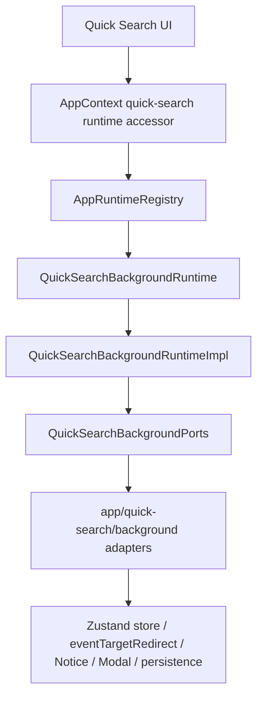
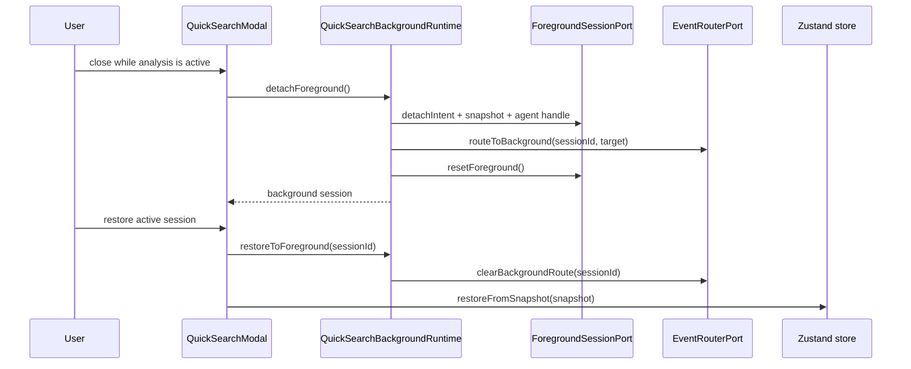
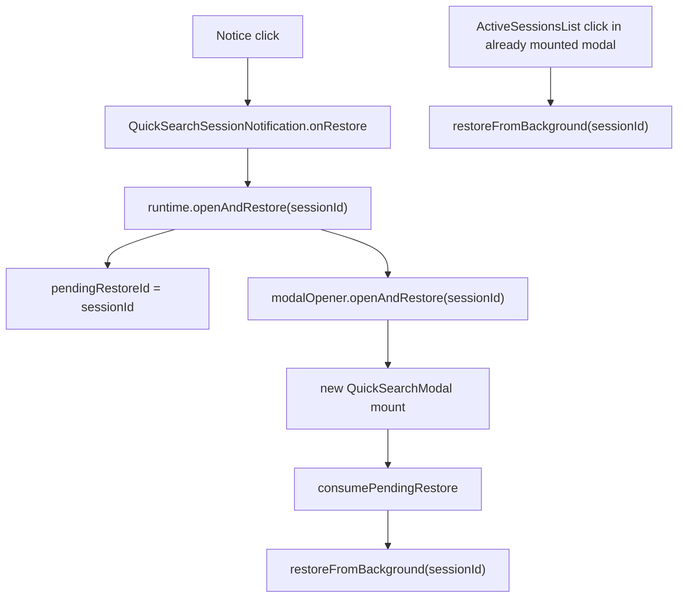
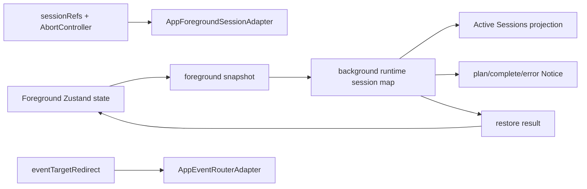
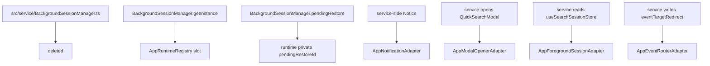

# Owner Review Packet: T10 Quick Search Background Session Runtime Boundary Wave

Claude Code commits:

- `5a21111b` `refactor(quick-search-background): add runtime contract, ports, types, registry slot (T10 part 1)`
- `c2c153cb` `refactor(quick-search-background): add app adapters and composition (T10 part 2)`
- `2daa8b3f` `refactor(quick-search-background): migrate UI + retire singleton + add T10 guards (T10 part 3)`
- `20bbd79f` `fix(quick-search-background): repair Notice and ActiveSessionsList restore paths (T10R)`

Verdict: **Accepted after T10R**

Owner decision: 可以把 T10 当作完成。不要继续围着 Quick Search background session 做小修，除非出现真实 bug。下一轮建议切到 **Copilot Action Registry Boundary Wave**，因为 `src/service/copilot/actions/index.ts` 现在是 boundary audit 里最大单点 offender。

Global position: T10 是第四个 worked example。T7 证明 Vault Lint foundation 可以收口，T8 证明 Ambient singleton 可以退役，T9 证明 Copilot Vault Review 可以用 app-owned runtime，T10 则证明 Quick Search 这种 UI hook / background session / event redirect / Notice / modal 纠缠很深的 surface，也可以被拆成 service runtime + app adapters。

## 0. Review Entry Points

| Review item | Status | Why open it |
| --- | --- | --- |
| This Owner Review Packet | Final | 本轮 owner 审查主文档。 |
| [`t10-quick-search-background-session-runtime-boundary-wave-handoff.md`](../refactor-ops/t10-quick-search-background-session-runtime-boundary-wave-handoff.md) | Source contract | T10 的原始任务边界。 |
| [`t10-review-fix-restore-entrypoints-handoff.md`](../refactor-ops/t10-review-fix-restore-entrypoints-handoff.md) | Review fix contract | Codex 卡住 T10 的两个 restore bug 和修复要求。 |
| [`architecture-scorecard.md`](../refactor-ops/architecture-scorecard.md) | Updated | T10 分数与趋势。 |
| `/tmp/t10r-codex-boundary-baseline.md` | Local evidence | Codex 复跑的 boundary scanner，396 findings。 |

## 0.5 Code Reading Guide

Read in this order:

| Order | File | What to inspect | Why it matters |
| ---: | --- | --- | --- |
| 1 | `src/service/search/background/QuickSearchBackgroundRuntime.ts` | `QuickSearchBackgroundRuntime` | 新 runtime facade；UI / worker / modal 都经它进后台会话。 |
| 2 | `src/service/search/background/ports/QuickSearchBackgroundPorts.ts` | 7 个 port interface | service runtime 被允许依赖的全部东西。 |
| 3 | `src/service/search/background/QuickSearchBackgroundRuntimeImpl.ts` | `detachForeground`, `restoreToForeground`, `openAndRestore`, `buildSessionHooks`, `fireNotification` | 核心编排。这里没有 UI store、AppContext、Notice。 |
| 4 | `src/app/quick-search/background/composeQuickSearchBackgroundRuntime.ts` | `composeQuickSearchBackgroundRuntime` | T10 的唯一 app composition point。 |
| 5 | `src/app/quick-search/background/AppForegroundSessionAdapter.ts` | `detachIntent`, `snapshot`, `restore`, `getAgentHandle` | 这里是 runtime 到 Zustand store + `sessionRefs` 的桥。 |
| 6 | `src/app/quick-search/background/AppEventRouterAdapter.ts` | `routeToBackground`, `clearBackgroundRoute` | 唯一写 `eventTargetRedirect.*` 的地方。 |
| 7 | `src/app/quick-search/background/AppBackgroundTargetFactory.ts` | `build` | 后台 streaming event 如何继续写进 snapshot。 |
| 8 | `src/app/quick-search/background/AppNotificationAdapter.ts` | click handler 调 `input.onRestore()` | T10R 修复点：Notice click 不再绕过 runtime pending restore。 |
| 9 | `src/ui/view/quick-search/SearchModal.tsx` | `<ActiveSessionsList onRestore={restoreFromBackground} />` | T10R 修复点：modal 已挂载时直接 restore，不写 pending。 |
| 10 | `test/quick-search-background-runtime-ports.test.ts` | `testNotificationOnRestoreTriggersOpenAndRestore` | fake-port 测试锁住 Notice click restore。 |
| 11 | `test/quick-search-background-source-guard.test.ts` | `testSearchModalActiveSessionsListUsesRestoreFromBackground` and source guards | 防止旧 singleton 和坏 restore path 回来。 |

Reading notes:

- 先看 service runtime 和 ports，再看 app adapters。不要从 React UI 开始读，否则会被 Quick Search 细节淹没。
- `AppBackgroundTargetFactory` 是最容易困惑的文件：它允许 app 层把 opaque snapshot 强转回 `V2SessionSnapshot`，这是为了让 service 层不 import UI types。
- `eventTargetRedirect` 和 `sessionRefs` 仍然存在，但现在是 adapter 管住的 UI implementation detail，不再是 service runtime 的真相。
- If this breaks later, open `QuickSearchBackgroundRuntimeImpl.ts` first；如果 Notice 打开但没恢复，打开 `AppNotificationAdapter.ts` + `fireNotification`；如果 Active Sessions 点击没恢复，打开 `SearchModal.tsx`。

## 0.6 Visual Dependency Maps

### Map 1: Runtime Ownership After T10



How to read:

- 左侧是用户和 UI surface。
- 中间是 app-owned runtime owner。
- 右侧是真实副作用。
- `src/service/search/background` 现在只处在 `Runtime -> Ports` 这一段。

### Map 2: Background Detach / Restore Sequence



This explains the main visible workflow: close the modal, let analysis keep running, then restore it.

### Map 3: T10R Restore Entrypoints



Why this matters:

- If a new modal is about to mount, pending restore is correct.
- If the modal is already mounted, direct restore is required.
- T10R fixed both paths and added tests for them.

### Map 4: State Ownership



State truth after T10:

| State | Owner | Consumers | Still ambiguous? |
| --- | --- | --- | --- |
| Foreground modal state | `useSearchSessionStore` | mounted Quick Search modal | No, projection only while modal is foreground. |
| Detached session state | `QuickSearchBackgroundRuntimeImpl.sessions` | Active Sessions, Recent AI Analysis, restore/cancel | No |
| Pending restore intent | runtime private `pendingRestoreId` | new modal mount effect | No |
| Streaming event redirect | `AppEventRouterAdapter` wrapping `eventTargetRedirect` | running stream route | Controlled residual |
| Agent/abort handle | `sessionRefs`, wrapped by `AppForegroundSessionAdapter` | cancel, restore HITL | Controlled residual |
| Saved analysis markdown | `persistSessionToVault`, wrapped by `AppAnalysisPersistenceAdapter` | plan-ready/completed persistence | Still has old AppContext internals |

### Map 5: Old Path Deletion



Deleted or retired:

- `src/service/BackgroundSessionManager.ts`: deleted.
- `BackgroundSessionManager.getInstance()`: no production live call.
- `BackgroundSessionManager.pendingRestore`: no production live reference.
- `BackgroundSessionManager.clearInstance()`: replaced by `AppContext.clearQuickSearchBackgroundRuntime()`.
- service-side UI store / hook / QuickSearchModal / Notice imports: moved into app adapters.

## 1. What Changed

T10 introduced a new Quick Search background runtime surface:

- `src/service/search/background/QuickSearchBackgroundRuntime.ts`
- `src/service/search/background/QuickSearchBackgroundRuntimeImpl.ts`
- `src/service/search/background/QuickSearchBackgroundTypes.ts`
- `src/service/search/background/ports/QuickSearchBackgroundPorts.ts`

T10 added app-layer adapters:

- `AppForegroundSessionAdapter`
- `AppEventRouterAdapter`
- `AppBackgroundTargetFactory`
- `AppNotificationAdapter`
- `AppModalOpenerAdapter`
- `AppAnalysisPersistenceAdapter`
- `DefaultClock`
- `composeQuickSearchBackgroundRuntime`

T10 migrated callers:

- `QuickSearchModal.onClose` now calls `AppContext.tryGetQuickSearchBackgroundRuntime()?.detachForeground()`.
- `SearchModal` consumes pending restore only for new-modal restore.
- `ActiveSessionsList` subscribes to runtime state.
- `RecentAIAnalysis` restores/cancels through runtime.
- `CascadeWorker` receives runtime by constructor DI instead of reaching into the old singleton.

T10R fixed two restore entrypoints:

- `Notice` click now calls a runtime-owned `onRestore` callback, so `pendingRestoreId` is set before opening the modal.
- `ActiveSessionsList` click in an already-mounted modal now calls `restoreFromBackground` directly.

## 2. Findings

No blocking findings remain after T10R.

### Fixed during review: Notice click restore

Original T10 problem:

```text
AppNotificationAdapter -> AppModalOpenerAdapter.openAndRestore
```

This opened a modal without writing runtime `pendingRestoreId`.

T10R fix:

```text
AppNotificationAdapter -> input.onRestore
input.onRestore -> runtime.openAndRestore
runtime.openAndRestore -> pendingRestoreId + modalOpener.openAndRestore
```

Evidence:

- `src/service/search/background/QuickSearchBackgroundRuntimeImpl.ts` builds `onRestore: () => this.openAndRestore(session.id)`.
- `src/app/quick-search/background/AppNotificationAdapter.ts` click handler calls `input.onRestore()`.
- `testNotificationOnRestoreTriggersOpenAndRestore` asserts modal opener call and pending restore id.

### Fixed during review: Active Sessions in-mounted-modal restore

Original T10 problem:

```tsx
onRestore={(sessionId) => runtime.requestRestore(sessionId)}
```

This only works before a modal mount, because the consumer lives in a mount effect.

T10R fix:

```tsx
<ActiveSessionsList onRestore={restoreFromBackground} />
```

Evidence:

- `src/ui/view/quick-search/SearchModal.tsx` renders the direct handler.
- `testSearchModalActiveSessionsListUsesRestoreFromBackground` guards this exact path.

## 3. Score

| Dimension | Score | Reason |
| --- | ---: | --- |
| Control | 89 | The runtime owner is now `AppRuntimeRegistry`; production old singleton path is gone. Score is capped by remaining UI hook globals wrapped by adapters rather than fully eliminated. |
| Boundary | 91 | `BackgroundSessionManager`'s service -> UI/app/Notice edges are removed; service -> UI drops 52 -> 45. Remaining offenders are outside this wave, especially Copilot actions and `analysisDocPersistence`. |
| Runtime truth | 90 | Detached session truth lives in `QuickSearchBackgroundRuntimeImpl`; pending restore is private runtime state. `eventTargetRedirect` and `sessionRefs` remain controlled residuals. |
| Verification | 94 | Build, T10 tests, T10R tests, T8/T9 regressions, source guards, and boundary audit all passed. Manual Obsidian click QA was not performed in this Codex pass. |
| Overall | 90 | Accepted. This is the largest non-Vault-Lint boundary closure so far and a strong fourth runtime pattern example. |

Confidence: high for architecture and automated behavior; medium for exact Obsidian modal/Notice UX because this review did not run an interactive Obsidian session.

## 4. Boundary Audit Delta

Claude reported and Codex independently verified:

| Metric | T9 after | T10/T10R after | Delta |
| --- | ---: | ---: | ---: |
| Total flagged edges | 404 | 396 | -8 |
| service -> ui | 52 | 45 | -7 |
| service/core -> Obsidian side-effect | 18 | 17 | -1 |
| service -> app | 63 | 62 | -1 |
| Files scanned | 854 | 865 | +11 |

Top remaining offender:

```text
src/service/copilot/actions/index.ts - 30 flagged edges
```

Interpretation: T10 eliminated the intended background-session boundary cluster. The scanner now clearly points at Copilot Action Registry as the next largest boundary target.

## 5. Verification

Codex ran:

```bash
npm run build
npm run test -- test/app-runtime-registry.test.ts test/quick-search-background-runtime-ports.test.ts test/quick-search-background-source-guard.test.ts
npm run test -- test/ambient-runtime-ports.test.ts test/ambient-source-guard.test.ts test/vault-review-runtime-ports.test.ts test/vault-review-source-guard.test.ts
node scripts/audit/boundary-baseline.mjs --out /tmp/t10r-codex-boundary-baseline.md
```

Results:

- `npm run build`: passed.
- T10/T10R tests: passed.
  - `app-runtime-registry`: 28/28.
  - `quick-search-background-runtime-ports`: 15/15.
  - `quick-search-background-source-guard`: 9/9.
- T8/T9 regression tests: passed.
- Boundary audit: 396 findings.

## 6. Residual Debt

These do not block accepting T10:

1. `eventTargetRedirect` is still a module-level UI hook global.
   It is now written only by `AppEventRouterAdapter`, and a source guard enforces that. Fully removing it would require a deeper stream-routing redesign.

2. `sessionRefs` is still a module-level UI hook holder.
   It is now wrapped by `AppForegroundSessionAdapter`. It remains because React unmount would otherwise drop agent / abort handles during background session restore.

3. `persistSessionToVault` still reaches `AppContext.getInstance()` internally.
   T10 only wrapped it in `AppAnalysisPersistenceAdapter`; a later Quick Search persistence wave can move this old path fully into app layer.

4. Some comments still mention `BackgroundSessionManager`.
   Example: `useEventRouter.ts` and `eventDispatcher.ts` comments. This is cleanup-only, not a live dependency.

5. No manual Obsidian UI click-through was performed by Codex.
   Automated tests cover the runtime/callback semantics, but not the actual Notice DOM click in a live Obsidian window.

## 7. Not Changed

- Chat modernization.
- Current Work State.
- Command Gateway.
- Copilot Action Registry.
- Search ranking / embeddings / `SearchClient`.
- Quick Search visual design.
- SQLite schema.
- Ambient runtime.
- Vault Review runtime.

## 8. Next Recommendation

Recommended next: **T11 Copilot Action Registry Boundary Wave**.

Why:

- Boundary scanner now shows `src/service/copilot/actions/index.ts` as the highest offender with 30 flagged edges.
- T7/T8/T9/T10 have established a repeatable runtime/ports/adapters pattern.
- Copilot actions are broad enough to satisfy the user's request for larger deltas, but still bounded enough to avoid Chat or Command Gateway.

Suggested T11 shape:

```text
Copilot action registry in service
-> action metadata/contracts in service/core-safe layer
-> app/ui adapter maps actions to panels
-> UI panels no longer imported by service registry
```

Do not start Current Work State yet. It is tempting now, but the Copilot registry is a large remaining architecture smell and should be handled before layering more capability UI on top.

Command Gateway remains T12 capstone.
