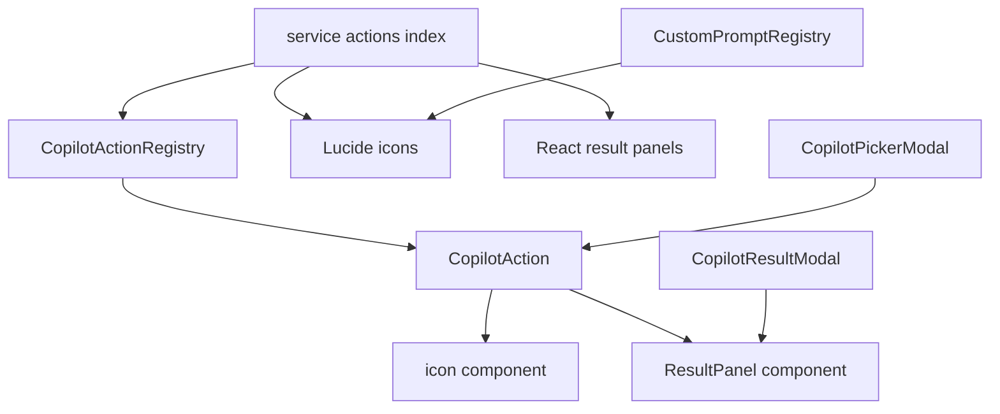
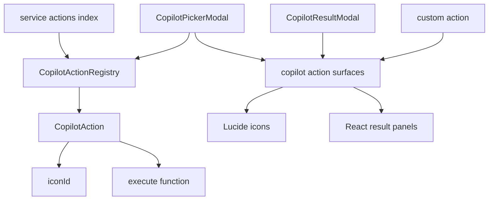
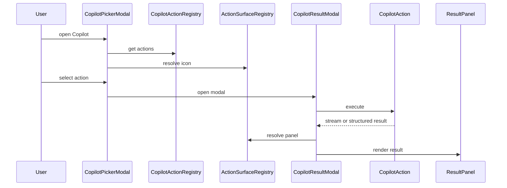
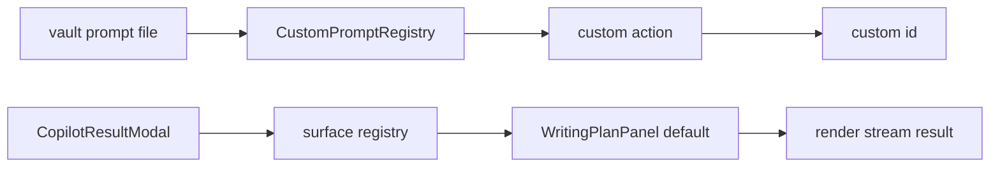
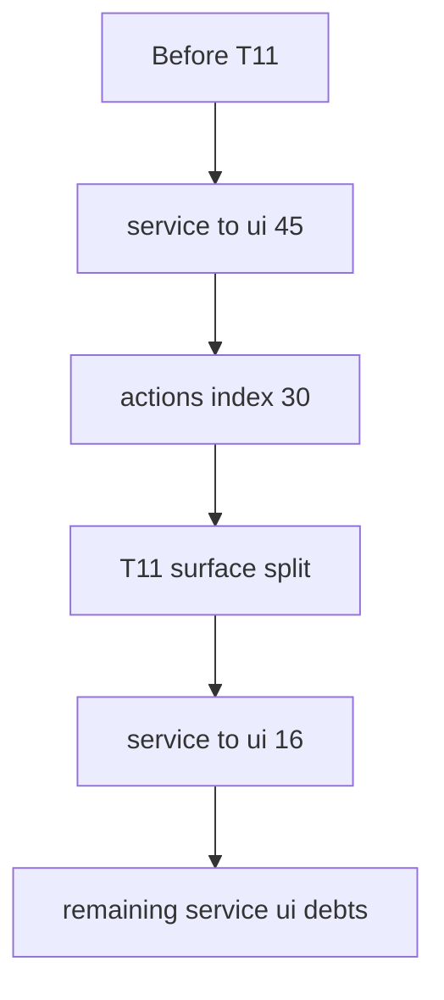

# Owner Review Packet: T11 Copilot Action Registry Boundary Wave

Claude Code commits:

- `c1d02ae4` `refactor(copilot): split action definitions from UI surfaces (T11 part 1)`
- `cbd14a68` `refactor(copilot): migrate picker and result modal to surface registry (T11 part 2)`
- `0037b074` `test(copilot): add action surface boundary guards (T11 part 3)`

Verdict: **Accepted**

Owner decision: 可以把 T11 当作完成。不要继续围着 Copilot action surface 做小修，除非出现真实 UI bug。下一轮建议切到 **Copilot Execution Ports / Registry Ownership Wave**：把 `actions/index.ts` 里 action `execute()` 的 `AppContext.getInstance()`、`SqliteStoreManager.getInstance()`、以及 `CopilotActionRegistry.instance` / `CustomPromptRegistry.instance` 这类 service-side singleton 收敛到 ports / app-owned composition。

Global position: T11 是 Copilot 方向的第二个边界波。T9 把 Vault Auto Review runtime 收到 app-owned runtime；T11 则把手动 Copilot action catalog 里的 UI surface 从 service action definition 中拆出去。它不解决 Copilot execution 的所有依赖，但它删除了当前最大单点 service→ui offender。

## 0. Review Entry Points

| Review item | Status | Why open it |
| --- | --- | --- |
| This Owner Review Packet | Final | 本轮 owner 审查主文档。 |
| [`t11-copilot-action-registry-boundary-wave-handoff.md`](../refactor-ops/t11-copilot-action-registry-boundary-wave-handoff.md) | Source contract | T11 的原始任务边界。 |
| [`architecture-scorecard.md`](../refactor-ops/architecture-scorecard.md) | Updated | T11 分数与趋势。 |
| `/tmp/t11-codex-boundary-baseline.md` | Local evidence | Codex 复跑的 boundary scanner，367 findings。 |

## 0.5 Code Reading Guide

Read in this order:

| Order | File | What to inspect | Why it matters |
| ---: | --- | --- | --- |
| 1 | `src/service/copilot/CopilotActionRegistry.ts` | `CopilotAction`, `CopilotActionIconId` | 新 service contract：只有 action 语义、`iconId` 字符串、执行函数；没有 React panel / Lucide component。 |
| 2 | `src/service/copilot/actions/index.ts` | action definitions, `ALL_ACTIONS`, `registerAllCopilotActions`, `loadCustomPromptActions` | 内置 action 仍在这里，但不再 import panel / icon，也不再 mutate `action.ResultPanel`。 |
| 3 | `src/ui/view/copilot/copilot-action-surfaces.tsx` | `ICON_MAP`, `PANEL_MAP`, `CUSTOM_PROMPT_DEFAULT_PANEL`, `getCopilotActionIcon`, `getCopilotResultPanel` | 新 UI surface registry；所有 Lucide icon 和 result panel 绑定集中在这里。 |
| 4 | `src/ui/view/copilot/CopilotPickerModal.tsx` | `getCopilotActionIcon(item.action.iconId)` | Picker 仍显示同样 icon，但 icon 解析已经从 service action object 移到 UI 层。 |
| 5 | `src/ui/view/copilot/CopilotResultModal.tsx` | `getCopilotResultPanel(action.id)` | Result modal 不再读 `action.ResultPanel`，而是按 action id 找 UI panel。 |
| 6 | `src/service/copilot/CustomPromptRegistry.ts` | `buildAction` | custom prompt action 只返回 `iconId: 'file-text'`，不再携带 panel。 |
| 7 | `test/copilot-action-surface-source-guard.test.ts` | source guards | 防止 service 重新 import panels / lucide / `ResultPanel`。 |
| 8 | `test/copilot-action-surface-registry.test.ts` | binding completeness | 确认 29 个内置 action 都有 icon 与 panel binding，`custom-*` 有默认 panel。 |

First debug file:

- Picker icon 消失：先看 `src/ui/view/copilot/copilot-action-surfaces.tsx` 的 `ICON_MAP`。
- Result modal 空白：先看同文件的 `PANEL_MAP` / `getCopilotResultPanel`。
- Custom prompt result 不显示：先看 `CUSTOM_PROMPT_DEFAULT_PANEL` 和 `custom-*` 分支。
- Boundary audit 没降：先跑 `rg "@/ui/view/copilot/panels" src/service`。

## 0.6 Visual Dependency Maps

### Map 1: T11 Before



How to read:

- `CopilotAction` 以前是半个 view model。
- service action definition 既负责业务执行，又负责 UI icon 和 result panel。
- `actions/index.ts` 因此成为 30 条 flagged edge 的最大 offender。

### Map 2: T11 After



How to read:

- service 现在只输出 action semantics。
- UI surface registry 负责把 `iconId` 和 `action.id` 翻译成真实 React component。
- Copilot Picker 和 Result Modal 都通过 `copilot-action-surfaces.tsx` 取 UI binding。

### Map 3: Action Run Sequence



This is the important mental model: the action still runs exactly where it ran before, but UI presentation is resolved by UI code.

### Map 4: Custom Prompt Fallback



Why this matters:

- Before T11, service action registration dynamically imported `WritingPlanPanel`.
- After T11, `custom-*` action ids use the default panel from UI surface registry.
- Service custom prompt loading still touches `AppContext`; that is execution/boot debt for the next wave, not a T11 blocker.

### Map 5: Boundary Delta



Remaining service→ui debts are now smaller and more distributed:

- quick-search analysis persistence and report types;
- chat store coupling;
- AI graph type imports;
- one Copilot artifact builder import into quick-search UI types.

## 1. What Changed

T11 changed the Copilot action model:

- `CopilotAction.icon` became `CopilotAction.iconId`.
- `CopilotAction.ResultPanel` was removed.
- `src/service/copilot/actions/index.ts` no longer imports `lucide-react`.
- `src/service/copilot/actions/index.ts` no longer imports `@/ui/view/copilot/panels/*`.
- `registerAllCopilotActions()` registers service action definitions only.
- UI result panel binding moved to `src/ui/view/copilot/copilot-action-surfaces.tsx`.
- custom prompt actions now rely on a `custom-*` panel fallback instead of service-side dynamic `WritingPlanPanel` import.

Changed files:

| Purpose | Files |
| --- | --- |
| Service contract | `src/service/copilot/CopilotActionRegistry.ts` |
| Built-in actions | `src/service/copilot/actions/index.ts` |
| Custom prompts | `src/service/copilot/CustomPromptRegistry.ts` |
| UI surface registry | `src/ui/view/copilot/copilot-action-surfaces.tsx` |
| UI callers | `src/ui/view/copilot/CopilotPickerModal.tsx`, `src/ui/view/copilot/CopilotResultModal.tsx` |
| Tests | `test/copilot-action-surface-source-guard.test.ts`, `test/copilot-action-surface-registry.test.ts`, `test/copilot-auto-planner.test.ts`, `test/copilot-command-model.test.ts` |

## 2. Findings

No blocking findings.

### P3 follow-up: fallback panel uses a raw button

`src/ui/view/copilot/copilot-action-surfaces.tsx` adds `MissingPanelFallback` with a native `<button>`. This is a fallback-only path for wiring bugs, and it does not affect the architecture goal. It should be cleaned up later by using the project `Button` component, but it is not worth a standalone T11R.

Why not block:

- The fallback only appears when an action has no panel binding.
- The binding completeness test prevents built-in actions from reaching it.
- Unknown action fallback is useful and visible.
- The project already has higher-value Copilot execution boundary debt.

## 3. Boundary Evidence

Codex reran:

```bash
node scripts/audit/boundary-baseline.mjs --out /tmp/t11-codex-boundary-baseline.md
```

Result:

| Metric | T10 accepted baseline | T11 after | Delta |
| --- | ---: | ---: | ---: |
| Total flagged edges | 396 | 367 | -29 |
| Service -> UI | 45 | 16 | -29 |
| `src/service/copilot/actions/index.ts` flagged edges | 30 | 0 | -30 |
| Service -> app | 62 | 62 | 0 |
| Service/core -> Obsidian side-effect | 17 | 17 | 0 |
| Service AppContext count | 86 | 86 | 0 |

Interpretation:

- T11 completely removed the Copilot action surface boundary offender.
- The unchanged AppContext / Obsidian numbers are expected because T11 intentionally did not port action execution dependencies.
- `src/service/copilot/actions/index.ts` no longer appears in top offender files.

## 4. Verification

Codex verified:

```bash
npm run build
npm run test -- test/copilot-auto-planner.test.ts test/copilot-command-model.test.ts test/copilot-intent-hub.test.ts
npm run test -- test/copilot-action-surface-source-guard.test.ts test/copilot-action-surface-registry.test.ts
node scripts/audit/boundary-baseline.mjs --out /tmp/t11-codex-boundary-baseline.md
```

Regression checks:

```bash
npm run test -- test/quick-search-background-source-guard.test.ts test/quick-search-background-runtime-ports.test.ts
npm run test -- test/vault-review-source-guard.test.ts
npm run test -- test/ambient-source-guard.test.ts test/ambient-runtime-ports.test.ts
```

Notes:

- Build passed.
- T11 target tests passed.
- T8/T9/T10 regression tests passed when run sequentially.
- An initial parallel regression run failed because `run-test.js` shares `temp-test.js`; this was a test-runner concurrency artifact, not a code failure.
- Tailwind still prints the existing `caniuse-lite is outdated` warning during build.

Grep checks:

```bash
rg "ResultPanel" src/service src/ui test
rg "@/ui/view/copilot/panels" src/service
rg "lucide-react" src/service/copilot/CopilotActionRegistry.ts src/service/copilot/actions/index.ts src/service/copilot/CustomPromptRegistry.ts
rg "action\\.ResultPanel|\\.ResultPanel\\s*=" src
```

Interpretation:

- `.ResultPanel =` has 0 production hits.
- service panel path and `lucide-react` hits are comment-only historical breadcrumbs.
- source guards strip comments and verify no live service dependency returned.

## 5. Architecture Score

Suggested T11 scores:

| Group | Score | Reason |
| --- | ---: | --- |
| Control Index | 90 | Owner can now trace action contract -> UI surface -> result modal; debug entry file is obvious. |
| Boundary Index | 94 | Largest remaining service→ui offender removed; panel and icon concrete dependencies now isolated in UI. |
| Runtime Truth Index | 90 | Action surface truth is single-path; runtime ownership singletons remain unchanged and cap the score. |
| Verification Index | 95 | Build, target tests, source guards, binding completeness, boundary scanner, and T8/T9/T10 regression tests passed. |
| Overall | 91 | Strong boundary win with no user-visible behavior change; execution ports and registry ownership remain. |

Confidence: **High** for boundary and verification; **Medium** for user-visible behavior because no manual Obsidian click QA was run in this packet.

## 6. Remaining Old Paths

Do not confuse T11 completion with full Copilot modernization. These remain:

- `src/service/copilot/actions/index.ts` action `execute()` bodies still call `AppContext.getInstance()`.
- Some action execution still calls `SqliteStoreManager.getInstance()`.
- `CopilotActionRegistry.instance` remains a service-side singleton.
- `CustomPromptRegistry.instance` remains a service-side singleton.
- `CustomPromptRegistry` still imports Obsidian types and `AppContext`.
- `CopilotArtifactAdapter` / `CopilotReviewArtifactBuilder` still have type coupling into UI/quick-search shapes.

These are not T11 regressions. They are the obvious input for the next Copilot wave.

## 7. Recommended Next Step

Next recommended task: **T12? Not yet. Do Copilot Execution Ports / Registry Ownership Wave first.**

Reason:

- T11 removed UI surface coupling, but action execution still reaches into app/services directly.
- Copilot is now split enough that a follow-up ports wave is more controllable.
- Jumping directly to Command Gateway would put a capstone on top of execution code that still uses service locators.

Suggested next task boundary:

```text
Copilot action execution deps:
  AppContext.getInstance
  SqliteStoreManager.getInstance
  CustomPromptRegistry singleton
  CopilotActionRegistry singleton

Target:
  app-owned action catalog / action execution ports
  no service-side UI surface dependencies
  no broad Copilot UI redesign
```

Do not start Current Work State / Ambient Push yet. Do not start Command Gateway yet.
