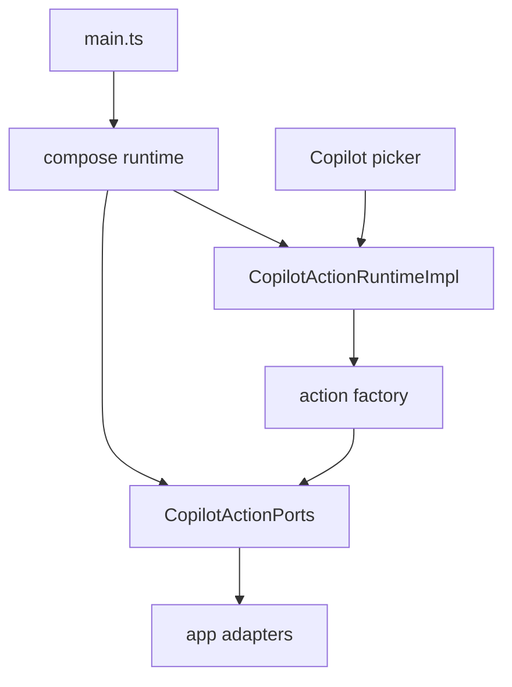
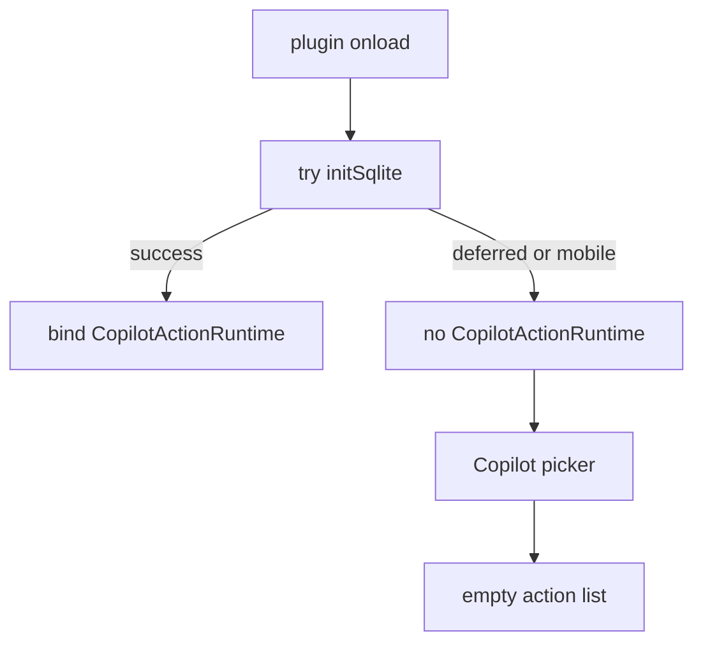
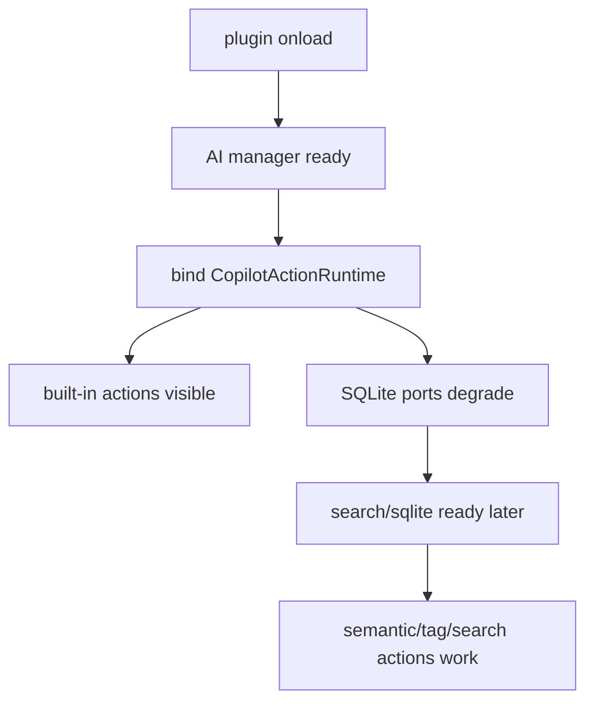
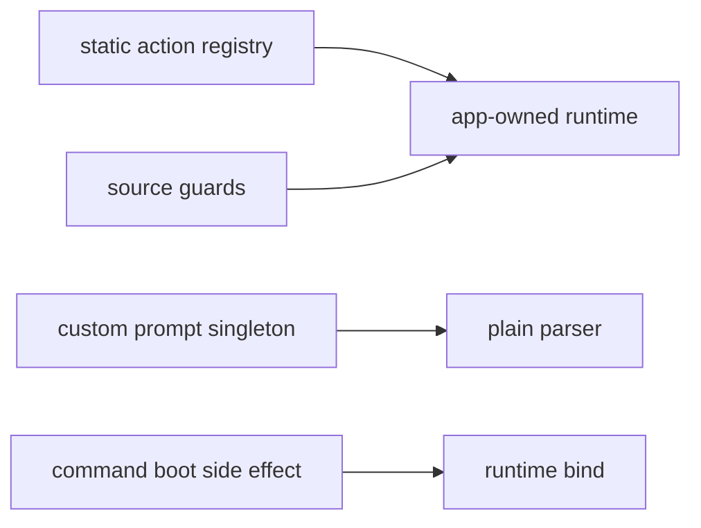

# Owner Review Packet: T11B Copilot Execution Ports / Registry Ownership Wave

Claude Code commits:

- `661a3dc1` `refactor(copilot): split action execution into ports + runtime (T11B part 1)`
- `13a425c9` `refactor(copilot): compose CopilotActionRuntime at the app layer (T11B part 2)`
- `7dd3f6d9` `refactor(copilot): migrate manual-action callers to the runtime (T11B part 3)`
- `68a2c176` `test(copilot): add runtime source guards + fake-port coverage (T11B part 4)`

Verdict: **Needs Review Fix**

Owner decision: 不要接受 T11B，也不要进入 T12 / Chat / deletion wave。先发 T11B-R 给 Claude Code：把 `CopilotActionRuntime` 改成 plugin boot 后 always-on 的 manual action catalog runtime，不能依赖 SQLite init 成功才绑定。

Global position: T11B 的方向是对的，它把 Copilot manual actions 从 service-side singleton / hidden service locator 移到了 app-owned runtime + explicit ports。但当前实现把 runtime 绑定放在 `initSqlite()` 成功路径里，这会让 SQLite deferred、native module 未 ready、或 mobile mode 下的 Copilot picker 变成空 action list。这个和 handoff 里的“用户可见行为不变”冲突。

## 0. Review Entry Points

| Review item | Status | Why open it |
| --- | --- | --- |
| This Owner Review Packet | Needs fix | 本轮 owner 审查主文档。 |
| [`t11b-copilot-execution-ports-registry-ownership-handoff.md`](../refactor-ops/t11b-copilot-execution-ports-registry-ownership-handoff.md) | Source contract | T11B 原始任务边界。 |
| [`t11b-review-fix-copilot-runtime-boot-availability-handoff.md`](../refactor-ops/t11b-review-fix-copilot-runtime-boot-availability-handoff.md) | Send to Claude | 需要立刻执行的 review fix。 |
| `/tmp/t11b-codex-boundary-baseline.md` | Local evidence | Codex 复跑 boundary scanner，366 findings。 |

## 0.5 Code Reading Guide

Read in this order:

| Order | File | What to inspect | Why it matters |
| ---: | --- | --- | --- |
| 1 | `main.ts` | `onload`, `initSqlite`, `setCopilotActionRuntime` | P1 风险就在这里：runtime 只在 SQLite 成功后绑定。 |
| 2 | `src/app/copilot/actions/composeCopilotActionRuntime.ts` | `composeCopilotActionRuntime` | 新 app-level composition 方向正确，但需要可在 SQLite 前组合。 |
| 3 | `src/service/copilot/actions/CopilotActionRuntimeImpl.ts` | `builtIns`, `refreshCustomPrompts` | runtime catalog ownership 正确。 |
| 4 | `src/service/copilot/actions/CopilotActionPorts.ts` | 7 个 ports | hidden dependencies 已显式化，这是 T11B 的主要收益。 |
| 5 | `src/ui/view/copilot/CopilotPickerModal.tsx` | `tryGetCopilotActionRuntime` | runtime 未绑定时会空 action list，当前没有 retry/subscription。 |
| 6 | `src/app/copilot/actions/AppCopilotActionSearchAdapter.ts` | `resolveClient` | 如果 runtime 提前绑定，search port 需要 graceful degraded behavior。 |
| 7 | `src/app/copilot/actions/SqliteCopilotActionSemanticGraphAdapter.ts` | sqlite repo calls | SQLite-dependent action 应降级，而不是阻止 catalog runtime 绑定。 |
| 8 | `test/copilot-action-runtime-source-guard.test.ts` | source guards | 证明旧 singleton / service locator 没回来。 |
| 9 | `test/copilot-action-runtime-ports.test.ts` | fake-port tests | 证明 action execution 已可 fake。 |

First debug file:

- Copilot picker empty：先看 `main.ts` 的 runtime bind path，再看 `CopilotPickerModal.tsx` 的 `tryGetCopilotActionRuntime()`。
- Custom prompts 不出现：先看 `CopilotActionRuntimeImpl.refreshCustomPrompts()` 和 `ObsidianCustomPromptSourceAdapter`。
- Search/semantic/tag action 在 SQLite 未 ready 时报错：先看 app adapters 的 degraded behavior。

## 0.6 Visual Dependency Maps

### Map 1: What T11B Got Right



How to read:

- Service actions no longer pull dependencies from `AppContext.getInstance()`.
- App adapters own Obsidian / SQLite / ProfileRegistry / SearchClient.
- This is the right architectural direction.

### Map 2: Blocking Runtime Availability Gap



Why this matters:

- Before T11B, `buildCoreCommands()` called `registerAllCopilotActions()` regardless of SQLite success.
- After T11B, manual action catalog depends on `initSqlite()` success.
- This is a user-visible availability regression.

### Map 3: Target Review Fix



Target rule:

```text
Action catalog runtime should be always-on after app boot.
SQLite/Search readiness should affect specific action execution,
not whether the whole catalog exists.
```

### Map 4: Old Path Deleted And Guarded



This part passes review. The review fix should preserve it.

## 1. One-Sentence Outcome

T11B replaced Copilot manual action hidden service-locator execution with an app-owned runtime and explicit ports, but it currently gates the whole action catalog behind SQLite init, so it needs a targeted review fix before acceptance.

## 2. What Changed Correctly

Accepted design direction:

- `src/service/copilot/actions/index.ts` now exports `createBuiltInCopilotActions(deps)`.
- `src/service/copilot/actions/CopilotActionPorts.ts` defines cohesive ports: `ai`, `vault`, `search`, `semanticGraph`, `tags`, `agent`, `customPrompts`.
- `src/service/copilot/actions/CopilotActionRuntimeImpl.ts` owns built-in + custom prompt action catalog.
- `CopilotActionRegistry` singleton body was removed; the file now keeps action types.
- `CustomPromptRegistry` singleton was replaced by parser/action-builder free functions.
- `TagSuggestionEngine` now receives `TagSuggestionDataPort`.
- `src/app/copilot/actions/*` adapters own concrete Obsidian / sqlite / profile / search access.
- `src/app/runtime/AppRuntimeRegistry.ts` owns `copilotActionRuntime` with set/get/tryGet/clear.
- `src/app/commands/Register.ts` no longer calls `registerAllCopilotActions()`.

This is a real boundary improvement. The issue is not “too much abstraction”; the issue is one boot-order assumption.

## 3. Blocking Finding

### P1: Copilot manual action catalog disappears when SQLite is deferred or unavailable

Evidence:

- `main.ts:238-244` catches SQLite init failure or skips SQLite on mobile.
- `main.ts:473-483` binds `CopilotActionRuntime` only inside `initSqlite()` after SQLite/search success.
- `CopilotPickerModal.tsx:77-78` reads `AppContext.tryGetCopilotActionRuntime()` and falls back to `[]`.

Concrete path:

```text
desktop native module missing / first install / SQLite ABI mismatch
  -> onload catches initSqlite failure
  -> commands and views still load
  -> CopilotActionRuntime is never bound
  -> Copilot picker opens with empty action list

mobile
  -> SQLite skipped
  -> CopilotActionRuntime is never bound
  -> Copilot picker opens with empty action list
```

Why this is a blocker:

- T11B implementation note claims “用户可见行为不变”.
- Old T11 path registered built-in actions from `buildCoreCommands()`, which still ran after SQLite defer.
- Many Copilot actions are AI/Vault-only and should not disappear just because SQLite/search is not ready.
- The T11B architecture rule should be: runtime catalog ownership is app-owned and always-on; individual SQLite-dependent ports may degrade.

Required fix:

- Bind `CopilotActionRuntime` after `AppContext` + `AIServiceManager` are ready, not inside the successful `initSqlite()` branch.
- Make Search / SemanticGraph / Tags adapters lazy and gracefully degraded when SQLite/search is unavailable.
- Add a guard/test so future changes do not move the manual action runtime binding back under `initSqlite()`.

## 4. Non-Blocking Notes

### P3: Custom prompt refresh has no explicit UI notification

`refreshCustomPrompts()` is async and mutates runtime internal `customPromptActions`. `CopilotPickerModal` reads `runtime.getAll()` during render and has no subscription to prompt refresh completion.

Why not block:

- Built-in actions remain available if runtime is bound.
- A normal picker opened after prompt refresh settles will see custom actions.
- This can be solved later with a runtime event, a `version` getter, or a React provider subscription if it becomes visible.

### P3: LOC increased, but old path did retire

Source/test delta from T11 baseline:

```text
25 files changed, 2391 insertions, 1269 deletions
net +1122 lines
```

This is not a code-volume win yet. But it is not pure bloat either:

- `actions/index.ts` was heavily rewritten, not only wrapped.
- old registry singleton and custom prompt singleton were removed.
- new lines include fake-port tests and app adapters.

Future owner packets should keep reporting LOC delta and deleted-path delta so architecture work does not become endless additive abstraction.

## 5. Verification

Codex reran these commands.

Build:

```bash
npm run build
```

Result: passed. Existing warning: `caniuse-lite is outdated`.

T11B target tests:

```bash
npm run test -- test/copilot-action-runtime-source-guard.test.ts test/copilot-action-runtime-ports.test.ts
npm run test -- test/copilot-action-surface-source-guard.test.ts test/copilot-action-surface-registry.test.ts
npm run test -- test/copilot-auto-planner.test.ts test/copilot-command-model.test.ts test/copilot-intent-hub.test.ts
```

Result: passed when run sequentially.

Important note: do not run multiple `npm run test` commands in parallel. `run-test.js` writes a shared `temp-test.js`; parallel runs can cross-execute the wrong bundle.

T8/T9/T10 regression:

```bash
npm run test -- test/ambient-source-guard.test.ts test/ambient-runtime-ports.test.ts
npm run test -- test/vault-review-source-guard.test.ts
npm run test -- test/quick-search-background-source-guard.test.ts test/quick-search-background-runtime-ports.test.ts
```

Result: passed.

Boundary audit:

```bash
node scripts/audit/boundary-baseline.mjs --out /tmp/t11b-codex-boundary-baseline.md
```

Result: `366 findings`.

Boundary delta:

| Metric | T11 accepted | T11B after | Delta |
| --- | ---: | ---: | ---: |
| Total flagged edges | 367 | 366 | -1 |
| service -> ui | 16 | 16 | 0 |
| service -> app | 62 | 59 | -3 |
| service/core -> Obsidian side-effect | 17 | 16 | -1 |
| service AppContext count | 86 | 62 | -24 |

Interpretation:

- Import-edge scanner barely moves because new app adapters/ports add imports while old hidden lookups disappear.
- The meaningful T11B metric is `service AppContext count: 86 -> 62`.
- The boundary direction is good, but acceptance is blocked by runtime availability.

## 6. Scoped Grep Evidence

Scoped grep:

```bash
rg "AppContext\\.getInstance|SqliteStoreManager\\.getInstance|CopilotActionRegistry\\.getInstance|CustomPromptRegistry\\.getInstance|ProfileRegistry\\.getInstance" src/service/copilot/actions src/service/copilot/TagSuggestionEngine.ts src/service/copilot/CustomPromptRegistry.ts
```

Result: comment-only hits.

Singleton guards:

```bash
rg "private static instance|static getInstance\\(" src/service/copilot/CopilotActionRegistry.ts src/service/copilot/CustomPromptRegistry.ts
```

Result: no hits.

Old registration:

```bash
rg "registerAllCopilotActions" src/app/commands/Register.ts main.ts src/service/copilot
```

Result: no hits.

Service UI/lucide:

```bash
rg "@/ui/view/copilot/panels|lucide-react|ResultPanel" src/service/copilot
```

Result: comment-only hits in `CopilotActionRegistry.ts`.

## 7. Runtime Ownership Check

| Runtime | Owner before | Owner after | App-level composition point | Service singleton? | Accepted? |
| --- | --- | --- | --- | --- | --- |
| Copilot manual actions | `CopilotActionRegistry.getInstance()` + `CustomPromptRegistry.getInstance()` | `AppRuntimeRegistry.copilotActionRuntime` | `src/app/copilot/actions/composeCopilotActionRuntime.ts` | Removed | Needs boot fix |

Decision:

- Runtime ownership model is accepted.
- Runtime binding location is not accepted.

## 8. Code Volume Check

| Area | Delta |
| --- | ---: |
| Source + tests changed | 25 files |
| Insertions | +2391 |
| Deletions | -1269 |
| Net | +1122 |

Owner interpretation:

- This wave increases code size.
- The increase is partially justified by ports/adapters/tests.
- It should not become the default pattern. Starting with the next accepted wave, owner review should require `LOC delta`, `deleted old path`, and `future deletion target`.

## 9. Required T11B-R Fix

Send Claude Code:

- [`t11b-review-fix-copilot-runtime-boot-availability-handoff.md`](../refactor-ops/t11b-review-fix-copilot-runtime-boot-availability-handoff.md)

Acceptance gates for T11B-R:

- `CopilotActionRuntime` is bound after app/AI manager boot even if SQLite init is deferred.
- Built-in action catalog is visible when SQLite/search is unavailable.
- SQLite/search-dependent actions degrade through ports.
- There is a source guard or test preventing runtime binding from being nested under `initSqlite()` only.
- T11B source guards and fake-port tests still pass.
- Boundary audit does not regress materially.

## 10. Next Task After Fix

Do not choose Chat or T12 until T11B-R passes.

After T11B-R:

1. Codex reruns owner review and, if clean, accepts T11B.
2. Then choose between:
   - Code Volume Audit / Deletion Map, because the codebase is still too large and T11B net-added lines.
   - Chat Runtime Ports, if we want to continue reducing `service -> app` and `service AppContext` counts.
   - T12 Command Gateway, only after Copilot manual action runtime is stable.
