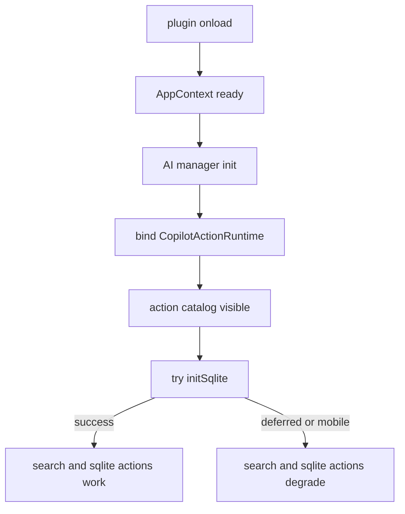
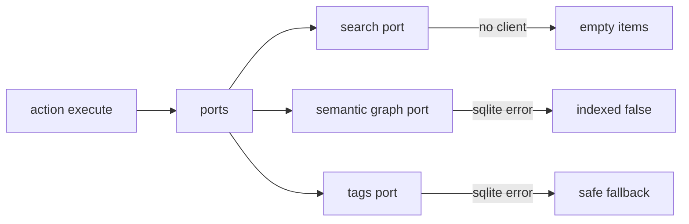
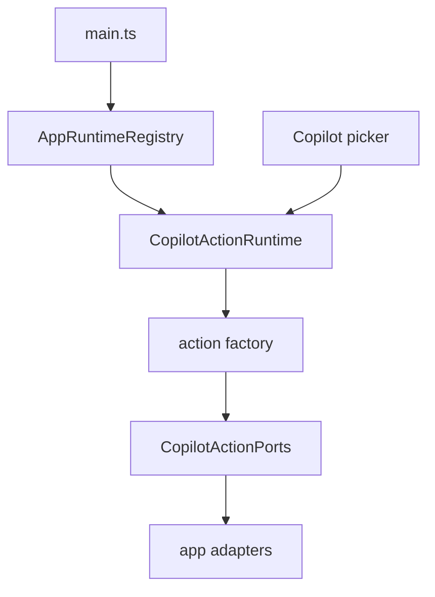

# Owner Review Packet: T11B-R Copilot Runtime Boot Availability Fix

Claude Code commit:

- `04d8c2c1` `fix(copilot): bind manual-action runtime before initSqlite (T11B-R)`

Verdict: **Accepted**

Owner decision: 可以把 T11B + T11B-R 一起视为完成。不要继续围绕 Copilot manual action runtime 做小修，除非出现真实 UI/runtime bug。下一步建议切到 **Code Volume Audit / Deletion Map**，因为 T11B 系列改善了 ownership，但仍然净增加代码；现在需要开始系统识别可退役 UI/service/core 路径。

Global position: T11B-R 修掉了 T11B 的 P1 boot regression。Copilot manual action catalog 现在在 app boot 后 always-on，不再依赖 SQLite init 成功；SQLite/Search 只影响具体 action execution 的降级，不影响 action catalog 是否存在。

## 0. Review Entry Points

| Review item | Status | Why open it |
| --- | --- | --- |
| This Owner Review Packet | Final | 本轮 review fix 审查主文档。 |
| [`2026-06-14-t11b-owner-review-packet.md`](./2026-06-14-t11b-owner-review-packet.md) | Previous packet | 记录为什么 T11B 最初不能接受。 |
| [`t11b-review-fix-copilot-runtime-boot-availability-handoff.md`](../refactor-ops/t11b-review-fix-copilot-runtime-boot-availability-handoff.md) | Source contract | T11B-R 的修复边界。 |
| [`architecture-scorecard.md`](../refactor-ops/architecture-scorecard.md) | Updated | T11B accepted 后的 score ledger。 |
| `/tmp/t11b-review-fix-codex-boundary-baseline.md` | Local evidence | Codex 复跑 boundary scanner，366 findings。 |

## 0.5 Code Reading Guide

Read in this order:

| Order | File | What to inspect | Why it matters |
| ---: | --- | --- | --- |
| 1 | `main.ts` | `onload`, `setCopilotActionRuntime`, `initSqlite` | P1 fix：runtime 现在在 SQLite 前绑定。 |
| 2 | `src/app/copilot/actions/composeCopilotActionRuntime.ts` | `safeGetSearchClient` | 把 null placeholder SearchClient 规范成 `null`。 |
| 3 | `src/app/copilot/actions/AppCopilotActionSearchAdapter.ts` | `vectorSearch` | SearchClient 缺失时返回空结果，不抛错。 |
| 4 | `src/app/copilot/actions/SqliteCopilotActionSemanticGraphAdapter.ts` | `findSemanticLinkNeighbors`, `findSmartConnections` | SQLite 未 ready 时返回 `indexed: false`。 |
| 5 | `src/app/copilot/actions/SqliteCopilotActionTagsAdapter.ts` | `safe`, `persistSuggestionBatch` | tag data/persistence 在 SQLite 未 ready 时降级。 |
| 6 | `test/copilot-action-runtime-source-guard.test.ts` | `mainBindsCopilotRuntimeBeforeInitSqlite` | 防止 runtime bind 又被塞回 `initSqlite()`。 |
| 7 | `test/copilot-action-runtime-degraded-ports.test.ts` | 4 个 degraded-port tests | 证明 Search/SQLite 未 ready 时不崩。 |

First debug file:

- Picker 为空：先看 `main.ts:227-241` 是否绑定了 runtime。
- Find Related 空结果：看 `AppCopilotActionSearchAdapter`。
- Semantic links / smart connections 显示未索引：看 `SqliteCopilotActionSemanticGraphAdapter`。
- Suggest tags 仍然能出结果但没有写入历史：看 `SqliteCopilotActionTagsAdapter.persistSuggestionBatch`。

## 0.6 Visual Dependency Maps

### Map 1: Fixed Boot Path



How to read:

- Catalog visibility no longer depends on SQLite.
- SQLite/Search readiness only affects individual action execution.

### Map 2: Degraded Ports



This is the intended owner model: no hidden crash, no catalog disappearance.

### Map 3: Accepted T11B Runtime Ownership



The T11B direction is now accepted after the boot fix.

## 1. One-Sentence Outcome

T11B-R moved Copilot manual action runtime binding before SQLite initialization and made SQLite/Search ports degrade safely, so the Copilot action catalog remains available on mobile and during SQLite-deferred boot.

## 2. What Changed

Accepted changes:

- `main.ts` now binds `CopilotActionRuntime` immediately after `AIServiceManager.init()`.
- `initSqlite()` no longer binds or rebinds the Copilot action runtime.
- `AppCopilotActionSearchAdapter` accepts nullable `SearchClient` and returns `{ items: [] }` when unavailable.
- `AppCopilotActionAgentAdapter` returns empty grep hits when `SearchClient` is unavailable.
- `SqliteCopilotActionSemanticGraphAdapter` catches SQLite-not-ready errors and returns `indexed: false`.
- `SqliteCopilotActionTagsAdapter` wraps SQLite data reads and persistence with safe fallbacks.
- Source guard now enforces `setCopilotActionRuntime` before the first `initSqlite()` call.
- Degraded-port tests cover null/undefined search client, unavailable SQLite semantic graph, and tag persistence no-op.

## 3. Previous Blocking Finding Resolved

Previous P1:

```text
SQLite deferred / mobile
  -> no initSqlite success
  -> no CopilotActionRuntime
  -> picker empty
```

After T11B-R:

```text
AppContext + AI manager ready
  -> CopilotActionRuntime bound
  -> picker sees built-in catalog
  -> SQLite/Search actions degrade if infra unavailable
```

Evidence:

- `main.ts:227-241` binds runtime before `main.ts:255` calls `this.initSqlite()`.
- `main.ts:482-486` records that `initSqlite()` no longer touches Copilot action runtime.
- `test/copilot-action-runtime-source-guard.test.ts` includes `mainBindsCopilotRuntimeBeforeInitSqlite`.

## 4. Verification

Codex reran:

```bash
npm run build
npm run test -- test/copilot-action-runtime-source-guard.test.ts test/copilot-action-runtime-ports.test.ts test/copilot-action-runtime-degraded-ports.test.ts
npm run test -- test/copilot-action-surface-source-guard.test.ts test/copilot-action-surface-registry.test.ts
npm run test -- test/copilot-auto-planner.test.ts test/copilot-command-model.test.ts test/copilot-intent-hub.test.ts
node scripts/audit/boundary-baseline.mjs --out /tmp/t11b-review-fix-codex-boundary-baseline.md
```

Results:

- Build passed.
- T11B source guards, fake-port tests, and degraded-port tests passed.
- T11 surface registry/source guard tests passed.
- Copilot planner/command/intent tests passed.
- Boundary audit wrote `366 findings`.

Expected warnings:

- Build still prints existing `caniuse-lite is outdated`.
- Degraded-port tests print expected warnings from SQLite-not-ready catch blocks.

## 5. Scoped Grep Evidence

Old singleton paths:

```bash
rg "registerAllCopilotActions|CopilotActionRegistry\\.getInstance|CustomPromptRegistry\\.getInstance" src main.ts
```

Result: no hits.

Boot order evidence:

```bash
rg -n "setCopilotActionRuntime|composeCopilotActionRuntime|initSqlite\\(" main.ts
```

Key result:

- `composeCopilotActionRuntime`: line 235
- `setCopilotActionRuntime`: line 237
- `await this.initSqlite()`: line 255
- `async initSqlite()`: line 435

Scoped service-locator check:

```bash
rg -n "AppContext\\.getInstance|SqliteStoreManager\\.getInstance|ProfileRegistry\\.getInstance|CopilotActionRegistry\\.getInstance|CustomPromptRegistry\\.getInstance" src/service/copilot/actions src/service/copilot/TagSuggestionEngine.ts src/service/copilot/CustomPromptRegistry.ts
```

Result: comment-only hits.

## 6. Boundary Evidence

Boundary delta:

| Metric | T11B before fix | T11B-R after | Delta |
| --- | ---: | ---: | ---: |
| Total flagged edges | 366 | 366 | 0 |
| service -> ui | 16 | 16 | 0 |
| service -> app | 59 | 59 | 0 |
| service AppContext count | 62 | 62 | 0 |

Interpretation:

- T11B-R is a behavior/boot-order fix, not a new boundary-reduction wave.
- No import-graph regression.

## 7. Code Volume Check

T11B-R delta from the review-fix handoff commit:

```text
8 files changed, 248 insertions, 55 deletions
net +193 lines
```

This is acceptable for a P1 review fix because:

- it adds guard/test coverage for a real boot regression;
- it does not introduce a second runtime path;
- it does not revive the retired singleton registry;
- the net increase is localized to degraded-port behavior and tests.

But this reinforces the next strategic need: we should not keep stacking abstraction forever. The next reviewable task should identify code paths to retire.

## 8. Runtime Ownership Check

| Runtime | Owner before T11B | Owner after T11B-R | App composition point | Service singleton? | Accepted? |
| --- | --- | --- | --- | --- | --- |
| Copilot manual actions | `CopilotActionRegistry.getInstance()` | `AppRuntimeRegistry.copilotActionRuntime` | `src/app/copilot/actions/composeCopilotActionRuntime.ts` | Removed | Yes |

Decision:

- T11B runtime ownership is accepted.
- T11B-R boot availability is accepted.
- Do not re-open this slice unless a concrete Copilot picker/runtime bug appears.

## 9. Remaining Old Paths

Known remaining old paths:

- `service -> app shell` remains at 59.
- Chat / agents / context / prompt / search still have AppContext/service-locator debt.
- Copilot auto-review related paths remain out of this T11B scope.
- UI panels still directly use AppContext in many places.
- Code volume is still too high, especially `src/ui` and `src/service`.

## 10. Recommended Next Task

Recommended next task: **Code Volume Audit / Deletion Map**.

Reason:

- The user explicitly wants the project to become smaller and easier to understand.
- T11B improved architecture but net-added code.
- Before another runtime wave, we should identify which UI/service/core files are safe to retire, which require guards, and which should not be touched.

Do not start:

- Command Gateway T12 yet.
- Current Work State yet.
- Chat Runtime Ports yet, unless the user chooses functionality/architecture reduction over deletion planning.
