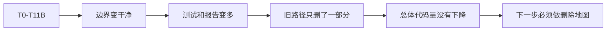
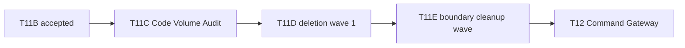
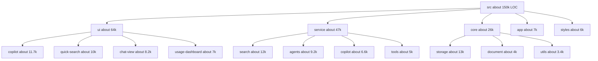
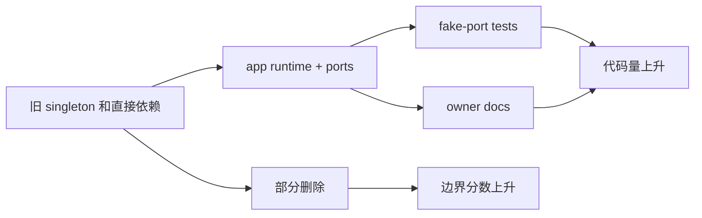
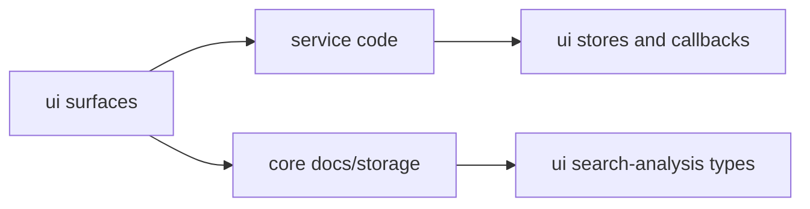
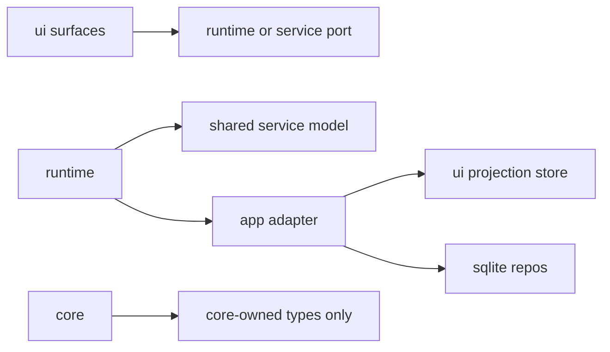
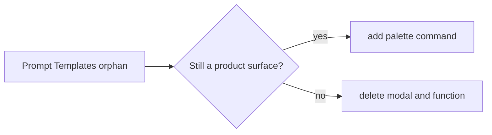
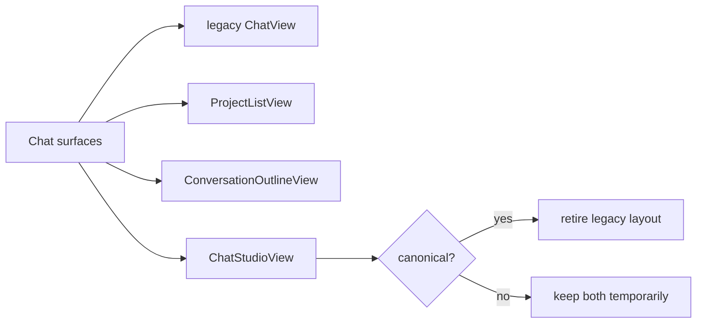
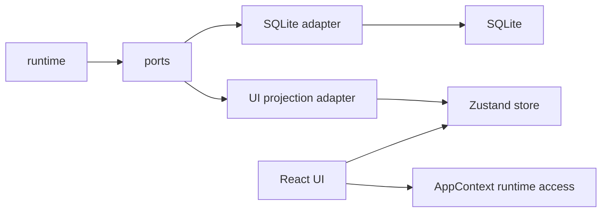
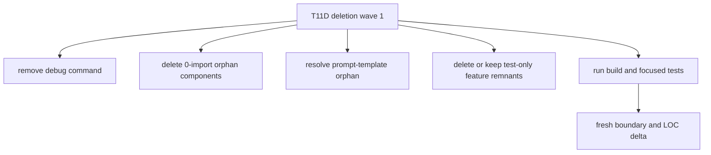

# T11C Code Volume Audit / Deletion Map

Date: 2026-06-25  
Branch: `codex/peak-modernization-refactor`  
Mode: Codex read-only audit. No runtime code was changed.

## 0. 先给结论

你现在的感觉是对的：T0-T11B 明显改善了边界，但还没有进入真正的“代码体积收缩期”。

从 `pre-large-refactor-2026-06-11` 到现在：

| Area | Delta |
| --- | ---: |
| `src/` | `+8,271 / -3,416`, net `+4,855` |
| `test/` | `+7,536 / -153`, net `+7,383` |
| `docs/superpowers/refactor-ops` | `+8,850` |
| `docs/superpowers/audits` | `+5,426` |
| `scripts/` | `+449` |

所以这轮重构到目前为止的性质是：



这不是失败。它说明前半段更像“搭新骨架 + 证明新路径”，后半段才应该开始“退役旧体积”。

## 1. 当前全局位置

当前最后接受的任务是 T11B-R：

- Copilot manual actions 已经改成 app-owned `CopilotActionRuntime`。
- `CopilotActionRegistry.getInstance()`、`CustomPromptRegistry.getInstance()`、`registerAllCopilotActions()` 这类旧 owner 已退役。
- `T11B-R` 修了 runtime binding 顺序，避免 SQLite 延迟启动时 catalog 不可用。

现在不要直接跳：

- Current Work State
- Chat 大重构
- Command Gateway / T12 capstone

现在应该先做：



## 2. 代码体积热区

Source scan:

- `src/` source total: about `150,658` lines across TS/TSX/CSS.
- Boundary scanner: `877` TS/TSX files under `src/`.
- Current boundary findings: `366`.
- T0 baseline was `423`, so boundary debt is down by `57`.

Top-level source size:

| Area | Lines | Meaning |
| --- | ---: | --- |
| `src/ui` | `64,419` | 最大体积区。多数代码仍是产品 surfaces、panels、stores、legacy views。 |
| `src/service` | `46,916` | 第二大。Search、agents、Copilot、Chat orchestration 仍很厚。 |
| `src/core` | `26,089` | Storage/document/provider/utils 很大，而且仍有 core -> service 反向依赖。 |
| `src/app` | `6,833` | 最近重构新增 adapters/runtime composition，体积小但增长明显。 |
| `src/styles` | `6,365` | CSS 体积集中在 component/system styles。 |

Largest subtrees:

| Subtree | Lines | Read |
| --- | ---: | --- |
| `src/ui/view/copilot` | `~11.7k` | Copilot UI surfaces and modals are now the biggest UI island. |
| `src/ui/view/quick-search` | `~10.0k` | Quick Search / AI Analysis remains a full app inside the app. |
| `src/service/search` | `~12.0k` | Indexing, query, graph, inspector tools, background runtime. |
| `src/core/storage/sqlite` | `~10.1k` | Many repos and DDL. High size but many are real persistence code. |
| `src/service/agents` | `~9.2k` | Agent loops, SDK bridge, graph/report/intuition agents. |
| `src/ui/view/chat-view` | `~8.2k` | Chat surface plus legacy/studio coexistence. |
| `src/ui/view/usage-dashboard` | `~7.0k` | Dashboard product surface; not architectural dead code by default. |

Visual map:



## 3. 为什么边界好了但代码没少

T0-T11B 主要做了这些：

- 把 runtime ownership 挪到 `src/app/runtime/AppRuntimeRegistry.ts`。
- 把 Obsidian / SQLite / UI store side effects 挪到 app adapters。
- 给 Vault Lint、Ambient、Vault Review、Quick Search Background、Copilot Action 建了 runtime / ports / tests。
- 删除了几条旧 singleton：
  - `src/service/BackgroundSessionManager.ts`
  - `src/service/ambient/AmbientPushService.ts`
  - `src/service/ambient/MorningBriefingService.ts`
  - `src/service/ambient/AmbientTrigger.ts`
  - `src/service/lint/SignalRegistry.ts`
  - `src/ui/store/vaultLintStore.ts`

但是同时新增了：

- app adapters
- runtime interfaces / impls
- fake-port tests
- source guards
- owner review docs
- handoff docs

这就是当前状态：



这轮 T11C 的目标不是继续加 runtime，而是把 deletion gate 做出来。

## 4. 当前边界残留

Fresh boundary audit:

| Metric | Current |
| --- | ---: |
| Files scanned | `877` |
| Total flagged edges | `366` |
| Service -> UI | `16` |
| Core -> Service/App/UI | `78` |
| Service/Core -> Obsidian side-effect surface | `16` |
| Service -> app shell | `59` |
| Service `AppContext.getInstance` references | `62` |

Important residual shapes:

### 4.1 service still reads UI

Current service/core -> UI examples:

- `src/service/search/analysisDocPersistence.ts`
  - imports Quick Search callbacks and UI store snapshot types.
- `src/service/chat/service-conversation.ts`
  - imports `useChatViewStore`.
- `src/service/chat/context/slots/SystemPromptSlot.ts`
  - imports `useChatViewStore`.
- `src/service/usage/CuratorRuntimePushService.ts`
  - imports dashboard `curatorPushStore` and `chatBridge`.
- `src/service/agents/report/ReportOrchestrator.ts`
  - imports Quick Search session store.
- `src/core/storage/vault/search-docs/*`
  - imports Quick Search UI store types and helpers.

This is still the biggest modularity smell:



The target shape is:



## 5. Static reachability scan

I ran a static import/require reachability scan from root `main.ts`.

Important caveat:

- This scan catches `import`, `export from`, dynamic `import()`, and `require()`.
- It cannot prove runtime-only Obsidian registration paths.
- A file marked unreachable is a deletion candidate, not automatic delete permission.

Result:

| Metric | Count |
| --- | ---: |
| TS/TSX files under `src` | `877` |
| Reachable from `main.ts` | `839` |
| Unreachable by static scan | `38` |
| Unreachable LOC | `3,081` |

Top unreachable candidates:

| File | LOC | Evidence |
| --- | ---: | --- |
| `src/service/skills/SkillExecutor.ts` | `308` | 0 production import found. Has service locators inside. |
| `src/service/ambient/AmbientContract.ts` | `287` | Descriptive contract/inventory; docs mention it, runtime does not import it. |
| `src/service/agents/intuition-helper/intuition.recon.ts` | `277` | Imported by `KnowledgeIntuitionAgent`, but that chain is not reachable from `main.ts`. |
| `src/ui/component/mine/InlineFollowupChat.tsx` | `203` | Comment references remain, but no production import found. |
| `src/service/agents/vault-sdk/sdkProfile.ts` | `164` | Test-only import found. |
| `src/service/copilot/CopilotAutoPlanner.ts` | `155` | Test-only import found. |
| `src/ui/view/modals/QuickNoteModal.ts` | `135` | 0 production import found. |
| `src/ui/component/mine/search-graph/SearchGraph.tsx` | `116` | 0 production import found. |
| `src/service/agents/intuition-helper/intuition.memory.ts` | `138` | 0 production import found. |
| `src/service/agents/intuition-helper/intuition.render.ts` | `112` | 0 production import found. |
| `src/ui/component/prompt-input/ModeSelector.tsx` | `99` | 0 production import found. |
| `src/core/providers/openai-compatible/OpenAICompatibleService.ts` | `95` | 0 production import found. |
| `src/ui/view/settings/hooks/useSurfaceReadiness.ts` | `90` | 0 production import found. |
| `src/core/po/{embedding,document-meta,doc-statistics}.po.ts` | `~125` | 0 production import found. `graph.po.ts` is explicitly not a candidate; it has many live graph/search imports. |
| `src/ui/view/vault-lint/components/PriorityActionsList.tsx` | `71` | 0 production import found; tests reference it as a source file. |
| `src/service/actions/*.ts` | `121` | 0 production import found. |

## 6. First deletion map

This section is not a delete command. It is the candidate map for T11D.

### Wave 1A: temporary/debug code

Best first deletion because the code itself says it is temporary.

| Candidate | Why | Risk |
| --- | --- | --- |
| `src/app/commands/DebugCommandActions.ts` | Header says delete after Conversation Index design sign-off. `Register.ts` exposes `[Debug] Load mock conversation...`. | Low if design preview is done. |
| `src/app/commands/Register.ts` debug command entry | Only needed by `DebugCommandActions.ts`. | Low. |

Expected removal: about `663` LOC plus command registration.

### Wave 1B: orphan command/function surfaces

| Candidate | Why | Risk |
| --- | --- | --- |
| `openPromptTemplates()` in `src/app/commands/PeakCommandActions.ts` | Function exists, but `buildCoreCommands()` does not register a command for it. | Needs product decision: either add command or delete prompt-template modal. |
| `src/ui/view/prompt-template/*` | Only appears connected through the orphan function above. | Medium. User may still want Prompt Templates reachable later. |

Decision needed:



### Wave 1C: static-unreachable code with 0 production imports

These are strong deletion candidates, but should be removed with build/test verification:

| Candidate group | Files |
| --- | --- |
| old modals/components | `QuickNoteModal.ts`, `InlineFollowupChat.tsx`, `SearchGraph.tsx`, `ModeSelector.tsx`, `MessageRoleAvatar.tsx` |
| unused UI helpers | `useTokenUsage.ts`, `useSurfaceReadiness.ts`, `SettingCard.tsx`, `shared-ui/badge.tsx`, `shared-ui/scroll-area.tsx` |
| orphan actions | `src/service/actions/addLinkAction.ts`, `src/service/actions/createBridgeNoteAction.ts` |
| old PO shells | `src/core/po/embedding.po.ts`, `document-meta.po.ts`, `doc-statistics.po.ts` |
| tiny barrels | `src/service/workflow/index.ts`, `src/service/chat/context/profiles/index.ts`, `src/ui/view/chat-view/integration/index.ts` |

Expected removal: likely `~800-1,200` LOC depending on which tests/docs are updated.

### Wave 1D: test-only feature remnants

These should not be silently deleted, because tests might document intended future behavior.

| Candidate | Evidence | Recommendation |
| --- | --- | --- |
| `CopilotAutoPlanner.ts` | Imported by `test/copilot-auto-planner.test.ts`, not production. | Decide whether Auto Planner is future product. If not, delete file + test. |
| `sdkProfile.ts` | Imported by `test/sdk-profile.test.ts`, not production. | Check whether SDK profile setting is still used. If not, delete file + test + stale setting shape. |
| `AmbientContract.ts` | Runtime does not import it; docs/test guard mention it. | Consider moving dependency inventory out of `src/` into docs if contracts are descriptive only. |

### Wave 1E: do not delete yet

These look tempting but are still active or structurally important:

| File/area | Why not delete now |
| --- | --- |
| `OnboardingModal.tsx` | Dynamically required from `main.ts`. Static import count alone would mislead. |
| `GraphFullscreenView.tsx` | Registered by `ViewManager` and dynamically opened from `V2SourcesView`. |
| `VaultXRayPanel.tsx` | Active T7 runtime consumer. |
| `UsageDashboard` | Product surface is registered and command-exposed. |
| `Search index / sqlite repos` | Large, but active infrastructure. Needs separate consolidation plan. |

## 7. Wave 2: boundary cleanup before big deletion

Wave 1 deletes obvious leftovers. Wave 2 should reduce coupling so future deletion is easier.

### 7.1 Retire service -> UI store writes that survived T11B

Top candidates:

| File | Problem | Direction |
| --- | --- | --- |
| `src/service/usage/CuratorRuntimePushService.ts` | service singleton imports usage dashboard UI store. | Move to app-owned runtime or delete if dashboard push is not product-critical. |
| `src/service/chat/service-conversation.ts` | service imports `chatViewStore`. | Extract a chat UI projection port or move UI state mutation to app/ui adapter. |
| `src/service/chat/context/slots/SystemPromptSlot.ts` | service reads UI store for prompt slot. | Replace with explicit chat context input. |
| `src/service/agents/report/ReportOrchestrator.ts` | service imports Quick Search session store. | Move report UI projection to Quick Search adapter. |

### 7.2 Retire core -> UI / service type leaks

Top candidates:

| Area | Problem | Direction |
| --- | --- | --- |
| `src/core/storage/vault/search-docs/*` | core imports Quick Search UI store types and helpers. | Move analysis doc model to service/core-neutral types. UI store imports that model, not the reverse. |
| `src/core/document/loader/*` | core imports `AIServiceManager`, `PromptId`, `Chunk` from service. | Split pure document loader types from indexing/chat service types. |
| `src/core/utils/format-utils.ts` | core imports search graph inspector parser. | Move parser to core or keep formatter in service; choose one owner. |

### 7.3 Retire remaining singleton/default state

Important current examples:

| File | State | Recommendation |
| --- | --- | --- |
| `src/service/ports/ProgressReporterPort.ts` | `let defaultReporter: ProgressReporterPort | null = null` | T2 temporary. Move default ownership to app/runtime composition or pass reporter explicitly. |
| `src/service/usage/CuratorRuntimePushService.ts` | `private static instance` | Either app-owned runtime or delete. |
| `src/service/skills/SkillRegistry.ts` | static singleton | If Skill system remains, move ownership to app context/runtime. |
| `src/service/capabilities/CapabilityRegistry.ts` | static singleton | Before T12, decide if CapabilityRegistry is a real app-owned registry or legacy placeholder. |

## 8. Wave 3: real big deletions require product decisions

If the goal is to visibly reduce code from `150k` LOC, dead-code cleanup alone is not enough. The big wins require retiring entire surfaces or old modes.

### 8.1 Chat legacy layout vs Chat Studio

Current `ViewManager` still registers:

- `ChatView`
- `ProjectListView`
- `ConversationOutlineView`
- `ChatStudioView`

If Chat Studio is now the canonical surface, then old three-leaf chat layout can be retired later. That would be a real UI deletion wave.

Decision:



### 8.2 Quick Search as old mega-app

`src/ui/view/quick-search` is about `10k` LOC and `src/service/search` is about `12k` LOC. It is probably the largest remaining product subsystem.

Do not delete blindly. Instead decide:

- Is Quick Search still a primary product surface?
- Should AI Analysis remain separate from Copilot/Vault Review?
- Should saved analysis docs move out of UI store types?
- Should search graph inspector tools remain user-facing, agent-only, or internal debug tools?

### 8.3 Copilot UI consolidation

`src/ui/view/copilot` is about `11.7k` LOC. T11/T11B cleaned the action registry/execution boundary, but UI surfaces remain many.

Possible later direction:

- One command/capability review shell.
- Thin surface registry.
- Retire duplicate panels that are now artifact renderers.

Do this after Code Volume Wave 1/2, not now.

### 8.4 Usage Dashboard product decision

`src/ui/view/usage-dashboard` is about `7k` LOC. It may be valuable, but it also owns a runtime push path that currently violates service -> UI boundary.

Decision:

- Keep as a real product surface and move push runtime to app-owned runtime.
- Or freeze/delete dashboard push features if not central.

## 9. How UI store and SQLite should be decoupled

The clean mental model:



Important rule:

- UI can read UI store.
- App adapters can write UI store because app layer is composition/glue.
- Service should not import UI store.
- Core should not import UI store.
- SQLite repo should not know UI snapshot types.

That is why `src/app/ambient/AmbientUiProjectionAdapter.ts` importing UI store is acceptable, but `src/service/usage/CuratorRuntimePushService.ts` importing dashboard store is not.

## 10. Proposed T11D scope

T11D should be a deletion wave, not another architecture foundation wave.

Recommended T11D:



Suggested acceptance gates:

1. `npm run build` passes.
2. `npm run test -- test/copilot-auto-planner.test.ts` is either deleted with the feature or still passes.
3. `npm run test -- test/sdk-profile.test.ts` is either deleted with the feature or still passes.
4. `npm run audit:boundary` does not increase total findings.
5. Produce deletion stat:
   - source files deleted
   - source LOC removed
   - tests deleted/updated
   - docs updated
6. No active command disappears unless explicitly listed.

## 11. Draft Claude prompt for T11D

Do not run this until the user confirms.

```text
Task: T11D Code Volume Deletion Wave 1

Context:
- Branch: codex/peak-modernization-refactor.
- T11B/T11B-R is accepted.
- Codex T11C audit found that architecture boundaries improved but source size grew. This task is intentionally deletion-focused.
- Follow runtime ownership and configurability rules from AGENTS.md / CLAUDE.md.
- Do not start Current Work State, Chat rewrite, or Command Gateway.

Goal:
Remove clearly retired temporary/orphan code and report exact LOC reduction, without changing active product behavior.

Read first:
- docs/superpowers/audits/2026-06-25-t11c-code-volume-deletion-map.md
- docs/progress.md active Architecture Modernization section
- docs/superpowers/refactor-ops/architecture-scorecard.md latest T11B row

Required investigation before edits:
1. Confirm current production references with rg for every deletion candidate.
2. Confirm whether prompt-template should be deleted or preserved. If uncertain, do not delete it.
3. Confirm whether CopilotAutoPlanner and sdkProfile are production-dead or test-only.

Primary deletion candidates:
- src/app/commands/DebugCommandActions.ts plus the debug command entry in src/app/commands/Register.ts.
- 0-production-import UI/component leftovers if rg confirms no active references:
  - src/ui/view/modals/QuickNoteModal.ts
  - src/ui/component/mine/InlineFollowupChat.tsx
  - src/ui/component/mine/search-graph/SearchGraph.tsx
  - src/ui/component/mine/search-graph/types.ts
  - src/ui/component/prompt-input/ModeSelector.tsx
  - src/ui/view/chat-view/components/MessageRoleAvatar.tsx
  - src/ui/view/chat-view/hooks/useTokenUsage.ts
  - src/ui/view/settings/hooks/useSurfaceReadiness.ts
  - src/ui/view/settings/components/SettingCard.tsx
  - src/ui/component/shared-ui/badge.tsx
  - src/ui/component/shared-ui/scroll-area.tsx
- 0-production-import service/core leftovers if rg confirms no active references:
  - src/service/actions/addLinkAction.ts
  - src/service/actions/createBridgeNoteAction.ts
  - src/core/po/embedding.po.ts
  - src/core/po/document-meta.po.ts
  - src/core/po/doc-statistics.po.ts
  - src/service/workflow/index.ts
  - src/ui/view/chat-view/integration/index.ts
  - src/service/chat/context/profiles/index.ts and only its child files if no production path imports them.

Handle carefully:
- src/service/copilot/CopilotAutoPlanner.ts and test/copilot-auto-planner.test.ts are test-only. Delete only if confirmed as non-product future work.
- src/service/agents/vault-sdk/sdkProfile.ts and test/sdk-profile.test.ts are test-only. Delete only if settings type cleanup is included or if the file is proven obsolete.
- src/service/ambient/AmbientContract.ts is descriptive architecture inventory in src. Do not delete unless you also update source guards/docs and Codex explicitly accepts moving that inventory out of runtime source.
- src/ui/view/prompt-template/* and openPromptTemplates(): either wire a command or delete; do not leave orphan function/surface.

Do not delete:
- OnboardingModal.tsx; it is dynamically required from main.ts.
- GraphFullscreenView.tsx; it is registered and opened from V2SourcesView.
- src/core/po/graph.po.ts; T11D review found many live graph/search imports.
- src/ui/view/chat-view/integration/messageReceiptSlot.ts; MessageViewItemRetained imports it.
- active runtime/adapters added in T6-T11B.
- Quick Search, Chat, Usage Dashboard, or Copilot panels wholesale.

Verification:
- npm run build
- npm run audit:boundary
- Run affected focused tests. If deleting test-only features, explicitly list deleted tests and why.
- Provide git diff --stat and source LOC removed.

Implementation note must include:
- Chinese summary.
- Exact files deleted/modified.
- Why each deletion is safe.
- Any candidates intentionally left untouched.
- Boundary audit delta.
- LOC delta.
- Next recommended deletion/boundary wave.
```

## 12. Code reading guide

Read in this order:

1. `docs/progress.md`
   - Confirm latest accepted task is T11B-R and next task is Code Volume Audit.

2. `docs/superpowers/refactor-ops/architecture-scorecard.md`
   - Read the T11B row. Notice the caveat: boundary score is high, but code net-added.

3. `main.ts`
   - See app composition and remaining singletons.
   - Important: dynamic `require('@/ui/view/modals/OnboardingModal')` means static import count can mislead.

4. `src/app/runtime/AppRuntimeRegistry.ts`
   - This is the desired owner pattern for capability runtimes.

5. `src/app/commands/Register.ts`
   - Read command palette entries.
   - The debug command is explicitly temporary.

6. `src/app/view/ViewManager.ts`
   - See which UI surfaces are actively registered.
   - This prevents accidental deletion of registered views.

7. `src/service/usage/CuratorRuntimePushService.ts`
   - Read as a remaining anti-pattern: service singleton directly writes dashboard UI store.

8. `src/service/ports/ProgressReporterPort.ts`
   - Read as a known T2 temporary compromise: mutable default reporter.

9. `src/service/search/analysisDocPersistence.ts`
   - Read as a representative leftover service -> UI coupling.

10. `src/core/storage/vault/search-docs/*`
   - Read as representative core -> UI type leak.

## 13. Recommended next move

I recommend:

1. User reviews this report, especially Wave 1B and Wave 1D decisions.
2. Codex turns the approved subset into a stricter T11D handoff.
3. Claude Code executes one larger deletion wave.
4. Codex reviews deletion safety, updates scorecard, and only then considers Wave 2 boundary cleanup.

Do not use T11D to start a new feature.
