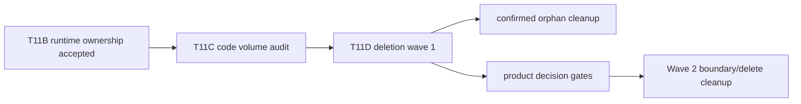
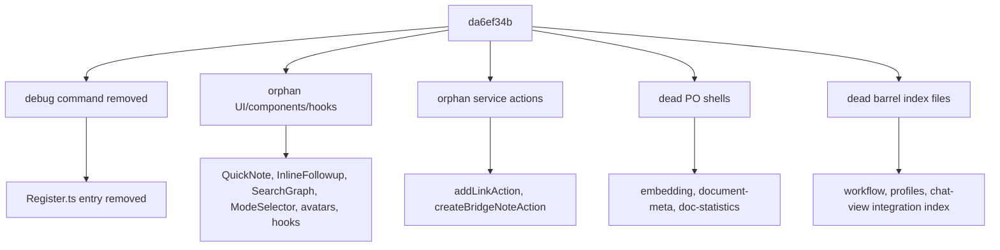
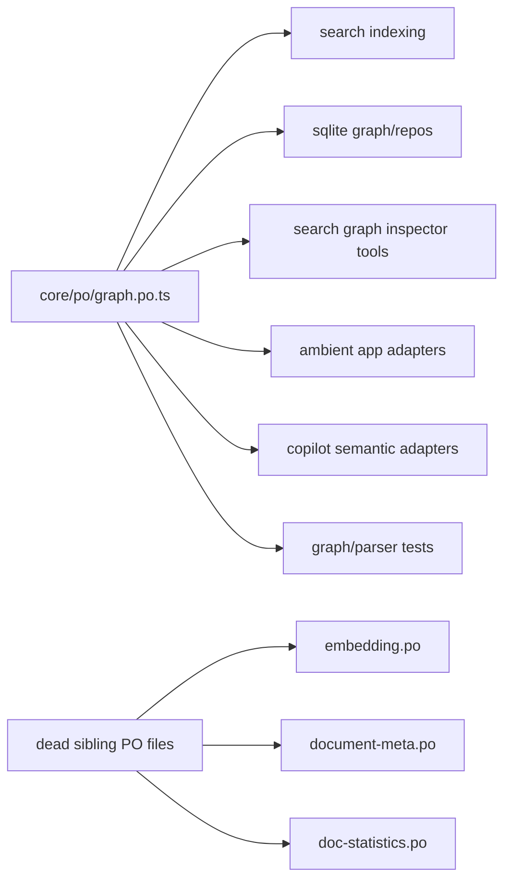
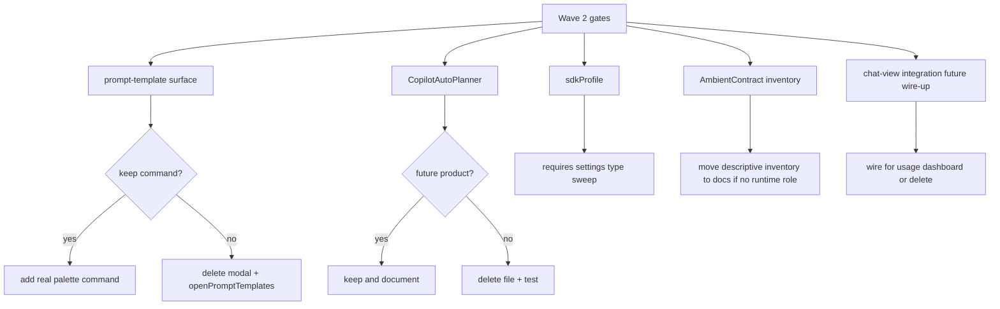

# Owner Review Packet: T11D Code Volume Deletion Wave 1

Claude Code commit:

- `da6ef34b` `refactor(prune): T11D wave 1 - delete confirmed orphan code`

Verdict: **Accepted**

Owner decision: 可以把 T11D 视为第一轮删码 wave 完成。它没有继续加抽象，而是删除确认无生产入口的 debug、UI、service、core leftovers。下一步不要马上开新功能，要先做一个 **Product Decision Packet**，把 prompt templates、CopilotAutoPlanner、sdkProfile、AmbientContract、chat-view integration 这些“可能是未来产品，也可能是旧残留”的门判清楚。

Global position: T0-T11B 主要是在收 runtime ownership 和 dependency boundary，但代码量持续变大。T11C 负责找可退役路径；T11D 是第一轮低风险删除，用来建立“不是只重构加层，也真的能退役旧代码”的节奏。

## 0. Review Entry Points

| Review item | Status | Why open it |
| --- | --- | --- |
| This Owner Review Packet | Final | T11D 的 owner 审查主文档。 |
| [`2026-06-25-t11c-code-volume-deletion-map.md`](./2026-06-25-t11c-code-volume-deletion-map.md) | Corrected | T11C 删除地图，已修正 `graph.po.ts` 误判。 |
| [`t11d-code-volume-deletion-wave-1-handoff.md`](../refactor-ops/t11d-code-volume-deletion-wave-1-handoff.md) | Corrected | 发给 Claude 的 T11D handoff，已补 `graph.po.ts` protected rule。 |
| [`architecture-scorecard.md`](../refactor-ops/architecture-scorecard.md) | Updated by Codex | T11D 完成后的 score ledger。 |

## 0.5 Code Reading Guide

Read in this order:

| Order | File / command | What to inspect | Why it matters |
| ---: | --- | --- | --- |
| 1 | `git show --name-status da6ef34b` | 完整删除清单 | 先看“删了哪些桶”。 |
| 2 | `src/app/commands/Register.ts` | debug command entry removed | 唯一用户可见入口变化：移除开发期 debug 命令。 |
| 3 | `src/core/po/index.ts` | 只剩 `export * from './graph.po'` | 证明 PO shell 只删了死类型，没有删活的 graph model。 |
| 4 | `src/ui/view/quick-search/components/V2ContinueAnalysisInput.tsx` | comment scrub | 避免注释继续指向已删除 `InlineFollowupChat`。 |
| 5 | `src/core/po/graph.po.ts` | live graph/search imports | 这是 T11D 最重要的“不要删错”证据。 |
| 6 | `src/ui/view/chat-view/integration/messageReceiptSlot.ts` | consumed by `MessageViewItemRetained` | 证明 chat integration barrel 可删，但具体 slot 文件仍然活着。 |
| 7 | `src/ui/view/chat-view/integration/useCurrentContextUtilization.ts` | future wire-up comment | 目前不是活入口，是 Wave 2 决策候选。 |

First debug file:

- 发现某个命令不见了：看 `src/app/commands/Register.ts`。
- graph/search 类型报错：先确认 `src/core/po/index.ts` 是否仍 re-export `graph.po`。
- chat message receipt UI 出问题：看 `MessageViewItemRetained -> messageReceiptSlot` 的相对 import。
- 想继续删码：先看本 packet 第 8 节，不要从大功能面直接开刀。

## 0.6 Visual Dependency Maps

### Map 1: Where T11D Sits



How to read:

- T11D 不是新的架构 foundation。
- 它是 T11C 之后的第一轮低风险删除。
- 下一轮要先判产品语义，再继续删。

### Map 2: Deletion Buckets



How to read:

- 这轮删除不是随便删大文件，而是按“无生产引用”的桶删。
- 最大可见变化只有 debug command 移除。
- 其余是被证明没有活入口的旧残留。

### Map 3: Why `graph.po.ts` Survived



How to read:

- T11C 静态候选表把 `graph.po.ts` 放进 PO group 是误判。
- Claude 这轮正确保留了它。
- Codex 已把 T11C/T11D 文档改成：只删 sibling PO shells，不删 graph model。

### Map 4: Current Deletion Gates



How to read:

- 这些不是“技术上不敢删”，而是“产品语义还没判”。
- Wave 2 的大收益来自把这些门一次性判掉。

## 1. One-Sentence Outcome

T11D 删除了 20 个 confirmed orphan source files，提交净删除 `src` 约 1,780 行，并且没有引入新的 runtime path、port、store 或功能分支。

## 2. What Changed

Deleted or changed:

| Purpose | Files |
| --- | --- |
| Debug entry | `src/app/commands/DebugCommandActions.ts`, `src/app/commands/Register.ts` |
| Orphan UI/components/hooks | `QuickNoteModal.ts`, `InlineFollowupChat.tsx`, `SearchGraph.tsx`, `types.ts`, `ModeSelector.tsx`, `MessageRoleAvatar.tsx`, `useTokenUsage.ts`, `useSurfaceReadiness.ts`, `SettingCard.tsx`, `shared-ui/badge.tsx`, `shared-ui/scroll-area.tsx` |
| Orphan service actions | `src/service/actions/addLinkAction.ts`, `src/service/actions/createBridgeNoteAction.ts` |
| Dead PO shells | `src/core/po/embedding.po.ts`, `document-meta.po.ts`, `doc-statistics.po.ts`; `src/core/po/index.ts` trimmed |
| Dead barrels | `src/service/workflow/index.ts`, `src/service/chat/context/profiles/index.ts`, `src/ui/view/chat-view/integration/index.ts` |
| Stale comment scrub | `src/ui/view/quick-search/components/V2ContinueAnalysisInput.tsx` |

Intentionally preserved:

- `src/core/po/graph.po.ts`: live production/test imports.
- `src/service/copilot/CopilotAutoPlanner.ts`: test-only but possible future product path.
- `src/service/agents/vault-sdk/sdkProfile.ts`: test-only, but settings type surface still exists.
- `src/ui/view/prompt-template/*` and `openPromptTemplates()`: needs owner product decision.
- `src/service/ambient/AmbientContract.ts`: descriptive inventory, should be moved to docs only by a planned cleanup.
- `src/ui/view/chat-view/integration/messageReceiptSlot.ts`: live import from `MessageViewItemRetained`.
- `src/ui/view/chat-view/integration/useCurrentContextUtilization.ts`: future wire-up candidate, not deleted in this safe wave.

## 3. Findings

No blocking findings.

### P3: T11C map over-included `graph.po.ts`

T11C/T11D docs previously grouped `graph.po.ts` with dead PO shells. That was wrong: live imports exist from search indexing, sqlite graph repos, app adapters, copilot adapters, and tests.

Resolution:

- Claude correctly preserved `graph.po.ts`.
- Codex corrected the T11C deletion map and T11D handoff.

### P3: One stale source comment remains

`src/ui/view/chat-view/integration/useCurrentContextUtilization.ts` still says it mirrors deleted `useTokenUsage`.

Why not block:

- The file itself was intentionally deferred.
- This is comment-only debt, not runtime behavior.
- It should be handled with the Wave 2 “wire or delete chat-view integration” decision.

### P3: Commit message says `sdk-profile` failed, but Codex rerun passed

Claude note recorded an `sdk-profile` pre-existing failure. Codex reran `npm run test -- test/sdk-profile.test.ts` on the current checkout and it passed.

Interpretation:

- Treat `sdkProfile.ts` as still unresolved product/deletion debt, not as a currently failing test.
- Do not delete it without a settings type sweep.

## 4. Verification

Codex reran:

```bash
npm run build
npm run audit:boundary
npm run test -- test/copilot-auto-planner.test.ts
npm run test -- test/vault-lint-runner.test.ts
npm run test -- test/sdk-profile.test.ts
rg -n "DebugCommandActions|loadMockConversationForIndexPreview|peak-debug-load-mock-conversation|QuickNoteModal|InlineFollowupChat|MessageRoleAvatar|useTokenUsage|useSurfaceReadiness|SettingCard|addLinkAction|createBridgeNoteAction|embedding\\.po|document-meta\\.po|doc-statistics\\.po" src main.ts test
```

Results:

- Build passed.
- Boundary audit passed: `363` total flagged edges.
- `copilot-auto-planner.test.ts` passed.
- `vault-lint-runner.test.ts` passed when run sequentially. A prior parallel run failed because the custom test runner shares `temp-test.js`.
- `sdk-profile.test.ts` passed in Codex rerun.
- Scoped `rg` found no live hits for deleted symbols except one stale comment mention of `useTokenUsage` in deferred `useCurrentContextUtilization.ts`.

Expected warning:

- Build still prints existing `caniuse-lite is outdated`.

## 5. Boundary Evidence

Boundary audit after T11D:

| Metric | After T11D | Interpretation |
| --- | ---: | --- |
| Total flagged edges | 363 | Down directionally from earlier baselines; T11D itself is mostly deletion, not boundary rewiring. |
| Service -> UI | 16 | Same major residual bucket as T11B after surface split. |
| Core -> upstream | 78 | Unchanged; core/document and storage still need later structural cleanup. |
| Service/core Obsidian side-effect surface | 16 | Residual service/core Obsidian coupling remains. |
| Service AppContext count | 62 | Same post-T11B level. |

Interpretation:

- T11D improves old-path deletion and code volume.
- It does not claim to solve remaining boundary debts.
- The most useful next boundary wave should target service -> UI and core -> upstream, but only after product-decision gates are cleared.

## 6. Code Volume Evidence

Stable commit delta:

```text
23 files changed, 1 insertion(+), 1781 deletions(-)
src_add 1 src_del 1781 src_net -1780
```

Source files deleted:

```text
20 source files
```

Local line-count note:

- `git diff --numstat da6ef34b^..da6ef34b -- src` is the official T11D delta.
- Absolute `src/` totals vary by counting口径 because the local checkout contains untracked `.DS_Store` files and non-TS assets.
- Current tracked `src/` all-file count in Codex rerun: `148,618` lines.
- Current tracked `src/**/*.ts(x)` count in Codex rerun: `141,075` lines.

## 7. Score

T11D score:

| Group | Score | Confidence | Why |
| --- | ---: | --- | --- |
| Control | 92 | High | Owner now has a deletion map, reading guide, and explicit next gates. |
| Boundary | 95 | High | No boundary regression; deletion removed stale surfaces but did not rewire core debts. |
| Runtime truth | 93 | High | No new runtime path; ambiguous future paths were deferred instead of duplicated. |
| Verification | 97 | High | Build, boundary audit, focused tests, and rg checks passed. |
| Overall | 93 | High | Real deletion wave with low behavioral risk; improvement is mainly OD/CR/OC, not new capability semantics. |

Per-dimension summary:

| Dimension | Score |
| --- | ---: |
| Architecture clarity | 91 |
| Capability semantics | 90 |
| Dependency direction | 94 |
| Modularity / cohesion | 94 |
| Side-effect isolation | 94 |
| Single runtime path | 96 |
| State ownership clarity | 92 |
| Observability / trace | 88 |
| Testability / fake-port readiness | 96 |
| Old-path deletion | 99 |
| Change radius | 95 |
| Owner comprehension | 94 |

Why overall does not jump higher:

- T11D deletes safe leftovers, but does not resolve core -> service/app or the remaining 16 service -> UI edges.
- It does not add RunEnvelope traces or new product observability.
- The next high-leverage work is decision-gated deletion plus boundary cleanup, not more tiny orphan sweeps.

## 8. Next Step

Do **Product Decision Packet before Wave 2 coding**.

Questions to answer:

| Gate | Owner question | If yes | If no |
| --- | --- | --- | --- |
| Prompt Templates | Do we still want a command/palette surface for prompt templates? | Add real command and keep. | Delete modal + `openPromptTemplates()`. |
| CopilotAutoPlanner | Is auto-planning future product behavior? | Keep, document roadmap, maybe wire later. | Delete file + test. |
| sdkProfile | Is SDK profile still part of settings/product? | Keep and wire/read clearly. | Delete with settings type sweep. |
| AmbientContract | Should descriptive contract live in runtime `src/`? | Keep with source guard justification. | Move inventory to docs, remove runtime source. |
| Chat integration hook | Will usage dashboard actually consume chat-view context hook? | Wire real path. | Delete future hook and stale bridge comments. |

Suggested task name:

```text
T11E Product Decision Packet for Deletion Wave 2
```

Expected output:

- one short Chinese owner-facing packet;
- a keep/delete/defer table;
- a Claude prompt for a larger Wave 2 deletion/boundary cleanup;
- no source edits yet, unless the owner explicitly approves one gate.

