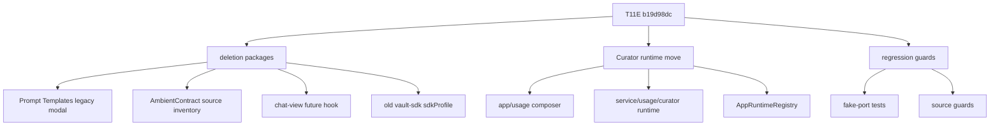
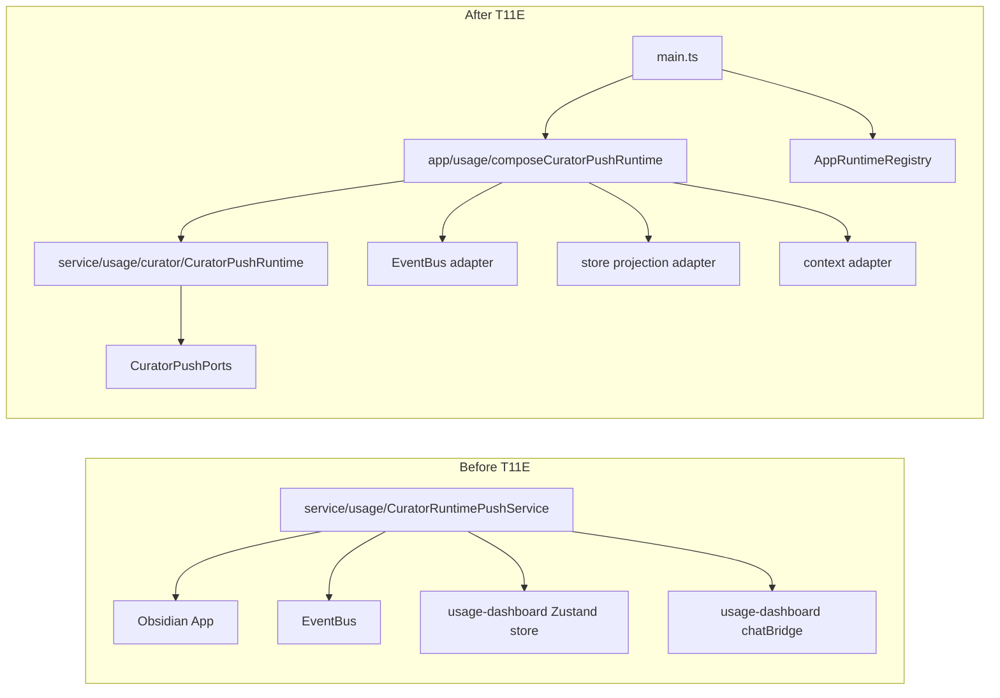
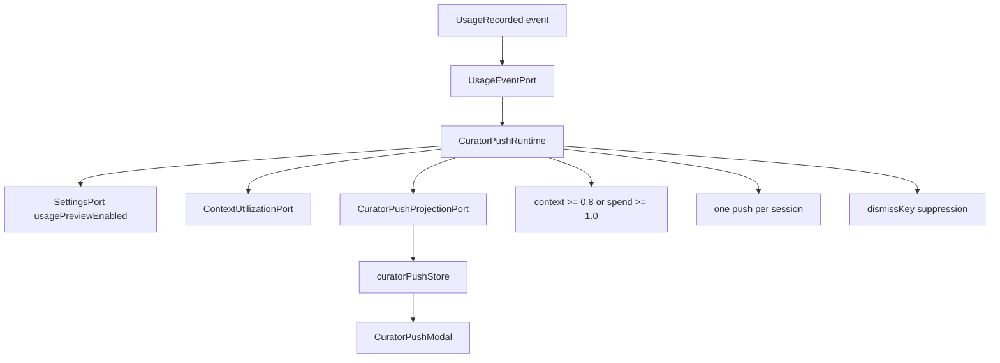

# Owner Review Packet: T11E Big Deletion + Curator Push Runtime Move

Claude Code commit:

- `b19d98dc` `refactor(modernization): T11E big deletion + Curator Push runtime move`

Verdict: **Accepted with required follow-up**

Owner decision: T11E 这波可以接受。它终于不是小碎步：一边删掉 Prompt Templates legacy modal、AmbientContract runtime inventory、chat-view future hook、旧 sdkProfile；另一边把 Curator Push 从 service-layer singleton 迁到 app-owned runtime + ports。唯一不能忽略的是 `test/profile-registry.test.ts` 仍有 2 个旧模型名断言失败；这不是 T11E 引入的，但 T11E 删除旧 sdkProfile 后，ProfileRegistry 已经成为 canonical path，所以必须马上做一个 T11E-R 小修把测试拉绿。

Global position: T11D 是第一轮删码；T11E 是第一轮“删码 + 真边界收口”的大 wave。它没有碰 Chat 主路径，也没有提前做 Current Work State / Command Gateway。

## 0. Review Entry Points

| Review item | Status | Why open it |
| --- | --- | --- |
| This Owner Review Packet | Final | T11E 审查主文档。 |
| [`t11e-big-deletion-boundary-wave-handoff.md`](../refactor-ops/t11e-big-deletion-boundary-wave-handoff.md) | Source contract | 本轮 Claude 任务边界。 |
| [`t11e-review-fix-profile-registry-model-defaults-handoff.md`](../refactor-ops/t11e-review-fix-profile-registry-model-defaults-handoff.md) | Next required fix | 清掉唯一红色测试。 |
| [`architecture-scorecard.md`](../refactor-ops/architecture-scorecard.md) | Updated | T11E 分数与趋势。 |

## 0.5 Code Reading Guide

Read in this order:

| Order | File / command | What to inspect | Why it matters |
| ---: | --- | --- | --- |
| 1 | `git show --name-status b19d98dc` | 全部删除/新增/修改文件 | 先建立“这波改了多少”的直觉。 |
| 2 | `src/app/usage/composeCuratorPushRuntime.ts` | EventBus / chatBridge / Zustand store adapter | 这是唯一 concrete wiring site。 |
| 3 | `src/service/usage/curator/CuratorPushRuntime.ts` | thresholds, throttle, dismiss, dispose | 业务语义迁到纯 runtime。 |
| 4 | `src/service/usage/curator/CuratorPushPorts.ts` | usage event / context / projection / settings ports | 这里是可 fake 的边界。 |
| 5 | `src/app/runtime/AppRuntimeRegistry.ts` | `set/get/tryGet/clearCuratorPushRuntime` | runtime ownership 是否回到 app 层。 |
| 6 | `main.ts` | compose/start/bind/unload | boot/unload 路径是否对称。 |
| 7 | `test/curator-push-runtime-ports.test.ts` | 9 个 fake-port behavior tests | 行为没有被 UI/Obsidian 绑死。 |
| 8 | `test/curator-push-runtime-source-guard.test.ts` | 9 个 boundary guards | 防止 service singleton / UI import 长回来。 |
| 9 | `src/app/settings/types.ts` | old `vaultSearch.sdkProfile` gone | 旧 SDK profile 残留已退役。 |
| 10 | `test/profile-registry.test.ts` | 2 个 stale expected model ids | 下一步 T11E-R。 |

## 0.6 Visual Dependency Maps

### Map 1: What T11E Actually Did



How to read:

- 左边是真删除。
- 右边是真边界迁移。
- 下面是防回归测试，不只是口头约束。

### Map 2: Curator Push Before / After



How to read:

- 以前 service 自己伸手拿 app/UI/store。
- 现在 service 只知道 ports。
- app composer 才负责接上真实世界。

### Map 3: State / Event Flow



How to read:

- runtime state truth 是 `sessionSpendUsd` + projection 的 session flags。
- UI store 只是 projection / modal state。
- settings/context/event 都变成 ports。

## 1. What Changed

Accepted changes:

| Package | Outcome |
| --- | --- |
| A Prompt Templates | Deleted legacy `src/ui/view/prompt-template/*`; removed orphan `openPromptTemplates()`. |
| B AmbientContract | Deleted descriptive `src/service/ambient/AmbientContract.ts`; source guard no longer special-cases it. |
| C Chat context hook | Deleted stale `src/ui/view/chat-view/integration/useCurrentContextUtilization.ts`; usage dashboard keeps its own active hook. |
| D sdkProfile | Deleted old `src/service/agents/vault-sdk/sdkProfile.ts` and `test/sdk-profile.test.ts`; removed `vaultSearch.sdkProfile` settings shape/default. |
| E Curator Push | Replaced `CuratorRuntimePushService` singleton with app-owned `CuratorPushRuntime` + ports + composer + registry binding. |

Protected paths correctly preserved:

- `src/core/po/graph.po.ts`
- `src/core/profiles/*`
- `src/service/agents/core/sdkAgentPool.ts`
- `src/ui/view/chat-view/integration/messageReceiptSlot.ts`
- `src/ui/view/usage-dashboard/integration/useCurrentContextUtilization.ts`
- `src/ui/view/usage-dashboard/integration/chatBridge.ts`
- `src/service/usage/UsageTrackingService.ts`
- `src/service/usage/UsageOutcomeService.ts`
- `src/service/usage/optimization/*`
- Ambient runtime / ports / app adapters

## 2. Findings

No T11E blocking findings.

### P2 follow-up: canonical ProfileRegistry test is red

`npm run test -- test/profile-registry.test.ts` fails 2 assertions:

```text
actual:   claude-sonnet-4-6
expected: claude-opus-4-6

actual:   anthropic/claude-sonnet-4-6
expected: anthropic/claude-opus-4-6
```

Why this matters:

- T11E deleted old `vault-sdk/sdkProfile.ts`.
- The new canonical SDK profile path is now `core/profiles/*`.
- Its test suite should not stay red, even if the failure predates T11E.

Why this does not block accepting T11E:

- Build passes.
- New Curator runtime behavior and boundary tests pass.
- The failing assertions are stale expected defaults in `test/profile-registry.test.ts`; current code and model catalog use Sonnet defaults.
- The failure is independent of Curator runtime and deletion packages.

Required next:

- Run T11E-R: update profile-registry expected defaults or preset default, with evidence. Recommendation: update test expected defaults to Sonnet because `src/core/profiles/presets.ts` and current model catalog already point there.

### P3 note: boot sequence starts before binding

`main.ts` does:

```text
compose -> runtime.start() -> AppContext.setCuratorPushRuntime(runtime)
```

This is acceptable because `start()` only subscribes to EventBus and does not synchronously emit. Existing tests cover double-start and unload. A future polish could bind before start for symmetry, but it is not a blocker.

## 3. Verification

Codex reran:

```bash
npm run build
npm run audit:boundary
npm run test -- test/curator-push-runtime-ports.test.ts
npm run test -- test/curator-push-runtime-source-guard.test.ts
npm run test -- test/ambient-source-guard.test.ts
npm run test -- test/usage-log-repo.test.ts test/usage-outcome-service.test.ts test/curator-validation.test.ts
npm run test -- test/profile-registry.test.ts
```

Results:

| Command | Result |
| --- | --- |
| `npm run build` | PASS |
| `npm run audit:boundary` | PASS, 358 findings |
| `curator-push-runtime-ports` | PASS, 9/9 |
| `curator-push-runtime-source-guard` | PASS, 9/9 |
| `ambient-source-guard` | PASS |
| `usage-log-repo` | PASS |
| `usage-outcome-service` | PASS |
| `curator-validation` | PASS, 14/14 |
| `profile-registry` | FAIL, 28 pass / 2 stale model-name failures |

Expected warning:

- Build still prints existing `caniuse-lite is outdated`.

## 4. Scoped `rg` Evidence

Deleted legacy surfaces:

```bash
rg -n "openPromptTemplates|PromptTemplateModal|PromptTemplateList|src/ui/view/prompt-template" src test main.ts
```

Result: no hits.

AmbientContract / stale chat hook:

```bash
rg -n "AmbientContract|chat-view/integration/useCurrentContextUtilization" src test main.ts
```

Result: no hits.

Old sdkProfile:

```bash
rg -n "vaultSearch\\.sdkProfile|service/agents/vault-sdk/sdkProfile|DEFAULT_SDK_PROFILE|readProfileFromSettings" src test main.ts
```

Result: no hits.

Curator old singleton:

```bash
rg -n "CuratorRuntimePushService|getInstance\\(\\)\\.init\\(this\\.app|curatorPushStore|usage-dashboard/integration/chatBridge" src/service src/app main.ts test
```

Interpretation:

- `composeCuratorPushRuntime.ts` is the legal wiring site for `curatorPushStore` and `chatBridge`.
- `test/curator-push-runtime-source-guard.test.ts` contains intentional guard strings.
- One broad-pattern hit is unrelated `SkillRegistry.getInstance().init(this.app)`.
- No live `CuratorRuntimePushService.getInstance()` path remains.

## 5. Boundary Evidence

| Metric | T11D after | T11E after | Delta |
| --- | ---: | ---: | ---: |
| Total flagged edges | 363 | 358 | -5 |
| service -> UI | 16 | 14 | -2 |
| core -> upstream | 78 | 78 | 0 |
| service/core side-effect surface | 16 | 16 | 0 |
| service -> app shell | 59 | 59 | 0 |
| service AppContext refs | 62 | 62 | 0 |
| files scanned | 857 | 853 | -4 |

Interpretation:

- The intended service -> UI reduction landed exactly.
- Curator no longer contributes service-side UI imports.
- Remaining service -> UI debt is now concentrated in AI graph types, report/search session store, chat store coupling, and analysisDocPersistence.

## 6. Code Volume Evidence

Commit stat:

```text
25 files changed, 929 insertions(+), 1252 deletions(-)
```

Stable delta:

```text
total_add 929 total_del 1252 total_net -323
src_add 361 src_del 1120 src_net -759
```

Interpretation:

- This was not only deletion; Package E added runtime/ports/tests.
- Net source code still decreased.
- More importantly, one live service singleton/runtime boundary was removed.

## 7. Score

T11E score:

| Group | Score | Confidence | Why |
| --- | ---: | --- | --- |
| Control | 94 | High | Owner can now read a single Curator runtime path and deletion list. |
| Boundary | 96 | High | service -> UI drops 16 -> 14; Curator service no longer imports UI/store/EventBus/App. |
| Runtime truth | 95 | High | Curator runtime is app-owned; old singleton path is gone. |
| Verification | 95 | Medium-High | T11E tests pass, but `profile-registry.test.ts` remains red for stale defaults. |
| Overall | 95 | Medium-High | Big wave accepted, with required T11E-R to restore canonical profile tests. |

Per-dimension summary:

| Dimension | Score |
| --- | ---: |
| Architecture clarity | 94 |
| Capability semantics | 93 |
| Dependency direction | 96 |
| Modularity / cohesion | 95 |
| Side-effect isolation | 96 |
| Single runtime path | 97 |
| State ownership clarity | 95 |
| Observability / trace | 90 |
| Testability / fake-port readiness | 96 |
| Old-path deletion | 98 |
| Change radius | 94 |
| Owner comprehension | 95 |

Why not higher:

- ProfileRegistry test suite is not fully green.
- Remaining service -> UI and core -> upstream debts are still substantial.
- Curator runtime does not emit RunEnvelope/artifact traces; it is a port-runtime pattern, not an observability wave.

## 8. Next Step

Do T11E-R first:

```text
T11E-R ProfileRegistry model default test alignment
```

Then the next architecture wave should target a bigger remaining hotspot. Best candidates:

1. `src/service/search/analysisDocPersistence.ts`
   - 5 flagged edges.
   - Directly imports Quick Search UI callbacks/store types.
   - Good bounded service -> UI cleanup.

2. `src/service/chat/service-conversation.ts` + `SystemPromptSlot.ts`
   - service -> chat UI store coupling.
   - Bigger blast radius; do after analysisDocPersistence unless owner wants to attack Chat.

3. `src/core/document/loader/*`
   - core -> service/app back-reference cluster.
   - Large structural wave, likely T12-prep or separate foundation pass.

Recommendation: after T11E-R, do `analysisDocPersistence` as the next larger but bounded boundary wave.

