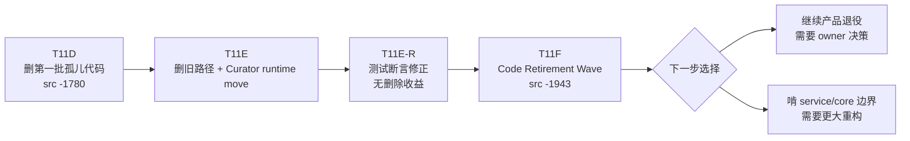
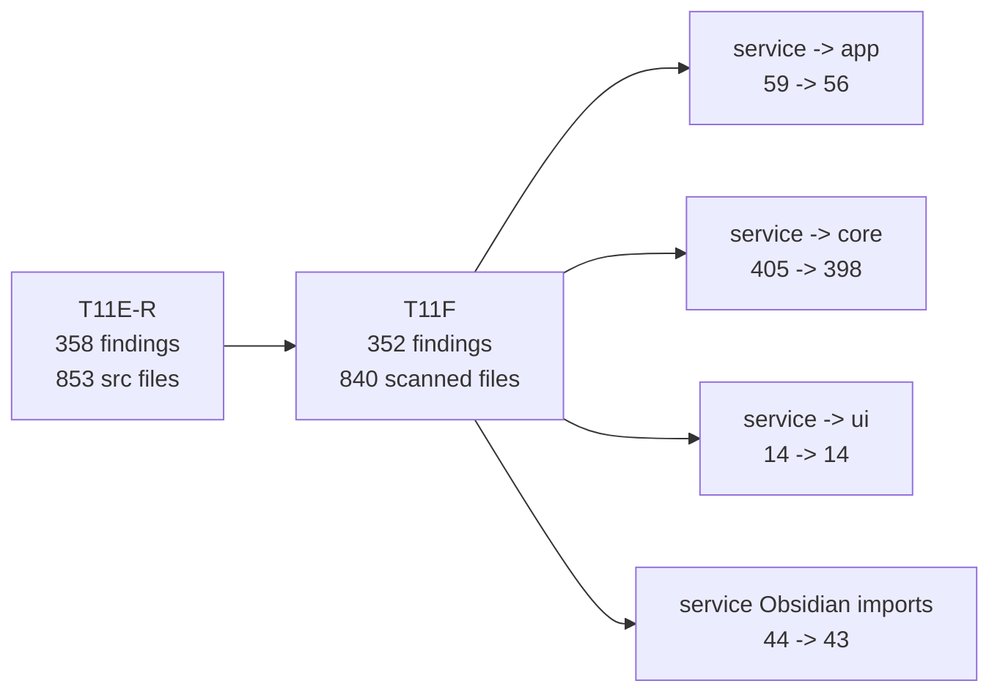

# T11F Owner Review Packet — Code Retirement Wave

Date: 2026-06-26  
Commit reviewed: `79947556` — `refactor(modernization): T11F code retirement wave (Packages A/B/C)`  
Verdict: Accepted

## 1. 一句话结论

T11F 是一轮真正的 deletion-first：删除 15 个文件，`src` commit net delta 是 `-1,943` 行，没有引入新 runtime、port、双系统，也没有碰 Quick Search / Chat / Gap Analysis / Knowledge Intuition 等受保护功能。

这轮不是“边界抽象变优雅”，而是“代码库减负变干净”。它达到了 T11F 的目标。

## 2. 本轮在大图里的位置



读法：T11F 接的是你“不够多”的反馈。它没有继续小步 port，而是把三类低价值路径一次性撤掉。

## 3. 删除了什么

```mermaid
flowchart TB
    A["Package A\n确认不可达 / orphan"] --> A1["SkillExecutor"]
    A --> A2["CopilotAutoPlanner"]
    A --> A3["OpenAICompatibleService"]
    A --> A4["PriorityActionsList"]
    A --> A5["copilot-auto-planner test"]

    B["Package B\n旧 Copilot Workflow 实验"] --> B1["service/workflow/*"]
    B --> B2["WorkflowPanel"]
    B --> B3["run-workflow action wiring"]

    C["Package C\n旧 first-run onboarding"] --> C1["OnboardingModal"]
    C --> C2["IndexConfigStep"]
    C --> C3["IndexProgressDisplay / ErrorDialog"]
    C --> C4["indexingStartup test"]

    Keep["明确保留"] --> K1["HarnessOnboardingModal"]
    Keep --> K2["ProviderForm"]
    Keep --> K3["Quick Search / Chat / Gap / Graph"]
```



### Package A — orphan retirement

Deleted:

- `src/service/skills/SkillExecutor.ts`
- `src/service/copilot/CopilotAutoPlanner.ts`
- `src/core/providers/openai-compatible/OpenAICompatibleService.ts`
- `src/ui/view/vault-lint/components/PriorityActionsList.tsx`
- `test/copilot-auto-planner.test.ts`

这部分是最安全的：删除前没有生产入边。

### Package B — retire run-workflow

Deleted:

- `src/service/workflow/WorkflowAgent.ts`
- `src/service/workflow/WorkflowRunner.ts`
- `src/service/workflow/types.ts`
- `src/ui/view/copilot/panels/WorkflowPanel.tsx`

Modified:

- `src/service/copilot/actions/index.ts`
- `src/service/copilot/intent-hub.ts`
- `src/ui/view/copilot/copilot-action-surfaces.tsx`
- `test/copilot-intent-hub.test.ts`

这部分退役的是旧 IFTTT-style workflow 实验。它不是当前 modernization 主线，也不是 Command Gateway。

### Package C — retire old OnboardingModal

Deleted:

- `src/ui/view/modals/OnboardingModal.tsx`
- `src/ui/view/modals/onboarding/IndexConfigStep.tsx`
- `src/ui/view/modals/onboarding/IndexErrorDialog.tsx`
- `src/ui/view/modals/onboarding/IndexProgressDisplay.tsx`
- `src/ui/view/modals/onboarding/indexingStartup.ts`
- `test/onboarding-indexing-startup.test.ts`

Modified:

- `main.ts`
- `src/ui/view/modals/onboarding/ProviderForm.tsx`

现在 first-run no-profile 路径直接打开 `HarnessOnboardingModal`。这很好：onboarding 从双系统变成单一入口。

## 4. 代码阅读顺序

按这个顺序读最省力：

1. `main.ts`
   - 看 first-run no-profile 分支。
   - 重点确认 `HarnessOnboardingModal` 已经成为唯一 onboarding surface。

2. `src/service/copilot/actions/index.ts`
   - 看 action catalog 里已经没有 `runWorkflowAction`。

3. `src/ui/view/copilot/copilot-action-surfaces.tsx`
   - 看 `WorkflowPanel` import / panel map / workflow icon 都消失了。

4. `src/service/copilot/intent-hub.ts`
   - 看 `SETTING_ACTION_IDS` 只剩 `prompt-audit`。

5. `test/vault-lint-runner.test.ts`
   - 看 `PriorityActionsList.tsx` 已经从 no-store-import sweep 里拿掉。

6. `src/ui/view/modals/onboarding/ProviderForm.tsx`
   - 确认它还保留，因为 Harness onboarding 仍复用它。

## 5. 数字核对

Codex 复核口径：

| Metric | Value |
| --- | ---: |
| Commit diff | 22 files, `+10 / -2137` |
| `src` commit delta | `+5 / -1948`, net `-1943` |
| Deleted files | 15 |
| Deleted source files | 13 |
| `src` tracked files after | 849 |
| tracked TS/TSX after | 839 files, 138,373 lines |
| Boundary findings | 358 -> 352 |
| Boundary scanned files | 853 -> 840 |

Note: Claude 的 note 里写 `src tracked LOC: 140,576 -> 138,633`。Codex 当前复跑的 tracked TS/TSX total 是 `138,373`，但 commit-level `src` net delta `-1943` 与 handoff 目标一致。这里按 Codex 复跑口径记录。

## 6. Boundary 变化



解释：

- 总 findings 降了 6。
- `service -> ui` 没降，说明这轮不是 UI-store/service 边界波。
- `service -> core` 从 405 降到 398，主要来自删除 workflow/orphan 路径，不是深层架构修复。
- 最大价值是减少旧入口和认知负担，而不是解决所有依赖方向。

## 7. Verification

Codex 复跑：

```bash
npm run test -- test/copilot-intent-hub.test.ts test/vault-lint-runner.test.ts test/harness-onboarding-state.test.ts test/onboarding-state-machine.test.ts
npm run test -- test/profile-registry.test.ts
npm run build
npm run audit:boundary
```

Results:

- Main T11F tests: passed.
- `profile-registry`: passed 30/30.
- Build: passed.
- Boundary audit: 352 findings.

Source guards:

```bash
rg -n "SkillExecutor|CopilotAutoPlanner|OpenAICompatibleService|PriorityActionsList" src test main.ts
rg -n "run-workflow|WorkflowPanel|WorkflowAgent|WorkflowRunner|service/workflow|runWorkflowAction" src test main.ts
rg -n "\bOnboardingModal\b|IndexConfigStep|IndexErrorDialog|IndexProgressDisplay|indexingStartup" src test main.ts
```

Results:

- First two sweeps: no hits.
- Third sweep: one comment-only hit in `main.ts` recording the T11F retirement. This is not a live reference. Optional cleanup later: remove the old symbol name from the comment if we want source guards to be completely silent.

Important verification note:

- Codex initially saw a SyntaxError while running two `npm run test` commands in parallel.
- Root cause: this repo test runner always writes `temp-test.js`; parallel test commands race on that same file.
- Sequential rerun passed. Do not run two `npm run test` invocations concurrently in this repo unless the runner gets unique temp output paths.

## 8. Protected Scope Check

No changes were made under protected targets:

- Quick Search runtime
- Chat runtime
- Ambient runtime
- Curator Push runtime
- Command Gateway
- `ReportOrchestrator`
- `analysisDocPersistence`
- Gap Analysis / Knowledge Intuition
- PatternDiscovery
- GraphFullscreen
- `service/agents/*`

No new `let currentRuntime = null`, service-layer mutable default, or dual runtime path was introduced.

## 9. Owner Interpretation

This was a good large deletion wave.

The important mental shift is:

- “能安全自动删的孤儿文件”已经不多。
- 继续大幅降代码量，需要 owner 决定哪些活功能真的不要了。
- 继续提升架构优雅度，则要开始啃 remaining boundary hotspots，而不是期待每轮都有 2k 行删除。

## 10. Next Decision

建议下一步不要直接进 Command Gateway。

Two sensible next paths:

1. **T11G Product Retirement Decision Map**
   - 目标：继续压代码量。
   - 先评估活功能是否退役：Gap Analysis / Knowledge Intuition / GraphFullscreen / older report surfaces / duplicated Copilot panels。
   - 适合你现在“代码还是太多”的感受。

2. **T11G Service-Core Boundary Wave**
   - 目标：提升 modularity 和可控性。
   - 主攻 `service/copilot/actions/*`、`service/agents/*`、`core/document/loader/*` 的反向依赖。
   - 代码量不一定大降，但架构会更优雅。

Codex recommendation: do `T11G Product Retirement Decision Map` first. 现在 deletion-first 的节奏刚建立，先把剩余大块活功能做成“保留 / 合并 / 退役”地图，再决定是否让 Claude 执行下一波大删。

