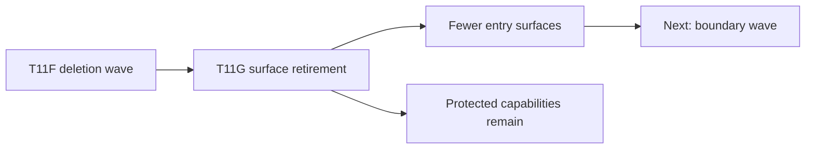
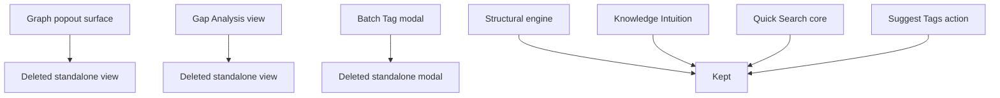
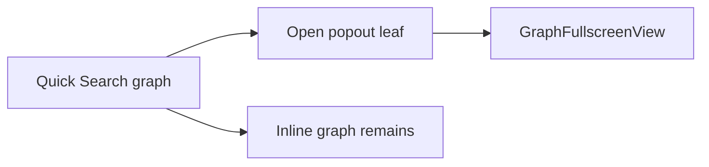
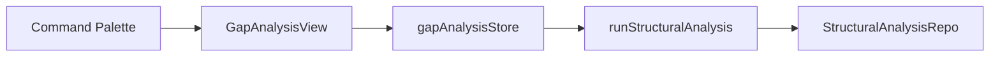
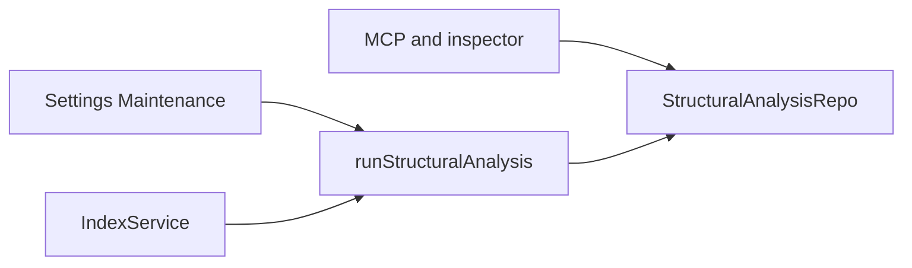
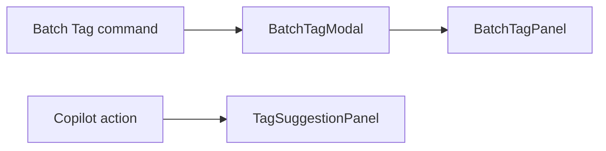

# T11G Owner Review Packet — Single-Prompt Product Surface Retirement

Date: 2026-06-26  
Commit reviewed: `06d9442a` — `refactor(modernization): T11G retire standalone product surfaces`  
Verdict: Accepted

## 1. 一句话结论

T11G 是第一轮真正按 single-prompt mega wave 执行的任务：一次 prompt 内退役 3 个 standalone product surfaces，删除 9 个 `src` 文件，`src` 净减 `1,201` 行，同时没有误删 Structural Hole engine、Knowledge Intuition、Quick Search 核心、Chat、Ambient 或 Command Gateway。

这轮可以接受。它不是深层 service/core 边界重构，而是产品入口和 UI surface 收口：让代码库少一些独立页面、独立命令、独立 modal。

## 2. Review Entry Points

| Review item | Status | Why open it |
| --- | --- | --- |
| This Owner Review Packet | Final | Codex 对 T11G 的接受结论和阅读路径。 |
| `06d9442a` commit diff | Source evidence | 查看真实删除文件和 wiring changes。 |
| `docs/superpowers/refactor-ops/t11g-product-retirement-decision-map.md` | Handoff | 证明 Claude 执行的是 single-prompt DAG 任务。 |
| `docs/manual-testing-checklist.md` | Updated | Gap Analysis / Batch Tag 的旧手测项已改为 retired 状态。 |
| `docs/progress.md` | Updated | T11G 状态和后续方向已记录。 |

## 3. 本轮在大图里的位置



读法：

- T11F 删的是旧 workflow / old onboarding / orphan code。
- T11G 删的是仍有入口但产品价值较弱的 standalone surfaces。
- 下一步如果继续追求优雅度，应该转向 service/core boundary 和 API 灰尘，而不是继续随机删 UI。

## 4. 删除了什么



Deleted source files:

- `src/ui/view/graph-fullscreen/GraphFullscreenView.tsx`
- `src/ui/view/gap-analysis/BridgeNodeList.tsx`
- `src/ui/view/gap-analysis/CommunityMap.tsx`
- `src/ui/view/gap-analysis/GapAnalysisView.tsx`
- `src/ui/view/gap-analysis/GapDetailsSidebar.tsx`
- `src/ui/view/gap-analysis/SuggestedActions.tsx`
- `src/ui/view/gap-analysis/gapAnalysisStore.ts`
- `src/ui/view/copilot/BatchTagModal.tsx`
- `src/ui/view/copilot/panels/BatchTagPanel.tsx`

Modified wiring:

- `src/app/view/types.ts`
- `src/app/view/ViewManager.ts`
- `src/app/commands/Register.ts`
- `src/app/commands/PeakCommandActions.ts`
- `src/ui/view/quick-search/components/V2SourcesView.tsx`
- `test/view-switch-standalone-views.test.ts`

## 5. Before / After

### 5.1 GraphFullscreen



After:

- Quick Search 仍然有 in-place graph view。
- popout leaf / `GraphFullscreenView` 退役。
- `MultiLensGraph.onExpand` 现在没有 caller；这是可选 follow-up，不是 T11G blocking issue。

### 5.2 Gap Analysis



After:



解释：

- 删除的是 Gap Analysis 的独立页面和 palette entry。
- 没删 structural engine、repo、MCP tools、vault digest 读取路径。
- 这是“删 surface，不删 capability”。

### 5.3 Batch Tag



After:

- `BatchTagModal` 和 `BatchTagPanel` 删除。
- `suggest-tags` action 和 `TagSuggestionPanel` 保留。
- Vault Lint 的 `fixActions: ['suggest-tags']` 仍在。

## 6. Code Reading Guide

按这个顺序读最省力：

1. `src/app/view/types.ts`
   - 看 `STANDALONE_PEAK_VIEW_TYPES` 少了 graph fullscreen 和 gap analysis。

2. `src/app/view/ViewManager.ts`
   - 看 `GraphFullscreenView` / `GapAnalysisView` import 和 registration 都消失了。

3. `src/app/commands/Register.ts`
   - 看 palette command 少了 `peak-gap-analysis` 和 `peak-batch-tag`。

4. `src/app/commands/PeakCommandActions.ts`
   - 看 `openGapAnalysis()` / `openBatchTagSuggestions()` 消失。
   - 同时确认 `recomputeGapAnalysis()` 和 `analyzeVaultIntuition()` 仍在。

5. `src/ui/view/quick-search/components/V2SourcesView.tsx`
   - 看 `handleExpand` popout opener 消失。
   - 确认 in-place `MultiLensGraph` 仍渲染。

6. `test/view-switch-standalone-views.test.ts`
   - 看测试从已退役 Gap view 改为仍活着的 Vault X-Ray standalone view。

7. `src/service/search/index/helper/structural/orchestrator.ts`
   - 确认 `runStructuralAnalysis` 仍是 structural engine 入口。

8. `src/core/storage/sqlite/repositories/StructuralAnalysisRepo.ts`
   - 确认 structural data repo 仍在。

9. `src/service/chat/context/slots/VaultIntuitionSlot.ts`
   - 确认 `knowledge_intuition_json` 仍进入 chat context。

## 7. Source Guards

Codex 复跑：

```bash
rg -n "GRAPH_FULLSCREEN_VIEW_TYPE|GraphFullscreenView|graph-fullscreen|GAP_ANALYSIS_VIEW_TYPE|GapAnalysisView|openGapAnalysis|peak-gap-analysis" src test main.ts
rg -n "BatchTagModal|openBatchTagSuggestions|peak-batch-tag" src test main.ts
rg -n "runStructuralAnalysis|StructuralAnalysisRepo|getStructuralAnalysisRepo|find-structural-holes|knowledge_intuition_json" src test main.ts | wc -l
```

Results:

- First sweep: one comment-only hit in `test/view-switch-standalone-views.test.ts`, no live import/use.
- Second sweep: no output.
- Third sweep: `25`, proving protected structural and Knowledge Intuition paths still exist.

## 8. Verification

Codex 复跑：

```bash
npm run build
npm run test -- test/view-switch-standalone-views.test.ts
npm run audit:boundary
```

Results:

- Build: passed.
- View-switch test: passed.
- Boundary audit: 349 findings.

Boundary delta:

| Metric | T11F | T11G | Delta |
| --- | ---: | ---: | ---: |
| Files scanned | 840 | 831 | -9 |
| Total findings | 352 | 349 | -3 |
| service -> ui | 14 | 14 | 0 |
| service -> core | 398 | 398 | 0 |
| service -> app | 56 | 56 | 0 |
| UI Obsidian imports | 83 | 78 | -5 |

Note: This confirms T11G is a surface/code-volume retirement wave, not a service/core boundary wave.

## 9. LOC / Change Size

Codex `git diff --numstat 79947556..06d9442a -- src test`:

| Area | Insertions | Deletions |
| --- | ---: | ---: |
| `src/app/**` wiring | 0 | 45 |
| deleted UI source files | 0 | 1147 |
| `V2SourcesView.tsx` | 0 | 9 |
| test rewrite | 22 | 9 |

Commit stat:

- 15 files changed.
- 22 insertions.
- 1210 deletions.
- `src` net delta: `-1,201`.

## 10. Caveats

Accepted caveats:

- `MultiLensGraph.onExpand` is now unused. This is a small API cleanup candidate, not a behavior risk.
- Historical docs/specs still mention old Gap Analysis / Batch Tag command palette flows. They are history docs and do not need mass rewrite.
- Active checklist/progress docs were updated so they no longer ask the user to verify deleted commands.

Not a caveat:

- `runStructuralAnalysis` still being present is correct.
- `StructuralAnalysisRepo` still being present is correct.
- `KnowledgeIntuitionAgent` still being present is correct.

## 11. Owner Interpretation

This was the right shape for the new workflow.

The important win is not only `-1,201` LOC. The bigger win is process:

- one prompt;
- internal DAG;
- multiple tracks;
- skip rules;
- one final note;
- Codex review after commit.

This should become the default for future architecture waves unless the task is truly risky or blocked on a product decision.

## 12. Next Recommendation

Do not jump to Command Gateway yet.

Recommended next wave:

```text
T11H Single-Prompt Boundary + API Dust Wave
```

Candidate tracks:

1. Remove `MultiLensGraph.onExpand` if no caller remains.
2. Sweep live docs/checklists for retired command references, without rewriting historical specs.
3. Start a larger service/core boundary wave around `service/agents/*`, `service/copilot/actions/index.ts`, and Quick Search report types.

This should again be one mega prompt with internal DAG, not several tiny prompt handoffs.
