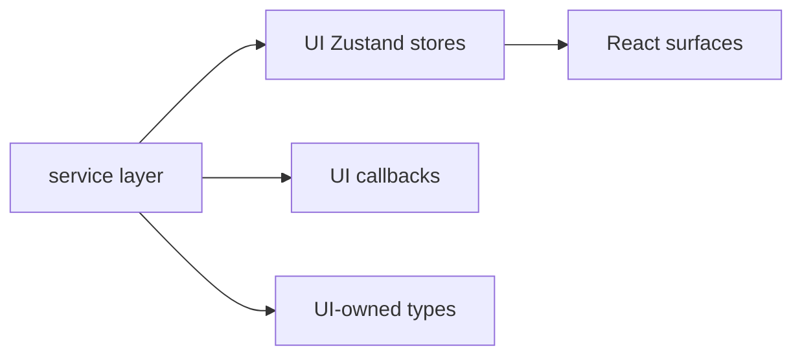
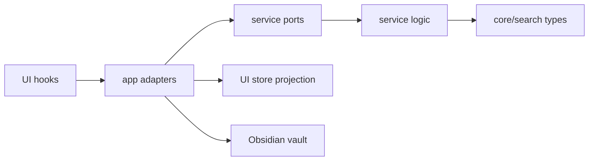
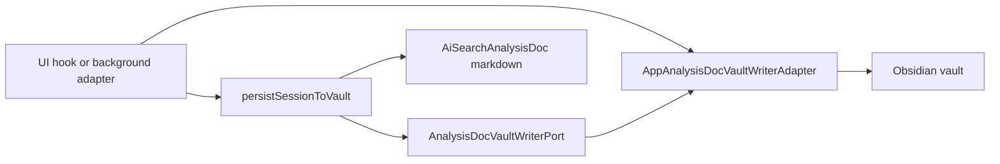
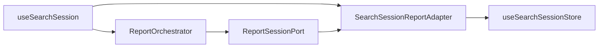
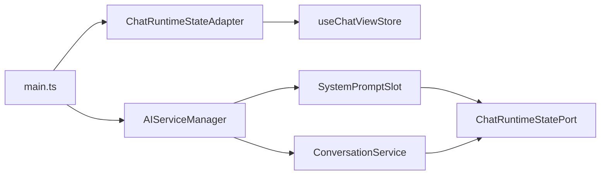
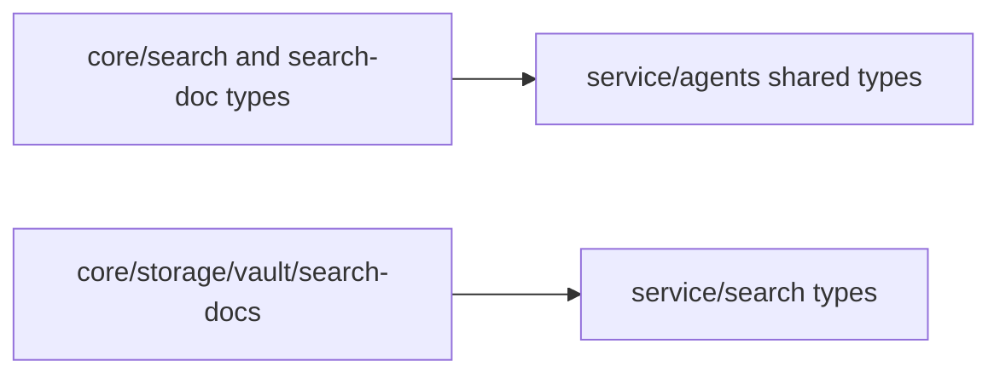

# Owner Review Packet: T11I Hard Service-to-UI Boundary Wave

## Wave Verdict

Wave classification: **Accepted as major wave, with caveat**.

Does this count as a major modernization wave? **Yes**.

Impact Contract:

- Primary target: `service -> ui` reverse imports `10 -> <=2`.
- Actual: `10 -> 0`.
- Required tracks: A, B, C all completed.
- Optional tracks: D and E also completed.
- Minimum acceptable delta: `>=6`; actual delta `-10`.

Owner decision: accept T11I. Do not ask Claude for a review fix unless runtime behavior breaks in manual testing.

Important caveat: T11I removes service/core UI imports, but it does **not** make `core` dependency-pure. Some moved "neutral" types still import `@/service/**`, so `core -> upstream` is now `79` in the audit. This is not a T11I blocker because the hard target was `service -> ui`, but it should shape T11J.

## Review Entry Points

| Review item | Status | Why open it |
| --- | --- | --- |
| This packet | Final | Main owner-facing review. |
| `b1c2fd0f` | Source commit | Claude implementation. |
| `docs/superpowers/refactor-ops/t11i-impact-contract-service-ui-boundary-wave-handoff.md` | Source contract | Shows the target and stop rules. |
| `docs/superpowers/refactor-ops/t11i-readonly-investigation-codex-review.md` | Source correction | Shows the A4 vault-writer correction. |

## What Changed

T11I erased the remaining service-layer imports of UI stores, UI callbacks, and UI display helpers.

Before:

After:

## Key Reading Order

1. `src/service/search/ports/AnalysisDocVaultWriterPort.ts`
   - Inspect `createDoc` and `overwriteDoc`.
   - This is the corrected A4 boundary.

2. `src/app/quick-search/AppAnalysisDocVaultWriterAdapter.ts`
   - Confirms `AppContext`, `TFile`, `app.vault`, folder creation, and filename collision handling live in app.

3. `src/service/search/analysisDocPersistence.ts`
   - Confirms `vaultWriter` is required in options.
   - Confirms no `@/ui/*` imports remain.

4. `src/service/agents/report/ReportSessionPort.ts`, `src/app/quick-search/SearchSessionReportAdapter.ts`, `src/service/agents/report/ReportOrchestrator.ts`
   - Shows `ReportOrchestrator` no longer imports `useSearchSessionStore`.

5. `src/service/chat/ChatRuntimeStatePort.ts`, `src/app/chat/ChatRuntimeStateAdapter.ts`, `src/service/chat/context/slots/SystemPromptSlot.ts`, `src/service/chat/service-conversation.ts`, `src/service/chat/service-manager.ts`
   - Shows chat mode / web search / vault search toggles now flow through a port.

6. `src/core/search/v2SessionTypes.ts`, `src/core/search/sessionSnapshot.ts`, `src/core/storage/vault/search-docs/analysisSnapshotTypes.ts`
   - Read these for type movement.
   - Caveat: some of these still import service types.

7. Tests:
   - `test/service-ui-boundary.test.ts`
   - `test/report-session-port.test.ts`
   - `test/chat-runtime-state-port.test.ts`
   - `test/analysis-doc-persistence-port.test.ts`

## Dependency Maps

### 1. Analysis Doc Persistence

Why this matters:

- Service builds the markdown and records history.
- App adapter owns the vault write side effect.
- No module-level default writer was added.

### 2. Report Generation State

Why this matters:

- The report agent still updates the same UI state.
- The service no longer imports the Zustand store directly.

### 3. Chat Runtime State

Why this matters:

- System prompt capabilities still reflect UI toggles.
- Conversation tool mode still reads the same runtime state.
- Service files no longer import `useChatViewStore`.

### 4. Remaining Caveat

This is the next architectural awkwardness. T11I made the service boundary cleaner but did not make `core` a true bottom layer.

## Verification Run By Codex

| Check | Result |
| --- | --- |
| `npm run build` | Pass |
| `npm run test -- test/analysis-doc-persistence-port.test.ts` | Pass, 10/10 |
| `npm run test -- test/service-ui-boundary.test.ts` | Pass |
| `npm run test -- test/report-session-port.test.ts` | Pass, 6/6 |
| `npm run test -- test/chat-runtime-state-port.test.ts` | Pass, 5/5 |
| `npm run audit:boundary` | Pass; diagnostic output generated |
| `rg -n "from ['\"]@/ui" src/service src/core` | No hits |

Boundary audit after T11I:

| Metric | Before T11I | After T11I | Delta |
| --- | ---: | ---: | ---: |
| Total flagged | 344 | 338 | -6 |
| `service -> ui` | 10 | 0 | -10 |
| `core -> ui` | 4 | 0 | -4 |
| `core -> upstream` category | 77 | 79 | +2 |
| `service -> app` | 56 | 56 | 0 |
| Files scanned | 832 | 844 | +12 |

## Findings

No blocking issue found.

Non-blocking caveat:

- `src/core/search/sessionSnapshot.ts` imports `AnalysisMode` from `@/service/agents/shared-types`.
- `src/core/storage/vault/search-docs/analysisSnapshotTypes.ts` imports several types from `@/service/agents/shared-types` and `@/service/search/types`.
- This is why the implementation note's "core -> upstream ~74" claim is not accurate. Current audit says `79`.

This should be tracked as T11J input, not as a T11I rejection.

## Score

| Group | Score | Reason |
| --- | ---: | --- |
| Control Index | 94 | Clear ports, adapters, and reading path. |
| Boundary Index | 96 | `service -> ui` and `core -> ui` hit zero; core upstream caveat remains. |
| Runtime Truth Index | 93 | No dual runtime path; UI stores remain projection/adapters. |
| Verification Index | 98 | Build, targeted tests, source guards, and boundary audit all pass. |
| Overall | 94 | Major boundary win with one explicit type-ownership caveat. |

## Next Task

Recommended next target: **T11J Core/Service Ownership Correction or Service-App Leak Wave**.

Two credible directions:

- Option A: fix the immediate caveat by moving analysis/search-domain types out of `core` or extracting truly lower-level shared types so `core/search/**` stops importing `@/service/**`.
- Option B: attack the next high-impact metric, `service -> app = 56`, starting with `analysisDocPersistence`, `ReportOrchestrator`, and `SynthesizeAgent` because they are already hot from T11I.

Do not jump to Command Gateway yet. T12 should still wait until the core runtime boundaries are cleaner.

