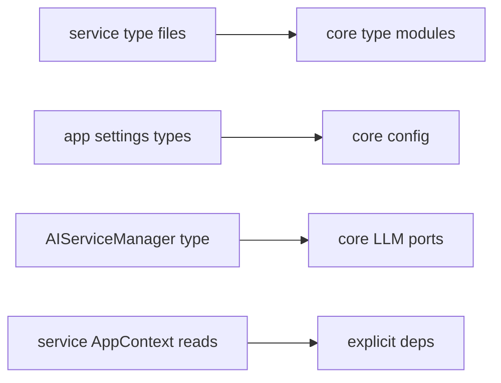
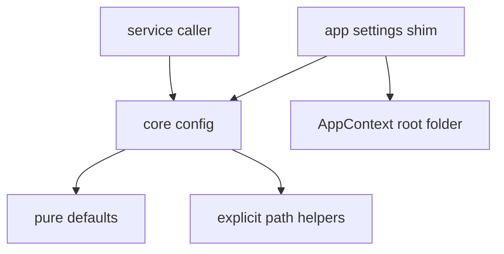
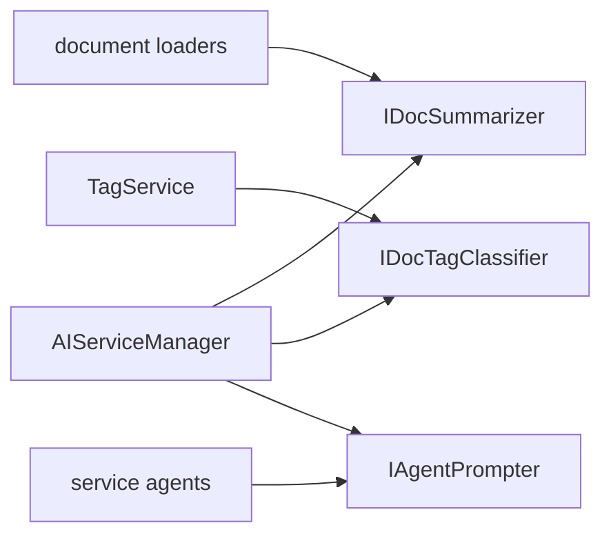
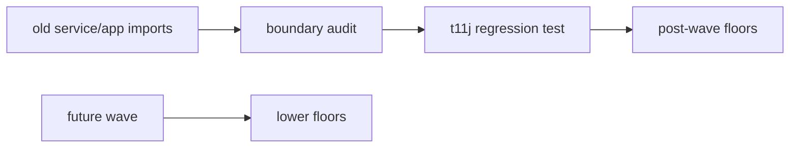
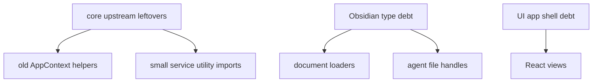
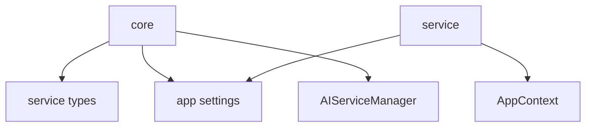
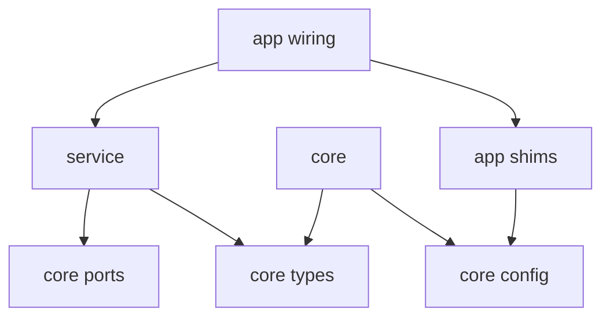
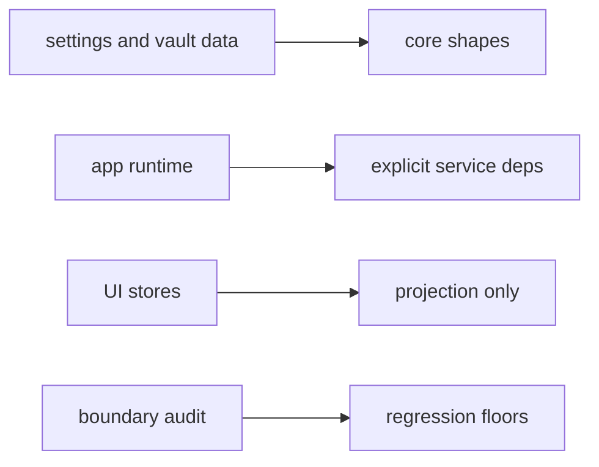

# Owner Review Packet: T11J Combined A+B Mega Wave

Claude Code commit:
- `a14c4135` `refactor(modernization): T11J combined A+B mega wave (338 -> 236)`

Verdict:
- **Accepted as major wave, with caveats**

Owner decision:
- Accept T11J. Do not ask for a review fix unless manual product smoke tests reveal runtime behavior breakage.
- Next architecture wave should target **T11K Obsidian type / file-handle carving** or the remaining core upstream leftovers. Do not jump to Command Gateway yet.

Global position:
- T11J is still foundation work. It does not add a product feature; it makes the codebase more modular by moving pure types/config into core and forcing service code to receive app dependencies explicitly.

## 0. Wave Verdict

Wave classification:
- **Accepted as major modernization wave**

Does this count as a major modernization wave?
- **Yes.**

Impact Contract:
- Primary metric target: `total flagged 338 -> <=230`, hard minimum `<=248`.
- Required bucket targets: `core -> upstream <=30`, `service -> app <=15`.
- Skip budget: no required A/B track may be skipped if the result claims to be T11J major.
- Zero-regression locks: `service -> ui = 0`, `core -> ui = 0`.

Actual outcome, verified by Codex:

| Metric | Before T11J | After T11J | Delta | Contract |
| --- | ---: | ---: | ---: | --- |
| Total flagged | 338 | 236 | -102 | Passed hard minimum, missed stretch target by 6 |
| `core -> upstream` | 79 | 11 | -68 | Passed |
| `service -> app` | 56 | 15 | -41 | Passed exactly |
| `service -> ui` | 0 | 0 | 0 | Lock held |
| `core -> ui` | 0 | 0 | 0 | Lock held |

Why this is accepted:
- `total flagged` did not hit the ideal `<=230`, but it beat the explicit hard floor `<=248` by 12 and moved two primary buckets at once.
- Both bucket-specific targets passed.
- Build, targeted tests, and boundary audit passed.

Important caveats:
- Claude's implementation note overclaimed one source check: `rg "from ['\"]@/app" src/core` is **not** zero. Current audit still lists 5 core -> app edges, including old `AppContext` imports in core utilities.
- Bucket C was intentionally deferred, but current audit says `service/core -> Obsidian types = 81`, not 78. Use 81 as the T11K baseline.
- T11J added neutral core modules and left compatibility shims. This is acceptable here, but later waves should delete or narrow shims when call sites stop needing them.

## 0. Review Entry Points

| Review item | Status | Why open it |
| --- | --- | --- |
| This packet | Final | Codex review, caveats, and reading order. |
| `a14c4135` | Source commit | Real implementation diff. |
| `docs/superpowers/refactor-ops/t11j-big-bucket-boundary-investigation-handoff.md` | Source contract | Shows original T11J target and stop rules. |
| `docs/superpowers/refactor-ops/t11j-readonly-investigation-codex-review.md` | Codex correction | Shows settings split / port / shim requirements. |
| `test/t11j-boundary-regression.test.ts` | Guard | Locks post-T11J floors. |

## 0.5 Code Reading Guide

Read in this order:

| Order | File | What to inspect | Why it matters |
| ---: | --- | --- | --- |
| 1 | `src/core/config/settingsTypes.ts` | Pure settings types and defaults | Shows A2's new source of truth. |
| 2 | `src/core/config/folderPaths.ts` | Explicit-root folder helpers | Confirms core no longer reads current app settings. |
| 3 | `src/app/settings/types.ts` | App-side compatibility wrappers | Confirms `AppContext.getInstance()` stayed app-side. |
| 4 | `src/core/prompt/PromptId.ts` | Prompt IDs and prompt model map inputs | Main A1 type relocation. |
| 5 | `src/core/search/searchTypes.ts`, `src/core/search/indexTypes.ts`, `src/core/types/agents-shared.ts` | Neutral search/agent shapes | Explains the `core -> upstream` drop. |
| 6 | `src/core/llm/IDocSummarizer.ts`, `src/core/llm/IDocTagClassifier.ts`, `src/core/llm/IAgentPrompter.ts` | LLM port split | Confirms no `AIServiceManager` god-port. |
| 7 | `src/service/chat/service-manager.ts`, `src/service/prompt/PromptService.ts` | App wiring and prompter injection | Confirms service no longer reaches AppContext for these paths. |
| 8 | `src/service/search/analysisDocPersistence.ts` | Required injected deps | Confirms T11I port path stayed intact. |
| 9 | `test/t11j-boundary-regression.test.ts` | Regression floors | Shows this is a non-regression guard, not final architecture target. |

Optional / debugging:
- `src/service/chat/types.ts` and `src/service/lint/types.ts`: not pure shims because TFile-bearing or service-runtime context types intentionally remain there.
- `src/core/document/loader/helper/DocumentLoaderHelpers.ts`: still has old AppContext debt; likely T11K/T11L input.

## 0.6 Visual Dependency Maps

### Map 1 — What T11J Moved



Read this as:
- Type ownership moved downward.
- Runtime app lookups moved outward into app wiring or explicit options.
- Core now depends less on service/app concrete modules.

### Map 2 — Settings Split



Why this matters:
- `core/config` is pure and testable.
- The compatibility shim still lets old app/ui callers use the previous API.
- Service code should pass `settings.ai.rootFolder` explicitly instead of reading global runtime state.

### Map 3 — LLM Port Split



Why this matters:
- `core` no longer imports the concrete `AIServiceManager`.
- Agents get a broader port, but it is named honestly and kept separate from document summarization.

### Map 4 — Old Import Path Guard



The guard is intentionally a floor, not the final ideal. The final direction is still fewer upstream imports, not permanent acceptance of 11 core upstream edges.

### Map 5 — Remaining Debt Atlas



Next wave should not treat these as the same problem. The cleanest next cut is likely Obsidian file-handle ports around document loaders.

## 1. One-Sentence Outcome

T11J moved a large amount of pure type/config ownership out of service/app into core, and replaced many service-side app lookups with explicit dependencies, so the codebase now has a much clearer lower layer and fewer hidden AppContext shortcuts.

中文说明:
- 这一轮做了什么: 把类型、默认配置、PromptId、search/index 类型、LLM port 等收敛到 core；把 service 对 app/settings/AppContext 的依赖压低。
- 为什么更可控: 以后看 core 类型和 config 不需要跳到 service/app；service 的部分运行依赖变成参数/port。
- 它没有做什么: 没处理 Obsidian `TFile/App` 抽象，没改 UI 产品体验，没动 Command Gateway。

## 2. Before Dependency Shape



Why this was hard to control:
- 底层 core 反向知道 service/app。
- 纯类型文件和运行时 owner 混在一起。
- 一些 service 行为通过 `AppContext.getInstance()` 隐式拿依赖，Capability Contract 看不见。

## 3. After Dependency Shape



How this lowers change radius:
- 修改 search/chat/usage/lint 的纯类型时，读 `core/**` 起步。
- 修改 app runtime settings wrapper 时，读 `src/app/settings/types.ts`。
- 修改 LLM behavior 时，先看 port surface，再看 `AIServiceManager` implementation。

## 4. State Ownership Map



State truth did not move dramatically in this wave. T11J mainly improved dependency ownership. Runtime state remains owned by existing app/service runtimes from previous waves.

## 5. What Was Verified

Codex reran:

```bash
npm run build
npm run test -- test/t11j-boundary-regression.test.ts
npm run test -- test/service-ui-boundary.test.ts
npm run test -- test/analysis-doc-persistence-port.test.ts
npm run audit:boundary
```

Results:
- Build: passed.
- `t11j-boundary-regression`: passed with `total=236 core->upstream=11 service->app=15 service->ui=0 core->ui=0`.
- `service-ui-boundary`: passed.
- `analysis-doc-persistence-port`: passed.
- Boundary audit: total flagged 236.

Codex source checks:
- `rg -n "from ['\"]@/ui" src/service src/core`: no hits.
- `rg -n "from ['\"]@/app" src/core`: 4 hits, not zero. These are current residual core app imports.
- `rg -n "let\s+current[A-Z]|let\s+default[A-Z].*= null" src/service`: only the known pre-existing `ProgressReporterPort` default reporter matched; no new T11J runtime singleton pattern found.

## 6. Findings

No blocking issue found.

Non-blocking findings:

1. Implementation note overclaimed the core app source check.
   - Current `src/core` still imports app context in:
     - `src/core/document/loader/helper/DocumentLoaderHelpers.ts`
     - `src/core/embeddings/embedClient.ts`
     - `src/core/utils/obsidian-utils.ts`
     - `src/core/utils/vault-utils.ts`
   - This does not reject T11J because the contract target was `core -> upstream <=30`, not zero. But it must be recorded honestly.

2. Obsidian type debt is now 81, not 78.
   - T11J intentionally deferred Bucket C.
   - Use `81` as the T11K starting metric.

3. `service/chat/types.ts` and `service/lint/types.ts` are not pure one-line shims.
   - This is acceptable because TFile-bearing and service-runtime context types remain service-side.
   - It should not become a pattern for duplicating pure types.

## 7. Score

| Group | Score | Reason |
| --- | ---: | --- |
| Control Index | 96 | Reading path is clearer: config/types/ports now have obvious home files. |
| Boundary Index | 97 | Two major buckets moved: `core -> upstream -68`, `service -> app -41`. |
| Runtime Truth Index | 94 | No new runtime path; however this was mostly dependency ownership, not a RunEnvelope/runtime-state wave. |
| Verification Index | 98 | Build, targeted tests, source scan, and audit all pass. |
| Overall | 96 | Major architecture cleanup with honest residual core/AppContext and Obsidian-type caveats. |

## 8. Next Task

Recommended next target: **T11K Obsidian File-Handle / Type Port Investigation**.

T11K should be read-only first, because this debt is wider and riskier than T11J:

- Starting metric: `service/core -> Obsidian types = 81`.
- Main clusters:
  - `src/core/document/loader/*`
  - `src/core/document/resource/*`
  - agent files with type-only `App` / `TFile`
  - `src/core/utils/obsidian-utils.ts` and `src/core/utils/vault-utils.ts`
- Goal: decide whether to extract a neutral `VaultFileRef` / `VaultFileReaderPort` shape or move Obsidian-backed loaders out of `core`.

Do not start Command Gateway yet. T12 should wait until these lower-level file/vault boundaries are less muddy.
