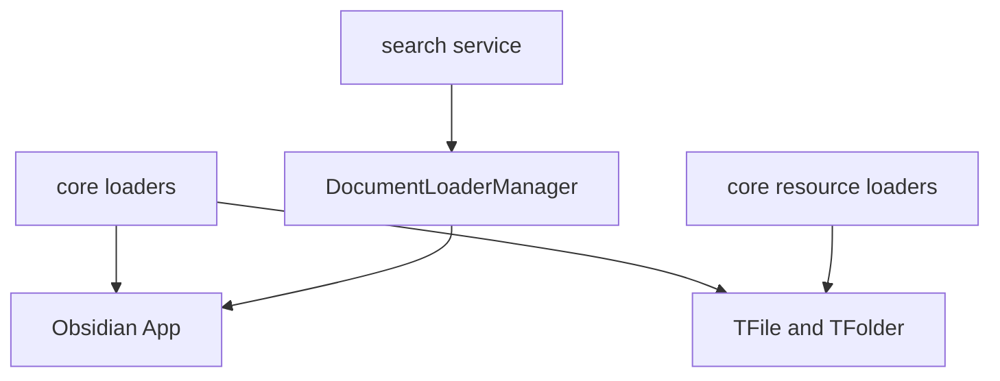
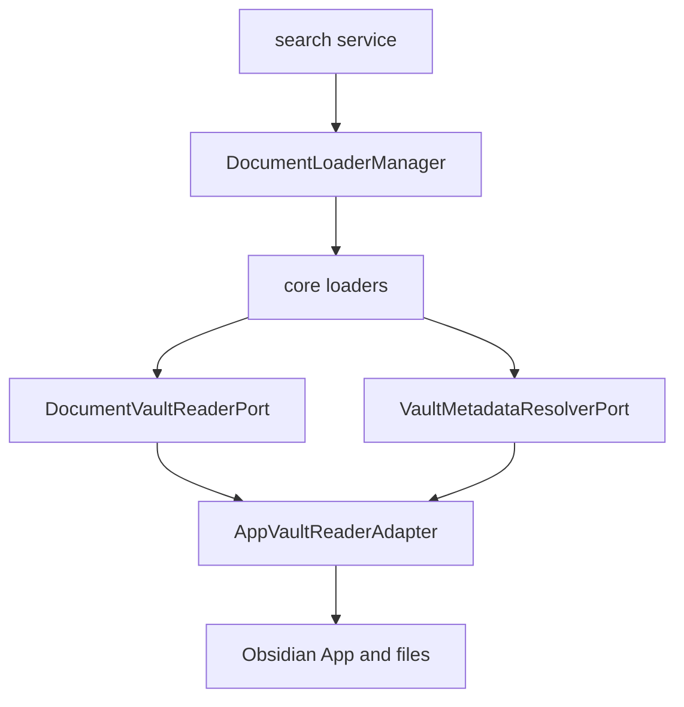
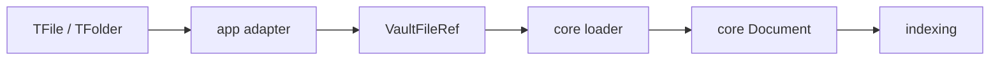
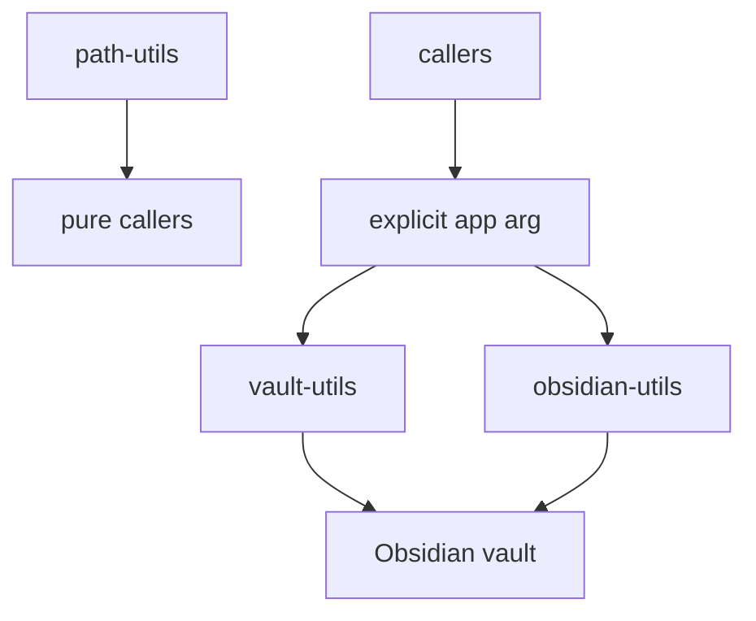
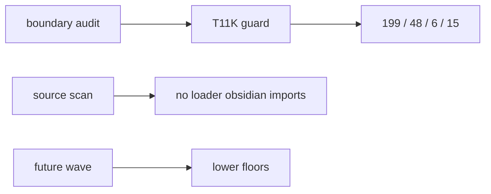
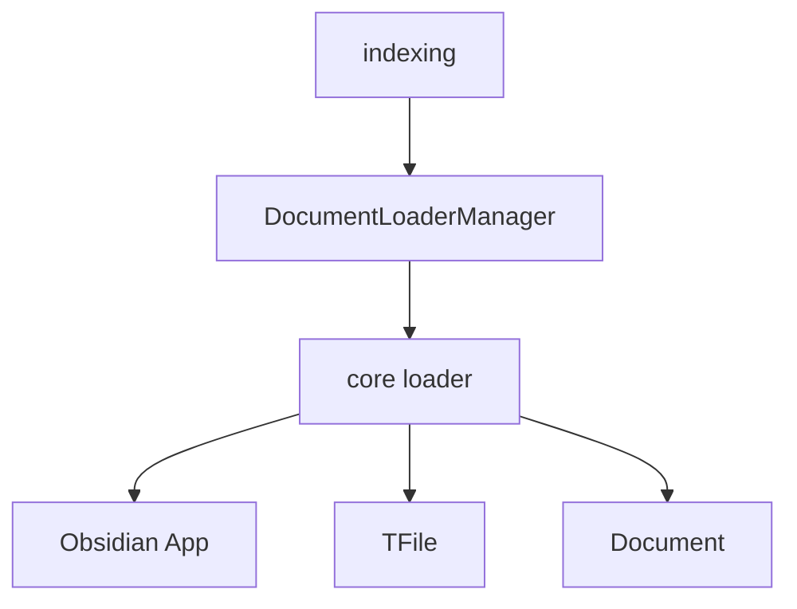
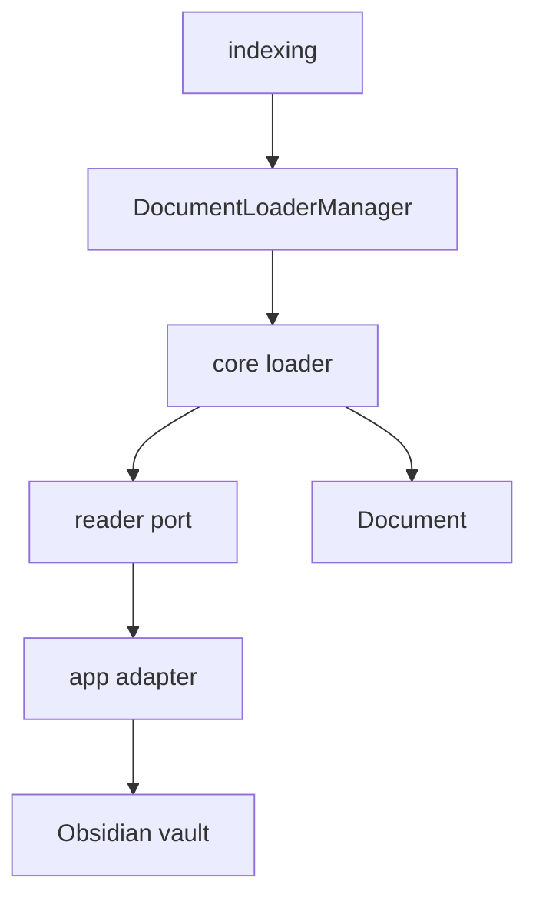
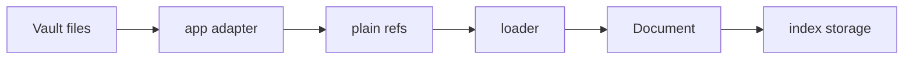
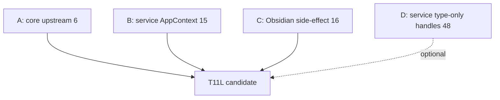

# Owner Review Packet: T11K Obsidian File-Handle Boundary Cut

Claude Code commit:
- `8ad1f78c` `refactor(core): T11K vault-port boundary cut for loaders + core utils`

Verdict:
- **Accepted as major wave, with caveats**

Owner decision:
- Accept T11K. Do not ask for a review fix unless manual indexing/file-loader smoke tests reveal behavior breakage.
- Next architecture wave should target either the remaining `core -> upstream` purity leftovers or the remaining service-side `AppContext` / Obsidian tool cluster. Do not jump to Command Gateway yet.

Global position:
- T11K is still foundation modernization. It does not add a product feature. It makes the document-loading foundation more modular by moving Obsidian concrete file handles behind a narrow app adapter.

## 0. Wave Verdict

Wave classification:
- **Accepted as major modernization wave**

Does this count as a major modernization wave?
- **Yes.**

Impact Contract:
- Primary metric hard minimum: `total flagged <=205`.
- Required bucket hard minimum: `service/core -> Obsidian types <=50`.
- Required secondary hard minimum: `core -> upstream <=8`.
- Zero-regression locks: `service -> app <=15`, `service -> ui = 0`, `core -> ui = 0`.

Actual outcome, verified by Codex:

| Metric | Before T11K | After T11K | Delta | Contract |
| --- | ---: | ---: | ---: | --- |
| Total flagged | 236 | 199 | -37 | Passed hard minimum |
| `service/core -> Obsidian types` | 81 | 48 | -33 | Passed |
| `service/core -> Obsidian side-effect` | 16 | 16 | 0 | Not targeted |
| `core -> upstream` | 11 | 6 | -5 | Passed |
| `service -> app` | 15 | 15 | 0 | Lock held |
| `service -> ui` | 0 | 0 | 0 | Lock held |
| `core -> ui` | 0 | 0 | 0 | Lock held |

Why this is accepted:
- The main targeted bucket moved materially: `Obsidian types 81 -> 48`.
- The implementation obeyed the Codex correction: no broad Vault god-port, no write/delete/event/workspace methods on the loader-facing port, and no raw `TFile` / `TFolder` in neutral file refs.
- Build, boundary audit, and all targeted guard tests passed.

Important caveats:
- `src/core/utils/vault-utils.ts` and `src/core/utils/obsidian-utils.ts` still live in core while holding Obsidian-backed runtime helpers. T11K removed their `AppContext` fallback, but did not relocate them. This is accepted as residual debt, not final architecture.
- `src/core/embeddings/embedClient.ts` now has a module-level `reporter` sink. It is narrow telemetry wiring and not a feature runtime singleton, but it should not become a general pattern.
- The boundary scanner's `AppContext.getInstance` count in core now includes comments, not live executable references. Use import/source checks for actual AppContext leaks.

## 0. Review Entry Points

| Review item | Status | Why open it |
| --- | --- | --- |
| This packet | Final | Codex review, caveats, and reading order. |
| `8ad1f78c` | Source commit | Real implementation diff. |
| `docs/superpowers/refactor-ops/t11k-obsidian-file-handle-boundary-investigation-handoff.md` | Source contract | Shows T11K hard minimum and forbidden scope. |
| `docs/superpowers/refactor-ops/t11k-readonly-investigation-codex-review.md` | Codex correction | Shows the narrow-port and no-god-port constraints. |
| `test/t11k-obsidian-boundary-regression.test.ts` | Guard | Locks post-T11K boundary floors. |

## 0.5 Code Reading Guide

Read in this order:

| Order | File | What to inspect | Why it matters |
| ---: | --- | --- | --- |
| 1 | `src/core/ports/DocumentVaultReaderPort.ts` | `DocumentVaultReaderPort` | The new core-facing contract. Confirm it is read-only and small. |
| 2 | `src/core/ports/VaultFileRef.ts` | `VaultFileRef`, `VaultFolderRef` | Confirms file handles are plain data, not Obsidian objects. |
| 3 | `src/core/ports/VaultMetadataResolverPort.ts` | `resolveLinkPath` | Shows metadata access was split from the file reader port. |
| 4 | `src/app/vault/AppVaultReaderAdapter.ts` | `AppVaultReaderAdapter` | The only new adapter allowed to hold `App` / `TFile` / `TFolder`. |
| 5 | `src/core/document/loader/BaseDocumentLoader.ts` | constructor, `readByPath`, `scanDocuments` | Proves the base loader no longer takes Obsidian `App`. |
| 6 | `src/core/document/loader/MarkdownDocumentLoader.ts` | `readMarkdownFile` | The hardest loader: vault reads and wikilink resolution now go through ports. |
| 7 | `src/core/document/loader/helper/DocumentLoaderManager.ts` | `init`, `registerAllLoaders`, `getVaultReader` | Shows where the 13 loaders receive the same port. |
| 8 | `src/core/document/resource/FolderResourceLoader.ts` and `src/core/document/resource/helper/ResourceKindDetector.ts` | folder/file detection | Confirms resource helpers no longer use `TFolder instanceof` directly. |
| 9 | `src/core/utils/path-utils.ts` | pure path helpers | Shows the pure path helpers split out of Obsidian-backed utils. |
| 10 | `src/core/utils/vault-utils.ts` and `src/core/utils/obsidian-utils.ts` | required `app: App` argument | Confirms `AppContext` fallback was removed, but also shows residual debt. |
| 11 | `src/core/embeddings/embedClient.ts` | `EmbeddingUsageReporter` | Confirms app telemetry is a narrow reporter, not a broad manager. |
| 12 | `test/t11k-obsidian-boundary-regression.test.ts` | regression floors + source scan | Proves the metrics and loader-cluster import boundary are guarded. |

Reading notes:
- Read first: the three files under `src/core/ports/`.
- Then read: `AppVaultReaderAdapter` and `BaseDocumentLoader`.
- Optional / only if debugging: one binary loader such as `ImageDocumentLoader` or `PdfDocumentLoader`.
- Files intentionally not relocated: `ChatStore`, `VaultContentProvider`, SQLite storage.
- If indexing breaks later, open `src/app/vault/AppVaultReaderAdapter.ts` first; it is now the path-to-Obsidian-file resolution point.

## 0.6 Visual Dependency Maps

### Map 1 — Before T11K



Why this was hard to control:
- `core` was not really pure for document loading.
- Loaders directly knew Obsidian file handles.
- Tests had to pretend Obsidian existed or avoid the path entirely.

### Map 2 — After T11K



How to read it:
- The only new concrete Obsidian bridge is the app adapter.
- Core loaders ask for read-only file refs and metadata resolution.
- Service code still receives the same `Document` output.

### Map 3 — File-Handle Ownership



The ownership rule:
- `TFile` / `TFolder` stay inside app adapter internals.
- `VaultFileRef` is plain data.
- `Document` remains the stable output model.

### Map 4 — Core Utils Residual Debt



This is better but not final:
- The hidden `AppContext` fallback is gone.
- Runtime helpers still sit under `core/utils`, so a later storage/app-boundary wave can move them more honestly.

### Map 5 — Guard Map



The guard is a floor, not the final target. Future waves should lower it when they remove more coupling.

## 1. One-Sentence Outcome

T11K replaced direct Obsidian file handles inside the document loader cluster with narrow read-only ports, so document loading is now much easier to reason about, fake, and move without dragging Obsidian through core.

中文说明:
- 这一轮做了什么: 把 13 个 document loader、base loader、manager、resource helper 从 `App/TFile/TFolder` 改为 `DocumentVaultReaderPort` + plain `VaultFileRef`。
- 为什么这让项目更可控: 以后读 loader 时不需要理解 Obsidian object lifecycle；只需要看 port contract 和 app adapter。
- 它没有做什么: 没移动 ChatStore/VaultContentProvider/SQLite，没处理全部 service 里 `TFile/App` type-only import，没做产品功能。

## 2. Before Runtime Path



Before:
- Entry: indexer or document read call.
- Runtime owner: `DocumentLoaderManager`.
- Side effect: each loader reached into `app.vault`.
- Why this was hard to control: every loader had Obsidian concrete types in its signature or implementation.

## 3. After Runtime Path



After:
- Entry: same indexing/read call.
- Runtime owner: still `DocumentLoaderManager`; no second path.
- Side effect boundary: `AppVaultReaderAdapter`.
- How this lowers change radius: a future test or alternate vault can fake the reader port without constructing Obsidian files.

## 4. State Ownership Map



State truth did not move dramatically in T11K. The durable truth remains vault files and index storage. T11K changed the handle boundary, not the persisted state model.

## 5. What Was Verified

Codex reran:

```bash
npm run build
npm run audit:boundary -- --out /tmp/t11k-codex-after.md
npm run test -- test/t11k-obsidian-boundary-regression.test.ts
npm run test -- test/t11j-boundary-regression.test.ts
npm run test -- test/service-ui-boundary.test.ts
npm run test -- test/analysis-doc-persistence-port.test.ts
npm run test -- test/report-session-port.test.ts
npm run test -- test/chat-runtime-state-port.test.ts
```

Results:
- Build: passed.
- Boundary audit: `199 findings`.
- `t11k-obsidian-boundary-regression`: passed with `total=199 obsidian-types=48 core->upstream=6 service->app=15 service->ui=0 core->ui=0`.
- `t11j-boundary-regression`: passed.
- `service-ui-boundary`: passed.
- `analysis-doc-persistence-port`: passed.
- `report-session-port`: passed.
- `chat-runtime-state-port`: passed.

Codex source checks:

```bash
rg -n "from ['\"]obsidian" src/core/document/loader src/core/document/resource
rg -n "from ['\"]@/app" src/core
rg -n "from ['\"]@/ui" src/service src/core
rg -n "\bTFile\b|\bTFolder\b|from ['\"]obsidian" src/core/ports src/core/document/loader src/core/document/resource
```

Results:
- Loader/resource cluster: no `obsidian` imports.
- `src/core`: no real `@/app` imports.
- `src/service` / `src/core`: no UI imports.
- `TFile/TFolder` in core ports/loaders/resources appears only in comments, not executable types/imports.

## 6. Findings

No blocking issue found.

Non-blocking findings:

1. `embedClient` keeps a module-level telemetry reporter sink.
   - File: `src/core/embeddings/embedClient.ts`
   - This is acceptable because the surface is narrow (`EmbeddingUsageReporter`) and optional.
   - It should stay a registration sink, not grow into a general service locator.

2. `vault-utils.ts` and `obsidian-utils.ts` are still Obsidian-backed core infrastructure.
   - T11K removed hidden `AppContext` fallback, which is the important hard stop.
   - Future work can move these helpers into `src/app/vault/**` / `src/app/obsidian/**` if it can avoid raising `service -> app`.

3. Remaining `service/core -> Obsidian types = 48` is now mostly outside loader ownership.
   - Many hits are service agent/search type handles.
   - This is a good input for a later service type-handle wave, but not a T11K blocker.

4. Remaining `core -> upstream = 6` is now small and concrete.
   - Current audit lists `DocumentLoaderManager -> IgnoreService`, `textRank -> segmenter`, `eventBus -> service/chat/types`, `ChatStore -> service/chat/types`, `SearchClickRepo -> porter-stemmer`, and `format-utils -> boolean-expression-parser`.
   - This is probably the cleanest next core-purity wave.

## 7. Score

| Group | Score | Reason |
| --- | ---: | --- |
| Control Index | 97 | Owner can now read one port + one adapter to understand document vault access. |
| Boundary Index | 98 | Loader/resource cluster no longer imports Obsidian; targeted bucket drops 81 -> 48. |
| Runtime Truth Index | 94 | No second loader runtime path was created; manager remains single path. Score capped because old singleton manager pattern remains. |
| Verification Index | 98 | New T11K guard plus T11J/T11I guards passed; source scans confirm no loader Obsidian imports. |
| Overall | 96 | Accepted as a real major boundary wave. Caveats are residual utils placement and telemetry sink shape. |

Confidence: High.

## 8. Next Recommended Move

Recommended next task:
- **T11L Remaining Core Purity + Service AppContext Investigation**

Why:
- After T11K, `total flagged` is 199. The next obvious targets are:
  - `core -> upstream = 6`
  - `service -> app = 15`
  - `service/core -> Obsidian types = 48`
  - `service/core -> Obsidian side-effect = 16`

Do not make the next task a tiny polish. Make it read-only first, with a bigger candidate matrix:



Suggested hard minimum for a real T11L major:
- `total flagged 199 -> <=160`
- `core -> upstream 6 -> <=2`
- `service -> app 15 -> <=8`
- `service/core -> Obsidian side-effect 16 -> <=10`
- `service -> ui = 0`
- `core -> ui = 0`

If Claude cannot find a plan that plausibly hits those numbers in read-only investigation, T11L should not implement yet.

