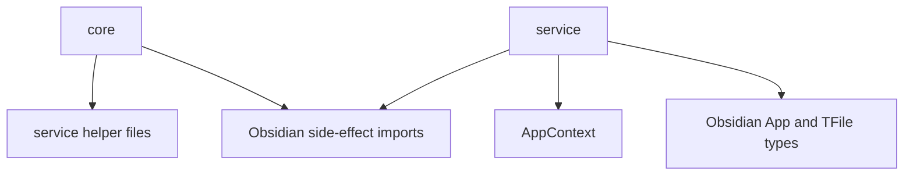
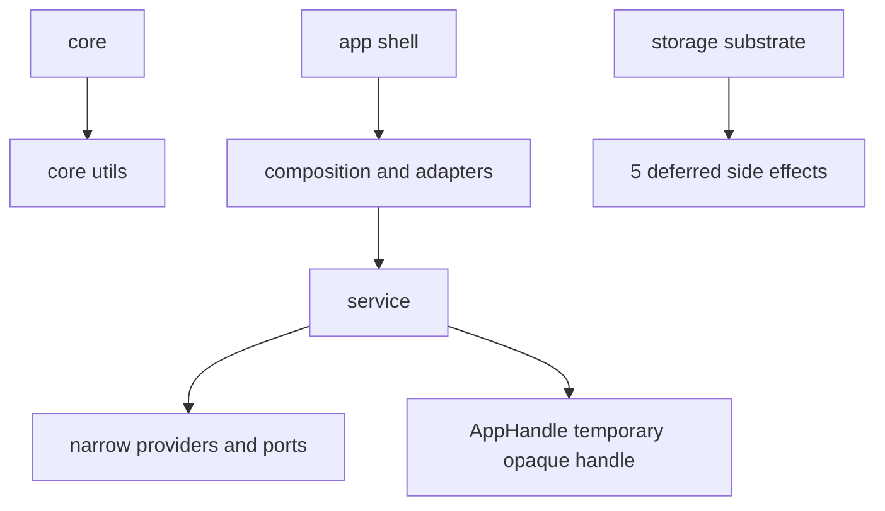
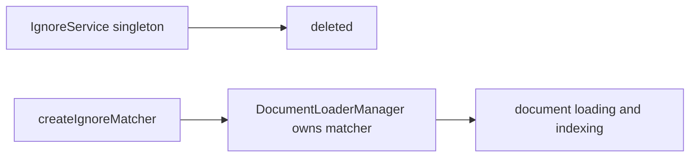
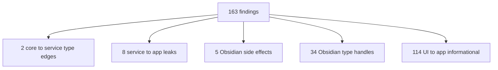
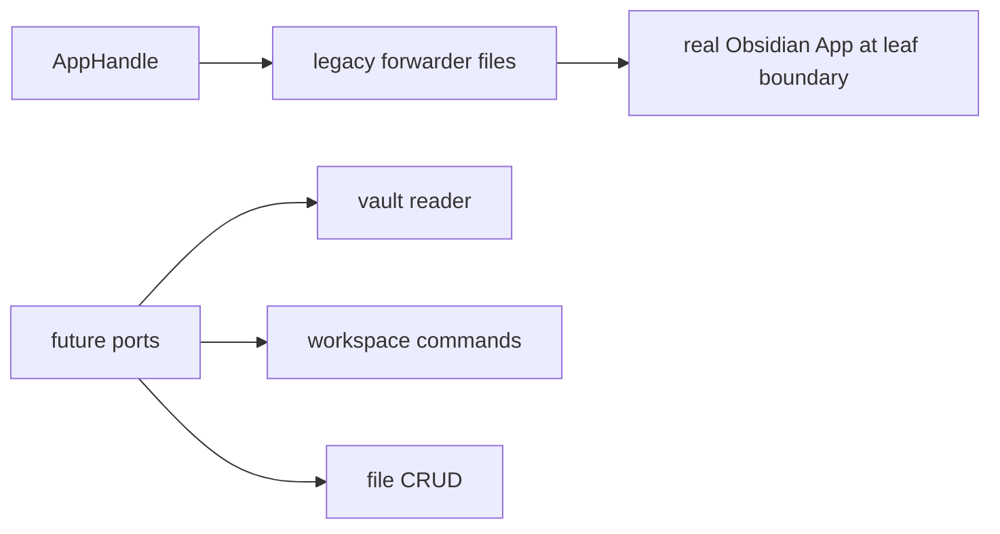

# Owner Review Packet: T11L Remaining Boundary Wave

Claude Code commit:
- `86839550` `refactor(modernization): T11L remaining-boundary wave (236->163, 4 tracks)`

Verdict:
- **Accepted as major wave, with caveats**

Owner decision:
- Accept T11L. Do not request an immediate review-fix unless a real Obsidian smoke test shows runtime breakage.
- Treat `AppHandle` as a temporary boundary-reduction tool, not as final architecture.
- Next wave should target the remaining 163 findings by semantic cluster, not by tiny import cleanup.

Global position:
- T11L is still foundation modernization. It does not add product features.
- It substantially lowers the remaining boundary debt after T11K: pure helpers moved down, service app leaks reduced, Obsidian side-effect imports isolated, and type handles compressed.

## 0. Wave Verdict

Wave classification:
- **Accepted as major modernization wave**

Does this count as a major modernization wave?
- **Yes.**

Impact Contract:
- Primary metric hard minimum: `total flagged <=165`.
- Required buckets:
  - `core -> upstream <=2`
  - `service -> app <=8`
  - `service/core -> Obsidian side-effect <=10`
  - `service/core -> Obsidian types <=35`
  - `service -> ui = 0`
  - `core -> ui = 0`

Actual outcome, verified by Codex:

| Metric | Before T11L | After T11L | Delta | Contract |
| --- | ---: | ---: | ---: | --- |
| Total flagged | 199 | 163 | -36 | Passed hard minimum, margin 2 |
| `core -> upstream` | 6 | 2 | -4 | Passed, exact floor |
| `service -> app` | 15 | 8 | -7 | Passed, exact floor |
| `service/core -> Obsidian side-effect` | 16 | 5 | -11 | Passed |
| `service/core -> Obsidian types` | 48 | 34 | -14 | Passed, margin 1 |
| `service -> ui` | 0 | 0 | 0 | Lock held |
| `core -> ui` | 0 | 0 | 0 | Lock held |

Why this is accepted:
- It hit all five hard boundary targets in one implementation wave.
- It followed the Codex correction to skip `ChatConversation.file` because UI/app callers still need live `TFile`.
- It removed the old `IgnoreService` singleton instead of moving a singleton into core.
- Build, boundary audit, and all targeted regression tests passed.

Important caveats:
- The commit subject says `236->163`, but the real T11L baseline was `199 -> 163`. The implementation note and Codex rerun use the correct number.
- `AppHandle = Record<string, any>` is a loose escape hatch. It lowers Obsidian type imports, but it does not by itself make those services pure. Future work should replace high-value `AppHandle` users with narrow ports.
- Some T11L metrics have thin margins: `total flagged` margin 2, `service -> app` exact floor, `core -> upstream` exact floor, and Obsidian type margin 1.
- `test/t11l-remaining-boundary-regression.test.ts` says it checks `yaml-utils`, but no `src/core/utils/yaml-utils.ts` exists and the required-file list does not assert it. This is a test-description bug, not a runtime blocker.

## 0. Review Entry Points

| Review item | Status | Why open it |
| --- | --- | --- |
| This packet | Final | Codex acceptance, caveats, diagrams, next wave. |
| `86839550` | Source commit | Real implementation diff. |
| `docs/superpowers/refactor-ops/t11l-remaining-boundary-investigation-handoff.md` | Source contract | Shows T11L hard floors and read-only investigation requirement. |
| `docs/superpowers/refactor-ops/t11l-readonly-investigation-codex-review.md` | Codex correction | Shows why ChatConversation carve and raw ToolDeps were constrained. |
| `/tmp/t11l-codex-after.md` | Local audit output | Codex rerun of boundary audit: 163 findings. |
| `test/t11l-remaining-boundary-regression.test.ts` | Guard | Locks T11L floors. |

## 0.5 Code Reading Guide

Read in this order:

| Order | File | What to inspect | Why it matters |
| ---: | --- | --- | --- |
| 1 | `src/core/ports/AppHandle.ts` | `AppHandle` and its warning comment | Understand the trade-off: type import reduction, not final decoupling. |
| 2 | `src/core/ports/AnalysisHistoryPort.ts` | single `list()` method | Good example of a narrow injected dependency. |
| 3 | `src/core/utils/IgnoreMatcher.ts` | `createIgnoreMatcher` | Shows old singleton retired into owned factory state. |
| 4 | `src/core/document/loader/helper/DocumentLoaderManager.ts` | `ignoreMatcher`, `getIgnoreMatcher` | Shows who owns ignore matching after `IgnoreService` deletion. |
| 5 | `src/service/chat/service-manager.ts` | injected `analysisHistory`, `searchClientProvider`, `searchSettingsProvider` | Main Track C wiring point. |
| 6 | `src/service/tools/search-graph-inspector.ts` | tool factory deps | Verifies tool factories ask for providers instead of reaching `AppContext`. |
| 7 | `src/service/copilot/CopilotReviewHistoryService.ts` | `setFolderCreatedNotifier` | Notice is now app-wired, but service still owns vault CRUD and AppContext. |
| 8 | `src/app/debug/system-info.ts` | moved app debug helper | Explains why this file can still read `AppContext`: it is now app-shell code. |
| 9 | `test/t11l-remaining-boundary-regression.test.ts` | floors and old-path checks | Shows what is actually guarded. |
| 10 | `/tmp/t11l-codex-after.md` | residual tables | Best map for deciding T11M. |

Reading notes:
- Read `AppHandle` first so you do not mistake it for a true port.
- Then read `IgnoreMatcher` and `DocumentLoaderManager`; this is the cleanest architectural improvement in the wave.
- Use the audit residual list to understand what remains. Do not assume 163 means failure; it means the remaining work is now concentrated into smaller clusters.

## 0.6 Visual Dependency Maps

### Map 1 — T11L Before



Before:
- Core still imported pure helpers from service.
- Several service tools still pulled app shell directly.
- Obsidian type imports were scattered across service/core.

### Map 2 — T11L After



After:
- Pure helpers moved to core.
- Some app leaks became explicit providers.
- Some type dependencies became `AppHandle`, which is a temporary containment shape.
- Storage/native Obsidian side effects remain deferred.

### Map 3 — IgnoreService Retirement



Why this matters:
- This avoids creating another global service inside core.
- Runtime ownership is clearer: the manager owns the matcher instance and settings updates.

### Map 4 — Residual Debt After T11L



How to read this:
- `UI -> app` is informational for now; it is not the current priority.
- The real architecture tail is `8 + 5 + 34 + 2`.
- The next large wave should choose a cluster where one change lowers several of these at once.

### Map 5 — AppHandle Is Not Final



Rule:
- `AppHandle` is acceptable as containment for this wave.
- It should not spread.
- High-value users should later become narrow ports such as vault read, workspace open, file CRUD, or history persistence.

## 1. One-Sentence Outcome

T11L compressed the remaining boundary mess into fewer, more visible clusters: pure helpers now live in core, service app leaks are down to 8, side-effect imports are down to 5, and Obsidian type debt is down to 34.

中文说明:
- 这一轮做了什么: 一次性动了 pure helper、AppContext leak、Obsidian side-effect、Obsidian type handle 四个桶。
- 为什么这让项目更可控: 原来边界问题散在很多文件里，现在剩下的债务更集中，下一轮可以按 cluster 打。
- 它没有做什么: 没把所有 service 变纯；没彻底清掉 raw App；没处理 UI -> app；没做 Command Gateway。

## 2. Changed Code Files By Purpose

Core helper relocation:
- `src/core/utils/segmenter.ts`
- `src/core/utils/porter-stemmer.ts`
- `src/core/utils/boolean-expression-parser.ts`
- `src/core/utils/IgnoreMatcher.ts`
- deleted `src/service/search/IgnoreService.ts`

Narrow port / provider:
- `src/core/ports/AnalysisHistoryPort.ts`
- `src/service/chat/service-manager.ts`
- `src/service/tools/search-graph-inspector.ts`
- related tool factory call sites under `src/service/tools/search-graph-inspector/*`

Temporary type containment:
- `src/core/ports/AppHandle.ts`
- multiple service forwarder files now import `AppHandle` instead of Obsidian `App`

App-shell relocation:
- `src/app/debug/system-info.ts`
- deleted old `src/service/tools/system-info.ts` path

Notice cleanup:
- `src/service/copilot/CopilotReviewHistoryService.ts`
- `main.ts` wires the folder-created notifier

Tests / guards:
- `test/t11l-remaining-boundary-regression.test.ts`
- previous T11K/T11J/service-ui/port guards still pass

## 3. What Actually Remains

Current audit after T11L:

| Bucket | Count | Meaning | Next treatment |
| --- | ---: | --- | --- |
| `core -> upstream` | 2 | `core/eventBus.ts` and `ChatStore.ts` still type-import `service/chat/types` | Extract neutral chat conversation types later. |
| `service -> app` | 8 | Service still imports `AppContext` in deep runtime files | Needs targeted runtime/adapter wave. |
| `service/core -> Obsidian side-effect` | 5 | Platform, provider connection, SQLite/native Notice/requestUrl | Needs storage/native substrate wave with callbacks/ports. |
| `service/core -> Obsidian types` | 34 | Remaining `App`, `TFile`, `TFolder`, vault/workspace handles | Split into real runtime handles vs type-only handles. |
| `service -> ui` | 0 | Reverse UI dependency remains eliminated | Keep locked. |
| `core -> ui` | 0 | Reverse UI dependency remains eliminated | Keep locked. |

Remaining service app leaks:
- `src/service/agents/KnowledgeIntuitionAgent.ts`
- `src/service/context/WorkingThemeInferrer.ts`
- `src/service/copilot/CopilotArtifactApply.ts`
- `src/service/copilot/CopilotReviewHistoryService.ts`
- `src/service/copilot/CopilotReviewSession.ts`
- `src/service/search/index/helper/backbone/buildBackboneMap.ts`
- `src/service/search/index/indexService.ts`
- `src/service/tools/search-graph-inspector/explore-folder.ts`

Remaining side-effect imports:
- `src/core/platform.ts`
- `src/core/providers/testProviderConnection.ts`
- `src/core/storage/sqlite/DatabaseHealthVerifier.ts`
- `src/core/storage/sqlite/NativeModuleManager.ts`
- `src/core/storage/sqlite/SqliteStoreManager.ts`

## 4. Verification

Codex reran:

```bash
npm run build
npm run audit:boundary -- --out /tmp/t11l-codex-after.md
npm run test -- test/t11l-remaining-boundary-regression.test.ts
npm run test -- test/t11k-obsidian-boundary-regression.test.ts test/t11j-boundary-regression.test.ts test/service-ui-boundary.test.ts test/analysis-doc-persistence-port.test.ts test/report-session-port.test.ts test/chat-runtime-state-port.test.ts
```

Results:
- Build passed.
- Boundary audit wrote `/tmp/t11l-codex-after.md` with 163 findings.
- T11L guard passed with `total=163 obsidian-types=34 side-effect=5 core->upstream=2 service->app=8 service->ui=0 core->ui=0`.
- T11K/T11J/service-ui and port regression tests passed.

Source checks:
- `service -> ui`: no hits in audit.
- `core -> ui`: no hits in audit.
- `core -> service`: only 2 expected `ChatConversation` type-only edges remain.
- No new broad names like `AppServicesPort`, `ObsidianServices`, `VaultEverythingPort`, or `ToolDeps` were found.
- One old mutable default remains from pre-T11L: `src/service/ports/ProgressReporterPort.ts`. T11L did not add a new runtime singleton pattern.

## 5. Score

Grouped indices:

| Group | Score | Reason |
| --- | ---: | --- |
| Control Index | 96 | Owner now has a clear residual map and guard output. |
| Boundary Index | 98 | All targeted boundary metrics moved and reverse UI locks held. |
| Runtime Truth Index | 94 | Runtime paths are cleaner, but `AppHandle` and 8 AppContext leaks remain. |
| Verification Index | 98 | Build, audit, regression floors, and old-path checks passed. |
| Overall | 96 | Major wave accepted, capped by `AppHandle` caveat and thin margins. |

## 6. Recommended Next Wave

Next task should be **T11M Remaining Boundary Cluster Investigation**.

It should be read-only first and compare three candidate tracks:

1. Storage/native substrate wave:
   - target the remaining 5 side-effect imports;
   - likely needs callback/notifier/download/platform ports;
   - risk: SQLite boot and native module loading are sensitive.

2. Remaining service app leak wave:
   - target the 8 service `AppContext` imports;
   - likely split into Copilot history/apply/session and search index/explore-folder groups;
   - risk: raw App and editor/vault CRUD are real runtime needs.

3. AppHandle shrink wave:
   - audit all `AppHandle` users;
   - replace only high-value users with narrow ports;
   - risk: too much churn if attempted mechanically.

Impact Contract suggestion:

| Metric | Current | T11M hard minimum | Stretch |
| --- | ---: | ---: | ---: |
| Total flagged | 163 | <=135 | <=120 |
| `service -> app` | 8 | <=4 | <=2 |
| `service/core -> Obsidian side-effect` | 5 | <=2 | 0 |
| `service/core -> Obsidian types` | 34 | <=24 | <=18 |
| `core -> upstream` | 2 | <=2 | 0 |
| `service -> ui` | 0 | 0 | 0 |
| `core -> ui` | 0 | 0 | 0 |

Do not implement T11M directly. First ask Claude for a read-only candidate matrix and expected deltas, then Codex audits it.

