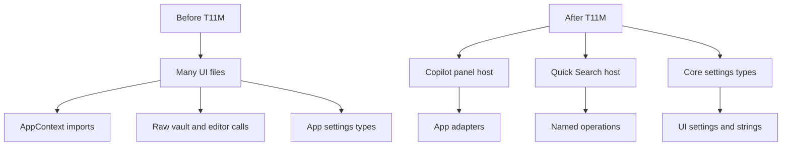
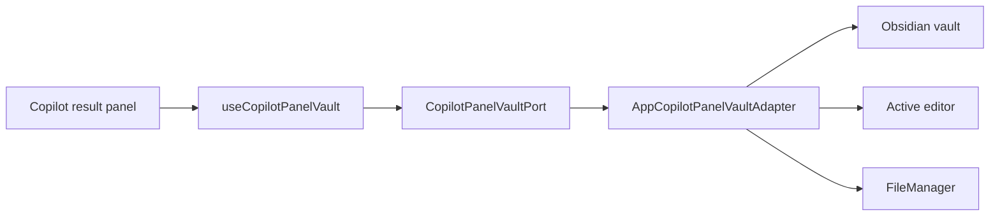
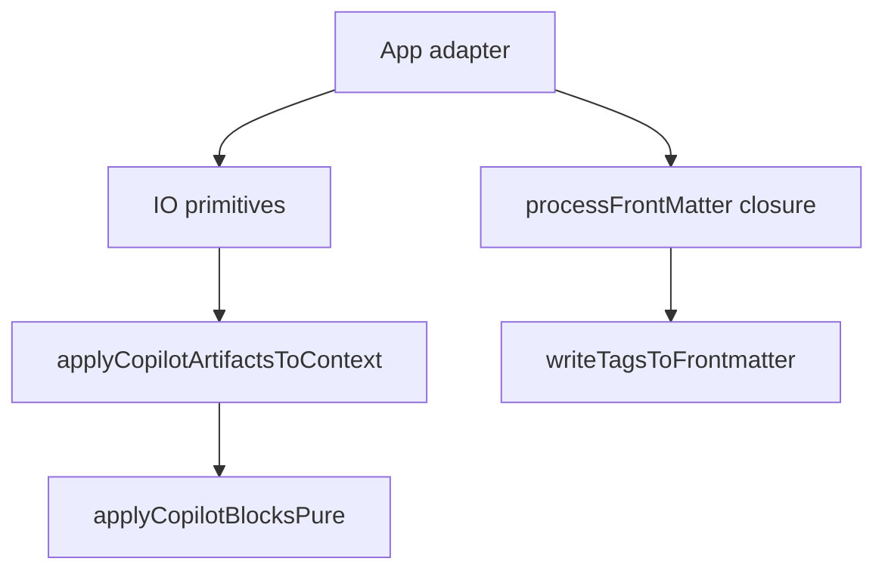
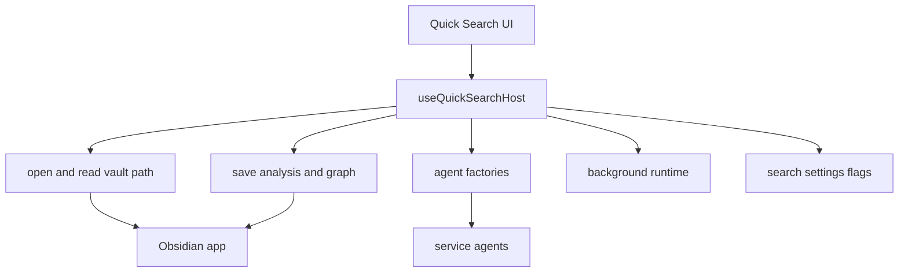
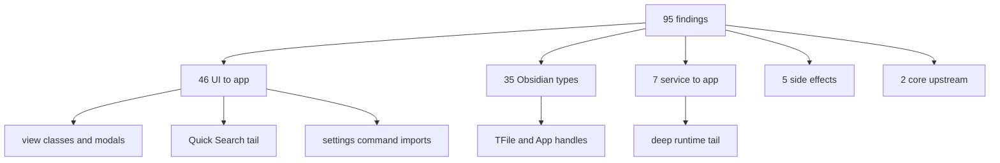

# Owner Review Packet: T11M UI to App Boundary Wave

Claude Code commit:
- `62a39991` `refactor(t11m): UI -> app boundary wave (5 tracks, 88 files)`

Verdict:
- **Accepted as major wave, with caveats**

Owner decision:
- Accept T11M. Do not request an immediate review-fix unless real Obsidian smoke testing shows a Copilot panel or Quick Search regression.
- Treat the new Quick Search host and Copilot panel ports as boundary concentration points, not as final architecture purity.
- The next wave should classify the remaining 95 findings by bucket and owner intent before implementing. Do not blindly chase the total number.

Global position:
- T11M is still architecture modernization, not product feature work.
- It attacks the largest remaining informational bucket after T11L: `UI -> app`.
- It does not finish all UI cleanup. It makes the most common UI app-shell usage easier to understand, fake, and guard.

## 0. Wave Verdict

Wave classification:
- **Accepted as major modernization wave**

Does this count as a major modernization wave?
- **Yes.**

Impact Contract:
- Primary metric hard minimum: `total flagged <=130`.
- Required buckets:
  - `UI -> app <=80`
  - direct UI `AppContext` import files `<=55`
  - `UI -> @/app/settings/types = 0`
  - `service -> app <=8`
  - `service -> ui = 0`
  - previous T11K/T11L Obsidian floors still hold

Actual outcome, verified by Codex:

| Metric | Before T11M | After T11M | Delta | Contract |
| --- | ---: | ---: | ---: | --- |
| Total flagged | 163 | 95 | -68 | Passed, margin 35 |
| `UI -> app` | 114 | 46 | -68 | Passed, margin 34 |
| Direct UI `AppContext` import files | 87 | 33 | -54 | Passed, margin 22 |
| `UI -> @/app/settings/types` | 15 | 0 | -15 | Passed exactly |
| `service -> app` | 8 | 7 | -1 | Passed |
| `service -> ui` | 0 | 0 | 0 | Lock held |
| `core -> upstream` | 2 | 2 | 0 | Lock held |
| `service/core -> Obsidian side-effect` | 5 | 5 | 0 | Lock held |
| `service/core -> Obsidian types` | 34 | 35 | +1 | Still within T11L floor |

Why this is accepted:
- It moved the biggest remaining bucket materially: `UI -> app` dropped from 114 to 46.
- Copilot result panels no longer perform raw vault/editor writes from `src/ui/view/copilot/panels/*`.
- Quick Search now has a single named-operation host hook instead of many direct `AppContext.getInstance()` reads.
- UI settings imports moved from app settings types to core config settings types.
- Build, boundary audit, T11M regression guard, and previous T11I/T11J/T11K/T11L guards all passed.

Important caveats:
- This is not a full UI purity pass. The audit still reports 46 `UI -> app` edges and 33 UI files importing `AppContext`.
- `useQuickSearchHost()` is a containment boundary. It still closes over `app`, `manager`, `plugin`, `searchClient`, and selected `AppContext` static access internally.
- `ServiceContext` still exposes raw `app`. T11M reduced high-frequency misuse but did not remove that escape hatch.
- `TemplateManager.setInstance()` is a new process-wide static singleton. It is useful as a compatibility bridge away from `AppContext`, but it should not become a pattern for more service/core globals.
- The T11M guard comment says Quick Search raw writes/openLinkText should route through `useQuickSearchHost`, but the actual source guard only forbids `AppContext.getInstance().app.*` leaks. Injected `app` helper calls still remain and are counted as residual raw UI operations.
- `CopilotPanelPorts.ts` still uses Obsidian `TFile` types. That is acceptable for this wave because existing Copilot `DocumentContext` still carries `TFile`, but it is not the final neutral file-handle shape.

## 0. Review Entry Points

| Review item | Status | Why open it |
| --- | --- | --- |
| This packet | Final | Codex acceptance, caveats, diagrams, next wave. |
| `62a39991` | Source commit | Real implementation diff. |
| `docs/superpowers/refactor-ops/t11m-ui-app-boundary-investigation-handoff.md` | Source contract | Shows T11M target buckets and hard floors. |
| `docs/superpowers/refactor-ops/t11m-readonly-investigation-codex-review.md` | Codex correction | Shows why god hooks and raw `obsidianApp` host returns were forbidden. |
| `/tmp/t11m-codex-after.md` | Local audit output | Codex rerun of boundary audit: 95 findings. |
| `test/t11m-ui-app-boundary-regression.test.ts` | Guard | Locks T11M floors and source invariants. |

## 0.5 Code Reading Guide

Read in this order:

| Order | File | What to inspect | Why it matters |
| ---: | --- | --- | --- |
| 1 | `test/t11m-ui-app-boundary-regression.test.ts` | floors and source guards | Understand exactly what is locked and what is not locked. |
| 2 | `src/service/copilot/panels/CopilotPanelPorts.ts` | `CopilotPanelVaultPort`, `CopilotPanelNavigator` | Shows the new named-operation surface for Copilot result panels. |
| 3 | `src/app/copilot/panels/AppCopilotPanelVaultAdapter.ts` | raw `app.vault`, editor, fileManager operations | Confirms Obsidian writes now live in app adapter, not panel UI. |
| 4 | `src/app/copilot/panels/AppCopilotPanelNavigatorAdapter.ts` | settings and picker modal openers | Shows navigation separated from vault/editor writes. |
| 5 | `src/app/copilot/panels/composeCopilotPanelVault.ts` | app composition function | Shows where the two Copilot adapters are bundled. |
| 6 | `src/ui/view/copilot/hooks/useCopilotPanelVault.ts` | hook return shape | Shows what Copilot panels are allowed to consume. |
| 7 | Pick one panel, for example `src/ui/view/copilot/panels/ContinueWritingPanel.tsx` | calls to `vault.appendToFile` | Confirms a panel uses the port instead of raw app. |
| 8 | `src/service/copilot/CopilotArtifactApply.ts` | `ApplyCopilotArtifactsOps`, `applyCopilotBlocksPure` | Confirms service helper is now IO-primitive driven. |
| 9 | `src/service/copilot/frontmatterTagWriter.ts` | `ProcessFrontMatterOp` | Confirms frontmatter write service no longer receives raw App. |
| 10 | `src/ui/view/quick-search/hooks/useQuickSearchHost.ts` | Quick Search host surface | Shows the main containment boundary for Quick Search app/service access. |
| 11 | `src/ui/context/ServiceContext.tsx` | remaining raw `app` and `copilotPanelVault` publication | Understand the shared React service bridge and its caveat. |
| 12 | `src/core/template/TemplateManager.ts` | static `setInstance/getInstance` | Understand the Track E trade-off away from UI `AppContext` imports. |
| 13 | `/tmp/t11m-codex-after.md` | residual tables | Use this to decide T11N. |

Reading notes:
- Start with the guard, not the adapter. It tells you what "done" means for this wave.
- Then read Copilot panel flow. It is the cleanest win in T11M.
- Read Quick Search after that. It is more complex and should be understood as containment, not complete purification.
- Finish with the audit residual list. That is the map for the next wave.

## 0.6 Visual Dependency Maps

### Map 1: T11M Overall Boundary Move



How to read this:
- T11M did not make UI independent from app.
- It moved many scattered edges into fewer named host/adaptor boundaries.
- The important improvement is concentration plus guards, not total purity.

### Map 2: Copilot Panel Write Flow



What changed:
- Panels now call methods like `appendToFile`, `applyArtifacts`, `writeFrontmatterTags`, and `openNote`.
- The adapter owns raw `app.vault`, `workspace.activeEditor`, and `fileManager.processFrontMatter`.
- `src/ui/view/copilot/panels/*` has 0 raw vault/editor ops after T11M.

### Map 3: Copilot Service Helper Split



Why this matters:
- The text transform is service-pure and testable.
- The Obsidian IO lives at the app boundary.
- This is the right shape for future fake-port tests.

### Map 4: Quick Search Containment



How to read this:
- UI should call named operations on `host`.
- `host` still closes over raw app/service dependencies internally.
- This is a stepping stone toward app-owned Quick Search adapters, not the endpoint.

### Map 5: Residual Debt After T11M



How to read this:
- `95` is now small enough to classify manually.
- `UI -> app` is still the biggest bucket.
- The next wave should decide which residual edges are legitimate app-shell view wrappers and which should move behind ports.

## 1. One-Sentence Outcome

T11M turns the largest remaining UI boundary problem from many scattered `AppContext` and raw vault/editor accesses into two named host surfaces plus core settings types, dropping the audit from 163 to 95.

中文说明:
- 这一轮做了什么: 把 Copilot result panels 和 Quick Search 的 UI 直接依赖收口。
- 为什么这让项目更可控: 以后读 Copilot panel 不用到处找 `AppContext.getInstance().app.vault`，先读 port 和 adapter 就能理解写入边界。
- 它没有做什么: 没把所有 UI view/modal 都和 AppContext 解耦；没删除 `ServiceContext.app`；没完成 Quick Search 最终 ports；没处理 Chat 或 Command Gateway。

## 2. Changed Code Files By Purpose

Copilot panel port and app adapters:
- `src/service/copilot/panels/CopilotPanelPorts.ts`
- `src/app/copilot/panels/AppCopilotPanelVaultAdapter.ts`
- `src/app/copilot/panels/AppCopilotPanelNavigatorAdapter.ts`
- `src/app/copilot/panels/composeCopilotPanelVault.ts`
- `src/ui/view/copilot/hooks/useCopilotPanelVault.ts`

Copilot panels and sibling modals:
- `src/ui/view/copilot/panels/*Panel.tsx`
- `src/ui/view/copilot/CopilotAutoRunModal.tsx`
- `src/ui/view/copilot/CopilotPickerModal.tsx`
- `src/ui/view/copilot/CopilotResultModal.tsx`
- `src/ui/view/copilot/CopilotReviewHistoryModal.tsx`
- `src/ui/view/copilot/review/SourcesArtifactPanel.tsx`

Service helper IO split:
- `src/service/copilot/CopilotArtifactApply.ts`
- `src/service/copilot/frontmatterTagWriter.ts`

Quick Search host containment:
- `src/ui/view/quick-search/hooks/useQuickSearchHost.ts`
- many Quick Search hooks/components now read from the host instead of direct `AppContext`

Settings/template cleanup:
- UI settings/string callers moved away from `@/app/settings/types`
- `src/core/config/settingsTypes.ts` is now the type source for UI settings shapes
- `src/core/template/TemplateManager.ts` exposes static instance binding for template-backed UI strings
- `main.ts` binds and clears `TemplateManager`

Shared React bridge:
- `src/ui/context/ServiceContext.tsx`

Tests / guards:
- `test/t11m-ui-app-boundary-regression.test.ts`

## 3. What Actually Remains

Current audit after T11M:

| Bucket | Count | Meaning | Next treatment |
| --- | ---: | --- | --- |
| `UI -> app` | 46 | Remaining view/modal/context/command bridge imports | Classify into legitimate app-shell view wrappers vs removable UI logic. |
| `service/core -> Obsidian types` | 35 | Remaining `TFile`, `App`, vault-backed helpers | Continue narrow file-handle and app-handle carving only where it reduces real ownership. |
| `service -> app` | 7 | Deep services still import `AppContext` | Tackle by subsystem, not one-file micro edits. |
| `service/core -> Obsidian side-effect` | 5 | Storage/native/provider platform side effects | Likely needs substrate-specific decision, not UI wave. |
| `core -> upstream` | 2 | chat type imports from core | Extract neutral chat types when working on chat. |
| `service -> ui` | 0 | Reverse UI dependency remains eliminated | Keep locked. |

Remaining `UI -> app` examples:
- App/view wrapper classes: `ChatView.ts`, `QuickSearchModal.tsx`, `SettingsModal.tsx`, `UsageDashboardView.ts`
- Shared bridge: `ServiceContext.tsx`, `ReactElementFactory.tsx`
- Quick Search tail: `open-source-file.ts`, `useStreamdownWikilinkClick.ts`, `useSearchSession.ts`, `ActiveSessionsList.tsx`
- Copilot modal/vault tail: `CopilotResultModal.tsx`, `CopilotPickerModal.tsx`, `VaultAutoRunModal.tsx`, `VaultPickerSections.tsx`
- Settings command launchers: settings tabs importing `PeakCommandActions`
- Product surfaces not targeted by T11M: Morning Briefing, usage dashboard receipt explainer, chat message item, streamdown previews

Remaining raw UI vault/editor operation examples from source scan:
- `src/ui/view/quick-search/SearchModal.tsx`
- `src/ui/view/quick-search/callbacks/save-ai-analyze-to-md.ts`
- `src/ui/view/quick-search/callbacks/useStreamdownWikilinkClick.ts`
- `src/ui/view/copilot/CopilotPickerModal.tsx`
- `src/ui/view/copilot/CopilotReviewHistoryModal.tsx`
- `src/ui/view/copilot/vault/VaultAutoRunModal.tsx`
- `src/ui/component/mine/streamdown/WikilinkHoverPreview.tsx`
- `src/ui/component/mine/resource-preview-hover.tsx`
- `src/ui/view/chat-view/components/messages/MessageViewItemRetained.tsx`

Interpretation:
- These remaining raw ops explain why T11M reports raw UI vault/editor ops at 25, not 0.
- That is acceptable for this wave because the contract was to reduce the largest bucket and remove the Copilot panel raw ops.
- It should be a future targeted wave if we want UI vault/editor operations to be mostly app-owned.

## 4. Architecture Scores

| Group | Score | Confidence | Why |
| --- | ---: | --- | --- |
| Control Index | 97 | High | Reading path is much clearer: guard -> port -> adapter -> host -> residual audit. |
| Boundary Index | 98 | High | `UI -> app` dropped 114 -> 46 and Copilot panel raw ops reached 0. |
| Runtime Truth Index | 94 | Medium | No new runtime path, but `ServiceContext.app` and `TemplateManager` static singleton remain compatibility bridges. |
| Verification Index | 98 | High | Build, audit, T11M guard, and prior boundary guards passed. |
| Overall | 96 | High | Major boundary movement with clear residual caveats. |

Per-dimension notes:
- Architecture clarity: improved because Copilot panel flow now has obvious start files.
- Dependency direction: improved sharply for UI-to-app scatter, especially settings and Copilot panel writes.
- Side-effect isolation: improved for Copilot panels; Quick Search still has host-contained raw operations.
- Old-path deletion: moderate, because this wave mostly redirected dependencies rather than deleting many source files.
- Owner comprehension: high, as the residual map is now small enough to inspect manually.

## 5. Verification

Codex reran:

```bash
npm run build
npm run audit:boundary -- --out /tmp/t11m-codex-after.md
npm run test -- test/t11m-ui-app-boundary-regression.test.ts
npm run test -- test/t11l-remaining-boundary-regression.test.ts test/t11k-obsidian-boundary-regression.test.ts test/t11j-boundary-regression.test.ts test/service-ui-boundary.test.ts test/report-session-port.test.ts test/chat-runtime-state-port.test.ts test/analysis-doc-persistence-port.test.ts
```

Results:
- Build passed.
- Boundary audit wrote `/tmp/t11m-codex-after.md` with 95 findings.
- T11M guard passed with `total=95 obsidian-types=35 side-effect=5 core->upstream=2 service->app=7 service->ui=0 ui->app=46`.
- Direct UI `AppContext` import files are 33, under the floor of 55.
- `UI -> @/app/settings/types` is 0.
- No banned god-hook strings exist in `src/`.
- Copilot panels have 0 raw vault/editor ops.
- Quick Search has 0 `AppContext.getInstance().app.*` leaks outside the host hook.
- T11L/T11K/T11J/T11I and port regression tests passed.

## 6. Next Recommended Task

Recommended next task:
- **T11N Remaining Boundary Tail Investigation**

Why investigation first:
- The remaining 95 findings are now small enough to classify manually.
- Some `UI -> app` edges are probably legitimate Obsidian view wrapper boundaries.
- Some raw UI vault/editor operations are real architecture debt.
- Some service/core Obsidian side effects are storage/native substrate work and should not be mixed into a UI wave.

T11N should produce:
- residual edge classification table;
- exact list of legitimate app-shell exceptions;
- exact list of real remaining UI raw vault/editor operations;
- recommendation for one large implementation wave, not micro tasks;
- expected metric delta with a hard minimum.

Suggested T11N target:
- Reduce total flagged from 95 to around 60 to 70 only if the investigation finds safe clusters.
- Do not force all `UI -> app` to 0. Some view classes may be legitimate app-shell leaves.
- Make raw UI vault/editor operations a first-class metric if chosen as the next implementation wave.

