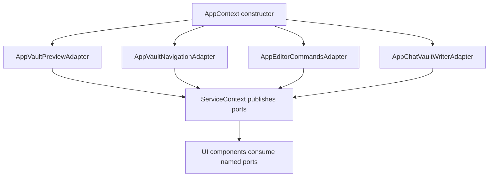
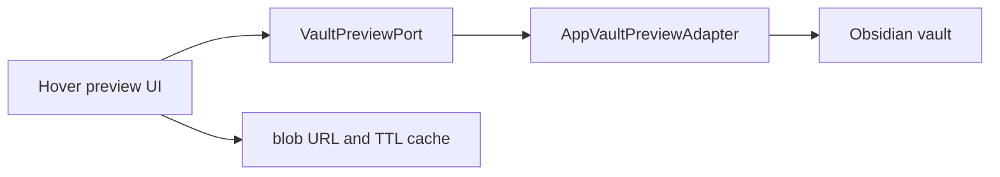
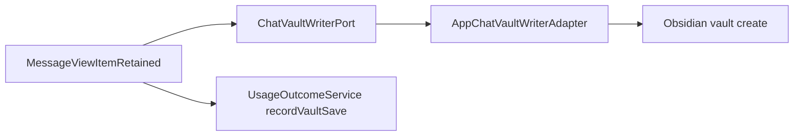
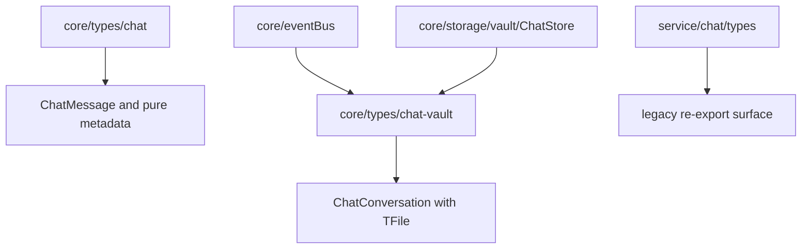
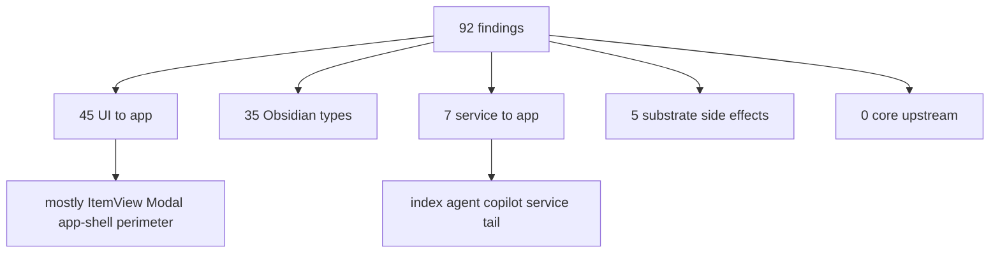

# Owner Review Packet: T11N UI Vault/Editor Port Wave

Claude Code commit:
- `860eb305` `refactor(t11n): UI vault/editor port wave (6 tracks, 92 findings)`

Verdict:
- **Accepted as a targeted raw-UI-IO port wave, with contract caveat**

Owner decision:
- Accept T11N. Do not request an immediate review-fix.
- Record that T11N did **not** meet the original `total flagged <=83` or `UI -> app <=42` hard floors.
- Treat T11N's success metric as: raw UI vault/editor operations compressed behind ports, and `core -> upstream` eliminated.

Global position:
- T11N is a boundary-quality wave, not a product feature.
- It proves that the remaining UI vault/editor IO can be moved into narrow app adapters without creating a new god hook.
- The boundary scanner total is now less useful as a primary metric because many remaining `UI -> app` edges are legitimate Obsidian app-shell wrappers.

## 0. Wave Verdict

Wave classification:
- **Accepted as major on raw-op metric**
- **Not accepted as total-flagged hard-floor completion**

Why this nuance matters:
- The corrected Impact Contract asked for `total flagged <=83` and `UI -> app <=42`.
- Actual result is `total flagged = 92` and `UI -> app = 45`.
- However, the wave hits the more meaningful technical target: raw UI vault/editor leak sites dropped to 7, and `core -> upstream` dropped to 0.

Actual outcome, verified by Codex:

| Metric | Before T11N | After T11N | Delta | Contract |
| --- | ---: | ---: | ---: | --- |
| Total flagged | 95 | 92 | -3 | Missed original hard floor `<=83` |
| `UI -> app` | 46 | 45 | -1 | Missed original hard floor `<=42` |
| Direct UI `AppContext` import files | 33 | 30 | -3 | Passed `<=31` |
| Raw UI vault/editor matches | about 20 | 7 | about -13 | Passed stretch `<=7` |
| `core -> upstream` | 2 | 0 | -2 | Passed |
| `service -> app` | 7 | 7 | 0 | Held |
| `service -> ui` | 0 | 0 | 0 | Lock held |
| `core -> ui` | 0 | 0 | 0 | Lock held |
| `service/core -> Obsidian types` | 35 | 35 | 0 | Held |
| `service/core -> Obsidian side-effect` | 5 | 5 | 0 | Held |

Why this is still accepted:
- It followed Codex's required shape corrections: grouped ports, app-owned adapter composition, no loose `ServiceContext` functions.
- It removed the last `core -> service` type imports.
- It reduced raw UI vault/editor operations to only 7 matches, all concentrated in Quick Search implementation/helper surfaces.
- Build, boundary audit, T11N guard, previous T11M/T11L/T11K/T11J/service-ui guards, and affected chat/Copilot tests passed.

Important caveats:
- `test/t11n-ui-vault-port-regression.test.ts` locks `totalFlagged` at 92. That is a regression floor, not proof that the original `<=83` target was met.
- `UI -> app` is now mostly app-shell/view/modal perimeter. Future waves should not chase it blindly.
- `ServiceContext` still exposes raw `app`, and T11M's `copilotPanelVault` fallback still composes inside `ServiceContext` for direct provider mounts.
- `useStreamdownWikilinkClick.ts` still has raw `app.workspace.openLinkText`, but now requires explicit `App` rather than falling back to `AppContext`.
- `core/types/chat-vault.ts` intentionally imports `TFile` from Obsidian. That keeps `core -> upstream = 0`, but it does not make chat-vault types platform-neutral.

## 0. Review Entry Points

| Review item | Status | Why open it |
| --- | --- | --- |
| This packet | Final | Codex acceptance, caveats, diagrams, next step. |
| `860eb305` | Source commit | Real implementation diff. |
| `docs/superpowers/refactor-ops/t11n-remaining-boundary-tail-investigation-handoff.md` | Source investigation request | Shows the T11N read-only investigation shape. |
| `docs/superpowers/refactor-ops/t11n-readonly-investigation-codex-review.md` | Codex correction | Shows the corrected implementation constraints. |
| `/tmp/t11n-codex-after.md` | Local audit output | Codex rerun of boundary audit: 92 findings. |
| `test/t11n-ui-vault-port-regression.test.ts` | Guard | Locks post-T11N raw UI IO and boundary floors. |

## 0.5 Code Reading Guide

Read in this order:

| Order | File | What to inspect | Why it matters |
| ---: | --- | --- | --- |
| 1 | `test/t11n-ui-vault-port-regression.test.ts` | floors and source guards | Understand what T11N actually locks. |
| 2 | `src/service/preview/VaultPreviewPort.ts` | preview port surface | Shows the read-only vault preview shape. |
| 3 | `src/app/preview/AppVaultPreviewAdapter.ts` | `readBinary`, `readText`, `getResourcePath` | Confirms raw preview IO is app-owned. |
| 4 | `src/service/navigation/VaultNavigationPort.ts` | `openLink` | Shows cross-surface file open operation. |
| 5 | `src/service/editor/EditorCommandsPort.ts` | `insertWikilinkAtCursor` | Shows editor mutation is separate from navigation. |
| 6 | `src/service/chat/ports/ChatVaultWriterPort.ts` | save-to-vault operation | Shows chat markdown write boundary. |
| 7 | `src/app/context/AppContext.ts` | port composition in constructor | Confirms adapters are app-owned and composed once. |
| 8 | `src/ui/context/ServiceContext.tsx` | published ports | Confirms context publishes grouped ports rather than loose functions. |
| 9 | `src/core/types/chat-vault.ts` | `ChatConversation` with `TFile` warning | Explains how `core -> upstream` reached 0. |
| 10 | `src/ui/component/mine/streamdown/WikilinkHoverPreview.tsx` | preview port use + blob cache | Confirms behavior-sensitive preview stayed intact. |
| 11 | `src/ui/view/chat-view/components/messages/MessageViewItemRetained.tsx` | `chatVaultWriter` + telemetry | Confirms save-to-vault outcome logging remains. |
| 12 | `/tmp/t11n-codex-after.md` | residual tables | Use this for T11O decisions. |

Reading notes:
- Start with the test because it reveals the contract caveat.
- Then read the four port families: preview, navigation, editor commands, chat writer.
- Finish with residual audit. The remaining 92 is not one bucket.

## 0.6 Visual Dependency Maps

### Map 1: T11N Port Ownership



How to read this:
- App layer owns concrete Obsidian IO.
- Service ports define the shape.
- UI consumes named operations, not raw `app.vault` or `app.workspace`.

### Map 2: Preview Flow



What changed:
- Image/PDF/text preview reads go through `VaultPreviewPort`.
- Blob URL creation and revoke behavior stays in UI because it is view lifecycle state.

### Map 3: Chat Save Flow



What changed:
- Vault folder/file creation moved to app adapter.
- Telemetry stays in caller and remains best-effort.

### Map 4: Chat Type Split



Why this matters:
- Core no longer imports service chat types.
- The TFile-bearing type is explicitly marked as vault-backed, not pure.

### Map 5: Residual After T11N



How to read this:
- The easy UI raw IO debt is mostly gone.
- The remaining meaningful implementation work is service tail, Obsidian type strategy, or documenting legitimate app shell.

## 1. One-Sentence Outcome

T11N moved scattered UI vault/editor operations behind four grouped ports and app adapters, reducing raw UI IO to 7 matches and eliminating the last `core -> service` imports, but it did not materially reduce the boundary scanner total.

中文说明:
- 这一轮做了什么: 把 UI 直接读写 Vault/Editor 的高风险散点收口成 app-owned ports。
- 为什么这让项目更可控: 以后预览、打开文件、插入 wikilink、保存 chat message 都有明确边界。
- 它没有做什么: 没清掉大多数 `UI -> app`，没处理 service app tail，没碰 index/agent/SQLite 保护区。

## 2. Changed Code Files By Purpose

Preview port:
- `src/service/preview/VaultPreviewPort.ts`
- `src/app/preview/AppVaultPreviewAdapter.ts`
- `src/app/preview/composeVaultPreview.ts`
- `src/ui/component/mine/streamdown/WikilinkHoverPreview.tsx`
- `src/ui/component/mine/resource-preview-hover.tsx`

Navigation and editor ports:
- `src/service/navigation/VaultNavigationPort.ts`
- `src/app/navigation/AppVaultNavigationAdapter.ts`
- `src/service/editor/EditorCommandsPort.ts`
- `src/app/navigation/AppEditorCommandsAdapter.ts`
- `src/app/navigation/composeNavigation.ts`
- `src/ui/view/morning-briefing/BriefingCard.tsx`
- `src/ui/view/ambient-push/PushCard.tsx`
- `src/ui/view/chat-view/view-Messages.tsx`
- `src/ui/view/copilot/vault/VaultAutoRunModal.tsx`

Chat save-to-vault port:
- `src/service/chat/ports/ChatVaultWriterPort.ts`
- `src/app/chat/AppChatVaultWriterAdapter.ts`
- `src/app/chat/composeChatVaultWriter.ts`
- `src/ui/view/chat-view/components/messages/MessageViewItemRetained.tsx`

Copilot modal read cleanup:
- `src/ui/view/copilot/CopilotPickerModal.tsx`
- `src/ui/view/copilot/CopilotReviewHistoryModal.tsx`

Streamdown / Quick Search fallback tightening:
- `src/ui/component/mine/StreamdownIsolated.tsx`
- `src/ui/view/quick-search/callbacks/useStreamdownWikilinkClick.ts`
- `src/ui/view/quick-search/callbacks/open-source-file.ts`
- Quick Search call sites under `src/ui/view/quick-search/**`

Chat type relocation:
- `src/core/types/chat-vault.ts`
- `src/core/eventBus.ts`
- `src/core/storage/vault/ChatStore.ts`
- `src/service/chat/types.ts`

Composition / provider:
- `src/app/context/AppContext.ts`
- `src/ui/react/ReactElementFactory.tsx`
- `src/ui/context/ServiceContext.tsx`

Tests:
- `test/t11n-ui-vault-port-regression.test.ts`

## 3. What Actually Remains

Current audit after T11N:

| Bucket | Count | Meaning | Next treatment |
| --- | ---: | --- | --- |
| `UI -> app` | 45 | Mostly view/modal/context/command app-shell imports | Document legitimate exceptions before more refactor. |
| `service/core -> Obsidian types` | 35 | Remaining TFile/App/vault-backed handles | Needs type strategy, not blind movement. |
| `service -> app` | 7 | Service tail imports `AppContext` | Candidate for T11O read-only investigation. |
| `service/core -> Obsidian side-effect` | 5 | Platform/provider/SQLite substrate | Defer unless doing substrate boot rewrite. |
| `core -> upstream` | 0 | T11N fixed the last two chat type leaks | Keep locked. |
| `service -> ui` | 0 | Reverse UI dependency remains eliminated | Keep locked. |

Remaining raw UI vault/editor matches:
- `src/ui/view/quick-search/callbacks/save-ai-analyze-to-md.ts`
- `src/ui/view/quick-search/callbacks/useStreamdownWikilinkClick.ts`
- `src/ui/view/quick-search/hooks/useQuickSearchHost.ts`

Interpretation:
- These are now Quick Search implementation/helper surfaces, not broad scattered UI components.
- A future Quick Search adapter relocation could reduce the source scan further, but it is optional unless Quick Search gets another wave.

## 4. Architecture Scores

| Group | Score | Confidence | Why |
| --- | ---: | --- | --- |
| Control Index | 96 | High | Clear reading path and new guard, but contract caveat must be remembered. |
| Boundary Index | 97 | High | Raw UI IO moved behind ports; total flagged barely moved. |
| Runtime Truth Index | 94 | Medium | No new runtime path, but `ServiceContext.app` and Quick Search helper raw ops remain. |
| Verification Index | 98 | High | Build, audit, T11N/T11M/T11L/T11K/T11J/service-ui, chat-docs/vault/Copilot tests passed. |
| Overall | 95 | High | Strong targeted boundary cleanup, not a broad total-flagged reduction. |

Per-dimension notes:
- Dependency direction: improved because `core -> upstream` is now 0.
- Side-effect isolation: improved for preview/navigation/editor/chat-save UI surfaces.
- Old-path deletion: low to moderate; this wave mostly moves IO behind ports rather than deleting code.
- Owner comprehension: improved because the residual map now clearly separates legitimate app shell from service tail.

## 5. Verification

Codex reran:

```bash
npm run build
npm run audit:boundary -- --out /tmp/t11n-codex-after.md
npm run test -- test/t11n-ui-vault-port-regression.test.ts
npm run test -- test/t11m-ui-app-boundary-regression.test.ts test/t11l-remaining-boundary-regression.test.ts test/t11k-obsidian-boundary-regression.test.ts test/t11j-boundary-regression.test.ts test/service-ui-boundary.test.ts
npm run test -- test/chat-docs/ChatConversationDoc.test.ts test/vault-framework/MarkdownDocBuilder.test.ts test/vault-framework/MarkdownDocEngine.test.ts test/copilot-artifact-adapter.test.ts test/copilot-action-runtime-ports.test.ts
```

Results:
- Build passed.
- Boundary audit wrote `/tmp/t11n-codex-after.md` with 92 findings.
- T11N guard passed with `total=92 obsidian-types=35 side-effect=5 core->upstream=0 service->app=7 service->ui=0 ui->app=45`.
- Raw UI vault/editor source scan is 7 matches.
- T11M/T11L/T11K/T11J/service-ui guards passed.
- Chat document, vault framework, Copilot artifact adapter, and Copilot action runtime port tests passed.

Note:
- Codex initially invoked a few non-existent shorthand test paths (`test/chat-docs.test.ts`, etc.). That failed at esbuild entry resolution, not at assertions. Codex then reran the real test files listed above and they passed.
- Full `npm run test` was not rerun by Codex; Claude reported it was too slow and killed. Current confidence comes from build plus targeted affected tests.

## 6. Next Recommended Task

Recommended next task:
- **T11O Residual Boundary Decision Packet**

Why not jump straight into implementation:
- The remaining `92` is now a mix of legitimate app-shell perimeter, service app tail, Obsidian type debt, and substrate side effects.
- The next implementation wave should not chase numbers blindly.
- The main real debt candidates are `service -> app` tail and Obsidian type strategy, but both touch higher-risk runtime zones.

T11O should decide:
- Which `UI -> app` edges are officially legitimate app-shell exceptions.
- Whether the `service -> app` tail should be tackled by agent/index/copilot-service domain.
- Whether `service/core -> Obsidian types = 35` should be reduced further or documented as platform boundary debt.
- Whether Quick Search helper raw ops deserve a small adapter relocation later.

