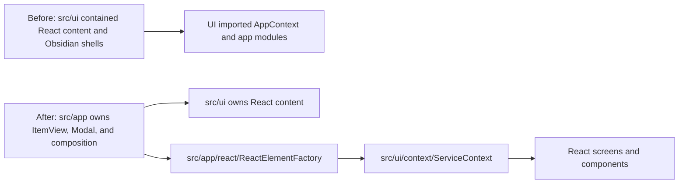

# Owner Review Packet: T11O App-Shell Relocation Wave

Claude Code commits:

- `5686ac97` `refactor(t11o): relocate 7 ItemView shells to src/app/view/ (T11O Track 1)`
- `ca6e591a` `refactor(t11o): relocate standalone Obsidian Modal shells (T11O Track 2)`
- `f35901cc` `refactor(t11o): split non-Copilot blended modals (T11O Track 3)`
- `78c4406f` `refactor(t11o): split Copilot modal cluster into app shells + UI content (T11O Track 4)`
- `b80028a9` `refactor(t11o): move ReactElementFactory to app composition; remove ServiceContext fallback (T11O Track 5)`
- `969c717c` `refactor(t11o): publish narrow runtimes/ports + open-settings action on ServiceContext (T11O Track 6)`
- `a9b04c2e` `refactor(t11o): finish shell relocation + add T11O regression guard (T11O Track 7)`
- `73fce758` `docs(t11o): add app-shell relocation implementation note`

Verdict:

- **Accepted as a major app-shell relocation wave**

Owner decision:

- Accept T11O. Do not request an immediate review-fix.
- Treat this as the wave that physically moved Obsidian shell ownership from `src/ui/**` to `src/app/**`.
- Keep the remaining `useServiceContext().app` consumers as explicit T11P+ debt; do not pretend UI is fully platform-neutral yet.

## 0. Wave Verdict

T11O met the hard contract.

| Metric | Before T11O | After T11O | Delta | Contract |
| --- | ---: | ---: | ---: | --- |
| Total flagged | 92 | 56 | -36 | Passed `<=60`; missed stretch `<=50` |
| `UI -> app` | 45 | 9 | -36 | Passed `<=15`; missed stretch `<=8` by 1 |
| Direct UI `AppContext` import files | 31 | 6 | -25 | Passed `<=8` |
| `service -> app` | 7 | 7 | 0 | Held |
| `service -> ui` | 0 | 0 | 0 | Lock held |
| `core -> ui` | 0 | 0 | 0 | Lock held |
| `core -> upstream` | 0 | 0 | 0 | Lock held |
| Raw UI vault/editor matches | 7 | 7 | 0 | Held |
| `useServiceContext().app` consumers | 27 | 25 | -2 | Held; honesty metric did not increase |

Why accepted:

- 21 app shells now live under `src/app/{view,modals,copilot/modals,react}/`.
- 20 old UI shell paths are confirmed absent by `test/t11o-app-shell-relocation-regression.test.ts`.
- No Obsidian `Modal` / `ItemView` subclasses remain under `src/ui/**`.
- `src/ui/react/ReactElementFactory.tsx` is gone; composition now lives at `src/app/react/ReactElementFactory.tsx`.
- `ServiceContext` no longer imports `@/app/context/AppContext` and no longer resolves a fallback singleton.
- Scanner was not weakened.

Important caveats:

- `ServiceContext` still publishes raw `app`, and 25 UI consumers still use it. T11O reduced static `UI -> app` imports, not all runtime app access.
- `total flagged = 56` is good progress, not final architecture completion.
- Full `npm run test` did not complete in Codex's verification pass; see verification note below.

## 0.5 Review Entry Points

| Review item | Status | Why open it |
| --- | --- | --- |
| This packet | Final | Codex acceptance, caveats, next step. |
| `73fce758` | Docs commit | Human-readable implementation note. |
| `docs/superpowers/refactor-ops/t11o-app-shell-relocation-implementation-note.md` | Source handoff result | Changed files, diagrams, remaining tail. |
| `test/t11o-app-shell-relocation-regression.test.ts` | Guard | Locks the T11O boundary floor and honesty metric. |
| `/tmp/t11o-codex-review-after.md` | Codex audit output | Boundary audit rerun: 56 findings, `UI -> app = 9`. |
| `src/app/react/ReactElementFactory.tsx` | Composition point | Shows how `AppContext` is converted into ServiceProvider values. |
| `src/ui/context/ServiceContext.tsx` | React publication contract | Confirms fallback singleton is gone; also shows remaining raw app surface. |

## 1. What Actually Changed

The key architectural move:



This is the first wave where `UI -> app` dropped for the right reason: shell files moved to the app layer instead of being hidden behind scanner exceptions.

## 2. Code Reading Guide

Read in this order:

| Order | File | What to inspect |
| ---: | --- | --- |
| 1 | `src/app/view/AmbientPushView.ts` | Canonical moved `ItemView` shell. |
| 2 | `src/app/modals/CostEstimationModal.tsx` + `src/ui/view/modals/CostEstimationContent.tsx` | Canonical app-shell / UI-content split. |
| 3 | `src/app/copilot/modals/CopilotPickerModal.tsx` | Chained modal navigation now lives inside app. |
| 4 | `src/app/react/ReactElementFactory.tsx` | App composition point; threads all ports and runtimes. |
| 5 | `src/ui/context/ServiceContext.tsx` | No `AppContext` fallback; still publishes raw `app`. |
| 6 | `src/ui/view/quick-search/hooks/useSearchSession.ts` | Example of helper changed from `AppContext.getInstance()` to injected deps. |
| 7 | `test/t11o-app-shell-relocation-regression.test.ts` | Regression floor, shell ban, honesty metric, scanner guard. |

## 3. Remaining `UI -> app` Tail

Codex reran boundary audit and confirmed exactly 9 entries:

```text
src/ui/context/ServiceContext.tsx -> @/app/view/ViewManager (type-only)
src/ui/context/ServiceContext.tsx -> @/app/copilot/panels/composeCopilotPanelVault (type-only)
src/ui/view/chat-view/chatNavigation.ts -> @/app/context/AppContext
src/ui/view/chat-view/chatNavigation.ts -> @/app/view/ViewManager (type-only)
src/ui/view/chat-view/components/ConversationIndex.tsx -> @/app/view/types
src/ui/view/settings/MaintenanceTab.tsx -> @/app/commands/PeakCommandActions
src/ui/view/settings/tabs/AISetupTab.tsx -> @/app/commands/PeakCommandActions
src/ui/view/settings/tabs/AdvancedTab.tsx -> @/app/commands/PeakCommandActions
src/ui/view/settings/tabs/OverviewTab.tsx -> @/app/commands/PeakCommandActions
```

Interpretation:

- `chatNavigation` is the cleanest T11P target.
- Settings tabs need a real `SettingsActionsPort`, not a 15-function dump.
- `ConversationIndex` view-type constants should not be dumped into `core` just to satisfy the scanner.
- The two `ServiceContext` imports are type-only, but still pin UI to app-shaped contracts.

## 4. Verification

Codex reran:

```bash
npm run build
npm run audit:boundary -- --out /tmp/t11o-codex-review-after.md
npm run test -- test/t11o-app-shell-relocation-regression.test.ts
npm run test -- test/t11n-ui-vault-port-regression.test.ts
npm run test -- test/t11m-ui-app-boundary-regression.test.ts test/t11l-remaining-boundary-regression.test.ts test/t11k-obsidian-boundary-regression.test.ts test/t11j-boundary-regression.test.ts test/service-ui-boundary.test.ts
```

Results:

- Build passed.
- Boundary audit wrote `/tmp/t11o-codex-review-after.md` with 56 findings.
- T11O guard passed 10/10.
- T11N guard passed.
- T11M/T11L/T11K/T11J/service-ui guards passed.
- `scripts/audit/boundary-baseline.mjs` was not changed in the T11O commit range.

Full test note:

- Codex attempted a full `npm run test`.
- It reached at least `ChatConversationDoc` and later produced no new output for more than two minutes, so Codex interrupted its own run with Ctrl-C to avoid leaving a hung test session.
- This packet therefore accepts T11O on build + affected regression tests, not on a completed full test suite.

## 5. T11P Recommendation

T11P should be a smaller but still meaningful tail wave:

1. Move `chatNavigation` behind a narrow app-composed chat navigation port or hook.
2. Create a real `SettingsActionsPort` namespace for settings-tab command operations.
3. After those, decide whether the remaining type-only `ServiceContext` app imports deserve neutral contract files.
4. Start reducing `useServiceContext().app` consumers where narrow ports already exist.

Do not start Command Gateway yet. T12 remains the capstone.
