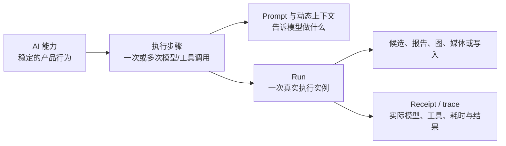

# Peak Assistant AI 能力与运行链审计

> - 状态：当前源码静态审计，供 AI Control Center 设计使用
> - 日期：2026-07-30
> - 范围：用户可见 AI 能力、后台 AI 任务、Prompt、模型路由、工具、产物与运行记录
> - 不包含：确定性 UI 操作、没有模型调用的普通 Search 排序、尚未接线的纯设计愿景

## 1. 结论

Peak 当前缺少的不是另一张 Prompt 表，而是一份统一的 **AI 能力运行目录**。

现有资料分别能回答一部分问题：

- [`25-infra-prompt-catalog.html`](../../25-infra-prompt-catalog.html) 能回答 Prompt 在哪里、有哪些变量、是否能找到源码引用。
- [`24-infra-ai-model-routing.html`](../../24-infra-ai-model-routing.html) 能回答多数 AI 触点当前如何选择模型。
- [`21-infra-agent-harness.html`](../../21-infra-agent-harness.html) 能回答 AgentLoop、工具、权限、tier 与 trace 的运行机制。
- 各 feature 文档能回答单个用户界面的入口和结果。

但没有一个对象能同时回答：

1. 这项 AI 能力从哪里触发；
2. 运行前组装什么上下文、权限、预算和模型；
3. 运行中使用哪些 Prompt、工具、schema 与升级规则；
4. 运行后如何校验、生成候选、写入历史或交给用户审阅；
5. 某一次真实运行最终使用了什么 Prompt 版本、模型和工具；
6. 设计预期与当前接线之间是否存在缺口。

因此原 **Prompt Control Center** 只能成为新中心中的 Prompt 子页，不能继续充当整个 AI 系统的顶层模型。

## 2. 审计口径

本次交叉检查了四类证据：

- `PromptId`、Prompt Registry 与 `templates/prompts/`；
- `queryText`、`queryStream`、`queryStructured`、`runAgentLoop`、embedding 与媒体 adapter 调用；
- Composer capability definitions、Copilot action registry、RunEnvelope adopter 与各域 receipt；
- 当前 Search、Composer、Chat、Harness 和模型路由文档。

“源码引用”不等于“用户入口可达”。本清单把状态区分为：

| 状态 | 含义 |
| --- | --- |
| 生产路径 | 能找到入口、运行时和结果处理链 |
| 部分接线 | 有运行组件，但入口、receipt、统一路由或 review 仍不完整 |
| 配套能力 | 本身不是独立 AI run，而是某个能力的 Prompt、工具或后处理步骤 |
| 待核对 | 注册或文件存在，但本次静态扫描不足以证明入口可达 |

## 3. 不应混为一谈的五个对象

- **AI 能力**描述用户要完成的工作和预期结果。
- **执行步骤**描述运行前、运行中和运行后的可检查阶段。
- **Prompt**只是某个执行步骤的指令来源；system companion 可能不拥有独立 run。
- **Run**是一次真实执行，可能包含多个 Prompt、模型调用、工具调用和人工确认。
- **Artifact / receipt**分别保存结果与执行证据。

原设计把“可执行 Prompt”近似当成“AI 动作”。这对简单单轮调用勉强成立，但无法表达 AI Search、Vault Review、Chat tool loop、媒体异步任务或一个 Prompt 被多项 Composer action 复用的情况。

## 4. 当前运行形状

### 4.1 多 tier AgentLoop

这类能力有工具循环，并可按质量或显式请求升级模型。

| 能力族 | 当前入口 | 主要阶段 | 当前路由 |
| --- | --- | --- | --- |
| AI Search 主分析 | `VaultSearchAgent.ts` | 准备 playbook → Vault 工具取证 → plan review → 继续执行 | `research`，可升到 `stronger` |
| Continue Analysis | `ContinueAnalysisAgent.ts` | 读取既有轮次 → 追加证据 → 合并结果 | 复用 AI Search tier |
| AI Analysis 后续问答 | `FollowupChatAgent.ts` | 选择结果上下文 → 工具或文本回答 → 写回当前分析会话 | `fast` 起步，可继续升级 |

### 4.2 固定模型 Harness run

这类能力仍经过 Peak Harness，但一个 run 绑定一个已经解析好的 Profile + model。

| 能力族 | 当前入口 | 运行特征 |
| --- | --- | --- |
| Chat Studio 主 turn | `harnessChatRunner.ts` | Context Pipeline、Assistant policy、Vault/Web/MCP tools、流式输出、turn receipt |
| AI Search 报告生成 | `ReportOrchestrator.ts` | 分段生成、summary、Mermaid 修复、来源和 tool receipt |
| AI Graph | `GraphAgent.ts` | sources → graph schema → graph artifact |
| Document / Vault Review | `CopilotMetaAgentStream.ts`、`VaultMetaAgentStream.ts` | 多轮 finding/source/change/trace 收集，结果进入 review history |
| Copilot agent actions | `copilot/actions/agent-actions.ts` | action playbook、工具调用、结构化结果 |
| Knowledge Intuition / Hub | `intuition.recon.ts`、`hub*Recon.ts` | plan、工具取证、submit、materialize / critique |
| Ambient explanation | `LlmAmbientExplanationAdapter.ts` | 为已选中的 ambient item 生成短解释 |

### 4.3 单轮模型 helper

这些调用不需要完整 AgentLoop，但仍应有能力身份、模型路由和 receipt。

| 能力族 | 当前入口 | 预期结果 |
| --- | --- | --- |
| Vault Search · Refine | `AIQueryRewriteService.ts` | 根据当前 query、搜索行为和 Vault 线索给出结构化查询候选 |
| 自然语言搜索解析 | `aiQueryParserRuntime.ts` | 把自然语言编译成 Hyper Search syntax；失败回退原文 |
| Context 压缩摘要 | `compactSummarizerRuntime.ts` | 在预算超限时生成可恢复摘要 |
| Usage 优化建议 | `UsageOptimizationService.ts` | 根据真实 usage 记录生成节省建议 |
| 标题、摘要与 follow-up | Chat / Quick Search helpers | 生成标题、项目描述、对话摘要、后续问题和保存建议 |
| 用户画像更新 | `BuildUserProfileRunner.ts`、`UserProfileService.ts` | 从真实 Vault 证据生成候选并整理 profile |

当前这些 helper 中仍有直接调用 provider adapter 的旁路。它们不应被强行改造成多轮 Agent，但需要进入统一能力目录和模型 resolver。

### 4.4 Composer 候选生成

Composer 已经最接近统一能力合同。它以 capability definition 表达目标块、Prompt、执行模式、typed result、renderer 与 writeback adapter。

#### 文本与结构

- 段落润色、补例子、转表格；
- 标题缩短、生成提纲和问题；
- 列表补缺、重排和转表格；
- 任务阻塞项、下一步和优先级；
- 引用解释、反例和 callout 转换；
- callout 类型、扩写和 checklist 转换；
- 新块草稿。

#### 结构化对象

- 表格总结、补列、单位检查、公式列和 chart；
- 公式解释、拆分和变量说明；
- Mermaid、代码、Base、Canvas、Excalidraw 的解释或 typed patch；
- 链接整理；
- frontmatter 属性和 tag 建议。

#### 图片与媒体

- 图片 caption；
- 多图 layout；
- AI image edit；
- Chat / Composer 的图片、视频和音乐生成；
- 音频和视频理解；
- 图片文档 description / summary。

这些能力不能只按 Prompt 分组：

- 多项 prose action 共用 `ComposerProseTransform`；
- image edit 走媒体生成服务，不是文本 Prompt；
- convert / rename 等相邻操作是确定性事务，不应误标为 AI；
- typed patch 在模型返回后还有 schema 校验、materialize、candidate review 和原子 writeback。

### 4.5 Copilot、Vault Intelligence 与 Ambient

| 能力族 | 代表动作 | 运行后结果 |
| --- | --- | --- |
| Document Copilot 固定动作 | polish、correct、review、split、tags、summary、concepts、translate | 文本候选、结构化 review 或建议列表 |
| Document Auto Review | suggest links、knowledge gaps、evidence、writing plan 等 | Changes / Insights / Sources / Trace |
| Vault Intelligence | Vault Health、Vault Summary、complete / fast review | Vault review snapshot、finding、source 和历史 |
| Insight inline chat | 解释 finding 或把 finding 变成草稿 | 同一 receipt 内的 follow-up 或 draft proposal |
| Ambient | working theme、相关项选择、解释 | Brief / gutter / panel 投影；当前动态 finding producer 仍不完整 |
| Custom Prompt | 用户 Vault 中的 Prompt action | 由 Copilot action runtime 执行，不能被内置模板覆盖 |

固定动作、动态 finding 和用户 Custom Prompt 必须在目录中分开标识。它们的 owner、可编辑范围和历史语义不同。

### 4.6 Chat Studio

Chat Studio 至少包含以下 AI 动作：

- 主对话 turn；
- Assistant instructions 与 preferred model；
- `/plan` 单次 plan mode；
- Vault search、Web search、MCP 和 artifact tools；
- Prompt Enhance；
- follow-up suggestions；
- conversation / project summary；
- conversation title 和 project description；
- Assistant draft；
- user memory / profile candidate extraction；
- media generation、media understanding 和 structured artifact generation。

主 turn 是一个能力，不是一个 Prompt。`conversation-system`、Context Pipeline slots、Assistant instructions、tool policy 和本轮用户输入共同构成最终请求。

### 4.7 Knowledge Index、Hub 与后台任务

后台 AI 也必须进入目录，否则模型成本、行为变更和失败只能从代码追踪。

| 能力族 | 主要动作 | 特殊边界 |
| --- | --- | --- |
| Knowledge Index | embedding、短/长 summary、tag、图片描述 | embedding 不使用 Chat Prompt |
| Pattern Discovery | 从查询历史发现可复用模式 | 单轮 structured output |
| Knowledge Intuition | 计划、取证、submit | Agent / tool workflow |
| Hub Curation | 选择、合并、归档策略 | 不应静默修改 user-owned hub |
| Hub Materialization | draft、critique、写入 | 写入前需要 provenance 和冲突保护 |
| Vault Lint AI repair | broken link、missing target、noise、orphan、tag、cleanup | Lint finding 与修复 Prompt 是两层对象 |
| Curator setup | 推荐 Profile / model bindings | 属于配置辅助，不是内容生成 |
| Usage optimization | 成本和质量建议 | 必须从真实 usage receipt 计算，不得虚构收益 |

## 5. 运行前与运行后步骤

统一目录需要描述阶段，但不能要求每项能力都执行完全相同的流程。

### 5.1 运行前

1. 识别入口、用户意图和 capability id；
2. 检查适用对象、必需资源和 feature readiness；
3. 冻结目标、source revision、selection 和输入引用；
4. 组装自动上下文、显式来源和用户配置；
5. 解析 Prompt / Assistant / Skill；
6. 解析用途槽、Profile、model 和 capability 要求；
7. 计算预算、费用提示、权限与可用工具；
8. 创建 run identity 和可追踪的输入 receipt。

### 5.2 运行中

运行形状可以是：

- 单轮 text / structured call；
- 流式 candidate；
- 固定模型 tool loop；
- 可升级的多 tier AgentLoop；
- 多阶段 workflow；
- durable media job；
- embedding / rerank。

目录必须显示实际形状，不能把所有 AI 调用都包装成“Agent Run”后隐藏差异。

### 5.3 运行后

1. 校验 schema、引用、typed patch 或媒体文件；
2. 把 raw output materialize 成候选或 artifact；
3. 显示 review / accept / reject / retry / stop 状态；
4. 通过 transaction 或 writer 执行实际写入；
5. 保存未采纳结果、错误和取消状态；
6. 记录 Prompt 版本、请求与实际模型、工具、成本和耗时；
7. 将结果投影到 Chat receipt、Generation History、AI Analysis、Copilot History 或 Usage Dashboard；
8. 收集人工反馈或未来 eval 所需的稳定标识。

## 6. 当前体系的结构性缺口

### 6.1 没有覆盖全项目的 AI capability registry

`CapabilityManifest` 已存在，但当前主要覆盖 Command Gateway 和部分 capability runtime。Composer 另有更丰富的 `ComposerCapabilityDefinition`，Chat、AI Search、Graph、后台 helper 与媒体 job 又各自维护运行信息。

### 6.2 Prompt Registry 不能表达工作流

`PromptId` 能表达模板身份和变量，却不能表达：

- 一个能力包含多个执行步骤；
- 一个 Prompt 被多项 action 复用；
- 一个步骤没有文本 Prompt；
- 运行前权限、预算和工具；
- 运行后的 validation、review、writeback 与 receipt。

### 6.3 模型路由仍有多条真值

当前同时存在 slot resolver、active Agent / Copilot role、Assistant override、feature-local fallback 和 provider-direct helper。旧 `promptModelMap` 会加载，但主要 `queryText` / `queryStream` 路径不消费它。

### 6.4 Receipt 与历史按域分散

Chat turn receipt、AI Analysis session、Copilot review history、Composer candidate/history、RunEnvelopeStore 和 media job receipt 都有价值，但缺少统一的 capability / step / prompt-version 关联。

### 6.5 “存在”与“可用”仍容易混淆

模板存在、Registry 注册、源码引用、入口可达、运行成功和真实交互验收是六个不同状态。Control Center 必须显示证据等级，而不是给每一行一个误导性的绿色状态。

## 7. 对 AI Control Center 的直接要求

中心的默认主对象应是 **AI capability / action**。每项能力至少显示：

- 人能读懂的名称、所属 surface 和触发入口；
- 当前接线状态与证据；
- 预期行为、输入、输出和安全边界；
- 运行形状与前置/后置步骤；
- Prompt / Assistant / Skill 引用；
- 默认模型用途槽、能力要求和 override；
- tools、permission、budget 和 escalation；
- validation、review、writeback 和 persistence；
- receipt、usage、history 和测试入口；
- 最近真实 runs，以及每次 run 的实际 Prompt / model / tool / artifact。

Prompt 子页继续负责正文审阅和 override，但模型 override 的 owner 应是 **可执行 capability step**：

- companion template 不拥有模型；
- 一个 workflow 的不同步骤可以有不同模型策略；
- 一个共享 Prompt 不能默认把所有调用者锁到同一模型；
- 只有一对一绑定时，UI 才可以把 capability-step override 简化显示为“这个 Prompt 的模型”。

## 8. 证据入口

- Prompt 身份与变量：`src/core/types/prompt.ts`
- Prompt 文件映射：`src/core/template/TemplateRegistry.ts`
- Prompt override：`src/service/prompt/PromptService.ts`
- 通用单轮调用：`src/service/chat/service-manager.ts`
- Agent loop：`src/service/agents/harness/loop/AgentLoop.ts`
- 固定模型 Harness：`src/service/agents/harness/HarnessModelRunner.ts`
- AI Search：`src/service/agents/VaultSearchAgent.ts`
- 报告生成：`src/service/agents/report/ReportOrchestrator.ts`
- AI Graph：`src/service/agents/ai-graph/GraphAgent.ts`
- Chat turn：`src/service/chat/harnessChatRunner.ts`
- Copilot actions：`src/service/copilot/actions/index.ts`
- Composer capabilities：`src/service/composer/capabilities/`
- Media：`src/service/media/`
- RunEnvelope：`src/service/run-envelope/`

## 9. 审计边界

这是一份静态源码审计，不宣称：

- 每个列出的 UI 入口都已经在真实 Obsidian 中验证；
- 每个 Prompt 都有可达的生产调用；
- 所有运行都已经写入统一 receipt；
- 当前 `promptModelMap` 已经生效；
- 本文列出的目标 registry 或 AI Control Center 已经实现。
