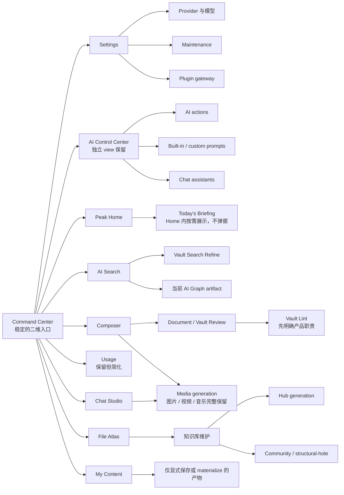

# Peak Assistant 激进代码退役与模块化审计

> - 状态：**只读审计 / Owner 决策稿**
> - 日期：2026-08-06
> - 源码基线：`HEAD d0bf30bb`；统计包含审计时工作区内的并行未提交改动
> - 范围：`src/**`、启动组合、用户入口、后台任务、兼容链、本地 SQLite 活动证据
> - 不包含：代码删除、重构、数据迁移、构建、测试、真实 Obsidian 交互验收
> - 阅读对象：产品 Owner、后续实施维护者、执行退役工作的编码代理
> - 预计阅读：20–25 分钟；前 5–10 分钟可完成主结论与产品边界评审

这份文档回答一个具体问题：Peak Assistant 现在接近 23 万行 `src` 代码，是否真由当前产品价值所必需，以及在保留核心能力的前提下可以激进地减少多少。

结论不是“再拆几个大文件”。当前最大问题是多个历史产品面、后台智能系统、兼容层和新替代路径同时存活。真正有效的顺序应是：**先退役完整产品岛和隐藏运行时，再对剩余核心做复用抽象。**

评审路径：

- Owner 先读[结论先行](#1-结论先行)和[建议保留的产品形状](#3-建议保留的产品形状)，确认产品边界；
- 再读[已批准退役项](#5-第一组已批准退役的旧产品与兼容链)和[保留能力的瘦身边界](#6-第二组保留能力并收紧实现边界)，确认第一、二波范围；
- 对 [Profile、Session、Hub 与 Media](#7-第三组先把能力讲清楚当前默认保护)确认保护边界；
- 最后在 [Owner 决策清单](#14-owner-决策清单)勾选，后续实施者按[推荐实施顺序](#13-推荐实施顺序)建立 Impact Contract。

---

## 1. 结论先行

### 1.1 23.03 万行不是当前产品必需体积

`src/**` 当前有 **230,298 行有效代码**。功能多可以解释项目比普通 Obsidian 插件重，但不能解释以下现象：

- 已有新入口后，旧入口和旧 view 仍被注册或保留；
- 已有当前事实源后，旧 adapter、migration 和兼容 UI 仍长期驻留；
- 一些能力各自拥有完整 UI、service、storage 和 prompt 链，但产品职责和最小实现边界没有被持续校准；
- 用户没有显式触发时，文件打开、索引更新和插件启动仍会组合后台运行时或写入机器记录；
- 相同能力被做成多个独立产品面，而不是一个核心能力在恰当位置被调用。

因此，这不是单纯的“代码写得啰嗦”。它首先是**产品边界过宽和退役不彻底**，其次才是复用不足。

### 1.2 可信的压缩目标

**第一目标：只做 Owner 已明确批准的产品退役。**

- `src` 净减少 **14,000–18,000 行**；
- 目标体积约 **212,000–216,000 行**；
- 主要来自旧 Document Copilot、旧 Chat、Related Notes、Heading mode、到期兼容链和旧 Ambient；
- 不依赖删除 Usage Dashboard、Vault Lint、AI Query Refine、Hub/community/structural-hole 或媒体生成。

**第二目标：在第一目标上再做保留功能的结构瘦身。**

- `src` 净减少 **19,000–28,000 行**；
- 目标体积约 **202,000–211,000 行**；
- 通过 Usage 简化、证明不可达后删除旧 Graph 编排、真正的重复结构合并和 CSS 清理实现；
- User Profile、Session Context、AI Control Center、Hub、AI Query Refine 与媒体能力默认保留；没有新的 Owner 决策，不用它们补 LOC 指标。

本报告不设 50,000–62,000 行的产品减法目标。完整媒体生成、AI Control Center 独立 view，以及 Hub generation、community 和 structural-hole 都已明确保护，不能为了 LOC 指标纳入退役范围。

### 1.3 最重要的判断

1. **旧 Document Copilot、旧 Chat、Related Notes、旧 Heading mode 和到期兼容链应作为第一批完整闭环删除。** Owner 已批准这部分产品退休。
2. **旧 Ambient runtime 应整体退休；Today’s Briefing 只保留为 Peak Home 内容。** 旧 push、Related Notes projection、status/gutter、启动检查和弹窗全部删除；三类有价值的知识提醒如果继续保留，只能由 Peak Home 按需加载，不再形成 Ambient 平行产品。
3. **Usage Dashboard 保留，但收缩成清晰、可信的 usage history / summary。** 当前稀薄的 outcome 和 cost 数据只能说明高级预测应简化，不能推导整个 Usage 产品应被删除。
4. **AI Query Refine 保留。** 它是 Vault Search 的明确能力，由 Search 的 `Refine` 入口、panel 和 rewrite service 组成，不应与旧 Ambient 一起退休。
5. **Hub generation、community 和 structural-hole 是知识库维护核心。** 它们应保留生成、review、materialize 和 read projection；可以优化启动与调度，但不能把整条写入能力删掉。
6. **Vault Lint 暂不退役。** 它是 Copilot Vault Health 与 Vault Review 的内部健康扫描提供者；需要先明确用户看到什么、哪些 detector 有价值，再决定简化边界。
7. **媒体生成完整保留。** 图片、视频、音乐都是明确需要的低成本能力；方向是统一低成本 API 路由、减少 adapter 重复和空闲 timer，而不是收缩媒体种类。
8. **AI Control Center 独立 view 保留。** 它承接全局 AI action、内置 prompt、custom prompt 和 assistant 的管理；需要修正的是静态 catalog 与真实执行链的对应关系，不是把产品折叠进 Settings。
9. **抽象复用不是主刀。** 历史 clone scan 只找到约 1,399 行字面重复。必须先删除已确认旧岛，再对 SQLite mapper、Review presentation 等仍有两个以上活跃调用点的结构做窄抽取；Document loader 已有公共基类，Search graph inspector 则是活跃 Agent 工具集，不能用旧标签粗略处理。

### 1.4 术语速译：这些名字在项目里到底指什么

| 名字 | 用正常产品语言解释 | 本报告现在怎么处理 |
| --- | --- | --- |
| User Profile | 一份给 AI 用的“长期用户偏好卡”，不是登录账号资料；Chat 会读取其中的背景、偏好等条目 | Profile 文本和 Chat 注入保留；全 Vault 自动/手动画像链单独评估，当前不删 |
| Session Context | 一条“最近做过什么”的内部活动时间线，不是某个 Chat session；记录打开文件、搜索、分析等，并给 Chat 最近活动摘要 | 当前保留；单独调查活动保存周期和每 10 次活动后的 LLM 主题推断成本 |
| Hub generation-to-materialize | 从 community / structural-hole 等知识结构生成 Hub 草案，经过 review 后变成可使用的 Hub | 全链保留；旧文档中的“删写入平面”建议已撤回 |
| 第二套 Graph | Quick Search 内部一条旧 `GraphAgent + useGraphAgent + store/fallback` 编排，不是第二个用户产品 | 当前 Graph 功能完整保留；只在证明旧编排无生产调用、并迁完剩余 store bridge 后删死代码 |
| Document loader | 把 Markdown、PDF、Word、PPT、HTML、图片等读成统一 Document，供索引、搜索和 Chat 使用 | 所有格式保留；项目已有公共基类，不再建议新造 builder |
| Search graph inspector | AI Search / Agent 调用的一组图谱查询工具，不是一个用户打开的 inspector 页面 | 工具能力保留；只能合并重复的查询/格式化小函数 |
| AI Control Center | 全局查看和管理 AI actions、prompts、custom prompts、assistants 的控制面 | 独立 view 保留；catalog 必须与真实 execution consumption 对齐 |
| Media | 图片、视频、音乐以及相关异步 job / attachment / receipt 链 | 全部保留；优先统一到低成本 API 路由并按需启动 |

---

## 2. 当前体积基线

本次用 `cloc` 统计 TypeScript、TSX 和 CSS 的有效代码行，不把空行和注释计入代码量。

| 区域 | 有效代码行 | 占 `src` | 审计判断 |
| --- | ---: | ---: | --- |
| `src/ui` | 92,913 | 40.3% | 最大区域；产品面、兼容 UI 和功能自建组件并存 |
| `src/service` | 62,804 | 27.3% | 搜索、Agent、后台智能和业务编排都很厚 |
| `src/core` | 31,902 | 13.9% | storage、provider、document 和 port；不能按目录粗删 |
| `src/styles` | 23,274 | 10.1% | 大量功能专属 CSS；功能退役后必须反向清 selector |
| `src/app` | 19,378 | 8.4% | 启动组合和 Obsidian host；隐藏运行成本集中暴露在这里 |
| `src` 根文件 | 27 | <0.1% | 声明类文件 |
| **`src` 合计** | **230,298** | **100%** | 本审计主要压缩对象 |
| `test` | 64,407 | — | `src + test` 合计 294,705 行 |

现有构建产物 `main.js` 约 **23.1 MiB**，`styles.css` 约 **2.1 MiB**。这两个数字只能说明最终载荷确实很重，不能直接推导每个功能的 bundle 占比；退役后仍需用 esbuild metafile 做依赖贡献分析。

与 [2026-06-25 Code Volume Audit](./2026-06-25-t11c-code-volume-deletion-map.md) 的约 15 万行相比，当前 `src` 又增加了约 7.9 万行。此前的模块化改造改善了 ownership 和依赖方向，但后续功能建设重新扩大了产品面、测试面和 runtime composition。

---

## 3. 建议保留的产品形状

下面这张图只回答一个问题：哪些稳定入口和知识维护能力属于应保护的当前产品。



阅读要点：

- Command Center 保留二维分组和空间层级，不退化为第二个命令面板。
- Peak Home 保留为独立 Home workspace；Today’s Briefing 只在这里展示，不在启动时自动弹出，也不保留独立 Briefing 入口。
- AI Control Center 继续是独立产品面；Settings 管 provider / 基础配置，AI Control Center 管 action、prompt、custom prompt 和 assistant。
- Usage 保留为稳定产品能力，但界面和统计只承诺可信数据能够支持的内容。
- AI Query Refine 明确归 Vault Search，不与 Ambient 或通用主动推荐系统混在一起。
- My Content 只承接用户显式保存、接受或 materialize 的产物，不成为所有机器状态的浏览器。
- AI Graph 保留当前 canonical artifact runtime；旧 `useGraphAgent` 没有生产调用者，但它的 store 仍被当前恢复链桥接，所以必须先完成调用图和迁移证明，不能把 Graph 功能一起删掉。
- Hub generation、community 与 structural-hole 是 File Atlas / Vault Intelligence 背后的知识维护能力，不进入退役池。
- Vault Lint 先保留并明确职责；Media 的图片、视频、音乐完整保留，优化方向是统一路由和按需运行。

---

## 4. 退役判断方法

本审计没有把“文件没有被 import”直接等同于“可以删除”。每个候选至少经过以下判断：

1. **入口是否仍存在。** 用户能否从稳定产品面发现并触发它？
2. **是否有独特价值。** 同样结果是否已由 Chat Studio、Composer、AI Search 或 File Atlas 提供？
3. **是否有真实活动。** 本地 SQLite 是否有运行、产物、反馈或恢复队列？
4. **是否造成隐藏成本。** 是否在启动、文件打开、消息发送或索引更新时自动工作？
5. **是否已有当前替代。** 删除后是否已有明确的 canonical runtime 或 UI 承接？
6. **数据是否安全。** 旧数据能否继续只读、导出或迁移，且不自动删除用户资产？

候选结论使用四种强度：

- **已批准退役**：Owner 已明确批准产品入口和兼容链退休。
- **保留但简化**：产品价值成立，只减少重复 UI、过度统计或不必要的后台工作。
- **保留并优化运行时**：完整能力属于当前产品，只调查按需组合和内部去重。
- **待产品决策**：当前不允许删除，也不把假设收益计入 LOC 目标。

---

## 5. 第一组：已批准退役的旧产品与兼容链

### 5.1 旧 Document Copilot

**结论：完整退休旧产品入口，但不能按 `src/ui/view/copilot/**` 整目录盲删。**

当前 Composer sidecar 也使用 `CopilotView` 这个名字，Vault Review 仍复用一部分 Copilot review 组件。实施时必须从用户入口反向求完整依赖闭包，而不是按名称匹配。

应删除：

- 旧 Document Copilot picker 和独立 view / modal 入口；
- 旧文档级 store、panel 编排和与 Composer 重复的生成路径；
- 仅为旧 surface 提供的 context graph / action bridge；
- 已被 Composer candidate/history/receipt 替代的旧状态和测试。

应保护：

- 当前 Composer sidecar 的 Copilot / History；
- 当前 Document Review 与 Vault Review runtime；
- current Composer intelligence presentation 和并行在改的 Composer 文件。

**预计净减少：7,500–9,000 行。**

### 5.2 旧 Chat、Related Notes 与旧 Heading mode

Related Notes 仍有独立 view 注册和命令动作；旧 Heading mode 已在代码中明确“不再 render”，但它的完整 UI 与 composition 链仍存在。

源码证据：

- [RelatedNotesView.ts](../../../src/app/ui-host/views/RelatedNotesView.ts) 仍定义独立 view；
- [ViewManager.ts](../../../src/app/ui-host/views/ViewManager.ts#L52) 仍注册和激活该 view；
- [tab-VaultSearch.tsx](../../../src/ui/view/quick-search/tab-VaultSearch.tsx#L173-L175) 明确说明 Heading mode 不再渲染；
- `src/ui/view/quick-search/components/heading-mode/**`、`useHeadingModeKeyboard.ts`、`HeadingModePort.ts` 和 `composeHeadingModeDeps.ts` 仍组成完整旧链。

建议把上述旧 Chat shim、Related Notes 和 Heading mode 一次性闭环删除。

**预计净减少：2,800–3,600 行。**

### 5.3 到期 migration / compatibility adapter

相关持久化域已建立 canonical JSON / JSONL 与 rebuildable projection。旧 Markdown reader 在迁移窗口内合理，但不能无限期成为第二套永久读模型。

本轮已获得 Owner 对“到期 adapter 退休”的批准。实施前只需为每条 adapter 确认：

- 是否仍有未迁移记录；
- migration journal 是否能证明已导入；
- 是否需要保留一次显式 export / manual import；
- 删除 adapter 后是否仍会读取用户原始 Markdown，而不是删除它。

**预计净减少：1,800–2,400 行。**

这三项合计是最确定的 **12,000–15,000 行**代码退役池。

---

## 6. 第二组：保留能力，并收紧实现边界

### 6.1 Usage Dashboard：保留产品，缩小承诺

**直接代码闭包：约 7,046 行。** 这个数字说明实现偏重，不代表整个 Usage 产品应删除。

确认自源码：

- 插件加载时注册 assistant message 下方的 receipt renderer：[main.ts L803–805](../../../main.ts#L803-L805)；
- SQLite 初始化时组合 Tracking、Outcome、Optimization 三个 service：[main.ts L846–864](../../../main.ts#L846-L864)；
- 用户快速追问时会写 continuation outcome：[useChatSubmit.ts L183–198](../../../src/ui/view/chat-view/hooks/useChatSubmit.ts#L183-L198)；
- 普通消息元信息已经展示 token 和耗时：[MessageViewItem.tsx L494–519](../../../src/ui/view/chat-view/components/messages/MessageViewItem.tsx#L494-L519)。

确认自本地 `ChatFolder/DataStore/chat.sqlite`：

- `usage_log` 有 89 条；
- `cost_usd` 总和为 0；
- `usage_outcome` 有 3 条，全部是 `continuation`。

这些数据只能说明预算预测、价值归因和 LLM 优化建议缺少可靠样本，不能说明用户不需要查看 usage。

建议保留的最小产品：

- 稳定的 Usage Dashboard 入口；
- 时间范围、请求数、token、耗时和可用时的成本；
- provider / model 分布与可检查的调用历史；
- message receipt 与 canonical run receipt 的一致数据源。

建议调查的瘦身点：

- 删除或降级没有数据支撑的 Outcome Value、复杂预算预测和 LLM optimization；
- 合并一次性 chart primitives，减少 feature-local UI 基础设施；
- 取消 message meta、inline receipt、dashboard 三处重复计算；
- 让 usage history 从 canonical receipt 派生，避免第二套统计真值。

**保留功能后的暂定净减少：2,000–4,000 行。** 这个区间必须在确定最小 Dashboard screen set 后重算，不能按完整 7,046 行删除。

### 6.2 Vault Lint：先解释清楚，再决定是否简化

Vault Lint 目前不是一个独立的“代码格式检查器”。它是 **Vault 健康扫描引擎**：从 Vault 文件、metadata 和图谱事实生成多维 finding，结果写入 SQLite。

当前消费路径：

- Copilot 的 `VaultHealthPanel` 展示 Vault Health；
- Vault Review 的 digest 读取最近一次 lint scan：[VaultDigestBuilder.ts L218–230](../../../src/service/copilot/vault/VaultDigestBuilder.ts#L218-L230)；
- 独立 Vault X-Ray surface 已退休，Vault Lint 现在主要是 Copilot / Vault Review 的内部 provider；
- SQLite ready 后仍组合完整 runtime：[main.ts L880–889](../../../main.ts#L880-L889)。

本地状态显示扫描 4 次、finding 10,485 条、dismissal 0 条，最近一次扫描在 2026-05-12。六个 semantic detector 当前还是空实现：[semantic.ts](../../../src/service/lint/signals/semantic.ts)。

这些事实暴露的是产品解释和 actionability 问题：用户不容易知道 Vault Lint 是什么，也没有对 10,485 条 finding 建立可见处理闭环。它们不足以支持完整退役。

在任何删除前，需要先回答：

- Vault Health 是否只在 Copilot Brief / Vault Review 中显示最重要的可操作问题；
- 扫描应手动、按需还是定期运行；
- 哪些 deterministic detector 对知识库维护有真实价值；
- 空 semantic detector、旧 repair glue 和不可见历史是否可以删除。

**当前决策：保留 Vault Lint，不计入退役 LOC。** 可能的结构瘦身需在产品定义完成后单独估算。

### 6.3 旧 Ambient：runtime 整体退休，Today’s Briefing 只进 Peak Home

当前 Composer 的稳定顶层只有 `Copilot / History`。Composer runtime 已拥有自己的 Brief projection、sensing policy 和 refresh lifecycle；Ambient 不应再作为第三个 tab 或平行产品。

Today’s Briefing 当前也属于旧 Ambient 启动链：[main.ts L1071–1087](../../../main.ts#L1071-L1087) 会在 SQLite 初始化后延迟 3 秒调用 `tryShowMorningBriefing()`，有内容时动态打开 [MorningBriefingModal.ts](../../../src/app/ui-host/modals/MorningBriefingModal.ts)。这正是需要删除的打扰式入口。当前 [CommandCenterHome.tsx](../../../src/ui/view/command-center/CommandCenterHome.tsx) 只有 Quick access、Continue 和 Pinned pages，Briefing 尚未接入 Peak Home。

已批准退役的旧链包括：

- `RelatedNotesPanel` 与 ambient push store projection；
- standalone Ambient runtime、status bar 和 CM6 gutter；
- `main.ts` 的 startup briefing timer、`MorningBriefingModal`、独立 panel / dismiss lifecycle 和自动弹窗设置；
- Ambient 专属 trigger、feedback、debug trace 和 LLM explanation；
- 旧 `ambient` intent tab、旧设置和只服务于上述链的 adapter / tests。

应保护：

- `DocumentComposerRuntime` 的 Brief producer 与 refresh lifecycle；
- `BriefView` 和 Copilot / History 两层 IA；
- 被当前 Brief 明确消费的通用搜索或关系评分逻辑。
- Today’s Briefing 中仍有价值的 deterministic 提醒语义：unresolved connections、changed hubs、decaying engagement；它们迁为 Peak Home 的 `Today` 卡片，不再归 Ambient runtime 所有。

Peak Home 卡片应在用户打开 Home 时按需读取，并允许手动刷新；不得在插件启动、打开普通文件或 workspace restore 时抢焦点。现有 `BriefingItemBuilder` / `BriefingCard` 可以作为迁移候选，但应改由 Home-owned port/runtime 消费；不要为了复用而保留 Ambient facade、Morning Briefing store 或 modal shell。

如果旧 Ambient 中还有其他有价值的纯算法，应把唯一消费者迁到 Composer Brief 后删除旧 runtime，不能保留 facade 维持双系统。

**预计净减少：2,200–2,800 行。** 相比完整删除 Morning Briefing，需扣除迁入 Peak Home 的窄 read model 和卡片 UI。

### 6.4 AI Query Refine：明确保留为 Vault Search 能力

AI Query Refine 有清楚的当前入口和用户任务：Vault Search 的 `Refine` 按钮打开 `AIQueryRewritePanel`，由 `AIQueryRewriteService` 基于当前 query 和搜索行为给出候选，并保留 Recent Refine history。

主要阅读入口：

- [SearchModal.tsx L1728–1746](../../../src/ui/view/quick-search/SearchModal.tsx#L1728-L1746)；
- [AIQueryRewriteModal.ts](../../../src/app/ui-host/modals/AIQueryRewriteModal.ts)；
- [AIQueryRewritePanel.tsx](../../../src/ui/view/quick-search/modals/AIQueryRewritePanel.tsx)；
- [AIQueryRewriteService.ts](../../../src/ui/view/quick-search/rewrite/AIQueryRewriteService.ts)。

**当前决策：完整保留产品能力。** 可调查的只有内部一致性：让模型路由、usage receipt 和 history 继续归 Vault Search 所有，清掉过期 adapter；不删除 Refine 入口、候选生成和历史。

### 6.5 Pattern / Knowledge Intuition：与 Ambient 分开评估

Pattern discovery 和 Knowledge Intuition 可能与 AI Search / Vault Review 重叠，但它们不因旧 Ambient 退休而自动进入删除范围。

在决定前应分别确认：

- 是否存在稳定用户入口；
- 结果是否进入 Copilot Brief、Vault Review 或可保存 artifact；
- 是否拥有 AI Search 无法替代的知识维护任务；
- 是否有未被用户触发的后台 LLM 成本。

**当前决策：待调查，不纳入已批准 LOC。**

---

## 7. 第三组：先把能力讲清楚，当前默认保护

### 7.1 User Profile：给 AI 的长期用户偏好卡，不是账号 Profile

这里的 User Profile 不是姓名、头像或登录账号。它是一份用户拥有的 Markdown 文本，按分类保存少量长期信息，例如工作背景、偏好、兴趣或稳定习惯。启用后，[UserProfileSlot.ts](../../../src/service/chat/context/slots/UserProfileSlot.ts) 会把这些条目作为 system context 提供给 Chat，让回答不必每次重新询问同一背景。

项目里实际有三件可分开的东西：

1. **Profile 文本**：`ChatFolder/system/User-Profile.md`；当前本地文件存在，配置也是 `profileEnabled=true`。
2. **Chat 注入**：[UserProfileService.ts](../../../src/service/chat/context/UserProfileService.ts) 读取 Markdown，[UserProfileSlot.ts](../../../src/service/chat/context/slots/UserProfileSlot.ts) 将其放进每次对话的 context budget。
3. **画像构建**：Settings Maintenance 中的 [BuildUserProfileRunner.ts](../../../src/service/chat/context/BuildUserProfileRunner.ts) 会分批扫描 Vault、用 LLM 提取候选，再合并到 Profile。另有从对话提取候选的 `extractCandidates()`，但当前未找到生产调用者。

`user_profile_processed_hash=0` 只说明当前开发 Vault 没有留下已处理 hash，不能直接证明这项能力应删除。真正需要分别判断的是：用户明确维护的一小段长期上下文是否有价值，以及全 Vault 扫描画像是否值得它的隐私、成本和代码复杂度。

**当前处理：完整能力暂时保留，不计退役 LOC。** 后续若要简化，应先保持 Profile 文本和 Chat 注入，只单独评审“全 Vault Build User Profile”和无调用者的 conversation candidate extraction；没有 Owner 决策前不删除任何一层。

### 7.2 Session Context：最近活动时间线，不是 Chat session

Session Context 也不是一个聊天窗口或聊天记录。它是一份跨功能的“我最近在做什么”机器上下文：打开了哪些文件、做过哪些搜索、运行过哪些 AI 分析或 Copilot 动作。Chat 的 [ActivityIndexSlot.ts](../../../src/service/chat/context/slots/ActivityIndexSlot.ts) 会把最近十条活动摘要放进 system context，目的是让后续追问能接上用户刚才的工作。

本地 `mobius_operation` 当前有 2,798 条记录：

- `file_open` 1,604；
- `ai_analysis` 1,091；
- `chat_message` 58；
- `search_query` 24；
- 其余为少量 Copilot / completion 事件。

这证明它是活跃能力，也暴露了两个应单独评审的运行成本：每次打开文件会写一条 activity；累计 10 次新活动后，[WorkingThemeInferrer.ts](../../../src/service/context/WorkingThemeInferrer.ts) 会等待 30 秒，再用最近 20 条活动调用一次 LLM 推断 working theme。源码组合见 [main.ts L939–946](../../../main.ts#L939-L946) 和 [SessionContextService.ts](../../../src/service/context/SessionContextService.ts)。

当前源码能证明“它在记录并注入上下文”，还不能证明 LLM theme 比 active file、selection、显式附件和最近消息带来多少额外质量。正确的调查问题不是“Session Context 整体删不删”，而是：

- activity 应保留多久、是否需要记录每一次 `file_open`；
- `ActivityIndexSlot` 对 follow-up 的真实质量提升；
- rule-based summary 是否已经足够，LLM working theme 是否值得保留；
- 用户是否需要开关和可见的隐私说明。

**当前处理：保留，不计退役 LOC。** 后续可先做 outcome / context contribution 审计，再分别决定 retention、`file_open` 粒度和 LLM theme；不预设整个 Session Context 退休。

### 7.3 Hub / community / structural-hole：知识库维护核心，完整保留

旧稿中的“先删写入平面，保留只读投影”是一句不合适的内部架构黑话，现已撤回。这里所谓“写入”指的正是：把 community、structural-hole 和索引事实变成 Hub 草案，经过 review 后 materialize 成用户可用的知识导航。删除这部分就等于删除 Hub 的生成价值，只剩一张过时结果表，因此不应这样处理。

确认自源码：

- 每次 SQLite 初始化都会组合 Curator、Materializer、Executor、Scheduler，并迁移 legacy Hub、重建 projection：[main.ts L903–932](../../../main.ts#L903-L932)；
- index update 仍接入 staleness / regen 相关逻辑；
- 本地配置 `hubCurationSchedulerEnabled=false`、`autoIndex=false`，但 runtime composition 和部分 staleness 检测仍存在。

确认自本地 `vault.sqlite`：

- `hub_constituent` 168；
- `hub_curation_plan` 0；
- `hub_regen_queue` 0；
- `community_metadata` 219；
- `structural_holes` 75。

本地 `hub_curation_plan=0` 或 `hub_regen_queue=0` 只说明当前开发 Vault 没有对应活动，不能推导生成能力没有价值。Hub generation 将社区和结构关系转成可审阅、可 materialize 的知识导航，是知识库维护的重要工具。

必须保留：

- Hub Curator、review plan、Materializer 与显式 materialize；
- community detection、structural-hole / bridge 分析；
- canonical Hub record、只读 projection 和已 materialize Markdown；
- File Atlas、My Content、Vault Review 对 Hub 数据的消费。

可以调查的不是“删掉写入平面”，而是运行方式：

- scheduler 关闭时，是否仍有不必要的 timer 或 staleness work；
- 是否可以在首次打开相关 surface 或显式生成时再组合 heavy runtime；
- boot migration / projection rebuild 是否可以改成有版本门禁的按需恢复；
- Curator 和 Materializer 之间是否存在重复 context、prompt 或 row mapping。

**当前决策：完整保留，不计入退役 LOC。** 优化必须证明不损失现有 generation-to-projection 闭环。

### 7.4 Media：图片、视频、音乐完整保留

媒体直接生产闭包约 **5,517 行**；再计入相关 UI、配置、receipt 和样式后，完整闭包约 7,000–9,000 行。

确认自源码：

- 插件启动时组合 fal sync/async、OpenAI image/video、transcription、job repository 和 resume/fail sweep：[main.ts L956–1034](../../../main.ts#L956-L1034)；
- Chat Composer 暴露 image、video、music 等生成动作：[ComposerGenerateActions.tsx](../../../src/ui/view/chat-view/components/composer/ComposerGenerateActions.tsx)；
- media runtime 同时承担 generation、understanding、reference resolution 和异步 job lifecycle。

确认自本地状态：

- 当前配置中已存在 fal.ai key；
- media defaults 有最近校验时间；
- `chat_media_job` 当前为 0。

因此 `chat_media_job=0` 不能被解释为媒体没有产品价值。Owner 已明确需要图片、视频和音乐生成，而且它们可以由一个低成本 API 覆盖；媒体是产品核心，不再保留“完整退出”或“种类收缩”的候选判断。

当前代码事实上已经有统一的 [MediaGenerationService.ts](../../../src/service/media/MediaGenerationService.ts) 和统一 `media_generate` Chat tool；[FalMediaAdapter.ts](../../../src/app/platform/media/FalMediaAdapter.ts) 声明支持 image、video、music、TTS。同时还存在 fal sync/async 与 OpenAI native image/video adapter。这里真正需要研究的是 provider 路由能否进一步收敛，而不是减少媒体能力。

只允许继续调查：

- 没有 unfinished job 时是否可以跳过 resume / fail sweep；
- fal sync/async、OpenAI native fallback、request codec 和 receipt mapping 中哪些重复确有两个活跃消费者；
- Settings capability matrix 是否能由 provider metadata 派生；
- media runtime 是否可以在用户第一次触发生成或理解时再初始化。

**当前处理：图片、视频、音乐及其异步 job / attachment / receipt 链完整保留，不计退役 LOC。** 架构方向是“一个统一服务 + 优先低成本 API 路由 + 必要 fallback”，并在空闲时不启动无用恢复工作。

### 7.5 AI Control Center：独立 view 保留，内部目录必须变成真实控制面

AI Control Center 不是 Settings 的一个重复 tab。当前独立 view 同时浏览五个产品域的 AI actions，并管理 built-in prompt、custom prompt 和 Chat assistant；入口已接入 Command Center 和稳定 view registration。它是跨产品 AI 能力的全局控制面，独立 view 合理且必须保留。

源码仍有两个需要继续审计的实现问题：

- [AIControlActionCatalog.ts](../../../src/app/ai-control-center/AIControlActionCatalog.ts) 是静态清单；列出一个 action 或 PromptId，不代表生产执行链真的读取了相应 override；
- Custom Prompt 和 Assistant Builder 在 Chat 也有入口，应复用同一 CRUD/runtime，而不是维护两套数据和校验；
- 旧 Ambient、旧 Graph 等退休后，catalog 必须同步清理；
- 长期方向应从“prompt 列表”升级为 action → prompt/context → model/profile/tools → run/receipt 的可追踪控制面。

**当前处理：独立 view、入口和核心管理能力完整保留，不计退役 LOC。** 允许删除的只有被证明失真的 catalog entry、重复 modal glue 和退休 feature residue；不能把 view 折叠进 Settings。

---

## 8. “生产不可达”和“第二套 Graph”到底指什么

“生产不可达”不是说某个功能难以发现，而是说一份代码没有从 `main.ts`、registered view/command、动态 import 或当前组件调用树通向真实运行入口。静态 import reachability 扫描曾得到 40 个不可达 TS/TSX 文件，但 declaration、动态 import、Obsidian registration 和当前并行代码都会产生误报，因此 40 个文件不能直接作为删除清单。

经语义筛选后，可继续证明的候选包括：

- 已不再 render 的 Heading mode；
- 旧 `useGraphAgent` 和 `GraphAgent/fallback` 编排；
- 仅测试消费的 feature run-envelope store、port/capability skeleton；
- Chat gallery、project summary、icons、result-tree 等 compatibility shim；
- 注册目录仍保留、但当前 canonical runtime 已替代的 factory 和 adapter。

当前 AI Graph artifact 路径仍是活跃核心：[useSearchSession.ts L272–350](../../../src/ui/view/quick-search/hooks/useSearchSession.ts#L272-L350) 会创建 `AIGraphAgent` 并持久化 artifact。旧 [useGraphAgent.ts](../../../src/ui/view/quick-search/hooks/useGraphAgent.ts) 则会创建另一种 `GraphAgent`，自己维护 step、fallback 和 persistence glue；当前源码中没有找到任何 TS/TSX 调用者。

但这里不能直接写“整条旧 Graph 都删掉”：旧 [graphAgentStore.ts](../../../src/ui/view/quick-search/store/graphAgentStore.ts) 仍被当前 [useSearchSession.ts](../../../src/ui/view/quick-search/hooks/useSearchSession.ts) 和 [aiAnalysisStore.ts](../../../src/ui/view/quick-search/store/aiAnalysisStore.ts) 用于 reset / restore bridge。这说明旧 agent/hook 很可能已失去入口，store 合同却还混在当前路径里。

正确处理顺序是：

1. 用 production call graph 和真实 AI Graph 打开/恢复流程证明 `useGraphAgent` 无调用者；
2. 把 current `AIGraphAgent` 的 reset、restore 和 Sources Graph 消费统一到 canonical artifact store；
3. 再删除孤立的旧 `GraphAgent`、hook、prompt、fallback 和 host factory；
4. Graph 生成、版本、evidence、restore 和 UI 一项都不能减少。

“仅测试消费的 skeleton”也不能和 Graph 打包粗删；每个 port/store 必须确认它不是待接入的 current contract。**这组当前只记为待证明的 400–800 行旧编排，不进入 Owner 已批准的 14–18k。**

---

## 9. 语义复用：应在删除之后做什么

历史 [deep code slimming map](../refactor-ops/t11x-f-codex-deep-alien-code-slimming-map.html) 的 clone scan 找到 81 个 clone block、约 1,399 行字面重复，历史 feature-preserving consolidation 池为 4,400–7,200 行。

这说明两个事实：

- “项目很大”主要不是 copy/paste 造成的；
- 复用仍有价值，但不能靠新增 shared framework 来制造另一层代码。

退役完成后，应重新扫描以下仍存活的结构族。

### 9.1 Document loaders：所有格式保留，不再新造 builder

Document loader 是索引和 Chat 的文件读取基础设施：PDF、Word、PPT、HTML、text、Markdown、JSON、表格、图片、Canvas 和 Excalidraw 都要被转换成统一 `Document`。这里没有产品退休建议。

更重要的是，当前代码已经完成了原稿想做的主要复用：[BaseDocumentLoader.ts](../../../src/core/document/loader/BaseDocumentLoader.ts) 提供共同读取/summary 流程，并已有 `buildTextDocument`、`buildBinaryDocument`；[DocumentLoaderManager.ts](../../../src/core/document/loader/helper/DocumentLoaderManager.ts) 统一注册和按扩展名路由 loader。因此“再抽 text/binary builder”是基于旧印象的错误建议，不能继续执行。

后续只允许检查每个格式 adapter 内剩余的局部重复，例如相同的 buffer error wrapping 或 metadata normalization。只有两个以上活跃 loader 真正共享、提取后净 LOC 下降时才改；不新增第二层 loader framework，不合并格式特有解析，也不删除任何格式支持。

### 9.2 Document / Vault Review meta-agent

两条 review runtime 共享：

- mode / prompt selection；
- finding/source/change/trace collection；
- stream event 映射；
- history / receipt persistence。

适合统一 execution shell，保留 document 与 vault 的 context builder 和 policy 差异。

### 9.3 AI Search 图谱检查工具：能力保留，只合并小范围重复

`search-graph-inspector` 这个目录名容易让人误以为它是一个 UI 页面。实际上它是一组给 AI Search 和 Agent 使用的 tool：检查一篇 note 的入链/出链/语义邻居，遍历图，找两点路径、关键节点和孤立笔记，按维度搜索，以及探索目录、grep 文件树、查看最近变化和本地搜索。它被 [AIGraphAgent.ts](../../../src/service/agents/AIGraphAgent.ts)、Follow-up Chat、Knowledge Intuition 和搜索索引 helper 实际消费。

所以这里不退休任何 tool family，也不把它并入 File Atlas UI。可做的只有很窄的内部整理：folder/document scope 解析、统计聚合、response formatting 或 `getSemanticNeighbors` 等公共查询在确有重复时共享纯函数。不要建立新的“万能 graph service”，也不要把这组工具与第 8 节的旧 Graph UI orchestration 混为一谈。

### 9.4 SQLite repository codec

当前 repository 家族反复实现：

- JSON encode/decode；
- row ↔ domain 映射；
- nullable / timestamp 规范化；
- keyset pagination；
- transaction boilerplate。

应该抽小型 codec 和 query helper，不应引入重量级 generic repository 基类。

### 9.5 Vault Review presentation grammar

`VaultAutoRunContent.tsx` 等大组件同时承担多种阶段和结果呈现职责。先明确 Vault Lint 与 Hub 输入在 Review 中的稳定合同，再按视觉语法拆分，而不是在当前复杂输入上继续加 abstraction。

**复用硬门禁：每个新抽象必须替换至少两个仍活跃的调用点，并在同一变更中净减少 LOC。** 只把代码搬到 `shared/`、增加 interface 或保留旧实现 wrapper，不计作瘦身。

删除之后，剩余可实现的净 consolidation 预计为 **2,000–4,000 行**；再清理退役 feature 留下的 CSS/compat selector，预计 **800–1,500 行**。

---

## 10. 去重后的代码减少模型

下面的候选区间用于建立优先级。它们不是可以逐行相加的合同。

| 候选组 | 推荐边界 | 净减少估计 | 决策状态 |
| --- | --- | ---: | --- |
| 旧产品与兼容链 | Document Copilot、旧 Chat、Related Notes、Heading、到期 adapter | 12.0–15.0k | 已批准 |
| 旧 Ambient | push、Related Notes projection、status/gutter、startup briefing modal、旧 runtime；Today 卡片迁 Peak Home | 2.2–2.8k | 已批准 |
| 旧 Graph 编排 | 先迁走 current store bridge，再删无调用者的 `useGraphAgent` / `GraphAgent` | 0.4–0.8k | 待生产调用图证明；Graph 产品保护 |
| 其他 shim / test skeleton | 每项分别证明无入口、无 current contract | 0.8–1.4k | 待逐项证明，不可打包粗删 |
| Usage 简化 | 保留 Dashboard/history，收缩高级预测与重复 UI | 2.0–4.0k | 保留产品 |
| User Profile | Profile、Chat 注入和 Build runner 当前都保留 | 0 | 先做贡献/隐私审计 |
| Session Context | activity index 当前保留；单独评估 retention 与 LLM theme | 0 | 先做质量/成本审计 |
| AI Control Center | 独立 view 与 action/prompt/assistant 管理保留 | 0 | 核心保留；只清失真 catalog residue |
| 删除后 consolidation / CSS | 仅仍活跃的重复结构 | 2.8–5.5k | 最后执行 |
| Vault Lint | 先明确 Vault Health / Review 职责 | 不计 | 保留，待定义 |
| AI Query Refine | Vault Search 的 Refine 能力 | 0 | 明确保留 |
| Hub / community / structural-hole | 生成、review、materialize、projection | 0 | 核心保留 |
| Media generation / understanding | 图片、视频、音乐完整保留；统一低成本 API 路由和按需 runtime | 0 | 核心保留 |

考虑共享文件、迁移保护和集成残留后：

- **只计算已批准产品退役：可信净目标 14–18k。**
- **再加入经过证明的死代码与保留功能结构瘦身：可信净目标 19–28k。**

超过 28k 的数字目前没有足够证据。任何实施波次都不能通过删除上述保护能力来补齐 LOC 指标。

---

## 11. 为什么这些删除会让产品更顺滑

### 11.1 启动阶段

| 当前隐藏工作 | 调整后 | 用户影响 |
| --- | --- | --- |
| 初始化 Usage 三 service | 保留 tracking/history；高级 outcome/optimization 按需 | Usage 仍可用，热重载更轻 |
| 组合 Vault Lint runtime | 先定义何时扫描，再按需加载 health engine | 保留 Vault Health，减少无意义扫描 |
| Hub migrate + projection rebuild + generation runtime | 保留生成；用版本门禁和首次消费延迟 heavy work | 知识维护完整，降低 boot I/O |
| Media resume + fail sweep + timers | 仅存在 unfinished job 时恢复 | 媒体完整，空闲时少轮询和 timer |
| 注册 legacy Ambient / Related Notes | 只保留 Composer Copilot Brief | workspace 恢复更简单 |
| 启动后延迟 3 秒检查并弹出 Morning Briefing modal | 删除 startup timer 和 modal；Briefing 只在打开 Peak Home 时按需读取 | 不抢焦点、不打断用户进入 Vault |

### 11.2 日常操作

| 用户事件 | 当前额外工作 | 建议结果 |
| --- | --- | --- |
| 发送或追问 Chat | usage log、continuation outcome、inline receipt 查询 | 保留 usage；统一从 canonical receipt 派生 |
| 打开文件 | 写 `file_open` activity；累计 10 次活动后延迟推断 working theme | 先量化 context 贡献，再决定 retention、记录粒度和是否只用 rule-based theme |
| 更新索引 | Hub staleness 检查和 regen scheduling | 保留 Hub；关闭 scheduler 时不做后台 regen |
| 打开 AI Control Center | 静态 catalog 可能包含已退休或未真实消费 override 的 action | 独立 view 保留；catalog 改为 source-backed，并追到真实 execution consumption |
| 浏览内容 | Related Notes、Graph、Atlas 多入口重叠 | File Atlas 承接关系浏览，Hub 能力继续提供知识结构 |

这里的“顺滑”不仅是毫秒性能。更少的产品入口和后台状态链，会同时减少：

- 用户不知道去哪个入口的决策成本；
- workspace restore 和 plugin hot reload 的边缘状态；
- 维护者修改一个功能前需要追踪的跨层路径；
- AI 编码代理为了理解兼容行为而进行的大范围调研。

### 11.3 Bundle 仍需单独治理

LOC 下降不会自动等比缩小 23.1 MiB 的 `main.js`。完成第一批退役后，应生成 esbuild metafile，重点核对以下重量依赖的真实贡献：

- 文档与渲染：Shiki、Mermaid、Mammoth、Officeparser；
- 图谱与交互：`@xyflow/react`、Framer Motion。

在没有 metafile 前，这些只是体积嫌疑，不应写成已确认的删除收益。

---

## 12. 必须保护的边界

### 12.1 产品核心

- Command Center 的二维 curated launcher；
- 当前 Chat Studio；
- 当前 Composer，包括正在并行修改的 intelligence / sidecar / lifecycle；
- AI Search 主分析、报告和 continue/follow-up；
- Vault Search 的 AI Query Refine、候选和 Recent Refine history；
- File Atlas；
- Hub generation、community detection、structural-hole / bridge 分析；
- Hub review、materialize、regen 和 read projection；
- Usage Dashboard 与可信 usage history；
- AI Control Center 独立 view，以及 action、built-in/custom prompt 和 assistant 管理；
- User Profile 文本、Chat context 注入和当前显式 Build User Profile 能力，直到单独决策；
- Session Context 的 recent activity 能力，直到 retention / LLM theme 审计完成；
- Peak Home 内按需展示的 Today’s Briefing 卡片及其三类知识提醒；不保护 startup timer、独立 modal 或 Ambient facade；
- Vault Lint，直到 Vault Health / Vault Review 的产品职责被重新确认；
- 图片、视频、音乐生成，以及必要的 async job、attachment、receipt 和 media understanding；
- My Content 中显式保存或 materialize 的用户产物；
- 当前 AI Graph canonical artifact、immutable version 和 evidence/review；
- AI Search / Agent 使用的 `search-graph-inspector` 工具集；
- Markdown、PDF、Word、PPT、HTML、text、JSON、表格、图片、Canvas、Excalidraw 等 Document loader；
- canonical AgentLoop / RunEnvelope / permission / trace；
- Vault Review，以及它对知识健康和 Hub 事实的必要读取。

### 12.2 数据安全

- 不自动删除旧 Markdown、用户附件、已 materialize Hub 或已有 Profile 文本；
- JSON / JSONL canonical record 先做备份和 schema/version 快照；
- SQLite 属于 rebuildable projection 时可以重建，但不能先删 canonical source；
- migration adapter 只有在 journal 和未迁移计数证明安全后才能删除；
- 删除 writer 不等于删除历史 reader，可以采用一轮“停止新写、保留只读”的过渡。

### 12.3 并行工作

审计时 Composer、File Atlas、`main.ts` 和相关 tests 存在并行未提交改动。本报告没有修改这些文件。后续退役实施必须建立独立分支 / worktree，记录起始 `git status`，避免把并行变更卷入删除提交。

---

## 13. 推荐实施顺序

这不是本轮执行计划，但给出依赖正确的落地顺序，避免删一半后长期保留 adapter。

### Gate 0：锁定 Impact Contract

每个大波次开始前先写清：

- `src` 净减少目标；
- 必须删除的 view、command、runtime owner 和 storage writer；
- 明确保护的核心 surface；
- 最大 skip budget；
- 数据备份和 rollback；
- 达不到最小 delta 时只能标记为 minor cleanup。

### Wave 1：已批准旧产品闭环

范围：旧 Document Copilot、旧 Chat、Related Notes、Heading mode、到期 migration / compat adapter，以及旧 Ambient runtime；Today’s Briefing 从 startup modal 迁成 Peak Home 卡片。

完成门禁：

- 旧 view type、command、store、runtime、prompt、CSS 和 tests 同时消失；
- workspace 中旧 saved view 有清晰降级，不导致 plugin load 失败；
- 旧用户数据保持只读或可导出；
- Composer 只保留 Copilot / History 和 current Brief，不保留 Ambient 平行 runtime；
- `main.ts` 不再调度 Morning Briefing，启动和 workspace restore 不会自动弹窗；
- Peak Home 的 Today 卡片按需加载，空数据时不占据大块空白，不新建独立 view；
- `src` 净减少至少 14k。

### Wave 2：保留功能的结构瘦身

范围：简化 Usage Dashboard；逐项证明并清理旧 Graph 编排和 compatibility shim；审计 Profile / Session 的贡献与成本；校正 AI Control Center catalog 和 execution consumption。

完成门禁：

- `main.ts` boot composition 和 EventBus subscriptions 实际减少；
- Usage 入口、可信 history 和 canonical receipt 保持可用；
- AI Query Refine、Vault Lint、Hub、Media 和 AI Control Center 独立 view 不进入删除 diff；
- current AI Graph 的生成、恢复、版本和 UI 保持可用；
- Profile / Session 没有新的 Owner 决策时只产出审计证据，不实施退休；
- 不通过新增通用 abstraction 抵消 LOC 收益。

### Wave 3：知识维护与媒体的运行时优化

范围：

- 为 Vault Lint 明确 Vault Health / Vault Review 中的用户任务；
- Hub generation 保持完整，只调查 lazy composition、scheduler gate 和 projection rebuild 条件；
- Media 图片、视频、音乐保持完整，只调查统一低成本 API 路由、empty-job fast path、lazy initialization 和 adapter 去重；
- Pattern / Knowledge Intuition 分别完成入口、产物和后台成本审计。

完成门禁：

- 不删除 Hub Curator、Materializer、community 或 structural-hole；
- 不删除图片、视频、音乐及其异步 job / attachment / receipt 链；
- 不删除 AI Query Refine；
- canonical data 和 read projection 边界不被破坏；
- File Atlas、Composer、Usage 和 My Content 的入口语义不出现空按钮或失效 deep link。

### Wave 4：删除后复用和 bundle 治理

范围：复核现有 Document loader 基类的剩余局部重复、Review shell、Search graph inspector 小型 helper、SQLite codec、Vault Review presentation、dead CSS 和重依赖分析。

完成门禁：

- 每个抽象替换两个以上活跃实现；
- 抽象提交本身净减少 LOC；
- esbuild metafile 给出真实依赖贡献；
- 没有新建第二套 runtime registry、generic repository framework 或 shared UI dump。

### 每波共同验证

- focused tests；
- production build 和 bundle check；
- architecture / boundary scan；
- commands、view registration、hot reload 和 workspace restore 的真实 Obsidian smoke；
- `git diff --check`；
- 本波源代码净变化、启动 owner 数、后台 listener/timer 数和删除入口数的 implementation note。

没有真实 Obsidian CDP 证据时，交互结论必须写 `INTERACTION NOT VERIFIED`。

---

## 14. Owner 决策清单

已确认：

- [x] 旧产品入口和兼容链退休；
- [x] 旧 Chat / Related Notes 路径退休；
- [x] 到期 migration / compat adapter 退休；
- [x] 旧 Document Copilot 退休；
- [x] 旧 Ambient runtime 整体退休；Composer 保留 Copilot Brief / Intelligence；
- [x] Today’s Briefing 删除 startup 自动弹窗和独立入口，只作为 Peak Home 内按需展示的 Today 卡片；
- [x] Usage Dashboard 保留，但允许简化；
- [x] AI Query Refine 作为 Vault Search 能力保留；
- [x] Hub generation、community、structural-hole 作为知识库维护能力完整保留；
- [x] 图片、视频、音乐生成完整保留，优先走统一低成本 API 路由，不做种类收缩；
- [x] AI Control Center 保持独立 view，不折叠进 Settings；
- [x] Vault Lint 暂不退役，先解释并确认它在 Vault Health / Vault Review 中的职责。

建议下一次确认：

- [ ] Usage Dashboard 的最小 screen set：history / summary / provider-model / budget 中具体保留哪些；
- [ ] Vault Lint 的用户任务、触发方式和需要保留的 detector；
- [ ] 旧 Ambient 中除 Today 卡片外，哪些纯搜索/评分算法需要迁入 current Composer Brief；
- [ ] Pattern / Knowledge Intuition 是否拥有 AI Search / Vault Review 不可替代的任务；
- [ ] User Profile 的全 Vault Build runner 是否值得保留；无调用者的 conversation extraction 是否可删除；Profile 文本和 Chat 注入默认保护；
- [ ] Session Context 的 activity retention、`file_open` 粒度、rule-based / LLM theme 各自带来多少质量提升；
- [ ] Hub 在保留完整能力下是否改为按需组合和有版本门禁的 projection rebuild；
- [ ] Media 是否以 fal.ai 作为统一低成本主路由、哪些 OpenAI native adapter 仍作为必要 fallback，以及 empty-job fast path / lazy initialization；
- [ ] AI Control Center 的 action catalog 如何从真实 runtime owner 派生，并证明每个 prompt/model override 被 execution path 消费；
- [ ] 旧 `useGraphAgent` / `GraphAgent` 在 current store bridge 迁移完成后是否可删除。

---

## 15. 证据索引与复核入口

### 15.1 启动组合

```text
main.ts
├─ L803–805    Usage inline receipt renderer
├─ L846–864    Usage Tracking / Outcome / Optimization
├─ L880–889    Vault Lint runtime
├─ L890–902    Vault Review runtime
├─ L903–932    Hub generation + migration + projection rebuild
├─ L939–946    Session Context + working-theme LLM adapter
├─ L956–1034   Media runtime + job resume/fail/timers
└─ L1071–1087  Morning Briefing startup timer + modal（删除）
```

### 15.2 主要审计闭包

```text
src/
├─ app/
│  ├─ ai-control-center/           # 独立 view 核心保留；校正 catalog 真值
│  ├─ ambient/                     # 旧链退役；Briefing read 语义迁 Peak Home
│  ├─ hub/                         # 保留；调查启动方式
│  ├─ lint/                        # 保留；先定义产品职责
│  ├─ media/                       # 图片 / 视频 / 音乐完整保留
│  └─ ui-host/views/               # Related Notes 退役，Usage 保留
├─ service/
│  ├─ ambient/                     # 旧链退役
│  ├─ context/                     # Session Context 保留；审计 retention / LLM theme
│  ├─ hub/                         # 核心保留
│  ├─ lint/                        # 保留并解释
│  ├─ media/                       # 核心保留；统一路由 / 按需运行
│  ├─ usage/                       # 保留并简化
│  ├─ tools/search-graph-inspector/# Agent 工具集保留
│  └─ agents/                      # current AIGraphAgent 保留；旧编排先证明
├─ ui/view/
│  ├─ ai-control-center/            # 独立 view 保留
│  ├─ command-center/               # Peak Home 承接按需 Today 卡片
│  ├─ morning-briefing/             # modal/panel 退役；必要 card 迁 Home
│  ├─ usage-dashboard/             # 保留最小 screen set
│  ├─ quick-search/rewrite/        # Query Refine 保留
│  ├─ quick-search/components/heading-mode/  # 退役
│  ├─ quick-search/hooks/useGraphAgent.ts     # 无调用者候选；迁 store bridge 后再删
│  ├─ copilot/                     # mixed current/legacy; dependency-slice
│  └─ ambient-panel/               # 旧 projection 退役
└─ core/
   ├─ document/loader/              # 格式完整保留；已有 BaseDocumentLoader
   ├─ ports/                        # 按能力边界逐项判断
   └─ storage/sqlite/repositories/ # 不因记录少而直接删除
```

### 15.3 本地活动快照

本地 DB 证据只说明当前开发 Vault 的实际活动，不能代替所有用户的遥测，也不能单独证明产品价值。

| 表 | 当前记录 | 审计含义 |
| --- | ---: | --- |
| `usage_log` | 89 | 支持基础 history；不足以支撑复杂预测 |
| `usage_outcome` | 3 | 高级价值归因样本不足 |
| `chat_media_job` | 0 | 只说明当前无 job，不能支持删除结论 |
| `mobius_operation` | 2,798 | Session Context 活跃，主要是 file_open / ai_analysis |
| `vault_lint_scan` | 4 | 需要明确触发方式和用户任务 |
| `vault_lint_finding` | 10,485 | 需要压缩为可操作结果 |
| `vault_lint_dismissal` | 0 | 暴露 review 闭环问题，不等于应退役 |
| `hub_constituent` | 168 | Hub 关系已有实际数据 |
| `hub_curation_plan` | 0 | 不能据此否定生成能力 |
| `hub_regen_queue` | 0 | 可调查 empty-queue fast path |
| `community_metadata` | 219 | community 能力明确保护 |
| `structural_holes` | 75 | structural-hole 能力明确保护 |

### 15.4 统计口径

- `cloc src test --include-ext=ts,tsx,css`；
- `src` 有效代码 230,298，`test` 有效代码 64,407；
- direct closure 是明确目录和文件的当前 `cloc`；
- net reduction 还计入 wiring、command、strings、templates、tests 和 CSS，并扣除保留 adapter / replacement 所需代码；
- 所有范围都应在实施前重扫，因为并行开发会改变 HEAD、入口和依赖闭包。

---

## 16. 本轮明确不做的事

- 不删除或修改任何 `src`、`test`、template、CSS 或 runtime data；
- 不运行 build 和产品测试来冒充实现完成；
- 不迁移、归档或删除旧用户数据；
- 不把本地 DB 活动解释成完整用户群统计；
- 不把 source inspection 写成真实 Obsidian 交互验收；
- 不对当前并行 Composer / File Atlas 改动做覆盖、回滚或 staging；
- 不删除 Usage Dashboard、AI Query Refine、Hub generation、community 或 structural-hole；
- 不删除图片、视频、音乐及其 generation / async job / attachment / receipt 能力；
- 不折叠或删除 AI Control Center 独立 view；
- 不把旧 Graph 编排死代码候选误写成删除 AI Graph 产品；
- 不删除 Document loader 的格式支持或 Search graph inspector 工具能力；
- 不在新的 Owner 决策前退休 User Profile 或 Session Context；
- 不在 Vault Lint 产品职责明确前删除其 runtime 或数据。
- 不保留 Today’s Briefing startup timer、自动弹窗、独立 modal/view 或 Ambient facade；若保留提醒内容，只能在 Peak Home 内按需展示。

本报告的交付结果是：建立一个可评审、可分波实施、能够核对净 LOC 和运行时收益的退役与简化地图。下一步应先由 Owner 勾选第 14 节，再为获批范围写 Impact Contract 和只读 implementation candidate matrix。
