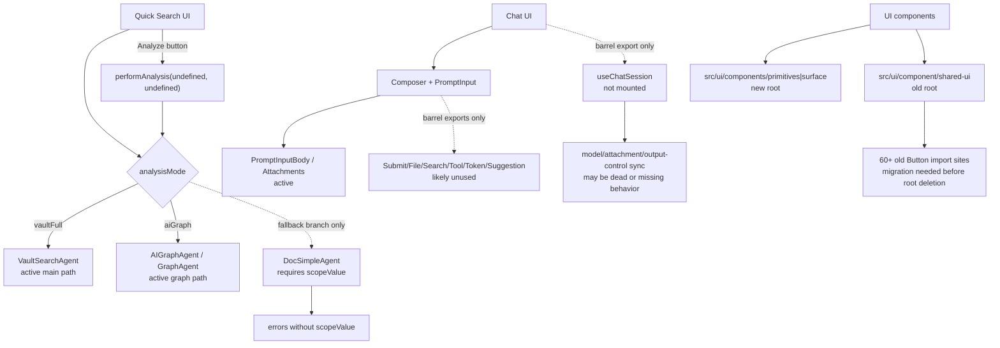

# T11X-E Codex 古董代码与重复形态审计（只读）

> 状态：Codex 只读调查。未修改产品代码，未删除文件，未提交 commit。
>
> 核心判断：你怀疑得对。现在代码里确实存在一批“不是 0 import 死代码、但真实产品路径已经不可达或被兼容层缠住”的旧代码。最典型的是 `DocSimpleAgent` 和 Chat 的若干旧 session/input 状态。它们比普通 grep 死代码更危险：因为表面还有 import / re-export，会让审计误判为 active。

## 1. 本文目标

本文不是继续追求一个虚假的 `-8k LOC` 大波次，而是回答三个问题：

1. 哪些代码虽然被 import，但当前 UI 入口已经不再能正常走到？
2. 哪些 Search / Chat / UI component 代码是历史残留、重复展示形态或 barrel re-export 伪活？
3. 下一轮如果要真正收敛，应先删/修哪几组，而不是继续泛泛扫描。

## 2. 总览图



读法：

- 实线是确认活路径。
- 虚线是“代码还连着，但正常用户路径不一定能到”的伪活路径。
- `DocSimpleAgent` 不是普通死代码；它更像“旧 single-file AI Analysis 模式残留”。
- Chat 旧状态更像“可能应该修回入口，也可能应该删”的悬挂逻辑。

## 3. 高置信候选

### A. `DocSimpleAgent`：旧 single-file AI Analysis 残留

**当前证据**

- `AnalysisMode` 当前只剩：
  - `vaultFull`
  - `aiGraph`
- Quick Search UI mode menu 也只提供这两个 mode。
- `performAnalysis()` 的最后 fallback 才调用 `aiSearchAgent.stream(...)`。
- `DocSimpleAgent.stream()` 强制要求 `scopeValue`，否则直接 yield error。
- Quick Search Analyze 按钮当前调用 `performAnalysis(undefined, undefined)`。
- 历史 docs 里还出现过 `docSimple / vaultSimple`，但当前 parser 只接受 `vaultFull / aiGraph`。

**结论**

`DocSimpleAgent` 表面 active，因为它还被 `AppContext.searchAgentFactory`、`QuickSearchHost.createDocSimpleAgent`、`useSearchSession` 引用。但当前正常 UI 模式下，它大概率不可达；即使走到 fallback，也没有 `scopeValue`，会失败。

**可收敛范围**

| 项 | 估算 |
|---|---:|
| `src/service/agents/DocSimpleAgent.ts` | -189 |
| `templates/prompts/ai-analysis-doc-simple-*.md` | -49 maint. |
| `PromptId.AiAnalysisDocSimple*` / `TemplateRegistry` entries | -10~20 |
| `AppContext.searchAgentFactory` / `QuickSearchHost.createDocSimpleAgent` / `useSearchSession aiSearchAgent` | -20~40 |

**风险**

- 需要确认没有外部 command / debug path 直接调用 `performAnalysis(_, scopeValue)`。
- 需要保留历史 markdown 的 `runAnalysisMode` 宽容解析；删除 agent 不等于删除历史文档读取。

**建议**

这是下一轮第一优先级。不是“直接删一个文件”，而是做一个 `DocSimple retirement` 小闭环：删入口、删 factory、删 prompts、加 regression：`AnalysisMode` 只有 `vaultFull|aiGraph`，Quick Search 不再创建 `DocSimpleAgent`。

### B. PromptInput 子组件：barrel re-export 伪活

**当前证据**

这些组件只有 `src/ui/component/prompt-input/index.ts` re-export，未看到真实 JSX 渲染入口：

| 文件 | LOC | 当前判断 |
|---|---:|---|
| `PromptInputFileButton.tsx` | 144 | likely unused |
| `PromptInputSubmit.tsx` | 206 | likely unused |
| `PromptInputSearchButton.tsx` | 154 | likely unused |
| `ToolButton.tsx` | 51 | likely unused |
| `TokenUsage.tsx` | 139 | likely unused |
| `SuggestionTags.tsx` | 71 | UI component unused；type 被 store 引用 |

Composer 当前自己实现了 run chip、send/cancel、attachment affordance，而不是使用这些旧小组件。

**可收敛范围**

保守可删约 `-690 ~ -760 LOC`，取决于是否把 `SuggestionTag` type 移到 `chatViewStore` 或 `prompt-input/types.ts`。

**风险**

- 需要防止未来外部从 barrel import 这些组件；可用 regression 扫描 `PromptInput(SearchButton|FileButton|Submit)|TokenUsage|ToolButton|SuggestionTags`。
- 删除 `PromptInputSubmit` 后要确认 Composer 的 submit/cancel 已覆盖所有行为。

**建议**

这是第二优先级，属于真正干净的 UI 死枝。比继续抽象 Usage Dashboard/Quick Search 小 card 更值得做。

### C. `useChatSession`：没挂载的 session 同步逻辑

**当前证据**

- `src/ui/view/chat-view/hooks/useChatSession.ts` 只有 `hooks/index.ts` re-export。
- 没发现 `useChatSession()` 在 Chat root、Messages view、Composer 或 Project views 中被调用。
- 文件内部却有重要副作用：
  - active conversation 打开时同步 `chatMode`
  - 同步 attachment handling mode
  - 同步 output control settings
  - 同步 selected model
  - 监听 store 变化并写回 conversation meta

**结论**

这不是简单“可删死代码”。它更像一个失联的旧 hook：

- 如果这些同步行为已被 `useChatSubmit` / manager fallback 取代，就应删除它和相关旧 store 字段。
- 如果这些同步行为仍然是产品需要，就应该把它挂到 `ChatViewComponent` 或 `MessagesViewComponent`，否则现在功能可能已经 silently broken。

**可收敛范围**

| 路线 | 结果 |
|---|---|
| 删除路线 | `useChatSession.ts` -185，顺带清理若干 store 字段 |
| 修复路线 | LOC 不一定减少，但修正真实功能缺口 |

**建议**

不要直接删。先做一个 focused test 或 runtime audit：打开已有 conversation 后，conversation model / attachment handling / output control 是否正确进入 UI 和后端。这个点更像 bug audit，不只是瘦身。

### D. Chat `fileChanges / promptsSuggest / suggestionTags`：旧 sessionStore 残留

**当前证据**

- `fileChanges` 只有 store 自己、`FileChangesList` 和 `useChatSession` 读取。
- `setFileChanges / updateFileChange / acceptFileChange / discardFileChange` 没看到真实写入方。
- `promptsSuggest` 只有 store 和 `useChatSession` 返回值。
- `suggestionTags` 的 UI 组件已经疑似 unused，store 里仅保留 setter/type。

**可收敛范围**

| 项 | 估算 |
|---|---:|
| `FileChangesList.tsx` | -166 |
| store fileChanges actions/state | -45~70 |
| promptsSuggest / suggestionTags state | -20~40 |
| `SuggestionTags.tsx` | -71 |

**风险**

File changes 可能原本属于旧 Copilot/Code Interpreter feature。现在没有写入方，删掉大概率安全，但需要确认用户是否还希望 Chat 内展示 file diff。

**建议**

和 PromptInput 一起做成 “Chat ghost state cleanup”。如果要保留 file diff 产品能力，应改走 Copilot review artifact surface，而不是留在 Chat store 里空转。

## 4. 中置信重复形态

### E. `src/ui/component` 与 `src/ui/components` 双根

**当前事实**

- `src/ui/components/primitives` 是新根。
- `src/ui/components/surface` 是新 surface 根。
- `src/ui/component/shared-ui` 旧根仍被广泛使用。
- `shared-ui/button` 仍有 60+ import site。
- `shared-ui` 自身体量约 838 LOC。

**为什么不能马上全删**

旧 `shared-ui` 还承担大量 Copilot、Quick Search、Settings、Ambient、Vault Lint 的按钮/input/tabs/switch。直接迁移到 primitives 会影响视觉细节，尤其是 `variant/size/className` 的兼容。

**建议**

不要把这件事当 LOC wave。它是 UI root governance wave：

1. 先禁止新增 `@/ui/component/shared-ui/*`。
2. 新代码只允许 `@/ui/components/primitives` / `@/ui/components/surface`。
3. 分 surface 迁移旧调用方。
4. 当 import site 清零后删除旧根。

预计直接净减不大，但能减少长期维护混乱。

### F. Quick Search V2 shim / restore bridge

**当前事实**

- `store/v2SessionTypes.ts` 是 re-export shim。
- `types/search-steps.ts` 是 re-export shim。
- `store/aiAnalysisStore.ts` 名字像 store，但实际主要做历史 analysis markdown → `searchSessionStore` 的 bridge。

**判断**

这里有可整理空间，但不是大 LOC 来源。真正收益是降低理解成本：

- 把 `aiAnalysisStore.ts` 重命名/迁移为 `analysisSnapshotRestore.ts`。
- 把 shim import 逐步改到 `@/core/search/*` 和 `@/service/search/v2ToolDisplay`。
- 保留历史 markdown restore；不要为了瘦身删除用户历史分析读取。

**估算**

净减 `-30 ~ -80 LOC`，但认知负担下降明显。

## 5. 低置信 / 不建议作为瘦身点

### G. `FollowupChatAgent`

`FollowupChatAgent` 仍然被 Quick Search post-analysis follow-up 使用，不应和 `DocSimpleAgent` 一起删。它可以后续和 `ContinueAnalysisAgent` / report follow-up flow 收口，但当前不是死代码。

### H. `CopilotArtifactAdapter`

它仍被 `CopilotReviewArtifactBuilder` 和 `CopilotResultContent` 使用。不是死代码。后续可做 artifact path 合并，但不是直接删除。

### I. `ResourcePreviewHover`

文件名直接 grep 会误判为 0 import，但它通过 `src/ui/component/mine/index.ts` 间接导出，并被 `MessageAttachmentsList` 使用。不能删。

## 6. 推荐下一波：不要叫“大瘦身”，叫 Ghost Path Cleanup

这轮如果让我继续，我建议做一个中等规模、真实可验证的 wave：

```text
T11X-E1 Ghost Path Cleanup

目标：
1. 退役 DocSimpleAgent 旧 single-file AI Analysis 路径。
2. 删除 PromptInput 未渲染子组件。
3. 清理 Chat ghost state：fileChanges / promptsSuggest / suggestionTags。
4. 对 useChatSession 做二选一：修回入口或删除；不能继续悬挂。
5. 加 regression，防止 barrel re-export 伪活再次出现。

预期：
- 保守净减：约 -900 ~ -1,300 TS/TSX LOC
- 如果 useChatSession 走删除路线：约 -1,200 ~ -1,600 TS/TSX LOC
- 如果 useChatSession 走修复路线：LOC 下降较少，但修掉真实产品缺口
```

这不是 `-5k` 波次，但它是“你正在找的那类古董代码”。

## 7. 代码阅读顺序

先按这个顺序读，最容易理解为什么它们是伪活：

1. `src/core/types/agents-shared.ts`
   - 看 `AnalysisMode = 'vaultFull' | 'aiGraph'`。
2. `src/ui/view/quick-search/SearchModal.tsx`
   - 看 `PRESETS` 只有 `vaultFull / aiGraph`。
   - 看 Analyze 调用 `performAnalysis(undefined, undefined)`。
3. `src/ui/view/quick-search/hooks/useSearchSession.ts`
   - 看 `vaultFull` / `aiGraph` 分支后才 fallback 到 `aiSearchAgent.stream(...)`。
4. `src/service/agents/DocSimpleAgent.ts`
   - 看它没有 `scopeValue` 会报错。
5. `src/ui/component/prompt-input/index.ts`
   - 看哪些旧组件还在 barrel export。
6. `src/ui/view/chat-view/components/Composer.tsx`
   - 看当前 composer 自己实现 submit/run-chip/attachment，不走那些旧组件。
7. `src/ui/view/chat-view/hooks/useChatSession.ts`
   - 看它有副作用，但没有挂载入口。
8. `src/ui/view/chat-view/store/chatViewStore.ts`
   - 看 `fileChanges/promptsSuggest/suggestionTags` 的状态和 setter。
9. `src/ui/view/chat-view/components/messages/FileChangesList.tsx`
   - 看它只读空转 store，没有生产方。
10. `src/ui/component/shared-ui/*` 与 `src/ui/components/primitives/*`
   - 看 UI root 双系统仍存在。

## 8. 需要守住的边界

下一步无论谁执行，都不能回到旧问题：

- 不新增 `service -> ui`、`ui -> app`、`service/core -> Obsidian`。
- 不新增 service 层 runtime singleton。
- 不为“兼容旧代码”新建第二套运行路径。
- 不删 Usage Dashboard、Chat 三视图、Quick Search、Copilot、Settings、Onboarding。
- 不把 `FollowupChatAgent` 误删。
- 不把历史 AI Analysis markdown restore 当死代码删掉。
- 不把 `ResourcePreviewHover` 当死代码删掉。

## 9. 当前结论

如果问题是“为什么代码还这么多”，答案不是“还有一个巨大死代码矿”。更准确是：

1. UI/Chat/Search 里有不少旧模式残留，但多是 100~700 LOC 的中块。
2. 最大的真实古董候选是 `DocSimpleAgent`，因为它已经没有 UI mode。
3. PromptInput 和 Chat store 里有一批 barrel re-export / setter-only 状态，可以比较干净地收。
4. `shared-ui` 双根是长期治理问题，不能靠一次机械替换解决。
5. 要继续大幅减代码，必须从“功能路径合并”入手，不是继续普通 dead-code grep。

