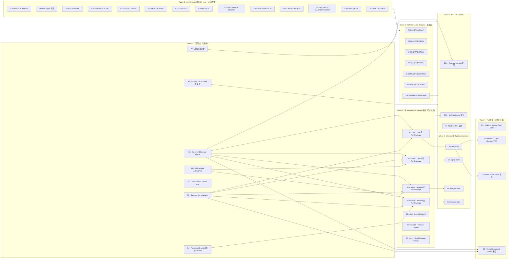

# Full Backlog Execution Plan — 2026-07-03

**目的**：把当前所有未 landed 项（架构 wire-in / lint detector / 产品升级 / 文档补齐 / backlog 调研）整合成一张 DAG，明确依赖关系与可并行边界，任何执行者（人 or AI session）拿这份 plan 都能自己按拓扑顺序推进。

**范围来源**：本 plan 上游是 2026-07-03 的"综合梳理"对话 —— 从 `docs/index.html` / `roadmap.html` / `01-architecture.html` / `05-use-case-playbook.html` / `13-feature-vault-intelligence.html` / `22-infra-context-pipeline.html` 里挑出的全部"非 landed"项，共 6 桶 · ~50 个任务节点。

**执行原则**（不要偏离）：

- **DAG 严格执行**：一个节点的所有前置未 done 前不启动
- **同 wave 内允许并行**：worktree isolation 或按节点分工都行
- **每个节点一次一 commit**，`refactor(...)` / `feat(...)` / `fix(...)` / `docs(...)` 前缀选一致
- **测试 + build 每次绿再进下一节点**
- **不要打包**：一个节点做完就 land，别攒
- **不要偷懒**：所有节点都要跑 `npm run test` + `npm run build`
- **文档节点包括更新 `docs/progress.md`**

---

## 1. 顶层 DAG · 五条并行 track



---

## 2. Wave 定义 · 什么时候可以启动下一 wave

| Wave | 启动条件 | 完工判据 | 预计规模 |
|---|---|---|---|
| W0 | 无 | 7 节点全 landed，`main` 分支绿 | 小-中 |
| W1 | W0 全 done | 7 个 adopter 全接进 live 路径，真机烟测通过 | 中 × 7 |
| W2 | 无（跟 W0/W1 并行） | 14 个 detector 全接进 lint scan，findings 数量提升 | 小-中 × 14 |
| W3 | W1 对应 feature done | 4 个 store 全走 RunEnvelopeStore，UI 无回归 | 中 × 4 |
| W4 | W3 相关 store done | 4 项产品升级各自 landed，用户可感 | 中-大 × 4 |
| W5 | W2 完成 + LLM budget 基础设施就绪 | 6 个 LLM detector + Multimodal 全接 | 大 × 7 |
| W6 | 各自前置见 DAG | 文档补齐 + 11 条 backlog 每条有 research 报告 | 中 × 13 |

---

## 3. Wave 0 · 立即启动（**7 节点全独立**）

### A0 · 文档标签同步

**做什么**：把陈旧的 partial / planned / 待补 标签跟当前代码状态对齐。

**改哪几处**：

- `docs/01-architecture.html` §trace-artifact 表
  - `Artifact 统一` 那行 `<span class="pill blue">partial</span>` → `<span class="pill green">landed</span>`，正文改成 "ArtifactPort + InMemoryArtifactStore 已 landed，Vault-backed 实现见 B6"
  - `Trace 事件统一` 那行同上 → landed；正文改为 "RunEnvelope + 8 adopter + golden-trace-cross-backend 已 landed"
- `docs/roadmap.html` §decided 表
  - 删除 "Feature 文档 14 / 15 / 13" 行（三份 doc 都在 index 里）
  - "AN/AO/AP 收尾" 行核查后：若已过 QA 迁到 §done；否则改状态为 "landed 未验证" 或删除
- `docs/index.html` L130 "灰色标 planned 的还没写" → 改成 "15 份根目录文档按主题分三组"
- `docs/progress.md` 末尾追加 "Doc status sync 2026-07-03"

**产物**：3 份 doc 更新 + 1 commit `docs(sync): align stale status labels with landed code`

**规模**：30 分钟

---

### B1 · CommandGateway wire-in

**做什么**：`main.ts` 里现在 ~10 处 `this.addCommand({ id, name, callback })` 各自跑业务；改成先在 CommandGateway 上 `register(GatewayBinding)`，再让 Obsidian callback 走 `() => gateway.dispatch(id)`。

**技术要点**：

- 在 `AppRuntimeRegistry` / `AppContext` 里挂一个 `commandGateway: CommandGateway` 单例
- 每条命令写一份 `CapabilityManifest`（fixture 放 `test/fixtures/capabilities/commands/`）
- `execute` 用 `composeExecuteFromPolicy(manifest, backendRegistry)` 合成（依赖 **B3 未 done 时先用 `makeEchoStrategy` 占位**）
- 原 callback 内容整体搬到 `execute` 里

**产物**：`main.ts` diff + 命令 fixture + 每条命令一个 wire-in test（点触即回 RunSession）

**规模**：中，一天

**依赖**：无（B3 未 done 前用 stub strategy）

---

### B4 · PermissionGuard 消费 quarantine

**做什么**：harness 里工具真正执行前调 `guardToolExecution`，拒绝时返 `fail('skill-quarantine: ...', false)`。

**改哪儿**：

- 找 `service/agents/harness/` 下工具 dispatch 点（大约 `HarnessRunner` 或 `AgentLoop.executeToolCall`）
- 包一层：`await guardToolExecution({ compiled: currentSkill, tool, input, ctx })`
- 加 UI toast 提示"某 tool 被 skill quarantine 拒绝"

**产物**：单元测试证明 strict skill 拒绝一个白名单外 tool；真机跑一次触发拒绝

**规模**：中

**依赖**：无

---

### B6 · Vault-backed ArtifactPort

**做什么**：`InMemoryArtifactStore` 只在测试用。加一个 `VaultArtifactStore implements ArtifactPort`，body 写到 `Vault/.peak/artifacts/<runId>/<artifactId>.<ext>`。

**技术要点**：

- 用 `AppHandle.vaultAdapter` 写文件（Vault-safe path 规范化必做）
- meta 单独存 `artifacts/<runId>/index.json`
- `listByRun(runId)` 读 index.json；`getArtifactBody(artifactId)` 读单文件
- ContentType 决定扩展名（markdown → .md / json → .json / trace → .trace.json）

**产物**：`src/service/run-envelope/VaultArtifactStore.ts` + 测试（内存 vs vault 行为一致性）

**规模**：中

**依赖**：无

---

### B7 · IndexService Graph slice

**做什么**：把 `IndexService` 里的 graph 操作（`upsertGraphEdges…` / `refreshMobiusAggregates…` / `recomputePageRank…` / `rebuildSemanticEdges…`）抽到 `IndexGraphPort`，`IndexService implements IndexGraphPort`。

**产物**：

- `src/core/ports/IndexGraphPort.ts`（列 5-7 个 graph mutating method）
- `src/service/search/index/indexService.ts` 加 `implements IndexGraphPort`
- 相关类型如需上升到 `core/types/index-graph.ts`
- `test/index-graph-port.test.ts` 3 条 guard（shape / boundary / implements）

**规模**：小-中，纯搬

**依赖**：无

---

### B3 · Backend live strategies

**做什么**：`BackendStrategyRegistry` 空架子；注册 hermes-harness / claude-sdk / provider-direct 三个真 backend。

**技术要点**：

- 在 `AppRuntimeRegistry` 合成期：判断 `settings.providers` 里哪些 provider 有 API key
- hermes-harness → 走 `runAgentLoop`
- claude-sdk → 走 Claude Anthropic SDK 直接调用
- provider-direct → 走 `MultiProviderChatService.streamText`
- 没配 key 的 backend **不注册**，`resolveBackendStrategy` 自动 fallback

**产物**：`src/app/composition/registerBackendStrategies.ts` + 3 条集成测试

**规模**：中，需要真 API key 试

**依赖**：无（但需要 provider 层可用）

---

### E1 · 05 playbook 3 cases 补文档

**做什么**：`docs/05-use-case-playbook.html` 的 Case 3/4/9 从 `待补详细文档` / `待抽基础设施文档` 补齐详细步骤。

- Case 3 · AI 总结主题材料 → 补 Vault Intelligence 使用步骤（触发 Vault tab / Scan / 看 finding）
- Case 4 · 看笔记关系 → 补 AI Graph 使用步骤（打开 view / node inspection / community 高亮）
- Case 9 · AI 知道我在做什么 → 补 Context Pipeline 基础设施说明（focus folder / active session / recent messages 如何进 prompt）

**产物**：3 段 case 内容 + doc-index.html 同步

**规模**：小，一晚

**依赖**：无

---

## 4. Wave 1 · RunEnvelope live adoption（**7 节点全独立 · 可 7 并发**）

**共同前置**：W0 全 done（尤其 B1 + B3 + B4 + B6）

**共同模式**：每个节点做以下改动

1. 找当前 feature 的 live 触发入口（如 chat 发消息、copilot 点 review 按钮）
2. 用对应 `*Run.ts` 包一层（如 `runChatConversation({ send: () => oldSendMessage() })`）
3. `send/review/generate/execute` 传入的 worker 就是原业务函数（保持行为不变）
4. `onEvent` 挂进 UI store（触发 zustand update）
5. 真机烟测：跑一次能看到 RunSession 起止时间、artifact 记录

### 节点列表

| ID | Feature | 关键改动位置 | 依赖 |
|---|---|---|---|
| B2.chat | Chat conversation | `service/chat/service-manager.ts` sendMessage 出口 | B1, B3 |
| B2.copilot | Copilot review | `service/copilot/CopilotReviewSession.ts` runReview 出口 | B3, B6 |
| B2.analysis | AI Analysis | `service/agents/report/ReportOrchestrator.ts` orchestrate 出口 | B3, B6 |
| B2.harness | Harness agent | `service/agents/harness/runAgentLoop.ts` 顶层 | B3, B4 |
| B2.index | IndexInitializer | `main.ts` startup checkAndUpdateIndex 调用 | 无 |
| B2.cascade | CascadeWorker | `service/search/index/cascade/CascadeWorker.ts` drainDebt 顶层 | 无 |
| B2.graph | GraphCleanup | 主入口 `GraphCleanupService.run` 顶层 | 无 |

**规模**：每节点 半天-一天

**共同产物**：每节点一次真机烟测截图 + progress.md 追一行

---

## 5. Wave 2 · Lint Detector 批量（**14 节点全独立 · 可 14 并发**）

**共同前置**：无（可跟 W0/W1 完全并行）

**共同模式**：

1. 在 `src/service/lint/signals/<signalId>Detector.ts` 新建
2. `class XxxDetector implements LintSignalDetector`
3. 从 `vault-lint-config.json` 读阈值（**禁止 hardcode**）
4. 在 `InMemoryDetectorRegistry` 注册
5. `test/lint-<signalId>-detector.test.ts` 4-6 条 guard（threshold / positive / negative / edge / config）
6. `13-feature-vault-intelligence.html` 相关行 spec-only → shipped

### 节点列表

**结构类（4）** · 依赖 graph edges / degrees

| ID | 信号 | 阈值 | 依赖数据 |
|---|---|---|---|
| C-S1 | S-SOFT-ORPHAN | degree ≤ 2 | node degrees |
| C-S2 | S-MISSING-BACKLINK | similarity ≥ 0.70 | semantic edges |
| C-S3 | S-ISLAND-CLUSTER | size ≤ 5 | connected components |
| C-S4 | S-FRAGILE-BRIDGE | density ≤ 0.30 | community + degree |

**内容类（4）** · 单文档质量

| ID | 信号 | 阈值 |
|---|---|---|
| C-C1 | C-OVERSIZED | words ≥ 5000 |
| C-C2 | C-DUPLICATE | sim ≥ 0.92, title jaccard ≥ 0.50 |
| C-C3 | C-FRONTMATTER-MISSING | rule-based |
| C-C4 | C-NAMING-VIOLATION | rule-based |

**时间类（3）** · 老化

| ID | 信号 | 阈值 |
|---|---|---|
| C-T1 | T-DECAYING-BRIDGE | 365 days |
| C-T2 | T-ABANDONED-CLUSTER/FOLDER | 180 / 365 |
| C-T3 | T-RECENT-DRIFT | 30 / 180 |

**Hub 类（2）** · 已 partial

| ID | 信号 | 状态 |
|---|---|---|
| C-HUB1 | T-STALE-HUB | infra 已在打 `hub_stale_since`；补 detector |
| C-HUB2 | HubDoc 生成实装 | `HubDocService.regenerateHubByNodeId` 从 stub 实装 |

**图类（1）**

| ID | 信号 | 阈值 |
|---|---|---|
| C-G1 | G-TAG-EXPLOSION | multiplier ≥ 5 |

**规模**：每节点 小-中，1-4 小时

---

## 6. Wave 3 · UI store 迁 RunEnvelopeStore（**4 节点 · 每节点前置对应 W1 项**）

**共同前置**：对应 feature 的 W1 节点 done

**共同模式**：

1. 现有 zustand store（如 `chatStore`）内的进度 / 状态字段
2. 改成用 `RunEnvelopeStore.register('lastStatus', selector)` 派生
3. UI 组件订阅改成 `useSyncExternalStore(projection.subscribe, projection.getSnapshot)` 或用 zustand adapter
4. 真机烟测：进度条 / 状态点仍然实时更新

### 节点列表

| ID | store | 前置 | 规模 |
|---|---|---|---|
| B5.chat | `ui/view/chat-view/store/chatStore` | B2.chat | 中 |
| B5.copilot | copilot store | B2.copilot | 中 |
| B5.analysis | analysis store | B2.analysis | 中 |
| B5.harness | harness runtime state | B2.harness | 中 |

---

## 7. Wave 4 · 产品升级（**4 节点 · 依赖如下**）

### D1 · Ambient Push Current Work State（无依赖）

**做什么**：Ambient 从"相关笔记列表"升级为"当前工作状态 / Session Thought Trace"。

**依据 spec**：`docs/superpowers/specs/2026-06-02-ambient-push-current-work-state-*`

**技术要点**：

- 新数据源：最近 N 分钟内的 chat message / 文档编辑 / 搜索关键词
- 用短-context LLM 摘要出"你现在正在思考的问题"
- 在 vault 里检索"跟这个思考角度相关"的笔记（比原来"相关笔记"更贴近意图）
- 状态栏 + gutter + Morning Briefing 三处呈现同一份数据

**产物**：新 `AmbientCurrentStateService` + 摘要 prompt + 检索器 + UI 三处更新

**规模**：中-大

**依赖**：无

---

### D2 · Copilot Command Center 重设

**依据 spec**：`docs/superpowers/specs/2026-05-14-copilot-command-center-user-centered-redesign.md`

**做什么**：点 Copilot / Knowledge Analysis 后，AI 自动 plan 一份 capability 计划，用户 review 后逐步执行。

**技术要点**：

- Meta-agent 起草 capability sequence（一份 JSON plan）
- 侧栏 / 弹窗 / review panel 三种承载方式
- 每一步都是一次 `gateway.dispatch(capId)`
- UI 展现"当前步 → 下一步"进度

**规模**：大

**依赖**：**B1 CommandGateway wire-in** + **B3 backend strategies live**

---

### D3.mermaid · Chat 富生成 Mermaid（前置 B5.chat）

**做什么**：Chat 回答里能内联 mermaid 图；渲染用 `shiki` mermaid extension 或直接 mermaid.js。

**Vault-aware**：AI 生成 mermaid 时能引用 vault 里真实的文档 title（渲染时点击 → 打开）。

**产物**：mermaid 渲染组件 + prompt 里加"vault 语境注入" + 测试

**规模**：中

---

### D3.bases · Chat 富生成 Bases（前置 B5.chat）

**做什么**：Chat 里能生成 Obsidian 新 Bases 视图（数据视图）。

**技术要点**：这是 Obsidian 最新的数据库 view type，格式需要跟官方接口对齐。

**规模**：中

---

## 8. Wave 5 · LLM Semantic Detector + Multimodal

### C-M1 ~ C-M6 · 6 个 LLM detector

**共同前置**：W2 全 done（**理由**：LLM detector 跑起来贵，先把便宜的 spec-only 全接了，让用户先看到量的提升；然后再上 LLM 层做质的提升）

**共同前置 · 基础设施**：LLM budget + throttle infra（`LintSignalDetector.requiresLlm` 字段已在 config，但节流器还没实装）

**共同模式**：

1. 每个 detector 一份 `<signalId>PromptTemplate`（放 `templates/lint/`）
2. 走 `contradictionConcurrency = 2` 之类节流参数（都在 config）
3. 命中率低时 detector 应该便宜地跳过（比如先用向量检索预筛，再喂 LLM）
4. 每次 scan 报告"跑了多少 LLM 调用，估算成本"

### 节点列表

| ID | 信号 | 输入形态 |
|---|---|---|
| C-M1 | M-COVERAGE-GAP | 主题地图缺口 |
| C-M2 | M-LOW-COHESION | 单文档主题混杂 |
| C-M3 | M-CONTRADICTION | 两文档语义矛盾（sim ≥ 0.80 内对比） |
| C-M4 | M-PHANTOM-NODE | 被引 ≥ 3 次但不存在的 wikilink 目标 |
| C-M5 | M-SEMANTIC-ISOLATION | 语义孤立 |
| C-M6 | M-REDUNDANT-HUBS | 冗余 hub（overlap ≥ 0.70） |

**规模**：每节点 中-大

---

### D4 · Multimodal Media Ring

**依据 research**：`docs/research/2026-07-01-multimodal-generation-studio/`

**做什么**：不是独立 Studio，是挂在 chat / note / copilot 的"媒体工具环"。骨干押 fal.ai 聚合。

**优先级 & 分阶段**：

1. TTS + 笔记播客（低摩擦，用户上手快）
2. 封面图（长按笔记 → generate cover）
3. Chat 内插图（跟 D3.mermaid 同样的内联渲染路径）
4. 视频（可选）
5. 音乐（放弃）

**护城河**：vault-aware（引用笔记内容生成） + project style token + 附件生命周期

**产物**：`service/media/` 新 runtime + fal.ai 客户端 + 4 段用户流程

**规模**：大，独立一 track，可跟 W5 detector 并行

**依赖**：**必须已 W3 完成**（UI 事件流已迁到 RunEnvelope 才好让"我正在生成图"的进度状态自然接进）

---

## 9. Wave 6 · Doc + Research

### E2.1 · 22 context pipeline · Command Gateway 章节（**前置 B1**）

**做什么**：`docs/22-infra-context-pipeline.html` 里 Command Gateway 那一段目前 spec-only，B1 完成后补真实 context 装配说明。

**产物**：补充章节 + 状态标签改 landed

---

### E2.2 · 22 context pipeline · Unified 章节（**前置 W1 完成**）

**做什么**：如果 Chat / Agent / Ambient 都走 RunEnvelope 之后 context 装配的三条路径能收敛，补一段"Unified ContextPipeline"文档；否则更新 spec 说明"决定不收敛，原因是 X"。

**规模**：中

---

### R · 11 条 backlog 逐条调研

**规则**：每条 backlog 动前必须先在 `docs/research/YYYY-MM-DD-<slug>/README.md` 落一份调研报告。

**排序（推荐调研顺序）**：

| # | 主题 | 调研角度重点 |
|---|---|---|
| R1 | Real-time LLM context inspector | 现有 trace infra 直接够不够；成本 |
| R2 | Message branching | UI/UX + storage schema |
| R3 | Conversation auto-split | LLM 分类 + UX（自动 vs 提示） |
| R4 | Canvas conversation type | Obsidian Canvas API 集成度 |
| R5 | Sync 外部笔记源 | flomo / Apple Notes / Calendar 各自 API 现状 |
| R6 | Graph 高级可视化 | Nebula / healing ray / source-sink 三个视图分别调研 |
| R7 | Message persistence queue | AI 自主决定"这条要存回 vault"的判据 |
| R8 | Template marketplace | 分发协议 + 版本 + 安全审阅 |
| R9 | Work focus mode + project templates | 已有 project 类型能不能复用 |
| R10 | IFTTT / Workflow agent | 触发器 vs 已有 command gateway 关系 |
| R11 | n8n / multi-agent / marketplace | 最大最模糊，最后调研 |

**规模**：每条 半天调研 + 一份 report

**共同产物**：调研完在 `roadmap.html` §researching 补一行

---

## 10. 执行规则

### 顺序约定

**Wave 内节点全独立**：Wave 内所有节点没有内部依赖，可以完全并行。

**Wave 之间的依赖只在 DAG 里的直连边**：例如 B2.chat 前置是 B1 + B3；一旦 B1 + B3 done，即使 B2.copilot 还没做，B2.chat 也可以先开。

### 并行策略（如有多 executor）

1. **worktree 隔离** · 每人一 worktree 各自 wave-1 节点，最后 rebase
2. **顺序化关键点** · Wave 转换点（W1 → W3）一定要合流一次跑全测再进入下一 wave
3. **Lint detector 节点（W2）纯加法**，可以随时插空跑，不阻塞主线

### 单节点收工判据

- [ ] 代码通过 `npm run test`
- [ ] 通过 `npm run build`
- [ ] T11 boundary regression 全绿
- [ ] 若涉及 UI，真机烟测过（截图入 progress.md）
- [ ] `docs/progress.md` 追加一段
- [ ] 若关键节点，`docs/roadmap.html` `#done` 或 `#researching` 补一行
- [ ] `docs/01-architecture.html` 相关状态标签同步（landed / partial → 更新）
- [ ] git commit 前缀正确

### 分支/PR 策略

- **无分叉执行**（AI session 单人跑）：直接在 `codex/peak-modernization-refactor` 一路 commit
- **多人执行**：每个 Wave-1 节点开一个 sub-branch，合入前跑完整 test

### 何时算总完工

- [ ] W0-W6 所有节点 landed
- [ ] `docs/roadmap.html` §decided 表 = 空（或全部迁到 §done）
- [ ] `docs/13-feature-vault-intelligence.html` 里 spec-only pill 数 = 0
- [ ] `docs/01-architecture.html` §trace-artifact 表全 landed
- [ ] `docs/index.html` L130 陈旧文案已修
- [ ] `docs/roadmap.html` §backlog 每条要么有 research，要么进 §researching

---

## 11. 追踪表（executor 每完成一节点在这里勾选）

### Wave 0 (7)
- [ ] A0 · 文档标签同步
- [ ] B1 · CommandGateway wire-in
- [ ] B3 · Backend live strategies
- [ ] B4 · PermissionGuard 消费 quarantine
- [ ] B6 · Vault-backed ArtifactPort
- [ ] B7 · IndexService Graph slice
- [ ] E1 · 05 playbook 3 cases

### Wave 1 (7)
- [ ] B2.chat
- [ ] B2.copilot
- [ ] B2.analysis
- [ ] B2.harness
- [ ] B2.index
- [ ] B2.cascade
- [ ] B2.graph

### Wave 2 (14)
- [ ] C-HUB1 · T-STALE-HUB
- [ ] C-HUB2 · HubDoc regen 实装
- [ ] C-S1 · S-SOFT-ORPHAN
- [ ] C-S2 · S-MISSING-BACKLINK
- [ ] C-S3 · S-ISLAND-CLUSTER
- [ ] C-S4 · S-FRAGILE-BRIDGE
- [ ] C-C1 · C-OVERSIZED
- [ ] C-C2 · C-DUPLICATE
- [ ] C-C3 · C-FRONTMATTER-MISSING
- [ ] C-C4 · C-NAMING-VIOLATION
- [ ] C-T1 · T-DECAYING-BRIDGE
- [ ] C-T2 · T-ABANDONED-CLUSTER/FOLDER
- [ ] C-T3 · T-RECENT-DRIFT
- [ ] C-G1 · G-TAG-EXPLOSION

### Wave 3 (4)
- [ ] B5.chat
- [ ] B5.copilot
- [ ] B5.analysis
- [ ] B5.harness

### Wave 4 (4)
- [ ] D1 · Ambient Current Work State
- [ ] D2 · Copilot Command Center 重设
- [ ] D3.mermaid · Chat Mermaid 生成
- [ ] D3.bases · Chat Bases 生成

### Wave 5 (7)
- [ ] C-M1 · M-COVERAGE-GAP
- [ ] C-M2 · M-LOW-COHESION
- [ ] C-M3 · M-CONTRADICTION
- [ ] C-M4 · M-PHANTOM-NODE
- [ ] C-M5 · M-SEMANTIC-ISOLATION
- [ ] C-M6 · M-REDUNDANT-HUBS
- [ ] D4 · Multimodal Media Ring

### Wave 6 (13)
- [ ] E2.1 · 22 pipeline · Gateway 章节
- [ ] E2.2 · 22 pipeline · Unified 章节
- [ ] R1 · Real-time LLM context inspector
- [ ] R2 · Message branching
- [ ] R3 · Conversation auto-split
- [ ] R4 · Canvas conversation type
- [ ] R5 · Sync 外部笔记源
- [ ] R6 · Graph 高级可视化
- [ ] R7 · Message persistence queue
- [ ] R8 · Template marketplace
- [ ] R9 · Work focus mode + project templates
- [ ] R10 · IFTTT / Workflow agent
- [ ] R11 · n8n / multi-agent / marketplace

**总计 56 节点**（Wave 0-5 共 43 + Wave 6 共 13）。

---

## 12. 上游 spec 索引

| 节点/主题 | 上游 spec / research |
|---|---|
| 全部 handbook T-任务 | `docs/superpowers/specs/2026-06-01-peak-system-architecture-modernization-handbook.html` |
| 完工规划 | `docs/superpowers/specs/2026-07-02-architecture-modernization-completion-plan.md` |
| T3 首适配器选型 | `docs/superpowers/specs/2026-07-02-t3-first-adopter-selection-design.md` |
| T12 Command Gateway | `docs/superpowers/specs/2026-06-03-obsidian-plugin-command-gateway-capstone-review.html` |
| D1 Ambient Current State | `docs/superpowers/specs/2026-06-02-ambient-push-current-work-state-product-technical-review.html` |
| D2 Copilot Command Center | `docs/superpowers/specs/2026-05-14-copilot-command-center-user-centered-redesign.md` |
| D3 Chat 富生成 | `docs/research/2026-07-01-rich-generation-in-chat/README.md` |
| D4 Multimodal | `docs/research/2026-07-01-multimodal-generation-studio/README.md` |
| Vault Lint 全体 | `docs/13-feature-vault-intelligence.html` + `templates/config/vault-lint-config.json` |
| Context Pipeline | `docs/superpowers/specs/2026-05-02-unified-context-pipeline-design.md` |

---

## 13. 收工

当追踪表全部勾选，写一份 `docs/progress.md` 收工段：

```
## Full Backlog Sweep Complete · YYYY-MM-DD

- Wave 0-6 共 56 节点全 landed
- roadmap.html §decided / §researching 迁移完毕
- 13-feature-vault-intelligence.html 15 类 detector 全接
- 01-architecture.html 底表全绿
- backlog 11 条各有 research 报告
```

之后就没有"未 landed"这一说了。下一轮开新的 handbook。
