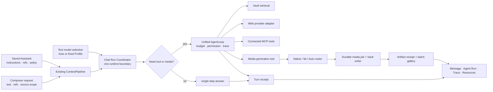

# Chat Runtime 与生成能力闭环 — Claude Code 实施交接

日期：2026-07-20（实施状态核对更新：2026-07-21）  
状态：**Track A–E2 已在当前未提交工作区实现；剩余能力已提升为 owner-mandated 的零遗留收口**。续接实施只读 [2026-07-21-chat-zero-gap-closure-claude-handoff.md](./2026-07-21-chat-zero-gap-closure-claude-handoff.md)，并见 [交付报告](./2026-07-21-chat-runtime-capability-closure-delivery.md) 与 [能力测试清单](../../testing/chat-studio-capability-checklist.md)。  
读者：在本仓库中实施 Chat 功能的 Claude Code  
目标：让 Chat Studio 的可见能力与真实运行时一致；把模型、工具、Agent Run、媒体生成和回执接成可验证的闭环。

> **重要：本文件的第 1–2 节是 2026-07-20 的实施前基线，不是当前状态。** 当前分支已有一批未提交实现。任何后续 Claude Code 必须先读第 0 节、交付报告和工作区 diff，再决定做验证、补洞还是继续实施；不得把旧基线当成待重做清单，也不得把本地 mock/test 通过误报为外部付费生成已实机成功。

## 0. 当前实施状态门槛（给后续 Claude Code）

### 0.1 已在源码中实现，并有本地验证证据

以下是当前工作区的**已实现范围**。本次状态复核已重新运行 6 个跨链路测试（Harness Chat、media service、media state matrix、MCP、Assistant、OpenAI native image adapter）和 `npm run build`，全部通过；交付报告声称全量测试为 239/239，但本次复核没有重复跑全量。

| 范围 | 当前事实 | 关键落点 / 证据 |
| --- | --- | --- |
| Chat 统一 Agent Run | **已实现** | Chat 经 `harnessChatRunner.ts` 进入可流式 Harness `AgentLoop`；run id、tool step、permission、cancel/error 状态由真实事件驱动，不再由 UI fixture 推断。`test/chat-harness-runner.test.ts` 通过。 |
| Chat 内图片生成 | **已实现，等待有凭据的实机调用** | `media_generate` 支持 `native`（当前仅 OpenAI image）、`fal` 与 `auto`；preflight、route/model/cost receipt、Vault 写入已接线。`test/media-generation-service.test.ts`、`test/openai-native-image-adapter.test.ts` 通过。 |
| 视频与音乐生成的产品链路 | **已实现为 fal 异步 job，尚未生产验收** | Composer / tool 入口、确认门、持久化 job、poll、重试、取消、本地重启恢复、Vault artifact/receipt 都在；music 是独立 `mediaKind`，不是 TTS。`test/media-status-matrix.test.ts` 通过。 |
| Media Settings 与可用性提示 | **已实现** | `Settings → Media Generation` 提供 Auto / Native / fal、key、目录、preset、OpenAI profile、route×kind 矩阵和本地 Validate；缺 key / profile 有真实 Configure 跳转。 |
| MCP 进入 Chat 与权限提示 | **已实现，等待真实 MCP server 验收** | 已连接 MCP 工具转为 Chat Harness tools；可变更工具经 PermissionGuard / `PermissionAskCard`；断连不伪造工具。`test/mcp-chat-integration.test.ts` 通过。 |
| Saved Assistant 真正影响运行时 | **已实现，等待实机会话验收** | instructions、knowledgeRefs、toolPolicy、preferredModel 进入 context / dispatch / receipt；`test/assistant-runtime.test.ts` 通过。 |
| Web 搜索 fallback | **已实现为 profile fallback** | 模型 catalog 的 `webSearch` metadata 不再抑制唯一可用 fallback；目前仍没有 native provider web-search adapter。 |

### 0.2 已有代码，但只能称为 PARTIAL，不能宣传为“已上线”

| 范围 | 为什么仍是 PARTIAL | 后续 Claude Code 的正确行为 |
| --- | --- | --- |
| OpenAI Native / fal 真实生成 | 本地已验证 request/response/error contract；当前没有可用 API key、计费授权和实际产物证据。Obsidian `app://` 对 OpenAI endpoint 的 CORS 也未实测。 | 不改写成“生产可用”。拿到明确授权的 test key 后，按 checklist `MEDIA-04` 执行真实调用；若 CORS 被拦截，只在 adapter 边界切换到 `requestUrl`。 |
| fal 视频 / 音乐默认 endpoint | 2026-07-21 已按 fal 官方文档核实修正（[核查报告](../../research/2026-07-21-fal-endpoint-verification/README.md)）：video 默认 `fal-ai/veo3.1`（veo3 已被 fal 废弃）+ `fast` preset；`lyria2` 核实存在、商用标注、输出固定 ~30s；payload 三处 CRITICAL 修正（duration 枚举串 / TTS `prompt` 字段 / music 删 duration）。 | 仍缺真实付费调用证据；拿到 fal key 后按 checklist MEDIA-04 实测，再据实测微调 config。 |
| 视频 / 音乐上线条件 | 2026-07-21：usage emitter 已接入（`MediaUsageEmitter` → `UsageRecordedViewEvent`，feature `media_generation`，estimated 语义）；音乐授权/商用说明已落 Settings → Media Generation → Music 段；MEDIA-03 门槛全项满足，checklist 已升 `AVAILABLE`（待实机验收）。fal 仍无 remote cancel（本地停止跟踪即权威取消，可能仍产生费用）。 | 剩余项只有带真实 key 的外部实机验收（MEDIA-04）；远程取消仅在 provider 真支持时加入，不能伪造。 |
| MCP、Assistant、Chat Agent Run | 集成与合约测试已过，但没有带真实 server / profile 的 owner-level Obsidian walkthrough 证据。 | 配置真实 MCP server 与 Assistant 后，按 checklist 录制 / 截图，核对 permission、步骤和 receipt。 |
| Web 搜索 | fallback 可以运行，但 source 仍从返回文本抽取 URL；没有结构化 native-web provider。 | 只能标为 fallback；新增 native provider adapter 前不得显示或声称 native web route。 |

### 0.3 当前仍未实现（不得在 UI 或文档中叫“完成”）

| 能力 | 现状 |
| --- | --- |
| 参考图 / mask 的 image edit | `NOT WIRED`；当前只有 text-to-image。 |
| 原生视频或原生音乐 provider 路由 | `NOT WIRED`；native 当前只承诺 OpenAI image，视频 / 音乐走 fal async route。 |
| 音频 / 视频附件的可靠模型理解 | `PARTIAL`；能上传，但没有专用 audio/video loader，不得承诺模型理解媒体内容。 |
| Dataview、Excalidraw / draw.io 生成、Chat Extract / Reminder | `NOT WIRED`；不能把源码输出或 Copilot 的独立能力伪装成 Chat artifact。 |
| Usage Dashboard 的媒体消费行、音乐授权 / 商用说明 | 2026-07-21 已接入 / 已落 Settings（见 0.2 行更新与 checklist MEDIA-03）；视频 / 音乐已升 `AVAILABLE`（待实机验收）。 |

### 0.4 后续 Claude Code 的启动规则

1. 先检查 `git diff --stat`、本节、交付报告、测试清单和实际源码；若这批未提交改动不在工作区，才退回第 1–9 节的实施前基线重新审计。
2. 有当前改动时，**不重做 Track A–E2**。只处理 0.2 / 0.3 中被 owner 明确授权的缺口，或修复由测试 / 实机复现出来的回归。
3. 外部付费调用、真实 key、MCP server、模型 endpoint 与 CORS 验证都需要真实配置；没有配置时，交付内容只能是本地 contract / mock-free adapter 测试与精确阻塞说明。
4. 每次状态变化必须同步更新 [能力测试清单](../../testing/chat-studio-capability-checklist.md)：区分 `AVAILABLE`、`PARTIAL`、`INFRA ONLY`、`NOT WIRED`，并附真实证据。

## 1. 实施前基线（历史记录，勿按此重做）

当前 Chat 有真实的普通流式对话、Vault 搜索工具和条件式 Web 搜索工具；它并不是只拼一段 prompt。

但当前也有四条必须关闭的断层：

1. Chat 用 Vercel AI SDK 的 `streamText` 自己执行工具循环；Harness `AgentLoop`、MCP 工具、权限 guard 和完整 step trace 在另一条运行时上。消息 UI 所叫的 “Agent run” 只能展示 Chat 流里出现的 tool events，不能证明 Harness agent 真在跑。
2. Assistant 可以创建、选择、保存和显示名称，但其 instructions、knowledgeRefs、toolPolicy、preferredModel 没有进入 Chat context 或执行策略。因此它目前是“身份 UI + 持久化”，不是可工作的 Assistant。
3. 当前真正可触达的媒体能力只有“当前笔记 TTS”和“当前笔记封面图”，且都固定走 fal.ai。Chat inline image、video、music、批量 media receipt 都还未接入；画廊是 UI regression fixture，不是生成证明。
4. Web / Vault / MCP / native model capability 的可见状态没有被同一个 availability contract 管住。例如 `webSearch: true` 会抑制 fallback web tool，但当前 Chat 没有对应的 native provider web-search adapter；MCP 也没有注入 Chat tool set。

## 2. 当前能力审计（源码优先）

| 能力 | 当前状态 | 已确认运行事实 | 本轮必须处理 |
| --- | --- | --- | --- |
| 普通多轮 Chat、流式文本、取消、重试 | **可用，需保留** | `ConversationService.streamChat()` 组装 context 后调用 `vercelStreamChat()`；`useStreamChat()` 消费 text / reasoning / tool 事件 | 保留 typewriter 与取消体验，统一进入新的 Chat run contract |
| Chat 上下文、项目、附件、`[[wikilink]]` | **可用** | `ContextPipeline`、resource summary、Composer draft 与 explicit refs 已接线 | 不另建第二条 context pipeline；Assistant / media context 必须作为 slot 或明确 request contract 进入现有路径 |
| 图片输入 | **部分可用** | 文件可上传并按 provider/model 的 vision 能力进入 prompt | 保留能力 gate；不要把“可看图”误写成“可生成图” |
| PDF / 文本 / Office 附件 | **可用但受 loader 与预算限制** | 上传、resource summary、loader 体系已存在 | 保留；在 run receipt 中记录实际读取，而不是仅记录用户允许 |
| 音频 / 视频输入 | **部分可用** | MIME、上传与资源卡存在；没有专用 audio/video 理解 loader 的完整保证 | 明确 unavailable / degraded 状态；不得承诺模型理解媒体内容 |
| Vault 搜索 | **可用，条件式** | app 层把 `SearchClient` 作为 `VaultRetrievalPort` 接入 Chat；开关启用后构建 `vault_search` tool 并记录 actual sources | 保留真实检索与 source receipt；接入统一工具权限/step contract |
| Web 搜索 | **部分可用，存在 native 路由缺口** | 无 native capability 时，且存在 active Web Search profile，才注入 `web_search` tool；它是一次 profile query 并从回答文本提取 URL | 建真实 `WebSearchProvider` availability；只有 provider adapter 真能执行 native search 时才允许 native route；否则不应因 metadata 抑制 fallback tool |
| MCP 连接与工具发现 | **可用，Chat 未接入** | `MCPClientManager` 能连接 stdio/SSE，`MCPToolAdapter` 能转成 Harness ToolDef | 把用户已配置且已连接的 MCP tools 纳入 Chat Agent 的允许范围、permission 与 receipt；未连接必须提示配置/重连 |
| Chat Agent Run | **部分可用** | Chat 目前是 Vercel SDK tool loop，最多 3 steps；`ToolCallSummary` 根据消息 tool calls 和 debug spans 显示时间线 | 迁移到同一个可流式的 Agent runtime；真实 step、工具、审批、失败和 trace 统一写入 run/receipt |
| Harness AgentLoop | **已实现但不是 Chat runtime** | 有 budget、tier、permission、hooks、subagent、trace；被 VaultSearch/Copilot 等路径使用 | 复用或抽取为 Chat 的唯一工具执行核心；禁止再维护两套 tool loop |
| Reasoning / Trace | **UI 可用，运行时语义需收口** | Reasoning 文本与 `ToolCallSummary` 已分离；Chat 有 debug trace | Reasoning 只显示 provider prose；Agent Run 只显示实际 step；Diagnostic Trace 只显示真实 spans |
| 模型选择 | **文本 Chat 可用** | Auto / fixed profile-model selection 已持久化到 conversation | 把 model selection 与 media route 分开；catalog `imageGeneration` 只是 metadata，不能代表 endpoint 已实现 |
| Saved Assistant | **UI / storage 完成，runtime 未接线** | `AssistantService`、builder、selector、conversation `assistantId` 已存在 | 让 Assistant 影响 context、knowledge refs、model preference、tool policy 与 approval；增加端到端测试 |
| Mermaid、Markdown table、code、公式、Bases | **可用** | renderer 与 prompt conventions 已存在；Bases 是 source 保存/原生打开，不是 Chat 内 Base renderer | 保留现有行为；生成产物必须有 typed receipt |
| Dataview、Excalidraw/draw.io、Reminder、Extract | **未接入 Chat** | checklist 已明确标注 `NOT WIRED` | 不把它们伪装成已上线；本轮只建立可扩展 artifact/tool contract，不强行实现全部编辑器生态 |
| 当前笔记 TTS | **可用，fal-only** | `MediaGenerationPort` + `FalMediaAdapter` + command；产物写 Vault | 迁移到新 media route / job / receipt 体系，命令继续兼容 |
| 当前笔记封面图 | **可用，fal-only** | 固定 Fast SDXL 默认值，命令生成并写 Vault | 成为 Chat image generation 的一个复用入口，而非并行实现 |
| Chat inline image / image edit | **未接入** | `MediaGenerationPort` 没有被 Chat tool flow 调用 | 实现；支持 native OpenAI image、fal image 和 Auto 路由 |
| 视频生成 | **基础设施存在，产品未上线** | fal adapter 有 submit/poll/result 逻辑；没有 Chat UI、job、成本确认、重试 | 实现为可恢复 async job，不能塞进普通文本流 |
| 音乐生成 | **未实现** | `MediaKind` 没有 music；无 adapter/UI | 实现独立 music kind 与 provider capability；不能把 TTS 叫 music |
| 多图片/视频/音频生成展示 | **UI fixture 已覆盖，真实 producer 未接线** | Artifact gallery 能渲染多项和 preview | 由真实 `ChatArtifactReceipt` 驱动，支持 batch、预览、打开、保存、失败、重试 |

### 2.1 关键源码证据

- Chat context / tool strategy：`src/service/chat/service-conversation.ts`、`src/service/chat/execution-strategy.ts`、`src/service/chat/tools/chatToolBuilder.ts`。
- 现有 Chat stream / message UI：`src/ui/view/chat-view/hooks/useStreamChat.ts`、`src/ui/view/chat-view/components/ToolCallSummary.tsx`。
- Harness：`src/service/agents/harness/loop/AgentLoop.ts`、`src/service/agents/harness/permission/PermissionGuard.ts`、`src/service/agents/harness/trace/events.ts`。
- MCP：`src/service/mcp/MCPClientManager.ts`、`src/service/mcp/MCPToolAdapter.ts`。
- Assistant：`src/service/chat/service-assistant.ts`、`src/ui/view/chat-view/components/composer/ComposerAssistantSelector.tsx`。
- 媒体：`src/core/ports/MediaGenerationPort.ts`、`src/app/platform/media/FalMediaAdapter.ts`、`src/service/media/MediaRingService.ts`。
- 现有能力状态基线：`docs/testing/chat-studio-capability-checklist.md`。

## 3. 产品目标与不可变原则

用户在 Composer 中只需要理解四个独立概念：

1. **模型**：回答文本的模型；固定某个 Profile/model，或 Auto。
2. **来源**：本轮是否允许 Vault / Web / 明确附件与链接。
3. **Assistant**：可复用的工作方式；它规定 instructions、知识引用、工具 policy 与默认模型偏好。
4. **媒体生成来源**：当任务需要 image / video / music 时，选择 Native、fal.ai 或 Auto；这不是普通文本模型选择的别名。

### 3.1 Native、fal.ai 与 Auto 的准确定义

| 路由 | 含义 | 失败时行为 |
| --- | --- | --- |
| `native` | 直接调用用户选定 Provider/Profile 的原生媒体 endpoint，例如 OpenAI 原生 image API | 不支持该 media kind、profile 无 key 或 endpoint 不可用时停止，并指出具体设置/可选模型；**不静默改走 fal** |
| `fal` | 调用 fal.ai endpoint，计费与执行通过 fal API key | key、endpoint、模型配置或额度有问题时停止，并给出 fal 设置入口；不冒充原生 Provider |
| `auto` | 路由器基于已配置的真实 capability、用户默认、可用性和预算选择一个可执行 route | 生成前在 UI 显示本次实际将使用的 source / provider / model / 预估成本；选择结果与最终 receipt 必须可见 |

`fal.ai` 是执行和计费入口，不是模型名称。若底层模型是某厂商的模型，receipt 仍必须写出 `executionRoute: fal` 与实际 endpoint/model id；不能用“Veo”之类品牌掩盖账单来源。

### 3.2 禁止事项

- 不要把 catalog 的 `imageGeneration` flag 当作“已经存在可调用原生图像接口”的证明。
- 不要因某模型声明 native web search 就删掉唯一可用的 fallback；必须先有可测试的 native web-search adapter。
- 不要把 TTS、audio attachment 和 music generation 混为一种能力。
- 不要为 Chat 再造一条 Prompt、context、tool loop、artifact store 或 media writer。
- 不要添加看起来可点击但没有真实 handler / receipt / 错误状态的控件。
- 不要在视频或音乐生成时直接扣费后静默等待；必须有 preflight、明确确认、取消、异步状态和可恢复错误。
- 不要改动 Quick Search、Copilot、Vault Search 的非必要行为；只复用其正式 port/adapter。

## 4. 目标运行模型



阅读要点：

- Context 仍由现有 `ContextPipeline` 负责；Assistant 以正式 context slot / request policy 加入。
- 普通回答与工具回答都必须经过同一个 Chat Run Coordinator；单步回答只是 Agent runtime 的无工具情形。
- Agent Run 只能消费 runtime 真实发出的 step / tool / permission 事件；不能从正文或 fixture 猜出来。
- Media 生成从 text stream 中分离成 durable job，但仍属于同一个 Chat turn/run，并写入 artifact receipt。

## 5. 必须实现的设计合同

### 5.1 一个 Chat 执行运行时

目标：Chat 不能继续有“Vercel tool loop”和“Harness tool loop”两套语义。

实施要求：

1. 以现有 Harness `AgentLoop` 为核心，或把它抽成唯一共享 engine；Chat 的工具、budget、permission、TraceBus、MCP、subagent 都必须由同一 engine 处理。
2. 保留 Chat 的 token streaming。若现有 Harness 只用 `generateText`，将其升级为可把 text delta、tool input、tool result、step finish 发给 Chat 的流式执行接口；不要为 Chat 再复制一份 while-loop。
3. 所有 Chat turn（包括无工具 turn）都生成同一类 run record。无工具 turn 显示普通消息和轻量 receipt；只有真实 tool step 才显示 Agent Run timeline。
4. `maxSteps`、token budget、tool-call budget、timeout 不得继续散落硬编码。将 product defaults 放到 `templates/config/`，经 TemplateManager 或明确 defaults 读取。
5. Chat 的 `RunEnvelope`、Harness trace、message status、turn receipt 要共享同一个 run id，并区分 `completed`、`cancelled`、`timeout`、`failed`、`waiting-permission`。
6. 修正当前 adapter `error` event 被 UI 忽略的路径：provider error 必须落到 assistant error receipt / retry UX，不能形成无结果的静默 turn。

### 5.2 Tool availability 与权限合同

建立一个纯数据的 availability/preflight 层，供 Composer、Agent 与 error UI 共同使用：

```ts
type ToolAvailability = {
  toolId: string;
  state: 'available' | 'unconfigured' | 'unsupported' | 'disconnected' | 'permission-required';
  reason?: string;
  configureAction?: 'profiles' | 'mcp' | 'media' | 'permissions';
};
```

最低支持工具：

- `vault_search`：只在 retrieval port 可用且用户打开 Vault scope 时加入。
- `web_search`：优先使用有真实 adapter 的 native provider；否则使用配置好的 Web Search profile fallback。source receipt 必须是实际结构化 source；如果 provider 只能返回文本，明确标记来源抽取限制，不可伪造 citation。
- `mcp_*`：只从已连接的 MCP server discovery 取工具；转换为 Harness ToolDef；依照 Assistant policy 与 PermissionGuard 处理。
- `media_generate`：只在所选 route 通过 preflight 后可执行；写入 durable media job。

所有需要写入 Vault、调用 MCP write tool 或可能花钱的媒体工具都必须经过 permission / explicit confirmation。read-only Vault search 可以按现有默认自动运行。

### 5.3 Assistant 必须影响实际请求

保持现有 `ChatAssistantDefinition` 作为唯一用户拥有的数据模型，但补齐 resolver 和 context slot：

1. conversation `assistantId` 解析为 Assistant definition；缺失/删除时安全回落 Default，并保留历史 receipt。
2. `instructions` 进入专门的 `AssistantSlot`，不能由 React 或 Composer 直接拼进 prompt。
3. `knowledgeRefs` 进入现有 explicit resource/context 流，记录实际使用的 refs。
4. `toolPolicy` 进入 ToolDef filtering 与 PermissionGuard；deny 优先。
5. 模型优先级固定为：conversation fixed selection > Assistant preferred model > Auto 当前默认 Profile。每次实际选中的模型写入 receipt。
6. Assistant builder 的 AI draft 只能生成草稿，保存必须明确点击；不得自动扩大工具权限。

### 5.4 媒体生成路由、配置与 job 合同

扩展现有 `MediaGenerationPort`，但保持服务层只依赖 port。推荐的新增核心类型：

```ts
type MediaKind = 'image' | 'video' | 'music' | 'tts';
type MediaExecutionRoute = 'native' | 'fal' | 'auto';

type MediaGenerationRequest = {
  kind: MediaKind;
  prompt: string;
  references?: ExplicitContextRef[];
  route: MediaExecutionRoute;
  nativeProfileId?: string;
  requestedModelId?: string;
  presetId: string;
  quantity?: number;
  aspectRatio?: string;
  durationSeconds?: number;
};

type MediaPreflight = {
  state: 'ready' | 'needs-configuration' | 'unsupported' | 'needs-confirmation';
  executionRoute?: 'native' | 'fal';
  provider?: string;
  modelId?: string;
  estimate?: { amountUsd?: number; billingUnit: string; confidence: 'estimated' | 'provider-reported' };
  problems: Array<{ code: string; message: string; configureAction?: string }>;
};

type MediaJob = {
  jobId: string;
  runId: string;
  state: 'queued' | 'awaiting-confirmation' | 'running' | 'completed' | 'failed' | 'cancelled';
  request: MediaGenerationRequest;
  preflight: MediaPreflight;
  receiptIds: string[];
};
```

实现规则：

1. **Native image**：先实现真实 OpenAI native image adapter，并使用已有 Profile key / base URL 边界；不能复用文字 Chat completion 假装 image generation。其他 provider 只有在真 endpoint + 真测试存在时才在 UI 声称支持 native media。
2. **fal image / video / music**：把当前硬编码 fal model 默认值迁到模板配置或明确 domain defaults。启动/设置保存时验证 endpoint 形状与配置；不要把陈旧 `veo3` id 当作永久正确值。
3. **Auto**：基于真实 adapter capability、有效 key、用户 preference、预算与 requested kind 选择 route。选择必须在确认前可见，最终 receipt 必须记录真实 source；不得悄悄跨帐单 fallback。
4. **Video / music**：是 durable async job，不是同步 text delta。需要队列、poll、超时、cancel、retry、应用重启后恢复/至少可重新查询。音乐必须单独使用实际支持的 provider endpoint，不能把 Kokoro TTS 当音乐。
5. **成本**：预估与实际费用分开存。拿不到 provider actual cost 时，receipt 写 `estimated`；Usage Dashboard 不得把估算伪装成账单实际。
6. **Vault**：所有成功媒体写入配置的 vault attachment folder。每个输出都创建真实 `ChatArtifactReceipt`，携带 route/provider/model/job/cost/source refs/state；普通 media command 复用同一 writer/job service。

### 5.5 Chat UI 行为

1. 只有 availability 为 `available` 的生成能力进入 `/` 菜单、Plus menu 或自然语言 agent tool list；其余能力显示不可用原因和“去配置”动作，或不显示。
2. 用户发出“生成图片/视频/音乐”自然语言请求时，Agent 可以调用 `media_generate`；若缺 key、模型不支持、缺确认或权限不足，消息内显示可恢复的 receipt，而不是模型编造完成。
3. Generate dialog / inline preflight 必须能选择 `Auto`、已配置的 Native source、fal.ai source；显示 model、输出大小/时长、数量、预估费用和确认按钮。
4. 一个 run 可产出多图、多视频、多 music、多 CSV 等。所有同一 batch 的 image 进入现有 gallery；video 可播放/全屏；audio/music 可播放；其他 artifacts 保持紧凑连续列表。没有真实 URL 只能显示诚实 placeholder。
5. 右侧 Resources 必须以 persisted artifact receipts 为数据源。不能用文件名 regex 或静态 fixture 猜“生成了视频”。
6. Agent Run 允许展开工具 timeline；Diagnostic Trace 只在真实 spans 存在时显示。Reasoning 继续是独立、简洁的 provider prose disclosure。

### 5.6 Settings 与错误恢复

在既有 Settings 信息架构中新增真实的 Media Generation 区域：

- 默认 route（Auto / Native / fal）。
- fal key、输出目录、每种 media kind 的默认 preset。
- 已配置 Native profile 的选择与支持矩阵，只显示经 adapter 验证的 kind。
- 当前 model/route 的可用性、配置错误、最后一次连通性检查。
- 可编辑 preset 与预算/时长上限；大配置表在 `templates/config/`，不硬编码在 UI/logic。

错误文案应精准：

| 情况 | 用户应看到 |
| --- | --- |
| Native selected，但 profile/key/endpoint 不可用 | “此模型不能原生生成图片；选择 fal.ai 或在 Settings 配置支持 image generation 的 Profile。” |
| fal selected，但无 key | “未配置 fal.ai API key。去 Settings → Media Generation 配置。” |
| Auto 无可用 route | “没有可用的 image/video/music provider”，并列出缺少的 profile/key/adapter |
| 视频/音乐需要成本确认 | 显示这次真正选择的 route、model、时长/数量与估算费用；确认前不提交 job |
| provider / policy / timeout 失败 | 保留失败 receipt、可重试、可更改 route；不删除 prompt 或上下文 |

## 6. Claude Code 的执行顺序

### Stage 0 — 只读差距矩阵，但同一 session 继续实施

先读：`AGENTS.md`、`docs/progress.md`、本文件、`docs/testing/chat-studio-capability-checklist.md`、`docs/11-feature-chat-context.html`、`docs/21-infra-agent-harness.html`。

检查并在最终报告中列出：

- 当前 Chat stream 与 Harness 的实际 caller graph；
- `AssistantService` 的 definition 是否已进入 request；
- `ProfileRegistry`、provider factory 和现有 OpenAI SDK 的可复用边界；
- fal 最新 endpoint/model 配置的验证方法；
- sqlite / vault storage 中可承载 job 与 receipt 的迁移点；
- 当前 UI fixture 与真实 producer 的分界。

给出一张 candidate matrix 后继续。只有不可逆数据迁移、真正缺少 provider API 权限或发现本文件的合同与源码硬冲突时才停下询问；普通实现选择按本文件默认继续。

### Track A — runtime 统一

1. 写 characterization tests，锁住现有普通流、取消、Vault search、source receipt、message action 行为。
2. 抽取/升级 Harness，使 Chat 可流式使用其 step、permission、trace、budget 语义。
3. 迁移 `ConversationService.streamChat()` 到这个唯一运行时，不保留第二个 Chat-only tool loop。
4. 把 provider `error` event 正确转成 message / run / receipt 的 error 状态。

### Track B — tools、Web、MCP 与 Assistant

1. 建 availability resolver、ToolDef builder 和 source receipt bridge。
2. 连接 Vault、Web、MCP tools，确保能在同一 Agent Run 内显示真实步骤。
3. 接入 Assistant slot、knowledge refs、tool policy、preferred model resolver。
4. 修正 native web capability 的假路由：没有 native adapter 就不显示为可用。

### Track C — media routing foundation

1. 扩展 media domain types、settings、config manifest、preflight、receipt 和 durable job storage。
2. 将现有 FalMediaAdapter / note commands 迁移到统一 media service，不破坏当前命令。
3. 实现并验证 OpenAI native image adapter；fal image adapter 继续可用。
4. 实现 Auto 路由、来源透明、缺 key / 不支持提示。

### Track D — Chat media 工具与 artifacts

1. 在 Chat Agent tool registry 中挂入 `media_generate`。
2. 实现 image generation / references / 多图 batch / real artifact receipts。
3. 实现 video 与 music job lifecycle、确认、轮询、取消、重试、资源卡与 Resources。
4. 使用已有 gallery/lightbox/player UI；为真实 job 补数据，而不是重画静态卡片。

### Track E — Settings、UI 与迁移

1. 建 media settings UI、model/route picker 与连接验证。
2. 完善 Composer 和 Agent Run 的 unavailable/permission/error states。
3. 为新 receipt/job schema 做前向兼容 migration；旧会话和既有 fal note commands 不得崩溃。
4. 更新 capability checklist，让每条状态由测试/真实入口证明。

## 7. Impact Contract

### 必达结果

- Chat 文本、Vault、Web、MCP、media 都通过同一个可追溯 run boundary；Agent Run 不再只是 UI 名称。
- 每个可见工具和媒体控件都有真实的 availability、执行、receipt、失败和重试链路。
- 用户可对 image generation 选择 OpenAI Native、fal.ai 或 Auto；运行前/后都能知道实际 route/model/billing source。
- Image、video、music 都能作为 Chat artifact 真实生成、写入 Vault、展示和恢复；视频/音乐有明确成本确认与异步 job。
- Assistant 的指令、知识、模型偏好与工具 policy 真正影响运行，而不是只显示名称。

### 禁止范围

- 不重做完整 Chat Studio 视觉设计；复用现有 CSS tokens、Lucide、gallery、message 与 right index 组件。
- 不删除现有正常 Chat、Vault search、Mermaid、Bases、TTS、cover image 或旧会话兼容路径。
- 不增加 service-layer mutable runtime singleton，也不要扩大 `AppContext.getInstance()` 使用。
- 不因为测试容易而只改 fixture、mock 或 docs。
- 不自行提交，不覆盖当前工作树中用户已有改动。

### 完成口径

没有真实 producer / configuration / receipt / error recovery 的能力必须仍标为未接入。build 通过但只有 UI、adapter 或 mock，不算完成。

## 8. 验收与测试

新增或更新的测试至少覆盖：

1. 无工具 turn、Vault search、Web fallback、MCP tool、permission deny、tool failure、cancel、timeout、provider error 的 run / message / receipt 一致性。
2. Assistant instructions、knowledge refs、allow/deny、preferred model 的实际 request effect 与 precedence。
3. Native image、fal image、Auto route、无 key、不支持模型、route 透明度、preflight / confirmation、cost estimate 标识。
4. video/music job 的 queued/running/completed/failed/cancelled/retry/reload 状态。
5. 多 image/video/audio batch 的 real artifact receipt 到 gallery / Resources projection；不存在 media URL 时不得伪造播放器。
6. 新旧 conversation、legacy media command、empty media settings 的兼容。

至少运行：

```bash
npm run test -- test/chat-execution-strategy.test.ts
npm run test -- test/chat-studio-contracts.test.ts
npm run test -- test/harness-loop.test.ts
npm run test -- test/media-ring-service.test.ts
npm run test
npm run build
```

还要进行真实 UI 验收：

- 配置/未配置 Native 与 fal 两种来源；
- 在 Chat 发起图片、视频、音乐；
- 观察 Agent Run、permission/cost confirmation、失败/重试、Resources、Vault 文件；
- 用多个真实输出验证 gallery，而不是只运行 `ChatStudioGalleryFixture`；
- 在 Obsidian 主窗口截图检查 composer、message、artifact 和 right Resources。

## 9. Claude Code 最终回报格式

用中文回报，并严格分为：

1. **真实新增能力**：用户从哪里进入、实际调用哪个 route/model、产物在哪里。
2. **运行时改造**：Chat 与 Harness 如何统一；哪些旧路径退役或转为 adapter。
3. **配置与失败恢复**：没有 key / route 不支持 / MCP 断连时的实际 UI。
4. **验证证据**：每条测试、build、手测、截图的结果。
5. **没有完成的项目**：必须给出 requirement、源码证据、原因与最小后续步骤；不得写成“已完成”。

不要只给文件清单；以用户能否真实完成任务为主线。

## 10. 可直接复制给 Claude Code 的执行提示

```text
你正在仓库：
/Users/zhangjike/code/my-code/mobius-highestpeak-kb/.obsidian/plugins/obsidian-peak-assistant

Owner 已明确授权立即实施 Chat Runtime 与生成能力闭环。唯一目标规格是：
docs/superpowers/plans/2026-07-20-chat-runtime-capability-closure-claude-handoff.md

先读 AGENTS.md、docs/progress.md、本 handoff 的 §0、交付报告、docs/testing/chat-studio-capability-checklist.md、docs/11-feature-chat-context.html、docs/21-infra-agent-harness.html。不要只看 mock 或 docs；生产源码与当前 git diff 才是真实当前行为。

当前状态门槛：若工作区包含本 handoff 所述 Track A–E2 改动，Chat Harness、Assistant runtime、MCP 接入、native/fal/auto image、fal video/music async job 和 Media Settings 都已经实现，**不要重做它们**。此时只可继续处理 §0.2 / §0.3 的明确缺口，或修复由测试 / 真实 Obsidian 复现的 bug。若这些改动根本不在当前工作区，才把 §1–9 当作实施任务重新审计。

工作方式：
1. 先做 Stage 0 只读差距矩阵：先列出“已实现且保留 / PARTIAL / NOT WIRED”，再给当前被授权缺口的改动、文件、测试、风险、skip rule。
2. 不要停在计划。对当前被授权的剩余缺口持续完成；不要为了声称全完成而在缺 API key、计费授权、真实 endpoint 或真实 MCP server 时伪造端到端结果。
3. 保留所有用户已有未提交改动；不自行 commit；不做与本任务无关的重构。

硬约束：
- Chat 的 Vercel SDK tool loop 与 Harness AgentLoop 不能长期并存。让 Chat 使用同一个可流式的 tool/permission/budget/trace runtime；保留 token streaming。
- Assistant 不能只保存/显示：instructions、knowledgeRefs、toolPolicy、preferredModel 必须进入实际 Chat request 和 tool dispatch。
- `imageGeneration` / `webSearch` catalog metadata 不是 endpoint 实现证明。没有真实 native adapter 就不得声称支持，更不能因此删除 fallback。
- 用户可为 image generation 选择 Native OpenAI、fal.ai 或 Auto。Native/Fal/Auto 必须明确路由、配置检查、preflight、cost confirmation、receipt；不要跨账单静默 fallback。
- Native OpenAI image 必须是真实原生 endpoint；fal image/video/music 必须是真实 fal endpoint。视频/音乐是 durable async job，必须有取消、重试、失败、恢复和 Vault artifact；TTS 不是 music。
- Chat 的 MCP tools 只来自已配置且已连接的 MCP server，必须经过 Assistant policy / PermissionGuard，并显示真实 Agent Run step。
- 所有成功输出写入 Vault 并产生 persisted ChatArtifactReceipt；同批多媒体用真实 receipt 驱动画廊/Resources，不改 fixture 来假装完成。
- 不新建第二条 context pipeline、artifact store、media writer 或 service-layer mutable runtime singleton。
- 设置、模型 manifest、preset、阈值、价格/预算规则应由 templates/config 或明确 defaults 所有；不要把大表硬编码在 UI/logic。

验证必须包括 targeted tests、npm run test、npm run build，以及真实 Obsidian UI 的 Native/Fal/Auto、missing-key、MCP、Vault/Web、image/video/music、Agent Run、receipt、retry 测试。若真实账号/额度缺失，写出精确阻塞和已经验证的 mock-free adapter contract；绝不能把 fixture 当端到端成功。

最终用中文按“真实新增能力 / 运行时改造 / 配置与失败恢复 / 验证证据 / 未完成项目”汇报，并给 requirement ID 或本 handoff section 对照。
```
