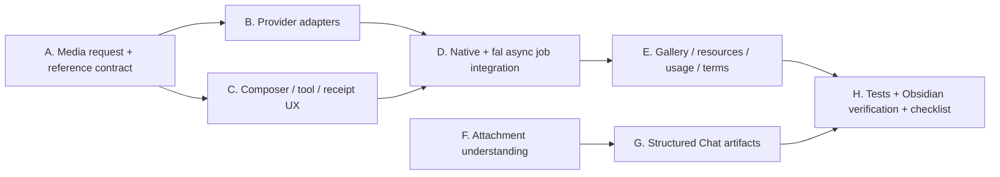

# Chat Studio 零遗留能力收口 — Claude Code 实施交接

日期：2026-07-21
状态：**owner 已授权立即实施；禁止把本计划中的能力留作 backlog**
前置：[`2026-07-20-chat-runtime-capability-closure-claude-handoff.md`](./2026-07-20-chat-runtime-capability-closure-claude-handoff.md) 的 Track A–E2 已在当前 dirty worktree 落地；本计划只处理其余缺口并修正文档/源码状态漂移。

## 1. Impact Contract

### 完成定义

本任务完成时，Chat 相关能力清单中本计划范围内不再存在 `NOT WIRED` 或“只有 UI / fixture / 底层 port”的条目。每项都必须具备：

1. 用户入口、真实 runtime / handler、可配置 provider route、明确失败态；
2. Vault 产物或可追溯 receipt（适用时）、Resources / Outline 回跳；
3. 单测、集成测试、build；以及无 key 时可复现的正确配置提示；
4. 真实 key 未提供时，只能把**外部付费调用**标记为“待 owner 凭据验收”，不能把代码能力本身降级为未完成，更不能伪造成功。

### 必须完成的 tracks

| Track | 必达能力 | 禁止的假完成 |
| --- | --- | --- |
| A | 参考图 / mask 图片编辑；图片、视频、音乐的 Native / fal / Auto 透明路由 | 只把文件名塞进 prompt；把 `imageGeneration` metadata 当 adapter；无 route 却显示按钮 |
| B | OpenAI 原生图片编辑和原生 Sora 视频 async job；fal image-edit、video、music 的真实异步接口 | 用 Chat completion 伪装生成；把 video/music 强行走同步图片 adapter；静默跨账单 fallback |
| C | 多媒体批量输入 / 输出、音频和视频附件的可理解链路、预览、引用与复用 | “可上传”冒充“模型已理解”；只显示空卡片或假波形 |
| D | Dataview、Excalidraw、draw.io、Extract、Reminder 的 Chat 产物 contract 和保存/打开动作 | 仅要求模型输出 code fence；仅展示源码却称“已创建” |
| E | Usage Dashboard 媒体用量、媒体授权/商业使用提示、Settings 能力矩阵与 provider validation | 估价当最终账单；藏起缺 key / 不支持 / endpoint 失效原因 |

### 不可变约束

- Skip budget = **0**。不得以“不是本轮范围”“未来实现”“仍 PARTIAL”为理由跳过 Track A–E。
- 允许 provider 自身不支持某 kind：此时 Settings / Composer 只显示真实支持矩阵；Auto 选可用 route，Native 明确失败，绝不声称该 provider 支持音乐或视频。
- 不新建第二条 Chat context、tool loop、artifact store、media writer、runtime singleton。
- 继续保留目前未提交改动；不自行 commit；不可回退其他人正在做的 docs/gstack 变更。
- 所有 model id、endpoint、价格估算、版权文案、feature flags 放 `templates/config/` 或明确 defaults，不写死在 UI。

## 2. 源码复核后的起点

### 已有且必须复用

- Chat 已经走 Harness runtime；MCP、Assistant、permission、真实 Agent Run 事件已接线。
- `MediaGenerationService`、`MediaJobService`、`MediaJobRunner`、`ChatArtifactReceipt`、`ObsidianMediaAttachmentWriter` 已是唯一 media pipeline。
- `MediaUsageEmitter` 已被加入 service/runner 和 app composition；必须继续把它显示到 Usage Dashboard，而不是重复造 telemetry。
- `FalAsyncMediaAdapter` 已支持 queue submit / poll / download；`OpenAINativeImageAdapter` 已真实调用 `/v1/images/generations`。
- Composer、ArtifactReceiptCard、Resources/Outline、Gallery 已有真实 receipt surface；增强它们，不能退回 fixture。

### 仍必须闭环

1. `MediaGenerationRequest` 只有 `kind`，没有 `operation` / reference image / mask 的正式 contract；`references` 也没有被解析为 provider 可读的二进制或可信 URL。
2. Native adapter 当前仅 `image` sync generation；没有 `/v1/images/edits`，没有 `/v1/videos` submit/poll/download/cancel。
3. `FalMediaAdapter` / `FalAsyncMediaAdapter` 对 image 总是 text-to-image payload；没有 image edit payload，亦无法选择有 mask 的 model contract。
4. Composer 没有选择“编辑图片、参考图、mask”的明确入口；Chat tool schema 也没有安全、可审计的 refs 参数。
5. Dashboard 是否渲染 `feature='media_generation'`、估价置信度和 route 尚未由用户可见面验证；音乐条款 / 首次确认尚未实现。
6. 音频/视频附件仍只是上传 / resource；没有从文件到可读 transcript/scene evidence 的能力 contract。
7. Dataview、Excalidraw/draw.io、Extract、Reminder 仍未成为 Chat 产物，不能保存/打开/追溯。

## 3. 实施 DAG



可并行阅读，但代码依赖顺序必须是 `A → B/C → D → E → H` 与 `F → G → H`。

## 4. Track A — 统一 media request 与图片编辑

### A1. 正式请求合同

- 把 `operation: 'generate' | 'edit'` 加入 `MediaGenerationRequest`，默认 `generate`，旧 job / receipt JSON 前向兼容。
- 新增 `referenceImages`（1–N）和可选 `maskImage` 的 typed input；每个输入保存 source ref、mime、stable content identifier，不把完整 base64 存在 chat DB。
- 在 app layer 加 `MediaReferenceResolver` port：仅允许 image MIME，读取 Vault / upload bytes，按 provider 的需要产出 data URI 或 temporary provider upload；受大小、数量、格式模板配置限制。
- preflight 按 `operation × route × kind` 验证；Native 选择但没有 native edit adapter 必须明确失败，不得自动改 fal。

### A2. UI / tool 入口

- Composer Plus Menu 增加 `Generate image` 与 `Edit image` 两个明确动作；Edit 表单可从当前附件/本轮 Resources 选择 base image、可选 mask、可添加多个 reference image。
- 自然语言 `media_generate` schema 支持 operation / reference ids / mask id；工具只能消费用户本轮显式选择的 refs，不能从 Vault 猜图。
- 预检卡显示 operation、输入图数量、mask 状态、route、provider、model、估价；无法解析引用时给 Configure / retry，不出现可点击假按钮。

### A3. Provider implementation

- OpenAI：实现 `/v1/images/edits` multipart 请求，支持 1–N image 与 optional mask；响应 bytes、错误分类、timeout、base URL、model response format 与 image generation 一样可配置。
- fal：在 `media-generation.json` 声明 edit preset / input codec。至少实现官方 image-to-image + mask 的 endpoint contract，并按所选 preset map `image_urls` / `mask_image_url`（或 model-specific codec）；不得把不同 fal model 的字段硬写在 UI。
- 产物和 batch：每张输出创建独立 receipt，均可预览、打开、作为下一次 edit reference；失败输出不污染成功 batch。

## 5. Track B — Native video 与真正异步 provider routing

### B1. OpenAI Sora async adapter

- 新建 `OpenAINativeVideoAdapter implements AsyncMediaAdapter`，接 `/v1/videos` submit、`/v1/videos/{id}` poll、`/v1/videos/{id}/content` download，使用 user-selected OpenAI profile key/base URL。
- 支持官方 allowed model / seconds / size 约束，reference image 通过 `input_reference`；这些映射、成本与可用模型放 template config。
- `MediaJobRunner.adapters.native` 注册该 adapter；重启恢复、timeout、失败、retry、remote cancel（若 endpoint 真支持）走与 fal 相同 job/receipt 状态机。

### B2. Auto / capability matrix

- Native route 仅在当前 profile + adapter + requested operation/kind 都真可执行时显示 available。
- `auto` 的选择规则可解释并记入 receipt：优先 owner default，其次可用 native / fal；**route 决定后不得换账单来源**。
- 音乐：若没有任何 native music adapter，Native 行必须为 unsupported（这是正确能力矩阵，不是功能遗漏）；Auto/fal 必须可完整执行音乐。预留可注册 native music adapter 的 config/port，不能把 OpenAI TTS 叫音乐。
- fal endpoints 按官方当前文档配置，且可在 Settings 逐 preset 覆盖。endpoint validation 检查结构而非实际扣费。

## 6. Track C — 媒体附件理解、预览与复用

### C1. 输入理解

- 实现 `MediaUnderstandingPort`：image 走当前 provider vision；audio 走可配置的 native transcription adapter；video 必须产生可用的 transcript / audio extraction 或明确由支持视频输入的 provider adapter 处理，二者都写 actual-source receipt。
- 选择一条可跨 Obsidian 桌面环境运行的 video audio extraction 实现，并隔离为 app/platform adapter；不要在 service 层调用 shell，不要静默丢弃 video 内容。
- 没有可执行 adapter 时，在 Composer 发送前显示“此 provider 未配置音/视频理解”，用户可改模型 / route / 改为仅附件保存；不能发送后假装已分析。

### C2. 用户可见行为

- 任意生成的 image/video/music 及用户上传的媒体都提供紧凑、有信息密度的卡片：标题、type、duration/size、状态、preview/open/download/insert-as-reference；支持同一 batch 多项 gallery 与 keyboard/lightbox。
- 视频 / 音乐真实 job 进度、错误、取消、重试、重启恢复在同一张 receipt card；无 URL 时不伪造播放器。

## 7. Track D — 所有承诺的结构化 Chat 产物

### D1. 输出协议与 runtime

- 在 `templates/config/chat-studio.json` / rich-output config 定义统一 `artifact_create` tool 和 typed schemas，产物都由服务保存到 Vault、创建 `ChatArtifactReceipt`，不得只让模型吐 fence。
- Dataview：接受 DQL / DataviewJS，保存为 `.md` 或配置目录下查询 note，Open action 在 Obsidian 打开；明确“query source”与 result preview。
- Excalidraw：生成有效 `.excalidraw.md`；draw.io：生成有效 `.drawio` XML；两个类型都必须 validate、save、open、失败重试。
- Extract：从用户已显式授权的 message/ref 中产生可编辑 Markdown note，保留来源链接。
- Reminder：建立持久化 reminder artifact（title、due、source、状态），接入已有 app reminder / notification composition 或提供真实的 Obsidian command/scheduler；不得只显示 text。

### D2. 渲染与 Resources

- renderer、Resources、Outline、Save-to-Vault、Open 统一理解 `dataview`、`drawing`、`reminder`、`extract` receipt kinds。
- 任何 schema / provider / vault 写失败都要渲染 failed receipt，不丢原始 content，支持修复后 retry。

## 8. Track E — Usage、授权、设置、文档

- 完成 Usage Dashboard 的 `media_generation` rows：route/provider/model/kind、estimated vs settled 标记、duration、job id、error 可查看；不能把 estimate 写成账单事实。
- 在 Settings 和 music 首次确认卡显示 provider-specific 授权 / 商用说明、适用链接与“我已阅读”确认；条款 URL 和文案放 config，receipt 记录 policy version / confirmation time。
- Settings capability matrix 必须涵盖 `generate/edit × image/video/music/tts × native/fal`；支持刷新 profile、validate config、定位缺 key / endpoint / model / terms 的具体入口。
- 更新 `docs/testing/chat-studio-capability-checklist.md`：本计划范围内最终不再写 `NOT WIRED`；外部凭据验证只放在验收步骤，不把代码能力降级。

## 9. 测试与验收（全部必做）

新增并通过以下测试层：

1. request / migration / preflight：operation、reference、mask、旧 JSON、route transparency、unsupported honest failure；
2. adapter contract：OpenAI image edit、OpenAI Sora submit/poll/download/cancel、fal edit codecs、fal video/music；
3. job lifecycle：confirm / poll / cancel / retry / restart resume / multi-output receipts；
4. UI contracts：Composer edit selector、route matrix、terms confirmation、batch gallery、Resource / Outline kind maps；
5. media understanding：audio/video configuration gates、actual source receipts、adapter failure；
6. structured artifacts：Dataview / Excalidraw / draw.io / Extract / Reminder validate-save-open-retry；
7. usage: successful and failed media events render with `estimated` caveat.

必须运行：

```bash
npm run test
npm run build
```

以及真实 Obsidian 中逐项验证：无 key、Native、fal、Auto、image edit+mask、Sora video、fal video、music terms、audio/video understanding、MCP、Assistant、5 类结构化 artifact、Resources / Outline / batch gallery、重启恢复。缺 key 时用明确“待 owner key”记录，每个 provider 至少给出可直接照做的验证命令/设置路径。

## 10. 直接交给 Claude Code 的提示

```text
在仓库 /Users/zhangjike/code/my-code/mobius-highestpeak-kb/.obsidian/plugins/obsidian-peak-assistant 实施：
docs/superpowers/plans/2026-07-21-chat-zero-gap-closure-claude-handoff.md

Owner 的要求是：所有列出的 Chat / media 能力都要真正完成，不能把任何 track 留作 PARTIAL、NOT WIRED 或 backlog。先读取 AGENTS.md、docs/progress.md、2026-07-20 handoff、当前计划、capability checklist 与当前 git diff；当前 dirty worktree 已包含 Track A–E2，必须在其基础上继续，不能重做或回退。

执行方式：先给出一个简短 source-first gap matrix 和文件 DAG，然后立即实现 Track A–E。只有真实 API key、计费授权、真实 MCP server 或 Obsidian 实机环境缺失时，才允许把“外部调用验证”列为 owner 验收前置；代码、设置、错误态、receipt、tests、documentation 必须全部落地。严禁用 fixture、静态 UI、prompt text 或 model catalog metadata 冒充已实现。

必须实现：reference/mask image edit；OpenAI `/v1/images/edits`；OpenAI Sora `/v1/videos` async adapter；fal edit/video/music；transparent Native/fal/Auto routing；audio/video understanding path；batch gallery；Dataview/Excalidraw/draw.io/Extract/Reminder artifacts；Usage Dashboard media rows；music terms confirmation；Settings matrix；全量 test/build 与 Obsidian checklist。

不要自行 commit，不要丢弃用户已有改动，不要新建第二条 context/tool/artifact/media runtime。配置、endpoint、成本、terms、model matrix 都应 template-driven。最终中文报告按：已实现能力、实际路由、设置/错误恢复、测试/实机证据、唯一仍需 owner 配置的外部验收步骤。
```
