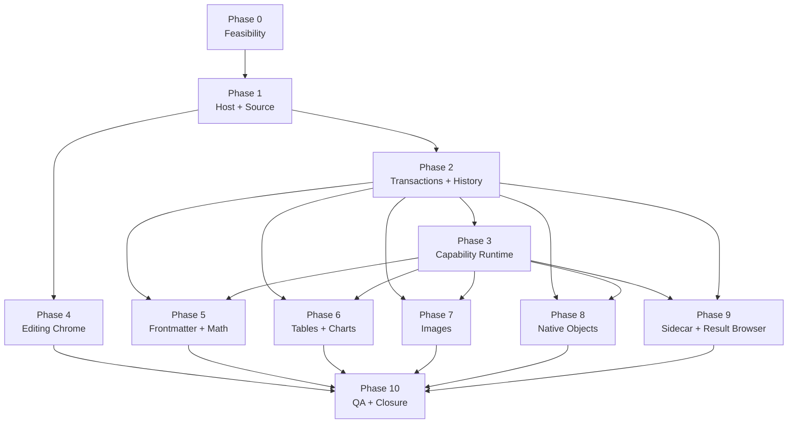

# Peak Composer 全功能生产实现交接

Date: 2026-07-24  
Status: **implementation-ready handoff; production implementation pending**  
Target reader: 下一次负责完整生产实现的 Codex / coding session  
Owner surface: 独立 Peak Composer View  
Scope: Composer 文档编辑、结构化对象、AI 能力、Intelligence Sidecar、History、共享 Result Browser 与生产级 QA

---

## 0. 下一会话直接执行提示

> 下一会话应把本文件整体作为任务上下文，不要只复制其中某一小节。

你正在 `/Users/zhangjike/code/my-code/mobius-highestpeak-kb/.obsidian/plugins/obsidian-peak-assistant` 实现 Peak Composer 的完整生产版本。

先完整阅读本文件及 §3 的 source-of-truth 文档。当前 `docs/gstack/peak-composer-editing-view-2026-07-09/` 是可交互设计 fixture，不是生产代码；不得把其 vanilla JS/CSS 直接 import 进 `src/`，也不得把 fixture 行为误报成已实现功能。

本任务是一个受 Impact Contract 约束的完整产品波次。必须：

1. 先做 Phase 0 的只读/可逆 feasibility 与 current-state characterization，补齐具体文件计划和测试基线。
2. 按 §12 的 DAG 执行；允许在一个 session 内分 checkpoint，但不要把用户变成许多 tiny prompt 的中转站。
3. 建立独立 Composer View，**不修改现有 Obsidian CodeMirror 编辑器**，也不删除或重命名 Chat Studio 的输入 `Composer`。
4. Markdown / YAML / Base / Canvas / Excalidraw 等原始文件始终是真值；所有改动通过有 source revision 校验、可逆、可记录 History 的 transaction 写回。
5. 复用现有 app-owned Capability、Copilot Action、RunEnvelope、Vault/Search、Peak design-system 基础；不得创建 Composer-only AI provider、第二套 conversation engine 或 service singleton。
6. 先建 source/block/transaction/change 基础，再做 UI 与各 block pack；禁止先堆静态卡片、假按钮和 placeholder，再把它称为功能完成。
7. 所有 AI 输出必须真实流式、可定向追问/重新生成、可切换版本、可接受/丢弃；接受以后必须进入 Composer History。
8. 所有确定性操作必须真实生效；暂不可用的动作要禁用并解释原因，不能放一个可点击但无效果的按钮。
9. 每个 checkpoint 运行相应测试；最终必须通过 §15 的完整验证。
10. 不得撤销用户现有 dirty worktree；只触碰本任务必要文件。先读取 `docs/progress.md` 和当前 `git status`。

最终报告必须使用 `COMPLETE / PARTIAL / BLOCKED` 三者之一：

- 只有 §2 Impact Contract 和 §14 验收矩阵全部满足，才可写 `COMPLETE`。
- 任一 required track、对象写回、History、真实交互或生产 QA 缺失，必须写 `PARTIAL`，逐项列出。
- 外部凭据可以阻塞真实付费 provider smoke test，但不能阻塞 fake-port、stream、candidate、writeback 和 UI contract 测试；不要把凭据缺失当成跳过架构或交互实现的理由。

---

## 1. 一句话产品定义

Peak Composer 是一个独立的 Obsidian 文档工作台：它在不替换 CodeMirror 的前提下，把当前 Markdown/native 文件渲染成可折叠、可拖动、可选择、可结构化编辑、可由 AI 局部协作并可安全回滚的文档视图。

它不是：

- Chat Studio 的输入框；
- 新的 Markdown 文件格式；
- Notion 克隆；
- 把静态 HTML mock 搬进生产；
- 把 AI 聊天窗口贴到文档旁边；
- 另建一套 AI provider/runtime；
- 用第二份 source snapshot 冒充 diff 或 undo。

---

## 2. Impact Contract

### 2.1 Primary metric

以一个真实 Vault Markdown 笔记为输入，生产 Composer View 必须完成以下闭环：

```text
打开真实文件
  -> 解析并渲染真实 block/native object
  -> 直接编辑或运行确定性/AI 操作
  -> 在原对象位置审阅候选
  -> 接受后原子写回原文件
  -> History 可定位、分组、回滚
  -> Undo / Redo 可逆
  -> 重新打开 Composer 后结果与源文件一致
```

### 2.2 Required tracks

| Track | 必须交付 |
| --- | --- |
| R0 | 独立 Composer View、真实文件生命周期、source/block model、round-trip |
| R1 | 统一 block chrome、折叠/拖动、选择/格式化/复制/链接/评论 |
| R2 | transaction、candidate、diff、History、Undo/Redo、stale revalidation |
| R3 | 单一 app-owned AI capability runtime 与 typed result/writeback |
| R4 | Frontmatter 属性库与字段级候选 |
| R5 | 公式、列表、任务、引用、Callout、普通文本能力 |
| R6 | 表格 cell selection、merge、deterministic tools、Chart Block |
| R7 | 图片粘贴/重命名/转换/图注/AI 改图/多图布局 |
| R8 | Code、Mermaid、Base、Canvas、Excalidraw 与 attachment/embed |
| R9 | Intelligence Sidecar、SuggestionFinding、run receipt、History |
| R10 | shared controlled Result Browser 的 Quick Search 与 Composer 双 host |
| R11 | tokens/component consistency、keyboard/A11y、detached window、窄宽 QA |
| R12 | 旧路径收敛、source guards、文档与最终 implementation note |

### 2.3 Forbidden scope

- 不修改 CodeMirror 的编辑体验、extension 或现有 Markdown View。
- 不删除或重写 Chat Studio 输入组件 `src/ui/view/chat-view/components/Composer.tsx`；名称冲突通过文档/模块限定解决。
- 不把 `docs/gstack/**` 导入生产 bundle。
- 不创建 service-side mutable runtime singleton。
- 不允许 UI 直接调用 provider。
- 不以中文 label、按钮文字、`id.includes(...)` 决定业务逻辑。
- 不散落 hardcoded prompt、i18n、正则、阈值、颜色和 timing。
- 不把 Quick Search modal/store 嵌入 Composer；只抽取 controlled Result Browser。
- 不增加大量 Command Palette 入口；Composer 内部能力归 Composer surface。
- 不用删除既有大功能来换 LOC 或工期。
- 不把第二份原对象、undo snapshot 或 prompt 句子渲染成候选正文。

### 2.4 Skip budget

- Required tracks: **0**。
- 可跳过：仅明确标为 future/optional 的协作编辑、多人 presence、移动端完整 touch-first 适配。
- 凭据：允许真实付费 provider smoke test 标 credential-blocked；所有 fake-port 与本地 fixture 测试仍必须完成。

### 2.5 Minimum acceptable delta

若当前 session 无法完成所有 track，至少必须：

1. 落地 R0、R2、R3 三个底座；
2. 交付至少一个文本 block、一个结构化 object、一个 native object 的完整真实 writeback vertical slice；
3. 明确标记 `PARTIAL`；
4. 保留单一架构，不能为了展示覆盖率引入临时第二套实现；
5. 给下一 checkpoint 一份精确剩余矩阵，而不是泛泛 todo。

若连 R0/R2/R3 都不能形成闭环，应停在 characterization/feasibility，不得先提交大量不可写回的 UI。

### 2.6 Stop / commit rule

- 每个 DAG checkpoint 只在相关 contract test、unit test 与 build 通过后提交。
- checkpoint 可按 foundation / editing / object packs / sidecar / closure 形成 4–7 个有意义的 commits；不要每个小按钮一个 commit。
- 任一 source round-trip 会破坏未知 Markdown、native file 或外部并发修改时，停止写回，显示 conflict/stale review，不得强写。
- 最终若 requirement traceability、测试或 production QA 缺一项，结果只能是 `PARTIAL`。

---

## 3. Source of truth 与阅读顺序

### 3.1 冲突优先级

1. 本文件记录的最新 owner 决定。
2. 当前 owner-review mock 与 README。
3. 当前 Composer 专项 specs。
4. AI modularity architecture。
5. 旧 Copilot / Ambient / Chat 文档只作背景。
6. `docs/progress.md` 只描述项目状态，不覆盖产品合同。

### 3.2 必读文档

1. [`2026-07-24-peak-composer-complete-implementation-handoff.md`](./2026-07-24-peak-composer-complete-implementation-handoff.md) — 本文件。
2. [`../specs/2026-07-22-peak-composer-related-document-map.md`](../specs/2026-07-22-peak-composer-related-document-map.md) — 文档地图与历史边界。
3. [`../specs/2026-07-09-peak-composer-editing-view.md`](../specs/2026-07-09-peak-composer-editing-view.md) — 宿主、编辑、对象模型。
4. [`../specs/2026-07-15-composer-block-ai-capability-contract.md`](../specs/2026-07-15-composer-block-ai-capability-contract.md) — block/AI/change 合同。
5. [`../specs/2026-07-15-composer-intelligence-sidecar-ui.md`](../specs/2026-07-15-composer-intelligence-sidecar-ui.md) — Sidecar、主动智能、相关材料。
6. [`../specs/2026-07-22-peak-composer-component-consistency.md`](../specs/2026-07-22-peak-composer-component-consistency.md) — 组件家族与视觉一致性。
7. [`../specs/2026-07-24-peak-composer-ai-capability-modularity-architecture.md`](../specs/2026-07-24-peak-composer-ai-capability-modularity-architecture.md) — AI 能力模块化生产架构。
8. [`2026-07-22-peak-composer-intelligence-sidecar-handoff.md`](./2026-07-22-peak-composer-intelligence-sidecar-handoff.md) — Sidecar 跨会话细节。
9. [`2026-07-21-vault-result-browser-shared-component.md`](./2026-07-21-vault-result-browser-shared-component.md) — Result Browser 抽取计划。
10. [`../../gstack/peak-composer-editing-view-2026-07-09/README.md`](../../gstack/peak-composer-editing-view-2026-07-09/README.md) 与 `index.html` — 当前交互 fixture。

### 3.3 已解决的旧规则冲突

以下最新决定覆盖旧文档中的相反描述：

| 主题 | 最终规则 |
| --- | --- |
| 公式变量表 | 每个公式 micro-block 的 `解释公式 / 拆分公式 / 变量表` 都是独立结果；三类结果可同时打开，不同公式之间也可共存。默认绝不把一次点击扩成三个公式的合并变量表。 |
| Result Browser | 是内部共享组件名；用户点击“打开完整视图”仍留在 Composer modal，不跳转 Vault Search。 |
| Review 模式 | `纯净阅读 / 工作原文 / 全部改动`；删除“当前一处/当前已出”作为文档视图模式。导航仍可定位下一处改动。 |
| AI 操作入口 | block 下方单行展平，取消二级 `AI 建议 · N` opener。 |
| Undo/Redo | 常驻 Composer 底部状态栏，不放在 mock 顶部 demo strip。 |
| 结构变换 | source 只出现一次；只渲染 candidate target，接受后替换，丢弃不改。 |

---

## 4. 当前生产状态：必须诚实区分

### 4.1 已有可复用生产基础

- `src/app/ui-host/ReactItemViewHost.ts` 与 `src/app/ui-host/views/ViewManager.ts`：生产 React-backed Obsidian ItemView 生命周期。
- `src/core/types/capability.ts`：稳定 capability manifest 基础，但当前 surface union 尚无 document Composer。
- `src/service/capabilities/CapabilityManifestRegistry.ts`、`CapabilityRunner.ts`：通用 manifest 与 backend-neutral run 基础。
- `src/service/run-envelope/`：RunSession / RunEvent / artifact / projection 基础。
- `src/service/copilot/CopilotActionRegistry.ts` 与 `src/service/copilot/actions/`：现有生产 Copilot actions。
- `src/app/copilot/actions/composeCopilotActionRuntime.ts`：app-owned runtime composition 先例。
- `src/app/context/AppRuntimeRegistry.ts`：app-owned runtime 生命周期与 double-bind guard。
- `src/ui/view/quick-search/`：List/Tree/Graph、inspector、keyboard、search host 的现有生产实现。
- `src/styles/peak-tokens.css`、Peak UI primitives、shadcn Button、Lucide：共享设计系统。
- 现有 Vault、metadata cache、search、semantic graph、AI provider 与 PromptService/TemplateManager。

### 4.2 仍只是设计 fixture

- 完整文档 Composer View。
- block source map 与生产 round-trip writer。
- Composer transaction/candidate/History/Undo stack。
- 选择跨 block/table cell 的生产实现。
- 图片/表格/公式/native object 的 Composer writeback adapters。
- Sidecar 与文档 Composer 的生产整合。
- shared controlled Result Browser。
- `docs/gstack/.../mock.js` 中的 transaction、table、image、AI draft、History 等行为。

### 4.3 名称边界

生产中已有的 `src/ui/view/chat-view/components/Composer.tsx` 是 Chat 输入器。新的文档宿主在代码、测试与日志中应使用明确名字，例如：

- `DocumentComposerView`
- `ComposerDocumentRuntime`
- `ComposerDocumentSession`

用户产品名称仍可显示 `Composer View`。不要重命名现有 Chat Composer 造成大面积无关 churn。

---

## 5. 核心领域模型

### 5.1 Source truth

```ts
interface ComposerDocumentSnapshot {
  documentId: string;
  filePath: string;
  revision: string;
  sourceText: string;
  blocks: readonly ComposerBlock[];
  nativeRefs: readonly ComposerNativeRef[];
}

interface ComposerBlock {
  blockId: string;
  kind: ComposerBlockKind;
  source: SourceAnchor;
  parentId?: string;
  children: readonly string[];
  renderModel: unknown;
}

interface SourceAnchor {
  revision: string;
  from: number;
  to: number;
  semanticFingerprint: string;
}
```

要求：

- `blockId` 在同一 revision 内稳定。
- patch 写回前必须重验证 source anchor/fingerprint。
- parser/serializer 不认识的 Markdown 必须保留原文，不得丢弃。
- block move、fold、selection、candidate 不能修改 canonical source，直到 commit。
- native object 使用自身合法格式的 typed adapter，不伪装成普通段落。

### 5.2 Transaction

```ts
interface ComposerTransaction {
  transactionId: string;
  documentId: string;
  baseRevision: string;
  origin: 'direct' | 'deterministic' | 'ai' | 'system-rollback';
  label: string;
  operations: readonly ComposerOperation[];
  inverseOperations: readonly ComposerOperation[];
  groupId?: string;
  runId?: string;
  committedAt?: number;
}
```

一个 commit 必须：

1. 在 base revision 上 revalidate；
2. 原子应用 operation；
3. 写入 Vault；
4. 重新解析并确认目标语义存在；
5. 记录 History；
6. 推入 Undo stack；
7. 清理 Redo branch；
8. 发出统一 transaction event。

### 5.3 Candidate 与 variant

```ts
interface ComposerCandidate<TResult> {
  candidateId: string;
  target: ComposerTarget;
  baseRevision: string;
  status: 'streaming' | 'ready' | 'stale' | 'accepted' | 'discarded' | 'failed';
  variants: readonly CandidateVariant<TResult>[];
  activeVariantId: string;
  proposedChange: ProposedChange<TResult>;
}
```

- pending candidate 不进入 Markdown、History 或 Undo。
- regeneration 追加 variant，不覆盖旧 variant。
- active completed variant 才能 accept。
- stale candidate 不允许直接 accept；必须 rebase/re-run 或明确冲突。
- targeted instruction 属 run context，不属于候选正文。

### 5.4 Finding identity

正文 finding 与 Sidecar brief 必须共享同一实体：

```ts
interface SuggestionFinding {
  findingId: string;
  fingerprint: string;
  evidenceRevision: string;
  target: ComposerTarget;
  state: 'active' | 'dismissed' | 'consumed' | 'stale';
}
```

- 同 fingerprint + evidence revision 只显示一次。
- 两个 surface 只是投影，不复制状态。
- 正文接受后 Sidecar 标 consumed；任一 surface ignore 后另一 surface 同步 dismissed。
- source revision 失配时标 stale，不悄悄重定向到相似文本。

---

## 6. 文档宿主与 Block 系统需求

### 6.1 独立宿主

- 新建独立 main-area ItemView。
- 打开 active Markdown 文件；文件切换、rename、delete、external modify 都有明确 lifecycle。
- 不改 CodeMirror；用户可在两个视图间切换，同一文件保持一致。
- dirty/pending candidate 离开前提示或保留 session；不静默丢失。
- 重新打开从源文件恢复 accepted state，从 session store 恢复未接受候选时必须 revalidate。

### 6.2 Block 类型

至少支持：

- Frontmatter
- heading
- paragraph
- list / nested list
- checklist/task
- quote
- Callout
- thematic break
- footnote/citation
- internal/external link
- embed/attachment
- display math 与公式组
- image / figure / multi-image layout
- Markdown table / raw HTML table
- fenced code
- fenced chart
- Mermaid
- Base
- JSON Canvas
- Excalidraw
- unsupported/unknown fallback

### 6.3 折叠与拖动

- 每个 top-level block 都有同尺寸 disclosure 与 drag controls。
- expanded 用 up chevron 表示收起；collapsed 用 down chevron 表示展开。
- heading 折叠包含到下一个同级或更高级 heading 前的 section。
- 普通 block 折叠成一行摘要。
- drag 先显示 drop target；commit 后原子改 source。
- nested list、formula micro-block 等内部对象使用自己的合法 reorder adapter。
- fold 是 view state，不写 Markdown。

### 6.4 单行 flattened action row

hover/focus 时：

```text
在下方插入 / 复制 / 评论 | 当前对象相关 AI 动作 | History / 指令
```

- 不存在二级 `AI 建议 · N`。
- deterministic 与 AI peer action 同 geometry。
- selection toolbar 出现时 block row 隐藏。
- action 由 stable capability ID 与 applicability 生成，不由 label switch。
- action row 只显示在生产真的可执行或有解释性 disabled 状态的动作。

---

## 7. 选择、格式化、链接、复制与评论

### 7.1 初始示例与可见样式

生产 fixture/测试文档必须真实包含并可编辑：

- `**bold**`
- `*italic*`
- `~~strikethrough~~`
- HTML `<u>underline</u>`
- text color
- highlight/background color
- internal link
- external link
- inline code
- inline math

AI 还可以提出新的格式候选，但必须以合法 Markdown/HTML 表达并可回滚。

### 7.2 Selection toolbar

```text
Bold / Italic / Underline / Strikethrough
Link / Text color / Highlight
Copy / Comment
Polish / Shorten / Expand / Custom instruction
```

- 不提供字号调整。
- toolbar 使用 compact square/text control family。
- Link、color、copy popover 关闭后恢复 selection/focus。
- AI text action 目标是冻结的 selection snapshot。

### 7.3 跨结构格式化

允许：

- 跨段落；
- 跨不同 block；
- 跨 list items；
- 跨 table cells；
- 同一 transaction 内应用 bold/italic/underline/strike/color/highlight。

实现规则：

- 将 selection 分割成每个 semantic inline unit 的合法 patch。
- 不用一个 HTML wrapper 包住段落、`li`、`tr`、`td` 等 structural node。
- operation 要么整体成功，要么整体失败。
- round-trip 后 selection 内容与结构保持。

### 7.4 Code Block 例外

- Code Block 只展示/编辑 code。
- 禁用 underline、strike、color、highlight 等 rich formatting。
- copy plain text/source 保留换行、缩进、tab。
- 允许 code-specific explain/check/generate preview 能力。

### 7.5 Paste URL into selection

- 仅在一个合法 semantic selection 上直接生成 Markdown/internal link。
- 跨 structural boundary 时禁止并解释；不要产生破坏性 wrapper。
- 粘贴普通文本仍按正常 paste。
- link candidate/commit 进入同一 transaction system。

### 7.6 Easy Copy

输出顺序固定：

1. 纯文本
2. 图片
3. Markdown
4. HTML

行为：

- 选择后立即 copy，不打开预览/第二确认。
- 原地显示短暂 check，然后恢复。
- 图片是原 DOM element 的 1:1 rendered snapshot，保留表格列宽/换行、KaTeX、列表样式、颜色。
- 复制 block 时排除编辑 chrome。
- 纯文本与 code 保留必要换行与缩进。
- 公式同时支持 text / LaTeX / HTML / exact rendered image。

### 7.7 Link hover

- Vault link hover 显示目标标题、路径、摘要、打开/定位动作。
- external link hover 显示域名、URL、可用 metadata 与打开动作。
- 链接本身可点击。
- broken link 显示修复/解析建议，但不阻止用户查看原始目标。
- popover 可 keyboard 操作，不能只依赖 hover。

### 7.8 评论

- 评论可绑定 block、selection 或 object subtarget。
- 评论不是 Markdown 正文；持久化位置由产品现有 comment/storage pattern 决定。
- source 改动后 comment anchor revalidate 或 stale。
- comment 与 AI suggestion 视觉不同，但复用 panel primitives。

---

## 8. Frontmatter

### 8.1 字段展示

- 不假定只有 created/updated/tags。
- 支持 scalar、list、boolean、date、link 与 unknown YAML value。
- 标记来源：程序生成、人工、AI 建议、规范建议。
- created/updated 等程序字段可由确定性逻辑维护；AI 不冒充程序字段。

### 8.2 Vault 属性库

- 是 Vault-wide field/tag inventory。
- 入口只在 Frontmatter block hover action row。
- 不放全局 header，不永久占一行。
- 打开后在 Frontmatter 附近显示字段：
  - 出现频率；
  - 值类型；
  - 稀有/孤立；
  - 类型冲突；
  - 当前文档缺失；
  - 建议来源。
- 选择一个已有字段后，为当前文档创建 candidate。
- 支持用户输入自定义 key/value。
- `添加属性` 不能盲加未知字段。

### 8.3 AI 属性建议

- 放在 `属性告警` 旁。
- 可以补标签、规范字段、推断 type/status/project 等。
- 每个字段独立 accept/reject。
- 不经确认不写 YAML。
- 显示 evidence/reason，但内部实现标签不出现在最终 UI。

### 8.4 YAML 写回

- 保留未知字段、顺序、可保留的注释/格式。
- 仅修改目标 field。
- list/scalar 转换必须明确 review。
- source stale 时停止接受。

---

## 9. Diff、Review、Draft、History 与 Undo

### 9.1 文档显示状态

保留三种：

1. `纯净阅读`：原始 accepted 内容，无 AI insight/finding。
2. `工作原文`：accepted 内容 + insight/finding/status。
3. `全部改动`：accepted 内容 + 所有 pending candidate/diff。

Review 可以在任一 candidate 存在时出现，不要求切到一个独立“审阅页”。

### 9.2 Inline rewrite

- 原地 word diff。
- 删除内容在原位置 strike/remove treatment；新增内容在同一语句位置。
- 不在下面重复输出一整行新文本。
- 接受前不写文件。
- 接受后恢复普通渲染。

### 9.3 Structural transform

对于 list→table、paragraph→callout、table transpose 等：

- source 对象仍在原位置且只出现一次；
- candidate target 紧邻/替代性 overlay 显示一次；
- 不在 candidate 里再复制“原列表/原表格”；
- accept 原子 replace；
- dismiss 不改 source；
- undo snapshot 不渲染成第二份 source。

### 9.4 Additive draft

- 在真正插入位置出现真实 typed object。
- pending 时使用中性 outline/body，不用大块绿色卡片。
- pending draft 不显示普通 block chrome。
- footer 包含 provenance/status、targeted instruction、variants、接受/丢弃。
- prompt 文案如“生成一个新的 Base view 草案”绝不作为候选正文。

### 9.5 AI streaming 与 variants

- 文本逐 token/segment 可见。
- table/Base/chart/native object 使用结构骨架 + progressive typed source/result。
- image 有 planning/generation progress。
- streaming 时禁用 accept、重复 regenerate 与 variant switch；允许 cancel/discard。
- 所有 AI candidate 都有定向输入框。
- Enter 与 regenerate button 等价。
- 1 个版本不显示无意义左右箭头。
- 2+ 版本使用对齐良好的 previous/count/next control。
- variant 历史可回看；accepted variant 仍保留 provenance。
- 不再额外铺一排“版本 1 首次生成 / 版本 2 重新生成”大标签；首次/再生成 provenance 放在紧凑 tooltip、history detail 或当前版本辅助文字中。
- candidate body、instruction 与 footer 使用同一内容边线和 12–16px 稳定内边距；按钮不得因窄宽换行成两行文字或与 count control 错位。

### 9.6 History

记录：

- direct edit；
- accepted deterministic transform；
- accepted AI candidate；
- accepted image/native replacement；
- system rollback/inverse transaction。

不记录：

- dismissed suggestion；
- 未接受 candidate；
- 仅 view fold/focus；
- suggestion finding 本身。

分组：

- 连续 typing burst 可聚合为一个父 transaction；
- 同一 AI run 的多个 accepted child changes 可聚合；
- child transaction 仍可展开、定位、查看 diff。

History item：

- 类型、来源、时间、目标位置；
- +/− 统计或 object-specific summary；
- locate；
- diff/detail；
- rollback（追加 inverse transaction，不删除原历史）。

### 9.7 Undo / Redo

- 常驻 Composer bottom status bar。
- 使用 Lucide `Undo2 / Redo2`。
- disabled 按钮保留位置。
- tooltip/aria 包含下一 transaction label 与 shortcut。
- `Cmd/Ctrl+Z` undo；`Shift+Cmd+Z` 或 `Ctrl+Y` redo。
- active input/contenteditable/range editor 保留 native undo ownership。
- 新 commit after undo 清空 redo。
- pending candidate 使用 discard/restore，不进入 document undo。

---

## 10. 各对象能力合同

### 10.1 普通文本、标题、列表、任务、引用、Callout

| 对象 | 确定性能力 | AI 能力示例 |
| --- | --- | --- |
| Heading | 改级别、折叠 section、复制、移动 | 改短标题、补提纲、生成导读问题 |
| Paragraph | 格式、链接、comment、move | 润色、精简、扩写、追问、补例、转表格、提取公式、生成示意图 |
| List | indent/outdent、reorder、toggle list kind | 补缺项、重排、转表格、提出问题 |
| Checklist | toggle、priority/date adapters | 找阻塞、补下一步、按优先级重排 |
| Quote | source/link handling | 解释引用、找反例、转 Callout |
| Callout | 改合法 callout type | 扩写原则、生成检查项 |

所有 AI 动作由 capability registry/applicability 提供；不能在 UI 写 `if label === ...`。

### 10.2 公式

每个 display formula micro-block：

```text
在下方插入 / 复制 / 评论 | 解释公式 / 拆分公式 / 变量表 / History / 指令
```

最终逻辑：

- 每个公式各自拥有三类 detail state。
- 同一公式可同时打开解释、拆分、变量表。
- 不同公式可同时打开任意组合。
- 点击 PageRank 变量表只显示 PageRank。
- 没有“打开一个则关闭另一个”的 global accordion。
- 每个结果都支持 targeted follow-up、regenerate、variant history、accept/keep annotation/close。
- 若未来需要跨公式比较，必须新增明确命名的 parent capability，不得改变当前动作语义。

公式复制：

- plain text；
- LaTeX source；
- HTML/MathML；
- exact rendered image。

### 10.3 表格选择

必须同时支持两类模式：

1. **文本选择**：在 cell 内圈文字，出现 text selection toolbar。
2. **对象选择**：按 cell/range 选表格对象，出现 table toolbar。

对象选择：

- click 单 cell；
- drag 连续 rectangle；
- vertical/horizontal range；
- Shift extend；
- Cmd/Ctrl-click 添加/移除不连续 cells；
- selection overlay 不遮住 grid/perimeter；
- `Esc` 清除；
- keyboard arrow/Shift+arrow 可扩展；
- ARIA 描述选区。

### 10.4 表格确定性工具

- format/alignment；
- add/remove row/column；
- sort；
- formula；
- merge/unmerge；
- transpose；
- CSV import/export/copy；
- chart；
- summary。

要求：

- 每个按钮真实可用；不支持时 disabled + reason。
- “格式化”必须有明确含义/菜单，不能只是一个无解释按钮。
- multi-cell selection 后 merge menu 可见。
- merge 只接受同一 table section 中完整 rectangle。
- pipe Markdown 无法表达 merged cell 时，整个 block 升级成 raw HTML table。
- 未 merge 的普通 grid 保持 pipe Markdown。
- complex HTML round-trip 不丢 rowspan/colspan/content。

### 10.5 Table AI

- 总结表格；
- 补一列；
- 检查口径；
- 提取公式；
- 生成 chart。

结果使用 typed table/cell/column patch，不用 prose diff 猜结构。

### 10.6 Chart Block

- table→chart 生成独立 pending Chart Block。
- source 使用 fenced `chart` 或本项目最终锁定的合法 Markdown-backed schema。
- Composer 渲染真实 chart。
- bar / line / pie 可切换且真实生效。
- 使用项目兼容的成熟 chart renderer；若需新增依赖，先做 size/theme/detached-window spike。
- accept 写合法 fenced source；dismiss 不改 table。
- chart 与 table source 不互相重复渲染。

### 10.7 图片粘贴与重命名

- 用户在 caret/新 block 位置 `Cmd/Ctrl+V` 粘贴 bitmap。
- 在段落中粘贴时按合法 source split 插入 image block。
- 保存附件后进入语义 rename review。
- 自动/AI 文件名可反复 regenerate、左右切换版本。
- accept rename 必须更新所有受影响引用，原子 commit。
- 最终 UI 不显示“程序清理文件名”“AI 候选”“示例中心”等内部说明。

### 10.8 Image Converter

确定性、非破坏性：

- 直接可调整矩形 crop；
- free crop/圈选（若底层格式允许，保存为 mask/crop result）；
- rotate left/right 90°；
- straighten；
- horizontal/vertical flip；
- compression quality；
- WebP / PNG / JPEG；
- metadata removal；
- preview output size/dimensions。

原附件在接受前保持不变。接受时默认新 asset + 引用替换；覆盖原文件需要额外明确确认与可逆 backup。

### 10.9 Image caption 与 AI edit

- caption 属于同一 `<figure>`/Markdown image caption adapter。
- 已有 caption 原地 stream + diff。
- 无 caption 时只创建 figcaption slot。
- 不插入 sibling prose block。
- `AI 改图` 先打开 instruction/presets，不立即生成一个固定新图。
- 支持连续 follow-up、mask/region、variants、history、restore、accept one。
- generation 显示 progress/skeleton。

### 10.10 多图布局

- 支持多张 image 在一个位置形成组合 layout。
- 至少覆盖 row、grid、hero+thumbs、masonry-like safe layout。
- 使用可保存在 Markdown 中、普通 Obsidian preview 也可见的 HTML。
- 图片引用仍是 Vault attachment path，不内嵌巨大 base64。
- layout editor 支持 reorder、replace、caption、alt、gap/alignment。
- AI 可智能排版、统一图注、调整叙事顺序；结果是 typed layout patch。

### 10.11 Code / Mermaid

Code：

- 只做 code 语义操作；
- rich formatting 禁用；
- source copy 保留换行缩进。

Mermaid header：

- 只常驻 `预览 / 源码`。
- copy source/image 走 shared Easy Copy。
- AI 增量编辑在 flattened block row。
- AI patch 修改 Mermaid source，重新渲染后 review。
- 不在 object header 重复 `复制源码 / 复制图像 / AI 增量编辑`。

### 10.12 Base / Canvas / Excalidraw

- Base candidate 必须是合法 `.base`/YAML view 内容与真实 preview，不是“生成一个 Base view 草案”文本。
- Canvas patch 修改 nodes/edges JSON。
- Excalidraw patch 修改合法 elements/files。
- 都支持 preview/source、typed incremental patch、re-render、targeted follow-up、variants、accept/restore。
- 原生对象写回使用专门 adapter；不能用 string replace 猜结构。

### 10.13 Link / citation / embed / attachment

- internal links：补双链、检查断链、生成 MOC 行。
- external links：摘要、核对来源、link card。
- footnote/citation：核对出处、转尾注/正文。
- embed：展开要点、修复锚点、改为链接。
- attachment：提取要点、生成引用、拆章节笔记。
- 所有导航目标可 hover、click、keyboard open。

---

## 11. AI 能力模块化生产架构

本节以 [`2026-07-24-peak-composer-ai-capability-modularity-architecture.md`](../specs/2026-07-24-peak-composer-ai-capability-modularity-architecture.md) 为详细真值。

### 11.1 单一运行时

```text
UI invocation
  -> capability projection
  -> app-owned Composer capability runtime
  -> frozen target/context snapshot
  -> executor/provider/tool ports
  -> typed stream events
  -> typed result materializer
  -> candidate renderer
  -> writeback adapter
  -> transaction/history bridge
```

- 扩展现有 `CapabilityManifest` surface vocabulary 加 document Composer。
- 复用 `CapabilityRunner` / RunEnvelope；补 Composer 所需 event/result contract。
- app layer 组合 runtime 并交 `AppRuntimeRegistry` 管理。
- 现有 Copilot actions 最终迁入/适配同一 stable capability definition。
- `CapabilityArtifact` 只作为 receipt projection，不作为复杂对象 canonical writeback。

### 11.2 Capability definition

每个能力必须声明：

- stable ID；
- title/description/config key；
- invocation surfaces；
- target kinds；
- applicability/guard；
- execution mode；
- effect kind；
- permission/cost/backend policy；
- prompt/template ID；
- input/result schema；
- renderer ID；
- writeback adapter ID；
- History labeling；
- tests。

### 11.3 Capability packs

- document/vault
- metadata/frontmatter
- prose/heading
- list/task/quote/callout
- math
- image/multi-image
- table/chart
- link/citation/embed/attachment
- code/query
- Mermaid/Canvas/Excalidraw/Base

新增能力只注册模块；不修改一个超大 toolbar switch。

### 11.4 Typed result

至少区分：

- text patch
- block insertion
- block replacement
- metadata field patch
- list item patch
- table patch
- chart source
- formula annotation
- image asset candidate
- image annotation/layout patch
- native file patch
- finding/insight
- source/trace receipt

renderer 与 writeback adapter 按 result kind/adapter ID dispatch，不按 action label 猜。

### 11.5 Config 与 prompts

- 文案、labels、正则、阈值、weights、timing、style config 放 `templates/config/`。
- prompts 通过 PromptId + PromptService。
- compiled fallback 放明确 domain defaults 文件并注明镜像 template。
- 不把大量 Composer domain config 塞进 `src/core/constant.ts`。

### 11.6 迁移/删除门

只有在新路径通过 parity 与 architecture guards 后才删除：

- 旧 Copilot action-specific provider dispatch；
- heuristic artifact inference；
- label-driven mock-style handlers；
- 重复 renderer/writeback；
- Quick Search-only result projection router。

绝不删除：

- Chat Composer；
- CodeMirror；
- 当前用户文件；
- 仍有生产 caller 的 compatibility path。

### 11.7 当前能力 parity 底线

Composer wave 不是只实现 mock 里最显眼的几个按钮。迁移后必须保留当前 28 个生产 Copilot action 的能力与权限语义：

```text
polish
format-polish
correct-content
review
suggest-links
suggest-semantic-links
suggest-split
suggest-tags
summarize
extract-concepts
translate
find-related
knowledge-gaps
synthesize-topic
vault-health
vault-summary
continue-writing
rewrite-selection
add-evidence
extract-todos
writing-plan
write-article
detect-and-file
check-task-list
prompt-audit
deduplicate-scan
find-solve-tasks
smart-connections
```

Composer 当前 14 个 global projection 也必须进入 stable registry/applicability，而不是继续留在 mock helper：

```text
connect-notes
improve-note
add-evidence
rewrite-selection
translate
continue-writing
writing-plan
write-article
generate-illustration
summarize
extract-concepts
suggest-tags
suggest-split
check-task-list
```

两组有交集时共享一个 definition，通过 surface projection、默认 target 与 label config 区分，不复制 executor。

---

## 12. Intelligence Sidecar 与 Result Browser

### 12.1 IA

顶层只有：

- `Copilot`
- `History`

Ambient 是 sensing/ranking runtime，经 Copilot brief 投影，不是第三 tab。

Copilot lifecycle：

```text
brief -> session -> running -> session/review
```

- brief 安静、文档相邻。
- session 才显示完整 prompt composer。
- Review 是 transient lifecycle，不是 permanent tab。
- 文档是 candidate review 真值；sidecar 提供状态、导航、解释与 run receipt。

### 12.2 Frozen run context

- active object/selection/nearby content/related materials 是 live context。
- 用户 send 时冻结 immutable run snapshot。
- 后续 focus 变化只影响下一 run。
- message 中显示 target quote，点击可定位文档。

### 12.3 Run receipt

一条 Copilot run message 内可展开：

- Changes
- Insights
- Sources
- Trace

它们不是永久顶级 tabs。accepted changes 进入 History。

### 12.4 Related materials

Sidecar：

- bounded local preview；
- 当前 block 周边的引用/semantic 关系；
- `查看来源`、`带入协作`；
- 不直接改正文。

`打开完整视图`：

- 在 Composer-owned wide modal 中打开；
- 浏览已经找到并冻结的 snapshot；
- 不导航 Quick Search/Vault Search；
- 不隐式重新搜索；
- 可本地 filter；
- List/Tree/Graph/toolbar/keyboard/inspector 来自 shared controlled Result Browser。

### 12.5 Shared Result Browser

执行现有 plan 的顺序：

```text
contract tests
  -> controlled toolbar/list/tree
  -> controlled graph
  -> Quick Search adapter parity
  -> Composer adapter
  -> remove old projection router
```

生产唯一 UI 真值：

`src/ui/component/result-browser/`

host 分工：

- Quick Search adapter：query/search store/telemetry/open policy。
- Composer adapter：frozen snapshot/session/source/context/focus restore。
- shared component：presentation/selection/scoped keyboard/inspector slot。

### 12.6 窄宽与 drawer

- 桌面右 sidecar。
- 窄 viewport 使用 fixed right drawer，完全进/出 viewport。
- close/reopen 可恢复。
- 页面无 horizontal overflow。
- modal 窄屏近全屏，inspector 移到底部。

### 12.7 主动智能评价指标

主动智能不能只统计“生成了多少建议”。至少建立以下指标，并把事件语义写进统一 telemetry/config，而不是在 Sidecar UI 中临时计数：

| 维度 | 指标 |
| --- | --- |
| 相关性 | finding precision、owner-rated relevance、evidence coverage |
| 结果 | accept rate、partial accept、edit-after-accept、task completion contribution |
| 控制 | dismiss/ignore rate、undo-after-accept、rollback rate、stale prevention count |
| 打扰 | unsolicited exposure、open rate、time-to-dismiss、interruption cost、quiet-session rate |
| 去重 | duplicate suppression、cross-surface duplicate leak、consumed resurfacing、stale resurfacing |
| 效率 | time-to-first-useful-suggestion、review time、actions saved、time-to-accepted-write |
| 可靠性 | run failure/cancel/retry、source-conflict rate、writeback validation failure、recovery success |
| 性能 | brief compute latency、local ranking CPU/time、memory、large-note degradation、drawer render latency |
| 信任 | evidence/source open rate、reason expansion、manual verification、accept-without-source-view |
| 学习 | per-capability acceptance trend、dismiss reason distribution、ranking lift without interruption growth |

评价边界：

- acceptance 不是唯一成功指标；用户忽略一个不必要建议也可能是系统正确保持安静。
- 不能通过提高曝光量虚增 accept count。
- AI 与 deterministic action 分开统计。
- 文档内容、prompt 与 source evidence 默认不进入外部 telemetry；仅记录必要的结构化事件/匿名计数。
- 任何 adaptive ranking 学习都必须可关闭、可清除，并遵守现有 local-first/privacy 设置。

---

## 13. Component consistency 与可访问性

### 13.1 六个组件家族

| 家族 | 规则 |
| --- | --- |
| Inline action capsule | 28px、pill；block flattened row |
| Compact toolbar control | 28px、radius-md；selection/object/native tools |
| Structural rail | 30×30、radius-md；collapse/drag |
| Review action | 30px、radius-md；accept/reject/retry/restore |
| Status chip | 20–22px、pill；状态/来源/数量 |
| Shell/panel | radius-lg outer、radius-md inner |

- AI 用 sparkle/分隔/文案区分，不换一套圆角。
- 也不能把所有控件都做成 pill。
- production 使用 Peak tokens，不复制 mock variables。
- React 生产按钮使用 shadcn `Button`，图标使用 Lucide。

### 13.2 状态

每个 interactive primitive 定义：

- rest
- hover
- focus-visible
- active/selected
- disabled
- busy
- success
- error

状态变化不引起 layout shift。

### 13.3 Keyboard/A11y

- block rail、toolbar、popover、review、History、drawer、Result Browser 可键盘操作。
- table selection 有 aria row/column/range 描述。
- sidecar/drawer/dialog 有 focus trap 与 restore。
- link hover 内容可通过 focus 打开。
- streaming 使用适度 `aria-live`，不逐 token 骚扰 screen reader。
- reduced motion。
- detached window 一律使用 `ownerDocument` / `ownerWindow`，不直接绑全局 `window/document`。

---

## 14. 执行 DAG

### Phase 0 — Characterize 与 feasibility gate

输出：

- 当前 production file/caller map；
- 当前 test baseline；
- Markdown/native round-trip spike；
- editor/selection/table/image library feasibility；
- exact file plan；
- dependency decision；
- risk register。

必须验证：

- 真实复杂 Markdown parse/render/patch/reparse；
- Frontmatter preserve；
- unknown block preserve；
- HTML table merge round-trip；
- Base/Canvas/Excalidraw fixture read/write；
- external modification stale detection；
- detached ownerWindow。

若 spike 失败，先修模型，不进入 UI 批量实现。

### Phase 1 — Host、source model、view lifecycle

建议边界：

- `src/core/composer/`：framework-neutral types、IDs、schemas。
- `src/service/composer/`：parse/model/session/transaction orchestration。
- `src/app/composer/`：Vault/native adapters、runtime composition、View host。
- `src/ui/view/composer/`：React view/store/hooks。

任务：

- 注册 DocumentComposerView；
- active file lifecycle；
- parser/source anchors/block IDs；
- render fallback；
- source revision service；
- fold view state。

### Phase 2 — Transaction/change/history foundation

- operation schemas；
- atomic Vault write adapter；
- inverse operations；
- candidate/variant store；
- stale revalidation；
- transaction events；
- History projection；
- Undo/Redo stack；
- direct edit burst grouping。

这是后续全部 feature 的硬依赖。

### Phase 3 — Capability runtime convergence

- extend manifest/surface；
- ComposerTarget/ContextSnapshot；
- events/results；
- app-owned runtime；
- result materializer registry；
- renderer registry；
- writeback adapter registry；
- History bridge；
- fake ports；
- first text vertical slice；
- migrate/adapter one existing Copilot action。

### Phase 4 — Shared editing chrome 与文本 vertical slice

- block rail；
- fold/drag；
- flattened row；
- selection toolbar；
- semantic selection partition；
- inline formatting；
- link/paste URL；
- Easy Copy；
- comment anchor；
- link hover；
- paragraph/heading/list/quote/callout direct edits。

### Phase 5 — Frontmatter + math

- YAML field model/writeback；
- Vault property inventory；
- AI field candidates；
- formula micro-blocks；
- independent coexistence state；
- explain/split/variable table；
- formula copy。

### Phase 6 — Tables + charts

- text vs object selection；
- continuous/discontinuous selection；
- toolbar restoration；
- merge validity；
- pipe→HTML upgrade；
- deterministic tools；
- typed AI table patch；
- Chart Block source/renderer/modes。

### Phase 7 — Images + multi-image

- paste/caret insertion；
- attachment transaction；
- rename variants；
- exact copy；
- converter/crop/rotate/format；
- caption slot；
- AI edit iterative flow；
- generation progress；
- layout HTML adapter；
- annotation overlay。

### Phase 8 — Native objects

- Code contract；
- Mermaid source/preview/incremental patch；
- Base；
- Canvas；
- Excalidraw；
- embed/attachment/citation/link cards；
- native Easy Copy；
- real fixture round-trip。

### Phase 9 — Sidecar + shared Result Browser

可与 Phase 5–8 部分并行，但依赖 Phase 2/3。

- shared sidecar shell；
- brief/session/review；
- frozen context；
- receipt；
- SuggestionFinding projection；
- document locate；
- History bridge；
- Result Browser extraction；
- Quick Search parity；
- Composer modal adapter。

### Phase 10 — Cross-cutting QA 与 closure

- tokens/primitives；
- keyboard/A11y；
- detached；
- narrow；
- source guards；
- architecture guards；
- remove superseded production paths；
- update docs/progress/release note；
- final implementation note。

### 依赖图



---

## 15. 验收矩阵

### 15.1 Source / host

- [ ] 独立生产 Composer View 注册并能打开真实 active Markdown。
- [ ] CodeMirror 文件零改动，Chat Composer 零回归。
- [ ] 未知 Markdown 不丢失。
- [ ] 外部修改触发 stale/conflict。
- [ ] reopen 与 source 一致。

### 15.2 Editing

- [ ] block fold/section fold/drag 真写回。
- [ ] one-row actions 无二级 AI opener。
- [ ] bold/italic/underline/strike/color/highlight 示例与操作。
- [ ] cross paragraph/block/item/cell formatting。
- [ ] code rich-format guard。
- [ ] Paste URL semantic guard。
- [ ] Easy Copy 四格式、newline、exact image、success check。
- [ ] internal/external link hover/click。

### 15.3 Transactions / AI

- [ ] pending 不写 source。
- [ ] inline diff 原位。
- [ ] structural source 只出现一次。
- [ ] additive draft 在真实位置且无 prompt body。
- [ ] text/structured/image streaming。
- [ ] targeted follow-up。
- [ ] 1 variant 无箭头，2+ 对齐切换。
- [ ] accept 写回 + History + Undo。
- [ ] stale accept 被阻止。
- [ ] direct/AI/system History 分组与 child locate。

### 15.4 Objects

- [ ] Frontmatter inventory/field candidate/custom key-value。
- [ ] 每公式三类 detail 独立且可共存。
- [ ] table cell text/object selection、range、discontinuous、merge。
- [ ] HTML merged table round-trip。
- [ ] deterministic table actions 真生效。
- [ ] chart bar/line/pie 真切换并写合法 source。
- [ ] image paste/rename/converter/caption/AI edit/variants。
- [ ] multi-image HTML layout 在普通 Markdown preview 可见。
- [ ] Mermaid/Base/Canvas/Excalidraw typed writeback。

### 15.5 Sidecar / search

- [ ] 顶层只有 Copilot/History。
- [ ] Ambient 只在 brief 投影。
- [ ] frozen run context。
- [ ] receipt Changes/Insights/Sources/Trace。
- [ ] SuggestionFinding 跨 surface 同状态。
- [ ] related preview 不直接改正文。
- [ ] full view 留在 Composer。
- [ ] Quick Search 与 Composer 共享 Result Browser。
- [ ] projection change 不触发 search/rebuild。

### 15.6 A11y / visual

- [ ] 六组件家族 geometry 符合合同。
- [ ] Lucide / shadcn / Peak tokens。
- [ ] focus-visible / keyboard / aria。
- [ ] detached ownerDocument/ownerWindow。
- [ ] desktop/narrow 无 horizontal overflow。
- [ ] sidecar close/reopen/focus restore。

---

## 16. 测试与验证

### 16.1 必须新增的 production tests

建议按 contract 分文件，而不是一个巨型测试：

- composer-view-lifecycle
- composer-source-roundtrip
- composer-source-stale-revalidation
- composer-block-identity
- composer-transaction-atomicity
- composer-history-grouping
- composer-undo-redo
- composer-candidate-variants
- composer-capability-registry
- composer-capability-applicability
- composer-result-renderer
- composer-writeback-adapters
- composer-selection-partition
- composer-easy-copy
- composer-frontmatter
- composer-formula-details
- composer-table-selection
- composer-table-merge-html
- composer-chart
- composer-image-asset-transaction
- composer-image-layout
- composer-native-roundtrip
- composer-finding-identity
- composer-intelligence-session
- result-browser-contract
- result-browser-host-parity
- composer-architecture-source-guards

### 16.2 静态 owner-review fixture QA

继续运行：

```bash
CAPTURE_SCREENSHOTS=0 node docs/gstack/peak-composer-editing-view-2026-07-09/composer-editing-patterns.qa.mjs
CAPTURE_SCREENSHOTS=0 node docs/gstack/peak-composer-editing-view-2026-07-09/composer-inline-image-table-contract.qa.mjs
CAPTURE_SCREENSHOTS=0 node docs/gstack/peak-composer-editing-view-2026-07-09/selection-format-matrix.qa.mjs
CAPTURE_SCREENSHOTS=0 node docs/gstack/peak-composer-editing-view-2026-07-09/intelligence-entrypoints.qa.mjs
CAPTURE_SCREENSHOTS=0 node docs/gstack/peak-composer-editing-view-2026-07-09/intelligence-ia-lab.qa.mjs
```

这些只能证明设计 fixture 未回归，不能代替 production tests。

Current baseline on 2026-07-24:

- `composer-inline-image-table-contract.qa.mjs`: pass
- `selection-format-matrix.qa.mjs`: pass, 24 formatting cases
- `intelligence-entrypoints.qa.mjs`: pass
- `intelligence-ia-lab.qa.mjs`: pass
- `composer-editing-patterns.qa.mjs`: **fails at the first table drag-range wait**

已定位的 failure：

- QA helper `dragTableCells()` 从 cell 正中心开始 pointer drag。
- 当前 mock 的 `pointHitsTableCellText()` 刻意把“从文字上开始的 drag”交给 native text selection，以满足“cell 里的字仍可圈选”。
- 因此 helper 没有进入 object-cell range，`#composer-table[data-cell-range]` 不出现，8 秒后 timeout。

下一实现 session 的 Phase 0 必须先锁清晰手势并修正 fixture QA：从 cell padding/edge 开始 drag 选择 cells；从 glyph/text 开始 drag 选择文字；click/Shift/Cmd/Ctrl 继续提供 object selection。不要通过重新禁止 cell 文本选择来让旧 QA 变绿。

### 16.3 Repo verification

```bash
npm run test
npm run build
git diff --check
```

### 16.4 真实 Obsidian QA

至少覆盖：

- active note open/switch/rename/external edit；
- light/dark；
- main window + detached popout；
- desktop width + narrow drawer；
- keyboard-only；
- 125% zoom；
- long document；
- complex Markdown；
- real Base/Canvas/Excalidraw/image fixtures；
- AI stream cancel/retry/variant/accept；
- History locate/rollback；
- close/reopen；
- no new console errors。

### 16.5 Architecture guards

断言：

- `src/**` 不 import `docs/gstack/**`。
- Composer UI 不 import provider adapters。
- service/core 不新增 mutable runtime singleton。
- no label-driven capability dispatch。
- prompts/config 不散落。
- CodeMirror paths 不被 Composer wave 修改。
- Quick Search 与 Composer 共享 controlled Result Browser。
- old path 只有在 parity 后才删除。

---

## 17. 风险与对策

| 风险 | 对策 |
| --- | --- |
| Markdown round-trip 破坏未知语法 | source anchor patch + unknown preservation + golden fixtures |
| contenteditable selection 不稳定 | DOM/source mapping abstraction；先 spike；selection contract tests |
| 表格文本选择与 cell 选择冲突 | 明确 mode/gesture ownership；Esc 与 keyboard contract |
| raw HTML table 与 Markdown 切换丢数据 | typed table model + one-way upgrade unless safe downgrade |
| AI stream 与 source 改动竞态 | frozen snapshot + revision revalidation + stale state |
| 图片覆盖不可逆 | immutable original + new asset default + inverse reference transaction |
| native object corruption | format-specific schema/adapter + fixture round-trip |
| Composer/Chat Composer 名称混淆 | DocumentComposer* code naming；不改 Chat component |
| Sidecar 成为第二 review owner | 文档 candidate 是真值；sidecar 只导航/解释 |
| Result Browser 复制 Quick Search | controlled extraction + dual-host parity test |
| runtime 双轨 | app-owned single registry + source guards + retirement gate |
| mock 假功能渗入生产 | `docs/gstack` import guard；production E2E 独立验收 |
| 大波次虚报完成 | Impact Contract + requirement traceability + COMPLETE gate |

---

## 18. 最终交付物

下一实现 session 完成后必须留下：

1. 生产 Composer View 与全部 runtime/UI/adapters。
2. 全部 tests 与真实 Obsidian QA evidence。
3. requirement ID → code → test traceability。
4. `docs/superpowers/plans/` 下 final implementation note。
5. 更新 `docs/progress.md`。
6. 若引入/迁移架构，更新相关 source-of-truth spec。
7. 删除路径清单与保留 compatibility path 原因。
8. credential-blocked smoke test 清单。
9. 精确 git commits、测试命令与结果。

最终 implementation note 至少回答：

- 实际交付了什么；
- 哪些 requirement 未交付；
- 哪些旧路径被删除；
- 哪些 production paths 仍是双轨以及为什么；
- 如何添加一个新 Composer AI capability；
- 如何 debug source mapping / transaction / writeback / History；
- 如何复现各对象的 QA；
- owner 下一步应该打开哪个真实生产入口验收。

---

## 19. 完成度判定模板

```md
Status: COMPLETE | PARTIAL | BLOCKED

Impact Contract:
- Primary metric: PASS/FAIL
- Required tracks: 13/13
- Skip budget used: 0
- CodeMirror touched: 0 files
- docs/gstack imported by production: 0
- Duplicate Composer AI runtimes: 0

Verification:
- npm run test:
- npm run build:
- fixture QA:
- Obsidian QA:

Implemented:
- ...

Not implemented / blocked:
- ...

Retired paths:
- ...

Remaining compatibility paths:
- ...

Owner review entry:
- ...
```

不要用“mock 看起来能点”“大部分能力都有 UI”“测试绿”替代逐项功能与写回证据。

---

## 20. 稳定 Requirement IDs 与 traceability

实现 session 必须在 final implementation note 中保留下表，并把每行补成：

```text
Requirement ID -> production files -> tests -> QA evidence -> status
```

| ID | 合同 |
| --- | --- |
| CMP-HOST-01 | 独立 Document Composer ItemView；不修改 CodeMirror |
| CMP-HOST-02 | 真实 active file lifecycle、switch/rename/delete/external modify |
| CMP-HOST-03 | Markdown/native source truth、unknown syntax preservation |
| CMP-HOST-04 | stable block identity、source anchor、revision/fingerprint |
| CMP-HOST-05 | fold/section fold 是 view state；drag 是原子 source transaction |
| CMP-HOST-06 | Chat Composer 与 Document Composer 代码/产品边界 |
| CMP-UI-01 | disclosure/drag matched rail 与正确 up/down chevron |
| CMP-UI-02 | one flattened block action row，无二级 AI opener |
| CMP-UI-03 | 六组件家族、Peak tokens、shadcn Button、Lucide |
| CMP-UI-04 | stable padding/alignment、无 candidate/footer layout shift |
| CMP-UI-05 | persistent bottom Undo2/Redo2，不依赖 demo top strip |
| CMP-SEL-01 | bold/italic/underline/strike/color/highlight 初始样例 |
| CMP-SEL-02 | selection toolbar deterministic/comment/AI 合流 |
| CMP-SEL-03 | cross paragraph/block/item/cell semantic partition |
| CMP-SEL-04 | Code Block rich-format suppression |
| CMP-SEL-05 | Paste URL into one semantic selection |
| CMP-COPY-01 | plain/image/Markdown/HTML 顺序与即时 success |
| CMP-COPY-02 | exact rendered element image、排除 chrome |
| CMP-COPY-03 | text/code newline 与 indentation preservation |
| CMP-LINK-01 | Vault/external/broken link hover、keyboard 与 navigation |
| CMP-COMMENT-01 | block/selection/object comment anchors 与 stale handling |
| CMP-FM-01 | full Frontmatter values 与 source provenance |
| CMP-FM-02 | hover-only Vault property inventory |
| CMP-FM-03 | frequency/type/rarity/conflict/missing statistics |
| CMP-FM-04 | selected/custom field candidate 与 field-level review |
| CMP-FM-05 | AI suggestions beside warning、无自动 YAML write |
| CMP-TXN-01 | typed atomic transaction + inverse operation |
| CMP-TXN-02 | pending candidate 不写 source/History/Undo |
| CMP-TXN-03 | revision revalidation、stale/conflict |
| CMP-TXN-04 | direct/deterministic/AI/system rollback origins |
| CMP-REV-01 | clean/work/all-changes document projections |
| CMP-REV-02 | in-place word diff、不重复整行 |
| CMP-REV-03 | structural source once + candidate target once |
| CMP-REV-04 | additive typed draft at insertion point、无 prompt body |
| CMP-REV-05 | object-native table/list/frontmatter/image/native review |
| CMP-AI-01 | visible text/structured/image streaming |
| CMP-AI-02 | targeted instruction on every AI candidate |
| CMP-AI-03 | append-only variants、1 个不显示 arrows、2+ 对齐 navigation |
| CMP-AI-04 | accept active completed variant only |
| CMP-AI-05 | single app-owned runtime、stable IDs、typed results |
| CMP-AI-06 | renderer/writeback/history registries、no label dispatch |
| CMP-AI-07 | prompts/config governance 与 fake-port tests |
| CMP-AI-08 | 当前 28 个 production Copilot actions parity |
| CMP-AI-09 | 当前 14 个 Composer global projections registry 化 |
| CMP-HIST-01 | accepted direct/AI/object/system transactions ledger |
| CMP-HIST-02 | typing/AI child grouping，child 仍可 locate/diff |
| CMP-HIST-03 | rollback 追加 inverse transaction |
| CMP-UNDO-01 | document undo/redo stack 与 native input ownership |
| CMP-UNDO-02 | new commit after undo clears redo |
| CMP-MATH-01 | 每公式独立 flattened row |
| CMP-MATH-02 | explain/split/variables 同公式与跨公式任意共存 |
| CMP-MATH-03 | 每个 detail targeted follow-up/variants |
| CMP-MATH-04 | clicked-formula-only variable table |
| CMP-MATH-05 | text/LaTeX/HTML/exact-image copy |
| CMP-TABLE-01 | cell text selection 与 object selection 双模式 |
| CMP-TABLE-02 | rectangle、vertical/horizontal、Shift、Cmd/Ctrl discontinuous |
| CMP-TABLE-03 | overlay 保留 grid/perimeter 与 keyboard/ARIA |
| CMP-TABLE-04 | merge menu、valid rectangle、unmerge |
| CMP-TABLE-05 | pipe Markdown plain grid；merged raw HTML upgrade |
| CMP-TABLE-06 | add/remove/align/sort/formula/transpose/CSV 真生效 |
| CMP-TABLE-07 | typed AI cell/row/column/table patches |
| CMP-CHART-01 | separate pending fenced Chart Block |
| CMP-CHART-02 | real bar/line/pie switching 与 production renderer |
| CMP-IMG-01 | caret/new-block paste + attachment transaction |
| CMP-IMG-02 | semantic rename candidates、regenerate/history、reference update |
| CMP-IMG-03 | direct crop/free crop、90° rotate、straighten、flip |
| CMP-IMG-04 | compression/format/metadata preview、immutable original |
| CMP-IMG-05 | figcaption in same figure、no sibling prose |
| CMP-IMG-06 | AI edit instruction first、iterative variants/history |
| CMP-IMG-07 | generation progress/skeleton 与 accept one version |
| CMP-IMG-08 | Markdown-visible HTML multi-image layouts |
| CMP-NATIVE-01 | Code semantic-only editing 与 exact source copy |
| CMP-NATIVE-02 | Mermaid header preview/source；shared copy/AI row |
| CMP-NATIVE-03 | valid Base candidate/source/preview |
| CMP-NATIVE-04 | typed Canvas nodes/edges patch |
| CMP-NATIVE-05 | typed Excalidraw elements patch |
| CMP-NATIVE-06 | embed/attachment/citation/link typed actions |
| CMP-FIND-01 | SuggestionFinding shared identity/fingerprint/evidence revision |
| CMP-FIND-02 | dismiss/consume/stale 跨正文/Sidecar 同步 |
| CMP-SIDE-01 | top-level Copilot/History only；Ambient projected brief |
| CMP-SIDE-02 | brief/session/running/review lifecycle |
| CMP-SIDE-03 | live context vs frozen run snapshot |
| CMP-SIDE-04 | receipt Changes/Insights/Sources/Trace inside message |
| CMP-SIDE-05 | document-owned review、Sidecar locate/explain/status |
| CMP-REL-01 | bounded related-material local preview |
| CMP-REL-02 | Composer-owned full-view modal、不导航 Quick Search |
| CMP-RB-01 | controlled query-agnostic shared Result Browser |
| CMP-RB-02 | List/Tree equality、Graph cap/root/selected invariants |
| CMP-RB-03 | Quick Search and Composer host adapters |
| CMP-RB-04 | projection changes do not search/rebuild |
| CMP-METRIC-01 | relevance/outcome/control/interruption metrics |
| CMP-METRIC-02 | dedup/reliability/performance/trust/learning metrics |
| CMP-METRIC-03 | privacy-safe telemetry 与 exposure-normalized evaluation |
| CMP-A11Y-01 | keyboard/focus/ARIA/reduced-motion |
| CMP-A11Y-02 | ownerDocument/ownerWindow detached support |
| CMP-RESP-01 | desktop+narrow no overflow、fixed drawer close/reopen |
| CMP-GOV-01 | no docs fixture import/no duplicate runtime/no provider in UI |
| CMP-GOV-02 | migration/deletion parity gates 与 honest COMPLETE status |
