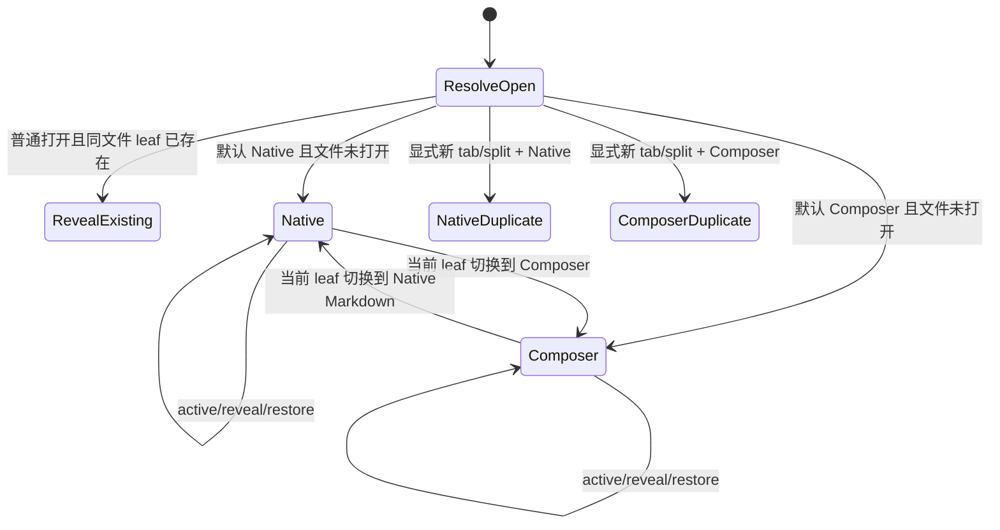
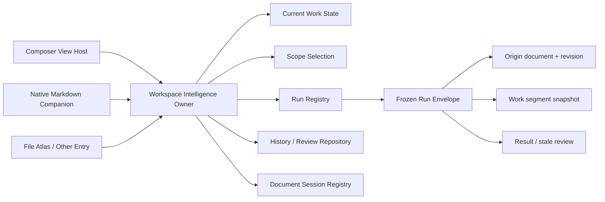
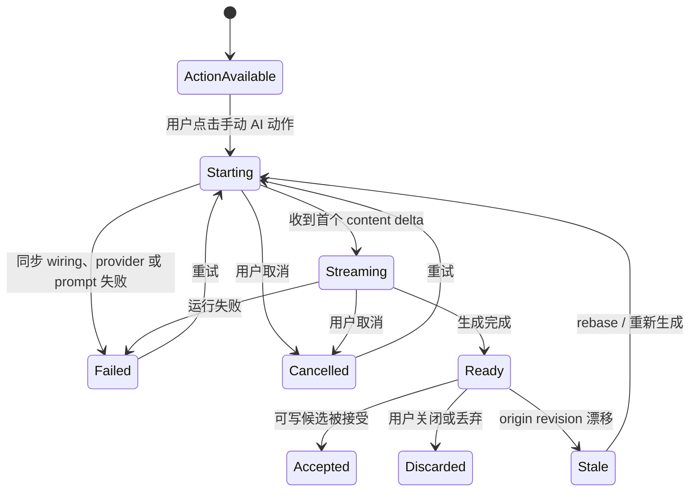
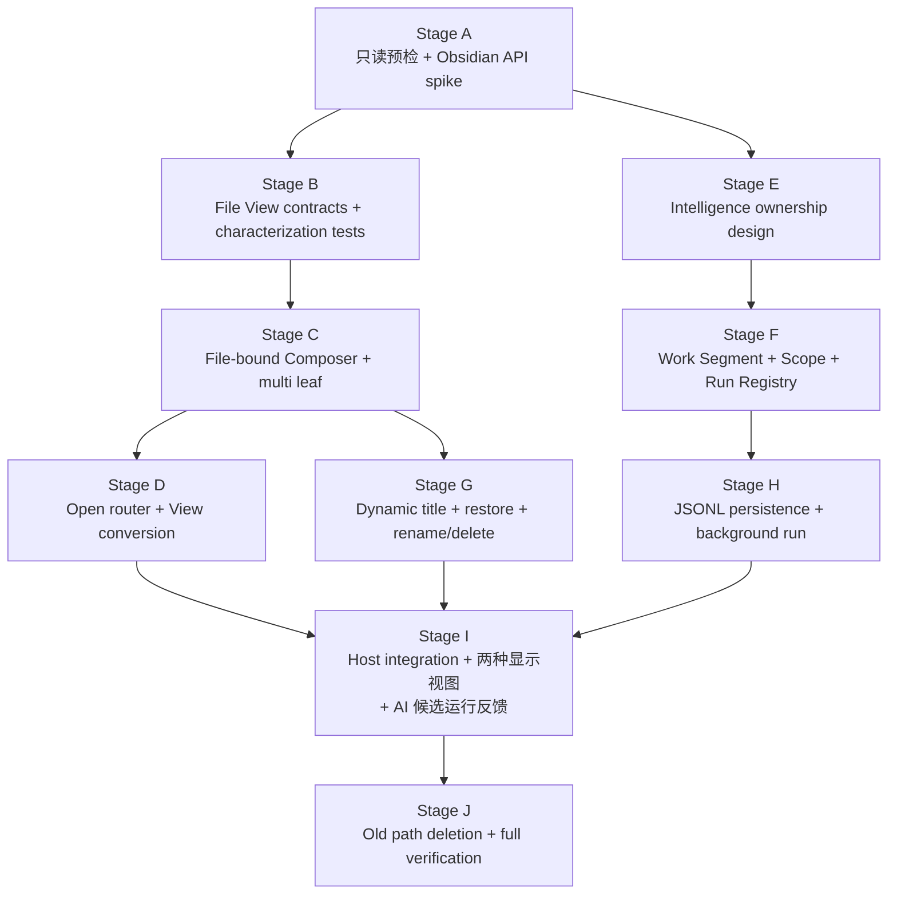

# Composer 文件视图、编辑/阅读显示与 Intelligence 运行反馈执行 Handoff

> 日期：2026-07-29
> 状态：已授权执行；先做强制只读预检，预检无阻塞后直接实现
> 面向对象：接手此任务的下一 Codex / Claude Code 会话
> 工作目录：`/Users/zhangjike/code/my-code/mobius-highestpeak-kb/.obsidian/plugins/obsidian-peak-assistant`

---

## 0. 接手方式

这不是一份供继续讨论的概念稿，而是一份单会话执行 handoff。

接手会话必须：

1. 先完成本文的 Stage A 只读预检；
2. 如果代码事实与本文一致、且没有命中停止条件，不要再次等待 owner 批准，直接按 DAG 实现；
3. 一次性完成所有核心轨道，不要把 owner 变成多个微型 prompt 的搬运者；
4. 任何“完成”都必须同时满足自动化验证和真实 Obsidian 验收合同；
5. 若只完成部分能力，必须诚实标为 `PARTIAL`，不得写成“基本完成”。

当前 checkout 已知存在以下非本任务资产，而且其他会话仍可能继续修改；Stage A 必须以接手时的实际 `git status` 为准：

- `docs/gstack/ai-search-report-workspace-2026-07-29/app.js` 和 `index.html` 有用户自己的未提交修改；
- `docs/superpowers/specs/2026-07-29-ai-search-report-workspace-ux-design.md` 有用户自己的未提交修改；
- `telemetry/composer-intelligence.jsonl` 有用户自己的未提交修改；
- [2026-07-29-composer-file-view-and-intelligence-state-work-plan.md](./2026-07-29-composer-file-view-and-intelligence-state-work-plan.md) 是本任务的上游工作计划，当前可能仍是未跟踪文件。

必须保留它们。不得覆盖、清理、回滚、自动提交或为了创建 worktree 而擅自改变其状态。

当前 checkout 还可能包含与本任务直接重叠的 Composer source、candidate renderer、CSS 和
focused test 未提交修改。Stage A 必须逐项记录并理解其意图；“本任务需要改同一个文件”
不等于获准覆盖或回退这些修改。无法安全融合时才命中停止条件。

---

## 1. Owner 要的最终结果

Composer 不再是一个跟随 Obsidian 全局 active file 的单例功能页，而要成为一种真正的 Markdown 文件视图：

- 每个 Composer leaf 明确绑定一个 Markdown 文件；
- 多个文件可以同时打开为多个 Composer tab；
- tab 标题显示文件名，而不是固定的 `Composer`；
- 用户普通打开 Markdown 文件时，可以按 Vault 级偏好默认进入 Native Markdown 或 Composer；
- 用户可以在当前 leaf 内安全地从 Composer 切回 Native Markdown，也可以从 Native Markdown 切到 Composer；
- “默认以后怎么打开文件”和“当前这个 tab 用什么 View”是两个不同控制；
- Copilot / Intelligence 不因切文件、切 tab、切 View 或关闭某个 React host 而丢失正在执行的 Run；
- Intelligence 能按“当前文档 / 当前工作段 / 固定范围”投影；
- Run 永远绑定发起时的原始文档、原始 revision 和工作段，之后切换筛选或 View 不得偷偷迁移 Run；
- Composer sidecar 与 Native Markdown companion 使用同一套 Intelligence、History、Run 和 Current Work State owner；
- Composer 顶层文档显示只保留 `编辑视图 / 纯净阅读`；旧 `全部改动` 不再是第三种常驻模式，而是编辑视图内按需展开候选的审阅动作；
- 用户点击任意手动 AI 动作后，原文锚点必须立即出现可见的运行卡；首 token 前、流式、成功、失败、取消和 stale 都有明确反馈；
- 多个候选同时存在时，当前运行项自动展开，其余项可收起，并提供 `审阅全部改动 · N` 一类的按需总览入口；
- 最终删除旧的 active-file follower 和单 Composer 入口，不保留永久双系统。

一句话定义：

> Composer 是文件级 View；默认打开模式是 Workspace 路由策略；编辑/阅读是当前文档的显示状态；Intelligence 是跨 View 的 app-owned 工作状态；AI Run 与候选卡绑定原始文档上下文并保持可见。

---

## 2. Source of Truth 与冲突优先级

按以下顺序处理冲突，前者优先：

1. 本 handoff 中的冻结决策和完成合同；
2. [Composer 文件视图、编辑/阅读显示与 Intelligence 运行反馈工作计划](./2026-07-29-composer-file-view-and-intelligence-state-work-plan.md)；
3. [Composer Intelligence Sidecar UI Spec](../specs/2026-07-15-composer-intelligence-sidecar-ui.md)；
4. [Copilot Intelligence Native Editor Modal Spec](../specs/2026-07-29-copilot-intelligence-native-editor-modal.md)；
5. [Machine Record Storage JSONL Design](../specs/2026-07-21-machine-record-storage-jsonl-design.md)；
6. 当前 production source、focused tests 和真实 Obsidian runtime 事实；
7. [Peak Composer Implementation Note](./2026-07-27-peak-composer-implementation-note.md)；
8. [Peak Composer Related Document Map](../specs/2026-07-22-peak-composer-related-document-map.md)；
9. 更早的 handoff、静态 mock、历史截图和旧设计说明。

工程规则以以下文档为准：

- [`AGENTS.md`](../../../AGENTS.md)
- [Obsidian Real UI QA](../../conventions/obsidian-real-ui-qa.md)
- [`docs/progress.md`](../../progress.md)

如果旧文档仍把 Composer 描述成“单例入口”或“跟随 active file”，视为待退休的 current-state 描述，不得用来推翻本文目标。

---

## 3. 当前 production 事实

Stage A 必须重新核验以下事实，不得只相信 handoff：

### 3.1 当前 Composer 是 active-file follower

- `src/app/composer/DocumentComposerView.ts`
  - `getDisplayText()` 返回固定 `Composer`；
  - `onOpen()` 创建 controller 并 `start()`；
  - View 自身没有以 `filePath` 为核心的持久化 view state。
- `src/app/composer/DocumentComposerController.ts`
  - `start()` 监听 active file；
  - 通过 host adapter 读取当前 active file；
  - active file 改变时释放当前 editing runtime，再加载另一个文件。
- `src/app/composer/ObsidianComposerAdapters.ts`
  - 通过 `workspace.getActiveFile()` 获取路径；
  - 通过 `active-leaf-change` 驱动文件切换。

### 3.2 当前入口是单 Composer leaf 语义

- `src/app/ui-host/views/ViewManager.ts`
  - `activateDocumentComposerView()` 优先 reveal 第一个已有 Composer leaf；
  - 没有文件身份、打开 disposition 或多 leaf 路由合同。

### 3.3 Intelligence 生命周期仍被 View / 文档 runtime 包住

- `src/app/composer/DocumentComposerRuntime.ts`
  - 每次 composed document editing runtime 创建新的 `IntelligenceRuntime`。
- `src/service/composer/intelligence/IntelligenceRuntime.ts`
  - runtime 自己拥有 `CopilotSessionMachine`。
- 单个 session 已有一定程度的 run-context freeze，但外层 runtime 会在文档切换或 View 释放时被销毁。

这意味着：

> 单次 Run 的局部冻结语义已经存在，但 Run、History、Work State 的 owner 还没有上升到能跨 View 生命周期存活的位置。

### 3.4 当前 AI 动作存在候选可见性黑洞

当前 production source 已确认存在一条互相冲突的显示条件，Stage A 必须在接手时重新核验：

- `src/ui/view/composer/ComposerRoot.tsx`
  - 默认有 editing runtime 时，`displayState` 初始化为 `work`；
  - 候选只有在 `displayState === 'all'` 时才通过 `showInlineCandidate` 展开；
  - 只要 `hasInlineCandidate` 为真，block action row 就会被隐藏，不管候选是否真的可见；
  - block AI invoke 的异常被空 `catch {}` 吞掉，用户看不到同步 wiring / runtime 错误。
- `test/composer-owner-feedback-contract.test.ts`
  - 当前测试反而把“候选只在全部改动中展开”锁成合同，需要改成防黑洞合同。
- `src/ui/view/composer/candidates/AnalysisCandidateCard.tsx`
  - 只处理 streaming text 和 ready payload；
  - failed / stale 且没有正文时会得到空白 body；
  - 它是解释流程图、解释代码等只读分析动作的主要 review surface。

这组 gating 由 commit `baa133bd`（`feat: advance composer intelligence workspace`）引入。修复时不得简单回退整个 commit；该提交还包含 findings、comment 和 selection 等其他能力，只能迁移显示状态并修正候选生命周期。

### 3.5 先验证再修改

预检时至少检查：

```bash
git status --short --branch
git rev-parse HEAD
rg -n "getDisplayText|activateDocumentComposerView|onActiveFileChange|getActiveFilePath|new IntelligenceRuntime|CopilotSessionMachine" \
  src test
rg -n "displayState|showInlineCandidate|hasInlineCandidate|projection\\.invoke|AnalysisCandidateCard" \
  src/ui/view/composer test
```

把实际文件、符号、测试入口、现有脏文件和基线 commit 写进最终 implementation note。

---

## 4. 已冻结的产品决策

以下决策已经由 owner 需求和前序梳理收束。接手会话不得为了实现方便改回旧模型。

### D1. 默认打开模式

- 默认模式是 Vault / workspace 级偏好；
- 值只有 `Native Markdown` 或 `Composer`；
- 初次升级和安全回退默认值保持 `Native Markdown`；
- 用户切换后立即影响后续普通 Markdown 打开动作；
- 它也不是 Composer 内部的显示状态；后者按 D11 只保留 `编辑视图 / 纯净阅读`。

### D2. 普通打开与显式新开

- 普通打开动作优先 reveal 已经打开的同文件 leaf；
- 如果该文件尚未打开，才按当前默认模式选择 Native Markdown 或 Composer；
- 显式“在新 tab 打开”或“在 split 打开”可以创建同文件第二个 leaf；
- 不得把所有 open disposition 压成一个行为。

### D3. Composer 是文件级 View

- 每个 Composer leaf 必须持有明确的文件身份；
- leaf 的标题跟随文件名，不能固定显示 `Composer`；
- rename、delete、workspace restore 必须有确定行为；
- 多个 Composer leaf 的选区、滚动、sidecar、本地 UI 状态不得串线。

### D4. 当前 View 原地切换

- Composer ↔ Native Markdown 优先在当前 leaf 原地转换；
- 切换前必须处理 Native Markdown 的未保存 buffer；
- 转换失败时必须回滚到原 View，并保留原文件；
- 不允许“关闭原 tab，再另外打开一个 tab”冒充原地切换。

### D5. 两个控制的语义分离

1. Composer 顶部主工具栏中的控制：
   - 改的是“后续文件默认用什么 View 打开”；
   - 不自动转换当前 leaf；
   - 需要有清楚的 tooltip / aria 文案。
2. 当前 tab / View header 的操作：
   - 改的是当前文件、当前 leaf 的 View；
   - Composer 中提供“切换到原生 Markdown”；
   - Native Markdown companion 中提供“切换到 Composer”。

不得用一个 toggle 同时承担这两种状态。

### D6. Work Segment

- Current Work State 是 workspace 级工作状态；
- 第一次开始一个 Copilot task session 时自动建立工作段；
- 用户打开相关文件、切 tab 或切 View 不会结束工作段；
- 空闲超时不得静默结束工作段；
- 用户可以显式开始新工作段、固定范围或结束当前工作段；
- 一个文件可以进入当前工作段，但工作段不等于“当前 active file”。

### D7. Intelligence Scope

用户可选择：

- `当前文档`：只投影当前 leaf 对应文件；
- `当前工作段`：投影当前 work segment 中的文档、Run、决策和历史；
- `固定范围`：投影用户显式 pinned 的文件或集合。

Scope selection 是 workspace 级选择；每个 View host 可以保存自己的局部位置和展示状态。Scope 切换只影响后续投影和新 Run，不得改写已经 Frozen 的 Run。

### D8. Run 归属

Run 启动时必须冻结：

- `runId`；
- origin document identity / path；
- origin revision；
- origin host / leaf context；
- work segment id；
- scope snapshot；
- action / selection / intent context。

Run 启动后：

- 切文件、切 tab、切 Scope、切 Native / Composer 都不能移动或取消它；
- 结果回到 origin document 的 review surface；
- origin revision 已变化时必须 fail closed，进入 stale review / rebase 流程；
- 不得静默把 patch 应用到“当前正在看的文件”。

### D9. Copilot 顶层 IA

- 保持 `Copilot / History` 两个顶层入口；
- Current Work State / Ambient Context 是 Copilot brief 背后的上下文，不新增第三个顶层 tab；
- Composer sidecar 与 Native Markdown companion 共享同一套核心 owner。

### D10. 持久化

- machine run / event record 使用既定 JSONL canonical storage；
- SQLite 只作为可重建 read model；
- Markdown 只用于用户文档或显式 export；
- 不得新建第三套 canonical History / Run 存储；
- workspace reload 后应恢复可恢复的 View state、Work Segment、Scope 和 Run/Review 状态。

### D11. Composer 文档显示只保留两个顶层状态

用户可见的顶层显示状态只有：

- `编辑视图`：原 `工作视图` 的明确命名；可编辑正文、显示 findings，并在原文锚点显示活动/待审候选；
- `纯净阅读`：只读阅读状态，隐藏编辑 chrome、findings 和候选，但不删除候选；切回编辑视图后恢复原状态。

旧 `全部改动` 不再是第三种持久 display state。它改为编辑视图中的上下文动作：

- 只有存在多个可审阅候选时才显示；
- 文案表达为 `审阅全部改动 · N` 或等价清晰文案；
- 点击后展开全部待审候选，或把用户定位到统一 review surface；
- 退出总览后仍回到编辑视图，不产生第三个顶层状态。

旧 `work / all / clean` 的 View state、fixture、CSS selector 和测试必须迁移。允许读旧值做一次性兼容，但最终写入和运行只保留 `edit / clean` 两种真相。

### D12. 手动 AI 动作必须即时、锚定、可恢复

所有 Composer 内手动 AI 动作遵循同一可见性合同：

- 点击动作后，先同步创建并投影候选/运行占位，再开始 provider 调用；
- 首 token 到达前显示 `正在生成` / `正在分析` 动画和取消动作；
- streaming 时在真实候选 body 中稳定更新；
- ready、failed、cancelled、stale 都保留可见终态和适用动作；
- 同步异常、provider 错误、prompt/config 错误不得被空 `catch {}` 吞掉；
- 在编辑视图中，候选存在时 action row 可以被候选替代；如果候选没有实际渲染，action row 必须保留并显示错误，二者不得同时消失；
- `纯净阅读` 可以暂时隐藏候选，但不能丢失或取消它们。

候选按结果类型使用不同 review surface：

- 润色、改写、文本替换：原位 diff 卡；
- 补写、提纲、插入内容：插入草稿卡；
- 表格、流程图、图片等结构化结果：对应结构化预览；
- 解释流程图、解释代码等 analysis：只读分析卡，无 `接受`，但必须有关闭、重试以及失败/stale 反馈。

多候选时：

- 当前活动或 streaming 候选自动展开；
- 其他候选收为轻量状态，可逐个展开；
- `审阅全部改动 · N` 提供按需总览；
- candidate identity、origin block、origin revision 和 Run identity 不因展开/收起或显示状态切换而变化。

---

## 5. 目标状态模型

### 5.1 文件打开和 View 转换



关键不变量：

- `DefaultDocumentView` 决定未来打开，不决定当前 leaf；
- `CurrentLeafViewType` 决定当前 leaf，不反向偷偷改全局默认；
- 普通 reveal 与显式 duplicate 是不同 disposition；
- 非 Markdown 文件不进入这套路由。

### 5.2 Intelligence 与 Run



核心所有权：

- App layer 负责 runtime composition 和生命周期；
- View 只持有 projection、选中项、滚动位置和 transient UI；
- Service 层不得新增模块级 singleton，也不得扩大 `AppContext.getInstance()`；
- 关闭一个 View host 不能销毁仍在运行或等待 review 的 Run。

### 5.3 编辑视图内的 AI 候选生命周期



阅读要点：

- `Starting` 不是空白等待期，必须已经有锚定卡片和动画。
- analysis 候选从 `Ready` 只能关闭/重试，不进入 `Accepted`。
- `纯净阅读` 只是隐藏 projection，不改变图中的候选状态。
- 在编辑视图中，action row 与候选卡必须至少有一个可见，不能出现交互黑洞。

### 5.4 推荐概念合同

具体类名可以调整，但以下信息不能丢：

```ts
type DefaultDocumentView = "markdown" | "composer";

type OpenDisposition =
  | "reuse-existing"
  | "replace-current"
  | "new-tab"
  | "split";

interface ComposerViewStateV1 {
  version: 1;
  filePath: string;
  displayMode?: "edit" | "clean";
  scrollAnchor?: unknown;
  selectedBlockId?: string;
}

type IntelligenceScope =
  | { kind: "document"; documentId: string }
  | { kind: "work-segment"; segmentId: string }
  | { kind: "pinned"; pinId: string };

interface FrozenRunEnvelope {
  runId: string;
  originDocumentId: string;
  originPathAtStart: string;
  originRevision: string;
  originHost: "composer" | "markdown";
  workSegmentId: string;
  scopeSnapshot: IntelligenceScope;
}

type CandidateLifecycle =
  | "starting"
  | "streaming"
  | "ready"
  | "failed"
  | "cancelled"
  | "stale"
  | "accepted"
  | "discarded";
```

这些只是语义合同，不要求机械复制命名。实现必须遵循项目既有 schema、template、port、runtime registry 和 JSONL 约定。

---

## 6. 完成合同

只有以下 Required Outcomes 全部满足，才允许标记 `COMPLETE`：

### R1. File-bound Composer

- Composer leaf state 明确持有文件；
- 不再依赖全局 active-file follower 选择主文档；
- tab 标题跟随文件名；
- 支持多 Composer leaf 和 workspace restore；
- rename / delete 有测试和明确 UX。

### R2. 打开路由

- Vault 级默认打开模式可切换、可持久化；
- 普通打开优先 reveal 同文件 leaf；
- 显式 new tab / split 可以 duplicate；
- 文件树、内部链接、搜索、File Atlas、recent/programmatic open 的关键入口经过一致的 app-owned 路由或有明确不拦截理由；
- 路由有 recursion / re-entry guard；
- 非 Markdown 文件不受影响。

### R3. 当前 View 切换

- Composer 与 Native Markdown 可以在当前 leaf 原地转换；
- 未保存 Markdown buffer 不丢；
- 失败可恢复；
- 两侧都有可发现的 current-leaf action；
- 顶部默认模式控制和 current-leaf View action 不混淆。

### R4. Intelligence owner 提升

- Current Work State、Scope、Run Registry、History/Review、Document Session 的 canonical owner 位于 app-owned runtime；
- Composer 和 Native host 共用 owner；
- View 销毁不结束 still-running Run；
- 没有新 service singleton 或双 runtime。

### R5. Scope 与 Work Segment

- `当前文档 / 当前工作段 / 固定范围` 可用；
- work segment 生命周期符合 D6；
- 每个 View 的局部 projection 状态不串线；
- Scope 切换不修改既有 Frozen Run。

### R6. Run 连续性

- 在 Composer 发起 Run 后切文件、切 View，Run 继续；
- 结果回到 origin document；
- revision 不一致时 fail closed；
- History / Review 可以重新定位到 origin document；
- reload 后可恢复已持久化状态，或对不可恢复状态给出明确终态。

### R7. 旧路径退休

- 删除 active-file follower 的主文档绑定职责；
- 删除“只 reveal 第一个 Composer leaf”的单入口假设；
- 删除 per-view canonical Intelligence owner；
- 不保留 feature flag 下的永久双系统；
- source guard / contract test 防止旧路径回流。

### R8. 验证

- focused tests 通过；
- `npm run test` 通过；
- `npm run build` 通过；
- 真实 Obsidian 完成本文验收场景，并保存可审阅证据；
- 无法完成真实交互验证时，必须标 `INTERACTION NOT VERIFIED`，整体只能是 `PARTIAL`。

### R9. 两种显示视图

- 顶层只显示 `编辑视图 / 纯净阅读`；
- `工作视图` 已更名为 `编辑视图`；
- `全部改动` 已从持久顶层状态移除，变成按需 `审阅全部改动 · N`；
- 旧 `work / all / clean` state 有明确 migration，最终写入不再产生 `all`；
- 纯净阅读隐藏候选但不删除，切回编辑视图后恢复。

### R10. AI 运行反馈与候选可见性

- 每个手动 AI 动作点击后立即出现 origin anchor 运行卡；
- 首 token 前有动画、状态文案和取消；
- streaming、ready、failed、cancelled、stale 均有可见且可操作的状态；
- rewrite、insert、structured 和 analysis 使用正确 card grammar；
- analysis 无接受动作，但有关闭、重试和错误/stale 反馈；
- 多候选自动展开当前项，其他项可收起，并有按需总览；
- 编辑视图中的 action row 与候选卡永远不会同时消失；
- invoke/runtime/provider/prompt 错误不再被静默吞掉。

核心轨道的 skip budget 为 0。只有需要真实付费模型 credential 的端到端调用允许被明确标成外部阻塞；这不免除 fake provider / deterministic provider 的生命周期验证。

---

## 7. 执行 DAG



允许在 Stage A 后并行推进 C 系和 F 系，但集成 owner 必须统一处理共享 runtime composition 文件。若接手会话不使用 subagent，就按同一 DAG 串行执行；不要为了形式并行而增加冲突。

---

## 8. Stage A：强制只读预检

Stage A 不修改 production code，目标是消除实现猜测。

### A1. Baseline 与脏文件

记录：

- branch；
- HEAD；
- `git status --short`；
- 与任务重叠的用户修改；
- 上游工作计划和本 handoff 是否已被跟踪。

如果用户修改与本任务目标文件重叠且无法安全保留，命中停止条件。`telemetry/composer-intelligence.jsonl` 不属于本任务，必须绕开。

### A2. Runtime 与调用图

至少审计：

- `DocumentComposerView`
- `DocumentComposerController`
- `DocumentComposerRuntime`
- `composeDocumentComposerRuntime`
- `ObsidianComposerAdapters`
- `ViewManager`
- `AppRuntimeRegistry`
- `main.ts`
- `IntelligenceRuntime`
- `CopilotSessionMachine`
- sidecar store / hooks / History / Review
- Native Markdown Intelligence modal / host
- `ComposerRoot` / `DisplayStateSwitch` / block action row
- candidate runtime / registry / host / type-specific candidate cards
- candidate status、stream event 和 error projection
- File Atlas 的打开文件入口
- Settings / workspace data persistence

输出一张简短 owner map，确认哪些对象是：

- workspace lifetime；
- document lifetime；
- leaf lifetime；
- run lifetime；
- React mount lifetime。

### A3. Obsidian API spike

在真实 Obsidian / CDP 中确认：

- 自定义 `ItemView` 的 `getState` / `setState` / workspace restore 行为；
- 动态 `getDisplayText()` 何时刷新，以及 rename 后如何触发；
- current view header action 的稳定官方入口；
- 同 leaf `workspace.setViewState` 或等效切换能否保留 leaf；
- Native Markdown 未保存 CodeMirror buffer 的 flush / save 时序；
- 同文件 leaf 查找与 reveal；
- tab / split disposition 的宿主语义；
- 插件自己的 open handler 如何避免递归。

不允许在未完成 API spike 时先写 DOM monkey patch。

### A4. 设计记录

在 production edit 前，新建或更新一份简短技术设计：

`docs/superpowers/specs/2026-07-29-composer-file-view-routing-and-intelligence-state-design.md`

它必须记录：

- ownership map；
- versioned View state；
- navigation/open port；
- View conversion transaction；
- Work Segment / Scope / Run state；
- persistence boundary；
- `编辑视图 / 纯净阅读` 两态 schema 与旧值 migration；
- 手动 AI 动作到候选卡的同步创建、stream、error、cancel、stale 状态机；
- 多候选展开/收起与 `审阅全部改动 · N`；
- rename/delete/reload 行为；
- 旧路径删除清单；
- API spike 证据和风险。

若设计与本文冻结决策一致，不需要再次等 owner 审批，继续实现。

---

## 9. Stage B–J 实现要求

### Stage B：合同和 characterization tests

先把当前 bug 和目标合同写进 tests：

- 当前 Composer 会跟随 active file；
- 当前入口只 reveal 第一个 Composer leaf；
- 当前 View title 固定；
- 当前 Intelligence runtime 会随 document/view runtime 重建；
- 单次 `CopilotSessionMachine` 已冻结哪些字段。
- 默认 `work` 中候选被 `displayState === 'all'` 隐藏；
- `hasInlineCandidate` 同时隐藏 action row 导致黑洞；
- AI invoke 的空 `catch {}` 使同步错误无反馈；
- analysis candidate 在 failed / stale 时可呈现空白 body。

然后新增目标合同测试。建议文件：

- `test/composer-file-view-state.test.ts`
- `test/composer-open-policy.test.ts`
- `test/composer-multi-leaf.test.ts`
- `test/composer-view-conversion.test.ts`
- `test/composer-intelligence-scope.test.ts`
- `test/composer-work-segment.test.ts`
- `test/composer-background-run.test.ts`
- `test/composer-display-state-contract.test.ts`
- `test/composer-ai-action-feedback.test.ts`
- `test/composer-analysis-candidate.test.ts`
- `test/composer-multi-candidate-review.test.ts`
- `test/composer-old-follower-retirement.test.ts`

同时按需更新：

- `test/composer-view-lifecycle.test.ts`
- `test/composer-production-composition.test.ts`
- `test/composer-intelligence-session.test.ts`
- `test/file-atlas-work-file-rail-contract.test.ts`

### Stage C：File-bound Composer

实现 versioned Composer view state：

- `filePath` 是 leaf 的绑定输入，不再从 global active file 推导；
- controller 接受显式 file binding；
- active leaf change 只影响激活状态，不重绑定主文件；
- Vault rename/delete/modify 事件分别处理；
- document editing runtime 的创建和释放跟这个 leaf 的文件绑定一致；
- 多 leaf 不共享 selection、scroll、active block 或 transient sidecar UI。

必须保留现有 Composer 文档编辑功能，不得为了多 tab 删减 block editing、history 或 AI review。显示状态按 D11 收敛为 `编辑视图 / 纯净阅读`，不得保留第三种顶层模式。

### Stage D：App-owned open router 与 View conversion

在 app layer 建立单一导航合同，至少表达：

- target file；
- preferred / explicit View type；
- open disposition；
- reveal-existing policy；
- source / reason；
- loop guard。

所有插件自有入口优先使用这套合同。对于 Obsidian 原生文件树、wikilink 等宿主入口，使用稳定 Obsidian API 拦截或替换；若某个入口没有安全 API，必须在 implementation note 中说明证据和降级行为，不能用脆弱 DOM patch 冒充完整覆盖。

View conversion 必须是 transaction：

1. 解析当前 leaf 和文件；
2. flush / save 必需的 Native Markdown buffer；
3. 保存可迁移状态；
4. 在同 leaf 设置目标 View state；
5. 验证目标 View 已绑定同文件；
6. 失败则恢复原 View state。

### Stage E–F：Intelligence owner、Work Segment、Scope 与 Run Registry

把 canonical Intelligence 生命周期从 per-view / per-document editing runtime 提升到 app-owned runtime registry。

要求：

- 一个 workspace 只有一个 canonical Current Work State owner；
- 一个 Run 只有一个 canonical Run Registry record；
- Composer sidecar 和 Native modal 订阅相同 source of truth；
- document registry 可以按稳定文档身份定位，并在 rename 时更新 path；
- Work Segment 不由 active file 或 idle timeout隐式结束；
- Scope selection 与 per-view projection position 分离；
- 新 Run 创建 Frozen Run Envelope；
- view unmount 只取消订阅，不取消 Run；
- cancellation 必须是明确的用户动作或 runtime shutdown policy。

不要创建 service-layer `let currentRuntime`、`setRuntime/getRuntime` 或新的 `AppContext.getInstance()` 依赖捷径。

### Stage G–H：标题、恢复、持久化与后台 Run

实现：

- tab title 使用文件名；
- rename 后同步；
- 同名文件通过 tooltip / aria / path context 可区分；
- workspace restore 能恢复 Composer leaf 与文件绑定；
- Work Segment、Scope、History、Run/Review 按既定 JSONL 设计持久化；
- SQLite 投影可重建；
- plugin reload 后不重复执行已完成 Run；
- in-flight Run 如果不能恢复计算，必须恢复成明确 interrupted/recoverable 状态；
- background Run 完成后把结果路由到 origin document 的 review surface。

### Stage I：UI 与宿主整合

先实现两个不同的文件 View 控制：

1. Composer 顶部主工具栏的默认打开模式控制；
2. 当前 View header 的 Native / Composer 切换 action。

再完成 Composer 文档显示和 AI 候选反馈：

1. 顶层 segmented control 只保留 `编辑视图 / 纯净阅读`；
2. 把旧 `工作视图` label、state 和测试迁移为 `编辑视图`；
3. 删除 `全部改动` 顶层选项，把它改成编辑视图内的 `审阅全部改动 · N`；
4. 点击任意 block / selection / Mermaid / code / table / image AI 动作时，同步创建 origin-anchor candidate；
5. provider 首 token 前显示 running skeleton / shimmer / caret 和 `正在生成` 或 `正在分析`；
6. 当前 streaming candidate 自动展开，其他候选收起为可定位状态；
7. ready / failed / cancelled / stale 都保留可见卡片和合适动作；
8. rewrite 使用原位 diff，insert 使用插入草稿，structured result 使用结构化预览，analysis 使用只读卡；
9. analysis 卡不得出现接受，但必须支持关闭、失败重试和 stale 重跑；
10. 移除 AI invoke 链路中的静默空 catch，把同步和异步错误投影到对应 candidate；
11. 建立不变量测试：编辑视图中 action row 与 candidate card 至少有一个可见；
12. 纯净阅读只隐藏候选 projection；切回编辑视图后候选、展开状态和 Run identity 恢复。

统一 UI 要求：

- 保持克制、专业；
- 使用项目现有 shadcn `Button` 和 Lucide icon；
- 遵守 Obsidian fixed-size button reset 防御规则；
- 不使用 emoji；
- 文案、label map、颜色、阈值放在 template/config 或对应 defaults，不散落硬编码；
- 不新增未经 owner 批准的 production Command Palette 命令；
- 不为 review-all 再造第三种 display state；
- 动画遵守 reduced-motion，并用 `aria-live` / status 文案提供非视觉反馈。

File Atlas、Native Markdown companion 和其他插件自有文件入口必须接入同一 open / Intelligence owner，不得各自复制状态机。

### Stage J：删除旧路径

在新路径验证通过后删除：

- active-file follower 的主文档重绑定逻辑；
- 单 Composer leaf activation 假设；
- per-view canonical `IntelligenceRuntime` 创建；
- 兼容期间新增但已不需要的 adapter；
- 无生产用途的 debug command、temporary flag 和 dead tests。

删除前确认调用者迁移完成；删除后增加 source guard 或 architecture test，防止旧模式回流。

---

## 10. 共享文件与集成策略

如果使用 subagent / worktree，必须先冻结 baseline，并明确 file ownership。当前 handoff 和上游计划可能未提交，因此不要创建看不到它们的 worktree 后凭记忆执行。

建议由主集成 owner 独占以下高冲突文件：

- `main.ts`
- `src/app/composer/DocumentComposerRuntime.ts`
- `src/app/composer/composeDocumentComposerRuntime.ts`
- app runtime registry / `AppContext` composition
- `src/app/ui-host/views/ViewManager.ts`
- Composer root / top toolbar
- display-state switch、candidate host、candidate registry 和 candidate cards
- shared Composer CSS
- shared template/config registry

可独立处理的 bounded tracks：

- pure state machine / schema；
- focused tests；
- JSONL repository adapter；
- Native Markdown host adapter；
- File Atlas caller migration；
- real-UI QA evidence；
- display-state migration 与 candidate lifecycle focused tests。

合并顺序：

1. contracts / tests；
2. app-owned runtime owner；
3. file-bound View；
4. open router / conversion；
5. host integrations；
6. persistence；
7. old-path deletion；
8. full verification。

不得让多个 worker 同时重写 runtime composition 或 Composer root。

---

## 11. 保护范围

以下内容除非实现所必需且有直接证据，否则不得修改：

- Chat 输入框 `src/ui/view/chat-view/components/Composer.tsx`；
- Chat Studio 和普通 Chat runtime；
- Obsidian / CodeMirror 内部实现；
- 无关的 search、report、usage、provider、indexing 功能；
- 用户的 AI Search Report Workspace 改动，包括 `docs/gstack/ai-search-report-workspace-2026-07-29/` 和 `docs/superpowers/specs/2026-07-29-ai-search-report-workspace-ux-design.md`；
- 用户的 `telemetry/composer-intelligence.jsonl` 修改；
- 现有用户 Vault 文档；
- 与本任务无关的 Command Palette；
- 付费 provider 配置和 credential。

明确禁止：

- 用 DOM 轮询 active tab 代替正式 View state；
- 用全局 module singleton 解决跨 View 生命周期；
- 用“当前 active file”定位 Run 结果；
- 让候选只在已经移除的 `全部改动` 状态可见；
- 在编辑视图中同时隐藏 action row 和 candidate card；
- 用空 `catch {}` 或只写 console 吞掉用户发起的 AI 错误；
- 用侧边聊天框替代 origin-anchor candidate 反馈；
- 为达到交付速度保留永久旧新双路径；
- 把测试 fixture 或静态 harness 说成真实 Obsidian 验收；
- 自动 commit、push、rebase 或清理用户改动；
- 删除主要 Composer 功能来降低复杂度。

---

## 12. 停止条件

只有以下情况允许停止并请求 owner 决策：

1. 发现与目标文件重叠的用户未提交修改，且无法在不覆盖意图的前提下继续；
2. 真实 API spike 证明 Obsidian 没有可安全实现同 leaf View conversion 或 header action 的稳定路径，而替代方案需要 DOM patch；
3. 无法证明 Native Markdown 未保存 buffer 在转换前可安全保存；
4. 当前 canonical persistence 事实与 JSONL accepted design 直接冲突，且会产生第二个 source of truth；
5. 需要扩展到非 Markdown 文件或修改 Obsidian core；
6. 用户在真实 Obsidian QA 过程中接管了应用状态；
7. 必需 credential 缺失且只剩真实付费模型验证。

第 7 项只阻塞付费端到端验证，不阻塞 deterministic/fake provider 测试、production build 或其他实现。

以下不是停止理由：

- 文件多；
- 需要重构 app-owned runtime composition；
- 现有测试覆盖不足；
- 需要补设计文档；
- 需要删除旧路径；
- 某个旧 handoff 与本文不一致。

---

## 13. 验证合同

### 13.1 自动化

按风险从小到大执行：

```bash
npm run test -- test/composer-file-view-state.test.ts
npm run test -- test/composer-open-policy.test.ts
npm run test -- test/composer-multi-leaf.test.ts
npm run test -- test/composer-view-conversion.test.ts
npm run test -- test/composer-intelligence-scope.test.ts
npm run test -- test/composer-work-segment.test.ts
npm run test -- test/composer-background-run.test.ts
npm run test -- test/composer-display-state-contract.test.ts
npm run test -- test/composer-ai-action-feedback.test.ts
npm run test -- test/composer-analysis-candidate.test.ts
npm run test -- test/composer-multi-candidate-review.test.ts
npm run test -- test/composer-old-follower-retirement.test.ts
npm run test
npm run build
```

若实际 test runner 的单文件参数不同，按 repo 当前脚本调整并在 implementation note 记录真实命令。

### 13.2 真实 Obsidian

遵守 [Obsidian Real UI QA](../../conventions/obsidian-real-ui-qa.md)：

1. 用 `lsof` 发现实际 CDP 端口，不硬编码；
2. 用 Playwright CDP 完成精确状态设置、DOM 断言、focus、geometry 和交互；
3. build 后只 reload 当前 plugin；
4. 用 Computer Use 证明结果来自真实 Obsidian，并保存最终可见截图；
5. harness / mock 只做 characterization，不算验收。

### 13.3 必测场景

1. 默认 Native：文件树普通打开 Markdown，进入 Native；
2. 切默认 Composer：下一个未打开 Markdown 进入 Composer；
3. 同文件已打开：普通打开 reveal 既有 leaf，不意外 duplicate；
4. 显式 new tab：同文件允许第二个 leaf；
5. 同时打开 A/B/C 三个 Composer tab，标题、内容、选区、scroll、sidecar 不串线；
6. Composer A 原地切 Native A，再原地切回 Composer A；
7. Native 有未保存输入时切 Composer，内容不丢；
8. rename A 后 Composer title、document identity、History/Run 定位继续有效；
9. delete A 后 View 显示明确 closed/missing 状态，不加载 active file 顶替；
10. Composer A 发起 Run，切到 Composer B，Run 继续且结果回 A；
11. Composer A 发起 Run，切到 Native A，Run 继续且 Native companion 可见同一状态；
12. Run 期间修改 A revision，结果进入 stale review，不自动 patch；
13. 在 `当前文档 / 当前工作段 / 固定范围` 间切换，既有 Run envelope 不变；
14. plugin reload / workspace restore 后多 leaf 文件绑定、默认模式、Scope、Work Segment 恢复；
15. File Atlas 打开同文件时遵守 reveal / disposition 合同；
16. 非 Markdown 文件不被 Composer router 劫持；
17. current-leaf action 和默认模式控制的状态互不偷改；
18. 旧 `active-leaf-change -> rebind Composer document` 路径不可再触发；
19. 顶层只显示 `编辑视图 / 纯净阅读`，不存在第三个 `全部改动` mode；
20. 在编辑视图点击润色/改写，首 token 前立即出现原位运行卡和动画；
21. 点击补写/提纲，显示 insertion draft；表格/流程图/图片显示对应结构化预览；
22. 点击解释流程图或解释代码，显示只读 analysis 卡且没有接受动作；
23. deterministic provider 分别走 ready、failed、cancelled、stale，卡片均可见且可恢复；
24. 同一文档存在多个候选时，活动项展开、其他项收起，`审阅全部改动 · N` 可展开总览；
25. 候选创建和 renderer 异常路径中，编辑视图的 action row 与候选卡不会同时消失；
26. 切入纯净阅读时候选隐藏，切回编辑视图后同一候选和 Run 状态恢复。

需要视频而非单张截图的场景：

- 未保存输入后切 View；
- Run 中切文件 / 切 View；
- 首 token 前等待、streaming、cancel、retry；
- 多候选展开/收起与 review-all；
- stale revision review；
- restore / reload 的中间状态；
- focus 恢复和 Escape 行为。

### 13.4 证据

保存：

- baseline commit 和 dirty file list；
- API spike 结果；
- focused/full test 日志；
- build 日志；
- real Obsidian viewport / DPR / theme / zoom；
- reference/current/normalized/overlay 或 diff；
- 必要的短视频；
- `INTERACTION NOT VERIFIED` / `NOT COMPARABLE` 的准确原因。

不能用 green build 替代真实 UI，也不能用截图替代时序交互。

---

## 14. 最终交付格式

完成后创建：

`docs/superpowers/plans/2026-07-29-composer-file-view-and-intelligence-implementation-note.md`

必须包含：

1. verdict：`COMPLETE` 或 `PARTIAL`；
2. baseline branch / commit / dirty files；
3. frozen decisions 是否全部保持；
4. ownership before / after；
5. 实际修改文件；
6. 旧路径删除清单；
7. 需求 R1–R10 的逐项证据；
8. 测试和 build 命令及结果；
9. 真实 Obsidian 场景与证据路径；
10. 未验证项、外部阻塞、已知风险；
11. 没有 commit / push 的说明，除非 owner 另行授权。

最终给 owner 的聊天摘要必须先说结果，再说：

- 能否把 Composer 作为默认文件 View；
- 多 Composer tab 是否真正 file-bound；
- Native / Composer 是否原地切换；
- Run 是否跨文件 / View 存活；
- Scope / Work Segment 的最终行为；
- 编辑视图 / 纯净阅读和按需审阅全部改动的最终行为；
- 手动 AI 动作是否从点击开始就有锚定运行反馈；
- 哪些旧路径已经删除；
- 真实 Obsidian 是否完整验收。

不得用“UI 已有”“测试大部分通过”“架构已准备好”替代能力完成。

---

## 15. 可直接复制到新会话的执行 Prompt

```text
请在下面这个 repo 中直接执行完整 handoff：

/Users/zhangjike/code/my-code/mobius-highestpeak-kb/.obsidian/plugins/obsidian-peak-assistant

主 handoff：
docs/superpowers/plans/2026-07-29-composer-file-view-and-intelligence-execution-handoff.md

上游工作计划：
docs/superpowers/plans/2026-07-29-composer-file-view-and-intelligence-state-work-plan.md

Owner 已授权：先完成 handoff 的 Stage A 只读预检；只要代码事实与冻结决策一致且没有命中停止条件，就不要再次等待批准，直接按执行 DAG 完成实现、旧路径删除、自动化验证和真实 Obsidian 验收。

请严格遵守：
- 保留所有用户未提交修改，尤其不要碰 AI Search Report Workspace 相关文件和 telemetry/composer-intelligence.jsonl；
- 不要把任务拆成多个需要 owner 搬运的微型 prompt；
- Composer 必须成为 file-bound View，不再跟随 global active file；
- 默认打开模式与当前 leaf View 切换必须是两种不同控制；
- Intelligence / Work Segment / Run Registry 必须提升为 app-owned canonical owner；
- Run 必须绑定 origin document + revision + work segment，并跨文件、tab、View 生命周期存活；
- Composer sidecar 与 Native Markdown companion 必须共用同一核心状态；
- Composer 顶层显示只保留“编辑视图 / 纯净阅读”，“全部改动”改为编辑视图内按需“审阅全部改动 · N”；
- 所有手动 AI 动作点击后必须立即在原文锚点显示运行卡，覆盖首 token 前、streaming、ready、failed、cancelled 和 stale；
- rewrite/insert/structured/analysis 使用各自正确的候选卡；analysis 无接受但有关闭、重试和错误反馈；
- 多候选时活动项展开、其他项可收起，并提供按需总览；
- 编辑视图中的 action row 与 candidate card 不得同时消失，AI invoke/runtime/provider/prompt 错误不得静默吞掉；
- 新路径验证后删除旧 active-file follower、单 Composer leaf 和 per-view Intelligence owner；
- 不得用 fixture、harness 或 green build 冒充真实 Obsidian 验收；
- 不要 commit 或 push，除非我另行明确授权。

若没有命中 handoff 的停止条件，请持续执行到完成，不要只返回研究报告或下一步建议。最后创建 handoff 指定的 implementation note，并按 R1–R10 给出 COMPLETE / PARTIAL 的诚实 verdict。文件视图完成但编辑/阅读显示或 AI 运行反馈未完成时，整体仍是 PARTIAL。
```
