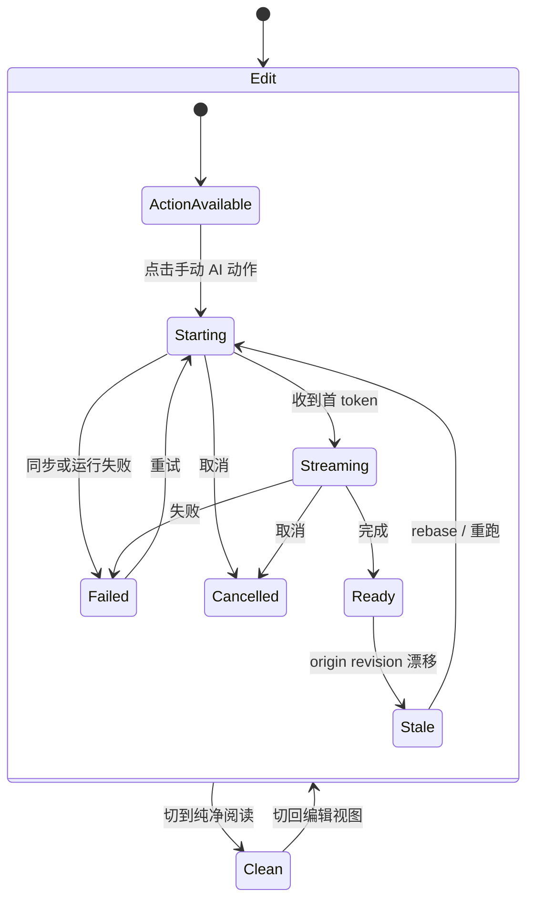
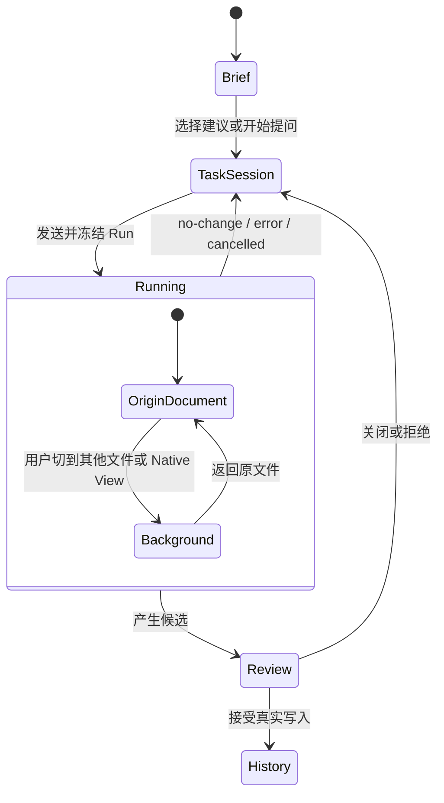

# Composer 文件视图、编辑/阅读显示与 Intelligence 运行反馈工作计划

Date: 2026-07-29
Status: requirements and owner decisions consolidated · execution governed by the companion handoff
Artifact type: product-state design gate + executable task plan
Audience: owner、实现者、reviewer，以及后续继续执行的 AI coding agent

## 1. 五分钟结论

这次工作不能被拆成“加两个切换按钮”和“让 tab 显示文件名”。当前 Composer 的根本模型是：

```text
全局 active Markdown file
  -> 一个 Composer leaf 跟随它
  -> 换文件时销毁旧 document runtime
  -> 为新文件重新创建 Composer + Intelligence runtime
```

目标模型必须改成：

```text
用户打开文件
  -> app-owned 文件打开策略选择 Native Markdown 或 Composer
  -> 每个 leaf 绑定自己的文件和 View 状态
  -> Composer / Native Markdown 可以在同一个文件上切换
  -> Composer 内只保留编辑视图 / 纯净阅读两个顶层显示状态
  -> 手动 AI 动作从点击开始就在原文锚点显示运行与候选状态
  -> 文档 Intelligence、当前工作段和 AI Run 分别拥有自己的生命周期
```

完成后应得到以下产品结果：

- Composer 可以成为 Markdown 文件的默认打开方式。
- 原生 Markdown View 始终保留，用户可以随时切换回来。
- 每个 Composer tab 绑定一个真实文件，标题显示文件名。
- 多个 Composer tab 可以同时打开不同文件。
- Copilot 的文档建议跟随当前文件。
- Current Work State 与本次工作的思想轨迹可以跨文件延续。
- 用户可以把 Intelligence 筛选为当前文档、当前工作段或固定范围。
- AI Run 一旦发送，就继续属于发送时冻结的文件和 revision；换文件或换 View 不会让结果漂移。
- 原 `工作视图` 更名为 `编辑视图`，与 `纯净阅读` 组成仅有的两个顶层显示状态。
- 原 `全部改动` 改成编辑视图内按需 `审阅全部改动 · N`，不再是一种常驻 display mode。
- 润色、补写、结构化生成和解释类动作都有锚定卡片；首 token 前、流式、成功、失败、取消和 stale 都有反馈。

执行先走 companion handoff 的 Stage A：核验代码事实、脏文件、Obsidian API 和状态所有权。若事实与本文冻结决策一致且没有命中停止条件，接手会话直接实现，不再等待第二次 owner 批准。

## 2. 本文要解决什么

本文把本轮对话中的需求变成一条可执行工作线：

1. 明确 Native Markdown 与 Composer 什么时候打开、如何切换。
2. 明确 Composer tab 与文件、leaf、标题和恢复状态的关系。
3. 明确 Copilot Intelligence 在换文件、换 View 和跨工作时间段时的状态归属。
4. 把 `工作视图 / 全部改动 / 纯净阅读` 收敛为 `编辑视图 / 纯净阅读` 与按需总览。
5. 修复所有 Composer 手动 AI 动作的运行反馈和候选可见性。
6. 给出按依赖排序的设计、实现、迁移和验收任务。

本文不做以下事情：

- 不在本轮直接修改生产功能代码。
- 不把 Composer 永久替换成 Obsidian 唯一编辑器。
- 不为 Composer、Native modal 和 File Atlas 建三套 Copilot runtime。
- 不把 Current Work State 做成 todo manager 或全 Vault dashboard。
- 不把 mock、单元测试或静态 source inspection 当成真实 Obsidian 验收。

## 3. 当前事实

### 3.1 Composer 仍然跟随全局 active file

当前 `DocumentComposerController.start()` 订阅全局 active leaf，并从
`ObsidianComposerFileEventsAdapter.getActiveFilePath()` 读取当前 Markdown 文件。
一个 Composer leaf 没有自己的持久文件绑定。

直接结果是：

- Composer 不能独立承接一次文件打开。
- Composer 需要某个 Markdown View 先成为 active file 来源。
- 切换文件会 dispose 当前 editing 与 Intelligence runtime，再为新文件重新创建。
- 多个 Composer leaf 即使存在，也会被同一个全局 active file 驱动。

### 3.2 Composer 入口仍是单例语义

`ViewManager.activateDocumentComposerView()` 会优先 reveal 第一个现有 Composer leaf。
它不会按文件查找或创建对应 Composer leaf，也没有 open disposition。

### 3.3 Composer tab 仍是固定功能页

`DocumentComposerView` 的 tab 标题固定为 `Composer`。它虽然暴露
`getSourceFilePath()` 供 File Atlas 识别，但没有把 `filePath` 写进 Obsidian
View state，也没有在 workspace restore 时恢复文件绑定。

### 3.4 单次 AI Run 已经具备冻结语义

现有 `CopilotSessionMachine.send()` 会冻结 `ComposerContextSnapshot`、目标引用、
相关材料和 capability。后续光标或 focus 变化不会修改已经发送的 Run。

这个基础应保留，但当前 `IntelligenceRuntime` 仍由每个打开文档的 editing runtime
拥有。换文件时 runtime 被销毁，因此“Run 冻结”尚不等于“Run 可以跨文件和
View 切换继续存在”。

### 3.5 现有 Intelligence IA 不能被推翻

已经确认的用户可见顶层仍然是：

- `Copilot`
- `History`

Ambient / Current Work State 是 Copilot brief 背后的 sensing 与排序能力，不恢复为
第三个顶层 tab。`brief -> task session -> running -> review` 的现有生命周期继续成立。

### 3.6 Native Markdown 仍有独立使用价值

现有 Native Editor Modal 设计明确要求：用户停留在原生 Markdown 编辑器时，仍能
消费同一套 Document Intelligence core。新的 Composer 默认打开模式不能使这个宿主
失效，也不能复制一套新的 History、Run 或 sensing state。

### 3.7 当前显示 gating 会制造 AI 操作黑洞

当前 source 中已确认：

- `ComposerRoot` 在有 editing runtime 时默认进入 `work`；
- inline candidate 只有 `displayState === 'all'` 才显示；
- `hasInlineCandidate` 又会隐藏 block action row；
- 因此默认状态下可能既看不到候选，也看不到原操作栏；
- block invoke 的空 `catch {}` 会把同步 runtime / wiring 错误吞掉；
- `AnalysisCandidateCard` 在 failed / stale 且无 payload 时可能显示空白 body。

`test/composer-owner-feedback-contract.test.ts` 目前还把“只在全部改动中展开候选”写成正向断言，所以现有 green test 不能证明用户链路正确。

这组条件由 commit `baa133bd` 引入，但该提交同时包含 findings、comment 和 selection 能力。修复目标是迁移显示状态和候选生命周期，不是回退整次提交。

### 3.8 证据入口

| 主题 | 当前事实来源 |
| --- | --- |
| Composer View 与固定标题 | [`DocumentComposerView.ts`](../../../src/app/composer/DocumentComposerView.ts) |
| active-file follower | [`DocumentComposerController.ts`](../../../src/app/composer/DocumentComposerController.ts)、[`ObsidianComposerAdapters.ts`](../../../src/app/composer/ObsidianComposerAdapters.ts) |
| 单例 Composer 入口 | [`ViewManager.ts`](../../../src/app/ui-host/views/ViewManager.ts) |
| per-document Intelligence runtime | [`IntelligenceRuntime.ts`](../../../src/service/composer/intelligence/IntelligenceRuntime.ts) |
| Frozen Run 与 Copilot 生命周期 | [`runSession.ts`](../../../src/service/composer/intelligence/runSession.ts) |
| Sidecar 产品状态合同 | [`2026-07-15-composer-intelligence-sidecar-ui.md`](../specs/2026-07-15-composer-intelligence-sidecar-ui.md) |
| Native Markdown companion | [`2026-07-29-copilot-intelligence-native-editor-modal.md`](../specs/2026-07-29-copilot-intelligence-native-editor-modal.md) |
| Copilot / History 持久化方向 | [`2026-07-21-machine-record-storage-jsonl-design.md`](../specs/2026-07-21-machine-record-storage-jsonl-design.md) |
| 当前 Composer 实现边界 | [`2026-07-27-peak-composer-implementation-note.md`](2026-07-27-peak-composer-implementation-note.md) |
| 显示状态与 candidate gating | [`ComposerRoot.tsx`](../../../src/ui/view/composer/ComposerRoot.tsx)、[`DisplayStateSwitch.tsx`](../../../src/ui/view/composer/chrome/DisplayStateSwitch.tsx) |
| 候选 host 与解释卡 | [`ComposerCandidateHost.tsx`](../../../src/ui/view/composer/candidates/ComposerCandidateHost.tsx)、[`AnalysisCandidateCard.tsx`](../../../src/ui/view/composer/candidates/AnalysisCandidateCard.tsx) |
| 当前错误合同测试 | [`composer-owner-feedback-contract.test.ts`](../../../test/composer-owner-feedback-contract.test.ts) |

## 4. 已确认的产品需求

### 4.1 默认文件打开模式

系统需要一个可持久化的默认打开模式：

- `原生 Markdown`
- `Composer`

Composer 工具栏提供切换入口。这个设置只决定未来的普通 Markdown 文件打开行为，
不强制转换所有已经打开的 tab。

非 Markdown 文件不受这项设置影响。

### 4.2 文件级 Composer

每个 Composer leaf 必须绑定一个明确的 Markdown 文件：

- `A.md` 的 Composer 与 `B.md` 的 Composer 状态互相隔离。
- tab 标题使用文件名，而不是统一显示 `Composer`。
- 文件 rename 后标题和绑定路径同步更新。
- 文件 delete 后进入明确的 missing state，不静默绑定其他 active file。
- Obsidian workspace restore 后恢复同一文件。

### 4.3 多 Composer tab

系统必须允许以下状态同时存在：

```text
Composer · A.md
Composer · B.md
Markdown · C.md
```

打开文件时仍需遵守 Obsidian 的 leaf disposition：

- 当前 tab 打开。
- 新 tab 打开。
- 分屏打开。
- 已存在目标 leaf 时 reveal。

“默认进入 Composer”只决定 View 类型，不应抹掉这些原生打开语义。

### 4.4 当前文件的 View 切换

当前文件需要一个 View 切换动作：

```text
Composer · A.md <-> Native Markdown · A.md
```

切换要求：

- 保持同一个文件。
- 优先保持同一个 leaf / tab 位置。
- 不要求先点击其他 tab 或其他文件。
- 不创建无意义的重复 tab。
- 不丢失未写入内容。
- 能恢复各自的 scroll、focus 和 review 定位状态。

用户要求入口位于 tab header / view header 附近。实现前必须通过真实 Obsidian spike
确认稳定宿主 API；不得默认用脆弱的全局 DOM 注入。

### 4.5 两个切换入口不是一件事

| 控制 | 影响范围 | 不应该做什么 |
| --- | --- | --- |
| Composer 工具栏默认模式 | 后续普通文件打开 | 不批量转换现有 tab |
| 当前 tab 的 View 切换 | 当前文件、当前 leaf | 不改全局默认模式 |

Composer 内的 `编辑视图 / 纯净阅读` 是第三类状态：它只改变当前 Composer 文档的显示和
编辑 chrome。新的默认打开控制、当前 leaf 的 Native/Composer 切换和 Composer 内显示状态
必须保持三个独立 owner。

### 4.6 Composer 只保留两种顶层显示视图

顶层 segmented control 只有：

- `编辑视图`：原 `工作视图` 的明确名称，可编辑正文、查看 findings 和候选；
- `纯净阅读`：只读并隐藏编辑 chrome、findings 和候选，但不删除候选状态。

原 `全部改动` 不再是第三个持久模式。存在多个待审候选时，在编辑视图显示
`审阅全部改动 · N` 或等价按需入口。它只展开/定位候选，不改变 display state。

旧 `work / all / clean` 值可以被一次性读取迁移，但最终 runtime 和持久化只写
`edit / clean`。

### 4.7 手动 AI 动作必须有完整运行反馈

所有 block、selection 和结构化内容 AI 动作共用以下产品合同：

- 点击后同步出现 origin-anchor 运行卡；
- 首 token 前显示 `正在生成` / `正在分析` 动画和取消动作；
- streaming、ready、failed、cancelled、stale 都是可见状态；
- 同步 invoke 错误、provider 错误、prompt/config 错误进入候选卡，不静默吞掉；
- 候选替代 action row 时必须真的可见；否则 action row 保留并显示错误；
- 切到纯净阅读只隐藏 projection，切回编辑视图恢复同一候选和 Run。

结果类型与 review surface 对应关系：

| 结果类型 | Surface | 主要动作 |
| --- | --- | --- |
| 润色、改写、文本替换 | 原位 diff 卡 | 接受、重新生成、丢弃 |
| 补写、提纲、插入 | insertion draft | 接受插入、重新生成、丢弃 |
| 表格、流程图、图片 | 结构化预览 | 接受、重新生成、丢弃 |
| 解释流程图、解释代码 | 只读 analysis 卡 | 关闭、重试；不显示接受 |

## 5. 状态模型

### 5.1 文件打开与 View 状态

```mermaid
stateDiagram-v2
    state "默认打开模式" as Policy {
        [*] --> NativeDefault
        NativeDefault --> ComposerDefault: Composer 工具栏切换
        ComposerDefault --> NativeDefault: Composer 工具栏切换
    }

    state "一个文件 leaf" as LeafState {
        [*] --> ResolveOpen
        ResolveOpen --> MarkdownView: 原生默认或显式原生打开
        ResolveOpen --> ComposerView: Composer 默认或显式 Composer 打开
        MarkdownView --> ComposerView: 当前 tab 切换
        ComposerView --> MarkdownView: 当前 tab 切换
        MarkdownView --> Missing: 文件删除
        ComposerView --> Missing: 文件删除
    }
```



阅读要点：

- 默认模式与当前 leaf View 是两种不同状态。
- 改默认模式不自动改现有 leaf。
- 当前 tab 切换只改变当前文件的 host。
- 文件路径属于 leaf View state，不再来自全局 active Markdown file。

### 5.2 Composer 显示与候选状态



阅读要点：

- `Starting` 已经是可见卡片，不是无反馈的空白期。
- Clean 只隐藏 Edit 内的候选 projection，不销毁候选。
- 多候选时当前运行项展开，其他项收起；review-all 是动作，不是第三种 state。
- 编辑视图中 action row 与候选卡至少有一个可见。

### 5.3 Intelligence 状态所有权

真正的问题不是“Copilot 跟文档还是跟用户”。不同状态必须跟随不同 owner。

| 状态 | Owner | 换文件时 | 换 View 时 |
| --- | --- | --- | --- |
| 当前文件、selection、revision | 当前 document leaf | 切到新文件 | 同文件保持 |
| Finding、候选、Review anchor | 原始 document | 留在原文件 | 同文件恢复 |
| Current Work State | 当前工作段 | 可以跨文件延续 | 保持 |
| Session Thought Trace | 当前工作段 | 可以跨文件延续 | 保持 |
| Copilot task session | 所选任务 + 工作段 | 不自动迁移到新文档 | 保持或后台 |
| Frozen Run | origin document + revision + run ID | 永远不改归属 | 继续运行 |
| Accepted History | 真实 transaction / document | 按筛选投影 | 不改变事实 |
| Intelligence 筛选 | 用户选择 | 按模式跟随或保持 | 保持 |

### 5.4 Intelligence 筛选

用户需要三种明确范围：

| 范围 | 文件切换后的行为 | 用途 |
| --- | --- | --- |
| 当前文档 | A 切到 B 后自动投影 B | 专注修改眼前文件 |
| 当前工作段 | 工作段不变，B 成为当前优先文档 | 跨多个相关文件继续同一件事 |
| 固定范围 | 文件、文件夹或项目范围不自动变化 | 长期研究或明确的多文件任务 |

推荐的默认行为是：

- 可见建议与 Review 以当前文档为第一优先。
- Current Work State 与思想轨迹保留当前工作段的连续性。
- UI 明确显示当前筛选，用户可以切换。

这不是把所有 Vault 内容暗中带入 Run。真正发送时仍需要冻结和展示本轮 context。

### 5.5 Copilot 生命周期与文件切换



运行中切换到 `B.md` 时：

- Run 继续属于 `A.md`。
- `B.md` 显示自己的 document projection。
- 当前工作段可以继续保持。
- Run 完成后，Review 仍回到 `A.md` 的真实 anchor。
- `A.md` revision 已变化时进入 stale / rebase / regenerate 处理，不允许写入错误文件。

## 6. 已冻结的实现决策

这些不是可以在编码过程中随便选的细节。接手会话在 Stage A 核验可行性；若没有命中
handoff 停止条件，按以下选择继续实现。

### 6.1 默认打开模式保存在哪里

冻结选择：按 Vault 保存，并在当前 workspace 中立即生效。

- 不同 Vault 可以使用不同默认模式。
- plugin reload 后保持。
- workspace restore 只恢复既有 leaf，不重新套用新的全局默认。

### 6.2 同一文件是否允许重复 Composer leaf

冻结选择：

- 普通点击优先 reveal 已有同文件 leaf。
- 显式 `Open in new tab` 允许重复 leaf。

这样既避免普通点击制造重复 tab，也保留 Obsidian 的显式多视图能力。

### 6.3 当前 tab 切换是否原地替换

冻结选择：优先使用同一 leaf 的 `setViewState()` 原地替换。

实现 spike 必须验证：

- Markdown 未保存 buffer 如何安全 flush。
- Composer transaction burst 如何安全 flush。
- 原生 scroll / editor mode 如何保存。
- Composer scroll / focused block / active change 如何保存。
- 转换失败时如何恢复原 View。

### 6.4 工作段怎么开始和结束

冻结选择：

- 第一次进入 Copilot task session 时创建工作段。
- 连续打开相关文件不会自动新建工作段。
- 用户可以显式开始新工作段或固定当前范围。
- idle 只能触发软提示，不能静默丢弃当前状态。
- plugin reload 后可以恢复未结束工作段。

### 6.5 Intelligence 筛选保存在哪里

冻结选择：

- 当前选择作为 workspace-level 工作偏好。
- 每个 Composer leaf 保存最后显示的 document projection 与定位状态。
- Frozen Run 永远保存发送时的真实范围，不读取后续筛选变化。

### 6.6 Composer 显示状态

- 用户可见值只有 `编辑视图 / 纯净阅读`。
- 旧 `工作视图` 迁移为 `编辑视图`。
- 旧 `全部改动` 迁移为编辑视图内按需 review-all action。
- leaf 保存 `edit / clean` 和局部展开状态，不保存第三种 mode。

### 6.7 候选运行反馈

- invoke 前同步建立候选/运行占位。
- activity/streaming candidate 自动展开。
- 非活动候选可折叠，但 origin anchor 和状态始终可定位。
- 所有错误通过 candidate lifecycle 呈现。
- analysis 是只读结果，不进入 accept transaction。

## 7. 执行任务

### Phase 0：只读预检与设计记录

目标：在不改产品行为的前提下，把当前 bug、目标状态和决策写成可测试合同。

任务：

- 记录当前 Composer 必须依赖 active Markdown file 的真实复现步骤。
- 锁定当前 `ViewManager` 单例 reveal 行为。
- 锁定多个 Composer leaf 被同一 active file 驱动的现状。
- 锁定换文件时 Intelligence runtime 被 dispose 的现状。
- 锁定 `work` 默认、`all` gating 和 action row 隐藏共同造成的候选黑洞。
- 锁定 invoke 空 `catch {}` 与 analysis failed/stale 空白。
- 完成默认打开、tab 切换、工作段和筛选的最终状态图。
- 把第 6 节七项已冻结决策写入最终技术设计和 tests。
- 更新 Native Editor Modal 设计，明确它与 Composer sidecar 消费同一个状态 core。

交付：

- 最终技术设计。
- 状态转换图。
- 状态所有权表。
- 自动化与真实 Obsidian 验收矩阵。

停止门：

> 只有真实 API / source 证据命中 companion handoff 的停止条件时才暂停；不得因已冻结决策重新发起同一轮产品讨论。

### Phase 1：文件 View 合同与测试地基

目标：先定义一个 leaf 如何拥有文件，再修改打开行为。

任务：

- 定义 Composer View state：
  - `filePath`
  - view schema version
  - Composer scroll anchor
  - focused block / active change
  - sidecar open state
  - document display state
- document display state 只写 `edit / clean`，读取旧 `work / all / clean` 时做一次性迁移。
- 为 `DocumentComposerView` 增加 state load / save / restore 合同。
- 把 controller 输入从“全局 active file event”改成“显式绑定文件”。
- 保留 rename、delete、modify 和 revision-stale 处理。
- 增加多 controller 隔离测试。
- 增加 workspace restore 与旧空 state migration 测试。

删除门：

- 最终不得保留“显式文件绑定”和“全局 active-file follower”两套业务真相。
- 迁移完成后删除 controller 对全局 active-file change 的依赖。

### Phase 2：文件级 Composer 与多 tab

目标：让 Composer 成为真正的 file-bound ItemView。

任务：

- `DocumentComposerView` 从 View state 恢复自己的文件。
- tab 标题显示真实 basename。
- rename 后刷新标题和 path。
- 普通打开优先 reveal 已有同文件 Composer leaf。
- 显式新 tab / split 可以创建第二个 leaf。
- 不同 Composer leaf 拥有独立：
  - document session
  - transaction hub
  - undo / redo
  - selection / focus
  - candidate / review
- 同一 leaf 的 active/streaming candidate 自动展开，其他 candidate 的折叠状态互不串线。
- File Atlas 的 Open / Recent 继续识别 Markdown 与 Composer leaf。
- plugin unload / reload 和 native popout 不泄漏 controller 或 listener。

### Phase 3：Intelligence 状态拆分

目标：View 生命周期不再等于 Intelligence 生命周期。

任务：

- 把 per-document Intelligence state 与 React/View mount 解耦。
- 建立 app-owned document runtime registry，按稳定 document identity 管理：
  - findings
  - brief revision
  - Copilot task sessions
  - receipts
  - pending review
- 建立 workspace-level Current Work State：
  - 当前工作段 ID
  - 当前工作重点
  - 本段相关文件
  - Recent Work Trace
  - Session Thought Trace
- 定义当前文档、当前工作段、固定范围三种查询 projection。
- UI 显示当前筛选与可移除 context。
- 切换筛选只改变 projection，不改已有 finding、receipt、transaction 或 frozen context。
- Composer sidecar 与 Native Editor Modal 使用同一个 state owner。
- 设计容量与 eviction：关闭 leaf 不应立刻丢状态，长期不用的 document runtime 也不能无限驻留内存。

### Phase 4：跨文件与跨 View 的 AI Run

目标：运行中的 Copilot 不因用户导航而丢失或写错文件。

任务：

- Run registry 以 run ID、origin document、revision 和工作段为真相。
- 从 Composer 切到 Native Markdown 时 Run 继续。
- 从 `A.md` 切到 `B.md` 时 Run 继续属于 A。
- B 的 sidecar 不显示成 A 的 Review。
- 提供后台运行状态与返回原文件的定位动作。
- Run 完成后将候选挂回 origin document anchor。
- origin revision 漂移时 fail closed。
- 接受后写入 origin document History；拒绝或未接受结果留在 Run / Generation History。

### Phase 5：默认打开路由、两个显示视图与 AI 运行反馈

目标：让普通 Markdown 文件打开可以由 Composer 承接，同时保留显式 Native 路径，并彻底
修复 Composer 手动 AI 动作的无反馈黑洞。

任务：

- 在 app 层定义唯一文件打开策略 owner。
- 保存 `Native Markdown / Composer` 默认模式。
- 统一接入主要文件入口：
  - File Explorer
  - wikilink
  - Search / File Atlas result
  - Recent files
  - programmatic `openLinkText`
- 保留 disposition 与 modifier semantics。
- 防止 `file-open -> setViewState -> file-open` 递归循环。
- Composer 加载失败时安全回退到 Native Markdown，并显示原因。
- 在 Composer control bar 中增加默认模式控制。
- 用视觉分组把默认模式与 `编辑视图 / 纯净阅读` 分开。
- 在当前 View header 增加 `Open in Native Markdown` / `Open in Composer` 动作。
- 通过稳定 Obsidian API 实现；若无法满足 tab header 精确位置，先给 owner 看真实 spike，不静默改成别的位置。
- 把 `ComposerDisplayState` 从 `work / all / clean` 迁移为 `edit / clean`。
- 删除 `全部改动` segmented option，增加按需 `审阅全部改动 · N`。
- 修正 candidate visibility，不再要求 `displayState === 'all'`。
- 调整 action row gating，确保编辑视图中的 action row 与 candidate card 不会同时消失。
- 所有手动 AI invoke 先创建可见 starting candidate，再开始 provider 调用。
- 首 token 前显示动画、状态文案和取消；支持 reduced-motion 和 aria live status。
- ready、failed、cancelled、stale 保持可见，并提供接受/重试/丢弃等适用动作。
- analysis candidate 无接受，但支持关闭、失败重试和 stale 重跑。
- rewrite、insert、structured、analysis 分别使用正确 surface。
- 多候选时活动项展开、其他项可收起，review-all 可展开/定位全部。
- 删除 AI invoke 链路的空 `catch {}`，把同步和异步错误写入对应 candidate 状态。

### Phase 6：持久化与恢复

目标：文件 View、工作段、Run 与 History 在正确的存储层恢复。

任务：

- Obsidian workspace state 保存 leaf 与文件绑定。
- plugin settings 保存默认打开模式。
- 新 Copilot session / Run 记录遵循已接受的 JSONL machine-record 设计。
- SQLite 只作为可重建查询投影，不成为新的 canonical truth。
- Markdown 只保存用户文档与显式 export。
- 恢复时校验文件存在、revision 和 transaction 状态。
- plugin reload 后恢复未完成或已完成待审 Run 的最低必要状态。
- 对旧的固定 Composer workspace state 提供一次性安全迁移。

### Phase 7：宿主一致性与旧路径清理

目标：Composer、Native Editor Modal 和 File Atlas 共享一套文件与 Intelligence 真相。

任务：

- Native Editor Modal 读取当前原生 Markdown leaf 的 document projection。
- Composer sidecar 读取当前 Composer leaf 的 document projection。
- File Atlas 只负责定位、选择和 handoff，不拥有自己的 Copilot session。
- 删除旧的“第一个 Composer leaf”单例入口行为。
- 删除旧的全局 active Markdown follower。
- 删除重复的 document / run / History state owner。
- 保留旧公共入口名时，只允许 thin forwarding 到新路由。
- 更新相关 spec、document map、roadmap 状态和 progress history。

### Phase 8：验证与真实 Obsidian 验收

目标：证明 View 切换、文件隔离和 AI 状态归属在真实 Obsidian 中成立。

自动化测试至少覆盖：

- 默认模式的纯状态机。
- 文件打开 disposition。
- Composer View state serialize / restore。
- 多 leaf 文件隔离。
- rename / delete / stale。
- Composer 与 Native 原地转换。
- 未保存 buffer / transaction burst flush。
- Intelligence 三种筛选。
- 工作段跨文件保持。
- Frozen Run 不随筛选或 active file 改变。
- A 运行、切到 B、返回 A Review。
- 编辑视图点击 AI 后立即出现 starting card。
- 首 token 前动画与取消。
- 编辑视图中的 action row 与 candidate card 不会同时消失。
- rewrite / insert / structured / analysis surface 映射。
- ready / failed / cancelled / stale 的恢复动作。
- 多候选展开、收起和按需 review-all。
- 纯净阅读隐藏、编辑视图恢复同一候选。
- Native Editor Modal 与 Composer sidecar 同源。
- plugin reload restore。
- old active-file follower source guard。

真实 Obsidian 场景至少覆盖：

1. 开启 Composer 默认模式，从 File Explorer 打开 `A.md`。
2. 继续打开 `B.md`，验证标题、leaf disposition 和状态隔离。
3. 切回 Native 默认模式，打开 `C.md`。
4. 在同一个 `A.md` tab 中 Composer -> Native -> Composer。
5. 同时保留 `Composer A / Composer B / Markdown C`。
6. 当前文档筛选随 A/B 切换。
7. 当前工作段筛选跨 A/B 保持。
8. 固定范围不随 active file 改变。
9. 在 A 发起 Run，切到 B，完成后返回 A Review。
10. A 的 Run 期间把 A 切为 Native Markdown，Run 不被取消。
11. 修改 origin revision，验证接受 fail closed。
12. plugin-only reload 后恢复文件 leaf、筛选和待审状态。
13. native popout 中重复核心路径。
14. 编辑视图点击润色，首 token 前立即出现原位运行卡。
15. 点击补写、表格/流程图/图片和解释动作，分别出现正确候选 surface。
16. fake provider 走 ready、failed、cancelled、stale，均有可见反馈和适用恢复动作。
17. 多个候选存在时，活动项展开、其余收起，按需总览可用。
18. 候选 renderer 或同步 invoke 失败时，编辑视图不出现 action row/candidate 双隐藏。
19. 切到纯净阅读再切回编辑视图，同一候选和 Run 状态恢复。

真实 UI 验收遵循：

```text
focused tests
  -> production build
  -> plugin-only reload
  -> CDP 状态和 DOM 断言
  -> Computer Use 可见截图
```

没有 CDP 或无法放入相同文件 revision / leaf / interaction state 时，对对应交互标记
`INTERACTION NOT VERIFIED`，不能用 harness 代替。

## 8. 需求到任务的追踪

| 需求 | 主要任务 | 验收信号 |
| --- | --- | --- |
| Composer 可作为默认文件 View | Phase 5 | 普通文件入口进入 Composer |
| 保留 Native Markdown | Phase 5 | 显式 Native 打开与回退可用 |
| 多文件 Composer tab | Phase 1-2 | A/B runtime 与标题隔离 |
| 当前 tab 双向切换 | Phase 5 | 同文件、同 leaf、安全 flush |
| tab 显示文件名 | Phase 2 | basename 与 rename 同步 |
| Copilot 跟随当前文档 | Phase 3 | document projection 随 leaf 变化 |
| 当前工作段跨文件 | Phase 3 | A/B 保持同一工作段 |
| 用户可选筛选 | Phase 3 | 三种 projection 行为不同且可解释 |
| Run 不随导航漂移 | Phase 4 | A Run 永远回到 A |
| Native/Composer 共用 Intelligence | Phase 3、7 | 同 finding / receipt / History owner |
| 跨 reload 恢复 | Phase 6 | workspace + JSONL 恢复通过 |
| 不保留双系统 | Phase 7 | follower 和重复 owner 删除 |
| 顶层只保留编辑/阅读 | Phase 1、5 | 不再写入或显示第三种 `all` mode |
| 全部改动按需审阅 | Phase 5 | 多候选时出现 review-all action |
| AI 点击后立即反馈 | Phase 5 | 首 token 前已有 origin-anchor card |
| AI 状态可恢复 | Phase 4、5 | failed/cancelled/stale 均可见可操作 |
| 候选类型正确 | Phase 5 | diff/insertion/structured/analysis surface 匹配 |

## 9. 主要风险

### 文件打开递归

监听 Obsidian 文件打开后再调用 `setViewState()`，可能再次触发文件打开事件。路由必须有
明确 source/disposition 和 reentrancy guard，不能靠 timing flag 猜测。

### 未保存 Markdown buffer

Native Markdown -> Composer 转换前，必须确认 CodeMirror buffer 已保存或被安全转移。
任何可能丢文本的路径都是阻断级问题。

### Run 被 View 生命周期误杀

如果 Run 仍由 `DocumentComposerView.onClose()` 间接拥有，切换 View 就会取消或遗失任务。
Run owner 必须先上移，再实现 tab 双向切换。

### 多 leaf 状态串线

全局 active file、全局 selection 或单例 sidecar store 都可能让 A/B 串线。测试必须同时挂载
两个 controller，而不是只顺序切换一个 fake path。

### 持久状态无限增长

关闭 View 不等于删除历史，但 document runtime 不能永久驻留内存。需要区分：

- runtime cache
- durable Run / History records
- workspace View state

### Native host 与 Composer host 分叉

Native Editor Modal 和 Composer sidecar 如果各自创建 session、finding 或 History，会重新产生
双系统。宿主只能拥有 projection 和 UI transient state。

### tab header 宿主不稳定

Obsidian 的公开 ItemView action 区与用户口中的 tab header 可能不是完全同一位置。必须在真实
Obsidian 中先做稳定 API spike；不得以易碎 selector monkey patch 作为默认方案。

### 候选可见性黑洞

如果实现继续用 `hasInlineCandidate` 隐藏 action row，却只在某个已移除的 display state 渲染
candidate，用户会再次遇到“点击后什么都没有”。必须用状态机和 DOM 合同证明编辑视图中
至少一个反馈 surface 可见。

### 首 token 前和错误路径无反馈

只监听 content delta 会在 provider 建连阶段产生空白等待；只处理 ready payload 会让 failed /
stale analysis 卡为空。starting placeholder 必须先于调用建立，所有终态必须有明确文案和动作。

## 10. 回滚与安全策略

- 新默认模式初始保持 `Native Markdown`，直到真实 Obsidian 验收通过。
- Composer 路由失败时回退到 Native Markdown，不吞掉用户打开动作。
- View 转换失败时恢复转换前 View state。
- 旧 `work` 和 `all` leaf state 都安全迁移到 `edit`；回滚读取兼容不等于保留第三种运行模式。
- 纯净阅读只改变 projection，不取消 Run 或删除 candidate。
- 数据迁移采用 additive schema/version 读取，但最终运行路径只保留一个文件绑定 owner。
- 不删除旧 follower，直到新 file-bound lifecycle、restore 和 multi-leaf 测试全部通过。
- 删除后不保留旧业务分支；回滚依赖版本控制和已验证 build，而不是长期 feature-flag 双系统。

## 11. 推荐执行顺序

```text
Phase 0 只读预检与设计记录
  -> Phase 1 文件 View 合同
  -> Phase 2 文件级 Composer
  -> Phase 3 Intelligence 状态拆分
  -> Phase 4 跨文件 Run
  -> Phase 5 默认路由、显示视图与 AI 反馈
  -> Phase 6 持久化恢复
  -> Phase 7 宿主统一与旧路径删除
  -> Phase 8 真实 Obsidian 验收
```

不能把 Phase 5 提前到 Phase 1 之前。否则系统会先拦截所有文件打开，却仍然把每个 Composer
leaf 绑定到同一个全局 active Markdown file。

不能把 Phase 3 和 Phase 4 留给最后补救。tab 切换会触发 View close；如果 Run ownership
没有先上移，
用户一切回 Native Markdown 就可能丢失正在运行的任务。

## 12. 下一步

执行入口是 companion handoff：

[Composer 文件视图、编辑/阅读显示与 Intelligence 运行反馈执行 Handoff](./2026-07-29-composer-file-view-and-intelligence-execution-handoff.md)

接手会话先完成 Stage A：

1. 记录 baseline、脏文件和并行修改保护范围。
2. 补实现前技术设计，统一 app-owned 文件路由、View state、显示状态、候选生命周期、
   Intelligence owner 和持久化边界。
3. 写 characterization tests，锁定 active-file follower、单例入口和 AI 候选黑洞。
4. 在真实 Obsidian 做 tab/view action API spike，并复现手动 AI 点击到首 token 的状态。
5. 未命中停止条件时，按统一 DAG 直接实现到旧路径删除、自动化和真实 Obsidian 验收。

文件视图轨道完成但编辑/阅读显示或 AI 运行反馈未完成时，整体仍必须标为 `PARTIAL`。
