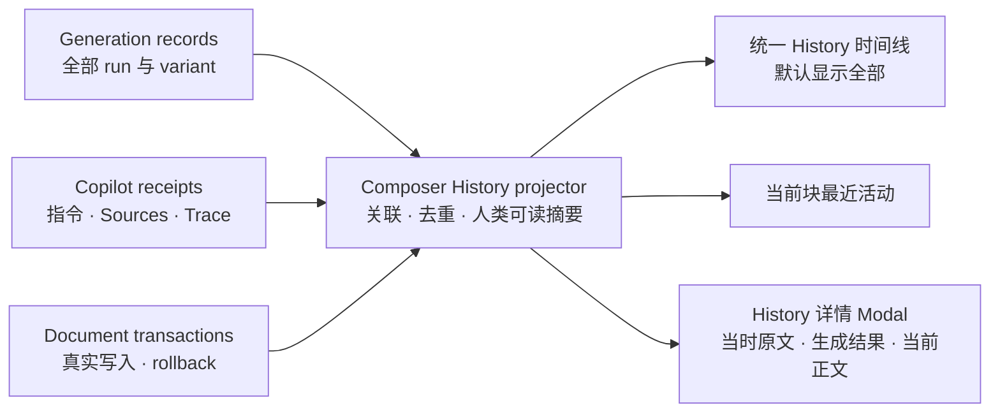

# Composer 统一历史与详情 Modal 实现计划

> 日期：2026-07-30
> 状态：Implementation complete in worktree · Real Obsidian interaction NOT VERIFIED
> Artifact type：技术设计补充 + 迁移计划 + 可执行任务计划
> 范围：Composer History、Copilot run receipt、Generation History、Document History、块内历史入口
> 不包含：重做 Composer AI Agent Loop、改变候选写回语义、修改 Chat Studio 历史

## 1. 五分钟结论

这轮不能只把 `composer.prose.polish-block` 换成中文，也不能只把两个 History tab
合成一个列表。当前三条记录链分别拥有一部分事实：

- Frozen Run 保存生成候选、版本、目标和采用状态；
- Copilot session 保存用户指令、来源和可验证 Trace，但目前主要在内存；
- Document History 保存真正提交的 transaction、Before/After 和回滚能力。

目标是保留三条事实链的独立责任，在 service 层建立一个统一的活动投影。侧栏和块内历史
只消费这个投影，不再各自拼接数据。



用户最终看到的是一条按时间排序的活动流：

- AI 生成、Copilot 协作和正文编辑默认混合显示；
- 已采用的生成和对应 transaction 只显示为一条活动；
- 同一 candidate 的 regenerate/follow-up 收进同一活动的版本列表；
- 点击摘要卡打开独立详情 Modal，不在窄侧栏内展开大块内容；
- 当前块的行内历史只保留最近活动入口，并复用同一个详情 Modal。

## 2. Impact contract

### Primary outcome

History 默认以人类可理解的一条活动代表一次用户意图。用户不需要理解 capability ID、
run ID、candidate ID 或 transaction ID，也能判断：

1. 当时做了什么；
2. 针对哪段内容；
3. 生成或修改了什么；
4. 最后是否采用；
5. 当前正文是否又发生变化。

### Required tracks

- 统一活动投影与跨记录关联；
- Copilot receipt、Generation 与 Document transaction 的持久化收口；
- 统一时间线和筛选；
- 详情 Modal 与按结果类型选择的对比 renderer；
- 当前块轻量历史入口；
- 旧记录兼容、错误脱敏、恢复和回滚安全；
- 自动测试、生产 build 和真实 Obsidian 验收。

### Forbidden scope

- 不把 Generation History 和 Document History 合成一份事实表；
- 不让 pending / not-adopted generation 进入 Undo/Redo；
- 不展示 chain-of-thought、原始 Provider payload 或默认展开的 debug JSON；
- 不从 capability ID 截字符串推断用户可见标题；
- 不新增 service singleton、UI 自建 runtime 或第二套 Composer transaction owner；
- 不删除当前 `composer-state` 记录；
- 不把新的运行记录继续写在插件安装目录；
- 不用静态 mock、source inspection 或 green test 替代真实 Obsidian 验收。

### Minimum acceptable delta

这一轮只有同时达到以下结果，才可以称为统一 History 完成：

- 默认时间线包含 AI 生成、Copilot 和文档编辑；
- 所有新记录使用动作名称和目标摘要，不显示内部 ID；
- accepted generation 与对应 transaction 去重为一条活动；
- not-adopted、failed、cancelled 和 stale 生成重启后仍可查看；
- Copilot 指令、Sources 和 Trace 重启后仍可查看；
- Document transaction 重启后仍能展示 Before/After；
- 行内入口和侧栏打开同一个详情 Modal；
- 旧记录仍可访问，但明确标注详情不完整；
- 真实 Obsidian 中完成筛选、Modal、恢复、定位和回滚验收。

### Stop and commit rule

每一阶段必须有独立测试和英文 checkpoint commit。出现以下任一情况时停止后续阶段：

- 无法证明 generation、receipt 和 transaction 的关联唯一；
- JSONL replay 后活动数量或状态发生漂移；
- source drift 时恢复路径可能直接覆盖当前正文；
- 新存储仍落在 `.obsidian/plugins/obsidian-peak-assistant`；
- Modal 关闭后焦点无法回到触发记录；
- 真实 Obsidian 无法复现与验证计划中的关键状态。

## 3. Source of truth

冲突时按以下顺序判断：

1. 2026-07-30 owner 最新决定；
2. 本计划；
3. [Composer AI Agent 流程与生成历史](../specs/2026-07-28-composer-agent-runs-and-generation-history.md)；
4. [机器运行记录存储重构](../specs/2026-07-21-machine-record-storage-jsonl-design.md)；
5. [Composer Intelligence sidecar 交接](./2026-07-22-peak-composer-intelligence-sidecar-handoff.md)；
6. 当前生产源码、测试和真实 Obsidian 行为；
7. 更早的静态 mock 和实现历史。

这里新增的一项 owner 决定是：

> Generation 与 Document transaction 在存储层继续分开，但 History
> 呈现层默认混合；Copilot 问答/run receipt 也进入同一活动时间线。

## 4. 当前事实与真正缺口

### 4.1 当前 UI 直接暴露内部记录结构

[`HistoryView.tsx`](../../../src/ui/view/composer/sidecar/HistoryView.tsx) 明确维护
`generation | document` 两种 mode。Generation 行主要展示 group label、状态、版本数量和
时间，展开后只有可选 preview、定位和恢复。

[`BlockHistoryPanel.tsx`](../../../src/ui/view/composer/chrome/BlockHistoryPanel.tsx)
又独立渲染一份 generation group 列表。它位于当前块旁，却仍为每条记录显示“定位”，
并且会用大面板遮挡正文。

### 4.2 capability ID 回退是截图中重复名称的直接原因

[`groupComposerGenerationRuns()`](../../../src/service/composer/intelligence/workspaceIntelligence.ts)
优先使用 persisted runtime label；没有 review snapshot 时直接回退到 `capabilityId`。

因此旧记录会显示：

```text
composer.prose.polish-block
composer.list.to-table
```

这不是 CSS 问题，而是 presentation fallback 使用了错误层级的身份。

### 4.3 新 generation 已经具备较完整的对比材料

较新的 `FrozenComposerRunEnvelope.review` 已经包含：

- candidate 和所有 variant；
- runtime label；
- 冻结的 `targetSource`；
- instruction；
- typed result 和 operations；
- accepted transaction link。

[`generationHistory.ts`](../../../src/ui/view/composer/generationHistory.ts) 已能从记录恢复
not-adopted review，也能从 result 或 operation 中提取文本 preview。当前 UI 没有完整使用这些
数据。

### 4.4 Copilot receipt 仍是内存状态

[`runSession.ts`](../../../src/service/composer/intelligence/runSession.ts) 的
`CopilotSessionMachine` 保存：

- Frozen run context；
- action 和 target label；
- Changes、Insights、Sources、Trace；
- accepted transaction IDs；
- external capability run 到 session run 的 alias。

这些内容目前由 per-document `IntelligenceRuntime` 持有。关闭插件或 runtime 后，完整 receipt
和 alias 不能从当前 Composer JSONL 恢复。

另外，当前 `send()` 没有把用户 typed instruction 作为正式 receipt 字段保存。它只把
instruction 传给 capability invocation。这会直接阻塞“问答历史里能看到当时问了什么”。

### 4.5 Document History 只在当前 hub 内完整

[`ComposerTransactionHub`](../../../src/service/composer/transactionHub.ts) 的 ledger 能提供：

- transaction Before/After；
- run link；
- locate target；
- safe rollback；
- direct、deterministic、AI 和 rollback origin。

但 transaction ledger 和 History projection 当前属于打开文档的 runtime，没有完整的
document-history repository replay。

### 4.6 当前 Composer JSONL 位置不符合已接受的存储设计

[`ObsidianComposerWorkspaceStatePersistence.ts`](../../../src/app/composer/ObsidianComposerWorkspaceStatePersistence.ts)
已经实现 append queue、corrupt-tail 容忍和 replay，但当前文件位于插件目录下的
`composer-state/`。

已接受的存储设计要求机器运行记录进入配置化的：

```text
DataStore/records/
```

因此本轮不能继续扩展插件目录中的单一 workspace JSONL。

### 4.7 当前 baseline

计划制定时以下 focused tests 已通过：

```text
composer-generation-history-lifecycle
composer-history-view-presentation
composer-intelligence-session
composer-review-reload
```

这些测试证明现有 generation 生命周期、session bridge 和 review reload 基础仍然可用；
它们不证明统一时间线、完整 receipt persistence 或详情 Modal 已存在。

## 5. 目标用户交互

### 5.1 History 默认状态

顶层继续保留：

```text
Copilot | History
```

History 内部取消 `生成历史 | 文档历史` 永久 tab。默认展示全部活动，并按日期分组。

顶部只保留：

- History 标题和当前结果数量；
- 一个“筛选”按钮；
- 激活筛选后的可移除标签；
- 空状态或旧记录详情提示。

### 5.2 折叠摘要卡

每条活动只负责识别，不承担完整对比：

```text
✨ 润色文字                     未采用 · 13:44
“创造一个知识库，其实是大脑的延伸……”
正文第 2 段 · 86 → 71 字 · 2 个版本          ›
```

摘要卡固定回答：

- 动作；
- 目标摘要；
- 状态；
- 时间；
- 位置或变化摘要；
- 版本数量。

`›` 表示进入详情 Modal。侧栏中不再使用向下展开 chevron。

### 5.3 详情 Modal

点击摘要卡后打开 shared wide Modal。Modal 至少处理三种文本状态：

1. **当时原文**：run 创建时冻结的 source；
2. **生成结果**：当前选择的 variant output；
3. **当前正文**：现在文档中可解析到的内容。

Modal 顶部使用：

```text
润色文字 · 正文第 2 段                 未采用
PKM 产品类别分析 · 13:44

[生成时对比] [当前正文] [过程记录]       版本 2/2
```

三个详情视图的责任如下：

| 视图 | 主要问题 | 内容 |
| --- | --- | --- |
| 生成时对比 | AI 当时改了什么 | 当时原文与选中 variant |
| 当前正文 | 这条历史与现在有什么关系 | variant/已写入结果与当前正文 |
| 过程记录 | 当时依据和过程是什么 | instruction、Sources、Trace、错误和 transaction link |

“源已变化”只在当前正文视图或恢复动作附近出现，不再作为列表主标签。

### 5.4 不同结果使用不同对比 renderer

| effect / result | 详情布局 |
| --- | --- |
| rewrite / text patch | 宽 Modal 中左右对比或 inline diff |
| insert / block insertion | 原上下文在上，新增内容在真实插入位置下方 |
| list item patch | 原列表中标出 insertion index 和新增项 |
| transform / list reorder / table | 原结构在上、新结构在下，保持垂直对比 |
| metadata patch | 原属性与建议属性的字段级 diff |
| media / native object | 原对象和新对象并列，附 artifact metadata |
| analyze / Copilot no-change | instruction、回答/洞察、Sources 和 Trace |
| legacy incomplete | 可用 metadata + 明确的“详情未保存”状态 |

renderer 按 persisted `effectKind` / `resultKind` dispatch，不能解析 capability ID 字符串。

### 5.5 当前块行内历史

块内历史只做局部索引：

- 最多显示最近 3 条与当前 target 匹配的活动；
- 每条显示动作、状态、时间和一行摘要；
- 不显示“定位”；
- 点击记录打开 shared History 详情 Modal；
- 底部提供“查看该段全部历史”；
- 完整筛选、日期分组和长列表只属于 sidecar History。

## 6. 统一活动投影

### 6.1 设计原则

统一活动不是第四份事实源。它是由 generation、receipt 和 transaction 构建的可重建 read
model。

建议新增一个 app-composed、per-document 的 `ComposerHistoryRuntime`：

```ts
// Proposed
interface ComposerHistoryRuntime {
  subscribe(cb: (projection: ComposerHistoryProjection) => void): () => void;
  projection(): ComposerHistoryProjection;
  detail(activityId: string): ComposerHistoryActivityDetail | null;
  restore(activityId: string, variantId?: string): boolean;
  rollback(activityId: string): Promise<void>;
}
```

它依赖：

- workspace generation repository/runtime；
- current document transaction hub/repository；
- Copilot session repository/runtime；
- current document snapshot resolver；
- config-backed presentation resolver。

它必须由 `DocumentComposerRuntime` 在 app composition 中创建和注入，不能由
`HistoryView` 构造，也不能成为 service module singleton。

### 6.2 摘要 read model

```ts
// Proposed
type ComposerHistoryActivitySource =
  | 'generation'
  | 'copilot'
  | 'document';

type ComposerHistoryActivityStatus =
  | 'running'
  | 'pending-review'
  | 'accepted'
  | 'not-adopted'
  | 'failed'
  | 'cancelled'
  | 'stale'
  | 'rolled-back'
  | 'completed';

interface ComposerHistoryActivitySummary {
  activityId: string;
  documentId: string;
  occurredAt: number;
  source: ComposerHistoryActivitySource;
  actionLabel: string;
  effectKind?: ComposerCapabilityEffectKind;
  targetKind?: ComposerTarget['kind'];
  targetLabel: string;
  targetQuote?: string;
  status: ComposerHistoryActivityStatus;
  variantCount: number;
  changeSummary?: string;
  detailAvailability: 'complete' | 'partial' | 'legacy';
  links: {
    sessionRunId?: string;
    runIds: readonly string[];
    candidateId?: string;
    transactionIds: readonly string[];
  };
}
```

列表 UI 只能读取这个摘要模型。内部 IDs 保留在 `links`，不进入默认可见标题。

### 6.3 详情 read model

```ts
// Proposed
interface ComposerHistoryActivityDetail {
  summary: ComposerHistoryActivitySummary;
  instruction?: string;
  comparisonKind:
    | 'rewrite'
    | 'insert'
    | 'structural'
    | 'metadata'
    | 'media'
    | 'analysis'
    | 'unavailable';
  generationTime: {
    sourceText?: string;
    variants: readonly ComposerHistoryVariant[];
  };
  currentDocument: {
    resolution: 'same' | 'changed' | 'missing' | 'unresolved';
    revision?: string;
    text?: string;
  };
  receipt?: {
    changes: readonly RunChangeArtifact[];
    insights: readonly RunArtifact[];
    sources: readonly RunSourceArtifact[];
    trace: readonly RunTraceArtifact[];
  };
  transaction?: {
    beforeText?: string;
    afterText?: string;
    rollbackState: 'available' | 'unsafe' | 'not-applicable';
  };
  safeError?: string;
  technicalRecordRef?: string;
}
```

`technicalRecordRef` 只用于“复制技术信息”等明确动作。默认 UI 不展示 raw payload。

### 6.4 关联和去重规则

投影必须按以下顺序建立关联：

1. 用 persisted external-run alias 把 capability run 关联到 Copilot session run；
2. 用 `candidateId` 把 initial、regenerate 和 follow-up variants 合成一个 generation；
3. 用 `acceptedTransactionId` 或 transaction `runId` 把真实写入关联回 generation；
4. accepted transaction 作为 generation outcome，不再生成第二张顶层卡；
5. direct/deterministic transaction 没有 run link 时，单独成为 document activity；
6. rollback 成为一条新活动，并链接被回滚 activity；
7. Copilot run 没有生成 candidate 时，仍以问答/分析活动进入时间线；
8. native-file accept 没有 Markdown transaction 时，generation 仍显示 accepted 和 artifact；
9. legacy record 没有 review/receipt 时保留，但不能假造 target 或 output。

### 6.5 activity identity

activity identity 必须稳定且可从事实记录重建：

- Copilot 发起并关联 generation：使用 session run identity；
- 独立 Composer block action：使用 candidate identity；
- direct/deterministic edit：使用 transaction identity；
- rollback：使用 rollback transaction identity。

同一个 activity 在 replay、筛选和不同 surface 中必须保持同一 ID。

## 7. 持久化与迁移

### 7.1 目标目录

机器记录迁入已接受的 DataStore 路径：

```text
DataStore/
└── records/
    ├── copilot/
    │   └── sessions/<session-or-work-segment-id>.jsonl
    └── document-history/
        └── <document-record-id>.jsonl
```

有 active Copilot session 的 generation 写入对应 session stream。独立 block action 使用已经存在
的 `workSegmentId` 作为 fallback stream identity；这个 identity 不向用户展示。

### 7.2 文档记录身份

当前 Composer runtime 常把打开时的 Vault path 当作 `documentId`。它在单次打开期间可以跟随
rename，但不能证明重启后、离线改名后或 path 重用后仍指向同一份文档。因此不能直接用原始
Vault path 作为永久 stream ID。

Phase 2 需要由 app 层提供 `ComposerDocumentRecordIdentityPort`：

- 首次建立历史时分配 opaque `documentRecordId`；
- DataStore 保存 current path、path aliases 和 rename events；
- 打开文档时先按 current path 查找，再按 alias 解析；
- 正常 rename 不创建第二条 history stream；
- 不把内部 ID 写进用户 Markdown/frontmatter；
- alias 不明确或发生冲突时 fail closed，进入可恢复的 orphaned-history 状态，不用全文相似度
  猜测并自动挂接。

必须覆盖 active rename、重启后 rename、离线 rename、旧 path 被新文件复用和 alias collision
五类测试。时间线 model 里的 `documentId` 是 domain identity，不等同于 Vault path。

### 7.3 中立 record store

不要把 `ObsidianComposerWorkspaceStatePersistence` 扩成第二个业务数据库。先抽一个
feature-neutral append-only port：

```ts
// Proposed
interface AppendOnlyRecordStorePort {
  readStream(streamType: string, streamId: string): Promise<readonly RecordEvent[]>;
  append(streamType: string, streamId: string, event: RecordEvent): Promise<void>;
}
```

app 层的 Obsidian adapter 负责：

- DataStore 路径解析；
- 目录创建；
- per-stream 串行 append；
- event ID 去重；
- corrupt-tail 容忍；
- schema version 检查；
- rename/path alias 记录。

Composer service repository 只读写 domain events，不知道 Vault adapter 或物理文件名。

### 7.4 Copilot / generation semantic events

至少持久化以下 semantic milestones：

```text
session.started
instruction.recorded
run.context.frozen
run.external-linked
run.receipt-upserted
generation.run-upserted
generation.disposition-changed
generation.transaction-linked
session.completed
```

不持久化每个 token delta。可恢复候选内容、最终 partial output、Sources、Trace 和错误才进入
semantic event。

`FrozenRunContext` 和 `RunReceipt` 需要补充：

- typed instruction；
- startedAt / completedAt；
- safe user-facing error；
- persisted external run alias；
- response / no-change summary；
- presentation origin；
- accepted transaction link。

### 7.5 Document History events

Document History stream 至少保存：

```text
document.transaction.committed
document.transaction.rolled-back
document.path-changed
```

persisted transaction 必须包含：

- operations 和 inverse operations；
- base/result revision；
- target 和 stats；
- runId、candidateId、variantId、sessionRunId；
- committedAt；
- rollback target identity。

hydrate 时，历史 transaction 进入 durable ledger/history projection，但不能无条件重新压入 live
Undo/Redo 栈。跨重启回滚继续经过 source/revision 安全检查。

### 7.6 当前插件目录记录迁移

当前 `composer-state/composer-workspace-state.jsonl` 不能删除。实现一个一次性、幂等的
compatibility importer：

1. 读取旧 event；
2. 按 run ID 取最后状态；
3. 有 review 的记录转换为完整 generation event；
4. 无 review 的记录标记 `legacy`；
5. 按 work segment 分流到 DataStore streams；
6. 写入 migration checkpoint；
7. 保留旧文件原样，直到单独的 owner cleanup gate。

默认时间线仍能访问 legacy records，但可以将连续的无详情旧记录折叠成：

```text
旧记录 · 12 条详情不完整
```

展开后仍逐条列出时间、状态和可用 metadata，不能静默隐藏或删除。

### 7.7 迁移期读写策略

迁移分三步：

1. 新 repository shadow-write，同时继续当前 runtime 投影；
2. replay parity 通过后，History read path 切到新 repository；
3. 停止插件目录旧 writer，但保留 compatibility reader 一个明确周期。

去重依据是 event ID、run ID 和 transaction ID，不能按时间或内容文本猜测。

## 8. 人类可读 presentation

### 8.1 标题来源

新记录在 run 创建时冻结 presentation snapshot：

- action title；
- history label；
- effect kind；
- result kind；
- target kind。

优先级：

1. persisted action/history label；
2. 当前 capability config；
3. config-backed generic label；
4. `历史记录`。

任何一级都不能回退到把 capability ID 直接显示给用户。

### 8.2 目标摘要

目标摘要优先使用：

1. frozen selection text；
2. frozen target source；
3. Copilot target quote；
4. transaction Before text；
5. config-backed `目标详情未保存`。

摘要生成只做 presentation normalization：

- 去除不影响识别的 Markdown chrome；
- 合并空白；
- 保留中文、链接文本和代码关键词；
- 按配置长度截断；
- 不用摘要文本承担恢复定位。

定位仍使用 target、revision 和 anchor mapping。

### 8.3 状态与错误

列表状态只表达用户结果：

- 待审阅；
- 已采用；
- 未采用；
- 已完成；
- 失败；
- 已取消；
- 已回滚。

`stale/source changed` 是安全状态，只在详情或恢复动作中解释。

失败记录列表只显示安全错误，例如：

```text
生成失败 · 当前模型不可用
```

raw Provider error、model ID、HTTP payload 和 stack 只进入技术详情或本地 debug copy。
错误映射和用户文案来自 `templates/config/composer.json`，不在 UI 逻辑中硬编码正则或 label map。

## 9. 筛选设计

History 默认 `全部`，筛选按钮打开一个 popover。

筛选维度：

- 记录来源：AI 生成、Copilot、文档编辑；
- 操作类型：来自 capability effect/action presentation；
- 结果状态：待审阅、已采用、未采用、失败、取消、已回滚；
- 作用对象：选区、段落、列表项、列表、表格、文档和 native object。

实现要求：

- 默认不显示永久二级 tab；
- 激活筛选显示 removable chips 和结果数量；
- 同一筛选状态同时作用于日期分组和空状态；
- filter function 是 pure domain/presentation helper；
- 块内历史不继承 sidecar 的全局 filter，只固定为当前 target；
- filter state 属于当前 History presentation，不写入 machine record。

## 10. UI 组件与状态所有权

### 10.1 建议组件

现有 `HistoryView.tsx` 应拆分为小组件：

```text
src/ui/view/composer/history/
├── HistoryView.tsx
├── HistoryFilterPopover.tsx
├── HistoryTimeline.tsx
├── HistoryActivityRow.tsx
├── HistoryDetailModal.tsx
├── HistoryComparison.tsx
├── HistoryTracePanel.tsx
└── historyPresentation.ts
```

最终目录以当前 repo 约定为准，但必须结束当前 500+ 行 `HistoryView.tsx` 同时承担
generation、transaction、分组、detail 和 formatting 的状态。

### 10.2 shared Modal owner

块内面板是 transient chrome。Modal state 不能由 `BlockHistoryPanel` 自己拥有，否则 block
失焦导致父组件卸载时，Modal 会一起消失。

建议在 `ComposerRoot` 附近增加一个 UI-only `HistoryPresentationController`：

```ts
// Proposed
interface HistoryPresentationController {
  selectedActivityId: string | null;
  open(activityId: string): void;
  close(): void;
}
```

它通过 Composer chrome context 和 Sidecar context 注入打开动作。根部只渲染一个
`HistoryDetailModal`，侧栏和块内入口都调用同一个 controller。

它只拥有 Modal selection，不拥有 history domain data。

### 10.3 Modal primitive

复用现有 Radix [`Modal`](../../../src/ui/components/primitives/Modal.tsx)：

- `width="wide"`；
- title、description 和 close control 完整；
- focus trap；
- Escape 关闭；
- 关闭后恢复触发记录焦点；
- body 自己滚动，header/footer 稳定；
- viewport 不足时 clamp 到可见范围；
- `prefers-reduced-motion` 下无非必要动画。

Modal 内动作继续使用共享 `Button` / `IconButton`，并遵守 Obsidian button geometry rule。

### 10.4 Sidecar History

重写 [`HistoryView.tsx`](../../../src/ui/view/composer/sidecar/HistoryView.tsx)：

- 删除 generation/document mode state 和 tabs；
- 订阅 `ComposerHistoryRuntime` projection；
- 默认按日期渲染全部活动；
- 使用 filter popover；
- row click 调用 shared presentation controller；
- 不在 row 内渲染长 preview、Trace、恢复按钮或 accordion。

### 10.5 Block History

重写 [`BlockHistoryPanel.tsx`](../../../src/ui/view/composer/chrome/BlockHistoryPanel.tsx)：

- 从统一投影按 target identity 过滤；
- 最多 3 条；
- 去掉 locate button；
- row click 打开 shared Modal；
- 保留“查看该段全部历史”；
- sidecar 可用时深链到 History 并带 target filter；
- sidecar 不可见时仍可直接打开 Modal。

## 11. 实施阶段

### Phase 0：冻结 baseline 与 characterization

当前工作区包含大量未提交改动，并且 History 相关文件本身处于修改/新增状态。正式实现前必须：

1. 由 owner 确认并创建当前工作区 checkpoint；
2. 使用英文 commit message；
3. 从包含当前 Frozen Run/History 基础的 baseline 建分支或 worktree；
4. 不从旧 HEAD 建空 worktree 后重新猜测当前未提交实现；
5. 保存当前真实 History 截图和匿名化数据形状 fixture。

新增 characterization tests：

- accepted run 与 transaction link；
- discarded generation reload；
- Copilot external run alias；
- direct transaction grouping；
- transaction Before/After；
- legacy run without review；
- source drift 和 restore refusal。

完成条件：测试锁定事实，不改变 UI。

### Phase 1：统一活动投影

新增 framework-neutral summary/detail types、projector 和 filter helpers。

重点任务：

1. generation group 转 activity；
2. receipt/run alias 关联；
3. accepted transaction 去重；
4. direct edit 和 rollback 投影；
5. human label/target quote/status；
6. legacy availability；
7. detail comparison kind。

建议测试：

```text
composer-history-activity-projector.test.ts
composer-history-activity-detail.test.ts
composer-history-filter.test.ts
composer-history-legacy-presentation.test.ts
```

完成条件：用纯 fixture 得到正确时间线，不依赖 React 和 Obsidian。

### Phase 2：durable repository 与迁移

先实现中立 record store，再实现 Composer repositories。

任务：

1. `AppendOnlyRecordStorePort` 与 Obsidian DataStore adapter；
2. `ComposerDocumentRecordIdentityPort`、path alias 与 collision handling；
3. Copilot/session/generation repository；
4. document transaction repository；
5. semantic event schema validation；
6. receipt、instruction、alias 和 correlation fields；
7. document history replay；
8. plugin-directory legacy importer；
9. shadow-write/replay parity；
10. composition 从 plugin path 切到 DataStore。

建议测试：

```text
jsonl-record-store.test.ts
composer-copilot-session-ledger.test.ts
composer-document-history-ledger.test.ts
composer-document-record-identity.test.ts
composer-history-legacy-import.test.ts
composer-history-replay-parity.test.ts
```

完成条件：

- reload 后 activity 数量、状态和关联不变；
- 文档 rename 与重启后仍解析到同一条 history stream；
- corrupt tail 不影响前序记录；
- 同一 event 重放不产生重复活动；
- 新运行记录不再写入插件目录。

### Phase 3：统一侧栏时间线与筛选

任务：

1. 删除 History 内二级 tabs；
2. 接入统一 projection；
3. 实现摘要卡；
4. 实现日期分组；
5. 实现 filter popover 和 active chips；
6. legacy group；
7. loading、empty、partial persistence error 状态。

完成条件：

- 默认显示全部来源；
- 内部 ID 不出现在列表；
- accepted generation 不重复；
- 相同 action 通过 target quote 可区分；
- 430px sidecar 与 drawer 无横向溢出。

### Phase 4：详情 Modal 与 renderer

任务：

1. shared presentation controller；
2. `HistoryDetailModal`；
3. 生成时对比；
4. 当前正文 resolution；
5. variant selector；
6. operation-specific renderers；
7. process/Trace panel；
8. locate、restore 和 rollback action；
9. source drift 安全状态；
10. technical copy action。

完成条件：

- rewrite、insert、list gap、list reorder、accepted transaction 和 Copilot no-change 都有正确详情；
- list reorder 使用垂直对比；
- stale 时恢复不会直接覆盖正文；
- Modal focus、Escape 和 close restore 正确。

### Phase 5：块内轻量历史

任务：

1. Block History 改读统一投影；
2. target identity 过滤；
3. 最多 3 条摘要；
4. shared Modal；
5. 查看该段全部历史；
6. 删除本地 accordion 和重复定位动作。

完成条件：

- 面板不再遮挡大面积正文；
- 当前块上下文足够识别记录；
- sidecar 和 inline 指向同一个 activity ID；
- block chrome 卸载不会关闭已经打开的 Modal。

### Phase 6：集成、清理和真实 UI 验收

任务：

1. 删除旧 generation/document tab CSS 和死组件；
2. 更新 config strings 和 capability presentation snapshot；
3. 更新 source guards；
4. focused tests；
5. full test；
6. production build；
7. plugin-only reload；
8. CDP DOM/focus/geometry assertions；
9. Computer Use 可见截图；
10. History restore/rollback sequence 录屏。

旧 writer、legacy reader 和旧数据文件的删除不进入本阶段。它们需要单独 cleanup gate。

## 12. 文件影响图

### Domain / service

主要修改：

- `src/core/composer/transaction.ts`
- `src/service/composer/transactionHub.ts`
- `src/service/composer/intelligence/workspaceIntelligence.ts`
- `src/service/composer/intelligence/runSession.ts`
- `src/service/composer/intelligence/IntelligenceRuntime.ts`
- `src/service/composer/intelligence/index.ts`

建议新增：

- `src/core/composer/historyActivity.ts`
- `src/service/composer/history/activityProjector.ts`
- `src/service/composer/history/activityDetail.ts`
- `src/service/composer/history/historyRuntime.ts`
- `src/service/composer/history/historyRepositories.ts`

### App composition / persistence

主要修改：

- `src/app/composer/DocumentComposerRuntime.ts`
- `src/app/composer/composeDocumentComposerRuntime.ts`
- `src/app/composer/ObsidianComposerWorkspaceStatePersistence.ts`

建议新增：

- neutral record-store port；
- app-owned DataStore JSONL adapter；
- Composer legacy importer。

最终具体路径应遵守当时已经落地的通用 record-store 结构；如果实施前其他工作已经创建
neutral store，必须复用，不得并行再造。

### UI

主要修改：

- `src/ui/view/composer/ComposerRoot.tsx`
- `src/ui/view/composer/sidecar/SidecarContext.tsx`
- `src/ui/view/composer/sidecar/HistoryView.tsx`
- `src/ui/view/composer/chrome/ComposerChromeContext.tsx`
- `src/ui/view/composer/chrome/BlockHistoryPanel.tsx`
- `src/ui/view/composer/generationHistory.ts`
- `src/ui/view/composer/sidecar/sidecarConfig.ts`
- `src/styles/composer-sidecar.css`
- `src/styles/composer.css`
- `templates/config/composer.json`

建议新增：

- History timeline components；
- filter popover；
- shared detail Modal；
- comparison renderers；
- History presentation controller。

## 13. 安全并行与 shared-file ownership

Phase 0–1 完成并冻结 type contracts 后，可以并行处理：

- persistence/repository；
- pure Modal renderer components；
- config/copy 和 test fixtures。

以下文件必须由 integration owner 串行修改：

- `ComposerRoot.tsx`
- `HistoryView.tsx`
- `SidecarContext.tsx`
- `ComposerChromeContext.tsx`
- `DocumentComposerRuntime.ts`
- `composeDocumentComposerRuntime.ts`
- shared Composer CSS。

并行工作不得各自定义不同的 activity type、status map 或 modal state owner。

## 14. 自动测试矩阵

| 范围 | 必须证明 |
| --- | --- |
| Projector | 三条事实链关联、去重、顺序、版本归组 |
| Presentation | human label、target quote、无 raw ID、safe error |
| Filters | 来源、操作、状态、对象和组合筛选 |
| Detail | frozen source、variant output、current source resolution |
| Result renderer | rewrite、insert、list gap、reorder、table、analysis |
| Persistence | append、replay、tail corruption、idempotency、stream split |
| Migration | current composer-state 导入、legacy partial、无删除 |
| Transaction | accepted unique、rollback link、restart 后 safety |
| Copilot | instruction、receipt、Sources、Trace、external alias reload |
| UI contract | no secondary tabs、shared modal、block max 3 |
| Accessibility | Modal labels、focus trap、Escape、focus restore |

建议 focused verification：

```bash
npm run test -- test/composer-history-activity-projector.test.ts
npm run test -- test/composer-history-activity-detail.test.ts
npm run test -- test/composer-history-filter.test.ts
npm run test -- test/composer-copilot-session-ledger.test.ts
npm run test -- test/composer-document-history-ledger.test.ts
npm run test -- test/composer-history-legacy-import.test.ts
npm run test -- test/composer-generation-history-lifecycle.test.ts
npm run test -- test/composer-intelligence-session.test.ts
npm run test -- test/composer-review-reload.test.ts
npm run test -- test/composer-history-view-presentation.test.ts
npm run test -- test/shared-button-reset-defense.test.ts
npm run test
npm run build
```

实际新测试文件名可按实现调整，但验证面不能删除。

## 15. 真实 Obsidian 验收

### 15.1 锁定证据

使用 canonical Composer QA 文档，记录：

- source path 和 SHA-256；
- theme、zoom、viewport 和 DPR；
- document scroll anchor；
- sidecar open/filter 状态；
- selected activity 和 Modal tab；
- workspace record revision；
- reference/current/normalized/overlay artifact hash。

### 15.2 必测数据场景

准备以下真实记录：

1. prose rewrite，未采用；
2. 同一 candidate 两个 variants；
3. insert/add example；
4. list fill gap，插入在中间；
5. list reorder，垂直对比；
6. accepted generation，关联唯一 transaction；
7. direct document edit；
8. failed generation；
9. source changed；
10. Copilot instruction + Sources + Trace；
11. legacy incomplete record；
12. rollback activity。

### 15.3 必测交互

- 默认全部时间线；
- 来源和 action type 筛选；
- row 打开 Modal；
- variant 切换；
- 生成时对比；
- 当前正文对比；
- Trace；
- locate；
- restore not-adopted；
- stale restore refusal；
- rollback；
- Escape 关闭和 focus restore；
- 块内最近活动打开同一个 Modal；
- sidecar drawer 模式。

### 15.4 证据形式

- CDP + Playwright 负责状态设置、DOM、focus、scroll、geometry 和交互断言；
- Computer Use 负责真实 Obsidian 可见截图；
- History restore/rollback、Modal focus/Escape 和版本切换使用短录屏；
- 静态 harness 只用于 renderer characterization，不算验收。

如果无法把真实 app 放到同一 source revision、viewport 和 interaction state，标记
`NOT COMPARABLE`，先修证据条件，不继续 CSS 调整。

## 16. Rollout 与 rollback

### Rollout

1. projector 先在测试中完成，不切 UI；
2. repositories shadow-write；
3. replay parity 通过；
4. sidecar 切统一 projection；
5. Modal 和 inline 接入；
6. 真实 UI 验收；
7. 停止旧 plugin-dir writer；
8. 后续版本再评估旧 compatibility reader 和文件 cleanup。

### Rollback

- UI rollback：恢复旧 `HistoryView` renderer，不修改新 records；
- repository rollback：停止新 writer，保留旧 runtime read path；
- migration rollback：旧 composer-state 文件未删除，可重新读取；
- transaction rollback：不删除历史 event，只追加 inverse transaction；
- cleanup rollback：cleanup 不与功能切换同 commit，未单独批准不得执行。

## 17. 风险与防护

### 重复活动

风险：accepted generation 和 transaction 各显示一次。

防护：acceptedTransactionId、runId 和 persisted alias 三重关联；projector contract test
断言一条 user intent 只产生一个顶层 activity。

### Copilot session run 与 capability run 双 ID

风险：alias 只在内存，重启后断链。

防护：`run.external-linked` semantic event；replay 后 projector 使用同一 alias。

### 旧记录没有 source/output

风险：UI 为了好看伪造 target 或把 capability ID 当标题。

防护：明确 `detailAvailability=legacy`；使用 generic config label；不伪造原文和结果。

### source drift

风险：用户从历史恢复旧候选时覆盖现在正文。

防护：Modal 先展示当前正文 comparison；恢复只创建待审候选；revision/anchor 不安全时
fail closed。

### transaction replay 污染 Undo

风险：重启后把所有历史 transaction 重新压入 live Undo 栈。

防护：durable History ledger 与 current-session Undo projection 分开 hydrate。

### 存储路径继续污染插件目录

风险：插件升级覆盖记录，或把运行数据误提交进源码。

防护：path contract test；所有新 writer 只允许 DataStore root。

### UI 再次复制 domain logic

风险：sidecar 和 inline 对同一 run 产生不同名称、状态和版本数量。

防护：二者只消费 `ComposerHistoryRuntime` 的同一 summary/detail model。

### 大记录和渲染性能

风险：每个 row 都深拷贝完整 candidate 或读取全文。

防护：时间线只读取 summary projection；详情按 activity ID 惰性加载；长 artifact 保存
reference；大列表后续可虚拟化，但不能为性能删除历史。

## 18. 验收标准

实现完成必须同时满足：

- History 默认显示全部活动，没有 generation/document 二级 tabs；
- 可以按来源、操作、状态和对象筛选；
- 列表中没有 capability ID、run ID、candidate ID 和 transaction ID；
- 每条记录有动作名称和目标摘要；
- 同一 candidate 的 versions 留在同一 activity；
- accepted generation 和 transaction 不重复；
- Copilot instruction、回答/产物、Sources 和 Trace 可恢复；
- Modal 能查看当时原文、生成结果和当前正文；
- rewrite、insert、补缺项、重排列表和结构化结果使用正确 renderer；
- source changed 只作为详情安全状态；
- not-adopted generation 能恢复为待审候选；
- unsafe restore 和 rollback fail closed；
- block history 最多 3 条并打开 shared Modal；
- legacy records 可访问且不伪造详情；
- records 位于 DataStore，不再新增 plugin-dir machine data；
- focused tests、full test、build 和真实 Obsidian acceptance 通过；
- 文档、实现说明和 progress 诚实区分 COMPLETE、PARTIAL 和 NOT VERIFIED。

## 19. 开始实施时的第一步

不要直接编辑 `HistoryView.tsx`。

第一步应当是：

1. 确认当前 dirty workspace 的 checkpoint 策略；
2. 冻结现有 History screenshot 和 anonymous record-shape fixture；
3. 新增 projector characterization tests；
4. 实现 `ComposerHistoryActivitySummary` 和纯 projector；
5. 用测试证明 accepted generation + transaction 只产生一条 activity；
6. 评审这个数据合同后，再进入 persistence 和 UI。

只要第一步没有完成，直接改侧栏样式都会继续把内部 ledger 结构泄漏到用户界面。

## 20. 2026-07-30 实施结果

### COMPLETE

- 新增统一的 `ComposerHistoryActivity` projector、过滤器和跨 generation / Copilot receipt /
  document transaction 的精确关联与去重；
- Copilot instruction、receipt、external run alias 与 document transaction ledger 进入
  DataStore JSONL，并支持重启 replay、corrupt-tail 容忍、rename/path reuse 防护；
- History 默认改为 generation、Copilot 与 document activity 混合时间线，取消二级永久 tab；
- 筛选支持来源、操作、状态和对象；
- 用户可见标题不再回退到 capability ID，旧记录使用明确的 generic label 和 incomplete 状态；
- 侧栏和块内历史复用 `HistoryDetailModal`；块内面板最多显示 3 条，不再显示重复定位动作；
- 块内 Modal selection 已提升到稳定的 Composer document owner，临时块面板卸载不会关闭 Modal；
- rewrite/metadata 使用横向对比；insert/structural/media/analyze 使用垂直对比；
- Modal 分开显示当时原文、结果、当前正文、instruction、Sources、Trace、恢复与回滚动作；
- 已删除旧 generation/document tabs、accordion 和行内 diff 的死 CSS。

### VERIFIED

- 9 个 History/Composer focused tests 通过；
- production `npm run build` 通过；
- `git diff --check` 通过；
- 全量测试 374 项中 370 项通过。4 项失败位于本次未改动的 Chat Studio、code theme、
  既有 Composer architecture guard 和 Frontmatter presentation baseline；History 相关测试全部通过。

### NOT VERIFIED

- 未控制或 reload Obsidian；
- 没有 CDP listener，因此 Modal focus restore、Escape、筛选交互、定位、恢复、回滚、
  drawer geometry 和真实截图/录屏均未做真实应用验收；
- owner 明确要求不要尝试控制 Obsidian，后续除非 owner 重新授权，否则保持
  `INTERACTION NOT VERIFIED`。
