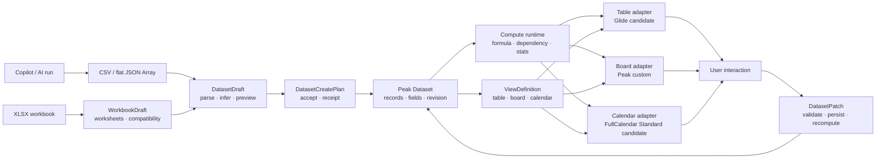

# Peak Sheet 视图适配器 Spike 与分阶段实现计划

> 状态：Planned requirement · spike-first · production implementation 未开始
>
> 产品状态：继续保持 Roadmap 中的 research candidate，不因本计划自动升级为实施承诺
>
> 依据：Peak Sheet Dataset / Compute 研究、2026-07-31 Editorial Mock、表格 / 看板 / 日历开源组件审查、2026-08-04 AI 创建入口需求，以及 2026-08-09 CSV/XLSX 统一归入 Peak Sheet 的 owner correction
>
> 面向读者：产品 owner、后续实现者、负责真实 Obsidian 验收的维护者

## 1. 执行结论

Peak Sheet 的实现不能从“先画三个页面”开始，而应从同一份 Dataset、同一套字段定义、同一条计算链和同一种写回协议开始。表格、看板与日历只是 Dataset 的不同投影；任何视图都不得复制一份独立记录状态。

本计划采用以下技术路线：

- **表格：先做 Glide Data Grid 隔离 Spike，再决定是否采用。** Glide 只可承担虚拟化网格、单元格选择、编辑、剪贴板和冻结区域等 viewport 交互；字段类型、排序、筛选、分组、公式、统计、AI 和数据持久化继续由 Peak 拥有。
- **日历：先用 FullCalendar Standard 做隔离 Spike，通过后接入。** 只允许 MIT 的 Standard 插件；不引入 Premium / Scheduler、resource timeline 或其他付费能力。
- **看板：保持自研。** 不使用 Atlassian Pragmatic Drag and Drop；先完成稳定的分组投影、显式 Move 操作和键盘路径，再补受控 pointer drag。
- **现有 Composer Markdown 表格继续保留。** `TableBlockView` 是文档块编辑器，不改造成 Dataset grid，也不被 Peak Sheet 替换。
- **AI 可以创建 Peak Sheet，CSV/XLSX 也可以导入 Peak Sheet。** Copilot 生成的 CSV 或扁平 JSON Array 经 `DatasetDraft` 进入创建入口；用户 XLSX 经 `WorkbookDraft`、worksheet 选择和 compatibility review 进入同一 Peak Sheet runtime。输入文件不是长期 Dataset / Sheet 真值。
- **创建后的 AI 操作必须增量化。** 自然语言公式、筛选、分析和数据修改必须编译为可预览、可验证、可撤销的 Peak-owned plan 或 patch，不能重新生成整份 CSV / JSON / XLSX 覆盖用户修改。

只有各项 Spike 的 GO gate 通过，才可进入对应 production adapter。Spike 失败时更换 renderer，不重写 Dataset、ViewDefinition 或 DatasetPatch 合同。

## 2. 当前事实与问题边界

### 2.1 已有能力

- Composer 已有 Markdown table model、选区、编辑、CSV 与图表相关基础；这些能力服务文档块，不等于生产级 Dataset runtime。
- 当前 XLSX 只有类型/设置痕迹，`TableDocumentLoader` 明确无解析实现；这是 target ingress 的实现缺口，不是长期产品排除。
- 现有 artifact 创建路径具备 validate、Vault write 与 receipt 的可复用形状；当前 Chat 中的 `dataset` artifact kind 仍不等于 Peak Dataset runtime。
- Peak Sheet 研究已经提出 `Dataset`、稳定 record / field ID、`ComputePlan`、preview / accept 与 manual refresh 的窄闭环。
- Editorial Mock 已表达 Table、Board、Calendar、字段类型、自由公式、计算列、选区统计、内联 AI 公式与侧栏 CRUD 的交互目标。

### 2.2 尚不存在的生产真值

- 没有可供三个视图共享的 production Dataset store 和 revision contract；
- 没有稳定的 ViewDefinition / ViewAdapter registry；
- 没有把 Copilot 生成的 CSV / JSON Array 提升为 `DatasetDraft`、`DatasetCreatePlan` 和 revision 1 的 production 入口，也没有 XLSX `WorkbookDraft`、worksheet compatibility report 或 import plan；
- 没有统一的 typed formula evaluator、依赖图、循环检测和错误类型；
- 没有统一的 DatasetPatch 验证、写回、重算和回滚路径；
- Mock、静态 HTML 与 build 都不能证明真实 Obsidian 中的编辑、IME、拖拽、焦点或跨视图同步。

### 2.3 产品主次

Peak Sheet 的优先级仍是：

1. 自由 Sheet 的单元格 / 区域计算与格式；
2. 结构化字段与稳定 Dataset；
3. CSV / JSON Array 与 Copilot 生成结果的可确认 Dataset 创建入口，以及 XLSX workbook 的可确认 Peak Sheet 导入入口；
4. 表格视图的编辑、筛选、排序、分组和统计；
5. 看板与日历投影；
6. 可验证的 AI 公式、筛选和分析入口。

AI 创建是共享合同成立后的第一条纵向产品闭环，不代表 AI 可以绕过第 1–4 层的数据合同。本计划聚焦第 2–6 项的共享基础、创建入口与视图适配，不重新定义自由 Sheet 的完整电子表格函数范围。

## 3. Impact Contract

### 3.1 Primary outcome

Copilot 生成的 CSV / 扁平 JSON Array 必须能经 preview / accept 创建首个 `DatasetRevision`；用户导入的 XLSX 必须能先选择 worksheet、审阅兼容性，再映射为 `DatasetDraft` 或通过 Phase 0 owner gate 确认的 `SheetDraft`。创建后由同一 Peak Sheet runtime 管理 revision；所有用户与 AI 修改都转换为 typed patch，经统一验证、持久化、重算后产生新 revision。

### 3.2 Required tracks

1. Dataset / Field / View / Patch 核心合同；
2. app-owned Sheet runtime 与 revision 传播；
3. Copilot → CSV / JSON Array → DatasetDraft，以及 XLSX → WorkbookDraft → worksheet review → DatasetDraft / SheetDraft 的创建/导入入口；
4. Glide Data Grid 高保真隔离 Spike 与 GO / NO-GO gate；
5. production Table adapter、字段编辑、组合筛选 / 排序 / 分组；
6. typed formula、选区统计与内联 AI formula plan；
7. FullCalendar Standard 隔离 Spike 与 Calendar adapter；
8. 自研 Board adapter、显式移动与 pointer drag；
9. 跨视图同步、回滚、真实 Obsidian interaction QA。

### 3.3 Forbidden scope

- 不使用 Atlassian Pragmatic Drag and Drop；
- 不引入 FullCalendar Premium / Scheduler、resource、timeline 或付费插件；
- 不用 Glide 承担 Dataset、字段 schema、公式、筛选、排序、分组、AI 或持久化；
- 不替换或重写 Composer `TableBlockView`；
- 不在本波实现 Gallery、Dashboard、Relation、Map、3D globe、automation、Portal 或多人协作；
- 不执行任意 JavaScript / Python 公式；
- 不把裸 CSV / JSON Array、XLSX workbook 或 AI field hint 直接当作 canonical Dataset / Sheet schema；
- 不允许 AI 静默创建持久文件，也不允许创建后通过重新生成整份 CSV / JSON / XLSX 覆盖 Dataset / Sheet；
- 不创建 service-layer runtime singleton，不通过 `AppContext.getInstance()` 扩大隐式依赖；
- 未在 generated artifact registry 明确 carrier、sync、index 与 materialization 规则前，不新增持久 writer；
- 不用 Mock、单元测试、静态几何或绿色 build 冒充真实 Obsidian 验收。

### 3.4 Minimum acceptable delta

本需求只有同时满足以下条件，才可从 planned requirement 移除：

- Table、Board、Calendar 读取同一 Dataset revision，任一视图的合法修改能在另外两个视图中出现；
- Copilot 能从 CSV 或扁平 JSON Array 生成可审阅 Draft；XLSX import 能展示 worksheet 与 compatibility report；用户确认后只创建目标 revision 1 和对应 receipt；
- 字段类型、公式结果和统计不由 renderer 私有状态决定；
- Glide 与 FullCalendar 的采用均有独立 Spike 证据和明确 GO 结论；
- 看板跨列移动、日历 range CRUD、表格 range selection 都有失败回滚路径；
- focused tests、production build 与真实 Obsidian interaction evidence 全部完成；
- 没有双写、影子 Dataset 或长期兼容 renderer。

### 3.5 Skip budget 与停止规则

Required tracks 的 skip budget 为 0。某项组件 Spike 未过 gate 时，允许切换到备选 renderer，但不得跳过共享合同、写回验证或真实交互验收。若事实证明 Dataset carrier 或自由 Sheet / structured Dataset 边界尚未确定，停止在合同与 Spike 阶段，不提前接入 production writer。

## 4. 目标架构



关键不变量：

- Dataset 是记录与字段的 source of truth；
- CSV / JSON Array 是创建入口；XLSX 是 workbook import 入口；`DatasetDraft` / `WorkbookDraft` 是确认前的暂态对象，都不是创建后的 Dataset / Sheet 真值；
- AI 推断只提供字段建议；只有用户接受的 `DatasetCreatePlan` 才能创建 revision 1；
- ViewDefinition 只保存投影配置，不复制 records；
- renderer 只接收 projection 并发出 intent；
- DatasetPatch 是唯一 mutation boundary；
- Compute runtime 在 patch 成功后统一重算；
- app layer 组合并拥有 runtime，UI / service 不持有模块级单例。

## 5. 拟议核心合同

以下类型用于约束实施方向，Phase 0 可在代码事实审查后调整命名，但不得改变所有权关系。

```ts
type DatasetId = string;
type RecordId = string;
type FieldId = string;
type ViewId = string;
type DatasetRevision = number;

interface DatasetDraft {
  id: string;
  source: {
    kind: "ai" | "import" | "paste";
    format: "csv" | "json-array" | "xlsx-worksheet";
    runId?: string;
    sourcePath?: string;
    worksheetName?: string;
    payloadHash: string;
  };
  rows: Array<Record<string, unknown>>;
  inferredFields: FieldDefinitionDraft[];
  diagnostics: DatasetDraftDiagnostic[];
}

interface WorkbookDraft {
  id: string;
  sourcePath: string;
  payloadHash: string;
  worksheets: WorkbookWorksheetDraft[];
  diagnostics: WorkbookCompatibilityDiagnostic[];
}

interface WorkbookWorksheetDraft {
  name: string;
  usedRange?: string;
  target: "dataset" | "sheet" | "skip";
  datasetDraftId?: string;
  diagnostics: WorkbookCompatibilityDiagnostic[];
}

interface DatasetCreatePlan {
  draftId: string;
  title: string;
  acceptedFields: FieldDefinitionDraft[];
  defaultView: TableViewDefinitionDraft;
}

interface DatasetSnapshot {
  id: DatasetId;
  revision: DatasetRevision;
  fields: FieldDefinition[];
  records: DatasetRecord[];
  compute: ComputeSnapshot;
}

type ViewDefinition =
  | TableViewDefinition
  | BoardViewDefinition
  | CalendarViewDefinition;

type DatasetPatch =
  | { kind: "cell.set"; recordId: RecordId; fieldId: FieldId; value: unknown }
  | { kind: "record.create"; values: Record<FieldId, unknown> }
  | { kind: "record.delete"; recordId: RecordId }
  | { kind: "record.move"; recordId: RecordId; groupFieldId: FieldId; groupValue: unknown; beforeId?: RecordId }
  | { kind: "date.range.set"; recordId: RecordId; startFieldId: FieldId; endFieldId?: FieldId; start: string; end?: string };

interface ViewAdapter<TView extends ViewDefinition, TProjection> {
  project(snapshot: DatasetSnapshot, view: TView): TProjection;
  toPatch(intent: ViewIntent, snapshot: DatasetSnapshot, view: TView): DatasetPatch[];
}
```

实现约束：

- `DatasetPatch` 输入先按 FieldDefinition 解码和校验，再允许写入；
- AI-create v1 只接受表头明确的 CSV 与扁平 JSON Array；嵌套对象 / 数组必须拒绝或经用户确认转成文本字段；
- XLSX 必须先进入 WorkbookDraft，逐 worksheet 显示公式、类型、样式、合并单元格、隐藏区域与跨 sheet reference 的保留/转换/丢失诊断；
- worksheet → `SheetDraft` 仅在 Phase 0 冻结自由 Sheet carrier 后可落地；未冻结时只允许明确映射为 `DatasetDraft` 或停止导入；
- parsing、大小限制和类型推断必须 deterministic；AI field hint 只能建议，不能跳过 preview；
- `DatasetCreatePlan` 是 Draft 进入 canonical Dataset 的唯一创建边界，成功后写入 revision 1 与 receipt；
- Dataset 创建后的新增、修改、删除、公式和视图操作都走 plan / patch，不回写整份 AI source payload；
- formula / lookup / rollup 等只读计算字段不得由 renderer 直接写入；
- patch 必须带 base revision，revision 冲突时拒绝或显式 rebase，不能静默覆盖；
- UI optimistic state 只用于短暂反馈，失败必须回到 authoritative snapshot；
- AI 产生的是候选 FormulaPlan / FilterPlan / DatasetPatchPlan，不直接执行隐藏 mutation。

## 6. 组件决策

| 表面 | 当前裁决 | 组件负责 | Peak 负责 | 采用 gate |
| --- | --- | --- | --- | --- |
| Table | Glide Data Grid 候选 | 虚拟化、selection、cell viewport、clipboard、基础编辑事件 | 字段、typed cell、格式、筛选、排序、分组、公式、统计、AI、revision | 高保真与交互 Spike 通过后 GO |
| Calendar | FullCalendar Standard 候选 | month / week 布局、range select、event drag / resize 生命周期 | 日期字段映射、CRUD、sidecar、权限、patch、回滚、主题 | 免费依赖与 CRUD / rollback Spike 通过后 GO |
| Board | Peak 自研 | 卡片、lane、drop placeholder、autoscroll | 分组语义、排序、Move fallback、patch、rollback | 无外部 DnD 依赖；交互 gate 通过后上线 |
| Composer table | 保留现状 | Markdown 文档块编辑 | Composer 自有 model / serialization | 不进入 Peak Sheet adapter |
| AI create / file import | Peak 自研并复用现有 AI execution / receipt | CSV / JSON Array generation、XLSX workbook import、Draft card | deterministic parse、worksheet/compatibility review、schema confirmation、create plan、revision | preview / accept 与真实打开 Sheet 通过后上线 |
| Formula / AI | Peak 自研 | — | parser、type check、dependency graph、preview / accept、receipt | deterministic 与可回滚 gate |

参考：

- [Glide Data Grid repository](https://github.com/glideapps/glide-data-grid)
- [Glide Data Grid API](https://github.com/glideapps/glide-data-grid/blob/main/packages/core/API.md)
- [FullCalendar license](https://fullcalendar.io/license)
- [FullCalendar plugin index](https://fullcalendar.io/docs/plugin-index)
- [FullCalendar range selection callback](https://fullcalendar.io/docs/select-callback)
- [FullCalendar eventDrop and revert](https://fullcalendar.io/docs/eventDrop)

## 7. 分阶段实施 DAG

### Phase 0 · Characterization 与合同冻结

目标：在写 production code 前建立可比较基线，消除 Mock 与 runtime 之间的假设。

任务：

1. 审计 Composer table、chart、selection、CSV 和 formula 相关代码，记录可复用逻辑与禁止耦合点；
2. 把 Editorial Mock 中的 Table / Board / Calendar 关键行为转成 acceptance checklist；
3. 确认 Dataset canonical carrier、ViewDefinition carrier、revision 和 materialization 规则；
4. 在 generated artifact registry 登记任何新增 writer；
5. 记录未加组件前的 production bundle、CSS bundle、build 时间与当前依赖许可证基线；
6. 冻结 5k 行 / 18 字段的统一 fixture，覆盖长文本、空值、中文、标签、日期区间、公式错误和只读字段；
7. 冻结创建/导入 fixture：合法 / 非法 CSV、键不一致 JSON Array、嵌套值、类型冲突、公式注入文本、重复记录与超限 payload；另含 multi-sheet XLSX、typed cells、公式、样式、merged cells、隐藏区域、跨 sheet reference 与损坏 workbook。

Gate G0：

- core contracts、storage owner、fixture 和 acceptance checklist 均获 owner 审核；
- 未确定 carrier 时，只允许 in-memory Spike；
- 不创建 production route，不修改 Composer table 行为。

### Phase 1 · Dataset / View / Patch runtime skeleton

目标：先让 renderer-independent contracts 可测试。

任务：

1. 定义 DatasetDraft、WorkbookDraft、WorkbookCompatibilityDiagnostic、DatasetCreatePlan、Dataset、Record、FieldDefinition、ViewDefinition 与 DatasetPatch；
2. 建立 CSV / JSON Array parser、field inference、diagnostic 与可配置大小限制，并冻结 XLSX parser/library Spike 的 port；
3. 建立 field codec、patch validator、base revision check 与 error taxonomy；
4. 建立 ComputePlan 接口、derived-field 只读边界和 invalidation contract；
5. 在 app layer 组合 Sheet runtime，通过 constructor / port 注入 service 与 UI；
6. 实现 in-memory reference adapter，证明三个 ViewDefinition 共享 snapshot；
7. 添加 contract tests：Draft parse、create plan、patch round-trip、revision conflict、invalid value、computed field rejection、rollback。

Gate G1：同一 fixture 经 accepted create plan 产生唯一 revision 1，再经三种 reference projection 后由 patch 产生唯一新 revision；没有 UI 或 service 模块单例。

### Phase 2 · Glide Data Grid 隔离 Spike

目标：判断 Canvas grid 是否能达到 Editorial 表格的内容密度、字体秩序与交互要求。

Spike 页面不得接 production writer，只读取 Phase 0 fixture，并实现：

- 5k 行 / 18 字段滚动与列冻结；
- text、long text、number、currency、date、single select、multi select、boolean、person、attachment、URL、formula 等代表性 cell；
- 单元格、连续 range、整行 / 整列选择与 selection stats；
- Enter / F2 编辑、Tab / Shift+Tab、Escape、copy / paste；
- 中文 IME composition，编辑时不提前提交；
- 标签、长文本省略、空值、只读 formula、错误态和 tooltip；
- Obsidian light / dark theme、不同 zoom / DPR、窄 viewport；
- portal / overlay、焦点恢复、screen reader 基础语义与 text-selection escape hatch。

Gate G2 · Glide GO：

- 字体、行高、线条、标签与长文本达到 Editorial baseline，不出现默认 demo 质感；
- selection 与编辑事件能稳定转换为 adapter intent；
- 快速滚动、hover、selection、编辑器挂载没有持续闪烁或布局跳动；
- IME、clipboard、焦点、portal、theme 和 DPR 全部有真实 Obsidian 证据；
- bundle delta、许可证和 CSS 隔离可接受；
- 不要求把业务逻辑塞入 Glide callback 私有状态。

Glide NO-GO fallback：保留完全相同的 ViewAdapter 与 DatasetPatch，改做语义 DOM grid + 行列虚拟化。不得为保留 Spike 投资而放宽 GO gate。

### Phase 3 · Production Table adapter

前置：Glide GO；若 NO-GO，则使用 fallback renderer 完成本阶段。

任务：

1. 将 DatasetSnapshot 与 TableViewDefinition 投影为 typed cells；
2. 将 edit / paste / fill / delete intent 转为 typed DatasetPatch；
3. 建立多条件筛选、稳定多字段排序与字段分组模型；
4. 筛选、排序、分组只写 ViewDefinition，不重排或复制 canonical records；
5. 实现字段配置面板，保存后保持面板打开并支持左侧字段切换；
6. 实现 inline search、去重入口、selection stats 与 compact command bar；
7. 长文本采用单行省略、hover preview 与显式展开 / 编辑，不因内容改变行高；
8. 对 editable、computed、invalid、pending 与 conflict cell 使用稳定且克制的视觉状态。

Gate G3：Table adapter 的 edit / paste / fill / delete、筛选 / 排序 / 分组和 selection stats 均只读取 Dataset / ViewDefinition，并只通过 typed DatasetPatch 写回。

### Phase 4 · Copilot AI 创建与 CSV/XLSX 文件入口

目标：用最简单的 AI 输出格式完成 Copilot → Peak Sheet 纵向闭环，并让 CSV/XLSX 都通过可审阅入口进入同一 Peak Sheet runtime。

任务：

1. 在现有 AI execution contract 中增加 Sheet Draft 结构化结果，不创建第二套 Copilot runtime；
2. 默认让 AI 生成扁平 JSON Array，同时接受 CSV；两种格式进入同一个 deterministic parser；
3. 在 Copilot 响应中渲染 Draft card，展示表名、记录数、字段建议、前几行预览、diagnostic 和来源；
4. 用户可以修改字段名、字段类型和枚举值，也可以要求 Copilot 继续调整 Draft；
5. `创建 Peak Sheet` 先生成可检查的 DatasetCreatePlan，确认后由 app-owned runtime 创建 revision 1、receipt 和默认 TableViewDefinition；
6. 创建成功后直接打开 Peak Sheet Table，不要求用户先下载再导入；
7. Sheet 创建后的 Copilot 修改只生成 DatasetPatchPlan、FormulaPlan、FilterPlan、ViewPlan 或 ComputePlan；
8. CSV 文件导入复用 DatasetDraft preview/accept，不另建 CSV editor 或第二份 Dataset store；
9. XLSX 先通过隔离 parser/library Spike，建立 WorkbookDraft、worksheet selection、used-range preview 和 payload hash；
10. compatibility report 必须逐 worksheet 标明公式、类型、样式、merged cells、隐藏行列、命名区域与跨 sheet reference 的保留、转换或丢失；
11. 规则矩形表可映射为 DatasetDraft；自由网格只在 Phase 0 冻结 SheetDraft/SheetCreatePlan 后导入，否则明确阻止而不是静默压平；
12. 提供显式 CSV/JSON/XLSX snapshot export；export 不建立对原始导入文件的隐藏双向同步。

Gate G4：从 Copilot prompt 或 CSV/XLSX import 到目标 revision 1 只有一次显式 accept；XLSX 每张 worksheet 的 import/skip 选择和 compatibility loss 可见；解析错误、类型冲突、超限 payload 与取消操作均不产生持久写入；receipt 能关联 AI run/source file、payload hash、accepted schema/compatibility 和创建结果。

### Phase 5 · Formula、统计与 AI-native 入口

任务：

1. 复用或建立 deterministic parser、type checker、evaluator 与 dependency graph；
2. 支持字段引用、基础数学 / 文本 / 日期 / 条件函数，并定义错误类型；
3. 检测循环依赖、缺失字段、类型不匹配与 stale revision；
4. 同一计算内核同时服务自由公式与 structured computed field；
5. 选区统计至少提供 count、sum、average、min、max，并根据字段类型裁剪；
6. 公式栏原地支持直接公式与自然语言规则输入；
7. AI 将自然语言编译为多个可验证候选，展示字段引用、解释、样例结果与错误；
8. 用户 preview / accept 后才写入 FormulaPlan；AI 分析复用 Copilot ComposerView 的 run / receipt / review 语言，不创建第二套分析 modal runtime。

Gate G5：相同输入必得相同结果；AI 候选无法绕过 parser、type check、preview / accept 或 revision guard。

### Phase 6 · FullCalendar Standard Spike 与 Calendar adapter

允许依赖仅包括：

- `@fullcalendar/react`；
- `@fullcalendar/core`；
- `@fullcalendar/daygrid`；
- `@fullcalendar/timegrid`（仅在周视图确有需要时）；
- `@fullcalendar/interaction`。

Spike 与接入任务：

1. 定义 CalendarViewDefinition 的 start / end / title / color 字段映射；
2. 点击空白日期创建，drag range 创建，点击 event 打开同一 CRUD sidecar；
3. event drag / resize 先产生 pending patch，失败调用 revert 并恢复 revision；
4. month 与 7-day agenda / week 使用同一 Dataset；
5. 自定义 event content、overflow、all-day、跨月与缺失 end date；
6. Escape、焦点恢复、键盘打开与只读权限路径；
7. 完成 Obsidian theme、zoom、窄 viewport 和大量 event 压力测试。

Gate G6 · Calendar GO：无需 Premium 插件即可完成目标交互；CRUD、range、drag / resize、revert、sidecar 和主题适配均通过真实 Obsidian QA。若不通过，保留 Calendar adapter 合同，回退自研 month / agenda renderer。

### Phase 7 · 自研 Board adapter

任务：

1. BoardViewDefinition 只保存 group field、lane order、card fields、filter、sort 和 display density；
2. lane 由 single-select / status 等可分组字段投影，不复制 records；
3. 卡片只显示 title、一个辅助字段和当前行动，细节进入 sidecar；
4. 第一条可用路径是显式 `Move to…`，支持键盘和菜单；
5. pointer drag 增加 lift、placeholder、目标 lane、边缘 autoscroll 与 Escape cancel；
6. 跨 lane 转换为 group-field patch；lane 内移动转换为显式 order patch；
7. 无权限、校验失败或 revision 冲突时回滚卡片，不保留幽灵 placeholder；
8. 对空 lane、长标题、大量卡片和窄 viewport 做视觉与交互 QA。

Gate G7 · Board GO：显式 Move 与 pointer drag 使用同一 patch 路径；没有拖拽也能完成 CRUD；不引入外部 DnD runtime。

### Phase 8 · 跨视图集成、发布与清理

任务：

1. 同时打开 Table、Board、Calendar，验证 revision propagation 与 stale view recovery；
2. 给 adapter 分别设置可撤销 feature flag，Dataset / View / Patch contract 不受 renderer flag 影响；
3. 实现错误回执、undo boundary、unsaved / conflict 状态与恢复入口；
4. 删除 Spike 专用 fixture route、重复 mapper、临时 shim 和未采用组件；
5. 补全用户文档、字段 / 视图限制与 AI preview 说明；
6. 完成 focused tests、full build、真实 Obsidian CDP + Computer Use 证据；
7. 在 implementation note 中逐项给出 COMPLETE / PARTIAL / NOT VERIFIED，不用 mock 代替产品验收。

Gate G8：默认入口只暴露通过真实 Obsidian 验收的创建与视图能力；所有未完成项在 implementation note 中保持 PARTIAL / NOT VERIFIED，并可通过 feature flag 无损回退。

## 8. 拟议代码所有权

最终目录名可在 Phase 0 调整；所有权不得跨层倒置。

```text
src/core/sheet/
  DatasetDraft.ts
  WorkbookDraft.ts
  WorkbookCompatibility.ts
  DatasetCreatePlan.ts
  Dataset.ts
  FieldDefinition.ts
  ViewDefinition.ts
  DatasetPatch.ts
  compute/

src/service/sheet/
  DatasetDraftService.ts
  WorkbookImportService.ts
  DatasetPatchService.ts
  ComputeService.ts
  projection/

src/app/sheet/
  PeakSheetRuntime.ts
  PeakSheetRuntimeRegistry.ts
  persistence/

src/ui/view/peak-sheet/
  PeakSheetView.tsx
  table/
  board/
  calendar/
  sidecar/

test/
  peak-sheet-ai-create-*.test.ts
  peak-sheet-workbook-import-*.test.ts
  peak-sheet-contract-*.test.ts
  peak-sheet-table-*.test.ts
  peak-sheet-board-*.test.ts
  peak-sheet-calendar-*.test.ts
  peak-sheet-compute-*.test.ts
```

`PeakSheetRuntimeRegistry` 必须由 app composition 创建和注入，不得变成 service 模块级 `set/getRuntime` 单例。

## 9. 需求追踪矩阵

| Requirement | Owner phase | 主要验证 |
| --- | --- | --- |
| AI 从 CSV / JSON 创建 Sheet | 1、4 | Draft diagnostics、preview / accept、revision 1、receipt |
| CSV/XLSX 导入 Peak Sheet | 0、1、4 | WorkbookDraft、worksheet selection、compatibility report、preview / accept、snapshot export |
| 一份 Dataset，多种视图 | 1、8 | revision propagation、无 duplicate record store |
| 字段类型与 cell 编辑 | 1–4 | codec、inference、IME、clipboard、typed patch |
| 多条件筛选 / 排序 / 分组 | 3 | ViewDefinition round-trip、组合条件测试 |
| 自由公式与计算列共用内核 | 5 | deterministic evaluator、dependency、cycle tests |
| 选区统计 | 2、5 | range selection 与 type-aware aggregate |
| 原地 AI 公式输入 | 5 | candidate preview、validation、accept / cancel |
| 日历 CRUD 与 range | 6 | create / edit / delete、select、drag / resize / revert |
| 看板移动与分组 | 7 | Move fallback、cross-lane、order、rollback |
| 统一 sidecar / review language | 3–7 | view context、focus restore、Copilot receipt consistency |
| 真实 Obsidian 稳定性 | 2、4、6–8 | CDP DOM / state assertions + visible evidence |

## 10. 验证矩阵

### 自动化

- contract tests：field codec、patch validation、base revision、rollback、computed-field write rejection；
- AI create/import tests：CSV / JSON Array parse；XLSX multi-sheet、typed cell、formula/style/merge/hidden/reference compatibility；preview / accept、cancel、limit、payload hash 与 receipt；
- projection tests：同 snapshot 对 Table / Board / Calendar 的稳定投影；
- formula tests：type、dependency、cycle、error、invalid reference、determinism；
- adapter tests：renderer intent → DatasetPatch，不允许 renderer-owned mutation；
- component tests：filter / sort / group composition、calendar revert、board Move fallback；
- `node docs/gstack/peak-sheet-multiview-editorial-2026-07-31/validate.mjs`；
- `npm run build`；
- `git diff --check`；
- 依赖 license、Premium package absence 和 bundle delta guard。

### 真实 Obsidian interaction

AI 创建：

- Copilot prompt 生成 CSV / JSON Array Draft card；
- 预览字段、记录和 diagnostics，并修改字段名 / 类型；
- 继续调整、取消和 `创建 Peak Sheet`；
- accept 后只产生一个 revision 1 并直接打开 Table；
- 创建后的 AI 修改进入增量 plan / patch，不覆盖整份 Dataset。

文件导入：

- CSV 文件进入 DatasetDraft，而不是独立 CSV editor；
- XLSX 显示 worksheet list、used range 与逐项 compatibility report；
- 分别选择 import / skip，并确认 DatasetDraft 或已批准的 SheetDraft 目标；
- accept 后只创建目标 revision 1 与 receipt，原 CSV/XLSX 保持用户输入资产；
- 显式导出 CSV/XLSX snapshot，不与原始文件隐藏双向同步。

Table：

- 单元格 / range / 行列选择；
- 文本选择与 cell selection 的明确切换；
- Enter、F2、Tab、Shift+Tab、Escape、copy / paste；
- 中文 IME、长文本、标签、空值、只读 formula 与 error cell；
- 冻结列、快速滚动、hover、overlay、zoom 与 DPR；
- 编辑前后 activeElement、selection 与 scroll anchor 不跳动。

Calendar：

- 点击与 range 创建、sidecar CRUD、删除；
- drag、resize、失败 revert；
- all-day、跨日 / 跨月、overflow、只读权限；
- Escape、关闭 / 重开与焦点恢复。

Board：

- 显式 Move、键盘路径、跨 lane、lane 内排序；
- 空 lane、placeholder、autoscroll、Escape cancel；
- 校验失败、revision conflict 与 rollback；
- 大量卡片、长标题和窄 viewport。

跨视图：

- 三种视图同时指向同一 revision；
- 任一合法修改只产生一次 canonical write；
- formula / stats 在新 revision 后一致；
- stale view 不静默覆盖新数据。

无法建立同一 source revision、viewport、theme、zoom 与 interaction state 时，标记 `NOT COMPARABLE`；无法真实执行某项交互时，标记 `INTERACTION NOT VERIFIED`。

## 11. 发布与回滚

- AI create、CSV/XLSX import、Table、Calendar、Board 分别使用可撤销 feature flag；先内部 fixture，再 owner fixture，再普通入口；
- feature flag 只切 renderer / adapter，不切换 Dataset source of truth；
- Glide 或 FullCalendar 回滚时移除对应 adapter 与依赖，Dataset、ViewDefinition 与用户数据保持不变；
- storage migration 采用兼容读取、单一写入，禁止长期 dual-write；
- 每阶段独立提交，提交范围只含该阶段拥有的合同、adapter、测试与文档；
- 未过真实 Obsidian gate 的 adapter 不进入默认入口。

## 12. 风险与待确认项

| 风险 / 未知 | 当前处理 |
| --- | --- |
| Canvas grid 的字体、标签、a11y 与 IME 可能无法达到产品标准 | Phase 2 高保真 Spike；失败即 NO-GO，不污染合同 |
| FullCalendar 默认视觉可能与 Editorial theme 冲突 | 只在通过 custom event / theme Spike 后采用 |
| 不用 DnD 库会增加看板 pointer drag 工作量 | 先交付显式 Move 与键盘路径，再补共享 patch 上的 pointer drag |
| AI 生成结果存在键不一致、类型冲突、公式注入文本或超限 payload | deterministic parser + diagnostics + configurable limits；accept 前不持久化 |
| 裸 CSV / JSON 缺少稳定 ID、schema、revision 与 view | 只作为 DatasetDraft 输入；accept 后提升为正式 Dataset |
| XLSX 具有多 worksheet、公式、样式、merged cells 和跨 sheet reference，不能等同于 CSV parser | WorkbookDraft + parser Spike + compatibility report；不支持项在 accept 前显式阻止或降级 |
| Dataset 与自由 Sheet 的 carrier / conversion 仍需冻结 | Phase 0 owner gate；未确定时禁止 production writer |
| 公式函数范围可能无限扩张 | 首波只做 typed baseline；函数 catalog 独立受控扩展 |
| AI 分析容易形成第二套 Composer | 复用现有 AI execution / receipt / review 语言，只增加 Sheet context adapter |

## 13. 完成定义

满足以下条件后，才能将 `PR-PEAK-SHEET-VIEW-ADAPTER-SPIKES` 从 Planned Requirements 移除：

1. G0–G8 均有证据，Glide / FullCalendar 分别有明确 GO 或已执行的 fallback；
2. Copilot 可以从 CSV / 扁平 JSON Array 生成 Draft，经一次显式 accept 创建 revision 1、receipt 并打开 Table；
3. CSV/XLSX 可以经同一 Peak Sheet 入口导入；XLSX worksheet 和兼容性损失在 accept 前可见，导入后原文件不成为隐藏 canonical store；
4. 创建后的 AI 修改只走 DatasetPatchPlan、FormulaPlan、FilterPlan、ViewPlan 或 ComputePlan；
5. Table、Board、Calendar 共用 Dataset、Compute 与 DatasetPatch；
6. 字段类型、组合筛选 / 排序 / 分组、公式、统计和 AI preview 均有 production 路径；
7. 三视图 CRUD 与回滚完成自动化和真实 Obsidian 验收；
8. 没有 Atlassian DnD、FullCalendar Premium、影子 Dataset、service runtime singleton 或 Composer table replacement；
9. implementation note 对每项要求给出 source evidence 与 COMPLETE / PARTIAL / NOT VERIFIED；
10. owner 明确批准从 research candidate 进入 Roadmap delivery，再执行 production rollout。

本计划本身只冻结实施方式和 adoption gates，不等于第 10 条批准已经发生。
