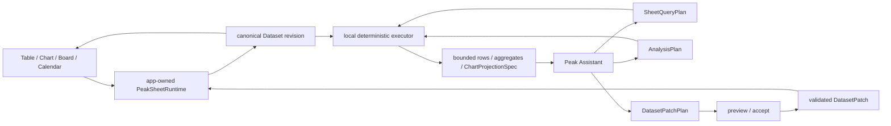
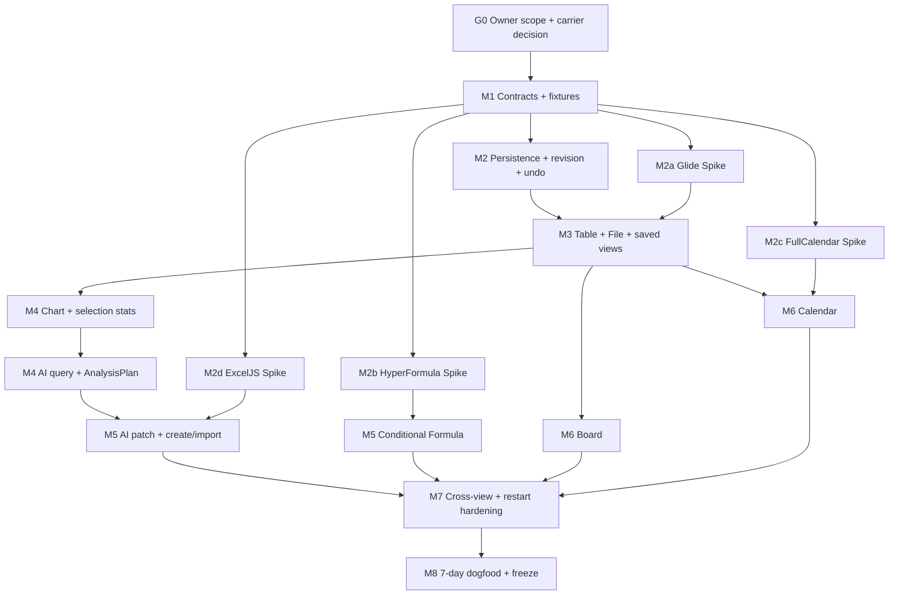

# Peak Sheet 本地数据工作台生产实施计划

> 状态：Stage 2 production implementation 已完成自动化收口 · 真实 Obsidian 验收与七天 dogfood 待完成
>
> 日期：2026-08-10
>
> 取代：[2026-08-02 Peak Sheet 视图适配器 Spike 与分阶段实现计划](./2026-08-02-peak-sheet-view-adapter-spike-and-rollout-plan.md)
>
> 实施证据：[Peak Sheet production implementation note](./2026-08-10-peak-sheet-production-implementation-note.md)
>
> 读者：Peak Assistant owner、后续实施 agent、架构与真实 Obsidian 验收 reviewer

## 0. 结论先行

Peak Sheet 首版应实现为一个 **本地、单用户、AI 可读写的数据工作台**：一个 app-owned `PeakSheetRuntime` 拥有唯一 Dataset revision，Table、Chart、Board、Calendar 都只是同一 revision 的投影。用户编辑和 AI 修改统一生成 typed patch；AI 分析统一生成受限、确定性的 `AnalysisPlan`，在本地执行后只把紧凑结果交给模型。

本轮不是重新做 Airtable、Excel 或一个公式语言。首版边界冻结为：

- P0 视图：Table、简单 Chart、简单 Board、简单 Calendar；
- P0 字段：Text、Number、Date、Single Select、Checkbox、Link、File；
- P0 数据能力：增删改、复制、排序、筛选、分组、隐藏列、保存视图、选区统计、Undo / Redo、本地持久化、进程内实时同步；
- P0 AI 能力：查询、创建、增量修改、把反馈转成任务、执行受限分析计划、生成图表规格、总结结果；
- 条件公式能力：第三方公式引擎 Spike 通过后才进入首版；失败则延期，禁止转为自研完整公式引擎；
- 文件字段只保存稳定引用；图片是 File 的可预览子类型，不新建第二套 Image 字段；
- CSV / 扁平 JSON Array 是创建入口；XLSX 是有损诊断可见的 bounded snapshot import，不承诺 Excel 完整兼容或双向同步。

第一条实施纵切是：

```text
Launch Tracker fixture
→ canonical Dataset revision
→ Table edit / sort / filter / group / selection stats
→ Chart projection
→ AI AnalysisPlan
→ DatasetPatchPlan preview / accept
→ restart / undo / cross-view verification
```

Board、Calendar、Beta Feedback、Launch Content 在首版冻结前完成，但不阻塞第一条纵切的建立。

## 1. 本文裁决什么

本文最初是两阶段 gate 的第一阶段交付物；owner 随后明确授权在隔离 worktree 完成全部实现。当前状态为：

1. Stage 1 的源码事实、范围合同与实施 DAG 继续作为验收基线；
2. Stage 2 已在独立 implementation worktree 落地；
3. focused tests、生产 build、bundle 与新增代码 TypeScript 过滤检查通过；
4. 真实 Obsidian IME、clipboard、drag、focus、reload 和 owner-device 500 行交互仍需 CDP 证据；
5. 连续七天 dogfood 未完成，因此仍不能从 Planned Requirements 移除或宣告首版冻结。

Stage 1 文档本身没有授权生产修改；后续 owner 指令已经提供明确 `GO`。实现内容和当前证据以同目录 implementation note 为准。

需求事实优先级：

1. 2026-08-10 owner 在当前讨论中明确修正的范围；
2. [Planned Requirements](../../planned-requirements.html) 当前登记；
3. [Roadmap 当前状态快照](../../roadmap.html)；
4. 旧计划、research 与 Mock，仅保留未冲突的设计证据。

## 2. Stage 1 当前源码审计

### 2.1 已确认的生产事实

- 当前 Planned Requirements 将 Peak Sheet 标为 `planned · spike-first · research candidate`，并明确 production runtime 尚未开始。
- `src/` 与 `test/` 中没有 `DatasetSnapshot`、`DatasetPatch`、`ViewDefinition`、`ComputePlan` 或 Peak Sheet runtime 的生产实现。
- 当前 Peak Sheet 提交只覆盖 research、Mock、Roadmap 与计划文档，不能算生产能力证据。
- [`package.json`](../../../package.json) 已安装 `recharts`，未安装 Glide Data Grid、HyperFormula、FullCalendar 或 ExcelJS。
- [`AppRuntimeRegistry`](../../../src/app/context/AppRuntimeRegistry.ts) 已提供 app-owned runtime 的唯一绑定模式；新增 Peak Sheet runtime 不得建立 service singleton，也不得新增 `AppContext.getInstance()` 依赖捷径。
- [`GeneratedOutputRegistry`](../../../src/core/storage/generated-output/GeneratedOutputRegistry.ts)、[`AtomicJsonSnapshotStore`](../../../src/core/storage/generated-output/AtomicJsonSnapshotStore.ts) 与 [`PartitionedJsonlStore`](../../../src/core/storage/generated-output/PartitionedJsonlStore.ts) 已提供注册、校验和恢复基础。
- [`RunEnvelope`](../../../src/service/run-envelope/types.ts) 已提供 run、progress、artifact、error 与 receipt 语义；Peak Sheet 分析不得另建第二套 AI run runtime。
- [`PermissionGuard`](../../../src/service/agents/harness/permission/PermissionGuard.ts) 已提供 deny-first、read / ask / accept-edits 的行为基线；AI read 与 mutation 必须继续区分。
- [`ResourcePreviewHover`](../../../src/ui/component/mine/resource-preview-hover.tsx) 与 `VaultPreviewPort` 已覆盖图片、PDF、文本与 URL 的悬浮预览路径，可作为 File cell 的复用入口。
- Composer 已有 [`TableModel`](../../../src/service/composer/packs/table/tableModel.ts) 与 [`chartModel`](../../../src/service/composer/packs/chart/chartModel.ts)，其中 Chart 已支持 bar / line / pie。它们是文档块模型，不是 Dataset runtime；只可复用纯函数或交互经验，不能成为 Peak Sheet 真值。

### 2.2 尚不存在的生产真值

- 没有 Dataset / Field / Row 的稳定 ID、schema version 与 revision 合同；
- 没有跨视图共享的 `ViewDefinition` 或 `ViewProjection`；
- 没有单写路径、stale revision 检测、patch validation、Undo / Redo 或 crash-safe save；
- 没有 Peak Sheet generated-output descriptor、carrier、sync、index、retention 或 migration 决议；
- 没有 Table / Chart / Board / Calendar production view；
- 没有受限分析脚本 / `AnalysisPlan` executor；
- 没有 AI 查询、写回、preview / accept 与 Sheet run receipt；
- 没有 CSV / JSON / XLSX 的 draft、diagnostic、accept 或取消闭环；
- 没有 200–500 行正式性能证据、5,000 行压力证据或真实 Obsidian 交互证据。

### 2.3 可以复用与必须隔离的边界

| 现有能力 | 可复用 | 禁止直接复用为真值 |
| --- | --- | --- |
| Generated Output stores | checksum、原子 snapshot、JSONL event、corrupt quarantine | 未登记 descriptor 前不得写 Peak Sheet 数据 |
| AppRuntimeRegistry | app-owned composition、boot / unload 对称 | service module singleton、静态 locator 扩张 |
| RunEnvelope / PermissionGuard | AI run、artifact ref、read / mutation gate | 新建 Sheet 专用 agent loop 或隐式写入通道 |
| ResourcePreviewHover | Vault 文件读取和 hover preview | 把 blob URL 或绝对系统路径持久化为 cell value |
| Composer Table / Chart | 纯模型、bar / line / pie 经验、Recharts renderer 经验 | Composer 文档块、fenced chart source、Markdown serializer |
| Existing SQLite | 可重建的搜索/排序 projection（若 500 行实测需要） | canonical Dataset、Undo 历史或唯一 revision truth |

## 3. 对 2026-08-02 旧计划的内容审计

### 3.1 保留

- 一个 Dataset、多个 View adapter、统一 typed patch；
- app-owned runtime 与 revision propagation；
- AI create / modify 必须 preview / accept，禁止整表重写；
- Glide 与 FullCalendar 先 Spike 后采用；
- Board 的显式 Move、键盘路径与 pointer drag 共用 patch；
- XLSX 必须先展示 worksheet 与兼容性损失，不能直接成为 canonical store；
- 真实 Obsidian 中验证 IME、选择、焦点、拖拽、Undo / Redo 和重启恢复；
- 不替换 Composer Markdown table。

### 3.2 重写

| 旧口径 | 当前口径 |
| --- | --- |
| Table / Board / Calendar 为主合同 | Table / Chart / Board / Calendar；Chart 是 P0，不再遗漏 |
| 自由 Sheet、丰富格式和结构化 Dataset 并行扩张 | 先做结构化本地数据工作台；不建设自由单元格电子表格产品 |
| typed formula 由 Peak 自研 parser / dependency graph | HyperFormula 等第三方引擎先 Spike；NO-GO 时公式延期 |
| 多种 rich field 与显示格式 | 仅 Text / Number / Date / Single Select / Checkbox / Link / File |
| 数字、日期、对齐、换行、条件格式是默认工作面 | 只保留 type-native display；条件格式与复杂显示格式移除 |
| 公式与格式承担计算工作面核心 | 选区统计与受限 AnalysisPlan 是必须项；公式为条件项 |
| 5,000 行作为主要交付尺度 | 200–500 行是产品保证；5,000 行只做工程压力测试 |
| AI 公式/筛选/分析入口混在一起 | read-only AnalysisPlan 与 mutating DatasetPatchPlan 分离 |

### 3.3 删除或延期

- Conditional formatting；
- 复杂显示格式、通用 number/date format language、alignment matrix；
- Person、Currency、Phone、Email、Multi-select 等 rich field；
- arbitrary JavaScript / Python；
- Relation、Lookup、Rollup、Pivot、Gallery、Map、3D、Dashboard builder；
- automation workflow、多人协作、权限系统、云协同实时同步；
- Excel 完整兼容、公式/样式 round-trip 或原文件双向同步；
- 把 Formula、Board、Calendar 的可选依赖失败转换为 scope 膨胀。

## 4. 冻结产品合同

### 4.1 首版使用场景

首版必须内置或一键创建三张 owner fixture：

1. **Peak Assistant Launch Tracker**：Task、Area、Priority、Status、Due Date、Blocker、Notes、Created At、Updated At；
2. **Beta Feedback**：User、Feedback、Category、Severity、Reproducible、Status、Related Task、Notes；
3. **Launch Content**：Channel、Content Type、Topic、Status、Publish Date、Link、Result。

`Related Task` 首版仍是 Link 或 Text，不升级为 Relation field。

### 4.2 字段合同

```ts
type PeakSheetFieldType =
  | 'text'
  | 'number'
  | 'date'
  | 'singleSelect'
  | 'checkbox'
  | 'link'
  | 'file';

type PeakSheetCellValue =
  | string
  | number
  | boolean
  | null
  | PeakSheetFileRef;

interface PeakSheetFileRef {
  kind: 'vault' | 'external-copy';
  vaultPath: string;
  mediaType?: string;
  displayName?: string;
}
```

约束：

- Date 保存 ISO date 或 datetime，显示由 field type 决定，不引入任意 display format；
- Link 保存 URL 或 Vault link，验证失败时保留原始文本并显示 diagnostic；
- File 首版每个 cell 只关联一个文件；图片通过 `mediaType` / extension 进入预览；
- 选择现有 Vault 文件时只保存引用，不移动文件；
- 外部文件只有在用户明确执行 Import / Copy 后才复制到可配置 attachment root；取消不产生文件；
- `computed` 若随第三方公式引擎进入，只是内部 read-only projection，不开放为第八种普通录入字段。

### 4.3 Table 行为

- 表创建、重命名、删除；
- 行新增、删除、复制；
- 列新增、删除、重命名、调整宽度；
- cell direct edit、range selection、copy / paste；
- stable multi-sort、组合 filter、单字段 group；
- 隐藏列、保存/重命名/删除 View；
- selection stats：count、sum、average、min、max；非数字值被忽略并显示参与计数；
- Undo / Redo 必须覆盖 cell、row、field、view 与跨视图 move；
- destructive schema change 先 preview 受影响 cell 数，确认后才产生 patch。

### 4.4 Chart 行为

- 支持 bar、line、pie；
- Chart view 保存 category field、series、aggregate、filter、sort、title，不复制数据；
- 使用同一 Dataset revision 和同一 filter evaluator；
- read-only；首版不在 chart 上直接拖动或编辑数据；
- AI 分析读取 underlying projected rows、aggregate result 与 Chart view spec，不读取截图；
- 不实现 dashboard、组合图、双轴、自由主题编辑器或图形条件格式。

### 4.5 Board 行为

- 只能按 Single Select 字段分 lane；
- card title 必须映射一个 Text 字段，最多显示三个 secondary fields；
- lane move 生成与 Table edit 相同的 `DatasetPatch`；
- 显式 Move command 与键盘路径先成立，pointer drag 后接入相同命令；
- 不实现 swimlane、WIP automation、card relation 或自定义 card renderer。

### 4.6 Calendar 行为

- 简单 month view；可选 agenda/list 仅在 Standard plugin 无额外复杂度时保留；
- 一个 Date 字段作为 start，首版不要求 duration / resource scheduling；
- date click 创建、event click 编辑、drag 改日期都生成相同 typed patch；
- 不引入 Premium / Scheduler、resource、timeline 或 recurrence engine。

### 4.7 “实时同步”的精确定义

首版实时同步是 **同一 Obsidian 进程内的 revision broadcast**：

- 一个视图 accept revision `N+1` 后，其他已打开视图在一个 UI event cycle 内收到新 snapshot；
- stale editor 在提交时必须带 `baseRevision`，冲突时拒绝并要求 rebase / retry，不能 last-write-wins 静默覆盖；
- 重启后从 canonical snapshot + event history 恢复；
- 不包含云 transport、多人 presence、跨设备推送或权限系统。

## 5. AI 与受限分析脚本合同

### 5.1 读、分析、写三条路径



- `SheetQueryPlan`：read-only filter / sort / select / limit；
- `AnalysisPlan`：read-only group / aggregate / topN / dedupe / cast / derive / chart；
- `DatasetPatchPlan`：mutating add / update / delete / schema / view；必须 preview / accept；
- 三者都记录 dataset ID、base revision、input hash、limits、diagnostic 与 run receipt；
- executor 是本地 deterministic TypeScript，不执行模型生成的 JavaScript / Python / SQL；
- 默认只把 schema、统计和 bounded result 交给模型；原始全表上传必须由现有 provider/privacy policy 明确允许且受 row / byte cap；
- AI narrative 不成为持久数据真值。revision 变化后旧 narrative 标 stale，用户触发时重跑。

### 5.2 AnalysisPlan 白名单

```ts
type AnalysisStep =
  | { op: 'filter'; expression: BooleanExpression }
  | { op: 'sort'; fields: readonly SortField[] }
  | { op: 'group'; fieldId: string }
  | { op: 'aggregate'; metrics: readonly AggregateMetric[] }
  | { op: 'topN'; count: number; orderBy: string }
  | { op: 'dedupe'; fieldIds: readonly string[] }
  | { op: 'cast'; fieldId: string; target: 'text' | 'number' | 'date' | 'checkbox' }
  | { op: 'derive'; expression: SafeExpression }
  | { op: 'chart'; chartType: 'bar' | 'line' | 'pie' };
```

每一步必须有 deterministic validator、cost estimate、row / group / output cap 和可解释 error。`derive` 只接受 Peak-owned AST；若 HyperFormula Spike GO，可映射其受支持表达式，否则只保留内置简单派生，不得扩成脚本。

### 5.3 首版自然语言验收

- “列出所有 P0 release blockers”；
- “把 onboarding 任务改成 Doing”；
- “显示所有被阻塞的任务”；
- “按 Area 分组未完成任务”；
- “把这段 beta feedback 转成任务”；
- “总结目前最影响发布的三个问题”；
- “按 Area 统计未完成任务并画柱状图”。

每条指令都要断言生成的 plan、读取 revision、preview 内容、accept/cancel 副作用和 receipt；不能只断言模型文案。

## 6. Canonical 数据与存储裁决

### 6.1 推荐合同

```ts
interface DatasetSnapshot {
  schemaVersion: 1;
  datasetId: string;
  name: string;
  revision: number;
  fields: readonly FieldDefinition[];
  rows: readonly DatasetRow[];
  views: readonly PeakSheetViewDefinition[];
  createdAt: string;
  updatedAt: string;
}

interface DatasetPatch {
  patchId: string;
  datasetId: string;
  baseRevision: number;
  operations: readonly DatasetOperation[];
  actor: { kind: 'user' | 'ai'; runId?: string };
  createdAt: string;
}

type PeakSheetViewDefinition =
  | TableViewDefinition
  | ChartViewDefinition
  | BoardViewDefinition
  | CalendarViewDefinition;
```

必须满足：

- `datasetId`、`fieldId`、`rowId`、`viewId` 稳定；展示名称可改；
- patch 只引用 ID，不引用列序号或显示名；
- accepted patch 产生且只产生一个新 revision；
- ViewDefinition 与 Dataset 同 revision 保存，但 filter/sort/group 是视图配置，不改原始 row order；
- Undo 是对已接受 patch 生成 typed inverse patch，不靠 renderer 私有 history；
- snapshot 是当前完整状态，JSONL event 是历史与审计；SQLite 如需引入，只是可重建 projection。

### 6.2 Generated Artifact gate

Stage 2 的第一个持久 writer 前，必须先在 [`generated-artifact-registry.md`](../../conventions/generated-artifact-registry.md) 和 typed catalog 登记：

| 建议 ID | Output | Carrier | Policy |
| --- | --- | --- | --- |
| `UA-16` / `peak-sheet.dataset` | 用户拥有的 Dataset current snapshot | JSON snapshot，按 dataset 分片 | sync required；Peak index exclude；由 Peak Sheet surface 管理，不自动 Markdown materialize |
| `DR-25` / `peak-sheet.events` | patch、undo、AI receipt、import receipt | per-dataset partitioned JSONL | sync required；Peak index exclude；durable retention |
| 可选 local projection | 仅性能证据要求时引入的索引 | SQLite | local-only、rebuildable、never materialize |

这些编号是实施建议，不是本计划对 registry 的实际修改。G0 必须核验当前最新 ID，并决定 Dataset 是 `user-artifact` 还是其他已批准的用户内容类别。任何冲突都先更新注册表文档，再写代码。

### 6.3 File 字段存储规则

- canonical cell 只保存 `vaultPath` 和可选 metadata，不保存文件 body；
- 预览临时 blob URL 永不持久化；
- Vault rename 通过 app-owned file identity / rename event 更新引用，不能在 service 层直接监听 Obsidian；
- missing file 显示 broken reference，不静默删除 cell；
- explicit external import 的复制成功与 Dataset patch 必须形成 compensating flow：任一步失败都不留下孤儿引用，必要时报告可恢复 orphan，不静默删除用户文件。

## 7. 第三方组件 Spike 矩阵

| 能力 | 候选 | 当前事实 | Peak 拥有 | GO gate | NO-GO |
| --- | --- | --- | --- | --- | --- |
| Table viewport | Glide Data Grid | MIT、React canvas grid；data mutation 由调用方 callback 管理；当前未安装 | Dataset、schema、sort/filter/group、patch、undo、a11y acceptance | Obsidian theme、IME、range、clipboard、resize、5k stress、canvas a11y、portal lifecycle 全过 | 保留 adapter，改用语义 DOM + virtualization |
| Formula | HyperFormula | headless TypeScript engine、dependency graph、400+ functions；GPLv3 / proprietary 双许可；当前未安装 | field mapping、allowlist、preview、patch、error UI、persistence | 许可/NOTICE review、bundle、ES2018、formula reference mapping、cycle/error、undo integration、500-row latency 全过 | 首版隐藏 Formula；保留 selection stats 与 AnalysisPlan；禁止自研 full engine |
| Chart | Recharts | 已安装；Composer 已有 bar / line / pie 经验 | projection spec、aggregate、filter、revision、AI analysis | 200–500 行聚合、empty/error、theme、resize、source-data analysis 通过 | 退回最小 SVG renderer；不阻塞 Dataset |
| Calendar | FullCalendar Standard | Standard plugins 覆盖 daygrid / interaction；Premium 独立；当前未安装 | field mapping、patch、undo、sidecar、revision | 仅 Standard package、bundle、month CRUD、drag revert、keyboard、theme 通过 | 自研简单 month/list projection |
| Board | Peak 自研 | 不需要外部 DnD | 全部 | Move / keyboard 先过，pointer drag、autoscroll、rollback 再过 | 保留 Move / keyboard，不能删除 Board view |
| XLSX import | ExcelJS 候选 | MIT、可读写 XLSX；当前未安装 | WorkbookDraft、compatibility report、limits、accept | bundle、worker/renderer safety、multi-sheet、type/formula/style/merge/hidden diagnostic、corrupt file 通过 | XLSX 保持 planned/disabled；CSV/JSON 创建不受影响 |

外部事实来源：

- [Glide Data Grid repository](https://github.com/glideapps/glide-data-grid) 与 [API](https://github.com/glideapps/glide-data-grid/blob/main/packages/core/API.md)；
- [HyperFormula client installation](https://hyperformula.handsontable.com/docs/guide/client-side-installation.html)、[key concepts](https://hyperformula.handsontable.com/docs/guide/key-concepts.html)、[license key guide](https://hyperformula.handsontable.com/docs/guide/license-key.html) 与 [license](https://github.com/handsontable/hyperformula/blob/master/LICENSE.txt)；
- [FullCalendar plugin index](https://fullcalendar.io/docs/plugin-index) 与 [v7 upgrade/license notes](https://fullcalendar.io/docs/upgrading-from-v6)；
- [ExcelJS repository](https://github.com/exceljs/exceljs) 与 [MIT license](https://github.com/exceljs/exceljs/blob/master/LICENSE)。

本仓库自身声明 GPL-3.0，但这不自动构成 HyperFormula 分发兼容性的法律结论。依赖 gate 必须记录版本、许可证文本、NOTICE/源码提供义务和最终采用结论；无法确认就 NO-GO。

## 8. Impact Contract

### 8.1 Primary metric

Owner 使用三张首版表连续七天管理 Peak Assistant 发布，期间不需要回到其他任务表格工具；所有修改由一个 Dataset truth 持久化，并可由 Peak Assistant 稳定查询、分析和增量修改。

### 8.2 Required tracks

1. Dataset / Field / Row / View / Patch / Analysis 核心合同；
2. app-owned runtime、canonical persistence、restart recovery、Undo / Redo；
3. Table CRUD、direct edit、sort / filter / group、hidden fields、saved views；
4. selection count / sum / average / min / max；
5. simple Chart（bar / line / pie）与 source-data AI analysis；
6. AI query、AnalysisPlan、DatasetPatchPlan preview / accept 与 receipt；
7. File ref、explicit external copy、image/file hover preview；
8. AI / CSV / flat JSON create；
9. bounded XLSX workbook import 与 compatibility report；
10. simple Board 与 simple Calendar；
11. 同进程跨视图 revision broadcast、stale-write rejection；
12. 200–500 行产品性能、5,000 行工程 stress、数据损坏防线与真实 Obsidian QA。

### 8.3 Conditional tracks

- HyperFormula：只有依赖 Spike GO 才加入 Formula 字段/栏；NO-GO 不消耗 Required track skip budget；
- Glide、FullCalendar、ExcelJS 是候选实现，不是产品合同。候选 NO-GO 后执行本文指定 fallback 或保留明确 disabled gate；
- XLSX 是当前 Planned Requirement 的 final-completion 项，但不阻塞第一条 Table + Chart + AI 纵切。

### 8.4 Forbidden scope

- 条件格式和复杂显示格式；
- 任意 JavaScript / Python / SQL；
- 多人、云同步、权限、presence、remote conflict merge；
- Relation / Lookup / Rollup / Pivot / Gallery / Map / Dashboard / automation；
- Person / Currency / Phone / Email / Multi-select rich field；
- FullCalendar Premium / Scheduler / resource timeline；
- Excel 完整兼容、原 XLSX 双向同步、隐式 workbook overwrite；
- renderer 私有 Dataset、AI 影子数据、CSV/XLSX 作为 canonical store；
- service runtime singleton、扩大 `AppContext.getInstance()`、第二套 AI loop；
- 替换 Composer Table / Chart 文档块；
- 未登记 generated output 就写持久数据；
- 用 Mock、unit test 或绿色 build 冒充真实 Obsidian interaction acceptance。

### 8.5 Skip budget

- Required tracks 1–8、10–12：skip budget 为 0；
- Required track 9（XLSX）：允许因明确的依赖/体积/安全 NO-GO 保持 disabled，但不能宣称整个 Planned Requirement 已完成；
- Conditional Formula：允许一次明确 NO-GO，必须删除/关闭入口并记录理由；不得以自研引擎补位；
- 单个第三方 renderer 允许一个 fallback，不允许同时维护两个 production renderer。

### 8.6 Minimum acceptable delta

Stage 2 才能被称为一次 Peak Sheet major wave，且至少同时实现：

- 首个 canonical Dataset 能创建、编辑、重启恢复和 Undo / Redo；
- Table 与 Chart 读取同一 revision，AI 能完成一个 read-only analysis 和一个 preview / accept mutation；
- 200–500 行无明显交互阻塞，5,000 行压力结果被记录但不作为产品承诺；
- 不产生双写、影子 Dataset、silent overwrite 或损坏后不可恢复的状态。

如果只增加 Mock、依赖 Spike 或几组类型/测试，应标为 Spike / foundation，不得宣称 major wave 或产品已实现。

### 8.7 Stop / commit rule

- Stage 1：owner 未给 GO 前停止在本文，不改生产代码；
- Stage 2：每个 gate 独立提交 task-owned files；失败 gate 提交证据和 rollback，不把 Spike code 混入 production；
- carrier、license、runtime owner 或 canonical identity 任一未决，停止对应 track；
- focused tests 与 build 通过后才能提交 implementation；真实 UI 未完成时必须标 `INTERACTION NOT VERIFIED`，不能宣称可发布；
- 任何阶段发现需要进入 Forbidden scope，停止并请求 owner 决策。

## 9. Stage 2 实施 DAG



可以并行的只有隔离 Spike；任何 Spike 不得直接修改 canonical Dataset 或把依赖接入 production UI。M3 以后都必须按同一 revision contract 串行整合。

## 10. 预计文件架构

```text
src/core/sheet/
  model/                DatasetSnapshot, FieldDefinition, ViewDefinition
  patch/                operations, validation, inverse patch
  compute/              filter, sort, group, aggregate, selection stats
  analysis/             AnalysisPlan schema, validation, bounded executor
  import/               DatasetDraft, diagnostics, limits
  formula/              optional FormulaEnginePort only

src/service/sheet/
  DatasetService.ts
  SheetQueryService.ts
  SheetAnalysisService.ts
  SheetMutationPlanner.ts
  SheetImportService.ts
  ports/                repository, clock, id, file, formula ports

src/app/sheet/
  PeakSheetRuntime.ts
  composePeakSheetRuntime.ts
  AppPeakSheetRepository.ts
  AppPeakSheetFileAdapter.ts
  AppPeakSheetAIAdapter.ts
  PeakSheetView.ts

src/ui/view/peak-sheet/
  PeakSheetRoot.tsx
  table/
  chart/
  board/
  calendar/
  analysis/
  file/

test/peak-sheet-*.test.ts
.dev/spikes/peak-sheet/{glide,hyperformula,fullcalendar,exceljs}/
```

边界：

- `core/sheet` 不导入 React、Obsidian、AI provider 或第三方 renderer；
- `service/sheet` 只依赖 ports，不读 `AppContext`；
- `app/sheet` 组成 Obsidian、storage、AI、file 和 runtime；
- UI 只订阅 runtime snapshot，mutation 必须调用 command/patch port；
- third-party formula 通过 `FormulaEnginePort`；third-party renderer 不进入 core；
- strings、limits、format defaults 进入 `templates/config/` 或 domain defaults，禁止散落硬编码。

## 11. 里程碑、任务与 Gate

### G0 · Owner review 与合同冻结

交付：

1. 审阅本文的 P0 / conditional / forbidden scope；
2. 确认 `UA-16` / `DR-25` 或最新可用 ID；
3. 确认 Dataset JSON snapshot + per-dataset JSONL event 的 carrier；
4. 确认 XLSX 是 final requirement，但不阻塞第一纵切；
5. 确认 Formula NO-GO 时延期而非自研；
6. 记录明确 `GO` 后创建 implementation worktree。

Gate：未明确 GO，不执行以下任何里程碑。

### M1 · 核心合同与 fixture characterization

任务：

1. 建立纯类型与 Zod schema：Dataset、Field、Row、View、Patch、Query、Analysis、Draft；
2. 冻结 stable ID、null、invalid value、date timezone、select option rename 语义；
3. 为三张 owner table 写 deterministic fixture；
4. 写 patch validation、stale revision、inverse patch、filter/sort/group/aggregate 的失败先行测试；
5. 在 registry 文档和 typed catalog 登记 Peak Sheet outputs。

Gate G1：core tests byte-stable；无 React/Obsidian/provider import；descriptor 与文档一一对应；没有 writer。

### M2 · Persistence、revision、Undo / Redo

任务：

1. 用现有 atomic snapshot 与 partitioned JSONL port 实现 repository；
2. 建立 `applyPatch(baseRevision)` 单写事务、checksum、event ID 幂等、inverse patch；
3. 建立 corrupt snapshot restore、JSONL tail quarantine、missing event diagnostic；
4. app layer compose `PeakSheetRuntime`，在 `AppRuntimeRegistry` 唯一绑定并对称 dispose；
5. 实现 in-process revision subscription；
6. 禁止 UI 或 AI 绕过 runtime 直接写 store。

Gate G2：create → patch → undo → redo → restart recovery 全过；并发 stale patch 被拒绝；故障注入不产生半 revision。

### M2a–M2d · 隔离依赖 Spike

每个 Spike 必须在 `.dev/spikes/peak-sheet/` 使用 in-memory fixture，输出：版本、许可证、bundle delta、API adapter、Obsidian harness evidence、GO/NO-GO、删除清单。

- Glide：IME、range、clipboard、column resize、keyboard、screen reader fallback、portal、5k row；
- HyperFormula：license、formula mapping、400+ function 不等于全部开放、cycle/error、dependency invalidation、undo、500 row；
- FullCalendar：只安装 Standard package，month CRUD、drag revert、keyboard、theme；
- ExcelJS：multi-sheet、formula/style/merge/hidden diagnostic、corrupt/zip bomb limit、bundle and renderer safety。

Gate G2S：每个候选单独 GO/NO-GO；不允许“能跑 demo”直接成为 production adoption。

### M3 · Table、File 与 Saved View 纵切

任务：

1. 注册一个稳定 Peak Sheet 主视图，不向 Command Palette 暴露 debug/fixture actions；
2. 实现 Dataset list/create/rename/delete 与 Table projection；
3. 实现 row/field/cell operations、width、range、clipboard、sort/filter/group、hidden field、saved views；
4. 实现 selection stats；
5. File picker 经 app port 选择 Vault file；外部 copy 明确确认；复用 preview port；
6. 所有操作生成 typed patch，失败回滚并保持 selection/focus；
7. 完成 Launch Tracker fixture 的 restart 与 Undo / Redo。

Gate G3：Table 无私有数据真值；IME、range、paste、resize、group、file preview、delete confirm、focus restore 在真实 Obsidian 通过。

### M4 · Chart 与 AI AnalysisPlan

任务：

1. 新增 `ChartViewDefinition` 与 deterministic projection；
2. 用 Recharts 实现 bar / line / pie、empty/error/loading、responsive resize；
3. aggregate 与 Table 使用同一 filter/type evaluator；
4. 实现 SheetQueryPlan / AnalysisPlan validator、cost estimate、executor 和 bounded result；
5. AI 可生成/修订 Chart view plan，preview 后保存 ViewDefinition；
6. 分析 run 使用现有 RunEnvelope / receipt；revision 变化后标 stale；
7. 验证“按 Area 统计未完成任务并画柱状图”。

Gate G4：Chart 与 Table 显示的计数一致；AI 输入来自 source rows / projection spec 而非截图；read-only plan 不产生 revision。

### M5 · AI mutation、创建与文件导入

任务：

1. 实现 DatasetPatchPlan preview / accept / cancel；
2. AI mutation 通过 deny-first permission 与 base revision gate；
3. CSV / flat JSON → DatasetDraft → schema review → revision 1；
4. AI beta feedback → task 使用同一 draft / patch 路径；
5. ExcelJS GO 时接 `WorkbookDraft`、worksheet selection、compatibility report、explicit accept；
6. 导入文件只保留 source hash / provenance；不建立隐藏同步；
7. HyperFormula GO 时经 `FormulaEnginePort` 加入受限 Formula；NO-GO 则入口不存在。

Gate G5：cancel 零写入；accept 只创建一个 revision 或一个新 patch revision；AI 无整表覆盖工具；XLSX loss 在 accept 前可见。

### M6 · Board 与 Calendar

Board：

1. Single Select lane、Text title、最多三个 secondary fields；
2. Move command + keyboard；
3. pointer drag、placeholder、autoscroll；
4. optimistic UI 必须在 patch failure 时 revert。

Calendar：

1. Date field mapping、month view；
2. date click create、event edit、drag date；
3. FullCalendar GO 则使用 Standard adapter，否则简单 month/list fallback；
4. 所有写入与 Table 共享 patch。

Gate G6：同一 row 在 Table、Board、Calendar 修改后只增加一个 revision；无 pointer drag 仍可键盘完成 Board；Calendar 不包含 Premium dependency。

### M7 · 同步、性能与损坏防线

任务：

1. 同开四个 view，验证 revision broadcast、stale edit 和 focus preservation；
2. 200、500、5,000 行分别记录 load、edit-to-paint、sort/filter/group、aggregate、save、restart；
3. 200–500 行必须满足正常编辑无可感知长任务；G0 后以真实设备 baseline 冻结 p95；
4. 5,000 行只用于定位 virtualization / compute bottleneck，不提升产品承诺；
5. fuzz patch、invalid schema、corrupt snapshot、truncated JSONL、missing file、provider cancel；
6. plugin-only reload、hot reload dispose、worktree checkout identity 验证。

Gate G7：没有数据损坏、silent overwrite、double subscription 或 runtime leak；性能报告区分正式保证与 stress。

### M8 · Owner dogfood 与冻结

1. 用三张真实表连续七天；
2. 每日记录需要回到其他工具的原因；
3. 验证首版自然语言指令；
4. 修复 P0 数据、Undo、同步、查询和性能问题；
5. 非 P0 需求进入 post-launch，不在 dogfood 中顺手扩 scope。

Gate G8：完成标准全部满足后冻结首版并更新 Roadmap / Planned Requirements / progress；否则保留 planned 状态。

## 12. 验证矩阵

| Requirement | Automated evidence | Real Obsidian evidence |
| --- | --- | --- |
| Canonical revision | repository、patch、idempotency、stale conflict tests | 四视图同开 revision assertion |
| CRUD / saved views | reducer、schema migration、round-trip tests | menu、keyboard、focus、restart |
| Sort/filter/group | deterministic fixture snapshots | 500-row interaction |
| Selection stats | numeric/null/invalid cases | range selection 与状态栏更新 |
| Undo / Redo | inverse patch property tests | 多步 sequence video + activeElement |
| File | ref validation、rename/missing/cancel tests | picker、hover、image/PDF、broken ref |
| Chart | projection parity、empty/error tests | resize/theme/three chart types |
| AI read/analysis | plan schema、caps、deterministic result | real provider run + receipt |
| AI mutation | permission、preview/cancel/accept tests | real preview、focus return、undo |
| CSV/JSON/XLSX | fixtures、limit、diagnostic、loss report | import picker、worksheet review |
| Board | move/keyboard/rollback tests | pointer corridor/autoscroll video |
| Calendar | mapping/drag/revert tests | month CRUD/keyboard/theme |
| Persistence | corruption/recovery/fault injection | plugin reload + Obsidian restart |
| Performance | 200/500/5k benchmark artifacts | owner device p95 capture |

每个里程碑至少运行：

```bash
npm run test -- <focused peak-sheet tests>
npm run build
git diff --check
```

涉及 UI 的里程碑按 [`obsidian-real-ui-qa.md`](../../conventions/obsidian-real-ui-qa.md) 执行 CDP DOM/assertion + Computer Use 可见证据。IME、drag、Undo / Redo、focus restoration 必须用真实交互序列或短视频，静态截图不够。

## 13. Rollout 与回滚

- Feature flags 按 `runtime`, `table`, `chart-analysis`, `ai-mutation`, `xlsx-import`, `formula`, `board`, `calendar` 分离；
- 每个 flag off 时 canonical Dataset 仍可读取/导出，不能让 renderer removal 造成数据不可达；
- Glide / FullCalendar / Recharts fallback 只替换 adapter，不改 Dataset / ViewDefinition；
- HyperFormula rollback 隐藏 Formula entry，并将已有 computed projection 标 unsupported；不得把计算结果静默固化成原始值；
- ExcelJS rollback 关闭 XLSX import，不影响 CSV/JSON 或已有 Dataset；
- schema migration 必须先 snapshot backup、dry-run report、owner confirm；不自动删除旧 source；
- 任何损坏恢复都保留 quarantine evidence。

## 14. 风险与明确未决项

| 风险 / 决策 | 当前建议 | Gate |
| --- | --- | --- |
| Dataset output class / IDs | user-owned JSON snapshot + durable JSONL history | G0 |
| HyperFormula 分发许可 | GO：仓库与依赖均为 GPL-3.0，使用 `gpl-v3` key；根目录 notice 记录 license/source obligation | G2S 已通过 |
| Glide canvas 的 IME / a11y / Obsidian reset | 高保真真实 host Spike；保留 DOM fallback | G2S |
| FullCalendar v7 与现有 React/build target | 只试 Standard；版本在 Spike 后 pin | G2S |
| ExcelJS bundle / renderer safety | bounded parser port、size/zip limits；NO-GO 可 disabled | G2S |
| File rename identity | app-owned vault event adapter；missing ref 不删值 | M3 |
| AI raw data exposure | local compute first，模型只收 bounded result | M4 |
| 500 行性能预算 | 先测 owner device baseline，再冻结 p95 数字 | M7 |
| Board pointer drag 成本 | Move / keyboard 先成立，drag 不创建第二路径 | M6 |

## 15. 完成定义

只有同时满足以下条件，才能说“Peak Sheet 首版已实现”，并从 Planned Requirements 移除：

1. 三张真实表可创建、重命名、删除并稳定保存；
2. 7 种字段和 Table P0 操作可用；
3. sort、filter、group、hidden fields、saved views 与 selection stats 稳定；
4. Table、Chart、Board、Calendar 共用一个 Dataset revision；
5. Undo / Redo、stale revision、restart recovery 与 corruption recovery 可靠；
6. Peak Assistant 能完成约定的查询、分析、创建与 preview / accept 修改；
7. File cell 可链接 Vault 文件，图片等可 hover preview，外部 copy 明确可撤销；
8. 200–500 行达到正式交互保证，5,000 行 stress 有记录；
9. XLSX 若仍在当前 Planned Requirement 中，必须有 worksheet review 与 compatibility report；若 disabled，需求不能关闭；
10. Formula 仅在第三方引擎 GO 时出现；无自研完整公式语言；
11. focused tests、production build 与真实 Obsidian interaction evidence 完整；
12. owner 连续七天不需要回到其他任务表格工具。

一句话冻结：

> **一份本地 Dataset、四个简单视图、一个受控 AI 读写与分析入口；先服务 Peak Assistant 发布，不做 Airtable 或 Excel。**

## 16. 下一步

Stage 2 已完成，不再等待 GO。剩余工作是验收和冻结，不是继续扩张功能：

1. 在具有 CDP 的真实 Obsidian 中完成 Table IME、选区 clipboard、Board/Calendar drag、hover preview、Undo / Redo、plugin-only reload 与 focus sequence；
2. 在 owner 设备记录 200 / 500 行的交互与持久化表现；
3. 完成三张真实表连续七天 dogfood；
4. G8 全部通过后再更新 Roadmap / Planned Requirements 并冻结首版。
