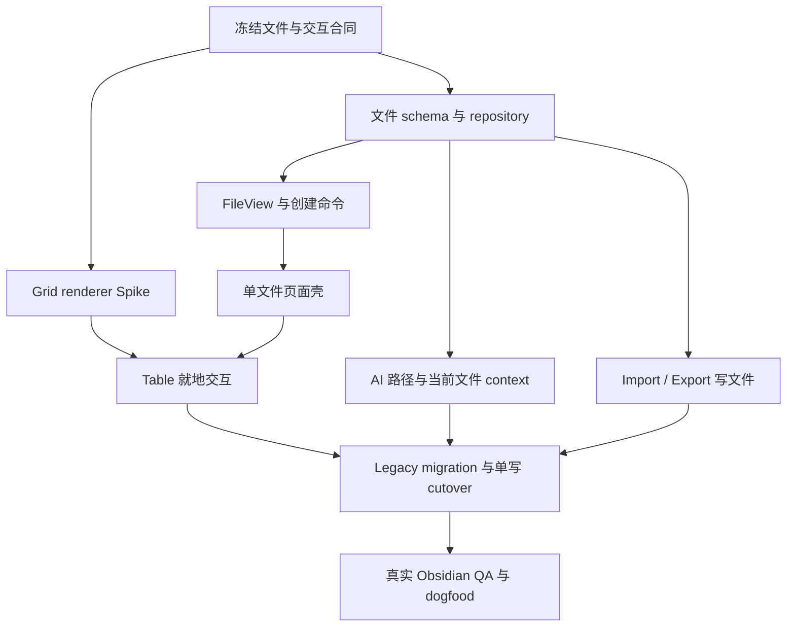

# Peak Sheet 文件化改版实施计划

> 日期：2026-08-11
>
> 状态：设计到生产的差异计划；本文件不代表生产改版已经完成
>
> 设计依据：[Peak Sheet · File-native V3](../../gstack/peak-sheet-file-native-2026-08-11/README.md)
>
> 当前实现证据：[Peak Sheet production implementation note](./2026-08-10-peak-sheet-production-implementation-note.md)
>
> 读者：Peak Assistant owner、实施 agent、真实 Obsidian 验收 reviewer
>
> 预计阅读：12–15 分钟

## 0. 结论先行

这次不应该重做整个 Peak Sheet。现有实现已经形成三组可复用基础：

- 数据模型、typed patch（结构化变更操作）、revision 与 Undo / Redo；
- 公式、Table、Chart、Board 与 Calendar；
- 文件字段、导入和 AI 分析。

真正偏离产品方向的是三个基础层：

- Sheet 仍藏在 Peak 数据目录里，没有成为 Obsidian 文件；
- 页面还是一个独立的 Sheet 管理器，而不是一份文件的编辑页；
- 行列操作仍依赖顶部按钮、右侧 Fields 面板和行尾图标，没有形成飞书式的就地表格交互。

因此本轮应做一次 **file-native cutover**：让每张 Sheet 由一个用户可见的 `.peaksheet` JSON 文件承载，让 Obsidian 文件目录成为唯一导航，再围绕当前文件重做 Table 的行列交互。底层 Dataset 能力继续复用，不重做已经成立的 view、formula 或 AI runtime。

完成后的用户路径必须缩短为：

1. 执行全局命令 `Create Peak Sheet`；
2. 在当前文件所在目录创建并打开一份 `.peaksheet` 文件；
3. 直接在表尾新增行，在最右侧新增列，在行号或字段标题上右键配置；
4. 从 Obsidian 文件目录再次打开这份文件；
5. Peak Assistant 可针对当前文件查询、分析和修改；
6. 用户可导入或导出 CSV / XLSX。

## 1. 当前能力如何处理

### 1.1 直接保留

| 能力 | 当前证据 | 本轮处理 |
| --- | --- | --- |
| Dataset、stable ID、revision | [`types.ts`](../../../src/core/sheet/types.ts) | 保留核心语义 |
| typed patch 与 inverse patch | [`patch.ts`](../../../src/core/sheet/patch.ts) | 扩充少量结构操作 |
| Undo / Redo 与 JSONL history | [`PeakSheetRuntime.ts`](../../../src/app/sheet/PeakSheetRuntime.ts) | 改为按文件 revision 恢复 |
| HyperFormula | [`HyperFormulaPeakSheetEngine.ts`](../../../src/service/sheet/formula/HyperFormulaPeakSheetEngine.ts) | 保留，不自研公式引擎 |
| Table projection、筛选、排序、分组 | [`compute.ts`](../../../src/core/sheet/compute.ts) | 保留纯函数 |
| Chart / Board / Calendar | [`PeakSheetChart.tsx`](../../../src/ui/view/peak-sheet/PeakSheetChart.tsx) 等现有 view | 绑定新文件 session |
| CSV / JSON / XLSX import | [`import.ts`](../../../src/core/sheet/import.ts)、[`PeakSheetXlsxImporter.ts`](../../../src/service/sheet/import/PeakSheetXlsxImporter.ts) | 输出目标改为 `.peaksheet` |
| File ref 与 hover preview | [`PeakSheetAttachmentAdapter.ts`](../../../src/app/sheet/PeakSheetAttachmentAdapter.ts) | 保留并补 rename / missing 行为 |
| AI read / analyze / edit tools | [`peakSheetTools.ts`](../../../src/service/chat/tools/peakSheetTools.ts) | 增加文件路径和当前文件语义 |
| 受限分析脚本 | [`PeakSheetAnalysisPlan`](../../../src/core/sheet/types.ts) | 继续作为内置 AI 的安全 script 接口 |

### 1.2 必须重做

| 领域 | 当前状态 | 目标状态 | 相对代价 |
| --- | --- | --- | --- |
| Canonical carrier | 隐藏 `dataset.json` | 用户可见 `.peaksheet` 文件 | 高 |
| Obsidian host | 独立 `ItemView` | custom extension 对应的 `FileView` | 中 |
| 导航 | Peak Sheet 内部列表和搜索 | 只使用 Obsidian 文件目录 | 低 |
| 新建 | 创建隐藏 Dataset 后打开工作台 | 当前目录直接创建并打开文件 | 中 |
| 页面模型 | 一个页面管理多个 Dataset | 一个页面只编辑当前文件 | 中 |
| 行操作 | 顶部 `+ Row`、行尾图标 | 表尾新增、行号右键菜单 | 中 |
| 列操作 | Fields 面板 | 表头菜单、右键、拖拽宽度和顺序 | 高 |
| 导出 | 只有 JSON | CSV 与 XLSX 为正式出口 | 中 |
| AI target | 只认识 `datasetId` | 同时认识标题、路径和当前文件 | 中 |
| 迁移 | 无 file-native 迁移 | 隐藏 Dataset 安全转成文件 | 高 |

### 1.3 明确不做

- 条件格式和复杂显示格式；
- Person、Currency、Phone、Email、Multi-select 等 rich field；
- Relation、Lookup、Rollup、Pivot、Gallery 和 Dashboard builder；
- 任意 JavaScript、Python 或 SQL 执行；
- 多人协作、权限、presence、云端实时协同和冲突合并；
- Excel 样式、宏、图表、数据透视表或公式 round-trip；
- Peak Sheet 自己的文件浏览器、主页或 Dashboard；
- 第二套公式引擎、第二套 AI agent loop 或第二份 Dataset 真值。

## 2. 文件与数据真值

### 2.1 推荐的唯一真值

建议新增 `PeakSheetFileDocument` schema v2。文件内容仍然是普通 JSON，但扩展名为 `.peaksheet`。

```ts
// Proposed contract. Not implemented yet.
interface PeakSheetFileDocument {
  format: 'peak-sheet';
  schemaVersion: 2;
  datasetId: string;
  revision: number;
  fields: readonly PeakSheetFieldDefinition[];
  rows: readonly PeakSheetRow[];
  views: readonly PeakSheetViewDefinition[];
  createdAt: string;
  updatedAt: string;
}
```

身份规则：

- `datasetId` 是稳定身份；文件移动或重命名不能改变它；
- 文件路径只是当前位置，不写进文件内容；
- Sheet 标题来自文件名，不再让 `snapshot.name` 与文件名形成双真值；
- `deletedAt` 从 file-native schema 移除，删除交给 Obsidian trash；
- JSONL 只保存恢复、Undo / Redo 和审计记录；
- SQLite 如果以后需要，只能是从 `.peaksheet` 重建的本地 projection。

### 2.2 Generated artifact 登记

[Generated artifact registry](../../conventions/generated-artifact-registry.md) 需要同步改口径：

- 当前 `UA-16 / peak-sheet.dataset` 改为 migration source，保留旧隐藏 snapshot 的读取能力；
- 新增当前空闲的 `UA-17 / peak-sheet.file`，carrier 为 JSON，path scope 为 `user-selected`；
- `UA-17` 由 Obsidian File Explorer 和 Peak Sheet FileView 管理，不加入 My Content；
- `DR-25 / peak-sheet.events` 继续按 `datasetId` 保存隐藏 JSONL；
- 新 writer 必须登记为 `AppPeakSheetFileRepository`，旧 snapshot writer 在 cutover 后停止。

`.peaksheet` 不能继续走只支持固定生成目录的 snapshot store。新的 app-owned repository 使用用户选择的 Vault 路径，同时仍从 registry 读取 output policy。

### 2.3 保存与外部修改

每次可接受的修改遵循同一顺序：

1. 校验 `datasetId`、`baseRevision` 和当前文件 source hash；
2. 生成 next snapshot、inverse patch 和 next content hash；
3. 先追加 JSONL journal event；
4. 通过 `Vault.process(file, fn)` 原子地重读、复核并写回 `.peaksheet`；
5. 文件成功后才更新内存 revision、广播订阅并显示 `Saved`。

失败规则：

- journal 已写但文件失败时，event tail 标为 pending，不自动提升为当前真值；
- 自己触发的 Vault modify event 用 `path + contentHash` 抑制一次，不能造成循环保存；
- 外部修改在页面无 dirty state 时自动重新载入；
- 外部修改与本地 dirty state 相撞时停止写入，显示 Reload / Save a copy；
- JSON 解析或 schema 校验失败时进入只读恢复页，绝不覆盖原文件；
- 同一 `datasetId` 出现在两个路径时，两份文件都进入 identity collision 状态；只有显式 `Make this a new sheet` 才生成新 ID。

## 3. Obsidian 原生文件生命周期

### 3.1 文件视图

新增 `PeakSheetFileView`，复用现有 [`ReactFileViewHost`](../../../src/app/ui-host/ReactFileViewHost.ts)：

- 注册 `.peaksheet` 扩展名；
- `onLoadFile` 创建 file-bound session；
- `onUnloadFile` 释放订阅和未完成任务；
- `onRename` 更新标题和路径，不改 `datasetId`；
- tab 标题使用文件 basename；
- `workspace.getActiveFile()`、Reveal active file 和 File Explorer auto-reveal 必须正常工作。

现有 standalone `PeakSheetView` 只在迁移窗口短期保留，迁移完成后删除。

### 3.2 新建入口

生产只保留一个 owner-approved 全局命令：`Create Peak Sheet`。

路径规则：

- 从文件夹右键菜单执行时，创建到该文件夹；
- 否则优先使用当前活动文件的父目录；
- 再使用 Obsidian 的 new-file parent 规则；
- 仍无法确定时才落在 Vault root；
- 文件名使用 `Untitled Peak Sheet.peaksheet`，冲突时追加数字；
- 创建后立即打开，并把焦点放在标题或第一个单元格。

现有 `Open Peak Sheet` 聚合命令应退役。已有 Sheet 通过 File Explorer、Quick Switcher、链接或最近文件打开，不再绕进独立工作台。

Starter tables 不再静默自动创建。保留三份模板，但放在 `New from template` 次级入口：

- Peak Assistant Launch Tracker；
- Beta Feedback；
- Launch Content。

## 4. 单文件页面与 Table 交互

### 4.1 页面壳

删除以下生产 UI：

- Peak Sheet brand 侧栏；
- `Find a sheet`；
- Dataset list；
- 侧栏 `New sheet`；
- 每行常驻 Copy / Delete 图标。

当前文件页面保留：

- 文件标题和轻量路径；
- `Saving / Saved / Conflict / Error` 状态；
- Table / Board / Calendar / Chart tabs；
- Undo / Redo、Filter、Sort、Group、Columns、Import、Export；
- 主内容区。

`Fields & views` 大面板不再承担主要编辑。Columns popover 只负责批量显示、隐藏和顺序总览；单字段配置全部回到字段标题附近。

### 4.2 Table 必做交互

行：

- 表尾常驻 `New record`，默认追加到原始 Dataset 尾部；
- 行号单击选择，Shift 扩展选择；
- 行号右键或 `Shift+F10` 打开 Insert above / below、Duplicate、Delete；
- 排序或筛选状态下新增记录后，按当前 projection 决定是否立即可见；
- 删除多行需要一次原子 patch 和一次 Undo。

列：

- 最后一列表头右侧常驻粘性 `+`；
- 字段标题单击箭头或右键打开同一菜单；
- 菜单包含 Rename、Type、Options、Formula、Sort、Filter、Insert left / right、Duplicate、Hide、Delete；
- Hide 只更新当前 Table view 的 `hiddenFieldIds`，不把字段从所有视图全局隐藏；
- 字段边界拖拽调整宽度；
- 表头拖拽调整字段顺序；
- 删除字段显示非空 cell 数量并允许 Undo。

单元格与键盘：

- 单击选择，双击或 Enter / F2 编辑；
- Enter 提交并下移，Tab / Shift+Tab 横向移动；
- Esc 取消编辑并恢复原值；
- 中文 IME composition 期间 Enter 不得误提交；
- Delete 清空选区，Copy / Paste 保持矩形语义；
- 选区统计继续提供 Count / Sum / Avg / Min / Max；
- File cell 继续支持 Vault 路径、外部复制和 hover preview。

### 4.3 需要补充的 patch operation

当前 patch 已支持 add / delete / rename / resize / hide。为了让 UI 和 AI 共用同一写路径，至少新增：

```ts
// Proposed operations. Not implemented yet.
type PeakSheetPatchOperation =
  | { type: 'moveField'; fieldId: string; toIndex: number }
  | { type: 'changeFieldType'; fieldId: string; nextType: PeakSheetFieldType }
  | ExistingPeakSheetPatchOperation;
```

行的上方、下方插入继续复用带 `index` 的 `addRow`。复制行继续复用新 row ID + `addRow`，不再新增重复语义的 operation。

复制字段继续复用带 `values` 的 `addField`。Hide 继续通过 `upsertView` 保存当前 view，不新增全局 hide operation。

字段类型变更必须先生成 compatibility preview。不能静默把无法转换的值写成 `null`。

patch actor 增加受限的 `system` 类型，仅允许 app layer 用于 Vault file rename 等可解释的宿主事件；AI 不能伪造 system actor。

### 4.4 Grid renderer 裁决

不要先围绕当前 `<table> + 每格 input` 继续堆按钮，也不要直接把 Glide 送进生产。先冻结上面的 interaction contract，再做一个有自动 GO / NO-GO 的短 Spike：

Glide GO 条件：

- 中文 IME、range selection、clipboard 和 keyboard 通过；
- 字段菜单、行菜单、宽度拖拽和列顺序可接入；
- Text、Number、Date、Single Select、Checkbox、Link、File、Formula display 全部可表达；
- Obsidian theme、portal、DPR、zoom、focus restore 和 500 行性能通过；
- 无法访问 canvas 的用户仍有可操作的 keyboard / screen-reader 路径。

任一关键 gate 失败时，直接使用语义 DOM grid：单 active editor、row windowing、共享 selection model。production 只能保留一个 renderer，Spike 代码不长期双轨。

## 5. 四视图、公式与文件字段

### 5.1 四视图

Table、Board、Calendar、Chart 继续读取同一个文件 revision。它们只需要做 file-session 适配和缺口收口：

- Board move、Calendar date move 和 Table edit 必须走同一 patch queue；
- Board 保留键盘 lane selector，pointer drag 失败时回滚；
- Calendar 保留 month navigation、日期新增和标题编辑；
- Chart 保留 bar / line / pie、category、aggregate、filter 和 saved config；
- 每个 view definition 继续保存在 `.peaksheet` 文件中。

本轮不为 Board 或 Calendar 再引入第二个第三方 runtime。

### 5.2 Formula

HyperFormula 已经集成，应保留：

- Formula 是字段的高级配置，不增加第二种 Formula field；
- 字段菜单中的 Formula editor 取代右侧大面板入口；
- 公式仍引用稳定 field mapping；
- field rename、Undo / Redo 和 file reload 后结果一致；
- 公式错误和 cycle 显示诊断，不把错误值静默固化。

### 5.3 File 与图片

继续只保留一个 File field：

- 图片、PDF、Markdown 和其他文件都是 File ref；
- 图片通过临时 hover preview 展示，不新增 Image field；
- cell 只保存 Vault path 和可选 metadata，不保存 blob URL 或绝对系统路径；
- 外部文件继续复制到 Peak media attachment 目录；
- Vault file rename 由 app-owned listener 生成 system patch，更新受影响的 File ref；
- missing file 显示 broken reference，绝不清空原值。

## 6. CSV、XLSX 与 native JSON

### 6.1 Import

保留现有 parser 和 XLSX review，但改变写入结果：

- CSV 创建一份 `.peaksheet`；
- flat JSON Array 创建一份 `.peaksheet`；
- XLSX 先预览 workbook diagnostics 和 worksheet selection；
- 每个接受的 worksheet 创建一份 `.peaksheet`；
- 默认保存到当前 Sheet 或当前活动文件的父目录；
- cancel 保持零文件写入；
- 导入不建立对原 CSV / XLSX 的隐藏同步。

### 6.2 Export

新增正式 Export menu：

- `CSV · Current table view`：导出当前筛选、排序和可见字段；
- `CSV · All data`：导出 canonical rows 与全部非隐藏字段；
- `XLSX workbook`：至少包含一张完整 Data worksheet，并为每个 saved Table view 生成 worksheet；
- `Native JSON`：导出当前 `.peaksheet` 内容，用于诊断或备份。

XLSX 写出规则：

- Number、Date、Checkbox 输出 typed cell；
- Link 和 File 输出可读路径或 URL；
- Formula 默认输出当前计算值，不承诺 Excel formula 兼容；
- 不写出条件格式、宏、Excel chart 或 pivot；
- worksheet 名称冲突和 31 字符限制必须确定性处理。

ExcelJS 已在当前实现中用于 bounded XLSX import，可复用为 exporter，不需要再引入另一套 workbook library。

## 7. AI 与安全分析 script

现有 `PeakSheetAnalysisPlan` 已经是正确方向，不需要增加一个用户可执行的 JavaScript / Python console。它继续承担内置 AI 的 script 接口：

- filter；
- sort；
- group；
- aggregate；
- topN；
- dedupe；
- cast；
- derive；
- chart。

本轮需要补的是文件上下文：

- `peak_sheet_list` 返回 `datasetId`、title、filePath、revision、rowCount 和 fieldCount；
- query / analyze / patch 接受稳定 `datasetId`，同时支持由 `filePath` 解析 target；
- 当前活动 `.peaksheet` 自动进入 AI context，让“分析这个表”不需要用户提供 ID；
- create 接受可选 target folder，默认使用当前文件父目录；
- patch preview 必须显示文件名、路径、base revision 和操作摘要；
- AI 与 UI 继续共用同一个 revision gate、patch validator、Undo / Redo 和保存状态；
- chart analysis 从 source rows 和 view definition 读取，不从截图猜数据。

首版自然语言验收继续覆盖：

- 列出所有 P0 release blockers；
- 把 onboarding 任务改成 Doing；
- 显示所有被阻塞的任务；
- 按 Area 分组未完成任务；
- 把 beta feedback 转成任务；
- 总结最影响发布的三个问题；
- 按 Area 统计未完成任务并生成柱状图。

## 8. 旧数据迁移与 cutover

迁移不能静默执行，也不能建立长期双写。

### 8.1 迁移流程

1. 扫描旧 `peak-sheet.dataset` snapshots 与对应 events；
2. 显示 sheet 名、revision、行列数、是否为 untouched starter、目标路径和冲突；
3. 默认选择用户创建或已修改的 Dataset，untouched starter 仍可手动选择；
4. 用户确认目标文件夹；
5. 为每个 Dataset 保留原 `datasetId`，写入 schema v2 `.peaksheet`；
6. 重读文件并验证 schema、revision、row / field count 和 content hash；
7. 写 migration journal；
8. 只有该 sheet 验证成功后，才把 runtime target 切到新文件。

### 8.2 保留与清理

- 旧隐藏 snapshot 进入 read-only migration-source；
- 旧 JSONL event 保留，并继续按原 `datasetId` 服务 Undo / recovery；
- 不自动删除用户历史；
- 新文件开始使用后，不再写旧 snapshot；
- rollback 时可重新启用 legacy reader，但不能同时向两边写；
- standalone Sheet browser、starter auto-create 和 `setDatasetDeleted` 在 cutover 完成后删除。

## 9. Impact Contract

### 9.1 Primary metric

用户从 Obsidian 任意工作目录执行一次 `Create Peak Sheet`，立即得到可见、可重命名、可移动、可重启恢复的 `.peaksheet` 文件；日常行列编辑不需要进入 Fields 面板或独立 Sheet browser。

### 9.2 Required tracks

1. `.peaksheet` schema、serializer、validator、file repository 和 conflict recovery；
2. extension registration、FileView 和原生文件生命周期；
3. 当前目录创建命令与文件夹右键入口；
4. 单文件页面壳与保存状态；
5. 表尾新增、最右新增列、字段/行号菜单、resize、reorder 和 keyboard grid；
6. CSV / XLSX 正式导出，现有 import 改为文件输出；
7. path-aware AI tools 与当前文件 context；
8. legacy migration、单写 cutover 和 rollback；
9. 真实 Obsidian interaction、200–500 行性能和七天 dogfood。

### 9.3 Skip budget

- Required tracks 1–8：skip budget 为 0；
- Grid 可以在 Glide 和 semantic DOM 中自动择一，但 interaction contract 不能缩水；
- 现有 Board、Calendar、Chart、Formula 可复用，不允许借改版之名删除；
- 真实交互未验证时只能报告 `INTERACTION NOT VERIFIED`，不能宣布可用级别完成。

### 9.4 Minimum acceptable delta

本轮只有同时达到以下结果，才算一次完成的 file-native 改版：

- 内部 Sheet sidebar 被移除；
- Sheet 在 File Explorer 中是一份真实文件；
- `Create Peak Sheet` 直接在正确目录创建并打开；
- 行列主要操作均在 grid 就地完成；
- CSV 与 XLSX 可以导出；
- Peak Assistant 可针对当前文件查询和修改；
- 旧数据可迁移且不存在双 canonical writer。

## 10. 实施依赖顺序



阅读要点：

- 文件 repository 必须先稳定，UI、AI 和 import 才能共享同一写路径；
- Grid Spike 可并行，但不能改 canonical 数据合同；
- legacy writer 只有在新文件、AI 和导入路径都稳定后才能停止；
- 真正的产品验收发生在 cutover 后，不是 Mock 或 unit test 通过时。

## 11. 分阶段任务

### Phase 0 · Characterization 与合同测试

- 为当前 hidden repository、patch、Undo、formula、import 和 AI tools 锁定行为；
- 新增 file schema v1 → v2 migration fixtures；
- 冻结行列 interaction contract 和 renderer port；
- 建立 duplicate ID、malformed JSON、external edit 和 pending journal fixtures；
- 更新 generated artifact registry 设计和 typed catalog 测试。

Gate：没有 writer 切换；现有数据 fixture 可确定性转换为 schema v2。

### Phase 1 · File repository 与 FileView

- 实现 `PeakSheetFileCodec`、`AppPeakSheetFileRepository` 和 file catalog；
- 注册 `.peaksheet` 与 `PeakSheetFileView`；
- 实现 create、load、save、rename、move、trash 和 collision handling；
- 维护 `datasetId ↔ filePath` 的可重建 catalog；
- 接通 revision subscription 和保存状态。

Gate：一个手工 fixture 可由 File Explorer 打开、修改、关闭、重启恢复；外部冲突不覆盖。

### Phase 2 · 创建入口与单文件页面

- 改写 `Create Peak Sheet`；
- 增加 folder context menu；
- 删除内部 sidebar 和 Dataset focus request；
- 标题编辑改为 Obsidian file rename；
- views、toolbar、import、export 绑定当前 file session。

Gate：从命令到可编辑文件不超过一次命令执行；不需要先打开 Peak Sheet 工作台。

### Phase 3 · Table interaction

- 完成 Grid Spike 并删除落选 renderer；
- 实现 row gutter、column header menu、context menu 和 keyboard path；
- 实现 column resize / reorder、field type preview 和 atomic multi-row operations；
- 把 formula、options、hide、delete 移到 field-local surface；
- 验证 IME、selection、clipboard、focus、Undo / Redo。

Gate：V3 设计稿的 Table 主路径在真实 Obsidian 中全部可完成。

### Phase 4 · Import / Export、AI 与 File ref

- import target 改为 user-selected `.peaksheet`；
- 增加 CSV / XLSX exporter 和 compatibility tests；
- AI list/query/analyze/patch/create 增加 file target；
- 注入 active sheet context；
- 接入 Vault rename 对 File ref 的 system patch。

Gate：同一文件可由 UI、AI、CSV / XLSX ingress 修改或创建，全部经过同一 revision gate。

### Phase 5 · Migration 与 retire old surface

- 实现 migration preview、验证、journal 和 rollback；
- 迁移真实 legacy sheets；
- 停止旧 hidden snapshot writer；
- 退役 standalone view、internal browser、starter auto-create、soft delete；
- 更新 Roadmap、Planned Requirements 和 progress 的真实状态。

Gate：没有 dual writer；旧数据仍可恢复；新文件是唯一 current truth。

### Phase 6 · 可用级验收

- 运行 focused tests、full test baseline 和 production build；
- 用 Obsidian CDP 验证 file lifecycle、DOM state、focus 和 revision；
- 用短视频验证 IME、drag、resize、reorder、clipboard、Undo / Redo；
- 记录 200 与 500 行的 load、edit-to-save、scroll、sort / filter / group；
- 用三张真实表连续七天，不回到其他任务表工具。

Gate：达到本文完成定义后才冻结 Peak Sheet 首版。

## 12. 预计源码结构

```text
src/core/sheet/
├─ file/                       schema v2, codec, migration, hashes
├─ types.ts                    file-aware summary and patch operations
├─ patch.ts                    move/type/duplicate field inverses
└─ export/                     CSV and workbook projections

src/app/sheet/
├─ AppPeakSheetFileRepository.ts
├─ PeakSheetFileCatalog.ts
├─ PeakSheetMigrationService.ts
├─ PeakSheetRuntime.ts          file-backed runtime and subscriptions
└─ PeakSheetAttachmentAdapter.ts

src/app/ui-host/views/
├─ PeakSheetFileView.tsx
└─ PeakSheetView.tsx            removed after migration

src/ui/view/peak-sheet/
├─ PeakSheet.tsx                one file, no internal browser
├─ table/                       grid, row gutter, menus, editors
├─ views/                       tabs and saved-view controls
└─ recovery/                    malformed/conflict/collision states

src/service/chat/tools/
└─ peakSheetTools.ts            file-aware target schemas

test/
├─ peak-sheet-file-*.test.ts
├─ peak-sheet-grid-*.test.ts
├─ peak-sheet-migration.test.ts
├─ peak-sheet-export.test.ts
└─ existing peak-sheet suites
```

实际文件可以在实现中做最小调整，但层级所有权不能改变：core 不依赖 Obsidian，app 拥有 Vault 生命周期，UI 不直接写文件，AI 不绕过 runtime。

## 13. 验证矩阵

| 需求 | 自动化证据 | 真实 Obsidian 证据 |
| --- | --- | --- |
| 文件真值 | codec、hash、stale、journal replay | create / move / rename / trash / restart |
| FileView | extension、load/unload tests | active file、tab title、Explorer reveal |
| 新建路径 | parent resolution、collision tests | active folder 与 Vault root 两条路径 |
| 行列交互 | patch inverse、menu action tests | right-click、resize、reorder、focus |
| 单元格 | type、paste、selection tests | IME、Enter / Tab / Esc、clipboard |
| Views | projection parity tests | 四视图同 revision 修改 |
| Formula | reload、rename、cycle、undo tests | field menu 与错误显示 |
| Import | CSV / JSON / XLSX fixtures | picker、review、cancel 零写入 |
| Export | CSV / XLSX round-trip tests | 下载文件可由 Numbers / Excel 打开 |
| AI | path resolver、permission、stale tests | 当前文件问答、preview、accept、undo |
| Migration | idempotency、collision、rollback | legacy preview 与单写 cutover |
| 性能 | 200 / 500 row benchmark | owner-device scroll、edit、save p95 |

每个实施 phase 至少运行：

```bash
npm run test -- <focused peak-sheet suites>
npm run build
git diff --check
```

涉及 UI 的阶段按 [Obsidian real UI QA](../../conventions/obsidian-real-ui-qa.md) 执行。静态 Mock、harness 或绿色 build 不能替代真实宿主验收。

## 14. Rollout、回滚与风险

### Rollout

- `file-native` feature gate 先只读取手工 fixture；
- FileView、create command、AI target 和 import writer 按顺序接入；
- legacy migration 在新路径稳定后开启；
- cutover 后关闭旧 snapshot writer；
- 观察期结束后删除 standalone surface 和 migration-only adapter。

### Rollback

- 关闭 file-native writer；
- 恢复 legacy reader 作为临时只读或旧 runtime；
- `.peaksheet` 文件保留，不删除、不覆盖；
- migration journal 标记回滚状态；
- 重新前进时从已验证的文件 revision 继续，不重复创建。

### 主要风险

| 风险 | 控制方式 |
| --- | --- |
| 文件与 JSONL revision 分叉 | journal pending 规则、hash、load-time audit |
| 外部编辑覆盖本地修改 | source hash、dirty conflict screen、Save a copy |
| 复制文件造成相同 datasetId | read-only collision + explicit re-ID |
| Grid 替换拖慢整个改版 | 自动 GO / NO-GO，单 renderer stop rule |
| 500 行全文件重写变慢 | blur-level patch、`Vault.process`、真实 p95 gate |
| 迁移产生双真值 | per-sheet cutover、旧 writer 停写、rollback journal |
| AI 修改错文件 | path + datasetId + revision preview |
| File ref 在 Vault rename 后失效 | app-owned rename listener + system patch |

## 15. 完成定义

只有同时满足以下条件，才能说这次改版达到可用级别：

1. `Create Peak Sheet` 在正确目录创建并打开真实 `.peaksheet` 文件；
2. File Explorer 是唯一 Sheet 导航，生产页面不存在内部 browser；
3. 行、列、字段和单元格的主要操作都能在 grid 就地完成；
4. 文件移动、重命名、删除、重启和外部冲突不会损坏数据；
5. Table、Board、Calendar、Chart、Formula 共用一个文件 revision；
6. CSV / JSON / XLSX 可以导入，CSV / XLSX 可以正式导出；
7. Peak Assistant 能识别当前文件，稳定查询、分析、创建和增量修改；
8. legacy Dataset 可验证迁移，没有双 canonical writer；
9. 200–500 行在 owner 设备保持流畅；
10. 真实 Obsidian 交互证据完整，三张表连续七天 dogfood 通过。

一句话收口：

> **保留已经成立的数据与 AI 引擎，把 Peak Sheet 从“插件里的表格管理器”改造成“Obsidian 文件目录里的本地智能表格”。**
