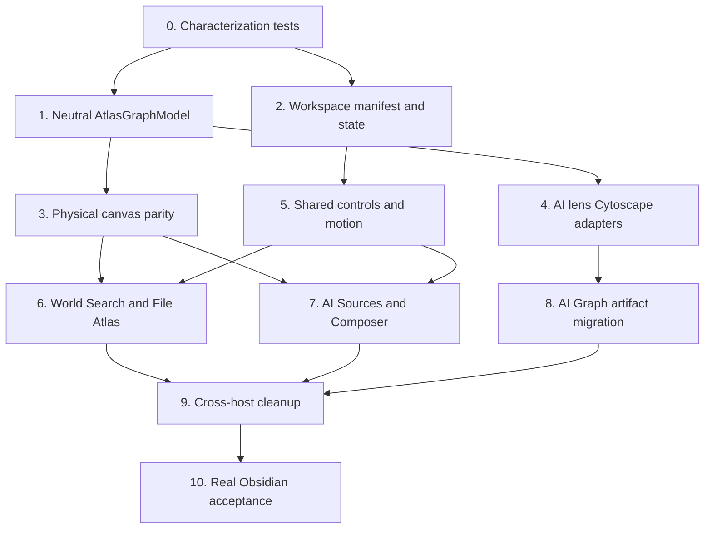

# Shared Graph Workspace 实施计划

> 对应规范：[产品与交互最终规范](../specs/2026-08-12-shared-graph-workspace-product-and-interaction-spec.md)  
> 视觉基准：[单页最终稿](../../gstack/shared-graph-workspace-2026-08-12/index.html)  
> Owner 验收：[真实 Obsidian 验收清单](./2026-08-12-shared-graph-workspace-owner-verification.md)

## 1. Impact Contract

这是一轮 Graph 公共边界收敛，不是普通样式清理。

### 主要结果指标

- World Search、File Atlas、AI Search Sources、Composer Relations 和 AI Graph Artifact 都由同一个 `GraphWorkspace` 控制壳表达。
- Graph 相关生产代码中的 React Flow 消费者归零；`MultiLensGraph` 及其专属旧路径在 parity 通过后删除。
- Graph 宿主的核心动作集合、快捷键、Mini Map 和 inspect 行为达到同一契约。
- 用户指出的冗余行全部移除；第一行控制体和画布悬浮动作栏与最终稿一致。

### 必做轨道

1. 现状刻画和回归测试。
2. 公共 manifest、状态模型和控制体。
3. `AtlasGraphCanvas` 中立数据模型与完整动作契约。
4. AI Graph 五个 lens 的 Cytoscape 迁移。
5. 五个宿主 adapter 接入。
6. 真实 Obsidian 交互和视觉验收。

### 禁止范围

- 不改 Search、Index、File Atlas、AI Graph artifact 的数据所有权。
- 不新增 Graph 模式、持久化格式或跨文件写权限。
- 不扩展 `@xyflow/react`、`MultiLensGraph` 或新的局部 graph renderer。
- 不把宿主空白、错误、权限和打开来源逻辑塞进 renderer。
- 不用删除产品能力换取代码量下降。

### 停止与命名规则

如果只完成公共控制条或两三个宿主接入，必须称为“partial migration”，不能宣称 Graph Workspace 完成。完整里程碑需要五个宿主状态、AI Graph renderer migration 和真实宿主验证全部通过。

## 2. 当前起点

- `AtlasGraphCanvas` 已经承担 Cytoscape、physical layouts、节点交互、快捷键、部分动作和 fullscreen。
- `ResultBrowserToolbar` 已有 Framer Motion sliding thumb，可复用交互原则。
- File Atlas 和 AI Sources 已有 One hop / Two hop / AI Graph 数据路径。
- AI Graph artifact、版本和 provenance 已经存在。
- `MultiLensGraph` 仍以 React Flow 渲染五种 lens，是本轮最高风险迁移点。

本轮先保护已存在的数据与交互，再统一 UI。不得用“重写更快”为理由跳过 characterization tests。

## 3. 目标文件结构

```text
src/ui/component/
├─ graph/
│  ├─ AtlasGraphCanvas.tsx
│  ├─ AtlasGraphCanvasImpl.tsx
│  ├─ AtlasGraphModel.ts
│  └─ adapters/
│     ├─ resultSubgraphToAtlasModel.ts
│     └─ aiLensToAtlasModel.ts
└─ graph-workspace/
   ├─ GraphWorkspace.tsx
   ├─ GraphWorkspaceControl.tsx
   ├─ GraphProjectionControl.tsx
   ├─ GraphWorkspaceState.ts
   ├─ GraphWorkspaceManifest.ts
   ├─ graphWorkspaceDefaults.ts
   └─ index.ts

templates/config/
└─ graph-workspace.json
```

这是计划结构，编码前可根据现有模块边界微调文件数量；不得把全部逻辑重新堆进 `AtlasGraphCanvasImpl.tsx`。

## 4. 提议的公共契约

下面是接口形状，不是可直接复制的最终代码：

```ts
type GraphWorkspaceView = 'list' | 'tree' | 'graph';
type GraphWorkspaceScope = 'one-hop' | 'two-hop' | 'ai';
type PhysicalProjection =
  | 'constellation'
  | 'community'
  | 'flow-lr'
  | 'flow-tb'
  | 'folders'
  | 'orbit';
type AIGraphLens = 'topology' | 'thinking-tree' | 'bridge' | 'timeline' | 'gap-analysis';

interface GraphWorkspaceManifest {
  hostId: 'world-search' | 'file-atlas' | 'ai-sources' | 'composer' | 'ai-graph-artifact';
  views: readonly GraphWorkspaceView[];
  scopes?: readonly GraphWorkspaceScope[];
  physicalProjections: readonly PhysicalProjection[];
  aiLenses: readonly AIGraphLens[];
  actions: GraphWorkspaceActionManifest;
  readOnly: boolean;
}
```

状态采用 controlled contract。宿主持有 scope、query result 和 inspector/open policy；Workspace 持有可复用的视觉状态转换，不建立 service singleton。

## 5. 执行 DAG



## 6. 分阶段任务

### Phase 0：锁定现有行为

新增或扩展测试：

- `test/graph-workspace-manifest.test.ts`
- `test/graph-workspace-state.test.ts`
- `test/graph-workspace-motion-contract.test.ts`
- `test/graph-workspace-host-parity.test.ts`
- `test/ai-graph-cytoscape-parity.test.ts`

先刻画：

- 六种 physical projection 的输入输出与选中状态。
- 五种 AI lens 的节点、边、可用 lens、空白和 insight。
- Shift inspect、`I` pin、方向键、Enter、Escape、fullscreen 和 viewport。
- 每个宿主当前的数据查询、scope 切换和 open policy。

### Phase 1：抽取中立画布数据模型

把当前 renderer 中对 `ResultSubgraphOutput` 的转换抽成中立 `AtlasGraphModel`：

- Node 包含 stable id、label、path/locator、semantic role、visual role、metadata 和 openability。
- Edge 包含 stable id、source、target、direction、relation role、evidence/provenance 和 label。
- Result Graph 和 AI Graph 各自提供 adapter，不把领域查询放入 Canvas。

验收：现有 physical graph focused tests 不回退，输出节点/边数量和 active topology 一致。

### Phase 2：建立 GraphWorkspace 壳层

实现：

- capability manifest。
- controlled state reducer / transition helpers。
- View 压缩、Scope 延伸、Projection 替换。
- 单一 sliding thumb motion primitive。
- reduced-motion 分支。
- `templates/config/graph-workspace.json` motion 和显示配置，以及同步 fallback defaults。

不在这一阶段接业务查询。

### Phase 3：补齐 Canvas 公共动作

在共享 Cytoscape 画布中统一：

- `Semantic edges` / `Evidence links` label role。
- Nodes popover。
- Copy Mermaid / image。
- Zoom、Fit、Readable view。
- 全屏。
- Mini Map。
- Shift inspect、pin、键盘导航和 viewport restore。

动作栏继续由 Canvas 渲染在画布之上；Workspace 只通过 action manifest 控制可用性和文案角色。

### Phase 4：迁移 physical graph 宿主

建议顺序：

1. World Search：最简单的单 scope 基准。
2. File Atlas：验证 Graph 展开 Scope 和 One / Two 数据重载。
3. AI Search Sources：移除额外说明行，验证 Graph-only scope。
4. Composer Relations：接入只读上下文和 frozen selection。

每迁移一个宿主，保留原 adapter 和数据路径，只替换 UI 组合方式。完成相应 parity test 后删除该宿主的局部 toolbar CSS 和重复 controls。

### Phase 5：迁移 AI Graph

先为每个 lens 生成中立模型：

- Topology。
- Thinking tree。
- Bridges。
- Timeline。
- Gaps。

再把 `ContextualAIGraphView` 和 AI Graph detail workspace 接到 `GraphWorkspace + AtlasGraphCanvas`。保留 artifact version、provenance、inspector、empty/create 和 open-details 行为。

只有五个 lens 的 parity 和真实交互通过后，才能删除：

- `src/ui/component/mine/multi-lens-graph/`。
- 全局 React Flow CSS。
- `@xyflow/react` 依赖；仅在确认无其他消费者后删除。

### Phase 6：收尾与去重

- 把生产文案从 `Links → / Links ↓` 改为 `Flow → / ↓`。
- 删除 `Vault links around the cited sources` 等冗余永久说明行。
- 删除 File Atlas、AI Sources、Composer 的局部 scope / layout button groups。
- 合并 motion、toolbar geometry、Mini Map 和 shortcut CSS。
- 运行 `rg '@xyflow/react|ReactFlow|MultiLensGraph' src test`，确认只剩允许的历史文档引用或完全归零。

## 7. 测试与验证

### Focused tests

保持现有测试，并加入新 Workspace suites：

```bash
npm run test -- test/graph-shared-surface-contract.test.ts
npm run test -- test/result-graph-canvas-toolbar.test.ts
npm run test -- test/result-graph-fullscreen-contract.test.ts
npm run test -- test/graph-interaction-model.test.ts
npm run test -- test/file-atlas-owner-review-contract.test.ts
npm run test -- test/graph-workspace-manifest.test.ts
npm run test -- test/graph-workspace-state.test.ts
npm run test -- test/graph-workspace-host-parity.test.ts
npm run test -- test/ai-graph-cytoscape-parity.test.ts
```

### Build 与静态边界

```bash
npm run build
rg -n "@xyflow/react|ReactFlow|MultiLensGraph" src test
rg -n "Links →|Links ↓|Vault links around the cited sources" src
```

### 真实 Obsidian

按照 [`obsidian-real-ui-qa.md`](../../conventions/obsidian-real-ui-qa.md) 执行：

1. 发现当前 CDP port。
2. 记录 source SHA、theme、zoom、viewport、DPR 和宿主状态。
3. focused test → build → plugin-only reload。
4. 用 CDP 建立 DOM、geometry、focus 和状态证据。
5. 用短视频验证 motion、Shift、pin、Escape、fullscreen 和 viewport restore。
6. 用 Computer Use 留下真实 Obsidian 可见截图。

Mock 页面只能验证设计基准，不计入生产验收。

## 8. 回滚策略

- 每个宿主单独迁移、单独提交；adapter 数据路径不与 UI shell 同时重写。
- 新 Workspace 可在迁移期间由受控 feature flag 或宿主级开关切换，但不得长期保留双实现。
- AI Graph 迁移在 parity 未完成前保留旧 renderer 作为短期回退；禁止在旧 renderer 上继续加功能。
- 出现 selection、viewport、artifact provenance 或 open policy 回归时，回滚当前宿主接入，不回滚中立模型或已通过的独立宿主。

## 9. Review gate

进入完成状态前需要一次 focused review，重点检查：

- 公共组件是否只解释 manifest，没有吞掉宿主业务逻辑。
- Canvas 是否仍通过 `AtlasGraphCanvas` public facade 使用。
- AI lens semantic roles 和 provenance 是否完整。
- Motion token 是否集中配置且 reduced-motion 生效。
- 所有真实交互 claim 是否有 CDP / 视频证据。

如果缺真实 Obsidian 证据，交付状态只能是 `SOURCE COMPLETE / INTERACTION NOT VERIFIED`。
