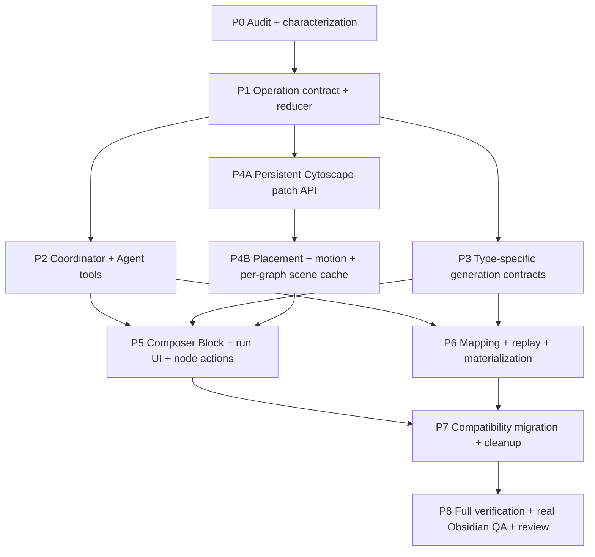

# AI Graph Agent 增量生成：生产实施计划

> 状态：**单次生成合同已修正；隔离增量运行时待重基线与整合**
> 首次日期：2026-08-13
> 最近修正：2026-08-14
> 设计真值：[最终产品与交互设计](../specs/2026-08-13-ai-graph-agent-incremental-final-design.md)
> 交互参考：[Cytoscape 增量 Mock](../../gstack/ai-graph-incremental-cytoscape-2026-08-12/index.html)
> Composer 参考：[Composer AI Graph Block Mock](../../gstack/composer-ai-graph-block-2026-08-14/index.html)
> 公共 Graph 前提：[Shared Graph Workspace 实施计划](./2026-08-12-shared-graph-workspace-implementation-plan.md)

## 1. 实施目标

把当前“Agent 一次性返回完整 `LensGraphData`，画布替换整个 model”的 AI Graph 链路，迁移为：

```text
typed Agent operation
→ validate + append event
→ reduce working draft
→ project one selected graph type
→ patch persistent Cytoscape instance
→ animate changed elements only
→ validate current graph
→ owner Accept
→ immutable artifact version
→ update Block graph-reference map
→ materialize Mermaid / SVG / PNG
```

一个 AI Graph Block 可以逐个保留多个独立图类型；一次 run 只生成或更新一个类型。已生成类型可随时切回，尚未生成类型必须先经过 type-first、optional-Prompt 生成入口。

这是一次跨 Agent runtime、artifact domain、Composer block、Graph adapter、renderer 和 Markdown materialization 的完整改造，不接受只修改 Mock、只加动画 CSS 或只新增几个 Agent tool name 的半成品。

## 2. Impact Contract

### 2.1 Primary metrics

实施完成必须达到：

1. **增量路径 0 次 renderer recreation**：一次 graph run 从第一个 patch 到完成，`cy.destroy()` 次数为 0；只有 workspace unmount / renderer teardown 可以 destroy。
2. **一次 run 只绑定一个 graph type**：run 不自动生成其他类型，也不覆盖 Block 中其他已生成图。
3. **已生成类型 100% 可恢复切换**：切换后恢复对应 `graphId`、selected version、layout、positions、zoom、pan 与 explanation。
4. **100% mutation revision-guarded**：所有 canonical graph mutation 都携带 operation ID、base revision 和 expected revision。
5. **Replay 等价**：同一 event stream 的 live reducer state 与冷启动 replay state 语义等价。
6. **增量放置无 bbox overlap**：默认 QA fixture 在 add、batch Expand、local reflow、final Refine 后，node bbox 间距达到配置阈值；不以 node center 距离代替 bbox。
7. **三种 materialization 可 round-trip**：Mermaid、SVG、PNG 都引用当前 type / version / layout；hidden ref 与 durable Block mapping 可恢复 AI Graph 身份。
8. **0 个 React Flow 回流**：不新增 `@xyflow/react` import、style、type、wrapper 或 consumer。
9. **Accepted artifact 不可变**：run 中间步骤不修改 manifest head；只有 Accept 创建新 immutable version。

### 2.2 Required tracks

以下 track 全部必须完成：

- P0 只读审计与 characterization；
- P1 operation schema、validator、reducer 与 replay；
- P2 app-owned coordinator、Agent tools 与现有 Agent 路径收敛；
- P3 type-specific Prompt、validator、operation grammar 与 explanation；
- P4 persistent Cytoscape patch、per-graph scene cache、placement、motion；
- P5 Composer AI Graph Block、生成询问、切换、Activity、rich card 与 Expand；
- P6 graph-set mapping、artifact persistence、hidden ref、materialization 与 Accept / Discard；
- P7 legacy full-snapshot adapter 收口与旧路径退休；
- P8 自动验证、真实 Obsidian QA 与 review。

### 2.3 Forbidden scope

- 不引入第二个 Graph renderer；
- 不恢复 React Flow / `MultiLensGraph`；
- 不创建五套重复 Graph runtime；
- 不恢复“一次 run 同时生成五个 view entry”的 `viewPackage` 路径；
- 不把尚未生成的类型伪装成 empty graph 或后台自动补齐；
- 不在切换图类型时删除、替换或重新生成旧图；
- 不让 Agent 输出坐标、zoom、pan、edge control points；
- 不新增 service-layer runtime singleton 或扩散 `AppContext.getInstance()`；
- 不建立第二份 artifact store；
- 不把 JSONL / SQLite 当 accepted artifact canonical truth，也不让 SQLite 成为 Block 映射的唯一恢复来源；
- 不删除已有 AI Graph 功能来降低实现难度；
- 不把隐藏 chain-of-thought 写入 Activity 或 explanation；
- 不顺带改造 Vault Intelligence、File Atlas、Result Graph 的产品语义。

### 2.4 Skip budget

Required track 的 skip budget 为 **0**。

若 P0 发现某个 track 已完整存在，可以提交证据并把该 track 标为 `verified-existing`；不能因为“风险高”跳过。若真实 Obsidian CDP 不可用，允许代码阶段停在：

```text
SOURCE COMPLETE · AUTOMATED CHECKS PASS · INTERACTION NOT VERIFIED
```

但不得宣称 production complete。

### 2.5 Stop / commit rule

- 每个 phase 只提交 task-owned files；
- focused tests 或生产 build 失败时不得提交该 phase 为完成；
- 与现有未提交改动无法安全分离时停止并报告 overlap；
- 不 push；
- P0 审计必须先接受 review，P1 之后才允许实施；
- P8 major review 完成前不移除 legacy compatibility adapter。

## 3. 两阶段审计门

### Stage A：只读审计

实施者先提交一份 read-only audit，不修改代码。至少包含：

- 当前 create / update / contextual open / Expand 的入口与 call graph；
- Composer insert、block parse / dispatch、source transaction 与 native Image / Mermaid materialization 路径；
- `GraphAgent` 与 `AIGraphAgent` 的职责重叠矩阵；
- `LensGraphData`、artifact version、run event、Block mapping、`AtlasGraphModel` 的数据转换链；
- 隔离分支 `codex/ai-graph-incremental-runtime` / commit `00486c30` 可复用与必须废止的变更矩阵；
- `AtlasGraphCanvasImpl` 所有 create / destroy / effect / event handler 生命周期；
- 当前 tests、已知 baseline failure 和真实 Obsidian CDP 可用性；
- 精确文件计划、schema migration 方案、风险、预期 metric delta；
- 哪一条现有 Agent 路径成为唯一 production path，另一条如何 adapter / retire。

Owner / Codex 审查后，才进入 Stage B。

### Stage B：按 DAG 实施



P1 的 domain contracts 可以先行。P2、P3、P4A 可在契约锁定后并行，但任何 track 不得自行发明第二套 operation shape。

## 4. P0 — Audit 与 Characterization

### 4.1 目标

锁住当前行为和迁移边界，避免在没有理解双 Agent 路径、canvas 生命周期和 persistence contract 时直接改动画。

### 4.2 必查文件

- `src/service/agents/ai-graph/GraphAgent.ts`
- `src/service/agents/ai-graph/graphTools.ts`
- `src/service/agents/AIGraphAgent.ts`
- `src/ui/view/quick-search/hooks/useGraphAgent.ts`
- `src/ui/view/quick-search/stores/graphAgentStore.ts`
- `src/service/agents/ai-graph/graph-output-to-lens.ts`
- `src/core/types/lens-graph.ts`
- `src/service/ai-graph/domain.ts`
- `src/service/ai-graph/AIGraphArtifactRuntime.ts`
- `src/ui/component/ai-graph/AIGraphWorkspaceCanvas.tsx`
- `src/ui/component/ai-graph/ContextualAIGraphView.tsx`
- `src/ui/component/graph/AtlasGraphCanvasImpl.tsx`
- `src/ui/component/graph/adapters/aiLensToAtlasModel.ts`
- `src/ui/component/graph/adapters/aiLensLayouts.ts`
- `src/ui/component/graph-workspace/GraphWorkspaceManifest.ts`
- `src/ui/component/graph-workspace/graphWorkspaceDefaults.ts`
- `src/core/schemas/composer.ts`
- `src/service/composer/documentParser.ts`
- `src/service/composer/newBlockDraft.ts`
- `src/ui/view/composer/blocks/BlockKindView.tsx`
- `src/ui/view/composer/blocks/mermaid/MermaidBlockView.tsx`
- `src/ui/view/composer/blocks/image/ImageBlockView.tsx`
- `src/ui/view/composer/chrome/InsertTypeMenu.tsx`
- `src/ui/view/composer/ComposerRoot.tsx`
- `docs/conventions/generated-artifact-registry.md`

### 4.3 Characterization tests

先建立或确认：

- current create run 何时第一次向 UI 提供 graph data；
- current update run 如何产生 full replacement 与 semantic diff；
- current artifact Accept 是否只生成一次 immutable version；
- current `AtlasGraphCanvasImpl` 在 model 更新时 destroy / create 几次；
- current graph-type 切换是否丢 `graphId`、version、zoom、pan、positions 与 explanation；
- current Composer round-trip 是否能将 hidden ref 和 visible materialization 重新识别成一个 AI Graph Block；
- current SVG / PNG attachment writer、rename、Undo / Redo 与 orphan cleanup 可复用到什么程度；
- current rich card 支持哪些通用 action；
- current old artifact reader 的最低兼容 fixture。

### 4.4 交付物

`docs/superpowers/audits/<date>-ai-graph-incremental-runtime-audit.md`

审计未通过 review 前，不进入 P1。

## 5. P1 — Operation schema、validator 与 reducer

### 5.1 新增 domain 模块

建议目录：

```text
src/service/ai-graph/run/
  AIGraphOperation.ts
  AIGraphOperationSchema.ts
  AIGraphOperationValidator.ts
  AIGraphWorkingGraph.ts
  AIGraphRunReducer.ts
  AIGraphRunReplay.ts
  AIGraphTypeValidator.ts
  AIGraphRunError.ts

src/core/composer/
  aiGraphBlock.ts

src/core/schemas/
  composerAiGraph.ts
```

命名可根据现有 domain 调整，但职责不能散落到 React hook 或 renderer。

### 5.2 Operation union

定义 discriminated union，覆盖：

- inspect receipt；
- node add / update / remove；
- relation add / update / remove；
- evidence attach / detach；
- graph begin / group / diagnostic / explanation / complete；
- local layout request；
- validation result；
- complete run。

Zod schema 放在现有 schema governance 对应位置，UI 和 service 复用同一 contract。

### 5.3 Reducer 约束

- pure reducer；
- no Obsidian / React / Cytoscape import；
- stale revision fail loud；
- duplicate operation idempotent；
- removal 正确处理 dangling relation 与 type-specific diagnostic membership；
- diagnostic / group 不污染 canonical semantic objects；
- reducer 返回 `changedObjectIds`、当前 `graphId` 和 renderer-safe semantic diff；
- replay 与 live apply 共用同一个 reducer。

同时定义 `ComposerAIGraphBlockState` 与以下不变量：

- `graphs` 是 `graphType → graphId / version / scene` 的稀疏映射；
- 缺失 key 表示尚未生成；
- `selectedType` 只能指向已生成图或正在创建的目标类型；
- materialization 必须指向一个已接受版本；
- hidden ref、durable mapping 与 DB projection 的 identity 可互相校验。

### 5.4 配置

revision policy、batch limit、view validation limit 等配置进入 `templates/config/ai-graph-agent.json`，如需 compiled fallback，使用明确的 domain defaults 文件，不写进 React / tool logic。

## 6. P2 — App-owned coordinator 与 Agent tools

### 6.1 唯一运行时

新增 app-owned `AIGraphRunCoordinator`，由 `main.ts` / `AppContext` / app runtime registry 构造：

- freeze source revision；
- 创建 run ID 与初始 working state；
- 为 Agent 暴露 typed tools；
- 串行化 mutation；
- validate + append JSONL；
- publish operation subscription；
- complete / retry / cancel；
- Accept / Discard 调用 artifact runtime。

### 6.2 收敛现有双路径

P0 必须选择一个现有 Agent orchestration 成为唯一 production path：

- 保留的一条负责 model loop 与 tools；
- 另一条暂时转成 compatibility adapter，调用同一个 coordinator；
- 不允许在 `GraphAgent`、`AIGraphAgent`、Quick Search hook 中各自维护 working graph state。

### 6.3 Tool 实现

Tool 只构造 operation request 并调用 coordinator。它不能：

- 直接 `setGraphData`；
- 直接 `cy.add()`；
- 直接写 artifact version；
- 直接决定坐标；
- 跳过 evidence / revision validation。

### 6.4 Step-stream

UI subscription 接收结构化 event：

```ts
type AIGraphRunUiEvent =
  | { type: "operation-accepted"; operation: AIGraphOperationEnvelope }
  | { type: "operation-rejected"; receipt: AIGraphOperationReceipt }
  | { type: "graph-completed"; graphId: string; graphType: AIGraphType }
  | { type: "run-completed"; summary: AIGraphRunSummary }
  | { type: "run-failed"; error: AIGraphRunError };
```

不传输模型 hidden reasoning。

## 7. P3 — Type-specific Prompt、validator 与 Explanation

### 7.1 共享接口

```ts
interface AIGraphTypeContract {
  readonly graphType: AIGraphType;
  readonly defaultPromptId: PromptId;
  readonly allowedLayouts: readonly AIGraphLayout[];
  validate(input: AIGraphTypeValidationInput): AIGraphTypeValidationResult;
  explain(input: AIGraphExplanationInput): AIGraphExplanation;
}
```

Type contract 是 pure domain validation / presentation contract，不渲染 UI。每次 run 选择其中一个 contract；不创建包含五个 entry 的 projection package。

生成入口必须同时支持：

- type-first 选择；
- optional Prompt；
- Prompt 为空时使用 type-specific default；
- source/context freeze receipt；
- Cancel 不创建 artifact；
- 同一类型 Regenerate 时从该图的 accepted head 建立 draft。

### 7.2 Topology contract

- 支持 connected 与 staged-unlinked nodes；
- 保留真实 directionality；
- layout intent 只允许 constellation / flow horizontal；
- 不因孤立节点自动生成 relation。

### 7.3 Thinking Tree contract

- root、parent、branch、outcome 与 cross-reference 明确区分；
- subtree add / prune 生成局部 changed set；
- 不暴露 future ghost nodes；
- validator 检查 tree parent 唯一与 root contract。

### 7.4 Bridges contract

- 先计算真实 connected components；
- candidate 在连接两侧并有证据后才升级；
- 记录 `leftComponentIds / rightComponentIds / validatingPathIds`；
- 空结果有明确 explanation。

### 7.5 Timeline contract

- temporal DAG；
- 支持 parallel lane、join、cross-dependency、out-of-order insert；
- phase 是 compound group；
- horizontal / vertical 使用同一 semantic DAG；
- validator 检查 temporal cycle、缺 date / range 的声明与 group membership。

### 7.6 Gaps contract

- 先读 task contract；
- 运行 path / evidence coverage check；
- 输出 typed diagnostic，而不是 canonical fake node；
- false positive 可删除；
- 空结果有明确 explanation。

### 7.7 Explanation

Explanation 必须在当前 graph complete 时生成并绑定 graph revision。若由模型辅助写作，输入只包含已验证 graph summary 与 evidence locators；输出仍需 schema 校验。

## 8. P4 — Persistent Cytoscape renderer

### 8.1 P4A：拆开 mount 与 update

重构 `AtlasGraphCanvasImpl`：

- mount effect 只创建一次 Cytoscape；
- teardown effect 只在组件 unmount / renderer identity 变化时 destroy；
- model snapshot 仅用于 initial load 或 explicit hard reset；
- incremental operation 走 element reconciler；
- styles、filters、positions、selection、viewport 分别更新；
- event handlers 使用稳定 registration，避免每次 render 重绑。

建议新增：

```text
src/ui/component/graph/runtime/
  AtlasGraphElementReconciler.ts
  AtlasGraphSceneCache.ts
  AtlasGraphMotionController.ts
  AtlasGraphPlacementSolver.ts
  AtlasGraphViewportController.ts
```

不要把这些职责继续堆进一个更大的 `AtlasGraphCanvasImpl.tsx`。

### 8.2 Element patch 顺序

一个 accepted operation 的 renderer transaction：

1. batch add / update nodes；
2. measure rendered bbox；
3. placement / local layout；
4. add / update edges；
5. remove rejected edges / nodes；
6. update overlays / classes；
7. run motion；
8. publish visual-settle receipt。

若 relation 与 node 同一 atomic operation 到达，node 必须先进入 `cy`，relation 后进入；UI 仍视为一个 revision。

### 8.3 Per-graph scene cache

每个已生成 `graphId` cache：

- elements snapshot / revision；
- positions；
- zoom / pan；
- selected / focused ID；
- graphType 与 layout intent；
- pending changed bbox。

切换已生成图类型不运行随机 layout，也不重新生成。只有该 `graphId` 的 structural revision 改变时更新 elements。

### 8.4 Placement 与 collision

- anchor-aware progressive ring / sector search；
- actual rendered bbox + configurable gutter；
- batch placement；
- compound bbox aware；
- off-canvas candidate 有可预测方向；
- deterministic tie-breaker，保证 replay 后视觉稳定；
- `layoutstop` 后 collision assertion 与 settle pass。

### 8.5 Edge motion

- 保留一条连续、低 opacity 的 Cytoscape base path；
- emphasis layer 只使用 Cytoscape style / animation；
- 禁止 dash-offset 把基础线条遮成空白段；
- arrowhead 与 endpoint geometry 一起由 Cytoscape 更新；
- edge enter 默认明显慢于当前 Mock 早期版本，建议 720–1000ms。

### 8.6 Resize / drawer

- `cy.resize()` 后保留 graph positions；
- card、current-operation indicator、minimap 都使用 renderer transform / viewport data 重新锚定；
- drawer 开合不触发 global layout；
- wrapper geometry从 compound children 重新测量，不使用旧 screen coordinate。

## 9. P5 — Composer AI Graph Block 与节点操作

### 9.1 原生 Composer Block

新增原生 AI Graph Block kind、parser、renderer 与 insert draft：

- Block source 由 hidden ref + 当前 visible materialization 组成；
- `BlockKindView` 分发到 AI Graph Block renderer；
- renderer 读取 durable Block mapping，并在缺失 DB projection 时尝试 rebuild；
- 复用 `AtlasGraphCanvas` 与共享 Graph toolbar，不复制 renderer；
- 底部 caption 只显示 graph name；
- Composer Action Row 保留 Insert、Copy、Comment、Explain、Expand、Focus、History 与 Instruction。

Block renderer 作为 coordinator consumer：

- 订阅 operation stream；
- 将 accepted operation 交给 reducer / projection / renderer；
- 管理 active graph type 与 per-graph scene；
- 渲染当前类型允许的 layout controls；
- 管理 Refine、Accept、Discard；
- 展示 explanation 与 optional Activity drawer。

### 9.2 图类型菜单与生成询问

菜单中的每个类型只有以下状态：

- `not-generated`：没有映射，选择后打开生成询问；
- `running`：正在生成当前类型；
- `accepted`：可立即切换并恢复 scene；
- `draft`：存在可 review 的 working draft；
- `failed`：可 retry 当前类型；
- `empty`：经过验证的合法空结果，仍然是已生成图。

新建 Block 或选择 `not-generated` 类型时：

1. 预选 graph type；
2. 显示 optional Prompt；
3. 空 Prompt 说明将使用默认指令；
4. `Generate` 才创建 run；
5. `Cancel` 返回当前图，不创建空 graph；
6. Accept 后加入 Block mapping；只有用户仍停留在目标类型时才显示新图，手动切走后不抢回 active type 或 camera。

选择 `accepted / draft / empty` 类型只切换，不发起新 run。Regenerate 是独立动作，并进入该类型自己的 version history。

### 9.3 Camera policy

新增 `userViewportIntent`：

- pointer drag / wheel / pinch / keyboard navigation / card open 时为 busy；
- busy 时只显示 `New changes` chip；
- idle 时可 focus changed bbox；
- 用户切换到另一个已生成类型后，后台当前 run 不得抢回 camera；通过 current-operation indicator 提示 run 仍在原 graph type 上继续。

### 9.4 Rich card

在共享 inspect card 中注入 AI Graph action adapter，不 fork 整张 card：

- Explain；
- Expand；
- Focus；
- Evidence。

Expand 使用 run-scoped suppression token：

```text
close card
→ suppress inspect
→ create draft expansion
→ inspect neighborhood
→ add/place nodes
→ add relations
→ validate
→ release suppression
```

任何 hover state、React rerender 或 Cytoscape `mouseover` 都不能在 token 释放前重开 card。

### 9.5 Activity 与 Review

- Activity 作为 drawer；
- canvas 上只显示 current operation；
- Review changes 按需打开 semantic diff；
- 不新增常驻大侧栏。

### 9.6 Save as

`Save as` 只提供：

- Mermaid；
- SVG；
- Image（PNG）。

选择格式后立即以一个 Composer transaction 重物化当前 selected graph；没有 `Graph` 选项，也不打开额外 Preview 对话框。切换图类型时使用当前格式重物化新选中的已接受版本。

## 10. P6 — Mapping、Persistence、Replay 与 Materialization

### 10.1 Run events

扩展现有 AI Graph run JSONL event，而不是创建另一个存储目录。每条 event 保存：

- operation envelope；
- validation receipt；
- resulting revision；
- changed IDs；
- timestamp；
- failure / retry metadata。

### 10.2 Artifact version

每个 graph type 使用独立 artifact / version chain。保持：

- immutable body；
- manifest-head history；
- `parentVersionId`；
- source revision / hashes；
- evidence / provenance；
- accepted review receipt。

artifact version 不新增一次 run 的多视图 `viewPackage`。`graphType` 必须收敛到产品 enum，legacy `free / concept / entity / evidence / causal / timeline` 通过明确 migration adapter 映射，不能在 UI 中并存两套名字。

### 10.3 Block mapping 与 DB projection

新增 app-owned durable mapping record：

```ts
type ComposerAIGraphBlockState = {
  blockGraphSetId: string;
  selectedType: AIGraphType;
  graphs: Partial<Record<AIGraphType, AIGraphBlockGraphRef>>;
  materialization: AIGraphMaterializationRef;
};
```

要求：

- DB 保存 Block、graph type、graphId、selected/head version、history projection、layout、viewport 与 materialization 查询映射；
- durable mapping record 与 Markdown hidden ref 提供 DB projection 的重建来源；
- graph history 仍由 manifest + immutable version chain 拥有，DB 不复制为 canonical truth；
- 删除 Block、切换格式和替换 asset 时遵循 generated artifact registry 的引用与清理规则。

### 10.4 Hidden ref 与 materializers

实现一个 Composer parser / writer 可稳定识别的 hidden ref，后接当前可见 representation：

- Mermaid fenced block；
- SVG native embed；
- PNG native embed。

Materializer 输入必须包含 `graphId + versionId + graphType + layout`，并返回 source patch、asset receipt 与 checksum。格式切换、类型切换和 Undo / Redo 必须是单一 Composer transaction。

### 10.5 Backward compatibility

- v1 artifact 没有 Block mapping：reader 仍可作为单图 artifact 打开；用户显式插入 Composer 后再创建 mapping；
- legacy multi-Lens result：迁移时拆成用户已有的独立 graph refs，不能继续作为新 run 输出格式；
- 不回写旧 artifact；
- legacy relation evidence 状态保持 `suggested / needs-review`；
- 不枚举目录推断 history。

### 10.6 Accept transaction

1. verify run complete；
2. validate current graph type；
3. freeze graph explanation；
4. build immutable version body；
5. atomic persist；
6. update manifest head；
7. emit accept receipt；
8. upsert Block graph reference；
9. materialize current format；
10. rebuild / update SQLite projection。

## 11. P7 — 兼容迁移与清理

### 11.1 Temporary compatibility adapter

旧 full `LensGraphData` result 可以在迁移期被包装成目标 graph type 的 synthetic operations，或在显式迁移时拆成多个 graph refs，但必须：

- 明确标记 `legacy-full-snapshot`；
- 只用于打开旧结果或迁移中的 provider；
- 不作为新功能继续扩展；
- 有移除条件与统计。

### 11.2 退休条件

当 Composer create、type generate、update、Expand、retry、resume、materialize 均通过新 coordinator / mapping runtime，且 old artifact reader 仍正常后：

- 删除旧 UI full-replacement state owner；
- 删除重复 Agent orchestration；
- 删除只服务旧 snapshot path 的 adapter / test；
- 保留 immutable artifact migration reader；
- 运行 `rg` 确认无 React Flow consumer 回流。

## 12. P8 — 验证矩阵

### 12.1 建议新增 focused tests

```text
test/ai-graph-operation-schema.test.ts
test/ai-graph-run-reducer.test.ts
test/ai-graph-run-replay.test.ts
test/ai-graph-type-contract.test.ts
test/ai-graph-agent-tool-contract.test.ts
test/composer-ai-graph-block-roundtrip.test.ts
test/composer-ai-graph-block-mapping.test.ts
test/composer-ai-graph-materialization.test.ts
test/composer-ai-graph-asset-lifecycle.test.ts
test/atlas-graph-incremental-patch.test.ts
test/atlas-graph-per-graph-scene-cache.test.ts
test/atlas-graph-collision-placement.test.ts
test/atlas-graph-edge-continuity.test.ts
test/ai-graph-node-action-contract.test.ts
test/ai-graph-artifact-backward-compat.test.ts
test/ai-graph-incremental-cytoscape-parity.test.ts
```

沿用并更新现有 Graph Workspace、artifact runtime、generated artifact registry、architecture boundary tests。

### 12.2 必测自动化场景

Topology：

- 先批量 add nodes，暂时无 edge；
- later add relations；
- update predicate；
- remove rejected node；
- local layout；
- final Refine。

Thinking Tree：

- root first；
- branch incremental growth；
- subtree prune；
- no ghost future node；
- only affected subtree moves。

Bridges：

- 三个 disconnected components；
- one-sided candidate remains candidate；
- two-sided candidate promoted；
- false candidate removed；
- valid zero-bridge result。

Timeline：

- parallel branches；
- out-of-order insert；
- cross dependency；
- multi-parent join；
- horizontal / vertical switch；
- compound wrapper follows children。

Gaps：

- missing path；
- weak evidence path；
- false positive rejected because path exists；
- valid zero-gap result；
- diagnostic never enters canonical nodes。

Shared interactions：

- new Block asks for graph type before generating；
- optional Prompt can be empty or explicit；
- selecting an ungenerated type opens the generation entry；
- selecting a generated type restores it without a new run；
- generating a second type does not replace the first；
- each type keeps independent version history；
- Expand closes card for full sequence；
- repeated Expand nodes never stack；
- off-canvas idle focus；
- busy viewport does not get stolen；
- resize / drawer keeps edges attached；
- active graph-type switch restores scene；
- Mermaid / SVG / PNG materialize the selected type and version；
- hidden ref + durable mapping rebuild DB projection；
- Save as and type switch round-trip through Composer Undo / Redo；
- Accept / Discard version boundary；
- crash replay equals live state。

### 12.3 Verification commands

根据 P0 实际测试文件更新 focused command。最低要求：

```bash
npm run test -- test/ai-graph-operation-schema.test.ts
npm run test -- test/ai-graph-run-reducer.test.ts
npm run test -- test/ai-graph-run-replay.test.ts
npm run test -- test/ai-graph-type-contract.test.ts
npm run test -- test/composer-ai-graph-block-roundtrip.test.ts
npm run test -- test/composer-ai-graph-materialization.test.ts
npm run test -- test/atlas-graph-incremental-patch.test.ts
npm run test -- test/atlas-graph-collision-placement.test.ts
npm run test -- test/ai-graph-node-action-contract.test.ts
npm run build
npm run test
rg -n "@xyflow/react|MultiLensGraph" src test package.json
```

`rg` 结果只能包含明确的 migration guard / historical test；生产 consumer 必须为 0。

### 12.4 真实 Obsidian QA

按 `docs/conventions/obsidian-real-ui-qa.md` 连接 CDP。使用固定 fixture、viewport、theme、zoom、source hash 和 run seed。必须录制短视频，因为静态截图无法证明 motion 与 card suppression。

每个 clip 只验证一个 flow：

1. New Block：type-first 询问 → 空 Prompt 生成 Topology → Accept；
2. Type collection：生成 Timeline → 切回 Topology → 再切回 Timeline，均不重新生成；
3. Topology：unlinked nodes → relations → remove → local layout → Refine；
4. Thinking Tree：root → branch growth → prune；
5. Bridges：candidate → connect one side → validate both sides / reject；
6. Timeline：parallel → insert → join → vertical switch；
7. Gaps：missing / weak path → reject false positive；
8. Expand：card close → multi-node placement → relations → accept / discard；
9. Materialization：Mermaid → SVG → PNG → reload → Undo / Redo；
10. Viewport：off-canvas focus、busy no-steal、per-graph scene restore；
11. Geometry：pan / zoom / resize / Activity drawer 中 edge 不断、不漂、不离开端点。

每个 run 保存：

- source revision / SHA；
- app viewport / DPR / theme / zoom；
- operation event stream；
- current revision；
- reference / current / normalized / overlay；
- video；
- DOM / geometry assertions；
- manifest。

没有这组证据，只能标 `INTERACTION NOT VERIFIED`。

## 13. Review gates

### Gate 1 — Domain review

- operation union 是否覆盖所有语义而无 UI leakage；
- reducer 是否 pure、revision safe、replayable；
- Bridge / Gap 判定是否可测试；
- 一次 run 是否严格绑定一个 graph type；
- Block graph-reference map 是否允许多类型独立历史而无重复 graph body。

### Gate 2 — Renderer review

- incremental path 是否确实不 destroy；
- effect dependencies 是否会隐式重建；
- event listeners 是否泄漏；
- placement 是否读取真实 bbox；
- edge path 是否始终连续；
- reduced motion 是否正确。

### Gate 3 — Persistence review

- event-first；
- Accept atomic；
- hidden ref、durable mapping 与 DB projection 是否可重建；
- Mermaid / SVG / PNG materialization 是否绑定正确 type / version / layout；
- old artifact read-only compatible；
- no SQLite-as-truth；
- generated artifact registry 登记一致。

### Gate 4 — Product review

- 五种图是否各自有真实意义；
- 已生成 / 尚未生成状态是否一眼可懂；
- 新类型生成是否先询问类型并允许空 Prompt；
- 切换已生成类型是否无重新生成、无覆盖；
- Timeline 是否确实是复杂 DAG；
- Bridge / Gap 是否不用解释也能从视觉看出，再由文字确认；
- Activity 是否保持次要；
- rich card / Expand / Focus / Evidence 是否一致。

### Gate 5 — Owner acceptance

- 真实 Obsidian 视频；
- owner 观看 motion、node spacing、edge continuity、layout controls；
- owner 确认类型切换、Save as、Accept / Discard 和 Explanation 信息密度。

## 14. Rollout 与 rollback

### 14.1 Rollout

- 以 config-backed capability flag 启用 incremental coordinator；
- internal / QA Composer fixture 先使用新 Block mapping 与 materializer path；
- legacy full snapshot 只作 temporary provider adapter；
- 观察 run failure、stale revision、replay mismatch、layout failure、mapping rebuild 与 asset write failure；
- 达到 Gate 1–5 后移除旧 writer / state owner。

### 14.2 Rollback

若 UI / renderer 出现严重回归：

- 停用 incremental consumer，保留已追加 operation events；
- 不修改 accepted manifest head；
- 使用 replay 导出诊断 snapshot；
- 可临时回到 read-only 打开 accepted artifact；
- 保留 hidden ref 与 visible materialization，不删除用户已写入的 Mermaid / SVG / PNG；
- 不恢复 React Flow；
- 修复后从同一 operation log replay，而不是丢弃用户 run。

## 15. 最终实施交付清单

实施任务结束时必须交付：

- Stage A audit；
- operation / graph-type / Block mapping schema；
- coordinator 与 tools；
- persistent Cytoscape patch runtime；
- five type contracts / validators / explanations；
- Composer AI Graph Block、生成询问、类型切换与 Expand；
- hidden ref、DB projection rebuild 与 Mermaid / SVG / PNG materializers；
- event replay 与 immutable Accept；
- backward-compatible reader；
- focused tests、full test、build、boundary evidence；
- real Obsidian evidence bundle；
- final implementation note，列出 commits、实际 metrics、skips、baseline failures 和 rollback 状态。

最终实施 note 必须诚实使用以下三种状态之一：

- `PRODUCTION COMPLETE`
- `SOURCE COMPLETE · INTERACTION NOT VERIFIED`
- `PARTIAL PROGRESS`（Impact Contract 未满足）

## 16. 一次性交付约束

实现时应把以上 DAG 作为一个完整 major wave 管理，而不是让 Owner 在多个 coding agent 之间搬运零散 prompt。可以按 phase 分 commit 和 review，但同一个实现 owner 必须维护：

- 一份 current audit；
- 一份 operation contract；
- 一份任务 DAG；
- 一份受保护范围；
- 一份验证账本；
- 一份最终 implementation note。

若任何 required track 因新证据需要改变方案，先更新 audit / plan，再继续实现；不要在代码中默默形成第二套架构。
