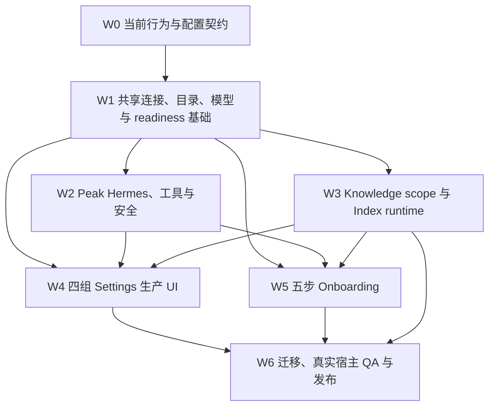

# Peak Assistant Onboarding、Settings 与 Knowledge Index 实现任务与验收计划

> - 状态：目标实现计划 · 等待 Final Design 终审后执行
> - 日期：2026-08-13
> - 产品契约：[最终设计](../specs/2026-08-13-onboarding-settings-knowledge-index-final-design.md)
> - 字段清单：[Settings 可配置能力总表](../specs/2026-08-12-settings-configurable-capabilities-by-group.md)
> - 交付原则：完整实现，不以静态 mock 或无消费者字段冒充完成

## 0. Impact Contract

### 主要目标

在不丢失现有真实能力的前提下，把 Peak 的首次配置、长期设置和 Knowledge Index 运行体验迁移到统一产品模型，并达到上线前可验证状态。

### 必须推进的指标

- Onboarding 从七个主步骤收口为五个可恢复步骤；
- 所有模型选择入口复用一个 Provider → Model picker 和同一目录；
- Peak Hermes 成为唯一 Agent runtime；
- Better SQLite 成为可查询、可修复、可验证的硬门槛；
- Knowledge scope 被扫描、增量更新、结构分析和 run preview 一致消费；
- Index run 可以显示速度、ETA、顺序、子步骤、文件类型和失败恢复；
- 所有正式设置具有持久化、runtime 消费者、生效反馈和恢复路径。

### 禁止范围

- 不重写 Vault Intelligence 正在变化的产品模型；
- 不移除现有功能来换取更短代码或更少设置；
- 不增加平行 Agent runtime；
- 不在生产路径引入 mock、Simulator 数据或硬编码 Ready；
- 不把 SQLite、路由评分、内部目录和模板阈值变成普通用户设置；
- 不把所有 Provider 参数强行抽象成一个固定公共结构。

### 完成规则

只有 P0 任务全部完成、迁移可回滚、focused tests 与 production build 通过、真实 Obsidian 关键交互完成验证，才可称为“上线准备完成”。P1 Knowledge enrichment 是本产品工作的完整范围；若尚未完成，只能标为“首发核心路径完成”，不能宣布整个 Knowledge Index 需求完成。

## 1. 任务依赖顺序

W1 是主阻塞项。不要先复制 mock UI，再为多个临时数据源补 adapter；这会固化第二套模型 picker、第二份 readiness 和冲突 owner。

## 2. 优先级与交付单位

- **P0**：上线前必须完成。
- **P1**：本产品需求的完整范围；可以晚于首发核心路径，但必须持续登记、实现和验收。
- **P2**：体验优化或维护能力，不阻塞核心首次成功。

每个任务必须形成可独立 review 的提交，包含：

- 配置或接口契约；
- runtime 消费者；
- 状态与错误；
- focused tests；
- 迁移或兼容说明；
- 对应 mock / 文档状态更新。

## 3. W0：锁定当前行为与迁移边界

### W0.1 配置 consumer matrix（P0）

为现有 `MyPluginSettings`、Provider/Profile、Search、Agent、Media、Ambient、Command Center、MCP、Skills 和路径字段建立 machine-readable 或可测试的 consumer matrix。

完成条件：

- 每个旧字段标为 keep、rename、move、internal、retire 或 blocked；
- keep / rename / move 项都有读写位置和 runtime consumer；
- 没有 consumer 的字段不会进入新 UI；
- 现有用户值的迁移规则可测试。

### W0.2 当前行为 characterization tests（P0）

先锁定：

- Provider profile 加载和验证；
- 当前 role / recommendation 解析；
- Better SQLite 加载和失败；
- Index scope、ignore patterns 和增量更新；
- Agent permission guard；
- Onboarding state 恢复。

完成条件：后续结构调整造成行为变化时，测试能够区分预期迁移和意外回归。

### W0.3 统一术语与状态枚举（P0）

定义 Connection、Model、Feature assignment、Peak Hermes、readiness、save/effect、operation progress 和 receipt 的共享类型。

完成条件：UI 不再自行把 `configured` 推断成 `ready`，也不再为同一状态使用多个不兼容枚举。

## 4. W1：共享 AI 与 readiness 基础

### W1.1 Connection Registry（P0）

统一 OpenAI、Anthropic、OpenRouter、Ollama、Codex、Claude Code 及 additional connections 的连接描述、凭据需求、健康和能力入口。

完成条件：

- 普通生成、工具调用、Hermes adapter 和媒体能力分别验证；
- 多实例连接有稳定 ID；
- disable、rename、delete 时可以检查并迁移引用；
- Provider-native media capability 由能力决定是否出现。

### W1.2 OpenRouter 在线目录（P0）

实现项目控制的只读 JSON catalog：

- schemaVersion / catalogVersion；
- 条件请求；
- 严格校验；
- 原子写入 last-known-good；
- bundled fallback；
- source 与 freshness；
- 离线和损坏恢复。

完成条件：断网、304、无效 schema、过期缓存和首次安装均有确定结果；远端失败不会清空可用目录。

### W1.3 模型目录偏好（P0）

实现一个 Catalog Preferences store，承载 hidden models、aliases 和 owner-confirmed capability overrides。

完成条件：

- 偏好按稳定 model identity 保存；
- catalog 更新后能迁移或指出 orphan；
- alias 不修改 Provider model ID；
- capability override 有来源、时间和恢复默认。

### W1.4 Capability Evidence Service（P0）

把静态目录声明、Provider runtime metadata、probe 结果和新鲜度组合成可解释证据。

完成条件：

- Hermes 工具能力 fail closed；
- unknown、stale 和 failed probe 不会被当成 supported；
- 不兼容原因可供 picker 和 System Check 使用；
- probe 不发送 Vault 私有内容。

### W1.5 统一 Provider → Model picker（P0）

抽取一个公共 picker，供 AI & Models、Agents、Knowledge、Web 和媒体复用。

完成条件：

- 支持多模型、多连接实例、搜索、分组和能力过滤；
- 支持 Automatic、不可选原因、当前项和键盘操作；
- trigger toggle、outside click、Escape、focus restore 均可验证；
- tab、模型名、Provider 名和状态不被裁切；
- 没有第二套硬编码下拉框。

### W1.6 Feature assignment 与 Automatic resolver（P0）

建立 `feature → action group → action` 绑定，以及 Automatic → feature default → action override → run override 的解析链。

完成条件：

- Automatic 只改仍处于 Automatic 的动作；
- preview 能列出受影响动作；
- restore 会删除 override；
- runtime receipt 记录最终选择与来源；
- 旧 role / recommendation 字段有一次迁移。

### W1.7 Advanced model controls（P0/P1）

先审计当前 AI SDK 与 Provider adapter，再实现 capability-driven 参数 schema。

P0：

- timeout、retry、fallback；
- max output / context；
- reasoning / verbosity；
- structured output；
- tool choice 与 tool round limits。

P1：

- Provider-specific sampling / thinking controls；
- media parameters；
- ignored / rejected 参数回执；
- per-action override 与 restore inheritance。

### W1.8 Chat Studio attachment 与媒体路线（P0）

补齐 attachment handling 的真实消息组装和降级路径，并把 image understanding、image generation 与其他媒体路线接入 feature assignment。

完成条件：

- direct、extract / summarize 和 ask 等模式都改变真实请求；
- 降级生成的摘要进入实际消息上下文；
- receipt 记录附件发送范围和降级原因；
- 没有相应能力的 Provider 不出现无效媒体设置。

## 5. W2：Peak Hermes、工具与安全

### W2.1 唯一 Hermes runtime composition（P0）

在 app layer 组合现有 Agent loop、Harness、tool registry、permission guard、receipt、stop 和 recovery。

完成条件：

- 所有 Agent / Wizard 入口使用同一 runtime；
- Codex / Claude Code 不拥有平行 workflow；
- execution model 通过统一 picker 和 capability gate；
- 中断、失败、重启和恢复有一致 receipt。

### W2.2 安全模式与权限统一（P0）

统一持久化枚举、Settings 文案、runtime guard 和每条工具路径。

完成条件：

- Read only、Ask every time、Accept reviewed edits、Bypass 语义一致；
- 默认是 Ask every time；
- read、write、delete/move、local command、network/provider 和 remembered approval 有明确 scope；
- high-risk hard rule 不被普通 toggle 绕过。

### W2.3 External capability registry（P0）

统一 Web、MCP、Skills、Obsidian commands 和 external plugin commands 的连接、健康、权限和可用性摘要。

完成条件：能力存在不等于权限已授予；UI 能分别显示这两个状态。

### W2.4 MCP 完整边界（P1）

补齐目标 transport、tools schema、认证、健康恢复和逐工具信任；对 Resources / Prompts 给出明确支持或不支持判决。

完成条件：旧 SSE 只作为兼容路径；新远端连接不回退到不安全的隐式信任。

### W2.5 标准 Agent Skills（P1）

支持标准 `SKILL.md`、渐进披露、scripts、references、assets 和兼容检查，并迁移旧 Peak skill。

完成条件：

- Hermes 能按任务发现技能；
- 只加载必要说明；
- scripts 和 assets 保持权限边界；
- legacy skill 有迁移报告而不是静默丢失。

### W2.6 Command Gateway（P1）

保留独立 workspace，负责外部插件命令审阅、允许范围、风险和使用记录。Agents 页面只显示摘要和入口。

### W2.7 Budget、limits 与 recovery（P1）

实现 Hermes budget、cost alerts、stronger-model escalation、step/tool-call limits、timeout、stop 和 resume。先明确 budget 是否只属于 Hermes。

## 6. W3：Knowledge scope 与 Index runtime

### W3.1 Canonical Knowledge Scope（P0）

实现 Whole Vault / include folders / ignore patterns / file types 的统一配置和 resolver。

完成条件：

- 初次扫描、增量更新、结构分析、run preview 和重试使用同一结果；
- include 与 exclude 冲突有确定优先级；
- 系统目录强制排除与用户规则分开展示；
- scope 变化能预览受影响文件和需要的重建。

### W3.2 文件能力 registry（P0）

正式支持 Markdown、PDF、Images、Excalidraw、Plain text、CSV、JSON、HTML、Canvas。Peak Sheet 与 AI Graph 单独治理；DOCX、PPTX、XLSX 不进入普通索引。

完成条件：注册、读取、提取、enrichment 和 UI 可见性分开记录，不能把“有 loader”当成端到端支持。

### W3.3 Index run schema 与 event stream（P0）

定义 run、document、stage、action、progress sample、failure、skip、pause、resume 和 receipt 的稳定 schema。

完成条件：UI 不从日志猜进度；中断后可以重建当前状态；每个 action 有开始、成功、失败、跳过和 freshness。

### W3.4 Progress metrics 与 queue（P0）

提供 total/completed、percentage、speed、ETA、elapsed、left、current document、document order、stage 和 file-type distribution。

完成条件：速度和 ETA 处理 warm-up、暂停、重试和长尾；顺序与实际执行一致；页面可反复打开。

### W3.5 Failure recovery（P0）

区分 processed、successful、failed 和 skipped，并支持只重试失败文档或失败动作。

完成条件：100% processed 不会隐藏失败；重试不会重复已经有效的昂贵产物。

### W3.6 长期 refresh / processing defaults（P0）

实现自动更新、可输入 settle time、启动补偿、大批变更、batch、并发、retry 和 failure visibility。

完成条件：Settings 值被增量 runtime 真实消费，并能显示保存、生效和失败。

### W3.7 Generated knowledge 已有能力接线（P0）

把 Markdown summaries、local keywords、已有关系、semantic similarities、community/Hub 和 ranking signals 接入 per-run selection、progress、failure 和 receipt。

### W3.8 六项 required enrichment（P1）

逐项实现并端到端验收：

- PDF summaries；
- Image summaries；
- Canvas / Excalidraw summaries；
- Scanned PDF OCR；
- Image OCR；
- Image visual description。

每项都必须读取真实文件内容、保存 durable per-action status、支持 incremental rerun、进入 progress/failure，并通过 fixture 与真实 Index 流程。

### W3.9 其余 generated knowledge（P1）

实现或正式判决 AI topic tags、functional tags、people/places/dates 和 inferred date。不可继续以永远 disabled 的占位替代任务登记。

## 7. W4：四组 Settings 生产 UI

### W4.1 Settings shell（P0）

在 Obsidian 原生 Settings pane 中实现居中顶部分类：AI & Models、Agents、Knowledge & Search、Advanced。

完成条件：

- 无第二侧栏、Overview、Features、全局 Standard/Advanced 和强制搜索；
- 分类在目标宽度不被裁切；
- small viewport 可滚动且不遮挡控件；
- save/effect 反馈来自共享状态。

### W4.2 AI & Models panel（P0）

实现 Connections、Model catalog 摘要、Automatic、collapsed feature assignments、Advanced controls 和底部 AI Control Center 入口。

完成条件：Chat Studio 附件、图片理解/生成和 Composer 媒体动作有真实配置；Add connection 只在 Connections 中。

### W4.3 Agents panel（P0）

实现单一 Peak Hermes、共享执行模型 picker、能力摘要、安全 accordion、权限、确认和诊断入口。

### W4.4 Knowledge & Search panel（P0）

实现 readiness 摘要、scope、refresh、embedding、summary/chunking、semantic search、Inspector links 和 Index Workspace 跳转。

完成条件：没有用户-facing model rerank / PPR；analysis history 不出现在 Settings。

### W4.5 Advanced panel（P0/P1）

P0：Data root、Media root、privacy/retention、diagnostics、Better SQLite repair。

P1：workspace behavior、appearance/accessibility、export/clear、maintenance 和危险操作完整反馈。

### W4.6 UI density and semantics（P0）

统一 Lucide 语义图标、行高、字号、tooltip/focus help、divider、popover 和 accordion。删除无意义的小字、重复边框和廉价颜色块。

## 8. W5：五步 Onboarding

### W5.1 五步状态机与持久化（P0）

迁移为 Connect AI、Core models、Prepare vault、System check、Try Peak，并保存 step、验证 receipt、失效原因和 first-success 状态。

完成条件：Finish later 不标记完成；重启从第一个未完成或失效步骤继续。

### W5.2 Preflight detection（P0）

在进入步骤前读取 connection、model、Hermes、SQLite、Index、scope、storage、Web 和 media readiness。检测不形成第六个可见步骤。

### W5.3 Connect AI（P0）

实现未配置、已有配置和修复状态；复用 Connection Registry 与真实 Provider forms；完成 authentication、catalog、compatible model 和 minimum request。

### W5.4 Core models（P0）

只显示 Chat & writing、Search & analysis、Agent & tools，复用统一 picker 的 onboarding 过滤模式。

完成条件：不会暴露完整目录；Hermes 不兼容模型不会出现为可选项。

### W5.5 Better SQLite hard gate（P0）

把 NativeModuleManager 改造成可观察 service：install、ABI verify、load、DB open、read/write probe、Retry、diagnostics 和 receipt。

完成条件：任何失败阻塞继续；成功后显示可复验状态；无 backend selector；不依赖 Notice 作为唯一反馈。

### W5.6 Prepare vault（P0）

复用健康全文索引，补 changed documents，或启动 fastest local full-text build。semantic / enrichment 不阻塞首次继续。

### W5.7 System Check（P0）

接入七个 required checks 与两个 optional checks。每行从真实 readiness 读取，并提供 repair/retry。

### W5.8 Try Peak launchpad（P0）

直接打开 Chat Studio、Composer、Vault Search、AI Search、File Atlas、AI Graph、Agent & Wizard 和条件 media。

完成条件：

- 不出现另一个输入框；
- Composer 有 current/recent/new-note fallback；
- 真实导航成功后记录 first-attempt；
- 首个成功结果单独记录 first-success。

### W5.9 小窗口与可访问性（P0）

验证步骤名不省略、正文可读、footer 永远可达、focus order、Escape、Back/Continue 和错误焦点。

## 9. W6：迁移、QA 与发布

### W6.1 配置迁移（P0）

迁移旧 Provider / role / safety / attachment / search / path / SQLite 字段。

完成条件：

- migration 可重复执行；
- 保留用户真实设置；
- orphan 引用有报告和修复；
- rollback 可以恢复旧配置 snapshot；
- `sqliteBackend` 最终不再作为用户设置。

### W6.2 自动化验证（P0）

至少覆盖：

- inheritance 与 restore automatic；
- provider deletion / rename；
- catalog update / cache / offline；
- capability gate；
- safety modes 与 permission scopes；
- knowledge scope resolver；
- index run events、ETA、pause/resume 和 retry；
- onboarding resume 与 failure recovery；
- shared picker keyboard/focus。

### W6.3 失败注入（P0）

必须测试：

- API key 错误；
- Provider timeout / rate limit；
- OpenRouter JSON 损坏或断网；
- Ollama 离线；
- incompatible Agent model；
- Better SQLite 下载失败、ABI mismatch、load failure、DB open/read/write failure；
- Data root 不可写；
- Index 单文档和单 action 失败；
- Obsidian 中断后恢复。

### W6.4 真实 Obsidian QA（P0）

使用 CDP + Playwright 验证 DOM、scroll、focus、keyboard、popover、accordion、geometry 和 plugin reload；使用 Computer Use 只提供真实 Obsidian 可见截图。

关键场景：

- fresh install；
- existing healthy setup；
- SQLite repair；
- empty Vault；
- large Vault；
- light / dark theme；
- small Settings / modal viewport；
- picker long catalog；
- indexing complete with failures。

任何无法完成的交互必须标为 `INTERACTION NOT VERIFIED`，不能用静态 mock 替代。

### W6.5 Dogfood 与指标（P0/P1）

记录：

- onboarding completion time；
- step failure rate；
- repair success rate；
- setup complete → first success conversion；
- connection verification latency；
- first searchable time；
- index throughput 与 ETA error；
- failed document retry success；
- Settings save/effect failures。

指标只用于发现阻塞和回归，不扩展成普通用户 analytics dashboard。

### W6.6 Rollout 与 rollback（P0）

按兼容 schema 和 feature gate 合入：

1. 先合并共享服务和迁移，不切 UI；
2. 切换 Settings；
3. 切换 Knowledge Index Workspace；
4. 切换 Onboarding；
5. dogfood 后删除旧 UI 和兼容写入；
6. 最后退役旧字段和旧七步状态机。

每一步保留上一个稳定配置 snapshot。出现数据丢失、无法恢复的 onboarding gate、索引 corruption 或权限绕过时立即回滚该 surface，不继续扩大 rollout。

## 10. 完成审查清单

### 产品合同

- [ ] 四个 surface 的 owner 没有重叠；
- [ ] 所有旧真实能力都有 keep / move / retire 判决；
- [ ] Ambient / Vault Intelligence 没有冻结过时字段；
- [ ] P1 enrichment 仍在总完成范围内。

### 运行真实性

- [ ] 每个正式设置有保存、消费、生效和恢复；
- [ ] readiness 来自 probe / runtime，而不是静态文案；
- [ ] receipt 能解释模型、参数、工具、权限和知识范围；
- [ ] 未实现项不可选择且明确标记。

### 交互

- [ ] Picker、popover、accordion 可开可关；
- [ ] 键盘、Escape、focus restore 通过；
- [ ] 小字体、裁切 tab、遮挡按钮和重复边框已消除；
- [ ] Settings 与 Onboarding 的说明密度符合最终视觉规则。

### 发布证据

- [ ] focused tests 通过；
- [ ] production build 通过；
- [ ] migration / rollback 通过；
- [ ] failure injection 通过；
- [ ] 真实 Obsidian QA 通过；
- [ ] fresh install 和 existing setup dogfood 通过。

## 11. 每个实施 PR 的最小交付说明

每个 PR 必须写明：

- 对应任务 ID；
- 改变的用户行为；
- 迁移或兼容影响；
- 新增的状态和错误；
- focused test；
- build 结果；
- 真实 Obsidian 验证或明确的 `INTERACTION NOT VERIFIED`；
- 尚未完成但仍在本计划范围内的后续任务。

不允许用“mock 已经能点”或“字段已经保存”作为完成证据。
